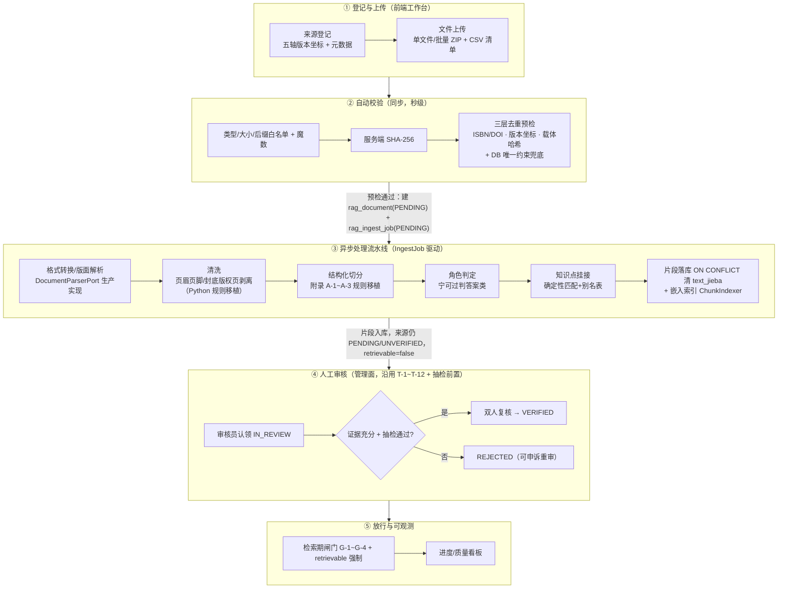

# RAG 语料录入线上化、自动化功能规划

| 字段 | 内容 |
|---|---|
| 文档类型 | 功能规划（可落地） |
| 版本/状态 | **v1.0.1 / 待评审** |
| 编制日期 | 2026-11-02 |
| 前置阅读 | 《RAG语料录入流程分析报告.md》（同目录，本方案是其优化建议 1/2/4/7 的实施化） |
| 关联基线 | RAG-D04（流水线）、RAG-D07（准入治理）、RAG-D09（阶段门禁）、RAG-D10（管理面） |
| 变更说明 | v1.0.1 基于 v1.0 审阅意见修订，**变更点以【V1.0.1】标注**，处置明细见 §11 |

---

## 0. 审阅意见处置总表（V1.0.1 新增）

> 本节逐条回应 v1.0 审阅意见（P1~P7），给出采纳结论与理由；采纳内容已落实到对应章节。

| # | 审阅意见 | 结论 | 理由与落点 |
|---|---|---|---|
| P1 | 方案范围不完整：回避了报告 P0 级"检索侧闸门强制"（G-2 过期/G-3 权威等级/G-4 版权缺失，载体级 `retrievable` 未在检索路径闭环） | **采纳** | 属实。核对 `JdbcRetrievalRepository.java:105` 注释"从不读 `rag_document.ver_status` 与 `retrievable`"（150 行虽已 JOIN `doc.retrievable`，但 G-2/G-3/G-4 三道闸门确缺失）。录入解决"进得来"，闸门解决"拦得住"，缺一合规不闭环。**落点**：§1.2 范围新增闸门强制项；§7.1 `rag-infrastructure` 增加检索 SQL 改造；§8 新增独立任务 S2b；§9 新增 RD-6。 |
| P2 | "三层去重表约束已存在"表述不准确；`content_hash` 无唯一索引、ISBN/DOI 无来源级唯一约束，纯应用层预检在并发下产生重复 | **采纳** | 属实。核对 `01_rag_ddl.sql`：`rag_document` 仅 `(tenant_id, document_id)` 唯一（`rag_document_tenant_document_unique`），`content_hash` 无任何唯一索引。**落点**：Z3 改为"应用层预检 + DB 唯一约束兜底"；§7.3 补唯一索引与部分唯一索引；§3 说明并发下以 `DuplicateKeyException` 映射错误码。 |
| P3 | "IngestionPipeline 逻辑完整，生产化改造主对象"口径偏乐观：管道仅内存计算返回 `List<Chunk>`，不落库，且无独立清洗步骤；清洗/附录 A-1~A-3/目录探测规则只存在于 Python 脚本，Java 侧空白，是"移植"而非"回灌" | **采纳** | 属实。核对 `IngestionPipeline.java`：无 `JdbcTemplate`/Repository 调用，清洗仅有 `KnowledgePoint.normalize`，boilerplate 剥离/附录切分/目录探测均在 `rag_import_pdf.py`。**落点**：A3/Z5/Z6/Z7 全部改述为"从 Python 移植到 Java（rag-core 纯函数）"；§7.1 明确 `IngestJobOrchestrator` 承担片段落库；§8 S2 保留"diff 归零"判据并前置为移植完成定义。 |
| P4 | 抽检作为 VERIFIED 前置与"治理维度 T-1~T-12 不变"自相矛盾 | **采纳** | 表述确属打架。**落点**：§2.2 删除"T-1~T-12 不变"绝对表述，改为"校验状态枚举不变，但 `IN_REVIEW→VERIFIED` 新增前置守卫"；R2/§7.3 同步。 |
| P5 | Job 状态机（RUNNING/DONE）与 DDL 枚举（PARSING/CHUNKING/EMBEDDING/INDEXING/SUCCEEDED/FAILED/REJECTED）不匹配；`rag_ingest_job` 零二级索引 | **采纳** | 属实。核对 `01_rag_ddl.sql:138` 枚举无 RUNNING/DONE；问题记录 03 确认该表零二级索引。**落点**：§2.2 改为沿用 DDL 细粒度枚举（不改 ENUM）；§7.3 补 `(tenant_id,status)`、`(status,created_at)` 索引。 |
| P6 | 扫描件 OCR 与 born-digital PDF 验收边界含糊：Z5 主流程含扫描件，RD-3 又撇清，S2 验收未区分载体类型 | **采纳** | 边界确实不清。**落点**：Z5 拆 Z5a（born-digital，S2 必交付）/Z5b（扫描件 OCR，试点灰度，不计入 S2 验收）；§8 S2 验收限定 born-digital；§9 RD-3 同步。 |
| P7 | 别名表方案含糊，`rag_dictionary` 复用评估悬置 | **采纳** | `rag_dictionary` 是通用 `dict_type/code` 词表（`01_rag_ddl.sql:415`），无法表达"某 kp_id 的别名集合"。**落点**：§7.3 定调新建 `rag_kp_alias`，删除"先评估复用"悬置表述；R7/§7.5 同步。 |

---

## 1. 现状基线：方案直接衔接的既有资产

规划不是从零开始。以下**已存在的能力/表/端点**是本方案的衔接点，模块与流程设计均以其为准：

| # | 资产 | 位置 | 现状 | 本方案如何用 |
|---|---|---|---|---|
| A1 | MULTIPART 上传端点 `POST /sources/{id}/documents`（落桶 + sha256 + 建载体壳） | `rag-management/.../RagManagementController#importDocument` | 只建壳，不触发解析 | **升级为录入主入口**，上传成功后自动创建 IngestJob |
| A2 | `rag_ingest_job` 表（job_id/source_id/status/parser_version/embed_model/chunk_count/error_detail/started_at/finished_at） | `deploy/sql/rag/01_rag_ddl.sql` | **表已建、代码未消费**；状态枚举为 `PENDING/PARSING/CHUNKING/EMBEDDING/INDEXING/SUCCEEDED/FAILED/REJECTED`【V1.0.1 修正：补充真实枚举值】 | 任务事实源，零新增表（仅补少量列与索引，见 §7.3） |
| A3 | 摄取管道 `IngestionPipeline`（parse→chunk→角色判定→知识点挂接） | `rag-application/.../ingest/` | 【V1.0.1 修正】**仅内存计算返回 `List<Chunk>`，不含落库逻辑，无独立清洗步骤**；`DocumentParserPort` 无生产实现（仅 `LocalDeterministicDocumentParserPort` 占位） | 生产化改造主对象：移植 Python 清洗/切分规则 + 新增落库编排 |
| A4 | `ChunkIndexer`（待索引判据 `text_jieba='' OR 无向量行`） | `rag-infrastructure` | 已被管理面与 worker 共用 | 嵌入段直接复用，口径不变 |
| A5 | 批量登记 `POST /sources/batch`（逐条成功/失败明细） | `rag-management` | 已实现 | 批量导入的元数据通道 |
| A6 | 状态机 `VerificationTransition`（T-1～T-12）+ 审计同事务 | `rag-management/core` | 逐条断言测试 | 审核节点沿用，**不得绕行**；VERIFIED 迁移新增抽检前置守卫【V1.0.1】 |
| A7 | 维护台 `/issues`、`/reindex`、统计三分布表 | `rag-management` | 已实现（同步、限量 1~2000） | 录入工作台的"失败处置"区直接复用 |
| A8 | 离线脚本 `rag_import_pdf.py` 的规则资产（boilerplate 剥离 `strip_boilerplate`、附录 A-1~A-3、目录探测 `toc_units`/`section_of`、角色分类词表 `classify`） | `scripts/` | **只在离线（Python）生效，Java 生产侧完全空白**【V1.0.1 修正】 | **移植**到 `rag-core` 纯函数，供生产解析器使用（D04 §5.5 待办） |
| A9 | 前端 `/rag/management`、`RagMaintenancePanels`、`useRagManagement` 五态 Hook（409 单独成态） | `frontend/src/pages/rag/` | 已交付 | 新增录入工作台，复用 Hook 与状态纪律 |
| A10 | 对象存储 `ObjectStorePort` / `LocalObjectStoreAdapter`（白名单后缀、路径穿越防护） | `rag-management/infrastructure` | 本地盘实现 | 保留端口，生产可换 S3/OSS 适配器 |
| A11【V1.0.1 新增】 | 检索仓储 `JdbcRetrievalRepository`（已 JOIN `doc.retrievable`，G-1 生效） | `rag-infrastructure/persistence` | G-2 过期 / G-3 权威等级 / G-4 版权三道闸门缺失 | P1 闸门强制的改造对象（见 §7.1 / §8 S2b） |

**两个硬约束**（来自门禁基线，方案不得违背）：
- **整册失败，不部分入库**（D04 §1）：半本教材入库会把数据缺失伪装成知识边界。
- **fail-closed 准入**（RD-02）：任何自动环节不得替人做出"可检索"的判定，自动链路终点一律是 `PENDING/IN_REVIEW`，`VERIFIED` 只能由人工签发。

---

## 2. 目标与范围

### 2.1 目标

| 目标 | 度量 |
|---|---|
| G-A 录入自服务化 | 业务方/采集员全程在 Web 界面完成，**DBA 退出日常录入**；单册录入（上传→提交审核）≤ 10 分钟人工操作 |
| G-B 处理自动化 | 上传后解析→切分→标注→嵌入全自动，单册处理无需人工参数（`--skip-pages` 类按册手标参数归零） |
| G-C 治理不倒退 | 每一步自动处理有留痕（job + audit），`VERIFIED` 仍只能人工签发，双人复核系统强制 |
| G-D 失败可处置 | 任何环节失败有明确错误码与人工处置入口，不出现"静默陈旧向量/静默缺内容" |
| G-E【V1.0.1 新增】 准入真拦得住 | 检索路径强制 G-1~G-4 + 载体级 `retrievable`，过期/等级不足/版权受限/载体撤回的语料**结构性不可召回** |

### 2.2 范围

- **做**：录入前端工作台、上传与批量导入、数据校验、格式转换（解析）、清洗、切分、角色/知识点标注、去重、异步任务调度、嵌入与索引、人工审核节点接线、权限与异常机制；**【V1.0.1 新增】检索路径 G-2/G-3/G-4 闸门与载体级 `retrievable` 过滤强制（P1）**。
- **不做**（明确出界）：检索排序/融合算法改造（D05）、引用接地判定（D06）、评测体系建设（D08）、主平台接入改造 M-1～M-4（G3 后）、版权商务谈判。
  > 【V1.0.1 说明】出界的是"检索**算法**（排序/融合/阈值标定）"，**不含**"检索**准入闸门**"——后者是合规底线，属本方案 P1 范围。

---

## 3. 总体流程设计

### 3.1 五段主链路



**关键口径**（与现状的唯一差异是 ③ 变为自动）：
- ② 是**同步预检**：在上传响应里立即给出"能不能收"，去重命中直接 400 拒收，不产生垃圾载体行；**并发穿透由 DB 唯一约束兜底，捕获 `DuplicateKeyException` 映射为去重错误码**【V1.0.1】。
- ③ 是**异步任务**：上传成功即返回 `jobId`，前端轮询进度；解析/切分/落库/嵌入在 `rag-worker` 执行。
- ③ 的终点**永远是** `rag_document.parse_status` 就绪 + 来源 `PENDING`——自动化只负责"把内容变成待审片段"，**绝不自动放行**。
- ④⑤ 沿用既有管理面与状态机；④ 新增"抽检前置 + 双人复核 + 审核≠采集"强制，⑤ 新增 G-2/G-3/G-4 闸门强制【V1.0.1】。

### 3.2 状态机（两层正交，不得混淆）

**Job 层（处理维度，本方案新增消费）**【V1.0.1 修正：沿用 DDL 现有枚举，不新增 RUNNING/DONE】：

```
PENDING → PARSING → CHUNKING → EMBEDDING → INDEXING → SUCCEEDED
   任一阶段 → FAILED（error_detail 必填；可人工触发重试 → 新 PENDING 行，旧行留痕）
   进行中状态超时 → Sweeper 接管置 FAILED（防僵尸）
```

> 对应 DDL `rag_ingest_status` 枚举（`01_rag_ddl.sql:138`），**不改 ENUM、不加值**。v1.0 的 `RUNNING` 即上述 `PARSING/CHUNKING/EMBEDDING/INDEXING` 进行中状态的统称，`DONE` 即 `SUCCEEDED`。§7.3 的 `stage` 列用于记录阶段内进度百分比，与状态枚举互补。

**校验层（治理维度）**【V1.0.1 修正表述，消解 P4 矛盾】：
状态枚举 `PENDING → IN_REVIEW → VERIFIED / REJECTED / REVOKED` 不变，REVOKED 终态（T-10）。
**但 `IN_REVIEW → VERIFIED` 迁移新增前置守卫：`inspection_status='PASSED'` 且满足双人复核**——这是对迁移条件的扩展，不是对枚举的修改；既有 `VerificationTransition` 逐条断言测试之上补一条"抽检未过不得 VERIFIED"反证。

> ⚠️ 两层独立演进：job FAILED 不影响来源状态（来源仍是 PENDING 待审）；来源 REVOKED 时其未完成 job 自动取消（防"撤回后还在跑嵌入"的资源浪费与状态倒挂）。

---

## 4. 需要自动化处理的环节

按环节给出输入 → 处理规则 → 失败处置。规则来源标注**新实现** / **从 Python 移植**（V1.0.1 修正原"回灌"表述）/ **复用既有**。

| # | 环节 | 处理规则 | 规则来源 | 失败处置 |
|---|---|---|---|---|
| Z1 | 格式与安全校验 | 后缀白名单（PDF/EPUB/HTML/TXT）、大小上限、魔数与后缀一致性 | 新实现（A1 已有白名单，补魔数校验） | 同步 400，不入桶 |
| Z2 | 服务端哈希 | SHA-256 服务端权威计算，**绝不信任前端传入** | A1 已有 | — |
| Z3 | **去重**（三层）【V1.0.1 修正】 | ① 来源级：ISBN/DOI 精确命中；② 版本级：五轴坐标命中 `rag_edition_unique`；③ 载体级：`content_hash` 相同。**应用层预检 + DB 唯一约束兜底**（§7.3 新增 `content_hash` 唯一索引、ISBN 部分唯一索引）；并发穿透捕获 `DuplicateKeyException` 映射错误码 | 新实现（②约束已存在；①③需补 DB 约束，V1.0"表约束已存在"表述已修正） | 同步 400：`DUP_SOURCE` / `DUP_EDITION` / `DUP_CARRIER`，附命中对象 ID；不产生任何落库 |
| Z4 | 元数据自动推断 | 从版权页/封面文本推断书名、出版社、版次；ISBN 正则抽取 + 校验位验证 | 新实现（推断结果**回填表单供人确认**，不直接落库为权威值） | 推断不出 → 表单留空人工填 |
| Z5a | born-digital PDF 解析 | PDF→`LayoutBlock[]`（标题层级/题号/答案区/双栏/公式表） | **Docling 生产实现**（D04 L-1，R1-1）；**S2 必交付**【V1.0.1 拆分】 | 整册 FAILED，不部分入库 |
| Z5b【V1.0.1 拆分】 | 扫描件 OCR 解析 | 扫描件走 `OcrPort` 分支 | 新增 `OcrPort`，**试点/灰度，不计入 S2 验收判据**（RD-3） | 识别率未达基线 → 标"待人工"，不进入自动主流程 |
| Z6 | 清洗 | 跨页页眉页脚剥离（`strip_boilerplate` 频次统计法）、封底/版权页按内容判噪丢弃、全角/软换行归一（`normalize`） | **从 Python `rag_import_pdf.py` 移植**到 `rag-core` 纯函数【V1.0.1 修正：原"回灌"改为"移植"，Java 侧本无此规则】 | — |
| Z7 | 结构化切分 | 结构优先（标题层级截断推进、题号保留）；附录按逻辑单位切（A-1 `appendix_pieces`）、续页状态机（A-2）、中英双形标题（A-3）；目录/章节探测（`toc_units`/`section_of`）；兜底重叠窗口 | **从 Python `rag_import_pdf.py` 移植** + D04 §5 规则【V1.0.1 修正同上】 | 抽检告警，段落级可重切 |
| Z8 | 分类标注（角色判定） | 基于版面事实十类 `ChunkRole`；不确定一律过判**答案类**（防泄题，D04 §3.1 勘误结论） | `IngestionPipeline.resolveRole` 已有，补答案区漏判=0 的守卫用例 | 人工抽检兜底（§5 R2） |
| Z9 | 知识点挂接 | 确定性匹配 + 别名表；别名表提供管理界面增量维护 | `IngestionPipeline` 已有匹配骨架；别名表 `rag_kp_alias` 新建（§7.3）【V1.0.1】 | 漏挂不阻断，进抽检项 |
| Z10 | 批量导入 | ZIP 包 + CSV 清单（每行：文件名 + 元数据）；逐条独立建 job，成功/失败明细返回 | 新实现（复用 A5 批量登记 + A1 上传组合） | 单文件失败不影响其余，明细逐条返回 |
| Z11 | 片段落库与嵌入索引【V1.0.1 补"落库"】 | `IngestJobOrchestrator` 调 `CorpusRepository` 批量 `INSERT ... ON CONFLICT DO UPDATE` **并清 `text_jieba`**；再由 `ChunkIndexer` 批量补向量；嵌入超时指数退避重试 3 次 | 落库：新实现（V1.0 漏列）；嵌入：A4 已有 | 3 次仍失败 → job FAILED（该批不入库，向量与片段同事务原则不破坏） |

> ⚠️ **重灌纪律内置化**（把 D04 §5.4 的坑变成机制）：凡正文更新的重灌，写入侧自动 `ON CONFLICT DO UPDATE` 并**清空 `text_jieba`**，由 `ChunkIndexer` 既有判据自动重新嵌入——消除"改了规则检索没变"的静默陈旧。该职责由 `IngestJobOrchestrator` 的落库段承担【V1.0.1 明确落点】。

---

## 5. 人工审核节点

| # | 节点 | 角色 | 动作 | 系统强制手段 |
|---|---|---|---|---|
| R1 | 元数据确认 | 采集员 | 确认/修正 Z4 推断的元数据后才提交 | 推断值在表单中标记"待确认"，未确认不可提交 |
| R2 | **人工抽检**（每册） | 审核员/质检 | 按 D04 §6 口径抽检：答案区识别 ≥95% 且**漏判=0 单点否决**、题号保留 100%、版本坐标 100% | 抽检记录结构化落库（判定人/片段 ID/错误类型）；不合格→该册 job 重跑；**`inspection_status='PASSED'` 是 `IN_REVIEW→VERIFIED` 的前置守卫**（状态机迁移扩展，见 §3.2/§7.3）【V1.0.1 表述统一】 |
| R3 | 认领 | 审核员 | PENDING→IN_REVIEW | 沿用 T-1；**认领人=审核员**由 IAM 角色决定 |
| R4 | 签发 VERIFIED/REJECTED | 审核员 + 复核人 | 上传证据（ISBN 校验记录/比对记录）→ 双人复核 | **双人复核技术强制**：`VERIFIED` 须第二个不同主体确认（依赖 D-001 IAM 主体）；**审核员≠采集员** 服务端比对 `registered_by` 与 `verified_by`，相同→409 |
| R5 | 撤回 | 法务/负责人 | REVOKED（终态），同事务下架全部载体 | 沿用 T-5~T-8；撤销时取消该来源未完成 job |
| R6 | 失败处置 | 运维 | 查看 job `error_detail` → 重试/换文件/废弃 | 录入工作台"失败列表"，重试=新建 job 行（旧行留痕，不覆盖） |
| R7 | 别名表维护 | 教研 | 增补知识点别名 | 新增管理端点读写 `rag_kp_alias`；别名变更触发受影响片段重挂提示（不自动重挂）【V1.0.1 明确落表】 |

> 设计原则：**自动化终点的下一站必须是人工节点**。自动链路把内容准备好、把证据链摆好，但"能不能给学生看"永远由人签字——这是 RD-02 fail-closed 在流程层的表达。

---

## 6. 数据权限机制

### 6.1 角色权限矩阵（依赖主平台 IAM D-001；在其交付前以"租户头 + 域令牌"过渡，**删除哨兵回落**）

| 操作 | 采集员 | 审核员 | 法务/负责人 | 运维 | 教研 |
|---|---|---|---|---|---|
| 登记/上传/批量导入 | ✅ | ❌ | ❌ | ❌ | ❌ |
| 元数据确认提交 | ✅ | ❌ | ❌ | ❌ | ❌ |
| 认领 / VERIFIED / REJECTED | ❌（含自己登记的，见下） | ✅ | ❌ | ❌ | ❌ |
| 抽检记录 | ❌ | ✅ | ❌ | ❌ | ✅ |
| REVOKED | ❌ | ❌ | ✅ | ❌ | ❌ |
| job 重试 / 失败处置 | ❌ | ❌ | ❌ | ✅ | ❌ |
| 别名表维护 | ❌ | ❌ | ❌ | ❌ | ✅ |
| 统计/问题清单（只读） | ✅（本租户） | ✅ | ✅ | ✅ | ✅ |

**三条硬规则**：
1. **审核员≠采集员**：服务端在 `VERIFIED` 落库前比对两个主体 ID，相同即 409（当前仅流程约定，本方案升级为代码强制）。
2. **无令牌即 401，不回落哨兵 UUID**：删除 `importDocument` 现有的 `00000000-…` 回落分支（`RagManagementController.java:504`）——匿名操作人是审计黑洞。
3. **租户隔离沿用 RLS + 非特权角色**：应用连接保持 `NOSUPERUSER NOBYPASSRLS`；PLATFORM 全局档仍要求治理票据（既有 `requireWriteContext` 逻辑不变）。

### 6.2 数据分级与留痕

- 原文只入对象存储，库里只存 `object_ref` + `content_hash`（既有纪律不变）。
- 所有状态流转与 job 状态变化写 `rag_access_audit`，与业务变更**同事务**（既有 D-5 纪律）。
- 抽检记录、失败 `error_detail` 属治理数据，保留期按 D07 口径，不存学生个人信息。

---

## 7. 异常处理机制

### 7.1 失败分类与处置矩阵

| 失败类别 | 例 | 处置 | 是否可自动重试 |
|---|---|---|---|
| 校验类（同步） | 类型不符、去重命中、元数据缺失 | 400 + 明确错误码，前端就地提示，**零落库**；并发去重穿透由 DB 约束兜底转 400【V1.0.1】 | 否（需人改输入） |
| 解析类 | OCR 乱码、版面识别失败、加密 PDF | job FAILED + `error_detail`；整册不入库 | 否（需换文件/调参数） |
| 瞬时类 | 嵌入模型超时、对象存储抖动 | 指数退避重试 3 次 | ✅ 是 |
| 系统类 | worker 崩溃、进程被杀 | Sweeper 扫描超时进行中状态 → 置 FAILED，人工重试【V1.0.1：由"超时 RUNNING"改为"超时进行中状态"】 | 半自动 |
| 治理类 | 撤回来源还有活跃 job | job 自动取消 + 审计记录 | — |

### 7.2 四条不变式（守卫测试锁定）

1. **幂等**：同文件重传（同 sha256）预检即拒 + DB 唯一约束兜底【V1.0.1】；job 重试新建行不覆盖旧行。
2. **不部分入库**：解析/切分任一整册级失败 → 该册片段整体不入库（沿用 D04 §1）。
3. **陈旧向量不可能**：正文更新必清 `text_jieba`（写入侧机制，非纪律）。
4. **自动不放行**：全链路代码中不存在把 `ver_status` 写成 `VERIFIED` 的路径（守卫测试：除 verification 端点外 grep 不到该字面量写入）。
5. 【V1.0.1 新增】**验了必拦得住**：检索 SQL 必含 G-1~G-4 + `doc.retrievable` 过滤（守卫测试：缺任一过滤条件则检索 IT 失败）。

### 7.3 可观测

- Job 列表/详情进录入工作台：状态、阶段进度（`stage` 列记录解析/切分/嵌入阶段内百分比）、`error_detail`、耗时。
- 汇总指标并入既有 `/statistics`：待处理 job 数、失败率、平均处理时长、`chunksMissingEmbedding`（沿用既有口径）；【V1.0.1 新增】闸门拦截命中计数（G-2/G-3/G-4 各拦了多少），用于验证 P1 生效。
- 告警：失败率超阈值、Sweeper 接管频发、重试 3 次仍失败积压——走平台既有 `agent.alerts.webhook-url` 通道。

---

## 8. 模块划分

### 8.1 后端（沿用现有 8 模块分层，不新增 Maven 模块）

| 模块 | 本方案职责 | 主要新增/改造 |
|---|---|---|
| `rag-api` | 录入入口 HTTP 层 | 新增 `IngestJobController`（job 列表/详情/重试）；`importDocument` 改造（去哨兵、触发建 job、魔数校验） |
| `rag-management` | 管理面与审核 | 抽检记录端点、别名表管理端点、双人复核与"审核≠采集"强制、来源 REVOKED 级联取消 job、VERIFIED 抽检前置守卫【V1.0.1】 |
| `rag-application` | 编排 | `IngestionPipeline` 生产化（接收真实 `LayoutBlock[]`）；新增 `IngestJobOrchestrator`（job 领取→分段执行→进度回写→**片段落库 `ON CONFLICT DO UPDATE` 清 `text_jieba`**）【V1.0.1 明确落库职责】 |
| `rag-core` | 领域规则 | 去重判定、**从 Python 移植的清洗/切分规则纯函数版**【V1.0.1】、抽检判定规则 |
| `rag-ports` | 端口契约 | `DocumentParserPort` 契约不变；新增 `OcrPort`（Z5b 扫描件分支，试点）【V1.0.1】 |
| `rag-infrastructure` | 适配器 | **Docling 解析适配器**（R1-1）、BGE-M3 嵌入适配器（替换占位）、`LocalObjectStoreAdapter` 保留（生产可加 S3 适配器）、`ChunkIndexer` 不变；【V1.0.1 新增】`JdbcRetrievalRepository` 补 G-2/G-3/G-4 闸门（P1） |
| `rag-worker` | 异步执行 | `IngestJobSweeper`（超时接管）+ job 消费循环（PG `SKIP LOCKED` 轮询，见 8.2） |
| `rag-bootstrap` | 装配与自检 | 启动自检追加：Docling 服务可达、嵌入模型可达（fail-closed） |

### 8.2 任务执行通道选型（明确推荐）

| 方案 | 说明 | 取舍 |
|---|---|---|
| **① PG 轮询 + `FOR UPDATE SKIP LOCKED`（推荐起步）** | `rag-worker` `@Scheduled` 领取 PENDING job，`SKIP LOCKED` 保证多 worker 不重复领 | RAG 模块当前**零 MQ 依赖**，job 表已具备全部字段；运维面最小；吞吐对"按册计"的教辅录入绰绰有余。**依赖 §7.3 新增的 `(status,…)` 索引避免全表扫描**【V1.0.1】 |
| ② 复用主平台 RabbitMQ（QuorumQueue + Outbox 唤醒） | 与 platform 同款模式 | 规模演进项；教辅录入频次低（按学期/按册），MQ 的低延迟优势无意义，反而引入 broker 运维耦合 |

> 决策：**阶段 S1~S3 用 ①**；若后续接入实时性要求高的增量语料（如真题速递），再评估 ②。不双轨并行。

### 8.3 数据库变更（走「01 DDL 终态快照 + 活库等价 ALTER」纪律，不新增 patch）

> 【V1.0.1 说明】v1.0 称"最小化，仅补少量列"，经核对实际还需补**去重唯一索引**（P2）与**job 表索引**（P5），变更量较 v1.0 增加，均为必要项。

| 变更 | 说明 |
|---|---|
| `rag_ingest_job` 加列 | `stage`（阶段内进度百分比，与状态枚举互补）、`attempt`（重试次数）、`created_by`（触发人） |
| `rag_ingest_job` 加索引【V1.0.1 新增，P5】 | `(tenant_id, status)`、`(status, created_at)` —— 该表现零二级索引，SKIP LOCKED 领取与 Sweeper 扫超时依赖，否则全表扫描 |
| `rag_document` 加唯一索引【V1.0.1 新增，P2】 | `UNIQUE (tenant_id, content_hash)`（载体级去重兜底；上线前先清理存量重复） |
| `rag_source` 加部分唯一索引【V1.0.1 新增，P2】 | `UNIQUE (tenant_id, isbn) WHERE isbn IS NOT NULL`（来源级去重兜底；DOI 同理） |
| `rag_source` 加列 | `inspection_status`（抽检状态：NOT_REQUIRED/PASSED/FAILED）——R2 抽检作为 VERIFIED 前置的落点 |
| 新表 `rag_inspection_record` | 抽检明细（判定人/片段 ID/正确角色/错误类型/日期），RLS 同其余表 |
| 新表 `rag_kp_alias`【V1.0.1 定调，P7】 | 知识点别名表（`alias_id/tenant_id/kp_id/alias_text/scope`），外键关联 `rag_knowledge_point`。**不复用 `rag_dictionary`**——后者是通用 `dict_type/code` 词表，无法表达"某 kp_id 的别名集合"。删除 v1.0"先评估复用"悬置表述 |
| 状态枚举 | **不变更** `rag_ingest_status`【V1.0.1，P5】；`rag_source` 校验状态枚举不变，仅在应用层为 VERIFIED 迁移加前置守卫【V1.0.1，P4】 |

### 8.4 前端（`frontend/src/pages/rag/`）

| 新页面/组件 | 职责 |
|---|---|
| `RagIngestPage.tsx`（录入工作台） | 四区：① 来源登记向导（五轴坐标 + 元数据，Z4 推断值标"待确认"）；② 上传区（拖拽单文件 / ZIP 批量 + CSV 清单，同步预检结果就地展示）；③ 我的任务列表（job 进度条：解析→切分→嵌入，失败显 `error_detail` + 重试按钮）；④ 失败处置 |
| `RagInspectionPanel.tsx`（抽检台） | 按册展示随机片段 → 判定人逐条标注 → 生成抽检记录；不合格一键触发重跑 |
| 改造 `RagManagementPage` | 审核表单加"复核人"字段；展示"该来源由 X 登记中"防自查提示 |

> 沿用既有三条前端纪律：只渲染合法状态流转按钮；409 呈现为"这一步不被允许"；不提供任何删除入口。

### 8.5 接口清单（新增/改造汇总）

| 端点 | 方法 | 类型 | 说明 |
|---|---|---|---|
| `/api/v1/management/sources/{id}/documents` | POST | 改造 | 校验加固 + 建 job 返回 `jobId`；删除哨兵回落 |
| `/api/v1/management/sources/batch` + 批量上传 | POST | 改造 | 支持 ZIP+CSV，逐条 job 明细 |
| `/api/v1/management/ingest-jobs` | GET | 新增 | job 列表（状态/来源/时间过滤） |
| `/api/v1/management/ingest-jobs/{id}` | GET | 新增 | 详情（分段进度 + error_detail） |
| `/api/v1/management/ingest-jobs/{id}/retry` | POST | 新增 | 人工重试（运维角色） |
| `/api/v1/management/sources/{id}/inspection` | POST/GET | 新增 | 抽检记录提交/查询 |
| `/api/v1/management/kp-aliases` | POST/GET | 新增 | 别名维护（读写 `rag_kp_alias`）【V1.0.1 明确落表】 |
| `/api/v1/management/statistics` | GET | 改造 | 追加 job 汇总指标 + 闸门拦截计数【V1.0.1】 |

---

## 9. 实施步骤建议

> 按「每阶段独立可验收」切分，对齐 RAG-D09 门禁证据要求。关键路径：**S1 → S2 → S3**，S2b、S4 可与主线部分并行。【V1.0.1 新增 S2b】

### S1 任务化骨架（先通，后好）

| 事项 | 验收判据 |
|---|---|
| `rag_ingest_job` 消费闭环：上传→建 job→worker 领取→串调现有管道→SUCCEEDED/FAILED 回写【V1.0.1 用真实枚举】 | 用**占位解析器**端到端跑通一个 TXT/PDF 样例；job 全状态有 IT 反证 |
| 上传端点改造：去哨兵回落（无令牌 401）、去重三层预检 + DB 唯一约束兜底、魔数校验【V1.0.1】 | 去重三类错误码各一条 IT（含并发穿透兜底用例）；哨兵删除有守卫测试 |
| Sweeper 超时接管 + 重试幂等（新建行） | 僵尸 job 接管 IT；重试不覆盖旧行断言 |
| 前端最小任务列表（进度轮询） | 失败/成功两态可见即可，视觉打磨放 S3 |

### S2 解析与嵌入生产化（质量核心，决定 G1）

| 事项 | 验收判据 |
|---|---|
| Docling 解析适配器 + **Python 规则移植**（Z5a/Z6/Z7：boilerplate、附录 A-1~A-3、目录/章节探测、路径截断）【V1.0.1 改"回灌"为"移植"，限定 born-digital】 | **≥1 册真实 born-digital 教材 PDF** 产出结构化块；**离线脚本与生产管道对同一册的切分结果 diff 归零——作为移植完成的定义**【V1.0.1 前置该判据】 |
| `IngestJobOrchestrator` 片段落库（`ON CONFLICT DO UPDATE` 清 `text_jieba`）【V1.0.1 补落库】 | 片段真实落库且重灌后 `text_jieba` 清空有 IT 断言 |
| BGE-M3 嵌入适配器替换占位 | 真实检索召回质量基线快照；分数门禁阈值重新标定（关闭 D10 §10.4 的"占位嵌入"边界） |
| 重灌纪律内置（清 `text_jieba`） | "改切分规则→重灌→向量更新"端到端实测，静默陈旧反证用例 |
| 按册参数归零：封面/目录/附录页自动探测（born-digital）【V1.0.1 限定载体】 | 3 册不同出版社 **born-digital** 样本零手工参数跑通 |
| 【V1.0.1 拆出】扫描件 OCR 试点（Z5b，OcrPort） | 单独试点验收：识别率基线 + 人工复核率，**不计入本阶段 born-digital 验收** |

### S2b【V1.0.1 新增，P1】检索准入闸门强制

> 独立于录入主线，可与 S2/S3 并行；解决报告 P0 级"验了拦不住"。

| 事项 | 验收判据 |
|---|---|
| `JdbcRetrievalRepository` 检索 SQL 补 G-2 过期 / G-3 权威等级 / G-4 版权三道 WHERE 闸门，确认 `doc.retrievable` 过滤生效 | G-3 用 `TrustTier.meets()` 展开 `IN (...)` 列表（防 D-6 枚举序数反转）；门槛走服务端配置 `rag.retrieval.min-trust-tier`，**绝不读可伪造请求头**；四道闸门各有"达标可取回/不达标不可取回"双向 IT |
| 闸门拦截计数接入统计 | `/statistics` 可见 G-2/G-3/G-4 各自拦截命中数 |
| 守卫测试 | 检索 SQL 缺任一闸门条件则 IT 失败（不变式 5） |

### S3 审核接线与前端工作台

| 事项 | 验收判据 |
|---|---|
| 抽检记录 + `inspection_status` 作为 VERIFIED 前置（状态机迁移扩展）【V1.0.1 表述统一】 | 未过抽检不得 VERIFIED 的 409 反证；抽检明细可回查；与既有 `VerificationTransition` 断言兼容 |
| 双人复核 + 审核员≠采集员 服务端强制 | 同主体自审 409 IT；依赖 D-001 issuer（**外部依赖，见 §10**） |
| 录入工作台四区 + 抽检台完整交付 | 前端三守卫测试（css/routing/role matrix）不破；行为测试覆盖批量导入失败明细展示 |
| 批量导入（ZIP+CSV） | 混合成功/失败批次明细逐条正确 |

### S4 观测、压测与门禁证据

| 事项 | 验收判据 |
|---|---|
| 看板指标 + 告警接线 | 失败率/积压告警实跳一次；闸门拦截计数可视【V1.0.1】 |
| 并发与规模 | 多 worker 并行领 job 无重复（SKIP LOCKED 反证，依赖 §7.3 新索引）【V1.0.1】；10 册批量吞吐达标 |
| 门禁证据包 | 人工抽检记录（答案区漏判=0）、切分不变式反证、可回取原文 20 段全对、**闸门强制双向 IT**【V1.0.1】——直接支撑 RAG-D09 **G1** ②③④ |

---

## 10. 风险与依赖

| # | 风险/依赖 | 影响 | 对策 |
|---|---|---|---|
| RD-1 | **Docling / BGE-M3 引入**（新服务依赖、模型资源） | S2 全部阻塞 | S1 用占位解析器先行打通骨架；Docling 以独立服务容器化部署，bootstrap 自检 fail-closed |
| RD-2 | **D-001 IAM issuer 未交付** | 双人复核/角色强制无法落地 | S3 拆两步：先上"审核≠采集"比对（可用过渡主体标识），复核人字段预留；IAM 交付后开关切换 |
| RD-3 | 扫描件 OCR 质量未知（D04 L-6）【V1.0.1 收紧边界】 | 扫描教材识别率可能显著下降 | OCR 独立成 `OcrPort`（Z5b），**S2 只承诺 born-digital PDF 验收**；扫描件标"试点"灰度，单独验收，不阻塞主流程 |
| RD-4 | 元数据自动推断误判 | 错误元数据流入审核 | 推断值仅回填表单、必经 R1 人工确认；ISBN 校验位强制 |
| RD-5 | 别名表建设是持续人力投入（D04 L-4） | 漏召回（表现为"少"而非"错"，易漏检） | R7 管理界面降低维护成本；把"别名覆盖率"纳入看板指标 |
| RD-6【V1.0.1 新增，P1】 | 检索闸门强制（S2b）若推迟，录入上线后"验了仍拦不住" | 合规缺口持续存在，G-2/G-3/G-4 失效 | S2b 与主线并行排期，列为 P0；门禁证据包（S4）纳入闸门双向 IT，未过不得收 G1 |
| RD-7【V1.0.1 新增，P3】 | Python→Java 规则移植的规则等价性风险 | 生产切分与已验证的离线结果不一致 | 以"离线脚本与生产管道对同一册 diff 归零"为移植完成的硬判据（S2），未归零不得进 S3 |

---

## 11. 一页决策摘要

1. **零新增 Maven 模块、零新增任务表**：消费已建未用的 `rag_ingest_job`，升级已存在的 `importDocument`，复用 `IngestionPipeline`/`ChunkIndexer`/状态机/维护台——改造量集中在"接线"与"移植"而非"新建"。【V1.0.1 保留核心立场】
2. **执行通道起步用 PG `SKIP LOCKED` 轮询**，不上 MQ——RAG 零 MQ 依赖是资产不是负债，教辅录入频次不需要 MQ；**依赖 §7.3 新增的 job 表索引**。【V1.0.1 补索引前提】
3. **自动化终点=人工起点**：全链路自动到"待审片段就绪"为止，`VERIFIED` 仍只能人工签发，且新增抽检前置与双人复核强制——治理纪律只收紧不放松。【V1.0.1 保留】
4. **【V1.0.1 新增】准入真拦得住**：录入线上化之外，检索路径强制 G-1~G-4 + 载体级 `retrievable`（P1），关闭"验了拦不住"的合规缺口。
5. **【V1.0.1 修正】规则是"移植"不是"回灌"**：清洗/附录 A-1~A-3/目录探测规则当前只在 Python 脚本，需移植为 `rag-core` 纯函数，以"同一册切分结果 diff 归零"为移植完成的硬判据。
6. **实施切五段**：S1 骨架（占位解析器先通）→ S2 生产化（Docling/BGE-M3 + 规则移植 + 落库，G1 证据）→ **S2b 检索闸门强制（P1，并行）** → S3 审核接线与工作台 → S4 观测与门禁证据包；最硬的外部依赖是 D-001 IAM 与 Docling/BGE-M3 引入。【V1.0.1 加入 S2b】

---

## 12. V1.0.1 变更点清单（相对 V1.0）

| 变更点 | 章节 | 类型 |
|---|---|---|
| 新增 §0 审阅意见处置总表（P1~P7 采纳结论与理由） | §0 | 新增 |
| A2 补充 `rag_ingest_status` 真实枚举值 | §1 A2 | 事实修正（P5） |
| A3 修正为"仅内存计算、不落库、无独立清洗" | §1 A3 | 事实修正（P3） |
| A8 修正规则资产现状为"仅 Python 生效，Java 侧空白" | §1 A8 | 事实修正（P3） |
| 新增 A11 检索仓储资产（G-2/G-3/G-4 缺失） | §1 A11 | 新增（P1） |
| 新增目标 G-E（准入真拦得住） | §2.1 | 新增（P1） |
| 范围补"检索闸门强制"，出界项澄清为"检索算法非闸门" | §2.2 | 新增（P1） |
| 主链路 ②③⑤ 补 DB 兜底/落库/闸门强制 | §3.1 | 修正（P2/P3/P1） |
| Job 状态机改用 DDL 现有枚举，弃 RUNNING/DONE | §3.2 | 事实修正（P5） |
| 校验层表述改为"枚举不变、VERIFIED 迁移加前置守卫" | §3.2 | 表述修正（P4） |
| Z3 改"应用层预检 + DB 唯一约束兜底" | §4 Z3 | 修正（P2） |
| Z5 拆 Z5a（born-digital 必交付）/Z5b（扫描件试点） | §4 Z5 | 拆分（P6） |
| Z6/Z7 规则来源改"从 Python 移植" | §4 Z6/Z7 | 事实修正（P3） |
| Z9 别名表落表 `rag_kp_alias`；Z11 补"片段落库" | §4 Z9/Z11 | 修正（P7/P3） |
| R2/R7 表述统一、落表明确 | §5 R2/R7 | 修正（P4/P7） |
| 不变式新增第 5 条"验了必拦得住" | §7.2 | 新增（P1） |
| 可观测补闸门拦截计数 | §7.3 | 新增（P1） |
| `rag-application` 补 Orchestrator 落库职责；`rag-infrastructure` 补检索闸门 | §8.1 | 修正（P3/P1） |
| §7.3→§8.3 补：job 表索引、`content_hash` 唯一索引、ISBN 部分唯一索引、`rag_kp_alias` 定调、枚举不变更说明 | §8.3 | 新增/修正（P2/P5/P7/P4） |
| 实施步骤新增 S2b（检索闸门强制）；S2 限定 born-digital、前置 diff 归零判据 | §9 | 新增/修正（P1/P6/P3） |
| 新增 RD-6（闸门推迟风险）、RD-7（移植等价性风险） | §10 | 新增（P1/P3） |
| 决策摘要补第 4/5 条，实施切五段 | §11 | 新增/修正（P1/P3） |
