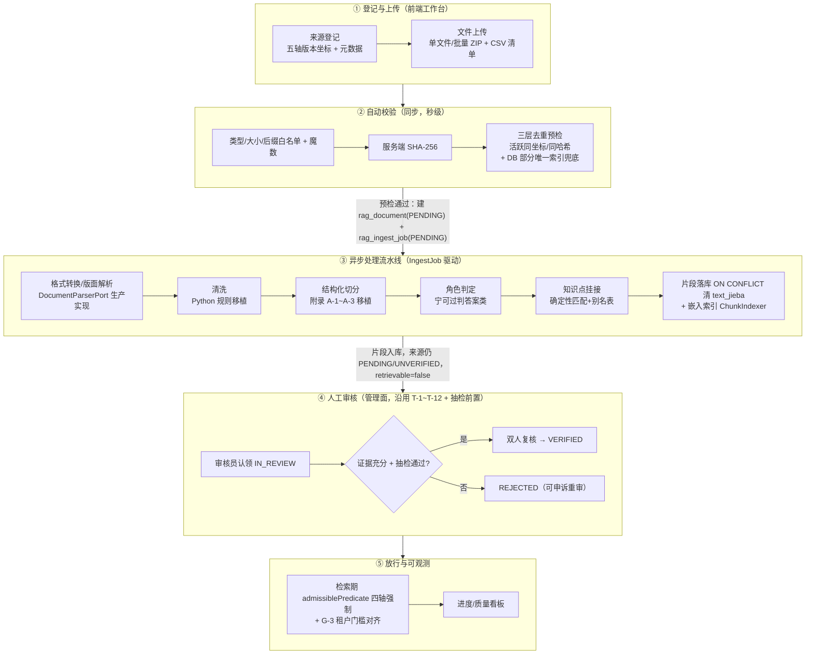

# RAG 语料录入线上化、自动化功能规划

| 字段 | 内容 |
|---|---|
| 文档类型 | 功能规划（可落地） |
| 版本/状态 | **v1.0.2 / 待评审** |
| 编制日期 | 2026-11-02 |
| 前置阅读 | 《RAG语料录入流程分析报告.md》（同目录，本方案是其优化建议 1/4/7 的实施化） |
| 关联基线 | RAG-D04（流水线）、RAG-D07（准入治理）、RAG-D09（阶段门禁）、RAG-D10（管理面）、RAG-D11（双作用域） |
| 变更说明 | v1.0.2 基于 v1.0.1 评审意见修订，**变更点以【V1.0.2】标注**，修订记录见 §12、评审处置见 §0 |

---

## 0. 评审意见处置总表（V1.0.1 → V1.0.2）

> 本节逐条回应《V1.0.1 评审意见》的评估结论；采纳内容已落实到对应章节。

| # | 评审意见 | 评估结论 | 理由与落点 |
|---|---|---|---|
| §二 P2~P7 核实 | 六项修订属实、落实到位 | **采纳**（确认） | 复核全部属实，无需改动；V1.0.2 保留这六项修订成果 |
| §三 **P1 反转** | "G-2/G-3/G-4 闸门缺失"是误读，四轴已实现于 `admissiblePredicate` | **采纳** | 属实。核对 `JdbcRetrievalRepository.java` L147-155 `ADMISSIBLE_TEMPLATE` 含全部四轴（见 §1 A11）。V1.0.1 误将 L103-105"修复前的真实缺陷"注释当作现状。**落点**：§0/§1 A11/§2.1 G-E/§7.2 不变式 5/§9 S2b/§10 RD-6/§11 全部重写 |
| §3.5/§3.6 **S2b 重写** | 闸门已实现，剩余缺口是 G-3 门槛维度（全局→租户） | **部分采纳** | 方向（全局配置→租户维度）有 D07/D11 基线支撑，采纳重写框架；**但评审称 `rag_tenant.min_trust_tier` "DDL 已有该列"不属实**——全库 grep 该表/列均不存在，仅见于 D07 设计文档（设计态）。**落点**：§9 S2b 第 1 条补前置依赖说明 |
| N1（高） | 唯一索引与 T-10 终态、失败重传冲突 | **采纳** | T-10 属实（D07 L272 REVOKED 终态须新建 source_id）。**落点**：§8.3 两个索引改部分索引；§4 Z3 预检口径与索引同口径，显式定义"重复" |
| N2（中） | job 取消无落点枚举 | **采纳** | `rag_ingest_status` 无 CANCELLED 且不改枚举。**落点**：§3.2/§7.1/§7.3 明确"取消=REJECTED + error_detail='SOURCE_REVOKED'，失败率剔除" |
| N3（低） | 不变式 5 守卫手段 | **采纳** | grep SQL 脆弱。**落点**：§7.2 改"行为 IT + 架构测试" |
| N4（低） | 存量重复清理缺纪律 | **采纳** | **落点**：§8.3 补 DBA 留档纪律 |
| N5（低） | A2 "零新增表"措辞 | **采纳** | **落点**：§1 A2 限定"job 侧零新增" |

---

## 1. 现状基线：方案直接衔接的既有资产

| # | 资产 | 位置 | 现状 | 本方案如何用 |
|---|---|---|---|---|
| A1 | MULTIPART 上传端点 `POST /sources/{id}/documents`（落桶 + sha256 + 建载体壳） | `rag-management/.../RagManagementController#importDocument` | 只建壳，不触发解析 | **升级为录入主入口**，上传成功后自动创建 IngestJob |
| A2 | `rag_ingest_job` 表 | `deploy/sql/rag/01_rag_ddl.sql` | **表已建、代码未消费**；状态枚举 8 值 `PENDING/PARSING/CHUNKING/EMBEDDING/INDEXING/SUCCEEDED/FAILED/REJECTED`；**零二级索引** | 任务事实源，**job 侧零新增表**（仅补列与索引，见 §8.3）【V1.0.2 限定措辞，N5】 |
| A3 | 摄取管道 `IngestionPipeline` | `rag-application/.../ingest/` | **仅内存计算返回 `List<Chunk>`，不落库，无独立清洗步骤**；`DocumentParserPort` 无生产实现（仅 `LocalDeterministicDocumentParserPort` 占位） | 生产化改造主对象：移植 Python 清洗/切分规则 + 新增落库编排 |
| A4 | `ChunkIndexer`（待索引判据 `text_jieba='' OR 无向量行`） | `rag-infrastructure` | 已被管理面与 worker 共用 | 嵌入段直接复用，口径不变 |
| A5 | 批量登记 `POST /sources/batch`（逐条成功/失败明细） | `rag-management` | 已实现 | 批量导入的元数据通道 |
| A6 | 状态机 `VerificationTransition`（T-1～T-12）+ 审计同事务 | `rag-management/core` | 逐条断言测试 | 审核节点沿用，**不得绕行**；VERIFIED 迁移新增抽检前置守卫 |
| A7 | 维护台 `/issues`、`/reindex`、统计三分布表 | `rag-management` | 已实现（同步、限量 1~2000） | 录入工作台的"失败处置"区直接复用 |
| A8 | 离线脚本 `rag_import_pdf.py` 规则资产（`strip_boilerplate`/附录 A-1~A-3/`toc_units`/`section_of`/`classify`） | `scripts/` | **只在离线（Python）生效，Java 生产侧完全空白** | **移植**到 `rag-core` 纯函数（D04 §5.5 待办） |
| A9 | 前端 `/rag/management`、`RagMaintenancePanels`、`useRagManagement` 五态 Hook | `frontend/src/pages/rag/` | 已交付 | 新增录入工作台，复用 Hook 与状态纪律 |
| A10 | 对象存储 `ObjectStorePort` / `LocalObjectStoreAdapter` | `rag-management/infrastructure` | 本地盘实现 | 保留端口，生产可换 S3/OSS 适配器 |
| A11【V1.0.2 重写】 | 检索准入谓词 `admissiblePredicate`（`ADMISSIBLE_TEMPLATE`，L147-155，单一真源 · 6 处 SELECT 共用） | `rag-infrastructure/persistence/JdbcRetrievalRepository` | **四轴闸门已实现**：G-1 来源 VERIFIED、G-0 载体 VERIFIED+`retrievable`、G-4 来源+载体版权非 RESTRICTED、G-2 过期（`verified_at+ver_valid_days>=now()`）、G-3 权威门槛（构造期 `TrustTier.meets()` 展开 IN 列表，含 2026-10-27 线上实测踩坑记录） | **本方案作为回归防线对象与门槛维度对齐对象，而非建设对象**【V1.0.2 更正：非"闸门缺失"】 |

**两个硬约束**（来自门禁基线，方案不得违背）：
- **整册失败，不部分入库**（D04 §1）。
- **fail-closed 准入**（RD-02）：自动链路终点一律 `PENDING/IN_REVIEW`，`VERIFIED` 只能人工签发。

---

## 2. 目标与范围

### 2.1 目标

| 目标 | 度量 |
|---|---|
| G-A 录入自服务化 | 业务方/采集员全程 Web 界面完成，**DBA 退出日常录入**；单册录入（上传→提交审核）≤ 10 分钟人工操作 |
| G-B 处理自动化 | 上传后解析→切分→标注→嵌入全自动；`--skip-pages` 类按册手标参数归零 |
| G-C 治理不倒退 | 每步自动处理有留痕（job + audit）；`VERIFIED` 仍人工签发，双人复核系统强制 |
| G-D 失败可处置 | 任何环节失败有明确错误码与人工处置入口；不出现"静默陈旧向量/静默缺内容" |
| G-E【V1.0.2 重写】 准入持续拦得住 + 门槛可对齐 | 四轴闸门已实现（A11），本目标是**保其不退化 + 补齐门槛粒度**：① 任何检索 SELECT 不得绕过 `admissiblePredicate`；② G-3 门槛从全局配置升级为租户维度差异化（见 §9 S2b） |

### 2.2 范围

- **做**：录入前端工作台、上传与批量导入、数据校验、格式转换（解析）、清洗、切分、角色/知识点标注、去重、异步任务调度、嵌入与索引、人工审核节点接线、权限与异常机制；【V1.0.2 重写】**检索准入的门槛维度对齐（G-3 全局→租户）+ 闸门覆盖审计与双向回归防线**。
- **不做**（明确出界）：检索排序/融合算法改造（D05）、引用接地判定（D06）、评测体系建设（D08）、主平台接入改造 M-1～M-4、版权商务谈判。
  > 【V1.0.2 说明】四轴准入闸门**已在代码中实现**（A11），不属"做"的范围；本方案对其只做**回归防线**与**门槛粒度对齐**，不重写既有闸门逻辑。

---

## 3. 总体流程设计

### 3.1 五段主链路



**关键口径**：
- ② 是**同步预检**：去重命中直接 400 拒收，不产生垃圾载体行；"重复"仅针对**活跃**对象（非 REVOKED/非解析失败，见 §4 Z3）；并发穿透由 DB 部分唯一索引兜底，捕获 `DuplicateKeyException` 映射为去重错误码。
- ③ 是**异步任务**：上传成功即返回 `jobId`，前端轮询；解析/切分/落库/嵌入在 `rag-worker` 执行。
- ③ 的终点**永远是** `rag_document.parse_status` 就绪 + 来源 `PENDING`——**绝不自动放行**。
- ④⑤ 沿用既有管理面与状态机；④ 新增"抽检前置 + 双人复核 + 审核≠采集"强制；⑤ 沿用已实现四轴闸门，补门槛维度对齐与回归防线【V1.0.2】。

### 3.2 状态机（两层正交，不得混淆）

**Job 层（处理维度，沿用 DDL 现有枚举，不改 ENUM、不加值）**：

```
PENDING → PARSING → CHUNKING → EMBEDDING → INDEXING → SUCCEEDED
   任一阶段 → FAILED（error_detail 必填；人工重试 → 新 PENDING 行，旧行留痕）
   进行中状态超时 → Sweeper 接管置 FAILED（防僵尸）
   来源 REVOKED → 其未完成 job 置 REJECTED + error_detail='SOURCE_REVOKED'（见 §7.1，N2）【V1.0.2】
```

**校验层（治理维度）**：
状态枚举 `PENDING → IN_REVIEW → VERIFIED / REJECTED / REVOKED` 不变，REVOKED 终态（T-10）。
**`IN_REVIEW → VERIFIED` 迁移新增前置守卫：`inspection_status='PASSED'` 且满足双人复核**——是迁移条件扩展，非枚举修改；既有 `VerificationTransition` 断言之上补"抽检未过不得 VERIFIED"反证。

> ⚠️ 两层独立演进：job FAILED 不影响来源状态；来源 REVOKED 时其未完成 job 置 `REJECTED`（非删除、非新增枚举值），防"撤回后还在跑嵌入"【V1.0.2 明确落点，N2】。

---

## 4. 需要自动化处理的环节

| # | 环节 | 处理规则 | 规则来源 | 失败处置 |
|---|---|---|---|---|
| Z1 | 格式与安全校验 | 后缀白名单、大小上限、魔数与后缀一致性 | 新实现（A1 补魔数） | 同步 400，不入桶 |
| Z2 | 服务端哈希 | SHA-256 服务端权威计算，**绝不信任前端传入** | A1 已有 | — |
| Z3 | **去重**（三层）【V1.0.2 重写，N1】 | ① 来源级 ISBN/DOI；② 版本级五轴坐标命中 `rag_edition_unique`；③ 载体级 `content_hash`。**"重复"的显式定义：存在活跃（`ver_status<>'REVOKED'` 且载体 `parse_status<>'FAILED'`）的同坐标/同哈希对象**。应用层预检与 §8.3 部分唯一索引**同口径**——预检跳过 REVOKED/FAILED 对象，索引亦排除之，两层不打架；并发穿透捕获 `DuplicateKeyException` 映射错误码 | 新实现（②约束已存在；①③补 DB 部分唯一索引兜底） | 同步 400：`DUP_SOURCE`/`DUP_EDITION`/`DUP_CARRIER`，附命中对象 ID；不产生任何落库；**不堵死 T-10 重登记与失败重传** |
| Z4 | 元数据自动推断 | 版权页/封面推断书名、出版社、版次；ISBN 正则 + 校验位 | 新实现（**回填表单供人确认**，不直接落库为权威值） | 推断不出 → 表单留空人工填 |
| Z5a | born-digital PDF 解析 | PDF→`LayoutBlock[]`（标题层级/题号/答案区/双栏/公式表） | **Docling 生产实现**（R1-1）；**S2 必交付** | 整册 FAILED，不部分入库 |
| Z5b | 扫描件 OCR 解析 | 扫描件走 `OcrPort` 分支 | 新增 `OcrPort`，**试点/灰度，不计入 S2 验收**（RD-3） | 识别率未达基线 → 标"待人工" |
| Z6 | 清洗 | 页眉页脚剥离（`strip_boilerplate`）、封底/版权页判噪、全角/软换行归一（`normalize`） | **从 Python `rag_import_pdf.py` 移植**到 `rag-core` 纯函数 | — |
| Z7 | 结构化切分 | 结构优先；附录逻辑单位切（A-1 `appendix_pieces`）、续页状态机（A-2）、中英双形标题（A-3）；目录/章节探测（`toc_units`/`section_of`）；兜底重叠窗口 | **从 Python 移植** + D04 §5 规则 | 抽检告警，段落级可重切 |
| Z8 | 分类标注（角色判定） | 基于版面事实十类 `ChunkRole`；不确定一律过判**答案类** | `IngestionPipeline.resolveRole` 已有，补漏判=0 守卫用例 | 人工抽检兜底（§5 R2） |
| Z9 | 知识点挂接 | 确定性匹配 + 别名表 | `IngestionPipeline` 匹配骨架已有；别名表 `rag_kp_alias` 新建（§8.3） | 漏挂不阻断，进抽检项 |
| Z10 | 批量导入 | ZIP + CSV 清单；逐条独立建 job，明细返回 | 新实现（复用 A5+A1） | 单文件失败不影响其余 |
| Z11 | 片段落库与嵌入索引 | `IngestJobOrchestrator` 批量 `INSERT ... ON CONFLICT DO UPDATE` **并清 `text_jieba`**；`ChunkIndexer` 批量补向量；嵌入超时指数退避重试 3 次 | 落库：新实现；嵌入：A4 已有 | 3 次仍失败 → job FAILED（向量与片段同事务原则不破坏） |

> ⚠️ **重灌纪律内置化**：凡正文更新的重灌，写入侧自动 `ON CONFLICT DO UPDATE` 并**清空 `text_jieba`**，由 `ChunkIndexer` 既有判据自动重新嵌入——职责由 `IngestJobOrchestrator` 落库段承担。

---

## 5. 人工审核节点

| # | 节点 | 角色 | 动作 | 系统强制手段 |
|---|---|---|---|---|
| R1 | 元数据确认 | 采集员 | 确认/修正 Z4 推断的元数据后才提交 | 推断值标"待确认"，未确认不可提交 |
| R2 | **人工抽检**（每册） | 审核员/质检 | 按 D04 §6：答案区识别 ≥95% 且**漏判=0 单点否决**、题号保留 100%、版本坐标 100% | 抽检记录结构化落库；不合格→该册 job 重跑；**`inspection_status='PASSED'` 是 `IN_REVIEW→VERIFIED` 前置守卫** |
| R3 | 认领 | 审核员 | PENDING→IN_REVIEW | 沿用 T-1；认领人=审核员由 IAM 角色决定 |
| R4 | 签发 VERIFIED/REJECTED | 审核员 + 复核人 | 上传证据 → 双人复核 | **双人复核技术强制**（依赖 D-001）；**审核员≠采集员** 服务端比对 `registered_by`/`verified_by`，相同→409 |
| R5 | 撤回 | 法务/负责人 | REVOKED（终态），同事务下架全部载体 | 沿用 T-5~T-8；撤销时该来源未完成 job 置 `REJECTED`+`SOURCE_REVOKED`【V1.0.2，N2】 |
| R6 | 失败处置 | 运维 | 查看 `error_detail` → 重试/换文件/废弃 | 录入工作台"失败列表"，重试=新建 job 行（旧行留痕） |
| R7 | 别名表维护 | 教研 | 增补知识点别名 | 新增管理端点读写 `rag_kp_alias`；变更触发受影响片段重挂提示（不自动重挂） |

> 设计原则：**自动化终点的下一站必须是人工节点**——RD-02 fail-closed 在流程层的表达。

---

## 6. 数据权限机制

### 6.1 角色权限矩阵（依赖主平台 IAM D-001；交付前以"租户头 + 域令牌"过渡，**删除哨兵回落**）

| 操作 | 采集员 | 审核员 | 法务/负责人 | 运维 | 教研 |
|---|---|---|---|---|---|
| 登记/上传/批量导入 | ✅ | ❌ | ❌ | ❌ | ❌ |
| 元数据确认提交 | ✅ | ❌ | ❌ | ❌ | ❌ |
| 认领 / VERIFIED / REJECTED | ❌（含自己登记的） | ✅ | ❌ | ❌ | ❌ |
| 抽检记录 | ❌ | ✅ | ❌ | ❌ | ✅ |
| REVOKED | ❌ | ❌ | ✅ | ❌ | ❌ |
| job 重试 / 失败处置 | ❌ | ❌ | ❌ | ✅ | ❌ |
| 别名表维护 | ❌ | ❌ | ❌ | ❌ | ✅ |
| 统计/问题清单（只读） | ✅（本租户） | ✅ | ✅ | ✅ | ✅ |

**三条硬规则**：
1. **审核员≠采集员**：`VERIFIED` 落库前比对两个主体 ID，相同即 409。
2. **无令牌即 401，不回落哨兵 UUID**：删除 `importDocument` 的 `00000000-…` 回落分支（`RagManagementController.java:504`）。
3. **租户隔离沿用 RLS + 非特权角色**：应用连接 `NOSUPERUSER NOBYPASSRLS`；PLATFORM 全局档仍要求治理票据。

### 6.2 数据分级与留痕

- 原文只入对象存储，库里只存 `object_ref` + `content_hash`。
- 所有状态流转与 job 状态变化写 `rag_access_audit`，与业务变更**同事务**。
- 抽检记录、失败 `error_detail` 属治理数据，保留期按 D07 口径，不存学生个人信息。

---

## 7. 异常处理机制

### 7.1 失败分类与处置矩阵

| 失败类别 | 例 | 处置 | 是否可自动重试 |
|---|---|---|---|
| 校验类（同步） | 类型不符、活跃去重命中、元数据缺失 | 400 + 明确错误码，前端就地提示，**零落库**；并发穿透由部分唯一索引兜底转 400 | 否（需人改输入） |
| 解析类 | OCR 乱码、版面识别失败、加密 PDF | job FAILED + `error_detail`；整册不入库 | 否（需换文件/调参数） |
| 瞬时类 | 嵌入模型超时、对象存储抖动 | 指数退避重试 3 次 | ✅ 是 |
| 系统类 | worker 崩溃、进程被杀 | Sweeper 扫描超时进行中状态 → 置 FAILED，人工重试 | 半自动 |
| 治理类【V1.0.2 明确落点，N2】 | 撤回来源还有活跃 job | job 置 **`REJECTED` + `error_detail='SOURCE_REVOKED'`** + 审计记录；**`/statistics` 失败率统计剔除该明细**，Sweeper 与取消共用此语义，避免合法撤回被当成故障打爆告警 | — |

### 7.2 五条不变式（守卫测试锁定）

1. **幂等**：同文件重传（同 sha256，活跃对象）预检即拒 + 部分唯一索引兜底；job 重试新建行不覆盖旧行。
2. **不部分入库**：整册级失败 → 该册片段整体不入库。
3. **陈旧向量不可能**：正文更新必清 `text_jieba`（写入侧机制）。
4. **自动不放行**：全链路代码中不存在把 `ver_status` 写成 `VERIFIED` 的路径。
5. 【V1.0.2 重写，采纳 N3】**检索准入不绕过**：**任何检索 SELECT 不得绕过 `admissiblePredicate`（单一真源）**。守卫手段为**行为级双向 IT（主防线）+ 架构测试（拦截新增绕过谓词的检索 SQL）**，不用脆弱的 grep SQL 文本。

### 7.3 可观测

- Job 列表/详情进录入工作台：状态、阶段进度（`stage` 列记录阶段内百分比）、`error_detail`、耗时。
- 汇总指标并入既有 `/statistics`：待处理 job 数、失败率（**剔除 `SOURCE_REVOKED` 取消明细**，N2）、平均处理时长、`chunksMissingEmbedding`；闸门拦截命中计数（G-2/G-3/G-4 各拦多少，用于验证四轴持续生效）【V1.0.2 保留】。
- 告警：失败率超阈值、Sweeper 接管频发、重试 3 次仍失败积压——走平台既有 `agent.alerts.webhook-url` 通道。

---

## 8. 模块划分

### 8.1 后端（沿用现有 8 模块分层，不新增 Maven 模块）

| 模块 | 本方案职责 | 主要新增/改造 |
|---|---|---|
| `rag-api` | 录入入口 HTTP 层 | 新增 `IngestJobController`；`importDocument` 改造（去哨兵、触发建 job、魔数校验） |
| `rag-management` | 管理面与审核 | 抽检记录端点、别名表管理端点、双人复核与"审核≠采集"强制、来源 REVOKED 级联取消 job（置 REJECTED）、VERIFIED 抽检前置守卫 |
| `rag-application` | 编排 | `IngestionPipeline` 生产化；新增 `IngestJobOrchestrator`（领取→分段执行→进度回写→**片段落库 `ON CONFLICT DO UPDATE` 清 `text_jieba`**） |
| `rag-core` | 领域规则 | 去重判定（活跃对象口径）、**从 Python 移植的清洗/切分规则纯函数版**、抽检判定规则 |
| `rag-ports` | 端口契约 | `DocumentParserPort` 契约不变；新增 `OcrPort`（Z5b，试点） |
| `rag-infrastructure` | 适配器 | **Docling 解析适配器**、BGE-M3 嵌入适配器（替换占位）、`ChunkIndexer` 不变；【V1.0.2 重写】`JdbcRetrievalRepository` **不重写既有四轴闸门**，仅做 G-3 门槛租户维度对齐 + 回归防线（见 §9 S2b） |
| `rag-worker` | 异步执行 | `IngestJobSweeper`（超时接管）+ job 消费循环（PG `SKIP LOCKED` 轮询） |
| `rag-bootstrap` | 装配与自检 | 启动自检追加：Docling 可达、嵌入模型可达（fail-closed） |

### 8.2 任务执行通道选型（明确推荐）

| 方案 | 说明 | 取舍 |
|---|---|---|
| **① PG 轮询 + `FOR UPDATE SKIP LOCKED`（推荐起步）** | `rag-worker` `@Scheduled` 领取 PENDING job，`SKIP LOCKED` 保证多 worker 不重复领 | RAG 零 MQ 依赖；运维面最小；吞吐对"按册计"绰绰有余。**依赖 §8.3 新增的 `(status,…)` 索引避免全表扫描** |
| ② 复用主平台 RabbitMQ | 与 platform 同款模式 | 规模演进项；教辅录入频次低，MQ 低延迟优势无意义，引入 broker 运维耦合 |

> 决策：**阶段 S1~S3 用 ①**；后续接入实时性要求高的增量语料再评估 ②。不双轨并行。

### 8.3 数据库变更（走「01 DDL 终态快照 + 活库等价 ALTER」纪律，不新增 patch）

| 变更 | 说明 |
|---|---|
| `rag_ingest_job` 加列 | `stage`（阶段内进度百分比）、`attempt`、`created_by` |
| `rag_ingest_job` 加索引 | `(tenant_id, status)`、`(status, created_at)`——该表现零二级索引，SKIP LOCKED 领取与 Sweeper 扫超时依赖 |
| `rag_document` 加**部分**唯一索引【V1.0.2，N1】 | `UNIQUE (tenant_id, content_hash) WHERE ver_status <> 'REVOKED' AND parse_status <> 'FAILED'`——排除已撤回/解析失败载体，**不堵死撤回重传与失败重传**；上线前清理存量活跃重复 |
| `rag_source` 加**部分**唯一索引【V1.0.2，N1】 | `UNIQUE (tenant_id, isbn) WHERE isbn IS NOT NULL AND ver_status <> 'REVOKED'`——排除 REVOKED，**保留 T-10"撤回后新建 source_id 重登记"合法路径**（DOI 同理） |
| `rag_source` 加列 | `inspection_status`（NOT_REQUIRED/PASSED/FAILED）——R2 抽检作为 VERIFIED 前置的落点 |
| 新表 `rag_inspection_record` | 抽检明细（判定人/片段 ID/正确角色/错误类型/日期），RLS 同其余表 |
| 新表 `rag_kp_alias` | 知识点别名表（`alias_id/tenant_id/kp_id/alias_text/scope`），外键关联 `rag_knowledge_point`。**不复用 `rag_dictionary`**（后者是通用 `dict_type/code` 词表，无法表达"某 kp_id 的别名集合"） |
| `rag_tenant.min_trust_tier`【V1.0.2 新增，前置依赖】 | **DDL 当前无 `rag_tenant` 表/该列**（评审误述"已有该列"，已更正）。G-3 门槛租户维度化的**前置**是此字段落地——或依 RAG-R23 由 platform 下发，或本方案新建 `rag_tenant`。未落地前 S2b 第 1 条不可执行 |
| 状态枚举 | **不变更** `rag_ingest_status`（job 取消复用 `REJECTED`，N2）；校验状态枚举不变，仅应用层加 VERIFIED 前置守卫 |

> **存量重复清理纪律**【V1.0.2，N4】：`content_hash` 部分唯一索引上线若遇存量活跃重复，清理动作**仅限 DBA 运维通道、逐条留档**（对象 ID + 处置人 + 依据），管理面 API 仍无删除端点（不破 INV-4-a）。

### 8.4 前端（`frontend/src/pages/rag/`）

| 新页面/组件 | 职责 |
|---|---|
| `RagIngestPage.tsx`（录入工作台） | 四区：① 来源登记向导（Z4 推断值标"待确认"）；② 上传区（拖拽单文件 / ZIP 批量 + CSV 清单，预检结果就地展示）；③ 我的任务列表（job 进度条 + `error_detail` + 重试）；④ 失败处置 |
| `RagInspectionPanel.tsx`（抽检台） | 按册随机片段 → 判定人逐条标注 → 生成抽检记录；不合格一键触发重跑 |
| 改造 `RagManagementPage` | 审核表单加"复核人"字段；展示"该来源由 X 登记中"防自查提示 |

> 沿用既有三条前端纪律：只渲染合法状态流转按钮；409 呈现为"这一步不被允许"；不提供任何删除入口。

### 8.5 接口清单（新增/改造汇总）

| 端点 | 方法 | 类型 | 说明 |
|---|---|---|---|
| `/api/v1/management/sources/{id}/documents` | POST | 改造 | 校验加固 + 建 job 返回 `jobId`；删除哨兵回落 |
| `/api/v1/management/sources/batch` + 批量上传 | POST | 改造 | 支持 ZIP+CSV，逐条 job 明细 |
| `/api/v1/management/ingest-jobs` | GET | 新增 | job 列表（状态/来源/时间过滤） |
| `/api/v1/management/ingest-jobs/{id}` | GET | 新增 | 详情（分段进度 + error_detail） |
| `/api/v1/management/ingest-jobs/{id}/retry` | POST | 新增 | 人工重试（运维角色） |
| `/api/v1/management/sources/{id}/inspection` | POST/GET | 新增 | 抽检记录提交/查询 |
| `/api/v1/management/kp-aliases` | POST/GET | 新增 | 别名维护（读写 `rag_kp_alias`） |
| `/api/v1/management/statistics` | GET | 改造 | 追加 job 汇总指标 + 闸门拦截计数 |

---

## 9. 实施步骤建议

> 按「每阶段独立可验收」切分，对齐 RAG-D09 门禁证据要求。关键路径：**S1 → S2 → S3**，S2b、S4 可与主线部分并行。

### S1 任务化骨架（先通，后好）

| 事项 | 验收判据 |
|---|---|
| `rag_ingest_job` 消费闭环：上传→建 job→worker 领取→串调现有管道→SUCCEEDED/FAILED 回写 | 用**占位解析器**端到端跑通一个 TXT/PDF 样例；job 全状态有 IT 反证 |
| 上传端点改造：去哨兵回落（无令牌 401）、去重三层预检（活跃口径）+ 部分唯一索引兜底、魔数校验 | 去重三类错误码各一条 IT（含并发穿透兜底用例）；哨兵删除有守卫测试；**REVOKED 对象重登记不被误拒**（T-10 反证，N1） |
| Sweeper 超时接管 + 重试幂等（新建行） + 来源 REVOKED 级联取消（置 REJECTED+`SOURCE_REVOKED`）【V1.0.2，N2】 | 僵尸 job 接管 IT；重试不覆盖旧行；撤回级联取消且失败率指标剔除断言 |
| 前端最小任务列表（进度轮询） | 失败/成功两态可见即可 |

### S2 解析与嵌入生产化（质量核心，决定 G1）

| 事项 | 验收判据 |
|---|---|
| Docling 解析适配器 + **Python 规则移植**（Z5a/Z6/Z7，限定 born-digital） | **≥1 册真实 born-digital 教材 PDF** 产出结构化块；**离线脚本与生产管道对同一册切分结果 diff 归零——作为移植完成的定义** |
| `IngestJobOrchestrator` 片段落库（`ON CONFLICT DO UPDATE` 清 `text_jieba`） | 片段真实落库且重灌后 `text_jieba` 清空有 IT 断言 |
| BGE-M3 嵌入适配器替换占位 | 真实检索召回质量基线快照；分数门禁阈值重新标定 |
| 重灌纪律内置（清 `text_jieba`） | "改切分规则→重灌→向量更新"端到端实测，静默陈旧反证用例 |
| 按册参数归零（born-digital） | 3 册不同出版社 **born-digital** 样本零手工参数跑通 |
| 扫描件 OCR 试点（Z5b，OcrPort） | 单独试点验收：识别率基线 + 人工复核率，**不计入 born-digital 验收** |

### S2b【V1.0.2 重写】检索准入的门槛维度对齐与回归防线

> **更正**：四轴闸门已在 `admissiblePredicate` 实现（A11），本阶段**不重建闸门**，只做"门槛粒度对齐 + 覆盖审计 + 回归证据"。

| 事项 | 验收判据 |
|---|---|
| G-3 门槛从全局配置（`application.yml:109` `RAG_RETRIEVAL_MIN_TRUST_TIER`，构造期定死）升级为租户维度差异化【V1.0.2 补前置依赖】 | **前置：`rag_tenant.min_trust_tier` 字段落地（DDL 当前无此表/列——依 RAG-R23 platform 下发或本方案新建）**；落地后：检索期按请求租户读门槛（查询期判定，对齐 D07 L249）；**保留 `TrustTier.meets()` 展开纪律**（防 D-6 枚举序数反转，已踩两次不得三踩）；**保留"不读可伪造请求头"原则**（读库不读头）。验收：A 租户 OFFICIAL_TUTORIAL / B 租户 OFFICIAL_PUBLISHER **差异化双向 IT** + "改门槛不重启生效"断言 |
| 覆盖审计：确认 6 处检索 SELECT 全部引用 `admissiblePredicate`，无裸 SQL 绕过 | 架构测试：新增绕过谓词的检索 SQL 即失败（对应不变式 5） |
| 闸门双向回归 IT（对既有实现补证据，而非补实现） | 过期/低等级/版权受限/载体撤回四类夹具 0 命中；达标夹具可召回——四类各有反证 |
| 闸门拦截计数接入 `/statistics` | G-2/G-3/G-4 拦截命中数可视 |

> 工作量从"开发项"缩为"中小型改造 + 测试项"，与 S2/S3 并行。

### S3 审核接线与前端工作台

| 事项 | 验收判据 |
|---|---|
| 抽检记录 + `inspection_status` 作为 VERIFIED 前置（迁移条件扩展） | 未过抽检不得 VERIFIED 的 409 反证；与既有 `VerificationTransition` 断言兼容 |
| 双人复核 + 审核员≠采集员 服务端强制 | 同主体自审 409 IT；依赖 D-001 issuer（外部依赖，见 §10） |
| 录入工作台四区 + 抽检台完整交付 | 前端三守卫测试不破；行为测试覆盖批量导入失败明细展示 |
| 批量导入（ZIP+CSV） | 混合成功/失败批次明细逐条正确 |

### S4 观测、压测与门禁证据

| 事项 | 验收判据 |
|---|---|
| 看板指标 + 告警接线 | 失败率/积压告警实跳一次；闸门拦截计数可视 |
| 并发与规模 | 多 worker 并行领 job 无重复（SKIP LOCKED 反证，依赖 §8.3 新索引）；10 册批量吞吐达标 |
| 门禁证据包 | 人工抽检记录（漏判=0）、切分不变式反证、可回取原文 20 段全对、**闸门四轴双向回归 IT**——支撑 RAG-D09 **G1** ②③④ |

---

## 10. 风险与依赖

| # | 风险/依赖 | 影响 | 对策 |
|---|---|---|---|
| RD-1 | **Docling / BGE-M3 引入**（新服务依赖、模型资源） | S2 全部阻塞 | S1 占位解析器先行；Docling 容器化，bootstrap 自检 fail-closed |
| RD-2 | **D-001 IAM issuer 未交付** | 双人复核/角色强制无法落地 | S3 拆两步：先上"审核≠采集"比对，复核人字段预留；IAM 交付后开关切换 |
| RD-3 | 扫描件 OCR 质量未知（D04 L-6） | 扫描教材识别率可能显著下降 | OCR 独立 `OcrPort`（Z5b），S2 只承诺 born-digital；扫描件试点灰度单独验收 |
| RD-4 | 元数据自动推断误判 | 错误元数据流入审核 | 推断值仅回填表单、必经 R1 人工确认；ISBN 校验位强制 |
| RD-5 | 别名表建设是持续人力投入（D04 L-4） | 漏召回（表现为"少"而非"错"） | R7 管理界面降低维护成本；"别名覆盖率"纳入看板 |
| RD-6【V1.0.2 重写】 | **G-3 门槛维度缺口若不修，多租户差异化治理落空**（非"闸门失效"——四轴已实现） | 全局配置门槛一刀切，改门槛需重启，无法按租户差异化 | S2b 落地租户维度门槛；**前置 `rag_tenant.min_trust_tier` 字段**；未落地前维持全局配置并标注边界 |
| RD-7 | Python→Java 规则移植的规则等价性风险 | 生产切分与已验证离线结果不一致 | 以"同一册切分结果 diff 归零"为移植完成硬判据（S2），未归零不得进 S3 |

---

## 11. 一页决策摘要

1. **零新增 Maven 模块、job 侧零新增任务表**：消费已建未用的 `rag_ingest_job`，升级 `importDocument`，复用 `IngestionPipeline`/`ChunkIndexer`/状态机/维护台——改造量集中在"接线"与"移植"。【V1.0.2 限定"job 侧"，N5】
2. **执行通道起步用 PG `SKIP LOCKED` 轮询**，不上 MQ——依赖 §8.3 新增的 job 表索引。
3. **自动化终点=人工起点**：全链路自动到"待审片段就绪"为止，`VERIFIED` 仍只能人工签发，新增抽检前置与双人复核强制。
4. 【V1.0.2 重写】**准入已实现、本方案保其不退化并对齐门槛粒度**：四轴闸门已在 `admissiblePredicate` 落地（含线上实测记录），本方案做的是**回归防线（不绕过谓词）+ G-3 门槛全局→租户维度对齐**，而非重建闸门。
5. **规则是"移植"不是"回灌"**：清洗/附录 A-1~A-3/目录探测规则当前只在 Python 脚本，移植为 `rag-core` 纯函数，以"同一册切分结果 diff 归零"为完成硬判据。
6. **实施切五段**：S1 骨架 → S2 生产化（Docling/BGE-M3 + 规则移植 + 落库）→ **S2b 门槛维度对齐与回归防线（并行）** → S3 审核接线与工作台 → S4 观测与门禁证据包；最硬外部依赖是 D-001 IAM、Docling/BGE-M3、及 `rag_tenant.min_trust_tier` 字段落地（RAG-R23）。【V1.0.2 补前置依赖】

---

## 12. 修订记录

### V1.0.2（相对 V1.0.1）

| 变更点 | 章节 | 类型 | 对应评审 |
|---|---|---|---|
| §0 改为 V1.0.1→V1.0.2 评审处置总表 | §0 | 重写 | 全部 |
| A11 重写：四轴闸门已实现（附 L147-155 证据），定位为回归防线+门槛对齐对象 | §1 A11 | 事实更正 | P1 反转 |
| A2 "零新增表"限定为"job 侧" | §1 A2 | 措辞 | N5 |
| G-E 重写为"准入持续拦得住 + 门槛可对齐" | §2.1 G-E | 重写 | P1 反转 |
| 范围说明改为"闸门已实现，只做回归防线+门槛对齐" | §2.2 | 重写 | P1 反转 |
| Z3 重写：显式定义"重复=活跃对象"，预检与索引同口径，不堵 T-10/失败重传 | §4 Z3 | 重写 | N1 |
| R5/§3.2/§7.1 明确 job 取消=REJECTED+`SOURCE_REVOKED`，失败率剔除 | §3.2/§5 R5/§7.1 | 明确落点 | N2 |
| 不变式 5 重写为"不绕过 `admissiblePredicate`"，手段改行为 IT+架构测试 | §7.2 | 重写 | P1 反转+N3 |
| §7.3 失败率剔除 `SOURCE_REVOKED` | §7.3 | 修正 | N2 |
| `rag-infrastructure` 职责改"不重写既有闸门，仅门槛对齐+回归防线" | §8.1 | 重写 | P1 反转 |
| §8.3 两个唯一索引改部分索引（排除 REVOKED/FAILED） | §8.3 | 修正 | N1 |
| §8.3 新增 `rag_tenant.min_trust_tier` 前置依赖行（更正评审"已有该列"误述） | §8.3 | 新增 | S2b 部分采纳 |
| §8.3 补存量重复清理 DBA 留档纪律 | §8.3 | 新增 | N4 |
| S1 补"REVOKED 重登记不误拒"反证 + 撤回级联取消验收 | §9 S1 | 修正 | N1/N2 |
| S2b 整体重写：门槛维度对齐（含前置依赖）+覆盖审计+双向回归 IT | §9 S2b | 重写 | P1 反转+S2b 部分采纳 |
| RD-6 重写为"门槛维度缺口"（非闸门失效），补前置依赖 | §10 RD-6 | 重写 | P1 反转 |
| 决策摘要第 4 条重写（闸门已实现）、第 6 条补 `rag_tenant` 前置依赖 | §11 | 重写 | P1 反转 |

### V1.0.1（相对 V1.0，保留成果）

P2 去重 DB 兜底、P3 规则"移植"改述、P4 状态机表述、P5 枚举沿用+索引、P6 OCR/born-digital 拆分、P7 `rag_kp_alias` 定调——**六项修订经评审确认属实，V1.0.2 全部保留**。
