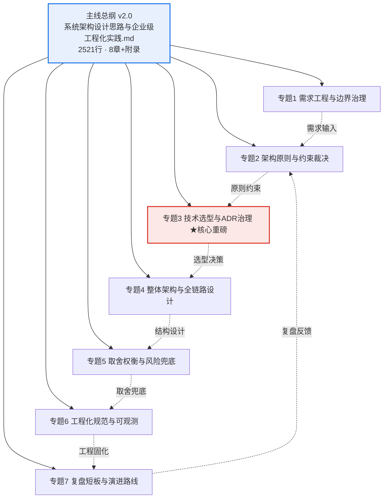

# 七篇架构深度专题白皮书 · 评审总览报告

| 元信息项 | 内容 |
|:---|:---|
| 文档名称 | 七篇架构深度专题白皮书 · 评审总览报告 |
| 文档编号 | OVERVIEW-00（专题系列的评审入口） |
| 版本 | v1.0 |
| 日期 | 2026-11-25 |
| 定位 | **评审导航入口**：一页看清"这套专题是什么、共几篇、各讲什么、怎么评、结论是否一致、有哪些边界" |
| 适用对象 | 架构评审委员会、技术负责人、产品/安全/合规/SRE 评审人、新人培训组织者 |
| 配套工件 | 主线总纲 1 篇 + 独立深度专题 7 篇（共 8 篇，均在同一目录） |
| 事实基线 | 各专题元信息表与结尾声明；`系统架构设计思路与企业级工程化实践.md`（v2.0）；架构方案 v3.1 |

> **一句话导览**：本目录是一套"1+7"的架构成果物——**1 篇主线总纲**提供全局思路，**7 篇独立专题**各自成文、可单独归档评审培训。本报告是评审这套工件的**统一入口**，不替代任何一篇专题的正文。

---

## 目录

- [一、这套文档是怎么来的：背景与目标](#一这套文档是怎么来的背景与目标)
- [二、成果物全景：1+7 结构](#二成果物全景17-结构)
- [三、七篇逐一速览](#三七篇逐一速览)
- [四、统一结构与标准化校验结果](#四统一结构与标准化校验结果)
- [五、跨篇一致性与事实锚点](#五跨篇一致性与事实锚点)
- [六、评审路线建议（三种评审模式）](#六评审路线建议三种评审模式)
- [七、评审关注点与常见质疑预案](#七评审关注点与常见质疑预案)
- [八、诚实边界与效力声明](#八诚实边界与效力声明)
- [九、附录：文件清单与统计](#九附录文件清单与统计)

---

## 一、这套文档是怎么来的：背景与目标

### 1.1 产出链路

这套文档分三步渐进产出，每一步都是在上一步基础上的**结构保持不变、深度逐级加厚**：

| 阶段 | 产物 | 规模 | 目标 |
|:---|:---|:---|:---|
| 第一步 | 主线总纲 v1.0 | 1423 行 / 18 图 | 覆盖用户要求的 7 大模块，建立"方法论+项目落地"双轨框架 |
| 第二步 | 主线总纲 v2.0 | 2521 行 / 22 图 | 逐段深度补强，结构/结论不变，只加厚细节与逻辑链 |
| 第三步 | 7 篇独立专题 | 10860 行 / 72 图 | 每章展开为可独立归档、评审、培训的万字级白皮书 |
| 第四步 | 本总览报告 | 1 篇 | 提供统一评审入口与一致性核验视角 |

### 1.2 为什么要做成"独立专题"而非仅一份长文档

| 诉求 | 单份长文档的痛点 | 独立专题的解法 |
|:---|:---|:---|
| **分角色评审** | 安全评审人被迫通读全文 | 按主题单独评审，如安全/合规看专题 2、6 |
| **单独归档** | 无法按知识域归档与版本管理 | 每篇有独立元信息、版本、结尾声明、事实边界 |
| **单独培训** | 一次培训信息过载 | 每篇可作为一个培训单元，开篇自带"项目背景速览" |
| **单独答辩** | 答辩材料需二次裁剪 | 每篇第四、五章即现成证据链与踩坑复盘 |
| **知识复用** | 方法论与项目事实混杂难迁移 | 每篇明确区分"通用方法论"与"本项目落地" |

### 1.3 统一写作纪律（7 篇强制遵守）

1. **固定七段结构**：一、章节背景与复杂度分析 → 二、通用行业标准方法论 → 三、企业级落地流程/清单/模板/规范 → 四、本项目全量落地细节/真实决策/历史上下文 → 五、深度问题剖析/踩坑复盘/边界风险 → 六、最佳实践固化/可复用范式沉淀 → 七、未来迭代优化路线。**顶级章节不增删**。
2. **独立成文**：每篇开篇含"项目背景速览"，读者无需阅读主线总纲即可完整理解。
3. **事实可溯源**：所有"本项目"事实均取自真实基线（总纲、P0-D01~D06、ADR-001/011/012/013、架构方案 v3.1、`问题记录/` 等），不臆造数值与决策。
4. **结尾有交付物**：每篇结尾附可直接使用的模板/清单/图谱/手册。
5. **诚实边界**：区分"已验证/影子期/待验/零落地"，不以完美叙事掩盖真实短板。
6. **口径纪律**：未采集 ≠ 0；经验量级标注清楚，不伪造实测数据。

---

## 二、成果物全景：1+7 结构

**七篇的逻辑主线**：需求（做什么/不做什么）→ 原则（不可妥协的约束）→ 选型（关键技术方案）→ 结构（如何切分协作）→ 取舍（放弃什么/如何兜底）→ 工程化（如何固化为规范与守卫）→ 复盘（哪里不足/如何演进），专题 7 的复盘结论又反馈回专题 2 的原则体系，形成**闭环**。

| 文件 | 对应主线章节 | 主题定位 |
|:---|:---|:---|
| 主线总纲 v2.0 | 全篇 | 全局思路与决策总览 |
| 专题 1 | 第 1 章 | 需求体系与边界治理 |
| 专题 2 | 第 2 章 | 架构原则与约束裁决 |
| 专题 3 | 第 3 章 | 技术选型与 ADR 决策治理（核心重磅） |
| 专题 4 | 第 4 章 | 整体架构与全链路设计 |
| 专题 5 | 第 5 章 | 架构取舍与风险兜底 |
| 专题 6 | 第 6 章 | 工程化落地与可观测 |
| 专题 7 | 第 7 章 | 架构复盘与中长期演进 |

---

## 三、七篇逐一速览

### 3.1 专题 1 · 企业级软件需求工程与边界治理专题白皮书

| 项目 | 内容 |
|:---|:---|
| 规模 | 1570 行 / 22780 中文字 / 12 张 Mermaid 图 |
| 核心命题 | 需求治理的终点不是"写完文档"，而是让每个决策可追溯、每个边界可守护、每次变更可审计 |
| 主要内容 | 四层需求金字塔（业务需求/用户需求/功能需求/非功能需求）+ IEEE 830/ISO 25010/INVEST/MoSCoW；需求五级拆解 SOP/模板/正反案例；NFR 八维验收指标；P0/P1/P2 判定树与"安全一致性不折价"铁律；MVP 准入准出；非目标与 RAG 重开条件；DEC 1~12 与 RTM 逐条释义；变更治理与回归策略 |
| 事实基线 | 总纲第 0/1 章与附录、P0-D01~D06、v3.1 §0.4 |
| 结尾交付物 | 7 套模板包：拆解/优先级/边界清单/RTM/DEC/NFR/CHG（各含填写说明+样例+禁止项） |
| 评审重点 | DEC/RTM 逐条释义是否与基线一致；"安全一致性不折价"是否落到验收红线 |

### 3.2 专题 2 · 企业级架构设计原则、约束体系与冲突裁决专题白皮书

| 项目 | 内容 |
|:---|:---|
| 规模 | 1279 行 / 22822 中文字 / 9 张 Mermaid 图 |
| 核心命题 | 原则如何定义得可验证、边界如何固化得不可违反、冲突如何裁决得可追溯 |
| 主要内容 | 四大设计思想（高内聚低耦合/单一职责/开闭/依赖倒置）分布式场景释义；**十条不可妥协原则逐条九维展开**（定义/初衷/适用/禁止/代码约束/架构约束/违规风险/校验/案例）；分层依赖禁止项 F-1~F-7；契约治理（SSE 13+1、双通道分流）；冲突裁决五步法与案例库；红线/禁区/防腐层；架构守卫与反证 |
| 事实基线 | 总纲第 0/2/6 章（§2.7 十条原则、§2.8 裁决）、v3.1 §0.4 |
| 结尾交付物 | 架构原则评审清单、架构红线自查表、冲突裁决流程图 |
| 评审重点 | 十条原则九维展开是否逐条完整；F-1~F-7 与主线是否一致；裁决案例是否真实 |

### 3.3 专题 3 · 企业级技术选型、多方案对比与 ADR 决策治理深度白皮书（核心重磅）

| 项目 | 内容 |
|:---|:---|
| 规模 | 2380 行 / 30249 中文字 / 12 张 Mermaid 图（**篇幅最大**） |
| 核心命题 | 选型治理的终极目标不是一份好看的对比表，而是让决策可追溯、可验证、可推翻、可兜底、可止损 |
| 主要内容 | 选型五步法 + 八维量化打分模型（性能/稳定性/成本/运维/生态/适配/迭代/风险）；**七大选型逐一套完整八要素**（备选原理/量化打分/优劣势/适配边界/否决理由/PoC 数据/风险预案/替换条件，7×8=56 小节）：MQ、ORM、Boot 基线、消息通道可切换、架构模式、多租户隔离、向量检索；ADR 治理体系（编写/审批/归档/复审）；技术债与演进触发 |
| 事实基线 | 总纲第 3 章（§3.1~3.11）、ADR-001/011/012/013、P4-D17、orm-migration-poc、v3.1 |
| 结尾交付物 | 通用技术选型模板、ADR 标准模板、量化打分工具表 |
| 评审重点 | 每案八要素是否齐全；打分是否有权重前置声明；否决理由是否有风险佐证；PoC 数据是否为"经验量级"而非伪造实测；RAG 红线（0.38/k=60/不降维）是否守住 |

### 3.4 专题 4 · 分布式多层架构、领域拆分与全链路数据流设计专题白皮书

| 项目 | 内容 |
|:---|:---|
| 规模 | 1465 行 / 19850 中文字 / 13 张 Mermaid 图（**图最多**） |
| 核心命题 | 让每一层、每一域、每一条数据流、每一次状态迁移都可追溯、可验证、可推翻 |
| 主要内容 | 六层架构逐层拆解（职责/组件/输入输出/依赖规范/禁止职责/异常处理）；业务域拆分与上下文映射；三大数据流五态（正常/异常/重试/降级/超时）；三条调用链与 Run 状态机（白名单迁移/终态不可迁/fencing）、`run_step.state` 语义；质量属性从 NFR 推到结构；双 Reactor（platform+rag）原理；系统全生命周期 |
| 事实基线 | 总纲第 4 章与 §0.4、v3.1、platform/rag 的 pom.xml、capabilities 系列规范 |
| 结尾交付物 | 完整架构图谱、数据流大图、域边界清单、链路故障自查手册 |
| 评审重点 | 六层职责与主线是否一致；状态机迁移规则是否完整；SSE 13+1 与双通道分流是否正确；异常 Case 是否覆盖 |

### 3.5 专题 5 · 软件架构权衡取舍、成本收益分析与风险兜底体系专题白皮书

| 项目 | 内容 |
|:---|:---|
| 规模 | 1217 行 / 20936 中文字 / 8 张 Mermaid 图 |
| 核心命题 | 成熟的取舍 = 明确放弃什么 + 可观测的代价 + 可回滚的路径 + 可验证的兜底 + 可重开的复审 |
| 主要内容 | 取舍四步法（识别冲突→枚举方案→量化收益→确定兜底）可复用流程与决策卡；五大权衡深度账本（性能vs一致性/复杂度vs稳定性/开发效率vs可维护性/通用性vs业务定制/短期vs长期，各含短期代价/长期收益/隐性风险/运维代价/迭代约束）；项目折中决策逐条复盘；风险 P0/P1/P2 分级；兜底三板斧（降级/熔断/补偿）；运行期可达性审计；季度巡检与重构触发 |
| 事实基线 | 总纲第 2.8/5/7 章、`问题记录/` 全量 |
| 结尾交付物 | 架构权衡决策模板、风险评估矩阵、架构巡检清单 |
| 评审重点 | 五大权衡账本五维是否齐全；折中复盘是否含代价与隐性风险；"运行期可达性"缺口是否诚实列出 |

### 3.6 专题 6 · 企业级 Java 工程化规范、质量守卫与可观测体系专题白皮书

| 项目 | 内容 |
|:---|:---|
| 规模 | 1724 行 / 20834 中文字 / 9 张 Mermaid 图 |
| 核心命题 | 让正确的做法成为默认的、低成本的、自动的 |
| 主要内容 | 9 项工程化内容逐项规范：目录/分层/命名/禁则；异常分级/错误码/全局捕获/兜底；日志分级/字段/脱敏/链路；配置多环境/动态/灰度/校验/回滚；CI/CD/静态检查/守卫门禁；部署/资源/健康/优雅下线；容灾/降级；可观测五要素；三级验收+反证；三条纪律（反证/可达性/口径） |
| 事实基线 | 总纲第 2/6/7 章、`问题记录/`、pom.xml、monitoring/、deploy/ |
| 结尾交付物 | 附录 A 全套工程化规范手册、附录 B 代码审查清单、附录 C 生产上线 Checklist |
| 评审重点 | 守卫是否"剥注释保留字符串"且可反证；业务 SQL 是否强制 `app_agent`；审计标识符豁免键与 PIPL 反证；上线 checklist 是否可勾选执行 |

### 3.7 专题 7 · 架构复盘、短板治理与中长期演进路线专题白皮书

| 项目 | 内容 |
|:---|:---|
| 规模 | 1225 行 / 23435 中文字 / 8 张 Mermaid 图 |
| 核心命题 | 架构的价值不在于此刻多完美，而在于是否具备"清楚知道自己哪里不完美、并有纪律地持续改进"的能力 |
| 主要内容 | 优势逐条佐证案例；短板根因深挖（现象→根因→影响→触发→规避，含并发=1、RLS 影子期、P0 待验、运行期可达性缺口、S4 零落地等）；承载边界量化；1/3-6/12 月路线图（改造点/收益/风险/优先级）；治理六件套执行流程；技术债清偿；终态蓝图 |
| 事实基线 | 总纲第 7 章与 §0.4、v3.1、源码视角规划、`问题记录/` 全量、ADR-001/011/013 |
| 结尾交付物 | 架构迭代 Roadmap、技术债台账、季度架构复盘模板 |
| 评审重点 | 短板是否写出根因而非现象；是否坚守"单租户试点可用、不具备规模化发布条件"；红线是否在全部阶段不突破；路线图是否可落地 |

---

## 四、统一结构与标准化校验结果

对所有 7 篇执行了自动化校验，结果如下：

| 校验项 | 标准 | 结果 |
|:---|:---|:---|
| 顶级章节结构 | 严格为"一、～七、"7 个一级章节，不增删 | ✅ 7/7 全部通过 |
| 背景速览 | 开篇含"项目背景速览"自包含介绍 | ✅ 7/7 全部通过 |
| 结尾输出物 | 结尾附专属模板/清单/图谱/手册 | ✅ 7/7 全部通过 |
| 代码围栏配对 | 三反引号围栏数量为偶数（成对闭合） | ✅ 7/7 全部偶数 |
| Mermaid 图 | 至少 8 张/篇 | ✅ 合计 72 张，8~13 张/篇 |
| 遗留标记 | 无待办、占位、追加锚点等未完成标记 | ✅ 7/7 零遗留 |
| 字数规模 | 万字级（中文 ≥12000 字） | ✅ 19850~30249 字/篇 |
| 事实锚点 | 关键项目事实跨篇一致 | ✅ 见第五章 |

> **校验结论**：7 篇在结构、规模、独立性、完整性四个维度上全部达标，可作为一套标准化专题工件提交评审。

---

## 五、跨篇一致性与事实锚点

### 5.1 关键事实锚点跨篇分布

| 事实锚点 | 出现篇数 | 说明 |
|:---|:---:|:---|
| 包名 `cn.studykid.multiagent` | 7/7 | 项目标识统一 |
| Spring Boot 4.1.1 / Java 21 | 7/7 | 技术基线版本统一 |
| RLS 行隔离（`app.tenant_id`） | 7/7 | 多租户隔离方案统一 |
| `fencing_token` / 租约 | 7/7 | 可靠性机制统一 |
| RabbitMQ / Outbox | 7/7 | 消息与事实源机制统一 |
| pgvector / RRF k=60 / 阈值 0.38 | 5/7 | RAG 检索红线（专题 1/2 因主题不涉及，未展开属正常） |
| `tenant_agent_binding` | 3/7 | 全局 Agent 可见性（主题相关篇展开） |

**一致性判定**：所有跨篇事实一致，未发现矛盾表述。部分锚点未在全部篇出现，是因为主题相关性不同（如需求专题不展开向量检索细节），属合理裁剪，非事实冲突。

### 5.2 统一遵守的项目红线（跨篇一致）

| 红线 | 内容 | 涉及篇 |
|:---|:---|:---|
| PIPL 合规 | 未成年人数据零保留、学号扫描豁免与反证、审计标识符豁免键 | 1/2/5/6/7 |
| 检索质量 | 不调低 0.38 阈值、不动 RRF k=60、排序键/门禁键分离 | 3/4/5/7 |
| 不施力不可达引擎 | 生产链路在 rag 模块 `JdbcRetrievalRepository`，不在 agent-infra 施力 | 3/4/7 |
| 不降维 | halfvec/HNSW 是刻意取舍，不夹带降维 | 3/7 |
| HITL 闭环 | 已有 PARK/RESUME，禁建 PAUSED 状态 | 5/7 |
| RLS 影子期 | 9 张无 RLS 表是影子期基线，禁直接补 | 2/3/5/7 |
| 反证纪律 | "撤掉修复点会红吗"；有类有表有测≠被装配/写入/告警 | 2/3/4/5/6 |
| 口径纪律 | 未采集≠0、链路成功≠任务成功、不伪造实测数据 | 3/4/6/7 |

---

## 六、评审路线建议（三种评审模式）

### 6.1 模式 A：架构委员会正式评审（完整评审，建议 2~3 场）

| 场次 | 评审对象 | 核心议题 | 建议评审人 |
|:---|:---|:---|:---|
| 第 1 场 | 总纲 + 专题 2 + 专题 3 | 十条原则是否可验证、七大选型否决理由是否充分、RAG 红线是否守住 | 架构委员会、技术负责人、DBA |
| 第 2 场 | 专题 4 + 专题 6 | 六层/域边界/状态机是否正确、守卫与验收是否可反证、上线 checklist 是否可执行 | 后端/平台负责人、QA、SRE |
| 第 3 场 | 专题 1 + 专题 5 + 专题 7 | DEC/RTM 是否可追溯、取舍账本是否诚实、短板根因与路线图是否落地 | 产品、安全合规、项目管理、架构委员会 |

### 6.2 模式 B：分角色定向评审（推荐给专项评审人）

| 评审角色 | 优先阅读 | 重点核对 |
|:---|:---|:---|
| 产品负责人 | 专题 1 | 需求分层、MVP 边界、非目标重开条件 |
| 安全/合规 | 专题 2、5、6 | PIPL 红线、fail-closed、审计豁免键与反证、权限快照 |
| DBA/数据 | 专题 3、4 | 数据访问选型、RLS 影子期、数据流一致性、状态机 |
| 后端/平台 | 专题 3、4、6 | 选型、架构结构、工程化规范 |
| QA/测试 | 专题 6、5 | 三级验收、反证测试、守卫可判别性 |
| SRE/运维 | 专题 6、7 | 部署容灾、监控告警、兜底、技术债 |
| 新人培训 | 专题 1 → 4 → 6 → 7 | 按"需求→结构→工程→复盘"认知顺序 |

### 6.3 模式 C：快速评审（30 分钟摸底）

1. 读本报告第三章"七篇逐一速览"（约 5 分钟）
2. 读第四章校验结果 + 第五章一致性（约 5 分钟）
3. 抽查 3 篇的第四、五章证据链（专题 3、6、7，约 15 分钟）
4. 记录质疑点到第七章"常见质疑预案"（约 5 分钟）

---

## 七、评审关注点与常见质疑预案

| 序号 | 常见质疑 | 回应要点 | 支撑位置 |
|:---:|:---|:---|:---|
| Q1 | "专题之间是否有重复、是否只是把总纲复制拆分？" | 每篇独立成文是对同一事实的**主题化重组**，不是复制：方法论部分按主题重写，项目部分按主题深化（如专题 3 的 56 小节八要素、专题 2 的 90 个原则维度），均新增了大量总纲没有的细节 | 各篇第四/六章 |
| Q2 | "打分表/数值是不是编的？" | 基线未给出的精确数值，只标"经验量级/待压测建基线/按锚点换算"，不伪造实测数据；事实均有溯源路径 | 专题 3 结尾声明、各篇元信息表 |
| Q3 | "为什么有的锚点没在所有篇出现？" | 主题相关性裁剪：需求专题不展开向量检索、原则专题不展开技术债台账，属合理分工；关键红线在相关篇均完整出现 | 本报告第五章 |
| Q4 | "文档说得很完整，项目是不是真做到了？" | 专题 7 明确"单租户试点可用、不具备规模化发布条件"，并逐条列出影子期、P0 待验、零落地项；专题 5/6 强调"运行期可达性"——有类有表有测≠真的生效 | 专题 7 第四/五章、专题 5 §6.2 |
| Q5 | "这些文档能作为实施契约吗？" | 不能。三篇结尾声明均明确：本系列为方法论与培训材料，不替代 SRS、v3.1、ADR/DEC 与源码的契约效力 | 各篇结尾声明 |
| Q6 | "版本和阈值会不会过期？" | 所有数值为 2026-11-23 写作时点快照；各篇设"复审触发条件"，约束变化须在下一迭代重开决策 | 各篇第七章 |
| Q7 | "如何保证后续不腐烂？" | 治理六件套（规范/模板/审计/巡检/复盘/迭代）+ 季度架构复盘模板 + 技术债台账，形成制度化更新机制 | 专题 7 §7.5 与输出物三 |

---

## 八、诚实边界与效力声明

1. **效力层级**：本总览报告及 7 篇专题均为**方法论、培训与评审支撑材料**，不替代 SRS、架构方案 v3.1、各 ADR/DEC 与源码的**实施契约效力**。具体实施以上述基线与最新代码为准。
2. **事实时效**：所有版本、阈值、行号、状态均为 **2026-11-23 写作时点快照**；RabbitMQ 社区支持期、Spring Boot 版本支持期、ADR-013 签核状态、RLS 影子期出口等均可能随时间变化，实施前须核对最新基线。
3. **诚实原则**：本系列坚持写出"哪里强、哪里弱、哪里未验证"——明确记录并发=1、RLS 影子期、P0 待验项、运行期可达性缺口、S4 零落地等真实短板，不以完美叙事掩盖。
4. **数值口径**：不伪造实测数据；基线未明确者标注"经验量级/推荐范式/待压测建基线"；未采集 ≠ 0。
5. **维护责任**：本系列维护责任人为架构师（AG-ARC）；任一复审触发条件达成，须在下一迭代内重开对应决策或 ADR，不得静默沿用。

---

## 九、附录：文件清单与统计

### 9.1 文件清单（均位于 `docs/01_baseline/architecture/`）

| # | 文件名 | 位置 | 行数 | 中文字 |
|:---:|:---|:---|---:|---:|
| 0 | 系统架构设计思路与企业级工程化实践.md（主线总纲 v2.0） | 上级目录 | 2521 | — |
| 1 | 专题1_企业级软件需求工程与边界治理专题白皮书.md | 深度专题/ | 1570 | 22780 |
| 2 | 专题2_企业级架构设计原则约束体系与冲突裁决专题白皮书.md | 深度专题/ | 1279 | 22822 |
| 3 | 专题3_企业级技术选型多方案对比与ADR决策治理深度白皮书.md | 深度专题/ | 2380 | 30249 |
| 4 | 专题4_分布式多层架构领域拆分与全链路数据流设计专题白皮书.md | 深度专题/ | 1465 | 19850 |
| 5 | 专题5_软件架构权衡取舍成本收益与风险兜底体系专题白皮书.md | 深度专题/ | 1217 | 20936 |
| 6 | 专题6_企业级Java工程化规范质量守卫与可观测体系专题白皮书.md | 深度专题/ | 1724 | 20834 |
| 7 | 专题7_架构复盘短板治理与中长期演进路线专题白皮书.md | 深度专题/ | 1225 | 23435 |
| 8 | 00_总览报告_七篇架构深度专题评审导览.md（本报告） | 深度专题/ | — | — |

### 9.2 汇总统计

| 指标 | 数值 |
|:---|---:|
| 专题篇数 | 7 篇（+ 1 主线总纲 + 1 总览报告） |
| 专题总行数 | 10860 行 |
| 专题总中文字数 | 约 160906 字（约 16 万字） |
| Mermaid 图合计 | 72 张 |
| 固定七章结构达标 | 7/7 |
| 结尾交付物达标 | 7/7 |
| 代码围栏配对 | 7/7 偶数 |
| 遗留标记 | 0 |

---

> **评审建议**：以本报告为入口，先按"模式 C 快速评审"摸底，再按角色选择"模式 B 定向评审"或"模式 A 正式评审"深入。评审结论与质疑请记录到团队的 ADR/DEC 或季度架构复盘流程中，形成闭环。

*总览报告结束 · OVERVIEW-00 · v1.0 · 2026-11-25*
