# 企业级软件需求工程与边界治理专题白皮书

| 元信息项 | 内容 |
|:---|:---|
| 文档名称 | 企业级软件需求工程与边界治理专题白皮书 |
| 专题编号 | 专题 1 |
| 版本 | v1.0 |
| 日期 | 2026-11-23 |
| 定位 | 团队培训教材 + 架构答辩支撑材料 + 项目审计依据；独立成文，读者无需阅读主文档即可完整理解 |
| 适用对象 | 架构师、产品负责人、后端负责人、测试/安全负责人、SRE、审计与合规评审人 |
| 事实基线 | `系统架构设计思路与企业级工程化实践.md` 第 0/1 章与附录；`P0-D01～D06` 需求文档包；`Java SaaS Agent 平台：规划与技术架构设计方案 v3.1` §0.4 十条不可妥协原则 |
| 引用纪律 | 本文所有"本项目"事实均来自上述基线；方法论部分为通用可复用内容，明确标注"通用"与"本项目"边界 |
| 阅读约定 | `DEC-N` 为需求层决策基线，`ADR-NNN` 为技术层架构决策，`FR-NNN/NFR-NNN` 为功能/非功能需求，`SB-NN` 为业务成功判据，`AT-XXX-NNN` 为验收测试用例 |

---

## 目录

> 本目录为自包含导航结构；七个一级章节固定，不随内容增删。

- **一、章节背景与复杂度分析**
  - 1.1 为什么需求治理是本项目第一性问题
  - 1.2 项目背景速览（自包含介绍）
  - 1.3 复杂度六维分析
  - 1.4 本专题的使用方式与边界声明
- **二、通用行业标准方法论（可复用）**
  - 2.1 软件需求四层金字塔模型
  - 2.2 需求五级拆解方法论
  - 2.3 非功能需求全维度治理
  - 2.4 需求优先级治理体系
  - 2.5 MVP 范围治理
  - 2.6 非目标需求深度沉淀
  - 2.7 本章小结：可迁移的方法论清单
- **三、企业级落地流程、清单、模板、规范**
  - 3.1 需求治理全流程（DoR → 拆解 → 评审 → 追踪 → DoD）
  - 3.2 各角色清单与门禁表
  - 3.3 模板规范与文档命名约定
  - 3.4 变更治理流程与回归策略
- **四、本项目全量落地细节、真实决策、历史上下文**
  - 4.1 需求体系地图与四层落地
  - 4.2 DEC 决策基线逐条释义
  - 4.3 RTM 可追溯矩阵逐条释义
  - 4.4 FR/NFR 全量清单与验收映射
  - 4.5 17 条验收红线与十条不可妥协原则
  - 4.6 MVP-A～D 分批与迭代准入/准出
  - 4.7 非目标清单与非目标重新纳入条件
- **五、深度问题剖析、踩坑复盘、边界风险**
  - 5.1 需求蔓延与"配置即后门"
  - 5.2 空话 NFR 与不可证伪验收
  - 5.3 安全/一致性需求被折价的典型路径
  - 5.4 未经验证的 RAG：最有价值的诱饵
  - 5.5 AI 全角色承担下的需求治理盲区
  - 5.6 边界风险登记与复审触发
- **六、最佳实践固化、可复用范式沉淀**
  - 6.1 可复用范式总表
  - 6.2 需求工程成熟度自检
  - 6.3 反模式清单（Do/Don't）
- **七、未来迭代优化路线**
  - 7.1 路线图总览
  - 7.2 各阶段优化目标与验收指标
  - 7.3 决策重开机制与长期约束
- **附录：可复用需求工程全套模板包**

---

## 一、章节背景与复杂度分析

### 1.1 为什么需求治理是本项目第一性问题

在多数企业级软件项目中，需求治理常被视为"前期的文档工作"，项目真正的技术含量被寄托在架构设计与编码实现上。这是一种普遍而危险的认知偏差。对于本项目——一个面向 K12（Kindergarten through 12th Grade，基础教育阶段）的多租户 SaaS Agent 平台——需求治理不是"写文档"，而是**决定项目生死的第一性约束**。

原因有三：

1. **需求即边界，边界即安全。** 在本项目中，"采集哪些字段"不是产品细节，而是 PIPL（《中华人民共和国个人信息保护法》）合规红线；"工具能否被自动重试"不是性能优化，而是是否产生未授权副作用的判定；"配置能否放松审批"不是灵活性提升，而是安全门禁降级。需求定义直接决定了系统的合规与数据安全底线。
2. **需求即决策，决策即可推翻性。** 项目用 DEC-1～12 冻结了 12 项需求层取舍，用 ADR-001～013 冻结了技术层取舍。每条决策都要求"背景/冲突/依据/影响/复审触发"完整留痕。这意味着需求文档本身就是**可审计的决策记录**，而非一次性的交付物。
3. **需求即验收，验收即真相。** 项目明确规定"代码合并 ≠ Done"，需求状态只以 RTM（需求追踪矩阵）为准。每条 P0 需求必须有正向路径与关键失败/越权路径，安全与一致性需求必须有自动化反证证据。

> **第一性命题**：在本项目里，"把需求说清楚"与"把系统做安全"是同一件事的两面。需求治理的缺失，不会以"文档不全"的形式暴露，而会以"跨租户数据泄露""未成年人数据违规""UNKNOWN 被盲目重放"的事故形式暴露。

本专题之所以独立成文，正是为了让团队在没有主文档的情况下，也能系统掌握这套"以需求为起点、以边界为骨架、以决策为记忆、以追踪为真相"的工程方法。

### 1.2 项目背景速览（自包含介绍）

> 本节自包含，读者无需阅读任何主文档即可建立完整项目坐标。

#### 1.2.1 项目是什么

本项目是一个**面向 K12 的多租户 SaaS Agent 平台**，代码包名 `cn.studykid.multiagent`，服务对象是未成年人学生（初中生，12–18 岁），由家长或教师代为发起请求。平台为授权租户提供 Agent 配置与版本管理、异步任务执行、模型与工具调用、执行轨迹查询、权限与审批、预算计量和运行治理能力。

平台的核心业务闭环为：

> 创建/发布 Agent → 绑定不可变执行快照 → 创建 Run → Outbox/MQ 投递 → Worker 执行单 Agent Loop → ModelGateway 决策 → 经唯一闸门调用受控工具 → 持久化步骤/事件/结果 → 查询轨迹与审计。

首个业务场景由 DEC-2 冻结为 **"初中生错题归因与个性化辅导"**：学生提交一道错题（题目文本 + 自己的解题过程 + 已知正确答案），Agent 完成"读取学习画像 → 错因归因分析 → 生成可执行讲解 → 记录薄弱点 → 返回结构化结果"五步，成功判据为 SB-01～07（归因准确率、讲解可执行性、薄弱点记录准确率、跨用户数据隔离、响应时延、幂等正确性、UNKNOWN 不盲重放）。

可用工具仅两个：`get_student_profile`（只读）与 `record_weakness`（有副作用，幂等键为 `student_id + run_id + knowledge_point`）。

#### 1.2.2 技术栈（已冻结基线）

| 层次 | 技术选型 | 需求治理关联 |
|:---|:---|:---|
| 语言和运行时 | Java 21 LTS | 生态兼容矩阵是 NFR-可维护性的组成部分（ADR-011） |
| 应用框架 | Spring Boot 4.1.1 / Spring Framework 7 / Jakarta EE 11 | 相对 v3.1 基线的 Spring Boot 3.x 发生偏离，由 DEC-4 记录并需 ADR-011 留痕 |
| 数据库 | PostgreSQL 17 | 唯一权威事实源；RLS 行隔离（GUC `app.tenant_id`） |
| 消息 | RabbitMQ 4.3.6（Quorum Queue） | 由 ADR-001 选定；默认消息通道为 `database`（PG 表队列），MQ 可切换 |
| 构建 | Maven 双 reactor：`platform`（13 模块）+ `rag`（11 模块） | 模块边界即需求边界的工程化映射 |
| 缓存 | Redis | 限流与短期协调，禁止作为唯一任务状态源 |
| AI 接入 | 自有 `ModelGateway`（OpenAI 兼容/MiniMax/Fake） | 领域层不依赖供应商专属类型（FR-006） |
| 可观测 | OpenTelemetry + Prometheus + Grafana + 审计报告 | NFR-007 可观测性落地 |
| ORM | MyBatis-Plus 3.5.17（显式 SQL 优先） | 涉及条件更新、租约、RLS 的路径优先显式 SQL |

#### 1.2.3 业务场景与规模量级

| 约束维度 | 取值/事实 | 对需求治理的直接影响 |
|:---|:---|:---|
| 业务体量 | 单/少租户试运营，首个场景为初中生错题归因 | 拒绝微服务过度设计；需求边界以"单 Agent 闭环"收敛 |
| 消息量级 | 每 Run 一条唤醒消息，低吞吐 | NFR 性能不预设 SLA，避免虚假性能承诺 |
| 并发模型 | 默认 `database` 通道（PG 表队列）+ 独立 Worker；Worker 并发 4、租户并发 5、单 Run `max-steps 20`、`max-cost 2.00` | 并发上限是需求配置项，须显式给保守初值并快照（DEC-9） |
| 数据规模 | platform 库 75 表 / 41 RLS / 49 策略；rag 库 15 表 / 43 策略；向量 `halfvec(4096)` | 单库可承载，需求不引入分库分表复杂度 |
| 团队/运维 | 小团队、无专职 SRE；十个角色全部由独立 AI Agent 承担（DEC-1） | 需求评审的独立性靠 ISO-1～ISO-5 隔离规则保障 |
| 合规 | 未成年人敏感个人信息（PIPL 第 31 条）、模型零保留、数据不出境 | 合规优先于数据丰富度；FR-019 为 P0 红线需求 |
| 时间窗 | 18 周分阶段交付（P0～P4），P0+P1 固定 2 周，P2–P5 由 P1-10 门禁重估（DEC-8） | 需求必须分批（MVP-A～D），但分批不降安全标准 |

#### 1.2.4 为什么需求治理在这个项目尤其关键

有三个结构性原因，使本项目的需求治理难度显著高于普通企业应用：

1. **合规对象是不可替代的未成年人。** 一旦姓名、学校、班级等直接身份信息被采集，或数据被用于模型训练、出境，即触发 PIPL 责任。因此"采集白名单"被写成 FR-019 红线，而非产品建议。
2. **Agent 系统的输出具有"不确定性"和"代理性"。** 模型可能建议调用工具，但**平台必须做主**（v3.1 §0.4 第 1 条）。需求必须精确界定"哪些上下文由服务端构造、哪些决策可被模型影响"，否则授权边界会被悄悄突破。
3. **外部副作用不可逆。** `record_weakness` 一旦写入画像，取消操作不承诺自动撤销；外部调用结果不确定时必须进入 UNKNOWN 对账。这要求需求把"失败"细分为"确定性失败""UNKNOWN""已发出不可撤销副作用"三类，而非笼统的"失败处理"。

### 1.3 复杂度六维分析

为便于培训与答辩，我们把本项目需求治理的复杂度拆为六个维度，每一维都对应一类典型治理失效：

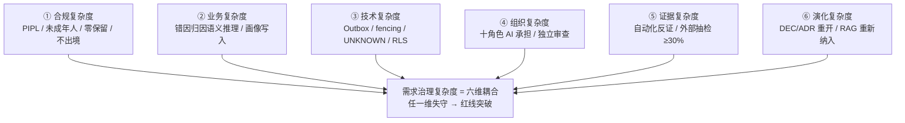

| 维度 | 复杂度来源 | 典型失效形态 | 本项目的治理抓手 |
|:---|:---|:---|:---|
| 合规复杂度 | 未成年人敏感个人信息、跨境、模型训练 | 采集白名单被"顺便"扩大 | FR-019 + DEC-6 + DEC-10 三道闸门 |
| 业务复杂度 | 错因归因需语义理解与多步推理 | 业务成功判据无法量化 | SB-01～07 + AT-BIZ-001…007 |
| 技术复杂度 | 分布式一致性、副作用、隔离 | 把设计写成需求、把 UNKNOWN 当普通失败 | NFR-003/004/005 + 反证用例 |
| 组织复杂度 | 十角色由 AI 承担，存在自审自 | 审查方接触实现推理 | ISO-1～ISO-5 上下文隔离 |
| 证据复杂度 | 安全结论需可复核 | 口头宣称"已完成" | RTM 状态即真相 + Sev-0 外部抽检 |
| 演化复杂度 | 决策需随事实变化重开 | 决策过期无人复审 | DEC/ADR 的"复审触发条件"字段 |

> **复杂度本质**：需求治理的目标不是"消除复杂度"，而是**把复杂度转化为可管理的结构化对象**——分层、编号、优先级、边界、追踪、决策留痕。这正是后面各章展开的方法论骨架。

### 1.4 本专题的使用方式与边界声明

| 使用场景 | 建议读法 | 重点关注章节 |
|:---|:---|:---|
| 团队培训 | 按章节顺序通读，先读 1.2 建立项目坐标 | 一、二、六 |
| 架构答辩 | 准备"为什么这样切边界"的话术与证据 | 四、五、七 |
| 项目审计 | 对照 DEC、RTM、红线清单逐条核查 | 三、四、附录 |
| 需求评审实操 | 直接取用模板包并裁剪 | 三、附录 |

**边界声明**：本专题的方法论章节（第二章、第三章、第六章）为通用可复用内容；本项目落地章节（第四章、第五章）中的事实来自基线文档，是**写作时点的快照**。任何数值（并发上限、成本上限、保留期、RPO/RTO）与版本（Spring Boot 4.1.1、RabbitMQ 4.3.6）在用于实施前，均应核对最新基线与 ADR 复审触发条件。本专题不替代 SRS、v3.1 架构方案与各 ADR 的契约效力。

---

## 二、通用行业标准方法论（可复用）

> 本章给出的方法论适用于任何中大型后端系统，不依赖本项目特定技术栈。每条方法均标注"标准出处"与"落地要点"。

### 2.1 软件需求四层金字塔模型

#### 2.1.1 模型结构

需求不是一个平面清单，而是**四层递进的金字塔**。越往上越抽象、越稳定；越往下越具体、越可验证。

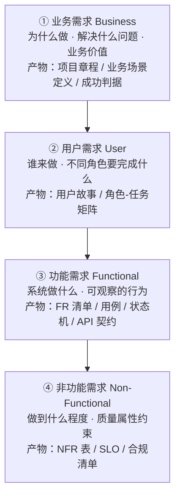

**分层的核心价值**：建立"业务变化 → 功能变化 → 技术变化"的追踪链。当业务方提出"要增加一个审批角色"时，可沿链路快速定位受影响的 FR、状态机、表结构与测试用例，而不是全系统盲改。

#### 2.1.2 逐层理论详解与行业标准

**① 业务需求（Business Requirements）**

- **定义**：组织层面的"为什么做"，描述业务问题、机会与预期价值，是项目章程的输入。
- **标准依据**：IEEE 830（软件需求规格说明推荐实践）强调 SRS 应首先说明"目的、范围、上下文"，即业务层定位；PMBOK -project charter 的同源思想。
- **产物**：项目章程、业务场景定义、成功判据（可度量的业务结果）。
- **撰写要点**：用业务语言、可度量价值、明确"不做什么"。
- **常见错误**：一上来就写接口和表结构，导致技术细节绑架业务目标。

**② 用户需求（User Requirements）**

- **定义**：不同角色（Actor）要系统帮助完成什么任务。
- **标准依据**：用户故事标准格式"作为〈角色〉，我希望〈能力〉，以便〈价值〉"；UML 用例的 Actor/Use Case 模型。
- **产物**：角色清单、用户故事、角色-任务矩阵。
- **撰写要点**：一个角色一条主线；区分主参与者、次参与者与外部系统。
- **常见错误**：把所有角色混成"用户"，丢失权限与合规边界。

**③ 功能需求（Functional Requirements）**

- **定义**：系统必须提供的可观察行为，是"系统应……"的陈述集合。
- **标准依据**：IEEE 830 对 SRS 的八项质量特性——**完整（Complete）、一致（Consistent）、无二义（Unambiguous）、可验证（Verifiable）、可追溯（Traceable）、可修改（Modifiable）、有组织（Organized）、可理解（Understandable）**——主要落在这一层验收。
- **产物**：FR 编号清单、用例、状态机、API 契约。
- **撰写要点**：每条 FR 可独立验收；避免混入实现方案（如具体 MQ 产品名）。
- **常见错误**：写成"用 RabbitMQ 发送消息"，把技术选型锁死为需求。

**④ 非功能需求（Non-Functional Requirements）**

- **定义**：质量属性与约束，描述"做到什么程度"。
- **标准依据**：**ISO/IEC 25010 系统与软件质量模型**（2011 版九大产品质量特性：功能适合性 Functional suitability、性能效率 Performance efficiency、兼容性 Compatibility、易用性 Usability、可靠性 Reliability、安全性 Security、可维护性 Maintainability、灵活性 Flexibility、安全性 Safety；2023 版将易用性细化为交互能力 Interaction capability 并做措辞调整）。这是 NFR 全维度治理的国际标准框架。
- **产物**：NFR 表、SLO、合规清单。
- **撰写要点**：能量化则量化；不能量化则给"策略 + 门禁 + 验证方式"。
- **常见错误**：只写"高性能、高可用、安全可靠"等空话，无法验收。

#### 2.1.3 四层字段清单（防漏项模板）

> 评审时逐字段检查是否填写，未填即视为需求未定义完成。

**业务需求字段**：业务目标、成功判据、目标用户群、业务约束、不做什么、业务负责人。

**用户需求字段**：角色名称、角色目标、主线任务、权限范围、触发方式、异常诉求。

**功能需求字段**：FR 编号、需求描述（"系统应……"）、优先级、前置条件、后置条件、验收条件、关联 NFR。

**非功能需求字段**：NFR 编号、质量维度、目标值/策略、验证方式、责任人、不达标后果。

#### 2.1.4 正反案例

| 类型 | 表述 | 判定 |
|:---|:---|:---|
| ✅ 好需求 | "系统应在 Run 创建事务内写入 Outbox 事件，强杀进程后二者同生共死（NFR-003）。" | 有行为、有边界、有可判定验收 |
| ❌ 坏需求 | "系统要支持高并发、性能好、安全可靠。" | 无行为、无量化、无法验收，典型空话 NFR |
| ✅ 好需求 | "系统应在 12 岁学生提交错题后，输出可执行的解题步骤，评测量表平均 ≥ 4/5。" | 业务价值可度量 |
| ❌ 坏需求 | "系统要智能地帮助学生学习。" | 主观、不可证伪 |

### 2.2 需求五级拆解方法论

#### 2.2.1 五级分解模型

需求拆解是把上层诉求逐层落成可执行单元的标准动作。

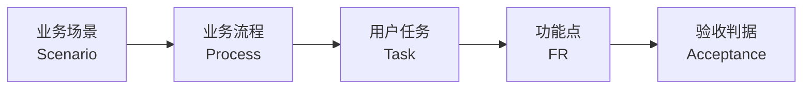

| 级别 | 定义 | 输入 → 输出 | 完成判定 |
|:---|:---|:---|:---|
| S1 场景 | 完整、有业务价值的端到端情境 | 业务目标 → 场景卡 | 有明确价值且端到端完整 |
| S2 流程 | 场景内的时序步骤，含正常/异常分支 | 场景卡 → 流程图 | 每条分支有起点和终点 |
| S3 任务 | 按角色切分的人工动作 | 流程图 → 角色×任务矩阵 | 每个任务有唯一责任角色 |
| S4 功能点 | 把"系统要做什么"抽成独立 FR | 任务矩阵 → FR 清单 | 每条 FR 可独立验收（INVEST） |
| S5 验收 | 为每条 FR 写可判定通过条件 | FR 清单 → 验收判据表 | 判据无主观形容词 |

#### 2.2.2 拆解公式（可机械套用）

为使拆解可复用，给出形式化表达：

```
场景 SC = ⟨触发事件, 主角色, 前置状态, 输入, 主流程步骤集, 异常分支集, 输出, 成功判据⟩

流程 P  = 主步骤序列 S⁺ ∪ 异常分支集 E
任务 Tᵢ = ⟨角色 Rᵢ, 动作 Aᵢ, 输入 Iᵢ, 输出 Oᵢ⟩   （Rᵢ 唯一）
FRⱼ     = "系统应 ⟨可观察行为 Bⱼ⟩，当 ⟨触发条件 Cⱼ⟩"（一个 FR 仅一个行为）
验收ⱼ   = Given ⟨前置⟩ When ⟨动作⟩ Then ⟨可判定结果⟩
```

**粒度判定公式**：若一条 FR 同时满足 INVEST 六项（Independent 独立、Negotiable 可协商、Valuable 有价值、Estimable 可估算、Small 小粒度、Testable 可测试），则粒度合格。若无法单独验收，通常说明"拆得不够"或"混入了实现细节"。

> **INVEST 来源**：Mike Cohn 在《User Stories Applied》中提出的用户故事质量准则，现已成为敏捷需求拆分事实标准。**MoSCoW**（Must/Should/Could/Won't）则由 Dai Clegg 提出，用于范围优先级划分，详见 2.4 节。

#### 2.2.3 完整操作步骤 SOP

| 步骤 | 输入 | 动作 | 输出 | 反例警戒 |
|:---|:---|:---|:---|:---|
| S1 定场景 | 业务目标 | 用"谁在什么情况下做什么，得到什么结果"写 1 段 | 场景卡 | 场景过泛，无法端到端 |
| S2 画流程 | 场景卡 | 画主流程 + 异常分支，标注触发条件 | 流程图 | 异常分支无终点 |
| S3 切任务 | 流程图 | 按角色归类人工动作 | 角色-任务矩阵 | 角色混淆导致权限边界丢失 |
| S4 抽 FR | 任务矩阵 | 逐句抽取"系统应……"并检查 INVEST | FR 清单 | 把技术名词写进 FR |
| S5 写验收 | FR 清单 | 写 Given/When/Then 判据 | 验收判据表 | 出现"快""好"等主观词 |

#### 2.2.4 标准化输出模板

```markdown
## 场景 SC-XX：<一句话场景>
- 触发：<什么事件启动>
- 主角色：<谁发起>　次要角色：<谁参与>
- 前置：<系统/数据处于什么状态>
- 输入：<结构化输入字段>
- 主流程：
  1. <步骤1> → 系统行为 → FR-XXX
  2. <步骤2> → 系统行为 → FR-XXX
- 异常分支：
  - 若<条件> → <系统如何处理>（对应 FR-XXX 的异常判据）
- 输出：<结构化输出>
- 成功判据：<可度量的业务结果>

## 拆解出的 FR
| FR | 描述 | 优先级 | 验收判据（Given/When/Then） |
|----|------|--------|---------------------------|
| FR-XXX | 系统应…… | P0 | Given … When … Then … |
```

#### 2.2.5 错误示范与纠正

| 反例 | 表现 | 为什么错 | 正确做法 |
|:---|:---|:---|:---|
| 拆解混入实现 | FR 写成"用 RabbitMQ 发送 run.execute 消息" | 把技术选型当需求，锁死实现 | "系统应异步派发 Run，消息可切换载体" |
| 粒度过粗 | 一条 FR="管理 Run 生命周期" | 无法单独验收，掩盖状态机复杂度 | 拆成创建/查询/取消/重试/终态等多条 FR |
| 粒度过细 | 把"校验幂等键格式"和"校验幂等键冲突"拆成两条 FR | 割裂同一业务语义，增加追踪成本 | 合并为"幂等键校验"一条，含两个判据 |
| 角色混淆 | "用户提交 Run"未区分学生/家长/教师代发 | 权限与合规边界丢失 | 明确代发关系，绑定审计主体 |
| 验收含主观词 | "响应要快""体验要好" | 无法判定通过 | 改为"P95 < X ms（压测后定档）" |

> **避坑口诀**：FR 里反复出现具体技术名词（MQ、表名、框架）→ 大概率"把设计写成需求"，回退到"系统应做什么"；FR 写不出 Given/When/Then → 粒度或边界有问题。

### 2.3 非功能需求全维度治理

ISO/IEC 25010 提供了质量属性的通用分类，但**标准只给维度，不给阈值**。企业级落地的核心动作是：为每个维度定义"验收指标 + 落地标准 + 验证方式"。下面按八个维度给出可复用治理框架。

| 维度 | 关键问题 | 验收指标（示例） | 落地标准 | 验证方式 |
|:---|:---|:---|:---|:---|
| 性能 Performance | 系统多快 | P95/P99 时延、吞吐 TPS、队列积压深度 | 先建基线，未完成容量评估禁止承诺 SLO | 压测报告、仪表盘 |
| 并发 Concurrency | 系统承载多少同时操作 | 单租户并发上限、Worker 并发、模型并发 | 配置项 + 保守初值 + 快照隔离 | 并发集成测试 |
| 可用性 Availability | 系统多大比例可用 | 可用率、RPO/RTO、MTTR | RPO/RTO 需业务批准，不虚构 | 故障演练、恢复记录 |
| 可观测 Observability | 系统状态是否可诊断 | correlation/run id 覆盖率、指标标签基数 | 日志/指标/Trace 关联；标签白名单 | 仪表盘、日志扫描 |
| 安全性 Security | 系统是否防越权与泄露 | 越权拒绝率、秘密泄漏数、单独同意留痕 | 认证与授权分离、fail-closed、服务端构造可信上下文 | 安全自动化测试、红队 |
| 可维护性 Maintainability | 系统是否易改 | 模块边界违规数、契约测试覆盖率 | 端口-适配器、架构守卫、文档先行 | 静态守卫、CI 门禁 |
| 兼容性 Compatibility | 系统是否可共存/升级 | 版本矩阵覆盖率、回滚成功率 | 冻结技术基线、记录偏离与回滚方案 | 集成测试优先于单测 |
| 灾备 Disaster Recovery | 灾难后能否恢复 | RPO/RTO 实测值、备份可恢复率 | 备份频率、恢复演练、责任人 | 恢复演练报告 |

#### 2.3.1 性能治理：先基线，后承诺

**铁律**：性能数值在容量评估完成前**不得预先承诺**。常见反模式是产品为了拿需求评审通过，随口写"接口响应 200ms 以内"，结果压测后发现模型推理就需要数秒，导致整条 NFR 失效。

正确做法分三步：
1. **建基线**：在目标环境采集 P50/P95/P99、吞吐、队列深度。
2. **分维度设限**：对同步查询端点可设较严 P95；对含模型推理的异步 Run 设端到端上限，并明确"异步不承诺同步时延"。
3. **用护栏代替承诺**：通过 `@ConcurrencyLimit`、租户并发上限、单 Run 步数上限等**可配置护栏**防止失控，而非承诺固定 SLA。

#### 2.3.2 并发治理：配置项必须带保守初值

并发上限类需求有一条容易被忽视的规则：**配置化解决"后续谁来调"，但初值本身仍是决策**。若初值缺失或缺省过大，系统上线首日即可能失控。因此每个并发配置项必须同时给出：配置键、保守初值、生效范围、快照策略、缺失时行为（fail-closed）。

#### 2.3.3 可用性治理：RPO/RTO 必须可验证

RPO（Recovery Point Objective，恢复点目标）与 RTO（Recovery Time Objective，恢复时间目标）不是越大越好也不是越小越好，而是"业务可接受 + 技术上可验证"。治理要点：
- 初值由业务批准，标注"保守初值待演练确认"；
- 必须有备份恢复演练记录，记录**实际恢复时间**与**实际数据丢失窗口**；
- 未演练前，RPO/RTO 仅为设计值，不得作为对外 SLA 承诺。

#### 2.3.4 可观测治理：低基数与脱敏是可观测性的硬约束

可观测性需求最容易被忽略的是**反作用**：高基数标签（如 user_id、run_id 直接作为指标 label）会压垮时序数据库；日志中打印 Token/密钥会造成二次泄露。因此可观测 NFR 必须包含：
- 指标标签白名单（禁止高基数、敏感字段）；
- 日志脱敏规则；
- 关键链路 correlation id / run id 的贯穿率指标。

#### 2.3.5 安全性治理：认证与授权分离、可信上下文服务端构造

安全 NFR 的最低要求：
1. 认证（你是谁）与授权（你能做什么）分离；
2. 租户 ID 等可信上下文由服务端构造，**不以客户端输入为授权依据**；
3. 敏感数据的采集、存储、保留、删除各有独立策略；
4. 配置缺失时拒绝（fail-closed），而非默认放行。

#### 2.3.6 可维护性治理：架构守卫与文档先行

可维护性常被写成无法验收的空话。可落地的做法是把它转成**可自动检查的约束**：
- 模块依赖方向测试（禁止反向依赖）；
- 领域纯度测试（领域层不得依赖框架/基础设施类型）；
- 文档先行且内容与实现一致（DoD 检查项）。

#### 2.3.7 兼容性治理：版本矩阵与回滚方案

兼容性 NFR 须回答"升级/降级时会坏什么"。落地标准：
- 冻结技术基线版本矩阵（框架、ORM、中间件、JDK）；
- 记录相对基线的偏离及理由；
- 提供回滚方案与验证证据。

#### 2.3.8 灾备治理：与可用性协同但更强调"演练"

灾备 NFR 与可用性重叠，但更强调**可执行的灾难场景**：区域故障、数据库损坏、误删数据。每项灾备需求须有：备份策略、恢复步骤、责任人、演练频率、演练记录。

> **NFR 治理总口诀**：能量化则量化；不能量化则给"策略 + 门禁 + 验证方式"；任何 NFR 都必须能回答"如何证明达标"。

### 2.4 需求优先级治理体系

#### 2.4.1 两层优先级模型

优先级不是单一维度排序，而是"阶段标签 × 价值-风险象限"的综合判断。

- **第一层：阶段标签**（P0/P1/P2）
  - **P0**：首期闭环/安全/一致性所必需，不满足不得进入下一阶段。
  - **P1**：首期需要，但可在不破坏核心安全与一致性的前提下按阶段交付。
  - **P2**：明确延期或后续增强。
- **第二层：价值-风险四象限**。在标签内，用"业务价值高低"与"技术/安全风险高低"进一步排序。

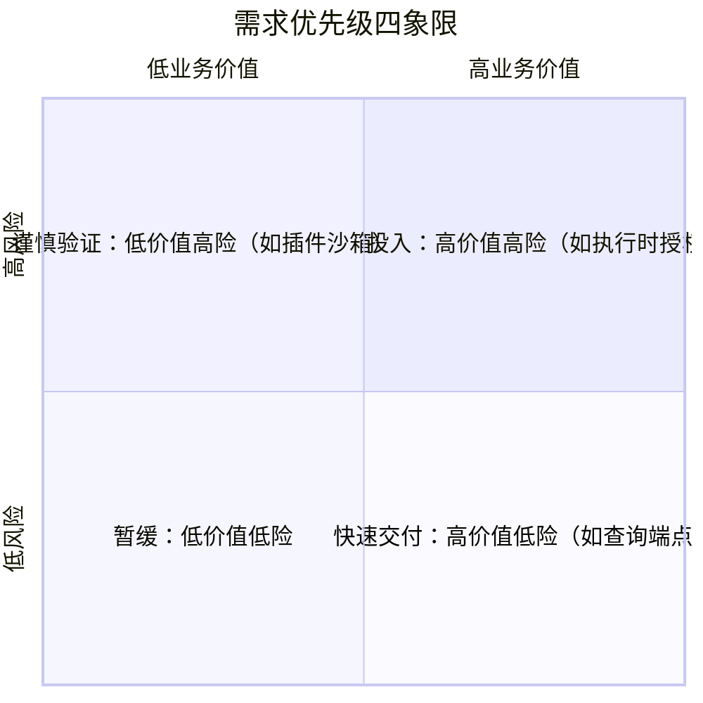

#### 2.4.2 P0/P1/P2 完整判定规则（决策树）

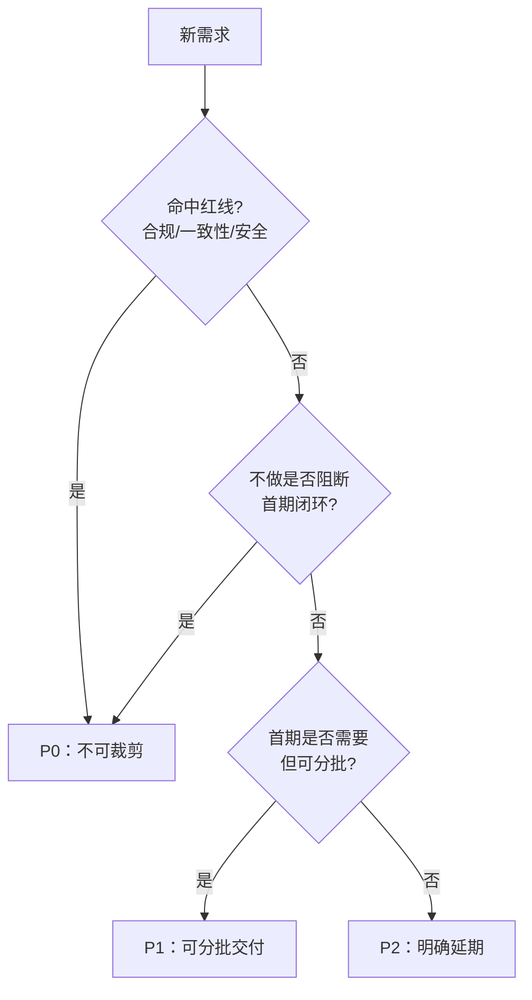

**红线判定三问**（命中任一即为红线，直接 P0）：
1. 是否涉及**法律合规**（未成年人数据、隐私）？
2. 是否涉及**数据一致性底线**（事务原子、幂等、fencing）？
3. 是否涉及**安全隔离**（租户边界、授权）？

#### 2.4.3 MoSCoW 与 P0/P1/P2 的映射

MoSCoW 是更通用的范围优先级语言，可与 P0/P1/P2 映射使用：

| MoSCoW | 含义 | 映射 | 使用约束 |
|:---|:---|:---|:---|
| Must have | 必须有，否则交付无效 | P0 | 不可裁剪 |
| Should have | 应该有，重要但非阻断 | P1 | 可分批但不取消 |
| Could have | 可以有，锦上添花 | P2 | 资源紧张时优先裁剪 |
| Won't have (this time) | 本期不做 | 非目标 | 必须写重新纳入条件 |

> **注意**：MoSCoW 的 "Won't have" 与"非目标"语义一致——都不是"永远不做"，而是"本期不做 + 需保留演进通道"。

#### 2.4.4 裁剪原则与红线清单

当时间/资源不足时，按以下顺序裁剪：

1. **先砍 P2**：直接移入 backlog，附带重新纳入条件。
2. **再砍 P1 的"分批"部分**：保留核心批次，延后增强批次。
3. **绝不砍 P0**：若 P0 无法完成，应**缩减场景范围**（如减少工具数量），而非降低安全/一致性标准。
4. **裁剪必须留痕**：记录"砍了什么、为什么、何时补回"，更新 RTM 状态为 Deferred。

**红线清单（通用模板）**：
- R-SEC-01 租户隔离不可裁剪；
- R-SEC-02 未成年人/敏感数据合规不可裁剪；
- R-CONS-01 状态与事件原子提交不可裁剪；
- R-CONS-02 幂等与 UNKNOWN 对账不可裁剪；
- R-AUTH-01 执行时授权不可裁剪；
- R-CFG-01 配置不得成为绕过门禁的后门（fail-closed）。

#### 2.4.5 取舍铁律：安全与一致性需求不参与价值折价

> **铁律**：安全性与一致性相关的需求，优先级**不参与"价值"折价**。即使没有直接业务价值，只要涉及租户隔离、副作用幂等、未成年人数据合规，一律 P0。

这是优先级治理中最容易被违反的一条。典型的违反路径是："这个安全检查用户感知不到，先用 Mock 绕过，上线后补"。正确的立场是：这类需求不是"价值低"，而是"价值形态不同"——它的价值是**避免损失**，而非**创造收益**。因此不能用"业务价值高低"这把尺子去衡量它。

### 2.5 MVP 范围治理

#### 2.5.1 MVP 的定义标准

MVP（Minimum Viable Product，最小可行产品）不是"功能最少的版本"，而是**可被真实业务验证、可授权执行、可追踪、失败可解释的最小闭环**。判定标准有四：

1. **业务可验证**：能在真实或批准的场景上跑出业务结果。
2. **授权可执行**：所有动作经过服务端授权，模型不能绕过。
3. **全程可追踪**：状态、步骤、事件、结果可查询审计。
4. **失败可解释**：异常有确定状态或 UNKNOWN 路径，不是静默失败。

#### 2.5.2 目标范围与阶段性边界

MVP 范围治理的关键动作是"列必做 → 列不做 → 列红线"三步法：

1. **列必做**：从 MVP 闭环倒推，列出"不做就不成立"的能力。
2. **列不做并为每项写重新纳入条件**：防止范围蔓延，同时保留演进通道。
3. **列红线**：把"即使压缩范围也绝不让步"的安全/一致性底线编号化。

#### 2.5.3 迭代准入/准出规则

| 门禁 | 准入条件（进入迭代） | 准出条件（离开迭代） |
|:---|:---|:---|
| DoR（Definition of Ready） | 有任务 ID、目标、唯一 DRI；有可验证验收条件与需求 ID；前置依赖/环境已准备；API/DDL/状态机/安全影响已识别 | —— |
| 迭代执行 | 设计文档先行；实现对照文档；偏离先改文档 | —— |
| DoD（Definition of Done） | —— | 文档与实现一致；非作者 Review；测试通过且证据可定位；配置 fail-closed 与快照有测试；RTM 状态更新为 Done |

> **关键纪律**：**代码合并 ≠ Done**。需求状态只以追踪矩阵为准，验收通过才置 Done。

### 2.6 非目标需求深度沉淀

#### 2.6.1 非目标的四要素

非目标不是"永远不做"，而是**带条件的边界声明**。每条非目标必须写清四要素：

| 要素 | 内容 | 作用 |
|:---|:---|:---|
| 为什么不做 | 舍弃/延后的根本原因 | 防止未来有人以"遗漏"为由重新打开 |
| 短期代价 | 当期放弃的能力或体验 | 让决策透明，避免隐性成本 |
| 长期约束 | 该决策对未来架构的锁定 | 提示演化成本 |
| 未来触发条件 | 什么情况下重新纳入 | 保留演进通道，避免僵化 |

#### 2.6.2 重新纳入条件的设计原则

一个合格的重新纳入条件必须**可判定**，而不是"以后再说"。推荐写成"多条件同时满足"的形式：

```
重新纳入条件 = 条件A ∧ 条件B ∧ 条件C ∧ 条件D
```

例如"未经验证的 RAG"的重新纳入，需要同时满足：数据 owner 明确、评测集建立、访问模型确定、收益指标定义，**且**评测显示参数内知识不足以支撑准确性。这样既守住首期边界，又保留了清晰的演进通道。

#### 2.6.3 非目标的三种形态

| 形态 | 含义 | 示例 |
|:---|:---|:---|
| 永久非目标 | 与产品定位冲突，不做 | 通用 DAG 引擎、插件市场 |
| 阶段性舍弃 | 本期不做，条件成熟再做 | 首期 RAG、无限期保存 Token 流 |
| 未来扩展点 | 架构已预留，成本到达阈值时启用 | 上下文压缩 S4、瓶颈模块服务化 |

### 2.7 本章小结：可迁移的方法论清单

- [ ] 用"业务→用户→功能→非功能"四层金字塔组织需求，拒绝平面清单。
- [ ] 用"场景→流程→任务→功能点→验收"五级分解，每条 FR 独立可验收（INVEST）。
- [ ] 边界三件套：MVP 范围、非目标（含重新纳入条件）、不可妥协红线。
- [ ] 优先级 = 阶段标签（P0/P1/P2）+ 价值-风险象限；**安全/一致性需求不参与价值折价**。
- [ ] NFR 能量化则量化，不能量化则给"策略 + 门禁 + 验证方式"，杜绝空话。
- [ ] 每条非目标写清"为什么不做/短期代价/长期约束/未来触发条件"。
- [ ] 迭代准入/准出用 DoR/DoD，代码合并不等于 Done。

---

## 三、企业级落地流程、清单、模板、规范

> 本章把第二章的方法论固化为"可执行的流程 + 可勾选的清单 + 可套用的模板 + 可审计的规范"。这是从"知道"到"做到"的关键一跃。

### 3.1 需求治理全流程（DoR → 拆解 → 评审 → 追踪 → DoD）

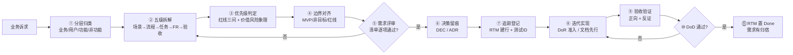

#### 3.1.1 流程各阶段定义

| 阶段 | 输入 | 核心活动 | 输出 | 门禁判定 |
|:---|:---|:---|:---|:---|
| ① 分层归类 | 业务诉求 | 判定属于哪一层需求 | 分层后的需求条目 | 四层均有归属，无"悬空需求" |
| ② 五级拆解 | 上层诉求 | S1～S5 分解 | 场景卡 + FR 清单 + 验收判据 | 每条 FR 满足 INVEST |
| ③ 优先级判定 | FR 清单 | 红线三问 + 价值风险象限 | P0/P1/P2 标签 | 红线需求已全部标 P0 |
| ④ 边界对齐 | 优先级结果 | 对照 MVP/非目标/红线 | 范围确认表 | 无"既非 MVP 又不属非目标"的灰区 |
| ⑤ 需求评审 | 全部产物 | 清单逐项 Check | 评审结论 | 全部清单项通过 |
| ⑥ 决策留痕 | 评审中的取舍 | 记录 DEC/ADR 六字段 | 决策基线 | 每条决策含复审触发条件 |
| ⑦ 追踪登记 | 已批准需求 | RTM 建行，分配测试 ID | RTM 初表 | 每条需求有测试 ID |
| ⑧ 迭代实现 | RTM 条目 | DoR 准入，文档先行 | 设计文档 + 代码 | DoR 全部满足 |
| ⑨ 验收验证 | 实现产物 | 正向路径 + 反证用例 | 测试报告 | 安全需求有反证 |
| ⑩～⑪ 完成 | 测试报告 | DoD 检查，RTM 置 Done | 已关闭需求 | 代码合并 ≠ Done，须验收通过 |

#### 3.1.2 需求评审清单（每张评审会逐条过）

**A. 分层与完整性**
- [ ] 需求已归入四层金字塔的正确层级？
- [ ] 业务需求有可度量的成功判据？
- [ ] 用户需求区分了主/次角色与外部系统？
- [ ] 功能需求用"系统应……"句式，无实现细节？
- [ ] 非功能需求能量化则量化，不能量化给了策略与门禁？

**B. 拆解与粒度**
- [ ] 每条 FR 满足 INVEST 六项？
- [ ] 每条 FR 可独立写成 Given/When/Then？
- [ ] 异常分支均有起点与终点？
- [ ] 未出现技术名词锁死实现？

**C. 边界与优先级**
- [ ] MVP 必做清单完整（"不做就不成立"的能力全在）？
- [ ] 每项非目标都有重新纳入条件？
- [ ] 红线清单已编号且未被裁剪？
- [ ] 红线需求全部标为 P0？
- [ ] 优先级裁剪已留痕？

**D. 可追溯与验收**
- [ ] 每条需求已登记 RTM？
- [ ] 每条 P0 需求有正向 + 关键失败/越权路径？
- [ ] 安全/一致性需求有自动化反证用例？
- [ ] 决策取舍已记录 DEC/ADR？

### 3.2 各角色清单与门禁表

#### 3.2.1 RACI 角色定义

| 缩写 | 含义 | 职责 |
|:---|:---|:---|
| R（Responsible） | 实际执行者 | 可多个 |
| A（Accountable） | 最终负责者 | 每项原则上唯一 |
| C（Consulted） | 需咨询方 | 提供专业意见 |
| I（Informed） | 需知会方 | 被告知结果 |

#### 3.2.2 需求治理活动 RACI 模板（通用）

| 工作项 | 业务 | 产品 | 项目 | 架构 | 后端 | 测试 | 安全 | 运维 |
|:---|:---|:---|:---|:---|:---|:---|:---|:---|
| 业务场景与价值目标 | A | R | C | I | I | C | C | I |
| MVP 范围/优先级 | C | A/R | C | C | C | C | C | I |
| 需求规格与验收口径 | C | A/R | C | C | C | R | C | I |
| 架构/ADR/模块边界 | I | C | I | A/R | R | C | C | C |
| 测试策略/追踪矩阵 | I | C | I | C | C | A/R | C | C |
| 威胁模型/安全门禁 | I | C | I | C | R | C | A/R | C |
| 生产发布与回滚 | C | C | A | C | R | R | C | R |

#### 3.2.3 阶段门禁表

| 阶段 | 准入条件 | 准出条件 | 禁止行为 |
|:---|:---|:---|:---|
| 需求基线（P0） | 场景、成功判据、边界、角色确定 | 六份需求文档签署，无 `[待确认]` | 带未决问题进入设计 |
| 架构验证（P1） | 需求基线批准 | 高风险决策有 ADR + PoC 证据 | 未验证即冻结关键决策 |
| 核心闭环（P2） | 工程骨架与关键协议可用 | 业务任务可执行、可追踪 | 以牺牲授权/幂等换演示速度 |
| 可靠性安全（P3） | 核心闭环稳定复现 | 关键风险用测试证据关闭 | 用普通豁免放行走私安全缺陷 |
| 生产候选（P4） | 测试环境与依赖就绪 | 容量、监控、恢复报告齐备 | 未演练即承诺 SLO |
| 试点验收（P5） | 生产准入评审通过 | 灰度、回滚、复盘、交接完成 | 无业务验收即宣布成功 |

### 3.3 模板规范与文档命名约定

#### 3.3.1 编号体系

| 前缀 | 含义 | 示例 |
|:---|:---|:---|
| `P0-DNN` | P0 阶段需求文档 | P0-D02 SRS |
| `FR-NNN` | 功能需求 | FR-003 Run 创建 |
| `NFR-NNN` | 非功能需求 | NFR-002 数据隔离 |
| `SB-NN` | 业务成功判据 | SB-01 归因准确率 |
| `DEC-N` | 需求层决策基线 | DEC-5 首期不做 RAG |
| `ADR-NNN` | 技术层架构决策 | ADR-011 技术基线 |
| `AT-XXX-NNN` | 验收测试用例 | AT-UNKNOWN-001 |
| `CHG-NNN` | 需求变更 | CHG-001 |
| `R-NNN / D-NNN / A-NNN` | 风险/依赖/假设 | R-012 未成年人合规 |

#### 3.3.2 状态枚举

需求状态只使用以下枚举值，禁止自造状态：

```
Draft → In Review → Approved → Deferred / Rejected → Done
```

- `Draft`：草稿，尚未评审。
- `In Review`：评审中。
- `Approved`：已批准，可进入实现。
- `Deferred`：已延期，必须附重新纳入条件。
- `Rejected`：已拒绝，必须记录理由。
- `Done`：验收通过（非仅代码合并）。

#### 3.3.3 文档命名与"文档先行"规范

```
命名格式：P{阶段}-D{序号}_{主题}.md
存放位置：docs/01_baseline/{阶段}/
要求：编码前先创建设计文档（哪怕草稿），写"为什么这样设计"而非"代码做了什么"；
      实现偏离文档时先改文档再改代码；完成后回填验证证据与已知限制。
```

> **为什么强调文档先行**：事后补记的文档会退化为"代码注释的复述"，丢失设计取舍的**理由**——而理由恰恰是后续维护者最需要的。

### 3.4 变更治理流程与回归策略

#### 3.4.1 变更治理流程

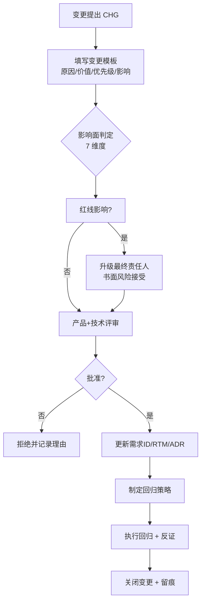

#### 3.4.2 变更模板必填字段

| 字段 | 填写要求 |
|:---|:---|
| 变更 ID | `CHG-NNN` 全局唯一 |
| 提出人/日期 | 实名 + 日期 |
| 新增/移除范围 | 精确描述 |
| 业务价值/紧急原因 | 可度量价值 |
| 对里程碑/成本/人员影响 | 量化影响 |
| 对 API/DDL/状态机/安全影响 | 影响面判定结果 |
| 替代方案与不做的后果 | 必须填写 |
| 测试与验收方式 | 回归 + 反证策略 |
| 产品/技术负责人意见 | 书面签署 |
| 批准结论/日期 | 含条件与期限 |

#### 3.4.3 影响面判定七维度

每次变更必须逐项判定以下七个维度是否受影响：

| 维度 | 判定问题 |
|:---|:---|
| 需求 | 哪些 FR/NFR 受影响？状态如何变？ |
| API | 契约是否破坏？客户端是否需同步？ |
| DDL | 是否需迁移？是否可回滚？ |
| 状态机 | 是否新增/修改状态迁移？终态是否受影响？ |
| 安全 | 授权边界、租户隔离、敏感数据是否受影响？ |
| 隐私 | 采集项、保留期、同意机制是否受影响？ |
| 测试 | 哪些用例需新增/修改？反证是否仍有效？ |

#### 3.4.4 回归策略

| 变更级别 | 判定标准 | 回归范围 |
|:---|:---|:---|
| 重大变更 | 触及红线、状态机、数据模型、授权边界 | 全量集成测试 + 反证 + 故障注入 + 外部抽检（如涉安全） |
| 一般变更 | 局部功能、非核心路径 | 受影响模块的单元 + 集成测试 + 关联反证 |
| 紧急变更 | 线上阻断且需立即修复 | 最小修复 + 定向回归 + 事后补全变更留痕与复盘 |

> **铁律**：任何变更都**不得通过减少安全/一致性验收项来追赶进度**。若阶段退出条件未满足，须记录 `Blocked` 或 `Accepted with conditions`，明确批准人与限制范围。

---

## 四、本项目全量落地细节、真实决策、历史上下文

> 本章所有内容均来自项目真实基线。通过逐条释义，让读者理解"决策背后的决策"。

### 4.1 需求体系地图与四层落地

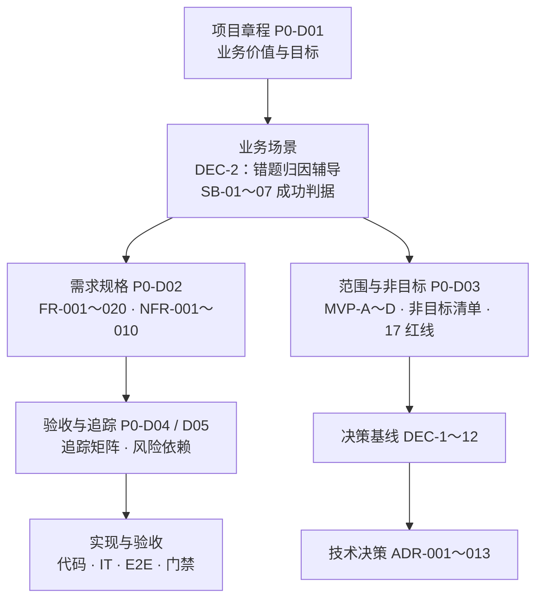

**需求四层落地对照表（本项目）**

| 层级 | 本项目内容 |
|:---|:---|
| 业务需求 | 为初中生提供错题归因与个性化辅导；输出归因结论、错因讲解、可执行步骤、薄弱点更新；成功判据 SB-01～07 |
| 用户需求 | 租户管理员、Agent 作者/业务用户（学生，家长/教师代发）、审批人、平台运维/SRE；外部系统 IAM/OIDC、模型服务、MQ、PG、业务工具 |
| 功能需求 | FR-001～020：Agent 版本、Run 创建、状态持久化、异步 Worker、ModelGateway、Tool SPI、执行时授权、UNKNOWN 对账、协作式取消、预算、审批、多租户隔离、Outbox、fencing、审计…… |
| 非功能需求 | NFR-001～010：安全、数据隔离、一致性、幂等、可恢复性、性能、可观测性、隐私、可维护性、灾备 |

> **历史上下文**：项目最初场景待定（P0-D01 §7 列为待确认事项）。DEC-2 将其冻结为单一真实场景，是为了"用单一场景收敛范围，避免泛化"。这一决策直接决定了后续工具限定为 `get_student_profile` 与 `record_weakness` 两个，而非通用工具集。

### 4.2 DEC 决策基线逐条释义

项目用 DEC-1～12 冻结了 12 项关键需求层取舍。**DEC-8 在决策基线中留空/未单列，属编号连续性处理，不影响决策完整性。**

| 决策 | 内容 | 背景/冲突 | 决策依据 | 影响与约束 | 复审触发 |
|:---|:---|:---|:---|:---|:---|
| DEC-1 | AI Agent 承担产品/业务分析角色 | 团队资源有限 vs 需要完整角色配置 | 项目资源约束 | 需 AI 审查独立性（ISO-1/2）对冲 | 角色配置到位 |
| DEC-2 | 首场景冻结为错题归因辅导 | 场景泛化 vs Single 场景收敛 | 单一真实场景可验证 | 工具限定 get_student_profile/record_weakness | 业务价值被证伪 |
| DEC-3 | IAM/PG/模型等由负责人自提供 | 自建 vs 复用 | 复用降低成本 | 版本/HA 待登记 | 环境策略变化 |
| DEC-4 | 技术基线 Java 21 + Boot 4.x | Boot 3.x vs 4.x | 生态对齐（ADR-011） | Jackson 3/Security 7 破坏性变更 | 生态不兼容 |
| DEC-5 | 首期不做 RAG | 外部知识丰富度 vs 不编造出处 | 首场景用参数内知识 | 需评测证明参数内知识不足才重开 | 评测不达标 |
| DEC-6 | 未成年人数据白名单 + 监护人同意 | 数据丰富度 vs 合规 | PIPL 第 31 条 | 采集限于随机 ID/年级/学科/薄弱点 | 法规变化 |
| DEC-7 | AI 审查独立性 | 效率 vs 客观性 | 避免自审自 | Sev-0/1 外部抽检 ≥30% | 无 |
| DEC-9 | 预算/并发/审批配置化 + fail-closed + 快照 | 硬编码 vs 灵活性 | 灵活不能以配置成后门为代价 | 配置缺失拒绝；快照隔离 | 压测调优 |
| DEC-10 | 零保留条款未确认前禁真实数据进 Prompt | 进度 vs 合规 | 合规硬闸门 | P1 用模拟数据；GATE 1/2/3 | 条款确认 |
| DEC-11 | 审批策略配置化 | 硬编码审批 vs 风险分级 | record_weakness=WRITE_PROFILE/OPTIONAL | 放松属门禁降级需评审 | 风险策略调整 |
| DEC-12 | 主 MQ 用 RabbitMQ | 见 ADR-001 | 定位为唤醒信号 | 接受社区支持期窗口 | 4.4 GA / 停维 |

#### 4.2.1 关键决策深度释义与场景说明

**DEC-2（首场景冻结）**：这是整个需求体系的"定海神针"。它把后续所有 FR 的工具边界、SB 的判据、AT 的测试数据都锚定在"错题归因"上。**场景说明**：若业务方提出"能否顺便做作文批改"，这属于新场景，必须走 CHG 变更流程，而非在现有 FR 上叠加——否则成功判据会失效。

**DEC-5（首期不做 RAG）**：这是最容易被挑战的决策。其取舍逻辑是"不编造出处"优先于"知识丰富度"。**场景说明**：首场景用模型参数内知识即可完成初中错题归因；若引入教材向量检索，一旦检索到错误片段或模型编造页码，会直接违反红线 13（模型输出不得编造出处）。

**DEC-6（未成年人数据白名单）**：合规红线。采集白名单仅限随机 `student_id`、年级、学科、薄弱点；禁止姓名/学校/班级/身份证号/手机号/精确定位/声纹等。**场景说明**：即使业务方认为"加个学校名能提升归因准确率"，也不得纳入——这是 FR-019 的 P0 红线。

**DEC-9（配置化 + fail-closed + 快照）**：灵活性与安全性的平衡。配置化解决"后续谁调参"，但引入三个硬约束：配置缺失拒绝（fail-closed）、配置只能收紧不能放松、Run 创建时快照隔离。**场景说明**：运行中把成本上限从 2.00 调到 3.00，只影响新 Run，不影响已创建 Run，保证同一 Run 前后行为可解释。

**DEC-10（零保留硬闸门）**：进度与合规的冲突决策。允许阶段延后，但不允许越线：P1 一律使用模拟数据，设 GATE-1/2/3 三道闸门。基线显示三家供应商（deepseek/minimax/workbuddy）均已取得书面零保留承诺，GATE-1 由代码强制（`ZeroRetentionGate`，按供应商分别判定）。

> **DEC 与 ADR 的互补关系**：DEC 记录"需求层"取舍（做什么、什么边界），ADR 记录"技术层"取舍（怎么做、选哪个方案）。二者共同构成"决策留痕"，是架构可推翻、可复审的基础。

### 4.3 RTM 可追溯矩阵逐条释义

项目 RTM 来自 `P0-D04`，追踪规则为"需求 ID → 验收标准 → 测试用例 ID → 测试证据/缺陷"。下表为完整 20 条追踪矩阵：

| 需求 ID | 验收条件 | 测试 ID（初始） | 证据类型 | 责任角色 | 阶段门禁 |
|:---|:---|:---|:---|:---|:---|
| FR-001 Agent 版本 | 创建/读取/更新草稿；版本可追溯；未授权主体访问被拒绝 | AT-AGENT-001/002 | API 自动化报告 | 后端+测试 | P2 |
| FR-002 不可变快照 | 发布后修改草稿不影响已创建 Run 的快照；快照 ID 可查询 | AT-SNAPSHOT-001 | 集成测试/数据记录 | 后端+测试 | P2 |
| FR-003 Run 幂等 | 同域同 key 同请求返回一致结果；同 key 不同请求摘要返回冲突；Run/初始事件/幂等记录/Outbox 原子提交 | AT-IDEM-001/002/003 | 并发集成测试、DB 断言 | 后端+DBA+测试 | P2/P3 |
| FR-004 状态迁移 | 非法迁移被拒绝；并发更新不会覆盖终态；状态变化有事件/审计 | AT-STATE-001/002 | 状态机单测/集成测试 | 后端+测试 | P2 |
| FR-005 Outbox/MQ | DB 提交后消息最终可投递；重复投递不重复创建逻辑执行；发布失败可重试 | AT-OUTBOX-001/002 | 故障注入/日志 | 后端+平台+测试 | P2/P3 |
| FR-006 Worker fencing | 租约失效 Worker 无法提交结果；新世代能安全接管 | AT-LEASE-001/002 | 并发测试/DB 断言 | 执行引擎+测试 | P3 |
| FR-007 ModelGateway | 超时、限流、供应商错误被归一化；秘密不出现在日志 | AT-MODEL-001/002 | 契约测试/日志扫描 | AI 接入+安全 | P2/P3 |
| FR-008 Tool SPI | Schema 错误拒绝；超时/错误分类可追踪；模型不能直接越权调用工具 | AT-TOOL-001/002 | 契约/安全测试 | 工具平台+测试 | P2 |
| FR-009 UNKNOWN | 模拟"请求已到下游但响应丢失"时进入 UNKNOWN；对账前禁止盲目重放 | AT-UNKNOWN-001/002 | 故障注入/账本核对 | 后端+测试 | P3 |
| FR-010 结果授权 | 跨租户或无权限读取 Run/结果/事件均被拒绝 | AT-TENANT-001/002 | 安全自动化报告 | 安全+测试 | P2/P3 |
| FR-011 取消竞态 | 取消注册后不得启动新的工具动作；已发出的外部副作用标记为不可保证撤销/按协议对账 | AT-CANCEL-001/002 | 并发测试/事件记录 | 后端+测试 | P3 |
| FR-012 预算预留 | 并发预留不会超出已批准额度；预留有唯一记录；重复结算不重复计费 | AT-BUDGET-001/002 | 并发/账本对账 | 后端+测试 | P3 |
| FR-013 审批消费 | 审批绑定参数摘要和目标；过期/撤销拒绝；消费与取消检查原子协调；崩溃后可恢复 | AT-APPROVAL-001/002 | 集成/故障注入 | 后端+安全+测试 | P3 |
| FR-014 SSE 续传 | 合法 Last-Event-ID 可续传；越权订阅拒绝；游标过期按协议重置 | AT-SSE-001/002 | API/E2E 测试 | API+测试 | P2/P3 |
| FR-015 对象存储授权 | 每次读取重新授权；撤权后旧引用不能继续访问；预签名 URL 过期后不可用 | AT-OBJ-001/002 | 安全集成测试 | 平台+安全+测试 | P3/P4 |
| FR-016 Prompt Injection | 工具输出被当作不可信数据；不能覆写系统策略或绕过权限；输入长度/深度有界 | AT-PROMPT-001/002 | 红队/回归测试 | AI+安全+测试 | P3 |
| FR-017 可观测性 | 关键 Run 可按 ID 追踪；指标不含用户/Run 等高基数标签；日志不含密钥 | AT-OBS-001/002 | 仪表盘/扫描报告 | SRE+安全 | P2/P4 |
| FR-018 业务任务验收 | 选定业务场景在约定数据集上满足 SB-01～SB-07 | AT-BIZ-001…007 | 业务验收记录 | AG-BUS+AG-PO+AG-QA | P2/P5 |
| FR-019 未成年人数据合规 | 采集项在白名单内；无直接身份信息；监护人单独同意留痕且可撤回；撤回后 30 日内删除；不出境、不用于训练 | AT-MINOR-001/002/003 | 合规检查报告 + 删除工单 | AG-SEC+AG-QA | P1/P3/P4 |
| FR-020 输出无编造出处 | Agent 不输出教材引用、页码或资料出处；注入内容不得诱导其声称引用来源 | AT-HALLU-001/002 | 评测集 + 红队回归 | AG-AI+AG-SEC | P2/P3 |

#### 4.3.1 RTM 的四条维护纪律（本项目落地）

1. **双向性**：既要"需求→测试"（防漏测），也要"测试→需求"（防测无用功能）。评审时抽查反向链。
2. **状态即真相**：需求状态只以 RTM 为准，禁止口头宣称"已完成"。代码合并 ≠ Done。
3. **红线需求强制反证**：涉及安全/一致性的 FR（如 FR-003/006/009/010/019/020），验收用例必须包含反证（撤掉修复点会红），否则不予 Done。
4. **变更同步**：需求变更（CHG-编号）必须同步更新 RTM 的受影响行，否则视为变更未完成。

#### 4.3.2 编号溯源说明

基线文档明确：`FR-019/FR-020` 为 DEC-5/DEC-6 引入的新增需求，`FR-011/FR-019/FR-020` 的编号沿用 P0-D02 §5 的 FR 序列。阅读时需注意：**SRS（P0-D02 §5）的 FR-001～020 是技术需求初稿，而 P0-D04 的追踪矩阵在沿用编号时做了语义调整**（例如 SRS 的 FR-011 是"事件查询与 SSE 续传"，而 P0-D04 的 FR-011 是"取消竞态"；P0-D04 额外新增了 FR-018 业务验收、FR-019 未成年人数据合规、FR-020 输出无编造出处）。这是需求追踪中的真实编号漂移点，详见第五章 5.5 节复盘。

### 4.4 FR/NFR 全量清单与验收映射

#### 4.4.1 功能需求（SRS §5 初稿，P0/P1 分级）

| ID | 需求 | 优先级 | 初始验收条件 | 状态 |
|:---|:---|:---|:---|:---|
| FR-001 | Agent 草稿与版本管理 | P0 | 可创建/读取草稿；版本可追溯；越权访问被拒绝 | Draft |
| FR-002 | 发布校验与不可变快照 | P0 | 发布时校验配置；Run 绑定快照 ID/版本 | Draft |
| FR-003 | Run 创建 | P0 | 幂等键域、请求摘要冲突语义；Run/事件/幂等记录/Outbox 原子提交 | Draft |
| FR-004 | Run 状态与步骤持久化 | P0 | 只允许合法状态迁移；并发条件更新；关键迁移可审计 | Draft |
| FR-005 | 异步 Worker 执行 | P0 | Worker 领取、续租；消息重复不重复创建逻辑执行 | Draft |
| FR-006 | ModelGateway | P0 | 供应商类型不泄漏到领域接口；超时/错误映射有测试 | Draft |
| FR-007 | Tool SPI | P0 | 工具具有 Schema、权限声明、超时、错误分类和审计字段 | Draft |
| FR-008 | 执行时授权 | P0 | 工具执行前按当前主体/租户/资源重新授权；拒绝路径有测试 | Draft |
| FR-009 | 工具操作账本与 UNKNOWN | P0 | 外部结果未知时进入 UNKNOWN；对账前不盲目重放 | Draft |
| FR-010 | Run 查询与结果读取 | P0 | 仅授权租户/主体可读取；敏感结果按策略脱敏 | Draft |
| FR-011 | 事件查询与 SSE 续传 | P1 | Last-Event-ID 可续传；过期游标有明确重置语义 | Draft |
| FR-012 | 协作式取消 | P0 | 取消标记与新工具动作启动有明确竞态规则 | Draft |
| FR-013 | 预算预留与结算 | P0 | 并发预留原子；唯一预留记录；重复 usage 不重复计费 | Draft |
| FR-014 | 审批生命周期 | P0 | 审批绑定 operation、参数摘要、资源、审批人和有效期 | Draft |
| FR-015 | 多租户隔离 | P0 | API/DB/缓存/事件/文件/日志均有租户边界验证 | Draft |
| FR-016 | Outbox/MQ | P0 | 状态与 Outbox 原子写入；发布可重试；消费幂等 | Draft |
| FR-017 | Worker fencing 与接管 | P0 | 旧世代不能提交状态/结果；崩溃后可安全接管 | Draft |
| FR-018 | 审计与可观测性 | P0 | 关键动作有审计；日志/Trace 不泄漏秘密；指标标签基数受控 | Draft |
| FR-019 | 对象存储授权 | P1 | 每次读取重新授权；预签名 URL 限定对象、权限和有效期 | Draft |
| FR-020 | 运维恢复与死信处理 | P1 | 有操作手册、告警责任人和恢复演练记录 | Draft |

#### 4.4.2 非功能需求（SRS §6）

| ID | 维度 | 要求 | 数值/策略 |
|:---|:---|:---|:---|
| NFR-001 | 安全 | 认证与资源授权分离；租户 ID 不以客户端输入作为授权依据 | 具体 IAM 映射待确认 |
| NFR-002 | 数据隔离 | 关键表有租户归属和隔离测试；RLS 与连接池事务上下文需验证 | P1 PoC 冻结策略 |
| NFR-003 | 一致性 | PostgreSQL 是 Run/事件/Outbox/操作账本的权威事实源 | 不以 Redis/MQ 为唯一事实源 |
| NFR-004 | 幂等 | 请求幂等键有操作域、请求摘要冲突语义和保留期 | 保留期待 ADR/业务确认 |
| NFR-005 | 可恢复性 | UNKNOWN 不盲目重放；租约/fencing 可测试 | 测试场景见 P0-D04 |
| NFR-006 | 性能 | 建立并发、时延、队列积压、事件吞吐基线 | 数值待容量评估，禁止预先承诺 |
| NFR-007 | 可观测性 | 关键链路具备 correlation/run ID、日志、指标和 Trace | 指标标签不使用高基数敏感字段 |
| NFR-008 | 隐私 | Prompt、工具结果、日志、Trace 和对象内容有独立脱敏/保留策略 | 数据分级/保留期待确认 |
| NFR-009 | 可维护性 | 模块边界清晰，接口契约与自动化测试同步 | 代码评审与 CI 门禁待 P1 定义 |
| NFR-010 | 灾备 | RPO/RTO、备份频率和恢复验证需有业务批准 | 数值待确认，不作为当前承诺 |

> **NFR 量化策略实例（本项目）**：性能维度"建基线但不预先承诺 SLA"，内置 `@ConcurrencyLimit`、租户并发上限 5、单 Run `max-steps 20`；可用性维度 RPO 24h / RTO 4h 作为可配置初值（DEC-9），P4 演练后确认。这正体现了第二章"能量化则量化，不能量化则给策略与门禁"的原则。

### 4.5 17 条验收红线与十条不可妥协原则

#### 4.5.1 P0-D03 的 17 条验收红线

| # | 红线 | 归类 |
|:---|:---|:---|
| 1 | PostgreSQL 是 Run、事件、Outbox、ToolOperation、Approval、Usage 等关键状态的权威事实源 | 一致性 |
| 2 | 只使用一种主 MQ；最终选择进入 P1 ADR，不提前假定 | 架构纪律 |
| 3 | Run 创建、初始事件、幂等记录和 Outbox 在同一事务提交 | 一致性 |
| 4 | Run attempt、ToolOperation 逻辑操作和工具调用 attempt 必须区分 | 一致性 |
| 5 | Worker 租约过期后可接管；旧 fencing 世代不得提交状态或结果 | 一致性 |
| 6 | 取消是协作式停止；外部副作用已发出后不承诺自动撤销 | 副作用治理 |
| 7 | UNKNOWN 必须对账；不得当成普通失败盲目重试或直接释放预算 | 一致性 |
| 8 | 对象存储每次读取重新授权；预签名 URL 限定对象、权限与有效期 | 安全 |
| 9 | 当前授权仍需在旧 Run 恢复和工具执行时重新验证 | 安全 |
| 10 | 高风险例外必须登记责任人、补偿措施、到期日和正式风险接受人 | 治理 |
| 11 | 未成年人数据采集项在白名单内，禁止直接身份信息 | 合规 |
| 12 | 监护人单独同意留痕且可撤回；撤回后 30 日内删除画像 | 合规 |
| 13 | 模型输出不得编造出处（首期不用外部知识库） | 业务正确性 |
| 14 | AI 审查独立性：AG-QA/AG-SEC 与实现方隔离；Sev-0/1 外部抽检 ≥30% 且含全部 Sev-0 | 组织治理 |
| 15 | 配置不得成为绕过门禁的后门；缺失时拒绝（fail-closed）；审批策略只能收紧不能放松 | 安全 |
| 16 | 配置变更须快照隔离：成本/并发/审批在 Run 创建时写入 ExecutionSnapshot | 一致性 |
| 17 | 未成年人数据接入硬闸门：零保留条款未确认前禁止真实学生数据进 Prompt | 合规 |

#### 4.5.2 v3.1 十条不可妥协原则

| # | 原则 | 需求映射 |
|:---|:---|:---|
| 1 | 模型只提出计划和工具调用建议；平台负责授权、调度、执行、持久化与最终交付 | FR-008 执行时授权 |
| 2 | tenant_id/actor_id/权限范围/run_id/trace_id 等可信上下文由服务端构造，不接受模型覆盖 | NFR-001 |
| 3 | PostgreSQL 是任务状态的权威事实来源；MQ 只负责唤醒和分发 | NFR-003 |
| 4 | Run 与 Outbox 事件在同一数据库事务中提交 | FR-003/016 |
| 5 | 每个 Worker 执行世代有单调递增 fencing_token；旧世代不能更新新世代状态 | FR-017 |
| 6 | 有副作用的工具必须具备下游幂等、可查询对账或受控人工处理策略；结果未知禁止盲目重放 | FR-009 |
| 7 | 发布后的 Agent 版本与执行快照不可变；安全授权在每次工具执行前动态检查 | FR-002/008 |
| 8 | 预算由服务端强制执行；调用前预留、调用后结算，重复结算必须幂等 | FR-013 |
| 9 | 外部网页、检索内容和工具结果均为不可信输入，不得升级为系统指令 | FR-016 Prompt Injection |
| 10 | 首期先交付安全、可靠的单 Agent 闭环，不以复杂编排替代可靠性基础 | MVP 定义 |

> **红线判定依据**（与第二章三问呼应）：是否为红线不看"业务价值高低"，而看三点——法律合规、数据一致性底线、安全隔离。命中任一即为红线，不参与优先级裁剪。

### 4.6 MVP-A～D 分批与迭代准入/准出

| 批次 | 范围 | 准入条件（DoR） | 准出条件（DoD） |
|:---|:---|:---|:---|
| MVP-A | Agent 草稿/版本、认证上下文、Run 创建与查询、持久化状态和基础事件 | 需求基线批准，状态机与 API 契约冻结 | Agent 版本可追溯；Run 创建四元素原子提交；越权拒绝有证据 |
| MVP-B | Outbox/MQ/Worker、ModelGateway、只读 Tool SPI、结果持久化 | MVP-A 稳定复现；消息通道可用 | DB 与 Outbox 原子；消费幂等；供应商类型不泄漏 |
| MVP-C | 端到端轨迹、SSE、授权测试、基本预算/审批路径 | 核心闭环可跑通 | Last-Event-ID 续传；授权拒绝测试；预算不超发 |
| MVP-D | UNKNOWN、fencing、故障注入、跨租户测试和生产准入补充门禁 | MVP-C 可稳定复现 | 旧 fencing 世代不可提交；UNKNOWN 不盲放；跨租户反证通过 |

> **关键声明**：此分批**仅用于迭代管理**，不表示可以在未满足安全门禁时把有副作用工具提前开放给真实用户。分批只管交付顺序，不管安全底线。

### 4.7 非目标清单与非目标重新纳入条件

| 类别 | 项目 | 舍弃/延后原因 | 重新纳入条件（触发点） |
|:---|:---|:---|:---|
| 非目标 | 通用多 Agent 协作 | 增加调度/上下文/故障语义复杂度 | 单 Agent 业务价值被验证并形成独立需求 |
| 非目标 | 通用 DAG/工作流引擎 | 超出首期闭环必要范围 | 有明确业务流程、用例和产品负责人 |
| 非目标 | 插件市场 | 涉及分发/版本兼容/供应链/租户治理 | 插件治理模型与安全沙箱专项评审通过 |
| 非目标 | 任意脚本执行/不可信插件沙箱 | 高风险执行面 | 独立威胁模型 + 隔离方案 + 安全批准 |
| 非目标 | 完整商业账单/发票/支付 | 首期只需预算与 usage 一致性 | 商业计费需求与财务口径确认 |
| 非目标 | 通用 BPM 审批中心 | 首期仅约束具体工具操作 | 多业务线复用需求成立且另立项目 |
| 阶段性舍弃 | 首期 RAG/知识库（DEC-5） | 首场景用模型参数内知识，避免编造出处 | 数据 owner + 评测集 + 访问模型 + 收益指标齐备，且评测证明参数内知识不足 |
| 阶段性舍弃 | 无限期保存 Token 流 | 隐私/成本/存储压力 | 明确业务理由 + 保留策略 + 费用审批 |
| 阶段性舍弃 | 固定吞吐 SLA 承诺 | 未完成容量评估 | 压测完成 + 业务/运维批准 SLO |
| 阶段性舍弃 | 自动重试所有失败工具 | 可能重复执行副作用 | 仅针对幂等/可查询且策略明确的操作 |
| 未来扩展点 | 上下文压缩 S4（M11/M12/M14） | ADR-013 定为后续阶段 | 长上下文成本成为瓶颈 |
| 未来扩展点 | RLS→应用层权限彻底迁移 | 影子期需观察真实流量 | `rlsDependent=0` + 观察期达标（M4） |
| 未来扩展点 | 瓶颈模块服务化 | 当前模块化单体已够用 | 某模块成为明确性能/部署瓶颈 |

#### 4.7.1 "未经验证的 RAG"重新纳入条件深度解析

这是本项目最有价值的非目标，其重新纳入条件被设计成**四个必要条件 + 一个验证条件同时满足**：

```
重新纳入 RAG 的条件 =
      数据 owner 明确
    ∧ 评测集建立（A-008 的 20 题标注样本）
    ∧ 访问模型确定（不引入无授权的知识源）
    ∧ 收益指标定义（归因准确率提升目标）
    ∧ 评测显示参数内知识不足以支撑归因准确性
```

**为什么这样设计**：RAG 本身不是坏技术，但在本项目中有三重风险——编造出处（违反红线 13）、引入未授权知识源（违反合规）、增加复杂度（与"单 Agent 闭环"首期目标冲突）。把重新纳入条件写成"多条件同时满足"，既避免了"永远不做"的僵化，也避免了"随时可做"的蔓延。

**未来触发场景**：当 A-008 评测显示 SB-01 归因准确率低于 80% 门槛，且经分析确认失败案例集中在"模型参数内知识缺失"时，可触发 DEC-5 重审，走 CHG 变更流程，并重新评估 +3～4 周工期与 D-011 向量库依赖。

---

## 五、深度问题剖析、踩坑复盘、边界风险

> 本章是白皮书的"价值密度最高"部分：不只讲正确做法，更讲错误是如何发生的、如何在本项目被识别与阻断。所有复盘均基于项目真实基线中的风险登记、决策留痕与门禁追加记录。

### 5.1 需求蔓延与"配置即后门"

#### 5.1.1 问题模式

需求蔓延（Scope Creep）最常见的形态不是"明目张胆加功能"，而是**以"灵活性"之名，行"绕过门禁"之实**。本项目对此有专门的命名——R-020：配置化被当作绕过安全门禁的后门。

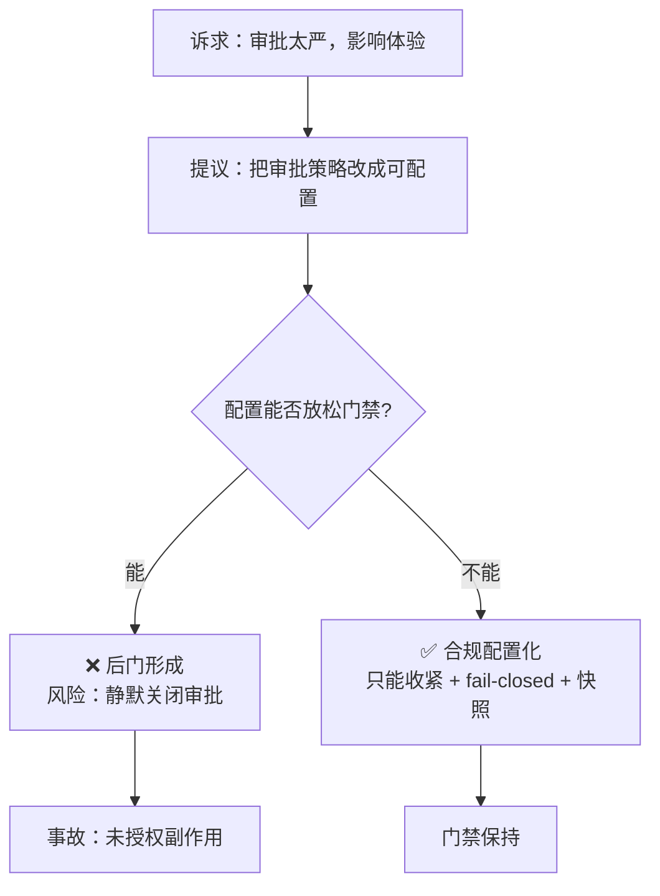

#### 5.1.2 正反案例

| 类型 | 做法 | 判定 |
|:---|:---|:---|
| ❌ 错误 | "把 `WRITE_EXTERNAL` 从 REQUIRED 改成可配置，默认关闭，需要时打开" | 门禁降级，可被静默关闭 |
| ✅ 正确 | 审批策略可配置，但**只能收紧不能放松**；将 REQUIRED 调为非 REQUIRED 属安全门禁降级，必须走 CHG 模板 + ISO-5 外部抽检 | 保持门禁严肃性 |
| ❌ 错误 | 配置读取失败时用默认值放行 | fail-open，配置缺失即失控 |
| ✅ 正确 | 配置缺失/非法时**拒绝而非放行**（fail-closed） | 默认安全 |
| ❌ 错误 | 运行中改成本上限立即对所有 Run 生效 | 同一 Run 前后行为不一致 |
| ✅ 正确 | 成本/并发/审批在 Run 创建时快照写入 ExecutionSnapshot，改配置只影响新 Run | 可解释、可复现 |

#### 5.1.3 根因与对策

**根因**：配置化在带来灵活性的同时，把"安全决策"从代码转移到了运行时数据。若缺乏约束，配置就变成可随时修改的"软开关"。

**对策（本项目 DEC-9/DEC-11 的三重锁）**：
1. **fail-closed**：配置缺失/非法时拒绝。
2. **单向收紧**：审批策略只能收紧不能放松，放松属门禁降级需评审。
3. **快照隔离**：Run 创建时钉死配置值，运行中变更不影响存量 Run。

> **可迁移原则**：任何"把安全规则外置为配置"的设计，都必须同时回答"配置错了怎么办（fail-closed）""谁能改（审批）""改了影响谁（快照）"。

### 5.2 空话 NFR 与不可证伪验收

#### 5.2.1 问题模式

"系统要高性能、高可用、安全可靠"是需求评审中最常见的空话 NFR。它的问题不是"错"，而是**不可证伪**——你无法设计一条测试来判定它是否达标。

#### 5.2.2 本项目的处理范式

| 空话表述 | 项目中的正确转化 |
|:---|:---|
| "高性能" | 建性能基线，P95 ≤ 30s（SB-05），数值待容量评估，禁止预先承诺 |
| "高并发" | Worker 并发 4、租户并发 5、单 Run max-steps 20、max-cost 2.00，全部为配置化保守初值 |
| "高可用" | RPO 24h / RTO 4h 为可配置初值，P4 演练后确认，未演练不作为承诺 |
| "安全可靠" | 拆为 NFR-001～005：认证授权分离、数据隔离、一致性、幂等、可恢复性，各有验证方式 |
| "体验好" | 讲解可执行性评分 ≥ 4/5（SB-02），教师评分量表 |

#### 5.2.3 不可证伪验收的三个典型信号

1. 验收条件中出现"体验良好""性能足够""稳定可靠"等主观形容词。
2. 验收方式写"人工确认"但无评分量表或判定标准。
3. 安全需求只有正向用例（"能访问"），没有反证用例（"越权被拒"）。

> **反证纪律**：涉及安全/一致性的 FR，验收用例必须包含"撤掉修复点会红"的反证。例如 FR-006 fencing 的反证是"旧世代 token 尝试写终态时被拒且状态不变"（AT-LEASE）。

### 5.3 安全/一致性需求被折价的典型路径

#### 5.3.1 问题的实质

优先级治理中最隐蔽的错误，是把安全/一致性需求当作"低业务价值"需求折价。其典型话术是："这个用户感知不到，先绕过，后面补。"

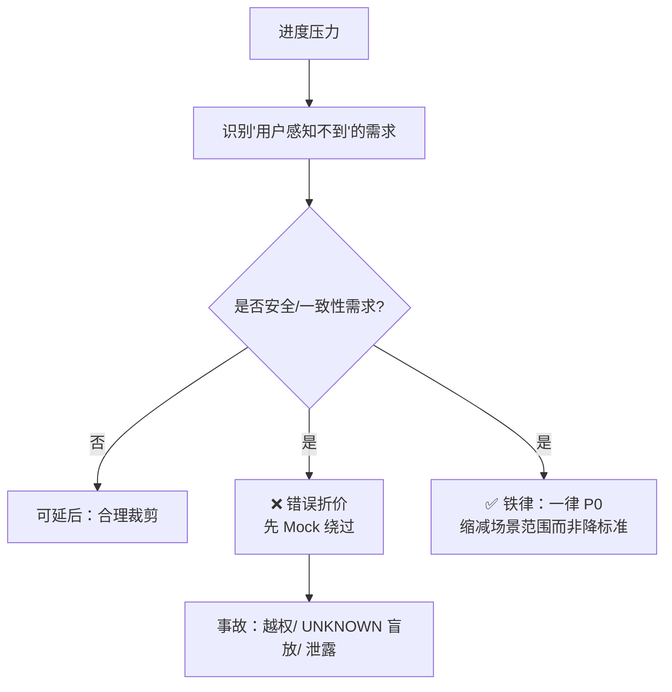

#### 5.3.2 本项目中的具体体现

| 需求 | 表面"无业务价值" | 实际价值形态 | 项目立场 |
|:---|:---|:---|:---|
| FR-009 UNKNOWN 对账 | 用户看不到"对账" | 避免重复写入副作用 | P0，红线 7 |
| FR-017 fencing | 用户看不到"世代" | 避免旧执行者覆盖状态 | P0，红线 5 |
| FR-019 未成年人数据合规 | 不直接提升准确率 | 避免监管处罚、信任崩塌 | P0，红线 11/12 |
| FR-003 幂等原子提交 | 用户不感知"原子" | 避免数据不一致 | P0，红线 3 |

#### 5.3.3 正确立场的表述

安全/一致性需求的**价值形态是"避免损失"而非"创造收益"**。用"业务价值高低"这把尺子衡量它，本身就是范畴错误。本项目的取舍铁律明确：涉及租户隔离、副作用幂等、未成年人数据合规，一律 P0，不参与价值折价。若 P0 无法完成，应**缩减场景范围**（如减少工具数量），而非降低安全/一致性标准。

### 5.4 未经验证的 RAG：最有价值的诱饵

#### 5.4.1 为什么 RAG 是"诱饵"

RAG（Retrieval-Augmented Generation，检索增强生成）在 Agent 项目中几乎是一种"默认正确"的政治正确：似乎加了知识库就更智能。但对本项目首场景，RAG 是**三重风险源**：

1. **编造出处风险**：检索片段 + 模型生成，极易输出不存在的教材引用或页码，直接违反红线 13。
2. **合规风险**：引入未授权知识源可能触碰数据出境、未授权内容。
3. **复杂度风险**：文档切分、入库、检索、RRF 融合（k=60）、`halfvec(4096)` 向量，与"单 Agent 闭环"首期目标冲突。

#### 5.4.2 项目的反诱饵决策

DEC-5 明确首期不做 RAG，使用模型参数内知识。这不是否定 RAG，而是**把 RAG 从"默认必做"改写为"带条件的演进项"**（详见 4.7.1 节的重新纳入条件）。

> **方法论价值**：这是"非目标需求深度沉淀"的典范——既不被技术潮流裹挟，也不把门关死，而是用可判定的重新纳入条件保留演进通道。

#### 5.4.3 何时应该重新打开

触发条件必须来自**评测证据**而非主观感觉：A-008（20 题样本评测）显示 SB-01 归因准确率低于 80% 门槛，且失败案例经分析确认集中在"参数内知识缺失"。此时才触发 DEC-5 重审，走 CHG 流程，并评估 +3～4 周与 D-011 向量库依赖。

### 5.5 AI 全角色承担下的需求治理盲区

#### 5.5.1 结构性风险

本项目十个角色（BUS/PO/PM/ARC/BE/AI/QA/SEC/SRE/EXT）全部由独立 AI Agent 承担（DEC-1）。这带来效率，也带来一个结构性风险：**同基座模型存在相关盲区**，AG-SEC 与 AG-BE 可能共享同类错误，即"自审自"问题。

#### 5.5.2 隔离机制 ISO-1～ISO-5

| 规则 | 内容 | 违反后果 |
|:---|:---|:---|
| ISO-1 | AG-QA/AG-SEC 上下文不得包含实现过程、推理记录、设计草案 | 审查结论作废，任务退回 |
| ISO-2 | 审查方输入仅限需求 ID、代码、测试结果、运行日志、DB 断言 | 同上 |
| ISO-3 | 同一 Agent 不得在同一任务中同时承担 R 与 C/A | DoD 不通过 |
| ISO-4 | AG-ARC 设计的协议由 AG-QA+AG-SEC 交叉审查，不得自审 | 门禁不通过 |
| ISO-5 | Sev-0/Sev-1 结论需 zhouwei 外部抽检，≥30% 且含全部 Sev-0 | 阶段门禁不通过 |

#### 5.5.3 残余风险与最后防线

基线明确承认残余风险："同基座模型存在相关盲区，Sev-0 判定不得仅依赖 AI，必须有自动化测试证据 + 外部抽检。"抽检记录归档至 P4-D09 风险接受单。

#### 5.5.4 真实踩坑复盘一：文档补记返工

**事实**：项目 D1 曾出现"代码提交后才补文档"的返工。

**根因**：事后补记的文档退化为"代码注释的复述"，丢失设计取舍的**理由**。

**纠正**：P0-D06 §8.0 于 2026-10-19 追加"文档前置"硬要求——每个需求必须先有文档再有代码，文档须含决策与理由，实现偏离时先改文档再改代码，完成后回填验证证据与已知限制，并同步更新进度台账。

#### 5.5.5 真实踩坑复盘二：FR 编号漂移

**事实**：SRS（P0-D02 §5）的 FR-001～020 是技术需求初稿，而 P0-D04 的 RTM 在沿用编号时做了语义调整：SRS 的 FR-011 是"事件查询与 SSE 续传"，P0-D04 的 FR-011 是"取消竞态"；P0-D04 额外新增 FR-018 业务验收、FR-019 未成年人数据合规、FR-020 输出无编造出处。

**风险**：同一编号指向不同语义，会导致 RTM 反向追踪错位、测试用例张冠李戴、审计时无法定位真实需求。

**对策**：
1. 需求编号一旦分配即冻结，语义变更必须新开编号并更新 RTM 双向链。
2. 新增需求追加编号（如 FR-021+），不复用已有编号。
3. 变更同步纪律：CHG 必须同步更新 RTM 受影响行，否则视为变更未完成。

#### 5.5.6 真实踩坑复盘三：技术基线偏离

**事实**：v3.1 基线为 Spring Boot 3.x，项目因生态对齐（DEC-4）实际采用 Spring Boot 4.1.1 + Java 21，相对基线发生偏离。

**风险**：Jackson 3、Security 7、模块化 starter、Hibernate 7 等破坏性变更可能导致"构建通过但启动/集成失败"（R-019）。

**对策**：ADR-011 记录偏离理由与影响面；集成测试优先于单测；提供回滚至 3.5.x 的方案与成本记录。

> **可迁移原则**：需求层的"技术基线"也是需求。任何偏离都必须留痕（DEC/ADR）+ 验证（PoC/集成测试）+ 回滚方案，而不是"悄悄换版本"。

#### 5.5.7 真实踩坑复盘四：RabbitMQ 停维残余风险

**事实**：RabbitMQ 4.3 社区支持于 2026-11-30 止，停维后无免费 CVE 补丁（R-022）。项目由 DEC-12 接受该风险。

**处理**：P4 生产准入前评估升级 4.4；升级路径提前演练（4.2→4.3 原地滚动，跨大版本需停机窗口）；P4-D04 安全复核登记该残余风险并由 zhouwei 书面接受。

> **可迁移原则**：风险接受不是"忽略"，而是"有接受人、有期限、有补偿控制、有复审条件"的正式决策。

### 5.6 边界风险登记与复审触发

#### 5.6.1 高风险登记（节选，与需求治理直接相关）

| ID | 风险 | 分级 | 缓解/验证 | Owner | 复审触发 |
|:---|:---|:---|:---|:---|:---|
| R-001 | 场景不明确导致 MVP 无法业务验收 | 高 | P0 冻结场景、判据与业务 owner | 产品/业务 | 判据不可测量 |
| R-012 | 未成年人信息处理不合规 | 高 | 白名单、单独同意、保留期与删除机制 | 安全/法务 | 法规变化 |
| R-016 | AI 全角色共享盲区 | 高 | ISO-1～5 + 外部抽检 ≥30% | 安全/负责人 | 每阶段抽检 |
| R-017 | 学生数据用于训练或出境 | 高 | 零保留条款 + 不出境（已 Mitigated） | 安全/AI | 供应商条款变化 |
| R-018 | 模型编造出处 | 高 | 输出约束 + 无引用字段 + 评测集 | AI/产品 | 评测发现编造 |
| R-020 | 配置化被当作后门 | 高 | fail-closed + 只能收紧 + 门禁降级评审 | 安全/架构 | 配置变更评审 |
| R-021 | 运行中改配置致行为不一致 | 中 | Run 创建时快照 + 快照可查询 | 后端/架构 | 快照设计变更 |
| R-022 | RabbitMQ 停维 | 中 | 升级 4.4 评估 + 书面接受 | 运维/安全 | 4.4 GA / 生产准入 |

#### 5.6.2 边界风险的复审触发清单

以下任一情形出现，必须重新打开对应决策/边界：

| 触发情形 | 重开对象 | 依据 |
|:---|:---|:---|
| SB-01 归因准确率评测不达标 | DEC-5（RAG）、DEC-2（场景） | A-008 |
| 法规变化或监管要求收紧 | DEC-6、FR-019 | R-012 |
| 模型供应商条款变化 | DEC-10、GATE 闸门 | R-017 |
| 压测显示并发/成本初值不合理 | DEC-9 配置初值 | NFR-006 |
| RabbitMQ 4.4 GA 或停维 | DEC-12、ADR-001 | R-022 |
| 业务价值被证伪 | DEC-2 场景冻结 | 决策基线复审触发 |
| 插件治理模型通过专项评审 | 插件市场非目标 | 非目标重新纳入条件 |

> **核心认知**：边界不是墙，而是**带闸门的门**。复审触发清单就是闸门的开启条件。没有复审触发的边界，要么僵化，要么被随意突破。

---

## 六、最佳实践固化、可复用范式沉淀

> 本章把前五章的经验提炼为"可带走、可复用、可自检"的范式。这是白皮书从"项目经验"升华为"组织资产"的关键。

### 6.1 可复用范式总表

| 范式 | 一句话表述 | 适用场景 | 对应章节 |
|:---|:---|:---|:---|
| 四层金字塔 | 业务→用户→功能→非功能，层层可追溯 | 任何需求体系组织 | 2.1 |
| 五级分解 | 场景→流程→任务→FR→验收 | 从业务诉求到可执行需求 | 2.2 |
| INVEST 粒度尺 | 独立/可协商/有价值/可估算/小/可测试 | 判定 FR 粒度 | 2.2 |
| NFR 量化三态 | 量化 / 策略+门禁 / 禁止空话 | NFR 编写 | 2.3 |
| 红线三问 | 合规/一致性/隔离命中任一即 P0 | 优先级判定 | 2.4 |
| 不折价铁律 | 安全/一致性不参与价值折价 | 优先级裁剪 | 2.4/5.3 |
| 边界三件套 | MVP + 非目标（含重开条件）+ 红线 | 范围定义 | 2.5/2.6 |
| DEC/ADR 双层留痕 | 需求层决策 + 技术层决策 | 决策可推翻可审计 | 4.2 |
| RTM 四纪律 | 双向性/状态即真相/强制反证/变更同步 | 需求追踪 | 4.3 |
| 文档先行 | 先文档后代码，写理由不写流水 | DoD | 3.3/5.5 |
| 配置三重锁 | fail-closed + 单向收紧 + 快照隔离 | 配置化安全 | 5.1 |
| 反证纪律 | 撤掉修复点会红吗 | 安全验收 | 5.2 |

### 6.2 需求工程成熟度自检

按五个等级评估团队需求工程成熟度（1 最低，5 最高）：

| 等级 | 名称 | 特征 | 判定问题 |
|:---|:---:|:---|:---|
| 1 | 混沌 | 需求是口头清单，无分层无编号 | 能列出需求清单吗？ |
| 2 | 文档化 | 有 SRS，但 NFR 是空话，边界模糊 | 每条需求有唯一编号吗？ |
| 3 | 结构化 | 四层 + 五级分解 + P0/P1/P2 + RTM | 每条需求可追溯到测试吗？ |
| 4 | 可审计 | DEC/ADR 留痕、反证用例、变更治理 | 每个决策有复审触发条件吗？ |
| 5 | 自演化 | 决策随证据自动重开，成熟度持续度量 | 边界能基于评测证据主动重开吗？ |

**本项目自评**：达到等级 4（可审计），并在"决策重开机制"（等级 5 特征）上有部分实践（DEC-5 的 RAG 重开条件、ADR 复审触发）。改进方向见第七章。

### 6.3 反模式清单（Do / Don't）

| # | Don't（反模式） | Do（正确做法） |
|:---|:---|:---|
| 1 | 需求写成平面清单 | 用四层金字塔组织 |
| 2 | FR 里写具体 MQ/表名/框架 | 写"系统应……"的行为 |
| 3 | 一条 FR 覆盖整个生命周期 | 按 INVEST 拆到可独立验收 |
| 4 | NFR 写"高性能/高可用" | 量化或给策略+门禁+验证 |
| 5 | 把安全需求折价为 P1/P2 | 一律 P0，不参与价值折价 |
| 6 | 非目标写"以后再说" | 写清四要素+可判定重开条件 |
| 7 | 口头宣布"已完成" | RTM 置 Done，验收通过为准 |
| 8 | 配置缺失时默认放行 | fail-closed 默认拒绝 |
| 9 | 运行中改配置影响存量 Run | 配置快照钉死 |
| 10 | 安全用例只有正向路径 | 必配反证（撤掉修复点会红） |
| 11 | 先写代码后补文档 | 文档先行，写理由 |
| 12 | 风险接受靠口头同意 | 书面接受人+期限+补偿+复审 |
| 13 | 技术基线偏离悄悄进行 | DEC/ADR 留痕+验证+回滚 |
| 14 | 同一 FR 编号指向不同语义 | 编号冻结，语义变更新开编号 |
| 15 | AI 审查方接触实现推理 | ISO-1～5 隔离+外部抽检 |

> **沉淀价值**：以上 15 条反模式，每一条都对应本项目基线中的真实决策或踩坑。它们构成了一份"需求工程负面清单"，可直接用于团队培训与代码评审 Checklist。

---

## 七、未来迭代优化路线

> 需求治理不是一次性工程，而是随业务、技术、合规证据持续演化的机制。本章给出本项目的优化路线与决策重开机制。

### 7.1 路线图总览

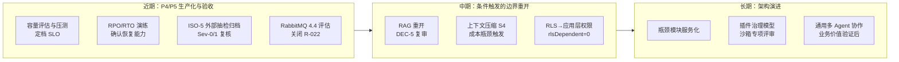

### 7.2 各阶段优化目标与验收指标

| 阶段 | 优化目标 | 关键动作 | 验收指标 | 触发/门禁 |
|:---|:---|:---|:---|:---|
| 近期 P4 | 生产准入能力完备 | 容量评估、压测、RPO/RTO 演练、监控与恢复演练 | SLO 定档；RPO/RTO 实测值；抽检记录归档 P4-D09 | 生产准入评审通过 |
| 近期 P5 | 试点验收与交接 | 灰度、回滚演练、试点复盘、运维交接 | SB-01～07 业务验收；回滚成功；交接完成 | 业务验收与运营交接 |
| 中期 M1 | RAG 边界重开（条件触发） | 评测 A-008 不达标 → DEC-5 重审 → CHG 变更 | 数据 owner + 评测集 + 访问模型 + 收益指标齐备；归因准确率提升 | SB-01 < 80% 且失败集中于参数知识缺失 |
| 中期 M2 | 上下文成本优化 | 启用 ADR-013 的上下文压缩 S4（M11/M12/M14） | 长上下文成本下降，准确率不降 | 长上下文成本成为瓶颈 |
| 中期 M3 | 权限模型演进 | RLS→应用层权限迁移，影子期观察真实流量 | `rlsDependent=0` + 观察期达标 | M4 门禁 |
| 长期 L1 | 瓶颈模块服务化 | 模块化单体中的瓶颈模块拆为独立服务 | 部署/性能瓶颈明确且拆分收益可量化 | 某模块成为明确瓶颈 |
| 长期 L2 | 插件治理 | 建立插件治理模型与安全沙箱 | 专项评审通过 | 治理模型 + 沙箱 + 安全批准 |
| 长期 L3 | 通用多 Agent 协作 | 业务价值验证后另立需求 | 单 Agent 价值被证真并形成独立需求 | DEC-2 复审触发 |

### 7.3 决策重开机制与长期约束

#### 7.3.1 决策重开机制

每条 DEC/ADR 都内置"复审触发条件"，这是决策可推翻的制度保障。重开流程如下：

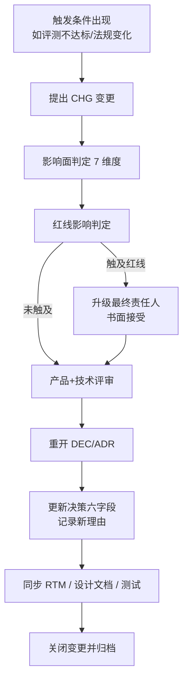

> **铁律重申**：决策重开**只允许调范围/排期/资源，不允许减验收项**（P1-10 门禁原则）。任何阶段退出条件未满足时，须记录 `Blocked` 或 `Accepted with conditions`，明确批准人与限制范围。

#### 7.3.2 长期约束（不可随时间弱化）

以下约束在本项目全生命周期内持续有效，不因迭代而取消：

| 约束 | 来源 | 长期有效性 |
|:---|:---|:---|
| 未成年人数据白名单 + 监护人单独同意 | DEC-6 / FR-019 | 只要服务未成年人即有效 |
| 模型零保留 + 数据不出境 | DEC-10 / R-017 | 只要使用模型服务即有效 |
| PG 为唯一权威事实源 | v3.1 原则 3 / NFR-003 | 架构级不变约束 |
| 配置 fail-closed + 快照隔离 | DEC-9 / DEC-11 | 只要配置驱动安全即有效 |
| 安全/一致性需求不参与价值折价 | 取舍铁律 | 只要存在优先级裁剪即有效 |
| 代码合并 ≠ Done，RTM 状态即真相 | RTM 纪律 | 只要需求追踪机制存在即有效 |
| AI 审查独立性 + 外部抽检 | ISO-1～5 / DEC-7 | 只要 AI 承担审查角色即有效 |

#### 7.3.3 度量与持续改进

建议为每个迭代采集以下需求工程度量，用于持续改进：

| 度量项 | 计算方式 | 目标 |
|:---|:---|:---|
| 需求可追溯率 | 有 RTM 行的需求数 / 总需求数 | 100% |
| 反证覆盖率 | 有反证用例的安全需求数 / 安全需求总数 | 100% |
| 决策留痕完整率 | 六字段齐全的 DEC/ADR 数 / 总决策数 | 100% |
| 编号漂移数 | 同一编号指向不同语义的次数 | 0 |
| 配置门禁降级次数 | 未经评审的配置放松次数 | 0 |
| 文档先行符合率 | 编码前已有设计文档的需求数 / 总需求数 | 趋近 100% |

> **演进愿景**：从成熟度等级 4（可审计）迈向等级 5（自演化）——让边界能基于评测证据**主动重开**，而不是等事故发生后被动补救。这正是"未经验证的 RAG 重新纳入条件"这类机制的设计初衷。

---

## 附录：可复用需求工程全套模板包

> 本模板包可直接复制使用。每个模板含"填写说明 + 样例 + 禁止项"三部分，覆盖需求工程全流程。

### 模板 A｜五级需求拆解模板

**填写说明**：
1. 场景卡须包含触发、角色、前置、输入、主流程、异常分支、输出、成功判据八要素。
2. 主流程每一环节标注对应的 FR 编号，异常分支也要落到 FR。
3. FR 描述用"系统应……"句式，一条 FR 一个可观察行为。
4. 验收判据用 Given/When/Then，不得含主观形容词。
5. 拆解完成后用 INVEST 六项自检。

**样例**：

```markdown
## 场景 SC-01：学生提交错题并获得归因辅导
- 触发：学生在授权下提交一道错题（题目 + 解题过程 + 正确答案）
- 主角色：学生（家长/教师代发）　次要角色：审批人、系统工具
- 前置：请求主体已认证，租户与 Agent 权限有效，零保留闸门通过
- 输入：题目文本、解题过程文本、正确答案、随机 student_id、年级、学科
- 主流程：
  1. 读取学习画像 → 系统应在授权下调用 get_student_profile → FR-001
  2. 错因归因与讲解生成 → 系统应经 ModelGateway 生成结构化结果 → FR-002
  3. 记录薄弱点 → 系统应在幂等约束下调用 record_weakness → FR-003
- 异常分支：
  - 若工具响应丢失 → 进入 UNKNOWN，对账前不重放 → FR-004
  - 若连续 3 次失败 → 转人工教师 → FR-005
- 输出：归因结论、错因讲解、可执行步骤、薄弱点更新结果
- 成功判据：SB-01 归因准确率 ≥ 80%

## 拆解出的 FR
| FR  | 描述 | 优先级 | 验收判据（Given/When/Then） |
|-----|------|--------|---------------------------|
| FR-001 | 系统应在授权下读取学习画像 | P0 | Given 有效租户主体 When 读取画像 Then 仅返回本租户画像，越权被拒 |
| FR-003 | 系统应在幂等约束下记录薄弱点 | P0 | Given 同幂等键 When 重复提交 Then 不产生重复薄弱点 |
```

**禁止项**：
- ❌ 在 FR 中写具体技术名词（RabbitMQ、表名、框架）。
- ❌ 一条 FR 覆盖多个不相关行为（如"管理整个 Run 生命周期"）。
- ❌ 验收判据出现"快""好""稳定"等主观词。
- ❌ 异常分支无明确处理终点。

---

### 模板 B｜优先级判定模板

**填写说明**：
1. 先做红线三问（合规/一致性/隔离），命中任一直接 P0。
2. 未命中红线时，判断"不做是否阻断首期闭环"，是则 P0。
3. 首期需要但可分批 → P1；明确延期 → P2。
4. 在标签内用价值-风险象限二次排序。
5. 裁剪必须记录"砍了什么、为什么、何时补回"。

**样例**：

```markdown
| 需求 | 红线三问 | 阻断闭环? | 可分批? | 优先级 | 象限 | 裁剪处理 |
|------|---------|----------|--------|--------|------|---------|
| 未成年人数据白名单 | 命中合规 | 是 | 否 | P0 | 高价值高险 | 不可裁剪 |
| SSE 事件续传 | 否 | 否 | 是 | P1 | 高价值低险 | MVP-C 交付 |
| 完整账单系统 | 否 | 否 | 否 | P2 | — | 移入 backlog，附重开条件 |
```

**禁止项**：
- ❌ 把安全/一致性需求按"业务价值低"折价为 P1/P2。
- ❌ 裁剪 P0 需求（应缩减场景范围而非降标准）。
- ❌ 裁剪不留痕、不更新 RTM 状态。
- ❌ 用 P0/P1/P2 之外的自造标签。

---

### 模板 C｜边界清单模板（MVP / 非目标 / 红线）

**填写说明**：
1. **MVP 必做**：从闭环倒推"不做就不成立"的能力，每项写不可妥协验收边界。
2. **非目标**：每项写清"为什么不做 / 短期代价 / 长期约束 / 未来触发条件"四要素。
3. **红线**：编号化硬约束，标注归类（合规/一致性/安全/治理）。
4. 重新纳入条件必须可判定，写成多条件同时满足。

**样例**：

```markdown
## MVP 必做
| 能力域 | 首期范围 | 不可妥协验收边界 |
|--------|---------|----------------|
| 副作用治理 | ToolOperation 账本、稳定幂等、UNKNOWN 对账 | 未知结果不盲目重放 |

## 非目标
| 非目标 | 为什么不做 | 短期代价 | 长期约束 | 未来触发条件 |
|--------|-----------|---------|---------|-------------|
| 首期 RAG | 首场景用参数内知识，避免编造出处 | 无外部知识丰富度 | 不引入向量库 | 数据owner+评测集+访问模型+收益指标齐备，且评测证明参数内知识不足 |

## 验收红线
| # | 红线 | 归类 |
|---|------|------|
| 1 | PG 是关键状态权威事实源 | 一致性 |
| 2 | 未成年人采集项在白名单内 | 合规 |
```

**禁止项**：
- ❌ 非目标写"以后再说""视情况而定"（不可判定）。
- ❌ 红线不编号或遗漏合规/一致性/安全类。
- ❌ MVP 必做清单混入"锦上添花"功能。
- ❌ 重新纳入条件只写单一模糊条件。

---

### 模板 D｜需求追踪矩阵（RTM）模板

**填写说明**：
1. 需求 ID 与 SRS 严格一致；编号一旦分配即冻结，语义变更新开编号。
2. 每条需求填设计文档（精确到章节）与实现模块（精确到类）。
3. 验收用例精确到方法名；安全/一致性需求必有反证标记。
4. 状态只用枚举值：Draft/In Review/Approved/Deferred/Rejected/Done。
5. 维护双向性：既查"需求→测试"（防漏测），也查"测试→需求"（防测无用功能）。

**样例**：

```markdown
| 需求 ID | 需求描述 | 优先级 | 设计文档 | 实现模块 | 验收用例 | 验收级别 | 状态 | 反证 |
|---------|---------|--------|---------|---------|---------|---------|------|------|
| FR-003 Run 创建 | 系统应在单事务内创建 Run 及关联元素 | P0 | v3.1 §4 / P0-D03 | RunCreationService | RunCreationIT.testAtomicCreation | 集成 | Done | 是 |
| FR-006 fencing | 旧世代不能提交状态 | P0 | v3.1 §3.5 | JdbcRunClaimRepository | fencing 接管反证 IT | 集成 | Done | 是 |
| NFR-002 数据隔离 | 跨租户访问被拒 | P0 | 威胁模型 | TenantSessionBinder | 跨租户访问反证 IT | 集成 | In Review | 是 |
```

**禁止项**：
- ❌ 代码合并即置 Done（须验收通过）。
- ❌ 安全需求无反证用例。
- ❌ 状态使用枚举外的值（如"基本完成"）。
- ❌ 同一编号指向不同语义（编号漂移）。
- ❌ 变更未同步更新 RTM 受影响行。

---

### 模板 E｜DEC 决策基线模板（补充）

**填写说明**：
1. 六字段齐全：编号、决策内容、背景/冲突、决策依据、影响与约束、复审触发条件。
2. "背景/冲突"必须写清两个对立选项。
3. "复审触发"必须可判定，禁止"待定"。

**样例**：

```markdown
| 字段 | 内容 |
|------|------|
| 编号 | DEC-10 |
| 决策内容 | 零保留条款未确认前禁止真实学生数据进 Prompt |
| 背景/冲突 | 项目进度 vs 未成年人数据合规 |
| 决策依据 | PIPL 第 31 条；模型服务零保留条款未定 |
| 影响与约束 | P1 阶段用模拟数据；设 GATE-1/2/3 硬闸门 |
| 复审触发 | 三家供应商均取得书面零保留承诺后重开 |
```

**禁止项**：
- ❌ 只写结论不写理由。
- ❌ 复审触发写"待定"或"以后看情况"。
- ❌ 把技术选型决策混入 DEC（应进 ADR）。

---

### 模板 F｜NFR 治理模板（补充）

**填写说明**：
1. 质量维度按 ISO/IEC 25010 选取（性能、安全、可靠性、可维护性等）。
2. 能量化则量化（P95、并发上限、RPO/RTO）；不能量化则写"策略 + 门禁 + 验证方式"。
3. 必须填写不达标后果与责任人。

**样例**：

```markdown
| NFR 编号 | 质量维度 | 目标值/策略 | 验证方式 | 责任人 | 不达标后果 |
|---------|---------|------------|---------|--------|-----------|
| NFR-006 | 性能 | 建基线，禁止预先承诺 SLO；租户并发上限 5 | 压测报告 + 仪表盘 | SRE | 容量失控，阻断上线 |
| NFR-002 | 数据隔离 | 关键表有租户归属；RLS + 事务上下文验证 | 跨租户访问反证 IT（NOBYPASSRLS） | 架构+安全 | 数据泄露，阻断上线 |
```

**禁止项**：
- ❌ 用"高性能/高可用/安全可靠"等空话。
- ❌ 未量化也未给策略与门禁。
- ❌ 性能数值未完成容量评估即承诺 SLO。

---

### 模板 G｜需求变更（CHG）模板（补充）

**填写说明**：
1. 变更 ID 全局唯一；必填影响面七维度判定结果。
2. 触及红线的变更必须升级最终责任人书面风险接受。
3. 必须填写"替代方案与不做的后果"。
4. 批准后同步更新需求 ID、RTM、ADR/设计文档。

**样例**：

```markdown
| 字段 | 内容 |
|------|------|
| 变更 ID | CHG-001 |
| 提出人/日期 | AG-PO / 2026-11-23 |
| 新增/移除范围 | 新增 record_weakness 审批 REQUIRED 策略 |
| 业务价值/紧急原因 | 提升写画像操作的安全性 |
| 对 API/DDL/状态机/安全影响 | 安全：审批收紧；状态机无变化 |
| 替代方案与不做的后果 | 不做则维持 OPTIONAL，存在未授权写入风险 |
| 测试与验收方式 | AT-APPROVAL-001/002 + 外部抽检 |
| 产品/技术意见 | 同意（收紧，非门禁降级） |
| 批准结论/日期 | 批准 / 2026-11-23 |
```

**禁止项**：
- ❌ 通过减少安全/一致性验收项追赶进度。
- ❌ 口头同意替代书面风险接受。
- ❌ 变更未同步 RTM 即视为完成。

---

## 结尾声明

本白皮书基于项目真实基线独立成文，旨在为企业级软件需求工程与边界治理提供一套"理论—流程—落地—复盘—演进"的完整方法论与可复用模板包。

1. **事实边界**：文中"本项目"部分的事实、数值、版本与决策均来自 `系统架构设计思路与企业级工程化实践.md` 第 0/1 章及附录、`P0-D01～D06` 需求文档包、`Java SaaS Agent 平台：规划与技术架构设计方案 v3.1` §0.4 原则。凡标注"待确认/待评审/保守初值"者，均为写作时点快照，实施前须核对最新基线。
2. **方法复用**：第二章、第三章、第六章、附录模板为通用可复用内容，可迁移至其他中大型后端项目；迁移时应结合本组织合规、团队与技术栈裁剪。
3. **效力层级**：本专题为方法论与培训材料，**不替代** SRS、v3.1 架构方案、各 ADR 与 DEC 的契约效力。具体实施契约以上述基线文档与源码为准。
4. **使用建议**：用于团队培训时按章节顺序通读；用于架构答辩时重点准备第四、五章的证据链；用于项目审计时对照第四章 DEC/RTM/红线清单与附录模板逐条核查。

> **一句收束**：需求治理的终点不是"写完文档"，而是让每一个决策都可追溯、每一个边界都可守护、每一次变更都可审计、每一个风险都有归宿——这正是企业级工程化与作坊式开发的根本分野。

*文档结束 · 专题 1 · v1.0 · 2026-11-23*
