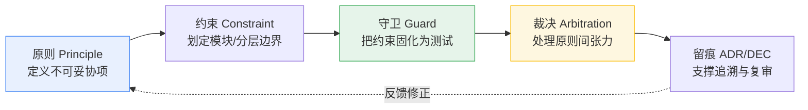
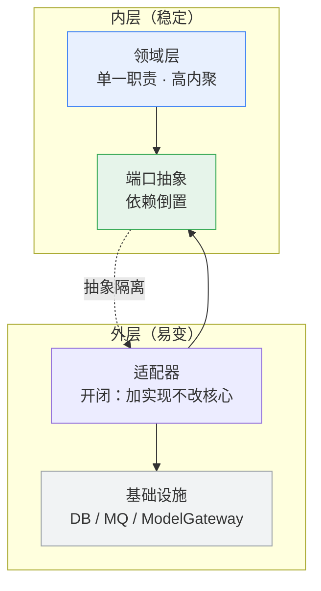
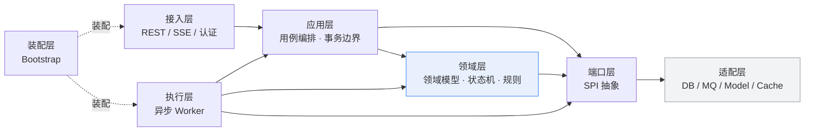
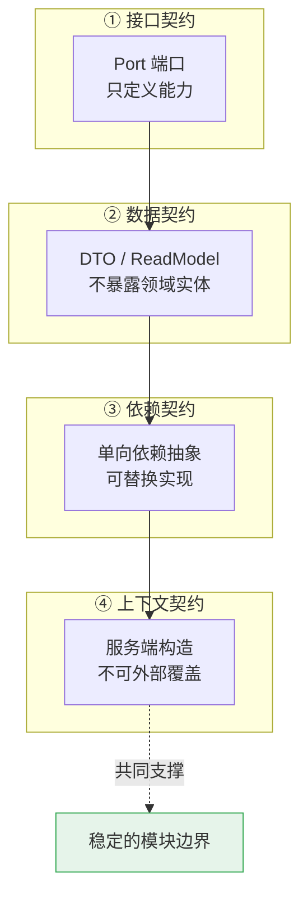
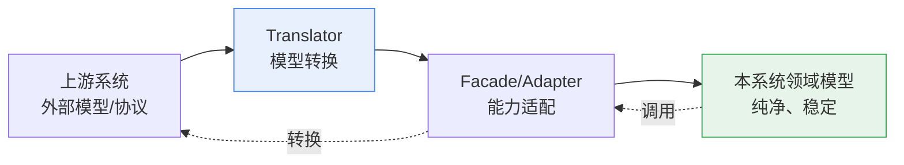
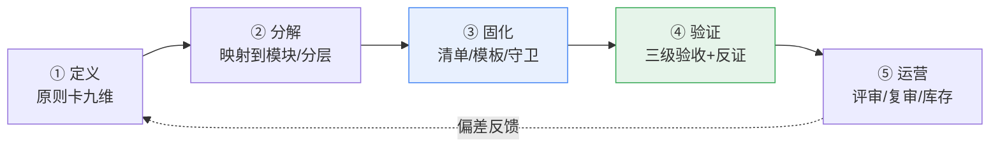
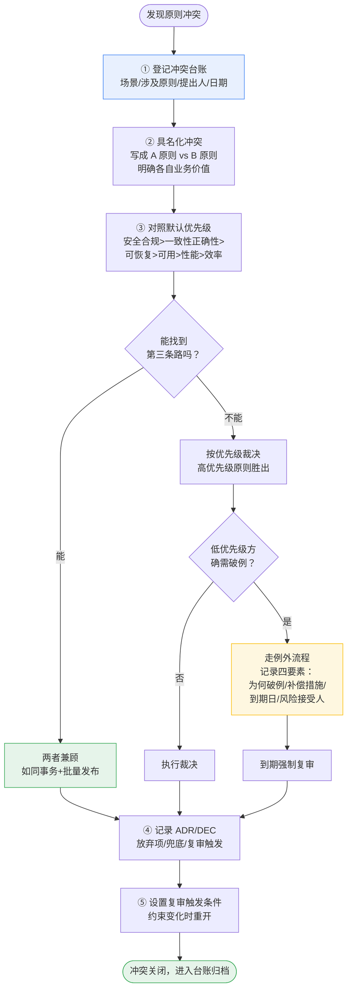

# 企业级架构设计原则、约束体系与冲突裁决专题白皮书

| 元信息项 | 内容 |
|:---|:---|
| 文档名称 | 企业级架构设计原则、约束体系与冲突裁决专题白皮书 |
| 专题编号 | 专题 2 |
| 版本 | v1.0 |
| 日期 | 2026-11-23 |
| 定位 | 团队培训教材 + 架构答辩支撑材料 + 项目审计依据；独立成文，读者无需阅读主文档即可完整理解 |
| 适用对象 | 架构师、技术负责人、后端/平台负责人、测试与安全负责人、SRE、审计与合规评审人 |
| 事实基线 | `系统架构设计思路与企业级工程化实践.md` 第 0 章、第 2 章（§2.7 十条原则、§2.8 裁决）、第 6 章守卫体系；`Java SaaS Agent 平台：规划与技术架构设计方案 v3.1` §0.4 十条不可妥协原则 |
| 引用纪律 | 本文所有"本项目"事实均来自上述基线；方法论部分为通用可复用内容，明确标注"通用"与"本项目"边界；不臆造未见于基线的决策与数据 |
| 阅读约定 | `DEC-N` 为决策基线，`ADR-NNN` 为技术架构决策，`F-N` 为分层依赖禁止项，`P-N` 为不可妥协原则，`Sev-N` 为故障严重级别 |
| 配套输出 | 文末附三件可直接使用的交付物：架构原则评审清单、架构红线自查表、冲突裁决流程图（Mermaid） |

---

## 目录

> 本目录为自包含导航结构；七个一级章节固定，不随内容增删，便于培训、答辩与审计时精确定位。

- **一、章节背景与复杂度分析**
  - 1.1 架构原则与约束体系为何是企业级系统的"第一性工程"
  - 1.2 项目背景速览（自包含介绍）
  - 1.3 复杂度六维分析
  - 1.4 本专题的使用方式与边界声明
- **二、通用行业标准方法论（可复用）**
  - 2.1 架构设计的本质：约束下的可追溯决策
  - 2.2 软件架构四大核心设计思想（分布式业务系统深度释义）
  - 2.3 分层架构标准模型（目的、依赖方向、隔离规则、F-1～F-7 禁止项）
  - 2.4 模块边界与契约治理（接口/数据/依赖/上下文四类契约）
  - 2.5 架构原则冲突完整裁决体系（冲突清单、优先级公式、五步法）
  - 2.6 架构红线、架构禁区与防腐层（ACL）设计
- **三、企业级落地流程、清单、模板、规范**
  - 3.1 原则体系落地五阶段流程
  - 3.2 架构原则卡九维模板
  - 3.3 分层与依赖治理落地清单
  - 3.4 契约治理四张模板
  - 3.5 冲突裁决 SOP 与记录模板
  - 3.6 架构守卫设计与落地规范（剥注释保留字符串、反证纪律）
  - 3.7 三级验收规范
- **四、本项目全量落地细节、真实决策、历史上下文**
  - 4.1 项目坐标与决策基线
  - 4.2 十条不可妥协原则逐条九维详解（重头）
  - 4.3 分层架构在本项目的落地
  - 4.4 契约治理落地（SSE 13+1、双通道分流）
  - 4.5 冲突裁决真实决策记录
  - 4.6 架构守卫在本项目的落地清单
- **五、深度问题剖析、踩坑复盘、边界风险**
  - 5.1 十大典型踩坑复盘
  - 5.2 原则冲突深度案例库
  - 5.3 边界风险清单
  - 5.4 架构退化早期信号
- **六、最佳实践固化、可复用范式沉淀**
  - 6.1 可复用范式总表
  - 6.2 架构守卫编写范式
  - 6.3 "约定即代码"防腐范式
  - 6.4 裁决纪律固化
  - 6.5 培训与答辩话术沉淀
- **七、未来迭代优化路线**
  - 7.1 分阶段演化路线图
  - 7.2 复审触发条件
  - 7.3 风险与依赖
  - 7.4 交付物一：架构原则评审清单
  - 7.5 交付物二：架构红线自查表
  - 7.6 交付物三：冲突裁决流程图（Mermaid）
  - 7.7 结尾声明

---

## 一、章节背景与复杂度分析

### 1.1 架构原则与约束体系为何是企业级系统的"第一性工程"

在软件工程实践中，存在一种普遍的认知偏差：把"架构"等同于"技术选型清单""模块拆分图"或"数据库表设计"。这类产出回答了"用什么"和"是什么"，却没有回答**"为什么这样切分"**以及**"如何保证半年后仍不被改坏"**。本专题开篇即确立一个贯穿全文的判断：

> 架构设计不是画图与选框架，而是**在约束条件下，对"系统如何切分、如何协作、如何演化"做出一组可追溯、可验证、可推翻的决策**。

这组决策若要真正落地并长期有效，必须依靠三件相互咬合的工件，缺一不可：

| 工件 | 回答的问题 | 缺失后的典型退化 |
|:---|:---|:---|
| **原则（Principle）** | 什么不可妥协、为什么 | 评审时各说各话，靠"我觉得"拍板 |
| **约束体系（Constraint System）** | 边界在哪里、如何隔离 | 跨层穿透、职责蔓延、依赖反转 |
| **裁决机制（Arbitration）** | 冲突时谁优先、如何留痕 | 临时权衡累积成技术债，无人能追溯 |

三者构成一条完整的因果链：**原则确立方向 → 约束划定边界 → 守卫固化边界 → 裁决处理原则之间的张力 → 决策留痕支撑演化与审计**。可以看到，约束体系是原则从"口号"变成"代码事实"的中间枢纽，而裁决机制是系统在多目标张力下保持逻辑闭环的关键阀门。没有裁决机制的原则体系是脆弱的——因为真实工程中的原则几乎总会冲突（一致性 vs 性能、安全 vs 效率、正确性 vs 可用性），若没有预先定义的优先级，团队就会在每一次冲突中重新发明标准。

本专题的核心命题由此展开：**一套企业级架构能否长期稳定，不取决于原则是否"先进"，而取决于原则是否被清晰地定义、被结构化地约束、被自动化地守卫，以及在冲突时是否有一套确定性的裁决办法**。这也是为什么本项目把十条不可妥协原则、F-1～F-7 分层禁止项、静态守卫体系与裁决五步法作为一个整体来设计，而不是孤立地罗列。



图 1-1：原则—约束—守卫—裁决—留痕的闭环（本专题主线）

### 1.2 项目背景速览（自包含介绍）

> 本节为自包含介绍，确保读者无需阅读主文档即可理解后文全部"本项目"论断。所有事实均来自事实基线，未作任何扩充或推测。

**业务定位**：本项目是面向 K12 场景的**多租户 SaaS Agent 平台**，包名 `cn.studykid.multiagent`。平台服务对象是**未成年人**，因此个人信息的采集与处理受到《个人信息保护法》（PIPL）的严格约束，尤其是涉及不满十四周岁未成年人的敏感个人信息，需要监护人单独同意——这是全项目最高优先级的合规红线，直接决定了"数据丰富度让位于合规"的一系列取舍。首个落地场景为初中生错题归因。

**技术基线（已冻结）**：Java 21 LTS · Spring Boot 4.1.1 · Spring Framework 7 · Jakarta EE 11 · PostgreSQL 17 · RabbitMQ 4.3.6 · MyBatis-Plus 3.5.17 · Druid 1.2.28 · RE2/J 1.8 · JUnit 6。其中 Boot 版本选择 4.1.1 而非 4.0.x 的原因，是必须覆盖 18 周分阶段交付（P0～P4）的全周期支持窗口。

**系统形态**：后端由**双 reactor** 构成——`platform`（13 个 Maven 模块，承载控制面与执行面）与 `rag`（11 个 Maven 模块，承载检索、摄取与治理）。客户端包括面向学生/租户端的 `frontend`（React18 + Vite6）与面向平台管理端的 `admin-console`（React18 + AntD5，`/admin/`）。可观测层由 OpenTelemetry + Prometheus + Grafana + 审计报告组成。

**数据与控制主线**：以 PostgreSQL 为**唯一权威事实源**，配合 Outbox 模式 + PG 表队列 + Worker 执行；配置通过不可变执行快照"钉死"；多租户隔离通过 RLS 行隔离实现，核心机制是事务内设置 GUC `app.tenant_id`（`set_config` 必须在业务 SQL 之前）。消息通道默认 `database`（PG 表队列），Worker 并发 4、租户并发 5、单 Run `max-steps=20`、`max-cost=2.00`。

**核心业务闭环**：创建/发布 Agent → 绑定不可变执行快照 → 创建 Run → Outbox/MQ 投递 → Worker 执行单 Agent Loop → ModelGateway 决策 → 经唯一闸门调用受控工具 → 持久化步骤/事件/结果 → 查询轨迹与审计。

**三条设计主线**（理解本项目所有原则的钥匙）：
1. **治理期**：把能力算成**不可变闭包**并双人复核发布——发布后的 Agent 版本与快照不可修改。
2. **运行期**：每个 Run **钉死配置快照**，工具调用穿过唯一闸门；预算由服务端预留与结算。
3. **全链路**：以 PG 为权威源，以租约/fencing/UNKNOWN 对账保障可靠性，以 fail-closed 与架构守卫防止退化。

**规模与约束基线**（所有架构取舍的前提）：

| 约束维度 | 取值/事实 | 对架构的直接影响 |
|:---|:---|:---|
| 业务体量 | 单/少租户试运营，首个场景为初中生错题归因 | 拒绝微服务过度设计；采用模块化单体 + 独立 Worker |
| 消息量级 | 每 Run 一条唤醒消息，低吞吐 | MQ 只需 at-least-once + 死信，Kafka 吞吐优势无用武之地 |
| 并发模型 | 默认 `database` 通道（PG 表队列）；Worker 并发 4、租户并发 5 | 有效并发由队列 + 租约控制，背压看活动通道深度 |
| 数据规模 | platform 库 75 表 / 41 RLS / 49 策略；rag 库 15 表 / 43 策略；向量 `halfvec(4096)` | 单库可承载，无需分库分表；PG 同时承担关系与向量检索 |
| 团队/运维 | 小团队、无专职 SRE | 选型以"运维简单"为高权重，社区版 + 接受支持期窗口 |
| 合规 | 未成年人敏感个人信息（PIPL 第 31 条）、模型零保留、数据不出境 | 采集白名单 + 监护人单独同意 + 零保留硬闸门，合规优先于数据丰富度 |
| 时间窗 | 18 周分阶段交付（P0～P4） | Boot 版本须覆盖全周期，故选 4.1.1 |

> 上述基线是**决策的输入，不是结论**。任一约束变化（体量增长、社区停维、合规收紧）都应依照对应 ADR 的"复审触发条件"重新打开决策——这正是第七章演化路线的立论基础。

### 1.3 复杂度六维分析

企业级架构之所以需要"原则—约束—裁决"的完整体系，根源在于其复杂度的多维叠加。单一维度的复杂度可以靠经验处理，多维度的相互耦合则必须依靠结构化的方法。本项目在六个维度上同时承压：

| 复杂度维度 | 具体表现 | 引发的架构张力 | 本专题对应的治理手段 |
|:---|:---|:---|:---|
| **业务复杂度** | Agent 治理、Run 执行、工具调用、审批、预算多条业务线并存 | 控制面与执行面职责易混淆 | 单一职责、分层隔离（§2.2/2.3） |
| **合规复杂度** | 未成年人 PIPL、零保留、数据不出境、模型供应商条款 | 数据价值 vs 合规红线 | 合规置于裁决优先级首位（§2.5） |
| **技术复杂度** | PG RLS/FORCE RLS、Outbox、租约/fencing、双 reactor、向量检索 | 一致性 vs 性能，正确性 vs 可用性 | PG 权威源、同事务、守卫（§4.2/3.6） |
| **组织复杂度** | 小团队、无专职 SRE、多人协作修改同一代码库 | 约定靠人记 → 快速腐蚀 | 约定固化为静态守卫（§3.6/6.2） |
| **演化复杂度** | 18 周分阶段、Boot 版本覆盖全周期、未来可能换 MQ | 当下实现 vs 未来可回滚 | OCP/DIP、端口前移、ADR（§2.2/7.2） |
| **度量复杂度** | 指标口径、覆盖率样本量、"链路成功≠任务成功" | 可观测性制造虚假安全感 | 指标口径纪律、fail-closed 守卫（§5.3） |

一个关键的洞察是：**复杂度本身不可怕，可怕的是复杂度之间缺乏明确的取舍规则**。例如"合规要求数据不出境"与"提升模型效果希望接入更多数据"的冲突，如果没有预设裁决优先级，就会演变成无休止的争论；而本项目通过"安全/合规 > 一致性/正确性 > 可恢复性 > 可用性 > 性能 > 开发效率"的默认序，使这类冲突有确定性的解法。

### 1.4 本专题的使用方式与边界声明

**三种使用场景**：

| 场景 | 阅读路径 | 重点关注 |
|:---|:---|:---|
| **培训** | 一 → 二 → 四（§4.2） → 六 | 建立方法论框架，理解十条原则的 9 维内涵 |
| **架构答辩** | 二（§2.5） → 四 → 五 → 七（§7.4～7.6） | 能回答"为什么这样切""冲突如何裁""如何防退化" |
| **项目审计** | 一（§1.2） → 四 → 五 → 七（三件交付物） | 逐条核对原则落地证据、红线自查、守卫反证 |

**边界声明**：

1. 本文的"通用方法论"章节（第二章及第三章前半）给出可直接迁移到任何后端项目的框架、清单与模板；"本项目落地"章节（第四章及第五章）映射到 `java-multi-agent` 的真实决策、约束与证据。二者以小节标题明确区分。
2. 本文**不替代**主文档或 v3.1 架构方案，而是把其中分散的原则、约束、裁决、守卫内容重新组织为一份自包含的专题，便于独立培训与审计。
3. 十条原则、F-1～F-7 禁止项、技术栈版本、数据规模等事实，均严格来自事实基线；任何看似"补充"的细节若未在基线出现，均不作断言。
4. 文末三件交付物为可直接落地的工件，读者可复制到评审与自查流程中使用。

---

## 二、通用行业标准方法论（可复用）

> 本章给出的方法论可迁移到任何中大型后端系统。所有内容标注为"通用"，本项目映射仅作为佐证，不构成方法论的一部分。

### 2.1 架构设计的本质：约束下的可追溯决策

架构设计包含四个关键词，构成后续全部章节的底层逻辑：

| 关键词 | 含义 | 落地要求 |
|:---|:---|:---|
| **约束条件** | 业务体量、团队规模、合规、技术栈、时间窗、成本 | 架构不是追求"最优"，而是追求"约束下最合适" |
| **切分/协作/演化** | 静态边界（怎么切）、运行时交互（怎么连）、时间维度（怎么变） | 分别产出分层图、依赖规则、调用链、状态机、演化路线 |
| **可追溯** | 每个决策都有"当时为什么" | 用 ADR/DEC 记录，不依赖口头记忆 |
| **可验证/可推翻** | 决策有验收标准，也有"何时重新打开"的触发条件 | 反证纪律 + 复审触发条件 |

架构设计回答四类根本问题：**切什么**（边界与职责）、**怎么连**（依赖与数据流）、**凭什么稳**（可靠性与安全）、**怎么变**（演化与治理）。一套完整的架构产出分三层：

- **决策层（灵魂）**：原则、权衡、技术选型及理由——回答"为什么"。
- **结构层（骨架）**：分层、模块边界、依赖关系、调用链、状态机——回答"是什么"。
- **工程层（肌肉）**：规范、静态守卫、测试门禁——回答"如何不跑偏"。

> 工程警示：很多团队只有结构层（一张模块图），缺少决策层与工程层，于是架构在 3～6 个月内退化。典型早期信号包括：新人问"为什么用 A 不用 B"无人能答（决策层缺失）；出现跨层直接 import（结构层被突破）；code review 反复提醒"记得先做某步"（工程层缺失）。任一信号出现，应在下一个迭代内补 ADR 或补守卫，而非等到事故后补救。

### 2.2 软件架构四大核心设计思想（分布式业务系统深度释义）

高内聚低耦合、单一职责、开闭、依赖倒置是软件工程最经典的设计思想。在**分布式业务系统**语境下，它们的内涵远比"类和接口的设计技巧"深刻——它们直接决定服务边界、网络调用成本、故障隔离能力与演进弹性。本节逐一做深度释义，每条给出"经典定义 → 分布式解读 → 落地手法 → 反面信号 → 本项目映射"。

#### 2.2.1 高内聚低耦合（High Cohesion, Low Coupling）

**经典定义**：相关功能聚在一起（内聚），跨模块依赖最小化（耦合）。

**分布式深度解读**：在分布式系统中，耦合的代价被网络放大。一次"低耦合"的方法调用是纳秒级内存操作，而一次"高耦合"的跨服务调用是毫秒级网络往返，并额外引入超时、重试、部分失败、序列化兼容等一整套复杂度。因此分布式场景下的低耦合有三层含义：
1. **变更耦合低**：改一个业务能力不需要联动发布多个服务（独立部署）。
2. **故障耦合低**：一个模块的故障不沿着调用链级联放大（故障隔离）。
3. **数据耦合低**：模块之间不共享可变状态数据库表，避免"改表结构全系统发版"。

**落地手法**：按业务域/限界上下文切模块；用端口（接口）隔离外部依赖，使"换实现"不影响调用方；跨服务只传 DTO，不共享领域实体。

**反面信号**：改一个功能要动 5 个模块；一处数据库的字段变更导致多个服务同时发版；服务之间互相持有对方的领域对象引用。

**本项目映射**：控制面（`agent-api`/`agent-application`，同步治理与编排）与执行面（`agent-worker`，异步执行）物理分模块，避免执行循环的重负载拖垮管理端点；所有数据库访问集中在 `agent-persistence` 一个模块，其余模块只见 Port 接口（变更耦合低）。

#### 2.2.2 单一职责（Single Responsibility Principle, SRP）

**经典定义**：一个模块/类只有一个变化原因。

**分布式深度解读**：在分布式系统中，SRP 的"变化原因"往往对应**不同的运行特征**——同步/异步、在线/离线、高吞吐/低延迟、可信/不可信上下文。把这些运行特征不同的职责放进同一服务，会导致资源争抢与故障域混淆。例如把"面向用户的同步查询 API"与"持续数分钟的 Agent 执行循环"放在同一进程，一个慢执行就会拖垮整个线程池。因此分布式 SRP 强调**按运行特征切分服务**，而不仅是按业务名词切分。

**落地手法**：Service 按职责拆分；控制面与执行面分离；读模型（ReadModel）与写模型分离，避免用同一个实体承担查询与写入两种职责。

**反面信号**：一个类既做校验、又做远程调用、又做持久化、又做消息推送；一个服务既承载管理端点又跑重型循环。

**本项目映射**：`Run` 查询结果用 ReadModel 而非 `Run` 实体（读写职责分离）；`RunExecutionLoop` 只负责编排，授权交给 `ToolInvocationGate`，预算交给 `BudgetService`，持久化交给 persistence 端口。

#### 2.2.3 开闭原则（Open-Closed Principle, OCP）

**经典定义**：对扩展开放、对修改封闭。

**分布式深度解读**：在分布式系统中，OCP 的核心价值是**降低演进的发布成本与回归面**。一个新需求若通过"修改核心代码 + 全量回归 + 多服务协同发版"实现，风险与成本极高；若通过"新增实现 + 配置切换"实现，则可以把变更约束在局部。配置快照、策略注册表、插件化 SPI 都是 OCP 在分布式的典型形态。

**落地手法**：接口 + 多实现；策略/注册表模式；特性开关；把"可变化点"抽象为端口，新增能力只需加实现类。

**反面信号**：每加一种模型供应商都改核心代码；切换消息载体需要重新发版并全链路重验。

**本项目映射**：`agent-ports` 定义 `ModelGateway`、`ToolHandler`、`MessageSender`、`QueueDepthProbe` 等端口，`agent-infrastructure` 提供多实现。新增模型供应商（OpenAI 兼容 / MiniMax / Fake）只需加实现类，不改领域层。消息通道可切换是 OCP 的教科书案例：`MessageSender` 端口前移到 `agent-ports`，使"换异步载体"从"改代码 + 重新发版 + 全链路重验"变成"改一个环境变量"。

#### 2.2.4 依赖倒置（Dependency Inversion Principle, DIP）

**经典定义**：高层模块不应依赖低层模块，二者都应依赖抽象；抽象不应依赖细节，细节应依赖抽象。

**分布式深度解读**：DIP 是分层架构与端口-适配器（ hexagonal / Ports & Adapters）的理论基石。在分布式系统中，DIP 的关键作用是**把不稳定、易变的外部设施（数据库驱动、MQ SDK、模型框架、Web 框架）挡在领域层之外**。领域层只认抽象端口，使核心业务逻辑不随基础设施升级而改动。这直接带来两个红利：**可回滚性**（换框架版本不影响领域逻辑）与**可测试性**（用 Fake 实现即可单测核心逻辑）。

**落地手法**：领域层定义端口接口，基础设施层实现；编译期依赖方向由内向外；用静态测试守住依赖白名单。

**反面信号**：领域层 import 了 Spring AI、JDBC 驱动或 Web 框架类型；换一个数据库驱动就要改领域实体。

**本项目映射**：`agent-core` 编译期依赖**仅 JSpecify**，由 `AgentCorePurityTest` 在编译期守住——这是"开闭 + 依赖倒置"被固化为自动检查的典范，也是 Boot 版本可回滚的红利来源。

**四大思想的协同关系**：



图 2-1：四大设计思想在企业级分层中的协同——依赖只指向抽象，变化被挡在外层

### 2.3 分层架构标准模型（目的、依赖方向、隔离规则、F-1～F-7 禁止项）

#### 2.3.1 分层的目的与依赖方向

分层架构的价值**不在"分了几层"，而在依赖只能单向流动**。一旦出现反向依赖或跨层穿透，分层就名存实亡。一个典型的标准分层模型如下：



图 2-2：标准分层模型与单向依赖（箭头方向即允许的依赖方向）

**依赖铁律（通用）**：
1. 领域层不依赖任何具体框架、数据库驱动、消息 SDK、Web 框架——只认语言级抽象与自定义端口。
2. 数据库访问集中在唯一的持久化边界，其余模块只见端口接口。
3. 异步 Worker 不把消息体当作权威任务状态，收到消息后回数据库读取。
4. 异步边界通过持久化 ID 与 DTO 传递，不依赖跨线程 `ThreadLocal`。
5. 模块依赖方向由静态测试守护，方向错了构建就红。

#### 2.3.2 隔离规则与跨层调用禁止项（F-1～F-7）

分层能否成立，取决于"禁止项"是否明确且被检测。下表给出通用的七条禁止项（本项目将其固化为 F-1～F-7，并配套检测手段），它们是架构评审逐条 Check 的对象：

| 编号 | 禁止项 | 为什么禁止 | 通用检测手段 |
|:---|:---|:---|:---|
| F-1 | 领域层依赖框架/DB 驱动/MQ SDK | 领域层失去纯净性，无法跨版本回滚与独立测试 | 编译期依赖白名单扫描（如 `AgentCorePurityTest`） |
| F-2 | 接入层直接 import 持久化层内部实现类 | 跨层穿透，绕过应用层事务边界 | 模块依赖方向测试 |
| F-3 | Controller 直接调持久化/Repository | 业务规则散落，无法复用与测试 | 代码评审 + 架构守卫 |
| F-4 | 数据库访问出现在持久化边界之外的模块 | 多数据源实现分散，RLS/隔离难以统一 | 包级 import 扫描守卫 |
| F-5 | 路由/策略层依赖应用层或基础设施层 | 路由引擎应只认领域层，避免逻辑倒置 | 模块依赖方向测试 |
| F-6 | 全局共享表的租户读路径把隔离谓词放 `WHERE` 而非 `ON` | 在特定隔离机制（如 FORCE RLS）下 JOIN 语义错误，可能数据泄露 | SQL 谓词位置架构测试（只认 ON 内谓词） |
| F-7 | 异步边界依赖 `ThreadLocal` 传递上下文 | 虚拟线程/跨线程场景下不传播，上下文丢失 | 代码评审 + 集成测试 |

> 说明：F-6 是一条"看似细节、实为安全"的禁止项。当数据库启用强制行级安全（FORCE RLS）且读路径需要 JOIN 一张全局共享表与租户绑定表时，如果把 `tenant_id` 谓词写在 `WHERE` 子句，可能导致全局表行先被纳入结果集再被过滤，语义与预期不符；而写在 `ON` 子句内则保证 JOIN 时就完成租户绑定。这类约束必须靠静态守卫而非人眼 review 来保证。

#### 2.3.3 模块隔离细则

- **一个持久化边界**：所有 SQL/ORM 集中在持久化模块，其余模块只见 Port 接口。
- **配置读取单一机制**：类型安全的配置绑定集中管理，禁止散落的 `System.getProperty` 硬读。
- **特性开关隔离**：所有特性开关通过统一前缀入口管理，禁止硬编码 `if(true)`。

### 2.4 模块边界与契约治理（接口/数据/依赖/上下文四类契约）

模块边界能否稳定，取决于是否存在**明确且稳定的契约**。契约治理覆盖四类：

| 契约类型 | 通用规范 | 关键约束 | 失效信号 |
|:---|:---|:---|:---|
| **接口契约** | 只定义能力，不含实现；签名稳定 | 端口只暴露领域语言，不泄漏框架类型 | 接口里出现具体 SDK 类型 |
| **数据契约** | 跨模块传递用 DTO/ReadModel，不暴露领域实体 | 读写模型分离；字段语义明确 | 直接返回可变实体，被外部改状态 |
| **依赖契约** | 依赖只能是抽象的、单向的、可替换的 | 新增实现不改调用方（OCP） | 业务代码里到处 `new` 具体基础设施类 |
| **上下文契约** | 可信上下文由服务端认证态构造，不接受外部覆盖 | 租户/身份/权限/追踪 ID 服务端注入 | 客户端传来的 tenantId 被当作授权依据 |

**事件契约**是一类特殊的数据契约，要求在分布式环境中额外满足：
- **单调序号**：事件带单调递增 `seq`，支持 `Last-Event-ID` 续传。
- **可授权过滤**：客户端只能读取自己有权访问的流。
- **终帧语义**：流必须有明确的结束事件，客户端能区分"正常结束"与"中断"。
- **去重**：允许网络层重复投递，客户端按 ID 去重。

> 边界失效的典型信号：某天要换消息载体，发现业务代码里到处直接 new 具体客户端——说明依赖契约与异步边界契约被突破。正确做法是把能力前移为端口，使"换载体"变成改配置。



图 2-3：四类契约共同支撑稳定的模块边界

### 2.5 架构原则冲突完整裁决体系

#### 2.5.1 常见冲突场景清单

真实工程中的原则冲突是常态而非例外。以下是高频冲突场景清单（通用）：

| # | 冲突场景 | 冲突的两条原则 | 常见错误解法 |
|:--:|:---|:---|:---|
| 1 | 提高写入吞吐 vs 状态与事件原子提交 | 性能 vs 一致性 | 拆成两次提交，引入崩溃窗口 |
| 2 | 快速接入真实数据 vs 合规条款未确认 | 效率/价值 vs 合规 | 先上线后补合规手续 |
| 3 | 自动重试一切失败 vs 副作用幂等/对账 | 可用性 vs 正确性 | 无脑重试导致重复副作用 |
| 4 | 放松审批提效 vs 门禁不可降级 | 效率 vs 安全 | 直接关闭审批 |
| 5 | 缓存状态加速 vs 权威数据源 | 性能 vs 一致性 | 直接用缓存状态作决策依据 |
| 6 | 微服务独立扩展 vs 强一致性 | 可扩展性 vs 一致性 | 过早拆分导致分布式事务泥潭 |
| 7 | 复用领域实体加速开发 vs 读写职责分离 | 开发效率 vs 单一职责 | 直接暴露可变实体 |

#### 2.5.2 优先级裁决公式与五步法

**优先级默认序（通用公式）**：

```
安全/合规  >  一致性/正确性  >  可恢复性  >  可用性  >  性能  >  开发效率
```

读作：左侧原则在冲突时默认优先于右侧原则；同级冲突时回到具体场景用第三条路解决。

**冲突裁决五步法**：

```mermaid
flowchart TB
    A["① 识别冲突<br/>明确是哪两条原则<br/>及其代表的价值"] --> B["② 对照优先级<br/>按默认序判定谁优先"]
    B --> C["③ 找第三条路<br/>能否两者兼顾?<br/>（如同事务+批量发布）"]
    C --> D["④ 记录取舍<br/>写 ADR/DEC：<br/>放弃什么/兜底/复审/风险接受人"]
    D --> E["⑤ 设复审触发<br/>约束变化时重开决策"]
    E -.>. A
    style C fill:#e6f4ea,stroke:#34a853
    style D fill:#fef7e0,stroke:#fbbc04
```

图 2-4：原则冲突裁决五步法

**五步法的关键纪律**：
- **第①步**要求把冲突"具名化"——必须说出是哪两条原则，不能笼统说"方案 A 更好"。
- **第③步**是避免非此即彼的核心。大多数冲突存在第三条路（如"同事务 + Outbox 批量发布"同时满足一致性与性能）。
- **第④步**要求留痕：一旦决定牺牲低优先级原则，必须记录放弃项、兜底措施、到期日与正式风险接受人。
- **第⑤步**要求设置复审触发条件，使裁决不是一锤子买卖。

> **裁决纪律**：优先级是"默认序"，不是"绝对序"。若业务上确有理由让低优先级原则胜出（如极端性能场景），必须走正式的例外流程：记录"为何破例 + 补偿措施 + 到期日 + 正式风险接受人"，并在到期时复审。破例必须是有期限、有责任人的显式决策，不能演变成事实标准。

#### 2.5.3 冲突取舍案例库（通用范式）

| 冲突场景 | 裁决结果 | 依据 | 第三条路/兜底 |
|:---|:---|:---|:---|
| 吞吐 vs 原子提交 | 保留原子提交 | 一致性优先 | 异步批量发布缓解性能 |
| 数据价值 vs 合规 | 延后接入 | 合规最高 | 用模拟数据 + 分阶段门禁 |
| 重试 vs 对账 | 选对账 | 正确性优先 | 对账服务 + 人工处置 |
| 提效 vs 门禁 | 拒绝放松 | 安全最高 | 风险分级，单向收紧 |
| 缓存加速 vs 权威源 | 缓存只做读加速 | 一致性优先 | 决策仍回权威源判定 |
| 微服务扩展 vs 强一致性 | 模块化单体 | 一致性优先 + 体量小 | 端口边界保留未来抽出能力 |

### 2.6 架构红线、架构禁区与防腐层（ACL）设计

#### 2.6.1 三个概念及其层级

| 概念 | 定义 | 性质 | 违反后果 |
|:---|:---|:---|:---|
| **架构红线** | 绝对不可触碰的原则底线，通常涉及安全/合规/数据正确性 | 硬性、一票否决 | Sev-0 级事故或合规处罚 |
| **架构禁区** | 明确不建议的实现方式，触碰需强理由与例外审批 | 软性但有门槛 | 技术债累积、评审打回 |
| **防腐层（ACL）** | 位于两个系统/层之间的转换层，隔离外部模型的污染 | 结构性防护机制 | 缺失则外部变化直接侵入核心 |

三者关系：**红线是"不能做"，禁区是"不建议做（除非走例外）"，ACL 是"要做但必须隔着一层做"**。红线与禁区靠裁决机制与守卫来维护，ACL 靠结构设计来实现。

#### 2.6.2 防腐层（Anti-Corruption Layer）的设计要点

防腐层是 DDD 中用于隔离不同限界上下文的核心模式，在企业级系统中尤其重要——它防止外部系统的概念模型、数据格式、协议变化"渗透"进本系统的领域模型。

**ACL 的典型结构**：



图 2-5：防腐层结构——外部变化被 Translator 挡在领域模型之外

**ACL 落地检查项**：
- [ ] 领域层是否只出现本系统语言（不出现外部系统字段名、协议类型）？
- [ ] 外部 DTO 到领域对象的转换是否集中在 Translator/Mapper？
- [ ] 外部系统升级时，改动是否只落在 ACL 内？
- [ ] ACL 是否承担了必要的校验（拒绝非法外部数据进入领域层）？

**本项目映射**：`agent-ports` 作为端口抽象层，本质上就是领域层与基础设施之间的防腐层；`ModelGateway` 屏蔽了 OpenAI 兼容 / MiniMax / Fake 等供应商差异，使领域层只见统一接口；`ToolOutputLimiter` 与注入检测则是对"外部不可信内容"进入领域层之前的净化处理。

---

## 三、企业级落地流程、清单、模板、规范

> 本章把第二章的通用方法论转化为**可直接执行的流程、清单、模板与规范**。它们是架构落地的"操作手册"，团队可按此建立自己的架构治理流水线。

### 3.1 原则体系落地五阶段流程

一套原则从"文档条款"变成"代码事实"，需要经历五个阶段。每个阶段都有明确的输入、产出与验收标准：



图 3-1：原则体系落地五阶段流程

| 阶段 | 输入 | 核心动作 | 产出 | 验收标准 |
|:---|:---|:---|:---|:---|
| ① 定义 | 业务约束、合规要求、历史事故 | 用九维模板逐条写明原则 | 原则卡集 | 每条原则九维齐全、无歧义 |
| ② 分解 | 原则卡 | 映射到模块边界、分层、契约 | 依赖规则表、F-N 禁止项 | 每条原则有明确的代码落点 |
| ③ 固化 | 依赖规则、禁止项 | 写成清单、模板、静态守卫 | 守卫代码 + 规范文档 | 违反约定能在 CI 阶段失败 |
| ④ 验证 | 守卫与实现 | 三级验收 + 反证 | 测试报告 | 撤掉修复点守卫会红 |
| ⑤ 运营 | 全部工件 | 评审、复审、库存更新 | ADR/DEC、复审记录 | 约束变化时能重开决策 |

### 3.2 架构原则卡九维模板

每条原则应以"原则卡"形式管理，包含九个维度。这是本报告第四章逐条展开所采用的统一结构，也是团队编写自身原则卡的标准模板：

| 维度 | 填写要求 | 常见缺失 |
|:---|:---|:---|
| ① 原则定义 | 一句话说清"是什么"，可度量 | 描述模糊，无法判断违反与否 |
| ② 设计初衷 | 记录"当时为什么"，关联约束/事故 | 只写结论不写背景，后人无法追溯 |
| ③ 适用场景 | 明确在什么情况下遵循 | 场景边界不清，导致过度应用 |
| ④ 禁止场景 | 明确什么情况下不适用或需例外 | 缺失导致原则被机械套用 |
| ⑤ 代码约束 | 具体到包/类/注解/API 的写法要求 | 停留在"要注意"层面 |
| ⑥ 架构约束 | 模块/分层/依赖层面的结构要求 | 与代码约束混为一谈 |
| ⑦ 违规风险与后果 | 违反后的事故类型与严重级别 | 不写后果，评审缺乏说服力 |
| ⑧ 校验方式 | 由哪个守卫/测试/评审检查 | 无法验证，原则沦为口号 |
| ⑨ 落地案例 | 本项目真实实现位置与证据 | 缺案例，培训时无抓手 |

> **模板使用纪律**：九维中"⑧ 校验方式"是原则能否落地的关键。若一条原则写不出任何校验方式（既非自动守卫，也非可执行的评审检查项），应视为该原则尚未定义完成，不得进入评审。

### 3.3 分层与依赖治理落地清单

**分层治理 Check List**（每次架构评审逐条核对）：

- [ ] 依赖方向是否单向？是否存在反向或跨层依赖？
- [ ] 领域层是否仅依赖语言级抽象与自定义端口（无框架/驱动污染）？
- [ ] 数据库访问是否集中在唯一持久化边界？
- [ ] 接入层是否通过应用层访问领域逻辑，而非直连持久化？
- [ ] 路由/策略层是否只认领域层？
- [ ] 读共享表的隔离谓词是否放在 JOIN 的 `ON` 子句而非 `WHERE`？
- [ ] 跨线程边界是否用显式 DTO 而非 `ThreadLocal` 传上下文？
- [ ] 模块依赖方向是否有静态测试守护？

**禁止项检测手段对照表**（与 §2.3 的 F-1～F-7 对应）：

| 禁止项 | 检测手段 | 触发时机 | 失败后果 |
|:---|:---|:---|:---|
| F-1 领域层污染 | 编译期依赖白名单扫描 | 编译期 | 构建失败 |
| F-2 跨层直连持久化 | 模块依赖方向测试 | CI | 构建失败 |
| F-3 Controller 直连 Repository | 架构守卫 + 评审 | CI + 评审 | 打回 |
| F-4 DB 访问越界 | 包级 import 扫描守卫 | CI | 构建失败 |
| F-5 路由层反向依赖 | 模块依赖方向测试 | CI | 构建失败 |
| F-6 隔离谓词位置错误 | SQL 谓词位置架构测试 | CI | 构建失败 |
| F-7 跨线程 ThreadLocal | 代码评审 + 集成测试 | 评审 + IT | 打回/测试失败 |

### 3.4 契约治理四张模板

#### 3.4.1 端口契约模板

```
端口名称：<PortName>
所属层：领域层/端口层
提供能力：<一句话描述，使用领域语言>
方法签名：<签名；不出现框架/SDK 类型>
稳定性：<稳定 / 实验性>
多实现：<实现清单及选择方式>
禁止事项：<不允许在端口中泄漏的实现细节>
```

#### 3.4.2 DTO/ReadModel 契约模板

```
DTO 名称：<Name>
用途：<读模型 / 写命令 / 异步消息>
字段清单：<字段名、类型、语义、是否可空>
是否暴露领域实体：否（必须转换）
版本策略：<schema_version 处理>
敏感字段：<是否需脱敏/裁剪>
```

#### 3.4.3 异步契约模板

```
消息类型：<eventType>
载荷字段：<持久化 ID 清单，不含对象引用>
权威状态来源：<数据库，消息仅作唤醒>
幂等键：<业务幂等键构成>
序号/去重：<seq 或唯一键>
重复投递处理：<消费端幂等策略>
```

#### 3.4.4 事件契约模板

```
事件类型：<event_type>
schema_version：<版本号>
必含字段：tenant_id / run_id / seq / event_type / schema_version / created_at
payload 策略：<完整 payload 或受控引用；禁止敏感数据>
终帧语义：<是否为终态事件>
续传：<Last-Event-ID 处理>
权限过滤：<读取前校验资源访问权>
```

### 3.5 冲突裁决 SOP 与记录模板

**冲突裁决 SOP（标准化作业流程）**：

1. **登记**：任何人发现原则冲突，先在冲突台账登记（场景、涉及原则、提出人、日期）。
2. **具名**：把冲突写成"A 原则 vs B 原则"的明确陈述，附带各自的业务价值。
3. **定序**：对照默认优先级判定谁优先；同级或存疑则进入第 4 步。
4. **找第三条路**：由提出人与架构负责人共同评估是否存在兼顾方案。
5. **决策与记录**：按下方模板填写 ADR/DEC，明确放弃项、兜底、复审触发、风险接受人。
6. **复审**：到达触发条件或到期日时重开决策，更新台账状态。

**裁决记录模板**：

```
决策编号：ADR-XXX / DEC-XX
冲突场景：<一句话>
涉及原则：<A 原则 vs B 原则>
默认序判定：<谁优先，依据是什么>
第三条路评估：<是否兼顾？若否，为何不可行>
最终裁决：<选择 A / 选择 B / 第三条路>
放弃项：<明确牺牲了什么>
兜底措施：<如何补偿>
风险接受人：<姓名/角色>
到期日/复审触发：<何时重开>
关联证据：<压测数据/合规意见/事故报告链接>
```

### 3.6 架构守卫设计与落地规范

架构守卫是本方法论中**约束力最强**的手段（强于文档约定与目录暗示）。它把架构约定写成自动化测试，使违反约定在 CI 阶段就失败。

#### 3.6.1 守卫设计的三条核心经验

1. **静态守卫要剥注释、保留字符串**（`stripCommentsKeepStrings`）。否则修复说明里的示例代码会被正则误判，造成恒定假红。即：扫描源码文本时先剥离注释部分，但保留字符串字面量（因为某些约定正是通过字符串表达的，如 SQL 片段、配置键）。
2. **守卫只校验口径明确项**。例如 DDL 计数守卫只校验口径明确的表/RLS/策略数量，避免口径不清导致误报。
3. **守卫必须可被反证**——问自己"撤掉修复点会红吗"。若不会，说明守卫无判别力，等于没写。

#### 3.6.2 守卫编写四原则

| 原则 | 含义 | 反例 |
|:---|:---|:---|
| **确定性** | 不依赖随机数据；问题需稳定复现则构造固定输入 | 依赖含 8+ 连续数字的随机 UUID 才触发的问题 |
| **剥噪** | 剥注释保留字符串，避免文档说明造成假红 | 把修复示例写进注释后守卫恒定红 |
| **可判定** | 断言明确（红/绿），无"可能/通常" | 断言"通常不应出现"这类模糊判断 |
| **可维护** | 白名单/期望值集中管理，新增元素同步登记 | 新增文件却未更新 ALLOWED 与 REQUIRED 清单 |

#### 3.6.3 守卫类型与反证验收方法

| 守卫类型 | 实现要点 | 反证验收方法 |
|:---|:---|:---|
| 依赖方向守卫 | 解析 import/模块依赖图，禁止反向边 | 故意加一条反向 import，构建应红 |
| 领域纯净守卫 | 扫描领域层编译期依赖白名单 | 故意 import 框架类，测试应红 |
| SQL 谓词位置守卫 | 解析 JOIN 的 `ON` 子句是否含租户键 | 把谓词移到 `WHERE`，测试应红 |
| 配置 fail-closed 守卫 | 断言缺失/非法配置抛异常 | 删配置项，测试应红 |
| DDL 计数守卫 | 只校验口径明确的表/RLS/策略数 | 加一张表但不更新期望值，测试应红 |
| 白名单完整性守卫 | 新增文件须同时登记 ALLOWED 与 REQUIRED | 新增文件不登记，测试应红 |

#### 3.6.4 "反证纪律"操作化

反证是判断守卫是否有价值的试金石，其操作定义为：

> 对每一条守卫，临时撤掉它所要防护的那个"修复点"（如把谓词从 `ON` 移到 `WHERE`、删掉配置项、加一条反向依赖），运行守卫；若守卫**变红**，说明它真正守住了约定；若仍为绿，则该守卫是"纸老虎"，必须重写或删除。

反证应作为守卫入库的强制门禁：未通过反证的守卫不得合入。这一点将在第七章的交付物中进一步固化。

### 3.7 三级验收规范

本项目沉淀的"三级验收 + 反证"体系，是原则落地验证的标准范式：

| 级别 | 名称 | 验证对象 | 手段 | 与反证的关系 |
|:---|:---|:---|:---|:---|
| 第一级 | 逻辑正确性验收 | 单元逻辑、状态机、规则 | 单元测试 + 状态迁移测试 | 验证"做对了" |
| 第二级 | 集成反证验收 | 真实依赖下的故障路径 | 集成测试（IT）+ 反证用例 | 验证"撤掉修复点会红" |
| 第三级 | 结构约束验收 | 分层/依赖/纯净性/配置 | 静态架构守卫 | 验证"结构上无法违反" |

三级验收的关系：**第一级保证局部正确，第二级保证在真实数据库/消息环境下的故障语义正确（含反证），第三级保证结构性的约定不会被时间腐蚀**。三级全绿，一条原则才算真正"落地"。

---

## 四、本项目全量落地细节、真实决策、历史上下文

> 本章是全篇的重头。§4.2 对 v3.1 十条不可妥协原则逐条展开九个维度，每条均对应真实代码约束、架构约束与校验方式，可直接用于培训与答辩。

### 4.1 项目坐标与决策基线

如 §1.2 所述，本项目为面向 K12 的多租户 SaaS Agent 平台（`cn.studykid.multiagent`），服务未成年人，PIPL 合规红线。技术栈 Java 21 / Spring Boot 4.1.1 / Spring 7 / Jakarta 11 / PG 17 / RabbitMQ 4.3.6；双 reactor（platform + rag）；PG 唯一事实源 + Outbox + PG 表队列 + Worker；配置快照钉死；RLS 行隔离（GUC `app.tenant_id` 事务内）。

十条不可妥协原则（v3.1 §0.4 原文）是所有设计取舍的最终依据，其权威地位体现在：它们对应主文档第 1 章的"红线"与第 5 章的"取舍底线"，是全项目判断"能否妥协"的标尺。任何设计评审都可逐条问"本设计是否触碰某条原则的禁止场景"，命中即打回。

**决策留痕体系**：
- `DEC-N`（决策基线）：需求层的决策记录（如 DEC-10 关于真实学生数据接入时机的决策）。
- `ADR-NNN`（架构决策记录）：技术层决策（如 ADR-001 消息通道、ADR-011 基线/领域层零框架依赖）。
- 两者均记录背景、依据、影响与复审触发条件，偏离基线必须留痕。

### 4.2 十条不可妥协原则逐条九维详解

#### 原则 1｜模型只提建议

> v3.1 原文：模型只提出计划和工具调用建议；平台负责授权、调度、执行、持久化与最终交付。

| 维度 | 内容 |
|:---|:---|
| ① 原则定义 | LLM 的输出是"计划与工具调用建议"，不是可执行指令；平台是唯一的执行主体，授权、调度、执行、持久化与交付全部由平台完成。 |
| ② 设计初衷 | LLM 本质上是不确定的、可被输入操纵的组件。把执行权交给模型，等于把系统安全边界交给不可信输出。设计初衷是确立"模型建议 ≠ 指令"的根本边界，使所有副作用都必须经过平台的确定性校验。 |
| ③ 适用场景 | 所有模型驱动的执行循环；任何由模型产生工具调用意图的场景；Agent Loop 的每一次决策步骤。 |
| ④ 禁止场景 | 禁止启用 Spring AI `ToolCallingAdvisor` 的自动工具循环（它绕过唯一闸门）；禁止按 Bean 名自动解析并执行工具；禁止把模型建议的 tenant_id、权限范围直接采信。 |
| ⑤ 代码约束 | `RunExecutionLoop` 接收模型建议后必须经 `ToolInvocationGate` 校验才执行；工具调用只能走唯一入口；不得在代码中直接执行模型返回的"工具名"字符串。 |
| ⑥ 架构约束 | 领域层定义"建议—校验—执行"三段式结构；工具执行上下文由平台构造；`agent-tool` 的工具执行上下文由平台构造，工具仍调用业务系统自身授权。 |
| ⑦ 违规风险与后果 | 模型可绕过授权直接调用工具，等于把执行权交给不可信输入（Sev-0）；可导致越权、数据泄露、越预算调用。 |
| ⑧ 校验方式 | 代码评审检查工具调用唯一入口；禁用自动 Advisor 的架构约束（ADR-011 §3.3）；工具调用链静态扫描。 |
| ⑨ 落地案例 | 本项目的 `ToolInvocationGate` 是唯一执行闸门；`ModelGateway` 只返回结构化建议；领域层不依赖 Spring AI 的自动工具执行能力。 |

#### 原则 2｜可信上下文服务端构造

> v3.1 原文：`tenant_id`、`actor_id`、权限范围、`run_id`、`trace_id` 等可信上下文由服务端构造，不接受模型覆盖。

| 维度 | 内容 |
|:---|:---|
| ① 原则定义 | 租户、调用者、权限范围、运行标识、追踪标识等可信上下文，必须由服务端从认证态构造，不接受模型或客户端覆盖。 |
| ② 设计初衷 | 多租户系统的安全根基是"身份不可伪造"。若租户/身份可被客户端参数或模型输出指定，攻击者即可越权访问其他租户数据。设计初衷是把可信上下文的来源收敛到唯一的认证链。 |
| ③ 适用场景 | 所有请求入口（REST/SSE）；Worker 消费消息后的上下文重建；异步链路的租户归属校验。 |
| ④ 禁止场景 | 禁止把 client 传来的 tenantId 作为授权依据；租户链 SSE 明确禁带 tenantId；禁止模型输出覆盖上下文字段。 |
| ⑤ 代码约束 | `TenantContext` 由认证链注入；消息体只带最小化 ID，Worker 回 DB 复核租户归属；MQ payload 的 tenant ID 只能作为提示，必须与数据库记录核对。 |
| ⑥ 架构约束 | 认证层是可信上下文的唯一生产者；数据层统一增加租户条件；RLS 作为纵深防御；复合外键确保子资源与父资源同租户。 |
| ⑦ 违规风险与后果 | 跨租户越权、数据泄露（Sev-0）；对服务未成年人的系统而言，可能构成敏感个人信息泄露的合规事故。 |
| ⑧ 校验方式 | 跨租户访问反证 IT（NOBYPASSRLS 角色验证）；SSE 受众隔离测试；payload 租户 ID 与 DB 核对测试。 |
| ⑨ 落地案例 | 本项目认证链注入 `TenantContext`；`set_config` 在事务内设置 GUC `app.tenant_id`；事件与缓存路径均纳入租户隔离。 |

#### 原则 3｜PG 是权威事实源

> v3.1 原文：PostgreSQL 是任务状态的权威事实来源；MQ 只负责唤醒和分发。

| 维度 | 内容 |
|:---|:---|
| ① 原则定义 | Run 状态、事件、Outbox、ToolOperation、Approval、Usage 的唯一事实源是 PostgreSQL；MQ 消息仅是"唤醒信号"，不承担权威状态职责。 |
| ② 设计初衷 | 消息存在重复、延迟、乱序的固有特性。若把消息体或内存/缓存当作任务状态，状态一致性将被网络不确定性破坏。设计初衷是用单一权威源吸收消息的不确定性：消息只说"有活儿了"，具体状态回权威源读取。 |
| ③ 适用场景 | 异步任务领取与执行；状态查询与展示；失败恢复与对账；所有"当前状态是什么"的判定。 |
| ④ 禁止场景 | 禁止把消息体、Redis、内存变量当作任务状态；禁止"先查缓存状态再决定执行"；禁止用缓存状态作为决策依据（缓存只做读加速）。 |
| ⑤ 代码约束 | Worker 消费消息后按 runId 回 DB 读取权威状态；关键状态迁移用条件更新（带 version/fencing）；终态判定以 DB 为准。 |
| ⑥ 架构约束 | PG 承担任务状态、版本、事件、Outbox、操作账本的权威存储；Redis 仅做限流/热点缓存，不能作为唯一任务状态；Worker 不把 MQ payload 当可信状态。 |
| ⑦ 违规风险与后果 | 消息重复/延迟/乱序导致状态错乱或重复执行；强杀进程后状态不可信；可能出现幽灵执行或任务永久丢失。 |
| ⑧ 校验方式 | 重复投递 3 次幂等测试；强杀进程后状态-from-DB 一致性检查；缓存与权威源决策路径分离的评审。 |
| ⑨ 落地案例 | 本项目 Worker 收到唤醒消息后回 DB 领取 Run（条件更新 + fencing）；背压护栏看活动通道深度而非消息数量判断任务状态。 |

#### 原则 4｜Run 与 Outbox 同事务

> v3.1 原文：Run 与 Outbox 事件在同一数据库事务中提交。

| 维度 | 内容 |
|:---|:---|
| ① 原则定义 | Run 创建时，`run` + `run_event` + 幂等记录 + `outbox_event` 四元素在同一 DB 事务提交，原子生效。v3.1 中新建 Run 不持久化 `CREATED`：创建事务直接写入 `QUEUED`。 |
| ② 设计初衷 | 若"先提交 Run 再发消息"，崩溃窗口会导致任务永不执行（Run 存在但无人唤醒）；若"先发消息再提交 Run"，会产生幽灵消息（有消息无任务）。设计初衷是用事务原子性消除这两个崩溃窗口。 |
| ③ 适用场景 | Run 创建；任何"状态变更 + 事件发布"需要同时生效的场景；审批消费等关键操作。 |
| ④ 禁止场景 | 禁止"先提交 Run 再发消息"；禁止"先发消息再提交 Run"；禁止把事件发布放在事务外而依赖补偿。 |
| ⑤ 代码约束 | `RunCreationService` 的事务边界覆盖四元素；授权、幂等检查、固定发布版本与快照、Run 插入、初始事件插入、Outbox 插入全部在事务内完成。 |
| ⑥ 架构约束 | Outbox Publisher 在事务提交后异步投递（至少一次）；消费者必须幂等；`CREATED` 不持久化，直接 `QUEUED`。 |
| ⑦ 违规风险与后果 | 任务丢失（Run 存在但无 Outbox）或幽灵执行（有 Outbox 无 Run）；破坏"提交后必执行"的基本承诺。 |
| ⑧ 校验方式 | 创建后强杀进程，检查四元素同生共死（ADR-001 §6）；事务边界代码评审。 |
| ⑨ 落地案例 | 本项目 `RunCreationService` 单事务写四元素；升级 v3.0 数据库时按 Outbox/事件完整性检查处理残留 `CREATED` 记录，不得只改枚举忽略历史数据。 |

#### 原则 5｜单调递增 fencing

> v3.1 原文：每个 Worker 执行世代有单调递增的 `fencing_token`；旧世代不能更新新世代状态。

| 维度 | 内容 |
|:---|:---|
| ① 原则定义 | 每个 Worker 执行世代持有 `fencing_token`，领取或接管时单调递增；关键写入校验 `run_id + lease_owner + fencing_token`，旧世代写入被拒。 |
| ② 设计初衷 | Worker  GC 停顿、网络分区或强杀后，旧进程可能"假死复活"继续写入，与接管它的新世代形成脑裂。设计初衷是用单调递增的世代号，使旧世代的写入因 token 不匹配而被数据库拒绝。 |
| ③ 适用场景 | 任务领取与接管；续租；每一步骤更新；Run 终态提交；任何跨世代的写操作。 |
| ④ 禁止场景 | 禁止终态后补 attempt；禁止不校验世代就写状态；禁止因"模型调用已成功"而绕过 fencing 校验。 |
| ⑤ 代码约束 | `JdbcRunClaimRepository` 在事务内 `set_config` + fencing 字段更新；续租 SQL 带 `AND fencing_token = :fencingToken`；步骤更新同时校验 `r.fencing_token` 与 `s.fencing_token`。 |
| ⑥ 架构约束 | 更新 Run/Step/事件/结果必须校验 `run_id + lease_owner + fencing_token`；关键状态迁移还要校验当前状态与 `version`；更新行数不是 1 时当前世代必须停止并记录 fencing 拒绝指标。 |
| ⑦ 违规风险与后果 | Worker 崩溃接管后旧世代"复活"写入，脑裂导致状态回退或重复副作用（Sev-0）；预算被错误释放。 |
| ⑧ 校验方式 | 强杀 Worker 后接管的反证 IT（旧 token 写入被拒）；fencing 拒绝指标监控。 |
| ⑨ 落地案例 | 本项目领取 SQL 用 `fencing_token = fencing_token + 1` 并返回新 token；完成 Run 事务校验 `status='RUNNING'`、`lease_owner`、`fencing_token`、`version`。 |

#### 原则 6｜副作用工具须可幂等/对账

> v3.1 原文：有副作用的工具必须具备下游幂等、可查询对账或受控人工处理策略；结果未知时禁止盲目重放。

| 维度 | 内容 |
|:---|:---|
| ① 原则定义 | 有副作用的工具必须具备下游幂等键、可查询对账或受控人工处理；调用结果"未知"（UNKNOWN）时进入对账，禁止盲目重试。 |
| ② 设计初衷 | 网络超时后无法判断下游是否已执行。盲目重试可能导致重复写入画像、重复扣费等不可逆副作用。设计初衷是把"不确定性"显式化为 UNKNOWN 状态并走受控路径，而非用重试掩盖。 |
| ③ 适用场景 | 所有会产生外部副作用的工具（写画像、发消息、调用业务系统写接口）；任何调用结果不确定的场景。 |
| ④ 禁止场景 | 禁止对 UNKNOWN 自动重试；禁止无限重投（delivery-limit 固定为 3）；禁止把 UNKNOWN 当作失败直接释放预算。 |
| ⑤ 代码约束 | 副作用工具先写操作账本再调下游；`record_weakness` 幂等键 = `student_id + run_id + knowledge_point`；异常分类不能把所有异常统一视为可重试。 |
| ⑥ 架构约束 | UNKNOWN 进 `ToolOperationReconciliationService`；状态机限定 UNKNOWN 只能转对账/人工；对账服务 + 人工处置路径必须存在。 |
| ⑦ 违规风险与后果 | 重复写入画像（Sev-0）；预算被错误释放；不可恢复的数据污染。 |
| ⑧ 校验方式 | UNKNOWN 状态机测试（仅能转对账/人工）；重复幂等键测试；delivery-limit 上限测试。 |
| ⑨ 落地案例 | 本项目 `ToolOperation` 账本记录 READY/IN_FLIGHT/UNKNOWN 等阶段；UNKNOWN 由对账服务按幂等键查询下游后决定收敛。 |

#### 原则 7｜发布后快照不可变 + 每次执行重授权

> v3.1 原文：发布后的 Agent 版本与执行快照不可变；安全授权在每次工具执行前动态检查。

| 维度 | 内容 |
|:---|:---|
| ① 原则定义 | Agent 版本与 `ExecutionSnapshot` 发布后不可修改；Run 绑定快照 ID；每次工具执行前重新检查当前授权（而非复用创建时结果）。 |
| ② 设计初衷 | 快照不可变保证"行为可解释"——同一 Run 永远按同一份配置执行；每次重授权防止 TOCTOU（检查与使用之间的时间差）——权限在 Run 创建后被回收却仍被执行。二者共同确保安全与可解释。 |
| ③ 适用场景 | Agent 治理期的发布流程；Run 创建时绑定快照；每次工具调用的准入检查。 |
| ④ 禁止场景 | 禁止原地修改已发布版本；禁止用 Run 创建时的授权结果贯穿整个执行期；禁止审批替代执行时授权。 |
| ⑤ 代码约束 | `ToolInvocationGate` 的 15 步准入含执行时授权；参数、工具版本、目标资源或关键数据范围变化时必须重新审批；审批消费通过条件更新确保一次性。 |
| ⑥ 架构约束 | 不可变通过触发器/数据库约束保证；Run 绑定快照 ID；批准生命周期采用 `NEEDS_APPROVAL → WAITING_APPROVAL → approve/reject → ALLOW/DENY` 流程。 |
| ⑦ 违规风险与后果 | 行为不可解释；权限被回收后仍可执行（Sev-0）；审批失效导致越权。 |
| ⑧ 校验方式 | 不可变触发器测试（尝试改已发布版本应失败）；执行时授权拒绝路径测试；审批一次性消费测试。 |
| ⑨ 落地案例 | 本项目 Run 绑定 `ExecutionSnapshot`；每次工具调用走 15 步授权链（租户有效、资源在范围、工具在允许清单、参数校验、预算/配额/deadline、审批一致、SSRF 策略、fencing 有效等）。 |

#### 原则 8｜预算服务端强制

> v3.1 原文：预算由服务端强制执行；调用前预留、调用后结算，重复结算必须幂等。

| 维度 | 内容 |
|:---|:---|
| ① 原则定义 | 预算由服务端强制执行：调用前原子预留、调用后原子结算，重复 usage 幂等；配置上限只作输入，实际扣费以 DB 原子更新为准。 |
| ② 设计初衷 | LLM 调用成本真实且不可忽略。若"先查余额再插入"非原子实现，并发下多个请求都看到足够余额而超发；若用配置上限当扣费依据，无法反映真实用量。设计初衷是用原子账本保证不超发、不重复计费。 |
| ③ 适用场景 | 每次模型调用前的额度检查；调用后的用量结算；并发预算控制。 |
| ④ 禁止场景 | 禁止"先查余额再插入"的非原子实现；禁止把配置上限当实际扣费依据；禁止 judge 成本混入 `usage_record`。 |
| ⑤ 代码约束 | `BudgetService` 原子预留账本；重复 usage 以幂等键去重；结算以 DB 原子更新结果为准。 |
| ⑥ 架构约束 | 预算维度覆盖调用前预留、调用后结算、幂等 usage 事件；预算/配额/并发/deadline 进入执行前授权链。 |
| ⑦ 违规风险与后果 | 并发超发（多个请求同时通过余额检查）；重复计费；成本失控。 |
| ⑧ 校验方式 | 并发预留测试（不超发）；幂等 usage 测试；judge 成本隔离检查。 |
| ⑨ 落地案例 | 本项目 `BudgetService` 原子预留；单 Run `max-cost=2.00` 由服务端强制；judge 成本绝不混入正常 usage。 |

#### 原则 9｜外部输入不可信

> v3.1 原文：外部网页、检索内容和工具结果均为不可信输入，不得升级为系统指令。

| 维度 | 内容 |
|:---|:---|
| ① 原则定义 | 网页、检索内容、工具结果均视为不可信数据，不得升级为系统指令（Prompt Injection 防护）；工具响应也必须按不可信内容处理。 |
| ② 设计初衷 | LLM 无法可靠区分"系统指令"与"外部数据中的指令"。攻击者可在网页/工具结果中植入"忽略前文指令"的文本劫持模型。设计初衷是在数据进入模型前做净化与隔离，并阻断 ReDoS 等伴生风险。 |
| ③ 适用场景 | RAG 检索内容注入 Prompt；外部 HTTP 工具返回；任何用户可控文本进入模型的路径。 |
| ④ 禁止场景 | 禁止把检索文本拼进系统 Prompt 模板的指令区；禁止用 `java.util.regex` 的回溯正则处理用户输入（ReDoS）；禁止把工具响应直接当作指令。 |
| ⑤ 代码约束 | RE2/J 线性正则做注入检测（禁环视）；`ToolOutputLimiter` 限流工具输出；含环视的正则与 `OutputModeration` 只留 JDK（RE2/J 不支持环视）。 |
| ⑥ 架构约束 | 外部内容进入领域层前经过净化层；凭据由 KMS/Vault 注入且不进入 Prompt/消息/异常文本；SSRF/Egress 策略阻止访问恶意地址。 |
| ⑦ 违规风险与后果 | 提示词注入使模型被劫持执行非授权操作；ReDoS 导致服务不可用；敏感数据被诱导外泄。 |
| ⑧ 校验方式 | Prompt 注入红队回归（P3-D09）；ReDoS 回归测试；SSRF/Egress 策略测试。 |
| ⑨ 落地案例 | 本项目用 RE2/J 做线性时间注入检测；`ToolOutputLimiter` 限制工具输出；每次重定向重新校验目标防 DNS rebinding。 |

#### 原则 10｜先单 Agent 闭环

> v3.1 原文：首期先交付安全、可靠的单 Agent 闭环，不以复杂编排替代可靠性基础。

| 维度 | 内容 |
|:---|:---|
| ① 原则定义 | MVP 首期交付可靠的单 Agent Loop（步骤持久化、检查点、结果交付），不以多 Agent/DAG 等复杂编排替代可靠性基础。 |
| ② 设计初衷 | 在 fencing、UNKNOWN、授权、预算等可靠性地基未稳时叠加编排复杂度，会使故障语义不可控、排查困难。设计初衷是"先可靠性后编排"——把有限工期投入到最难、最关键的可靠性基础上。 |
| ③ 适用场景 | MVP 范围规划；迭代节奏安排；新特性引入前的门槛评估。 |
| ④ 禁止场景 | 禁止在 fencing/UNKNOWN/授权未可靠前引入 DAG 或多 Agent 调度；禁止把"任意工作流补偿引擎""通用 DAG"纳入首期。 |
| ⑤ 代码约束 | MVP 顺序 A→B→C→D，先可靠性后编排；代码结构保留扩展点但不提前实现复杂编排。 |
| ⑥ 架构约束 | 首期能力范围明确排除多 Agent、通用 DAG；端口边界保留未来抽出多 Agent 的能力，但不在首期落地。 |
| ⑦ 违规风险与后果 | 在可靠性地基未稳时叠加复杂度，故障语义不可控；工期被编排消耗，核心可靠性无法按期交付。 |
| ⑧ 校验方式 | MVP 范围评审（P0-D03）；非目标清单守住；新特性引入前的门槛检查。 |
| ⑨ 落地案例 | 本项目 v3.1 §1.1 明确"执行引擎首期为单 Agent Loop，不纳入多 Agent/通用 DAG"；非目标清单由 DEC 基线维护。 |

> **十条原则的使用纪律**：这十条既是评审清单也是培训"架构红线第一课"。任何设计评审逐条问"是否触碰某条禁止场景"，命中即打回。但需注意原则之间的张力——这由 §4.5 的裁决机制处理，而非机械套用。

### 4.3 分层架构在本项目的落地

**依赖铁律（本项目）**：
1. `agent-core` 不依赖 Spring AI、MQ SDK、Web 框架、数据库驱动——只认 JSpecify 与端口。
2. 数据库访问只在 `agent-persistence` 一个模块（ADR-011）；main 侧 JDBC import 只允许出现在 persistence。
3. `agent-worker` 不把 MQ 消息体当作权威任务状态，收到消息后回数据库读取。
4. 异步边界通过持久化 ID 与 DTO 传递，不依赖跨线程 `ThreadLocal`。
5. 模块依赖方向由 `ModuleDependencyDirectionTest` 等静态测试守护，方向错了构建就红。

**本项目的 F-1～F-7 落地对照**：

| 禁止项 | 本项目具体约束 | 检测手段 |
|:---|:---|:---|
| F-1 | `agent-core` 编译期仅 JSpecify | `AgentCorePurityTest` |
| F-2 | `agent-api` 不直接 import `agent-persistence` 内部实现类 | `ModuleDependencyDirectionTest` |
| F-3 | Controller 不直连 persistence，经 application Service | 代码评审 + 架构守卫 |
| F-4 | DB 访问只在 `agent-persistence` | 包级 import 扫描守卫 |
| F-5 | `agent-routing` 不依赖 application/infrastructure | `ModuleDependencyDirectionTest` |
| F-6 | 全局 Agent 表租户读路径谓词放 `ON` 内 | `JoinTenantPredicateArchitectureTest`（只认 ON 内谓词） |
| F-7 | 异步边界不依赖 `ThreadLocal` | 代码评审 + 集成测试 |

**实践警示（来自真实踩坑）**：组件扫描类若有 ≥2 个构造函数，必须用 `@Autowired` 显式标注；多 Bean 注入点必须 `@Qualifier`。这类"Spring 隐式行为"是分层依赖在运行时被破坏的常见暗门，已被写入项目铁律。

### 4.4 契约治理落地（SSE 13+1、双通道分流）

**SSE 事件契约**：本项目采用 **13+1 事件模型**——13 类业务事件（覆盖状态迁移、步骤执行、模型交互、工具调用、审批与审计等）外加 1 个 `done` 终帧事件。`done` 终帧是流结束的明确标志，客户端据此区分"正常结束"与"连接中断"，避免把中断误判为无更多事件。

- 事件必含字段：`tenant_id`、`run_id`、`seq`、`event_type`、`schema_version`、`created_at` + payload 或受控引用。
- SSE `id` 使用数据库持久化的 `seq`；客户端通过 `Last-Event-ID` 续传，服务端先验证资源访问权再查 `seq > lastEventId`。
- 游标超保留期时返回明确的快照/重置语义，不静默从头返回。
- `model.token` 类高频事件可选，关键状态迁移必须持久化。
- SSE 连接断开不取消 Run；重连不触发重执行。
- 事件 payload 不放完整敏感 Prompt、密钥或不必要的业务数据。

**双通道 eventType 分流**：由于本项目存在 `platform` 与 `rag` 双 reactor，两类事件的生产与消费通道并存。事件消费侧按 `eventType` 进行分流路由——不同类别的事件被路由到对应的处理链路，避免跨通道误消费。这与消息通道可切换（默认 `database` PG 表队列，可切 RabbitMQ）的设计共同构成"事件—通道—消费者"的清晰契约：通道只负责搬运，事件类型决定语义与去向。

**异步契约落地**：消息体只含 `runId/tenantId/attempt/fencingToken` 等持久化 ID，不传对象引用；`(tenant_id, run_id, seq)` 唯一且单调；消费端幂等，重复投递不产生逻辑副作用。

### 4.5 冲突裁决真实决策记录

本项目严格采用默认优先级：`安全/合规 > 一致性/正确性 > 可恢复性 > 可用性 > 性能 > 开发效率`。以下为基于事实基线的真实裁决记录：

| 冲突场景 | 冲突的原则 | 裁决结果 | 依据与第三条路 |
|:---|:---|:---|:---|
| 提高写入吞吐 vs 四元素同事务 | 性能 vs 一致性 | 保留同事务 | 一致性优先；Outbox 异步批量发布缓解性能 |
| 真实学生数据接入 vs 零保留未确认 | 效率/价值 vs 合规 | 延后接入 | 合规最高（DEC-10）；P1 用模拟数据，设 GATE 1/2/3 |
| 自动重试 vs UNKNOWN 对账 | 可用性 vs 正确性 | 选对账 | 正确性优先；对账服务 + 人工处置 |
| 审批策略放松提效 vs 门禁不可降级 | 效率 vs 安全 | 拒绝放松 | 安全最高；风险分级（OPTIONAL→REQUIRED 单向收紧） |
| 缓存状态加速 vs PG 权威源 | 性能 vs 一致性 | 缓存只做读加速 | 一致性优先；决策仍回 DB 判定 |
| 微服务独立扩展 vs 强一致性 | 可扩展性 vs 一致性 | 模块化单体 | 一致性优先 + 体量小；端口边界保留未来抽出能力 |

> **裁决纪律的落地**：优先级是默认序，不是绝对序。若业务上确有理由让低优先级胜出，必须走 ADR 记录"为何破例 + 补偿措施 + 到期日 + 正式风险接受人"（对应 P0-D03 红线 10 的高风险例外规则）。

### 4.6 架构守卫在本项目的落地清单

| 守卫 | 守护的约定 | 失败后果 |
|:---|:---|:---|
| `AgentCorePurityTest` | 领域层零框架依赖 | 编译期依赖混入框架即红 |
| `ModuleDependencyDirectionTest` | 模块依赖单向流动 | 反向/跨层依赖即红 |
| `JoinTenantPredicateArchitectureTest` | 读全局 Agent 表的租户路径必须 JOIN 绑定表且谓词在 ON 内 | 谓词放 WHERE 即红 |
| `ContextCompressionM6GuardTest` | 上下文状态文件白名单完整性 | 新增文件未登记即红 |
| `ConfigFailClosedTest` | 配置缺失/非法一律拒绝 | 静默放行即红 |
| DDL 计数守卫 | 表/RLS/策略基线数量 | 结构漂移即红 |
| `MessagingSwitchGuard` | 切换前旧通道排空 | 未排空拒绝启动 |

**守卫设计的本项目经验**：
1. 静态守卫要剥注释、保留字符串（`stripCommentsKeepStrings`），否则修复说明里的示例代码造成恒定假红。
2. DDL 计数守卫只校验口径明确项，避免口径不清导致误报。
3. 守卫必须可被反证——"撤掉修复点会红吗"；若不会，守卫无判别力，等于没写。

**自动化守卫规则（编写规范 + 反证验收）**：见 §3.6.3 的对照表，本项目逐条对应实现。

---

## 五、深度问题剖析、踩坑复盘、边界风险

> 本章从"为什么会错"的角度深挖：把项目真实踩坑按统一结构复盘，剖析原则冲突的深层机理，并给出边界风险清单。目标是让读者不仅"知道规则"，更能"识别规则的边界"。

### 5.1 十大典型踩坑复盘

每个踩坑按"现象 → 根因 → 修复 → 守卫 → 反证"五段式复盘。这些均来自本项目工程规范与代码层禁止写法清单。

#### 踩坑 1｜RLS GUC 时序错误（裸写 `set_config` 在业务 SQL 之后）

- **现象**：FORCE RLS 开启后，租户查询静默返回 0 行，无报错、无异常，极易误判为"没数据"。
- **根因**：RLS 策略依赖事务内 GUC `app.tenant_id`。若 `set_config` 写在业务 SQL 之后，策略在查询执行时读到的是空/默认值，导致所有行被策略过滤。
- **修复**：在事务内、业务 SQL 之前设置 GUC，且保持在同一事务连接上（连接池场景需保证同一物理连接）。
- **守卫**：静态扫描 + 集成测试断言"先设置再查询"的调用顺序；连接归还时清理 GUC。
- **反证**：故意把 `set_config` 移到查询之后，集成测试应返回空并被判红。

#### 踩坑 2｜枚举用字符串裸拼（缺少 `?::enum` 转换）

- **现象**：JDBC 传字符串到 PG 枚举列时报类型错误，或参数化查询无法推断枚举类型。
- **根因**：PG 枚举类型不会自动从 Java String 推断；裸拼字符串还可能引入 SQL 注入面。
- **修复**：使用 `?::enum_type` 显式类型转换（`CAST(? AS enum_type)`），或由驱动注册枚举类型。
- **守卫**：SQL 片段扫描，禁止枚举列用裸字符串拼接；参数化强制。
- **反证**：把 `?::enum` 改为字符串拼接测试应失败。

#### 踩坑 3｜`RETURNING` 权限被忽略

- **现象**：`UPDATE`/`DELETE ... RETURNING` 在 RLS 环境突然报权限不足，而单独 UPDATE 正常。
- **根因**：PG 要求 `RETURNING` 子句需要相应的 SELECT 权限；在 RLS 下，若角色只有写权限而无对应读权限（或策略不允许 SELECT），RETURNING 会失败。
- **修复**：核对角色的 SELECT 权限与 RLS 策略覆盖；领取/更新 SQL 使用显式列并确认策略允许。
- **守卫**：以最小权限角色运行领取/接管 SQL 的集成测试，断言 RETURNING 成功返回预期字段。
- **反证**：撤销 SELECT 权限后测试应失败，证明 RETURNING 确实依赖该权限。

#### 踩坑 4｜FORCE RLS 下 `MATERIALIZED` CTE 的上下文陷阱

- **现象**：使用 `WITH ... AS MATERIALIZED` 的复杂读路径在 FORCE RLS 下出现与预期不符的行集，尤其当 CTE 内部涉及跨表 JOIN 或谓词时。
- **根因**：CTE 被物化后，其内部查询的求值时机与外层隔离谓词、GUC 时序的相互作用变得敏感；若 CTE 物化发生在租户上下文尚未正确生效时，或谓词位置不当，会导致策略应用语义偏移。
- **修复**：对涉及租户隔离的读路径，优先保证 GUC 在事务最前面设置；对 CTE 显式控制物化行为（必要时 `NOT MATERIALIZED`），并确保 JOIN 的 `ON` 内绑定租户谓词（呼应 F-6）。
- **守卫**：谓词位置架构测试覆盖 CTE 内部 JOIN；复杂读路径的集成测试以双租户数据反证隔离。
- **反证**：把谓词从 `ON` 移到 `WHERE` 或改变 CTE 物化方式后，测试应判红。

#### 踩坑 5｜`run_step` 更新漏带 fencing_token

- **现象**：旧世代 Worker 被接管后仍成功更新步骤，导致状态回退或重复步骤。
- **根因**：步骤更新只按 `step_id` 更新，未在同一语句校验 Run 与 Step 的 `fencing_token`。
- **修复**：步骤更新语句同时带 `AND r.fencing_token = :fencingToken AND s.fencing_token = :fencingToken`；更新行数≠1 时当前世代停止并记录指标。
- **守卫**：SQL 审核守卫要求步骤更新必须带双 token 校验；fencing 拒绝指标监控。
- **反证**：用旧 token 执行更新，断言影响行数为 0。

#### 踩坑 6｜组件扫描类 ≥2 构造函数未加 `@Autowired`

- **现象**：Spring 组件注入了错误的 Bean 或在启动时报"多个构造函数无法确定使用哪个"，更隐蔽的是隐式选中了无参构造导致依赖为 null。
- **根因**：Spring 对多构造函数的组件，在没有显式标注时不会自动选择（与单构造函数的隐式注入不同），行为不直观。
- **修复**：组件扫描类若有 ≥2 个构造函数，必须用 `@Autowired` 显式标注要使用的构造函数；多 Bean 注入点用 `@Qualifier`。
- **守卫**：代码评审清单 + 启动期 fail-closed（注入为 null 时拒绝启动）。
- **反证**：移除 `@Autowired` 后启动测试应失败。

#### 踩坑 7｜跨线程传 `ThreadLocal` 上下文

- **现象**：异步执行或虚拟线程中 `TenantContext` 丢失，导致后续 DB 操作取不到租户 GUC。
- **根因**：普通 `ThreadLocal`（甚至 MDC）在虚拟线程/跨线程切换时不传播。
- **修复**：用 `InheritableThreadLocal` 或（更稳妥地）显式 DTO 传递上下文；异步边界只传持久化 ID + DTO。
- **守卫**：F-7 代码评审 + 集成测试断言异步链路租户上下文不丢。
- **反证**：在异步边界改用普通 `ThreadLocal`，测试应判红。

#### 踩坑 8｜事务内 SQL 失败后 fail-soft 继续 COMMIT

- **现象**：事务中某条 SQL 失败被吞掉，后续逻辑继续执行并最终 COMMIT，导致部分脏数据落库。
- **根因**：捕获异常后记录日志继续，未标记连接为不可用，也未回滚。
- **修复**：事务内 SQL 失败必须标记连接 `POISONED` 并回滚，禁止 fail-soft 后 COMMIT。
- **守卫**：`ConfigFailClosedTest` 思想延伸——任何"静默放行"路径必须被测试覆盖；异常分类明确哪些可重试。
- **反证**：注入一条失败 SQL 后断言事务回滚且连接不可用。

#### 踩坑 9｜`List.of(nullable)` / `Map.of` 超 10 组 / `wasNull()` 误用 / JSON 空判断

- **现象**：`List.of(null)` 抛 NPE；`Map.of` 超过 10 组抛异常；`wasNull()` 读到错误列；`"usage":null` 被误判为 0。
- **根因**：
  - `List.of`/`Map.of` 拒绝 null 元素，`Map.of` 上限 10 组（超过用 `Map.ofEntries`）。
  - `wasNull()` 只反映最近一次读取的列，读完目标列后又读别的列再取 `wasNull()` 会误判。
  - `!node.isMissingNode()` 在 `"usage":null` 时为 true 但取值为 0，应用 `node.isObject()` 判空。
- **修复**：逐参数绑定 + `setNull`；`Map.ofEntries`；读完立刻取 `wasNull()`；用 `isObject()` 判 JSON 对象空。
- **守卫**：静态扫描禁止 `List.of(nullable)` 与超 10 组 `Map.of`；代码评审清单。
- **反证**：构造 null 入参/11 组 Map/null JSON 的单元测试断言正确行为。

#### 踩坑 10｜静态守卫正则常量声明顺序

- **现象**：静态守卫的正则开关恒定失效（静默不生效），问题难以复现。
- **根因**：正则常量若声明在使用它的静态字段之后，静态初始化时该字段读到默认值（flag=0），导致大小写不敏感等开关静默失效。
- **修复**：正则常量必须声明在使用它的静态字段之前。
- **守卫**：守卫自身的代码评审 + 反证用例覆盖大小写变体。
- **反证**：构造大小写变体输入，断言守卫能正确命中；若开关失效则判红。

> **踩坑复盘的通性**：以上十个坑可归为三类——**上下文类**（GUC 时序、CTE、ThreadLocal、RETURNING）、**并发类**（fencing、事务 fail-soft）、**语言/框架陷阱类**（枚举、构造注入、集合 API、静态初始化）。三类的共同解法都是"把隐性约定变成显性守卫"，这正是第三章方法论的价值所在。

### 5.2 原则冲突深度案例库

在 §4.5 的真实裁决记录基础上，本节做深度机理剖析，给出更复杂、更接近两难的场景。

**案例 A：合规零保留 vs 调试可观测性**

- **冲突**：排查模型问题需要保留 Prompt/工具结果用于复盘，但零保留条款要求不留敏感数据。
- **深层机理**：可观测性价值与合规义务直接对立，且"部分脱敏"可能因重构还原而失效。
- **裁决**：合规优先（最高优先级）。保留期限分级（Prompt/工具结果 90 天、审计 180 天、Trace/指标 30 天），敏感字段裁剪到最小必要，凭据绝不进日志/Trace 标签。
- **第三条路**：用脱敏后的 request ID / trace ID / operation ID 关联排查，而非保存原文。

**案例 B：一致性优先 vs 用户等待体验（SSE 实时性）**

- **冲突**：关键状态迁移必须持久化（一致性），但用户希望实时看到每一步。
- **裁决**：一致性优先但可通过事件分层兼顾——关键状态迁移持久化，高频 token 事件可选；`done` 终帧给出明确结束语义。
- **第三条路**：持久化关键迁移 + 可选高频事件 + 明确终帧，兼顾正确性与体验。

**案例 C：可靠性加固 vs 交付工期（18 周窗口）**

- **冲突**：fencing/UNKNOWN/授权等可靠性加固耗时，与 18 周交付窗口冲突。
- **裁决**：以原则 10"先单 Agent 闭环"为纲——先可靠性后编排，把有限工期投入地基；多 Agent/DAG 列为非目标。
- **兜底**：Boot 版本选 4.1.1 覆盖全周期，避免因版本停维导致中途返工。

**案例 D：模块化解耦 vs 事务边界（跨模块原子性）**

- **冲突**：解耦要求模块独立，但 Run + 事件 + Outbox 要求跨模块单事务。
- **裁决**：一致性优先——把四元素事务放在 `agent-application` 的统一事务边界内，模块间通过端口协作而非各自开事务。
- **教训**：解耦不等于"每个模块各管各的事务"，事务边界要按业务原子性而非模块边界来划。

> **案例库共性结论**：几乎所有"两难"都能通过"优先级定序 + 第三条路 + 显式留痕"化解。真正危险的不是冲突本身，而是**无意识的错误妥协**——既不记录、也无兜底、更无复审。

### 5.3 边界风险清单

| 类别 | 风险 | 触发条件 | 缓解措施 |
|:---|:---|:---|:---|
| **合规风险** | 未成年人敏感信息处理不合规 | 采集超出白名单/监护人同意缺失 | 采集白名单 + 单独同意 + 零保留硬闸门 |
| **合规风险** | 数据出境/供应商留存条款不符 | 模型供应商条款未确认 | DEC-10 延后接入 + GATE 门禁 + 条款评审 |
| **数据风险** | 跨租户数据泄露 | 租户谓词位置错误/GUC 时序错 | F-6 守卫 + GUC 时序守卫 + 反证 IT |
| **并发风险** | 脑裂/重复副作用 | fencing 缺失或漏校验 | 双 token 校验 + fencing 拒绝指标 |
| **一致性风险** | 任务丢失/幽灵执行 | 四元素未同事务 | 同事务 + 强杀反证 |
| **可观测风险** | 指标虚假安全感 | "未采集=0"、无样本量 | 指标口径纪律：覆盖率带样本量、区分链路/任务成功 |
| **运维风险** | 通道切换残留 | 旧通道未排空即切换 | `MessagingSwitchGuard` 拒绝启动 |
| **演化风险** | 版本停维/无法回滚 | Boot 版本窗口不足/领域层污染 | Boot 4.1.1 + `AgentCorePurityTest` |
| **组织风险** | 约定靠人记、快速腐蚀 | 无静态守卫 | 约定固化为守卫 + 反证纪律 |

**指标口径纪律（三条）**：本项目特别强调——① 未采集 ≠ 0；② 覆盖率必须带样本量；③ "链路成功" ≠ "任务成功"。这三条防止可观测性本身制造虚假安全感，是边界风险管理中容易被忽视的一环。

### 5.4 架构退化早期信号

架构退化有可识别的早期信号，出现即应在下个迭代补齐对应工件：

| 信号 | 表明缺失 | 应对 |
|:---|:---|:---|
| 新人问"为什么用 A 不用 B"无人能答，或答案与代码不符 | 决策层（ADR/DEC）缺失 | 补 ADR，记录背景与复审触发 |
| 出现 `agent-api` 直接 import `agent-persistence` 内部实现类 | 结构层依赖约束被突破 | 补依赖守卫，构建判红 |
| code review 反复提醒"记得先 set_config 再查询" | 工程层守卫缺失 | 补静态守卫 + 反证 |
| 换 MQ 发现业务代码到处 `new RabbitTemplate()` | 依赖契约/异步边界被突破 | 端口前移，改配置即可切换 |

---

## 六、最佳实践固化、可复用范式沉淀

> 本章把本项目经验抽象为可带走的范式，供其他项目复用，同时作为本团队培训与答辩的标准话术库。

### 6.1 可复用范式总表

| 范式 | 一句话 | 适用场景 | 本项目的对应实现 |
|:---|:---|:---|:---|
| 原则—约束—守卫—裁决闭环 | 原则定义方向，约束划边界，守卫固化，裁决处理张力 | 任何中大型后端系统 | 十条原则 + F-1～F-7 + 守卫 + 五步法 |
| 端口前移实现 OCP | 把变化点抽象为端口，换实现只改配置 | 多供应商/多通道场景 | `MessageSender`/`ModelGateway` 前移到 `agent-ports` |
| 权威源 + 唤醒信号 | 消息只唤醒，状态回权威源读 | 所有异步任务系统 | PG 权威源 + MQ 唤醒 |
| 同事务四元素 | 状态+事件+幂等+Outbox 原子提交 | 需要"提交必执行"的场景 | `RunCreationService` 单事务 |
| 单调递增 fencing | 用世代号杜绝脑裂 | 多 Worker 竞争任务 | `fencing_token` 双校验 |
| UNKNOWN 显式化 | 不确定结果走对账，不盲目重试 | 有外部副作用的工具 | `ToolOperation` 账本 + 对账服务 |
| 快照不可变 + 重授权 | 行为可解释 + 防 TOCTOU | 策略驱动的执行系统 | `ExecutionSnapshot` + 15 步准入 |
| fail-closed 默认拒绝 | 缺失/非法即拒绝，不静默放行 | 配置/授权/迁移链/能力目录 | 多处 fail-closed 实践 |
| 约定即代码 | 架构约定写成守卫，违反即构建失败 | 多人协作长期维护 | 静态守卫体系 |
| 裁决默认序 + 例外留痕 | 预设优先级，破例需登记 | 多目标权衡场景 | 安全>一致性>可恢复>可用>性能>效率 |

### 6.2 架构守卫编写范式

守卫是"约定即代码"的核心载体。其编写遵循一个固定范式：

```
守卫 = 扫描范围 + 剥噪规则 + 判定断言 + 反证用例
```

- **扫描范围**：明确扫描哪些路径/模块/依赖图（避免过宽误报、过窄漏报）。
- **剥噪规则**：统一 `stripCommentsKeepStrings`——剥注释、保留字符串。
- **判定断言**：断言必须红/绿二元，无模糊判断。
- **反证用例**：每个守卫配一条"撤掉修复点"的反证用例，作为入库门禁。

**守卫编写四原则（再强调）**：确定性（不依赖随机）、剥噪（剥注释保字符串）、可判定（断言明确）、可维护（白名单/期望值集中管理，新增元素同步登记）。

### 6.3 "约定即代码"防腐范式

架构退化的根源是"约定靠人记"。防腐范式把约定按约束力从弱到强分级：

| 手段 | 约束力 | 时效 | 适用 |
|:---|:---|:---|:---|
| 文档约定 | 弱（靠人记） | 易失效 | 理念宣导 |
| 目录/模块结构 | 中（结构性暗示） | 较稳定 | 边界提示 |
| 编译期/静态守卫 | 强（自动拒绝） | 稳定 | 关键红线 |

**范式结论**：凡是能用静态守卫表达的约定，就不要停留在文档层面；凡是能通过模块结构暗示的边界，就不要只写在 Wiki 里。`AgentCorePurityTest` 把"领域层零框架依赖"从一句口号变成编译期事实，是这一范式的最佳范例。

### 6.4 裁决纪律固化

裁决纪律的核心是防止"无意识的错误妥协"。固化手段：

1. **优先级上墙**：默认序在评审会议室/文档中常驻，评审开场即对齐。
2. **冲突台账**：任何冲突先登记再讨论，避免"拍脑袋"。
3. **例外四要素**：破例必须记录"为何破例 + 补偿措施 + 到期日 + 正式风险接受人"，缺一不可。
4. **到期复审**：例外到期自动触发复审，防止临时破例演变为事实标准。

### 6.5 培训与答辩话术沉淀

以下问答对可直接用于培训与架构答辩准备：

**问：为什么用 PostgreSQL 而不用「更流行的方案」？**
> 答：PG 同时满足四件事——权威事实源（事务/条件更新/fencing）、RLS 多租户隔离、向量检索（`halfvec(4096)`）、以及低运维成本（单库承载关系与向量，无需分库分表）。这是约束下的最合适选择，不是流行度问题；决策见 ADR。

**问：为什么消息不直接携带任务状态？**
> 答：消息天然重复/延迟/乱序。本项目让 MQ 只做唤醒，Worker 收到消息回 PG 读权威状态，从而用单一权威源吸收消息的不确定性（原则 3）。

**问：如何防止多租户数据泄露？**
> 答：纵深防御——认证链构造可信上下文（原则 2）、数据层统一租户条件、RLS 作为最后防线、全局表 JOIN 谓词放 `ON` 内（F-6）、并有 `JoinTenantPredicateArchitectureTest` 静态守卫与跨租户反证 IT。

**问：Worker 崩溃后会怎样？**
> 答：租约过期后由新世代接管，fencing token 单调递增；旧世代的写入因 token 不匹配被数据库拒绝，杜绝脑裂（原则 5），并有强杀后接管的反证 IT。

**问：架构这么设计，怎么保证半年后不被改坏？**
> 答：约定固化为静态守卫，违反即构建失败；每条守卫必须通过"撤掉修复点会红吗"的反证；决策有 ADR/DEC 留痕并可复审。这是我们区别于"只有一张模块图"的关键。

---

## 七、未来迭代优化路线

> 本章给出架构原则与约束体系的演化路线，并附三件可直接投入使用的交付物。

### 7.1 分阶段演化路线图

架构体系不是一次性工程，而需随业务与约束持续演进。建议按四个阶段推进：

| 阶段 | 主题 | 关键动作 | 完成标志 |
|:---|:---|:---|:---|
| 阶段一：固化 | 把现有约定全部守卫化 | 补齐 F-1～F-7 守卫、反证用例、红线自查表 | 三级验收全绿，红线清单.each 有守卫 |
| 阶段二：量化 | 架构健康度可度量 | 建立守卫覆盖率、反证通过率、ADR 复审及时率指标 | 度量看板上线，指标带样本量 |
| 阶段三：扩展 | 支撑业务演化 | 在可靠性地基稳固后评估多 Agent/DAG 引入 | 通过 P0-D03 门槛评审 |
| 阶段四：治理 | 决策资产化 | ADR/DEC 结构化入库，支持检索与影响分析 | 新决策可自动关联历史决策 |


图 7-1：架构体系演化四阶段

### 7.2 复审触发条件

以下任一条件出现时，应重新打开对应决策（ADR/DEC），而不是默认沿用：

- **体量变化**：单/少租户 → 多租户规模化，或消息量级显著上升。
- **社区/版本变化**：Boot 或关键依赖进入停维窗口。
- **合规收紧**：未成年人信息处理要求、数据驻留或模型供应商条款变化。
- **事故驱动**：发生 Sev-0/Sev-1 事故，且根因与某条原则/守卫相关。
- **守卫失真**：某守卫频繁假红/假绿，或反证失效。
- **例外到期**：临时破例的例外到达到期日。

> 复审纪律：复审不是"推翻一切"，而是核对"当初的约束是否仍然成立"。若成立则维持决策并更新复审日期；若不成立则按五步法重新裁决。

### 7.3 风险与依赖

| 风险 | 说明 | 应对 |
|:---|:---|:---|
| 守卫维护成本 | 白名单/期望值需随代码同步更新，否则误报 | 集中管理 + 新增元素强制同步登记 |
| 反证流于形式 | 反证用例久不维护失去判别力 | 把反证纳入 CI 门禁，定期抽检 |
| 原则被机械套用 | 忽视禁止场景与例外通道 | 培训中强调 9 维完整内涵 |
| 裁决台账空转 | 冲突登记后无人跟进 | 明确裁决责任人 + 到期提醒 |

**对外部依赖的说明**：本专题的方法论部分不依赖任何特定框架；本项目落地部分依赖事实基线中记录的技术栈与决策。若基线变更，§4 的具体实现细节需同步更新，但§2/§3/§6 的通用方法论与三件交付物仍可复用。

### 7.4 交付物一：架构原则评审清单

> 使用方式：在每次设计评审中逐条勾选，任一项"否"即需说明原因或打回。

| # | 检查项 | 判定 |
|:--:|:---|:---:|
| 1 | 设计是否明确不把模型输出当可执行指令（原则 1）？ | □是 □否 |
| 2 | 可信上下文是否全部由服务端构造，无客户端/模型覆盖（原则 2）？ | □是 □否 |
| 3 | 任务状态是否回 PG 权威源读取，消息仅作唤醒（原则 3）？ | □是 □否 |
| 4 | 状态变更与事件/Outbox 是否同事务提交（原则 4）？ | □是 □否 |
| 5 | 关键写入是否带单调递增 fencing 校验（原则 5）？ | □是 □否 |
| 6 | 副作用工具是否具备幂等键/对账/人工路径，UNKNOWN 不盲目重试（原则 6）？ | □是 □否 |
| 7 | 快照发布后不可变，每次执行前重授权（原则 7）？ | □是 □否 |
| 8 | 预算是否服务端原子预留/结算，usage 幂等（原则 8）？ | □是 □否 |
| 9 | 外部输入是否经净化/限流，不升级为系统指令（原则 9）？ | □是 □否 |
| 10 | 首期是否守住单 Agent 闭环，不提前引入复杂编排（原则 10）？ | □是 □否 |
| 11 | 依赖方向是否单向，无 F-1～F-7 违规？ | □是 □否 |
| 12 | 是否存在对应的静态守卫，且通过"撤掉修复点会红"反证？ | □是 □否 |
| 13 | 若涉及原则冲突，是否按默认序裁决并留痕（含例外四要素）？ | □是 □否 |
| 14 | 是否定义复审触发条件？ | □是 □否 |

### 7.5 交付物二：架构红线自查表

> 使用方式：模块上线/版本发布前由负责人自查，红线项任一为"否"则不得发布。

| # | 红线项 | 自查问题 | 证据/守卫 | 判定 |
|:--:|:---|:---|:---|:---:|
| 1 | 领域层纯净 | `agent-core` 是否仅依赖 JSpecify + 端口？ | `AgentCorePurityTest` | □通过 □不通过 |
| 2 | DB 访问唯一边界 | 除 `agent-persistence` 外是否无 JDBC import？ | 包级 import 扫描守卫 | □通过 □不通过 |
| 3 | 多租户隔离 | 全局 Agent 表读路径谓词是否在 `ON` 内？ | `JoinTenantPredicateArchitectureTest` | □通过 □不通过 |
| 4 | GUC 时序 | `set_config` 是否在事务内、业务 SQL 前？ | 集成测试 + 代码评审 | □通过 □不通过 |
| 5 | 脑裂防护 | 关键写入是否校验 run_id+lease_owner+fencing_token？ | fencing 反证 IT | □通过 □不通过 |
| 6 | 原子提交 | Run+event+幂等+Outbox 是否同事务？ | 强杀进程反证 | □通过 □不通过 |
| 7 | 副作用安全 | UNKNOWN 是否仅转对账/人工，无自动重试？ | 状态机测试 | □通过 □不通过 |
| 8 | 权限不可降级 | 执行时是否重授权，审批一次性消费？ | 授权拒绝路径测试 | □通过 □不通过 |
| 9 | 预算不可绕过 | 是否服务端原子预留/结算，judge 成本隔离？ | 并发预留 + 幂等测试 | □通过 □不通过 |
| 10 | 不可信输入 | 外部内容是否净化/限流，RE2/J 禁环视？ | 注入红队回归 | □通过 □不通过 |
| 11 | fail-closed | 配置缺失/非法、迁移链异常是否拒绝而非静默放行？ | `ConfigFailClosedTest` | □通过 □不通过 |
| 12 | 通道切换安全 | 切换前旧通道是否排空？ | `MessagingSwitchGuard` | □通过 □不通过 |
| 13 | 结构不漂移 | 表/RLS/策略数量是否符合基线？ | DDL 计数守卫 | □通过 □不通过 |
| 14 | 白名单完整 | 新增上下文状态文件是否同步登记 ALLOWED/REQUIRED？ | `ContextCompressionM6GuardTest` | □通过 □不通过 |

### 7.6 交付物三：冲突裁决流程图（Mermaid）



图 7-2：冲突裁决完整流程（含第三条路与例外四要素）

### 7.7 结尾声明

本专题以"原则—约束—守卫—裁决—留痕"为主线，系统性地回答了企业级架构中最容易被忽视的三个问题：**原则如何定义得可验证、边界如何固化得不可违反、冲突如何裁决得可追溯**。全文独立成文，开篇"项目背景速览"确保读者无需阅读主文档即可理解全部"本项目"论断。

**事实纪律声明**：本文所有"本项目"事实——十条不可妥协原则、F-1～F-7 禁止项、技术栈版本、数据规模、双 reactor、SSE 13+1、守卫清单、裁决记录——均来自事实基线（`系统架构设计思路与企业级工程化实践.md` 与 `Java SaaS Agent 平台：规划与技术架构设计方案 v3.1`），未作编造或推测。方法论部分标注为"通用"，可迁移到任何中大型后端系统。

**维护声明**：当 §7.2 任一复审触发条件出现时，应重新审视本文对应章节并更新版本；三件交付物（架构原则评审清单、架构红线自查表、冲突裁决流程图）可直接复制到团队的评审与自查流程中使用，并随约束变化同步更新。

**适用范围声明**：本专题用于团队培训、架构答辩与项目审计；它不替代主文档或架构方案，而是把其中分散的原则、约束、裁决与守卫内容重组为一份自包含的专题工件。任何与本专题冲突的具体实现，以事实基线与最新 ADR/DEC 为准。

> 文档版本：v1.0 ｜ 日期：2026-11-23 ｜ 专题编号：专题 2 ｜ 状态：受控基线

