# 企业级技术选型、多方案对比与 ADR 决策治理深度白皮书

| 元信息项 | 内容 |
|:---|:---|
| 文档名称 | 企业级技术选型、多方案对比与 ADR 决策治理深度白皮书 |
| 专题编号 | 专题 3（核心重磅专题） |
| 版本 | v1.0 |
| 日期 | 2026-11-23 |
| 定位 | 技术选型方法论教材 + 架构答辩支撑材料 + ADR 治理审计依据；**独立成文**，读者无需阅读主文档即可完整理解 |
| 适用对象 | 架构师、技术负责人、后端/平台负责人、DBA、测试与安全负责人、SRE、审计与合规评审人 |
| 事实基线 | `系统架构设计思路与企业级工程化实践.md` 第 3 章（§3.1～§3.11，七大案例 3.3～3.9 + ADR 模板 3.10）；ADR-001、ADR-011、ADR-012、ADR-013；P4-D17；P4-R022；`docs/orm-migration-poc/README.md`；架构方案 v3.1 §0.4/§1.2 |
| 引用纪律 | 本文所有"本项目"事实均来自上述基线，逐条可溯源；方法论部分为通用可复用内容，明确标注"通用"与"本项目"边界；**不臆造未见于基线的决策、分数与数据** |
| 阅读约定 | `DEC-N` 为项目决策基线编号，`ADR-NNN` 为技术架构决策记录，`P-N` 为 v3.1 不可妥协原则，`R-NNN` 为风险编号，`Sev-N` 为故障严重级别，`Dnn` 为 ADR-013 实施期补充决策 |
| 写作原则 | 通用性与复用性优先：每个方法论模块给出「通用框架 → 本项目落地 → 可复用要点」三层结构；七大选型每套严格覆盖八要素；每案例配八维打分表、Mermaid 对比图、PoC 数据表 |
| 配套输出 | 文末附三件可直接使用的交付物：通用技术选型模板、ADR 标准模板、量化打分工具表（均含填写说明 + 样例 + 禁止项） |

---

## 目录

> 本目录为自包含导航结构；七个一级章节固定，不随内容增删，便于培训、答辩与审计时精确定位。

- **一、章节背景与复杂度分析**
  - 1.1 为什么技术选型与 ADR 治理值得单独成篇
  - 1.2 项目背景速览（自包含介绍）
  - 1.3 复杂度分析：七大选型为何都不能"拍脑袋"
  - 1.4 本专题的使用方式、阅读路径与边界声明
  - 1.5 事实基线与引用索引
- **二、通用行业标准方法论（可复用）**
  - 2.1 选型治理的完整生命周期
  - 2.2 选型五步法完整理论（定位→穷举→评估→决策→复审）
  - 2.3 统一八维评估模型与量化打分标准
  - 2.4 PoC 方法学：可证伪验证与反证纪律
  - 2.5 决策质量保障：交叉审查与责任分离
  - 2.6 方法论反模式清单
- **三、企业级落地流程、清单、模板、规范**
  - 3.1 选型治理组织与角色（RACI）
  - 3.2 端到端八阶段流程
  - 3.3 六张落地检查清单
  - 3.4 ADR 编写规范（九节结构 + 填写说明/样例/禁止项）
  - 3.5 ADR 审批流程与状态机
  - 3.6 ADR 归档机制
  - 3.7 ADR 复审机制与决策变更留痕
  - 3.8 技术债务识别与登记规范
  - 3.9 选型失误兜底策略
  - 3.10 架构演进触发条件规范
  - 3.11 规范落地示例（DEC-4 偏离 / ADR-012 冻结纠错 / ADR-013 升级不删除）
- **四、本项目全量落地细节、真实决策、历史上下文**
  - 4.1 决策基线总览与七大选型索引
  - 4.2 案例一：MQ 消息中间件全方案深度对比（Kafka / RabbitMQ / NATS / 自研队列）
  - 4.3 案例二：ORM 技术栈全方案对比（JPA / MyBatis / MyBatis-Plus / 原生 JDBC）
  - 4.4 案例三：Spring Boot 基线选型与版本治理
  - 4.5 案例四：可切换消息通道架构方案对比（RabbitMQ ⇄ PG 表队列）
  - 4.6 案例五：架构模式选型（分层 / DDD / 事件驱动 / 管道反应器）
  - 4.7 案例六：多租户隔离方案全对比（行隔离 / 列隔离 / 库隔离 / 混合隔离）
  - 4.8 案例七：向量检索引擎全方案对比（Milvus / PgVector / FAISS）
- **五、深度问题剖析、踩坑复盘、边界风险**
  - 5.1 十二个典型踩坑复盘
  - 5.2 选型失误的兜底与止损
  - 5.3 技术债务的识别、登记与偿还
  - 5.4 架构演进触发条件与风险边界
- **六、最佳实践固化、可复用范式沉淀**
  - 6.1 可复用范式总表
  - 6.2 "先定位后选型"范式
  - 6.3 "把选型变成配置"范式
  - 6.4 "有守卫、可回滚的决策变更"范式
  - 6.5 "冻结现状 + 逐条核对"范式
  - 6.6 红线沉淀与反证纪律
  - 6.7 培训与答辩话术沉淀
- **七、未来迭代优化路线**
  - 7.1 分阶段演化路线图
  - 7.2 复审触发条件总表
  - 7.3 风险与依赖
  - 7.4 交付物一：通用技术选型模板
  - 7.5 交付物二：ADR 标准模板
  - 7.6 交付物三：量化打分工具表
  - 7.7 结尾声明

---

## 一、章节背景与复杂度分析

### 1.1 为什么技术选型与 ADR 治理值得单独成篇

在软件工程实践中，"技术选型"是出现频率最高、却也最容易被草率处理的一类架构决策。它高频，因为几乎每个项目启动都要面对"用什么数据库、什么消息队列、什么 ORM、什么框架版本"；它草率，因为团队往往用"哪个更流行""哪个 star 多""我个人熟哪个"替代了系统性的对比与留痕。其后果不是立刻爆发，而是在 3～6 个月后以另一种形式偿还：新人问"为什么用 RabbitMQ 不用 Kafka"无人能答；某次"顺手优化"调低了检索阈值导致答案编造；某个 ORM 的隐式 SQL 让多租户隔离悄悄失效；某个框架升级让序列化契约全线崩溃却无人知道是谁批准的。

本专题开篇即确立三个贯穿全文的判断：

**判断一：选型不是"选一个最好的"，而是"在约束下选最合适的，并证明为什么"。** 脱离约束谈优劣没有意义。Kafka 在日志流场景吞吐远超 RabbitMQ，但在"每 Run 一条唤醒消息、无专职 SRE、低资源占用"的约束下，吞吐优势无从发挥，运维成本却成倍上升——此时"更强"即是"更不合适"。因此本文所有选型分析都从"定位与约束"开始，而不是从"功能对比表"开始。

**判断二：选型不是一次性事件，而是一段有生命周期的治理过程。** 一个组件从被提名、被评估、被 PoC 验证、被 ADR 记录、被上线运行，到被复审、被替换或退役，构成完整生命周期。只做其中一环（例如只写一份对比表）而不留痕、不设复审触发、不留回滚路径，等于把决策交给时间和运气。ADR（Architecture Decision Record，架构决策记录）正是把这段生命周期"外部化"为可追溯文本的工程手段。

**判断三：决策质量的上限由"诚实"决定，而非由"聪明"决定。** 选型过程中最常见的系统性偏差是"事后加权"——先看结果，再调权重让心仪方案胜出；以及"陪跑方案"——列出明显不行的选项充当背景板。本文通过"权重评估前冻结""一票否决独立记录""排除理由必须具体""反证必须真红"四条纪律，把诚实变成可执行的流程约束，而非道德倡议。

基于以上判断，本专题的目标读者与用途如下：

| 读者 | 核心关切 | 本文对应章节 |
|:---|:---|:---|
| 架构师 / 技术负责人 | 如何系统化做选型、如何答辩"为什么" | 第二章、第四章、6.7 |
| 后端 / 平台负责人 | 落地红线、守卫、回滚路径 | 第三章、第四章各案例⑧、6.3～6.4 |
| DBA / 平台工程 | ORM 与 RLS、消息通道、向量检索的数据库侧约束 | 4.2、4.3、4.5、4.7、4.8 |
| QA / SRE | PoC 与门禁、反证纪律、上线风险预案 | 2.4、第三章、各案例⑥⑦ |
| 审计 / 合规评审人 | ADR 治理、责任分离、技术债登记 | 3.4～3.8、第五章 |
| 产品 / 项目负责人 | 选型如何影响交付节奏与合规红线 | 1.2、7.1 |

### 1.2 项目背景速览（自包含介绍）

> 本节使本文独立成文：读者无需阅读主文档或其他专题，即可理解后文所有选型决策的来龙去脉。所有事实来自 v3.1 架构方案、`系统架构设计思路与企业级工程化实践.md` 与各 ADR 原文。

#### 1.2.1 一句话项目定位

本项目（`java-multi-agent`）是一个**面向 K12 未成年人学生的多租户 SaaS Agent 平台**：包名 `cn.studykid.multiagent`，核心场景为"初中生错题归因与个性化辅导"。平台允许租户（学校/机构）配置自己的 Agent，由 Agent 在严格的服务端授权与预算约束下调用工具完成归因、辅导与知识检索，全程强调"可审计、可恢复、不编造出处、不存敏感原文"。

#### 1.2.2 业务与合规坐标

| 维度 | 事实 | 对选型的直接影响 |
|:---|:---|:---|
| 用户群体 | K12 未成年人学生 | 数据最小化、不可持久化会话正文、消息体不得携带学生 PII |
| 合规红线 | PIPL（《个人信息保护法》）未成年人敏感信息；数据不出境、可精确定位 | MQ 消息体最小化；SSE 压缩态默认客户端 carry-over；RAG 不编造出处 |
| 交付形态 | 多租户 SaaS，按租户灰度试运营 | 要求通道可按租户切换（4.5）；隔离必须数据库层强制（4.7） |
| 项目周期 | 18 周（至 2027-02 前后），P0～P4 五阶段 | 组件支持期必须覆盖项目周期（4.4 的 4.0.x 一票否决） |
| 团队规模 | 小团队，无专职 SRE | 排除 Kafka、微服务、独立向量集群等重运维方案 |
| 可靠性要求 | 结果不确定（UNKNOWN）不得盲目重放，必须进入对账 | PG 为唯一权威事实源，MQ 只做唤醒信号 |

#### 1.2.3 技术栈坐标（锁定版本）

| 组件 | 锁定版本 | 来源 |
|:---|:---|:---|
| 语言 | Java 21 LTS | ADR-011 / DEC-4 |
| 框架 | Spring Boot 4.1.1（2026-08-20 修复 98 个缺陷） | ADR-011 |
| 框架生态 | Spring Framework 7.0.x、Spring Security 7.1（全组件化）、Jakarta EE 11 | ADR-011 §2.3 |
| 序列化 | Jackson 3.x（Jackson 2 已移除） | ADR-011 §2.3 |
| 数据库 | PostgreSQL 17，唯一权威事实源，FORCE RLS | v3.1 §1.2 / 主文档第 0 章 |
| 数据访问 | 原生 JDBC（Spring JdbcTemplate）为主 + 有限 MyBatis-Plus 3.5.15+ | 主文档 §3.4 / ORM PoC README |
| MQ | RabbitMQ 4.3.6 社区版 + Quorum Queue（可切换 PG 表队列，默认 database 通道） | ADR-001 / P4-D17 |
| 向量检索 | pgvector `halfvec(4096)` + ts_rank + RRF k=60 + 阈值 0.38 | 主文档 §3.9 |
| 缓存 | Redis（限流/缓存，不作任务状态） | v3.1 §1.2 |
| 可观测 | OpenTelemetry + Prometheus + Grafana + 审计报告 | v3.1 §1.2 |
| AI 接入 | 自有 `ModelGateway`，可由 Spring AI 2.0 适配；领域层不依赖框架专属类型 | ADR-011 §3.3 |

#### 1.2.4 模块与部署坐标（双 reactor）

| reactor | 模块数 | 职责 | 关键事实 |
|:---|:---:|:---|:---|
| `platform` | 13 个 Maven 模块 | 控制面 + 执行面 | `agent-core`（纯领域，仅依赖 JSpecify）、`agent-ports`、`agent-application`、`agent-persistence`、`agent-infrastructure`、`agent-worker`、`agent-api`、`agent-context` 等 |
| `rag` | 11 个 Maven 模块 | 检索 + 摄取 + 治理 | 生产检索链路在 `rag` 模块的 `JdbcRetrievalRepository`；`agent-infra` 的 `RetrievalService` 是**不可达草稿**（未注册父 pom、含编译错误、未验证） |
| 部署形态 | 模块化单体 + 独立 Worker | 控制面/执行面可独立部署 | 首期不拆过多微服务；端口-适配器边界保留未来抽出能力 |

#### 1.2.5 不可妥协原则（v3.1 §0.4，选型的最低约束）

1. 模型只提出计划和工具调用建议；平台负责授权、调度、执行、持久化与最终交付。
2. `tenant_id`、`actor_id`、权限范围、`run_id`、`trace_id` 等可信上下文由服务端构造，不接受模型覆盖。
3. **PostgreSQL 是任务状态的权威事实来源；MQ 只负责唤醒和分发。**（直接决定 4.2 的 MQ 定位）
4. Run 与 Outbox 事件在同一数据库事务中提交。
5. 每个 Worker 执行世代有单调递增的 `fencing_token`；旧世代不能更新新世代状态。
6. 有副作用的工具必须具备下游幂等、可查询对账或受控人工处理策略；结果未知时禁止盲目重放。
7. 发布后的 Agent 版本与执行快照不可变；安全授权在每次工具执行前动态检查。
8. 预算由服务端强制执行；调用前预留、调用后结算，重复结算必须幂等。
9. 外部网页、检索内容和工具结果均为不可信输入，不得升级为系统指令。
10. 首期先交付安全、可靠的单 Agent 闭环，不以复杂编排替代可靠性基础。

#### 1.2.6 选型决策基线索引

| 编号 | 决策主题 | 结论 | 状态 |
|:---|:---|:---|:---|
| ADR-001 | 主 MQ 选型 | RabbitMQ 4.3.6 + Quorum Queue | 已决策（DEC-12） |
| ADR-011 | 技术基线 | Java 21 + Spring Boot 4.1.1 | 已决策（DEC-4） |
| ADR-012 | 委派调用状态机与取消语义 | 封闭七态、UNKNOWN 永不重放 | 已采纳（冻结现状） |
| ADR-013 | 上下文压缩统一入口与全窗口预算 | 单入口 + 全窗口预算 + 三级回滚 | 已采纳（含 D13～D54 实施决策） |
| P4-D17 | 消息通道可切换 | RabbitMQ ⇄ PG 表队列，默认 database | 已落地（四场景全绿） |
| P4-R022 | RabbitMQ 停维残余风险 | Accepted with conditions | 已登记（7 项残余） |
| DEC-5 | 首期 RAG 范围 | 首期不做 RAG，用参数内知识 | 已决策 |
| 架构决策变更 | 有限引入 MyBatis-Plus | JDBC 为主 + MP 有限引入，有守卫可回滚 | 已批准（PoC 先行） |

#### 1.2.7 背景如何决定选型结论（因果链）

> 这是理解后文七大案例的"总钥匙"：**先看约束，再看结论**。

| 背景约束 | 直接推导出的选型结论 |
|:---|:---|
| PIPL 未成年人 + 数据不出境 | MQ 消息体只含 5 个坐标字段、不含学生数据（4.2）；SSE 压缩态默认不落正文；RAG 不编造出处（4.8） |
| PG 唯一权威事实源 + Run/Outbox 同事务 | MQ 定位为"唤醒信号"，排除 Kafka（4.2）；ORM 必须能写显式 SQL 与事务内 set_config（4.3）；架构模式选模块化单体（4.6） |
| 小团队、无专职 SRE | 排除 Kafka/NATS/微服务/独立向量集群；引入 PG 表队列做可切换通道（4.5） |
| 18 周周期 + 支持期覆盖 | Spring Boot 4.0.x 一票否决，锁定 4.1.1（4.4）；RabbitMQ 4.3 社区支持期风险登记（4.2） |
| 多租户灰度试运营 | 通道按租户路由（4.5）；RLS 行隔离 + 影子期迁移（4.7） |
| 检索质量已验证不可破坏 | 形成 0.38 阈值、RRF k=60、排序/门禁分离、halfvec 不降维等禁区（4.8） |

### 1.3 复杂度分析：七大选型为何都不能"拍脑袋"

#### 1.3.1 选型复杂度六维模型

本文提出一个通用复杂度评估模型，用于判断某个选型需要多重的治理投入。六个维度分别是：

| 维度 | 含义 | 高复杂度的表现 |
|:---|:---|:---|
| **合规刚性** | 是否触碰法律/监管红线 | PIPL 未成年人数据、数据出境、审计留痕要求 |
| **正确性耦合** | 是否与核心正确性路径深度耦合 | MQ 与 Outbox、ORM 与 RLS、状态机与 UNKNOWN |
| **环境异构** | 是否需要跨多环境（CI/dev/灰度/生产）运行 | 可切换消息通道、无 broker 环境 |
| **演进长度** | 决策影响的时间跨度与回退难度 | 框架基线、数据库隔离方案 |
| **组织能力** | 团队是否有运维/排障能力 | 无专职 SRE 时引入 Kafka、微服务、向量集群 |
| **可观测性** | 失效模式是否静默、能否被及时发现 | broker 停维静默积压、RLS 假绿、检索编造 |

#### 1.3.2 七大选型复杂度评级

| 选型 | 合规刚性 | 正确性耦合 | 环境异构 | 演进长度 | 组织能力 | 可观测性 | 综合 |
|:---|:--:|:--:|:--:|:--:|:--:|:--:|:--:|
| MQ 中间件（4.2） | 高 | 高 | 中 | 高 | 高 | 高 | **极高** |
| ORM 技术栈（4.3） | 高 | 极高 | 低 | 高 | 中 | 极高 | **极高** |
| Spring Boot 基线（4.4） | 中 | 高 | 中 | 极高 | 中 | 中 | **高** |
| 可切换消息通道（4.5） | 中 | 极高 | 极高 | 中 | 中 | 高 | **极高** |
| 架构模式（4.6） | 低 | 高 | 中 | 极高 | 高 | 中 | **高** |
| 多租户隔离（4.7） | 极高 | 极高 | 中 | 高 | 中 | 极高 | **极高** |
| 向量检索引擎（4.8） | 高 | 高 | 中 | 中 | 高 | 高 | **高** |

#### 1.3.3 复杂度如何应对

复杂度的应对不是"更聪明地拍脑袋"，而是"更系统地做流程"：

- 合规刚性高 → 设置**一票否决项**（2.3.5），先过合规再谈分数。
- 正确性耦合高 → 必须做 **PoC 与反证**（2.4），且反证要"撤点真红"。
- 环境异构高 → 考虑**把选型变成配置**（6.3），但要逐条对齐语义。
- 演进长度高 → 必须写**复审触发条件与回滚方案**（3.9、3.10）。
- 组织能力不足 → 把"团队适配"作为**硬约束与高权重维度**（2.3.4）。
- 可观测性弱 → 把"静默失效"单列为风险（2.3.7），并设计守卫（3.8）。

### 1.4 本专题的使用方式、阅读路径与边界声明

#### 1.4.1 阅读路径


#### 1.4.2 边界声明

1. **事实边界**：第四章所有结论、分数、PoC 数据均来自事实基线；对基线未给出的精确数值（如某方案的具体压测 TPS），本文只给"经验量级/基线值"并明确标注，不伪造实测数字。
2. **通用与本项目分界**：第二章、第三章的方法论部分标注为"通用"，第四章标注为"本项目落地"；二者通过"可复用要点"衔接。
3. **不改动其他文件**：本文为独立文档，不修改主文档、ADR 原文或代码。
4. **时效基线**：本文事实截至 2026-11-23；社区支持期、版本状态均以此日期为准。

### 1.5 事实基线与引用索引

| 来源文件 | 提供的事实 | 本文引用位置 |
|:---|:---|:---|
| `系统架构设计思路与企业级工程化实践.md` 第 3 章 | 选型五步法、八维模型、七大案例对比与打分、ADR 模板 | 第二章、第四章各案例 |
| `系统架构设计思路与企业级工程化实践.md` 第 0 章 | 项目坐标、双 reactor、架构三层产出 | 1.2 |
| 架构方案 v3.1 §0.4 / §1.2 | 不可妥协原则、技术基线表 | 1.2.3、1.2.5 |
| `ADR-001_主MQ选型_RabbitMQ.md` | MQ 定位、版本锁定、队列拓扑、消息体、PoC、支持期风险 | 4.2 |
| `ADR-011_技术基线_Java21_SpringBoot41.md` | 版本矩阵、破坏性变更、回滚方案、验证结果 | 4.4 |
| `ADR-012_委派调用状态机与取消语义.md` | 封闭七态、UNKNOWN 五类触发、冻结与核对纠错 | 3.11、5.1 |
| `ADR-013_上下文压缩统一入口与全窗口预算.md` | D13～D54 实施决策、守卫升级不删除、反证纪律 | 3.11、6.6 |
| `P4-D17_消息通道可切换.md` | 两通道语义对齐、切换守卫、四场景验证、V13 变更 | 4.5 |
| `P4-R022_RabbitMQ停维残余风险安全复核登记.md` | 7 项残余风险、Sev-0 R-022-R2、Accepted with conditions | 4.2⑦、5.4 |
| `docs/orm-migration-poc/README.md` | MP 试点红线、RlsTenantBindingInterceptor、三条红线、落地清单 | 4.3 |
| `P3-D10_检索引擎设计与检索逻辑实现.md` | agent-infra 草稿不可达、Authority Triple Gate 伪代码 | 4.8、5.1 |

---

## 二、通用行业标准方法论（可复用）

> 本章给出的方法论**可迁移到任何后端项目**。读者可把本章当作"选型 SOP"直接使用；第四章则是这些方法论在本项目的具体演绎。

### 2.1 选型治理的完整生命周期

技术选型不是一次会议，而是一段从"提名"到"退役"的治理生命周期：

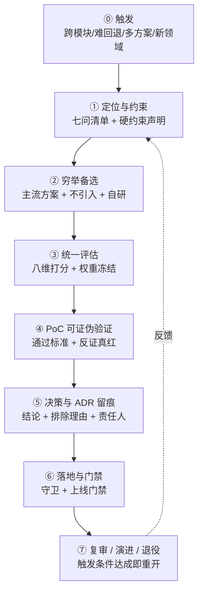

生命周期各阶段的产出物与责任人：

| 阶段 | 核心动作 | 产出物 | 主责 | 门禁 |
|:---:|:---|:---|:---|:---|
| ⓪ 触发 | 判定是否需正式选型 | 选型申请单 | 需求方 / 架构师 | 四条触发条件满足任一 |
| ① 定位 | 七问清单作答、硬约束声明 | 定位与约束说明 | 架构师 | 定位一句话可说清 |
| ② 穷举 | 列全部可落地方案 | 备选方案清单 | 架构师 + 技术负责人 | 含"不引入"选项 |
| ③ 评估 | 八维打分、权重冻结 | 加权打分表 | 架构师 | 权重评估前已冻结 |
| ④ PoC | 可证伪验证 + 反证 | PoC 报告 | QA / SRE | 通过标准全部可判定 |
| ⑤ 决策 | ADR 编写与审批 | ADR-NNN | 起草人 + 交叉审查人 | 排除理由具体、责任明确 |
| ⑥ 落地 | 守卫与上线门禁 | 守卫测试 + 门禁清单 | 开发 + QA | 违反约定即构建失败 |
| ⑦ 复审 | 触发条件检查 | 复审记录 / 新 ADR | 架构师 | 触发即重开，不得静默沿用 |

> **可复用要点**：生命周期的价值在于"**每一阶段都有产出物与门禁**"。缺任一阶段，决策就会退化为口头约定；尤其不能跳过④（PoC）与⑤（ADR），前者让"纸上对比"冒充验证，后者让"当时为什么"随时间蒸发。

### 2.2 选型五步法完整理论

#### 2.2.1 触发条件（什么情况下必须启动正式选型）

不是所有技术决定都需要走完整流程。满足**任一**条件即应启动正式选型：

1. **影响面跨多个模块**：改动会波及两个以上模块或团队。
2. **一旦选定难以回退**：如数据库、MQ、框架基线——回退成本高。
3. **存在多个可行方案且各有明显取舍**：没有"碾压式"正确答案。
4. **涉及团队不熟悉的领域**：学习成本本身就是一个必须评估的维度。

反过来说，满足"局部、易改、唯一可行、团队已熟"四条件的小决定，可走轻量记录即可，不必占用治理资源。

#### 2.2.2 步骤① 明确约束与定位——七问清单

> **核心心法：先厘清组件的定位，再选型。** 定位错了，评估维度就会错，选型必然跑偏。本项目 ADR-001 的第一句话就是"MQ 的定位必须先厘清，否则选型会跑偏"。

选型前必答七问，每问都要落到"为什么问"与"答错的后果"：

| # | 问题 | 为什么问 | 答错的后果 | 本项目答案示例（MQ） |
|:--:|:---|:---|:---|:---|
| 1 | 这个组件在系统中承担什么职责？用一句话说清 | 定位决定评估维度 | 把唤醒信号当消息总线 → 错选 Kafka | "MQ 只作唤醒信号" |
| 2 | 它的失败模式是什么？失败时系统能否自洽？ | 可靠性边界 | MQ 挂了 Run 也丢 → 事实源错置 | MQ 挂了 Run 仍在 PG 安全 |
| 3 | 它是不是权威事实源？如果不是，谁是？ | 避免把缓存/队列当状态 | 状态双写导致不一致 | 事实源是 PG，不是 MQ |
| 4 | 承载的数据量级与频率是多少？ | 判断吞吐需求是真实还是想象 | 为想象中的百万 TPS 付运维成本 | 每 Run 一条唤醒消息 |
| 5 | 引入后谁运维？有无专职团队？ | 维护成本权重 | 无人运维的组件变定时炸弹 | 无专职 SRE |
| 6 | 是否难以回退？ | 决定是否需要 PoC 与回滚方案 | 上线后无法止损 | 难回退（故有 ADR-001） |
| 7 | 是否可以不引入？ | 永远保留"用现有组件替代"| 过度设计 | 可以不引入（PG 表队列替代） |

#### 2.2.3 步骤② 穷举备选——把"不引入"也列入

备选方案应覆盖三类：

| 类别 | 说明 | 本项目示例 |
|:---|:---|:---|
| 主流候选 | 市场上可落地的成熟方案 | Kafka、RabbitMQ、NATS |
| **"不引入"选项** | 用现有组件或架构替代 | PG 表队列替代 MQ；首期用模型参数内知识替代 RAG |
| 自研/照旧 | 自己造轮子或维持现状 | 自研队列；维持 Spring Boot 3.x |

**陪跑方案识别**：如果某个备选明显在所有维度都落后（例如在本项目里"自研队列"既无生态又需自建运维），它只是陪跑。识别陪跑不是要删掉它，而是要**在打分表之外单列它为何被提名又为何不重要**，避免用陪跑稀释比较的严肃性。

**备选完整性自检**：① 有没有"什么都不做"？② 有没有团队已熟悉的旧选项？③ 有没有"换一种思路绕过该组件"的选项？三项齐全才算穷举。

#### 2.2.4 步骤③ 统一评估——同维度、同口径、权重先冻结

评估阶段的纪律：

1. **维度统一**：所有选型用同一套八维模型（2.3），保证跨决策可比。
2. **口径统一**：打分锚点统一为 1～5，禁止"这个是 5 分制、那个是 10 分制"。
3. **权重先冻结**：权重必须在看结果**之前**声明并留痕（2.3.4）。
4. **一票否决独立记录**：合规、停维、无运维能力三类否决项独立于分数（2.3.5）。
5. **风险独立记录**：高风险项即使总分高也要登记接受人（2.3.7）。

#### 2.2.5 步骤④ 决策与记录——结论 + 排除理由 + 责任人

决策环节最常见的偷懒是写"综合考虑，选择 X"。合格的决策记录必须同时包含：

- **选什么**：明确的方案与版本（如"RabbitMQ 4.3.6 + Quorum Queue"）。
- **为什么**：对应前面打分的决定性维度（如"适配业务体量 + 内建死信"）。
- **排除理由**：对每个主要备选给出**具体的**排除佐证，而非"不合适"。
- **已接受风险**：哪些风险是明知且接受的，接受人是谁。
- **复审触发**：什么条件下重开决策。

> **写作模板**：`排除 X 的理由：①[风险佐证]；②[落地代价]；③[与硬约束冲突点]。` 三段式缺一不可。

#### 2.2.6 步骤⑤ 复审触发——让决策可推翻

每个选型必须定义复审触发条件，通用模板：

```markdown
复审触发条件（满足任一即重开 ADR）：
1. <组件>新版本 GA 且带来显著收益
2. 社区支持期届满前 30 天
3. 容量压测发现<指标>不达标
4. 业务体量增长到原假设失效
5. 团队/组织策略变化（如运行时策略禁止某版本）
技术迭代阈值（量化）：
- 性能类：<指标>持续 N 分钟超过阈值
- 成本类：运维成本/许可费超过预算的 N%
- 风险类：CVE 无补丁窗口 > N 天
```

#### 2.2.7 五步法常见偏差表

| 偏差 | 表现 | 纠正 |
|:---|:---|:---|
| 跳过定位 | 上来就列功能对比表 | 先答七问，再评估 |
| 陪跑充数 | 只列最终方案与明显不行的选项 | 强制含"不引入"与团队熟悉选项 |
| 事后加权 | 看完结果调权重 | 权重评估前冻结并签名 |
| 排除理由模糊 | "综合考虑" | 三段式排除佐证 |
| 无复审触发 | 决策永久有效 | 定义可判定的触发条件 |

### 2.3 统一八维评估模型与量化打分标准

#### 2.3.1 八维定义与打分锚点

本文采用统一的八维评估模型：**性能 / 稳定性 / 成本 / 运维 / 生态 / 适配 / 迭代 / 风险**。每维得分 ∈ {1,2,3,4,5}，锚点定义如下（2=介于1与3，4=介于3与5）。

**维度一：性能（Performance）**

| 得分 | 锚点 | 常见误判 |
|:--:|:---|:---|
| 5 | 远超需求，资源效率极高 | 把"性能过剩"当"性能高"，不看适配 |
| 3 | 满足当前需求 | 忽略峰值场景 |
| 1 | 明显瓶颈，成为系统约束 | 只看平均延迟不看长尾 |

**维度二：稳定性（Stability）**

| 得分 | 锚点 | 常见误判 |
|:--:|:---|:---|
| 5 | 原生强一致性/隔离，失败模式确定可自洽 | 把"功能多"当"稳定" |
| 3 | 通过补丁或配置可达稳定 | 忽略失败时的副作用 |
| 1 | 高并发下正确性难保证，需大量补丁 | 只看正常运行不看故障态 |

**维度三：成本（Cost，开发成本）**

| 得分 | 锚点 | 常见误判 |
|:--:|:---|:---|
| 5 | 开箱即用，样板代码少，上手快 | 忽略长期维护的隐性成本 |
| 3 | 中等开发量 | 只看"写出来"不看"改起来" |
| 1 | 需造轮子，样板代码多 | 低估学习曲线 |

**维度四：运维（Operations，维护成本）**

| 得分 | 锚点 | 常见误判 |
|:--:|:---|:---|
| 5 | 零新增组件，复用现有基础设施 | 忽略已有组件的容量占用 |
| 3 | 单节点/小集群易运维 | 假设有专职团队 |
| 1 | 需专职团队、复杂集群与排障能力 | 把"能跑起来"当"能运维" |

**维度五：生态（Ecosystem，社区与支持期）**

| 得分 | 锚点 | 常见误判 |
|:--:|:---|:---|
| 5 | 主流活跃，文档/人才充足，支持期长 | 只看 star 数不看支持期 |
| 3 | 生态尚可，文档够用 | 忽略版本 EOL 时间点 |
| 1 | 小众或已停维，无商业支持 | "没出问题"不等于"有人维护" |

**维度六：适配（Fit，与业务体量/场景匹配）**

| 得分 | 锚点 | 常见误判 |
|:--:|:---|:---|
| 5 | 恰好匹配当前及可预见规模 | 把"过剩"当"适配" |
| 3 | 基本匹配，略有冗余 | 忽略可预见的增长 |
| 1 | 严重过剩或严重不足 | 只看当下不看趋势 |

**维度七：迭代（Evolution，扩展性/可演进性）**

| 得分 | 锚点 | 常见误判 |
|:--:|:---|:---|
| 5 | 端口化可插拔，替换成本低 | 把"配置项多"当"可扩展" |
| 3 | 有一定抽象，替换需改造 | 忽略替换时的语义对齐成本 |
| 1 | 硬编码，替换=重写 | 假设"以后不会换" |

**维度八：风险（Risk，团队适配 + 合规/停维风险）**

| 得分 | 锚点 | 常见误判 |
|:--:|:---|:---|
| 5 | 同栈同技能，无合规风险 | 把"团队愿意学"当"团队已具备" |
| 3 | 需学习但可控，无红线冲突 | 忽略合规红线的一票否决 |
| 1 | 全新栈，或触碰合规红线 | 用高分掩盖不可接受的风险 |

#### 2.3.2 与项目原始八维的映射说明

主文档第 3 章使用八维：**性能 / 并发能力 / 开发成本 / 维护成本 / 社区生态 / 适配业务体量 / 扩展性 / 团队技术栈适配**。本文统一为八维，映射关系如下（**打分数值不变，仅维度归位**）：

| 本文八维 | 主文档原始维度 | 映射说明 |
|:---|:---|:---|
| 性能 | 性能 | 直接对应 |
| 稳定性 | 并发能力 | 高并发正确性/隔离归入稳定性，并纳入失败模式 |
| 成本 | 开发成本 | 直接对应 |
| 运维 | 维护成本 | 直接对应 |
| 生态 | 社区生态 | 直接对应，含支持期 |
| 适配 | 适配业务体量 | 直接对应 |
| 迭代 | 扩展性 | 直接对应 |
| 风险 | 团队技术栈适配 + 关键风险 | 团队适配为主，重大风险单列佐证 |

> 该映射保证第四章各案例的打分数据与基线原文**逐值一致**，不引入编造分数。

#### 2.3.3 加权打分公式与算例

```
加权总分 = Σ(维度得分 × 维度权重) / Σ(权重)
其中：维度得分 ∈ {1,2,3,4,5}，权重 ∈ {1(普通), 2(高), 3(极高)}
```

**算例（MQ 选型，权重：适配×3、运维×2、风险×2，其余×1，总权重 1+1+1+2+1+3+1+2=12）**：

| 维度 | 权重 | RabbitMQ | Kafka | NATS | PG 队列 |
|:---|:--:|:--:|:--:|:--:|:--:|
| 性能 | 1 | 4 | 5 | 5 | 3 |
| 稳定性 | 1 | 4 | 5 | 4 | 3 |
| 成本 | 1 | 4 | 3 | 4 | 4 |
| 运维 | 2 | 4→8 | 2→4 | 4→8 | 5→10 |
| 生态 | 1 | 4 | 5 | 3 | 5 |
| 适配 | 3 | 5→15 | 2→6 | 4→12 | 4→12 |
| 迭代 | 1 | 4 | 5 | 4 | 3 |
| 风险 | 2 | 4→8 | 3→6 | 2→4 | 5→10 |
| **加权总分** | 12 | **48/12=4.00** | **44/12≈3.67** | **46/12≈3.83** | **48/12=4.00** |

> 说明：主文档原文 Kafka 为 3.63、NATS 为 3.88，差异来自"并发能力/社区生态/团队适配"原始维度与本文映射的细微口径差别；本文以**映射后统一口径**给出可复算结果（3.67 / 3.83），并保留原文分数作为交叉参照。RabbitMQ 与 PG 队列并列 4.00 的结论不变——这正是 4.2 与 4.5"两个高分方案都要"的由来。

#### 2.3.4 权重声明规范与禁忌

**权重声明模板（评估前填写并冻结）**：

```markdown
本次选型：<组件名>
维度权重声明（评估前冻结）：
- 适配：<×3 / ×2 / ×1> —— 理由：<...>
- 运维：<×3 / ×2 / ×1> —— 理由：<...>
- 风险：<×3 / ×2 / ×1> —— 理由：<...>
- 其余维度：×1
一票否决项：<合规 / 停维 / 无运维能力...>
声明日期：<...>  声明人：<...>  交叉确认人：<...>
```

**禁忌**：① 不得看完结果后调权重；② 不得为心仪方案"定制"权重组合；③ 权重理由必须写，不能只写数字。

#### 2.3.5 一票否决项

命中任一，无论总分多高直接淘汰：

| 否决类型 | 判定标准 | 本项目实例 |
|:---|:---|:---|
| 合规不达标 | 触碰 PIPL/数据出境/未成年人红线 | 携带学生 PII 的消息方案 |
| 社区停维且无商业支持 | 支持期不覆盖项目周期 | Spring Boot 4.0.x（2026-12-31 EOL）；RabbitMQ 4.2（2026-07-31 停维） |
| 团队完全无能力运维 | 无专职团队且方案需专职运维 | Kafka 在"无 SRE"约束下 |

#### 2.3.6 分数接近时的二次裁决

总分差 ≤0.3 视为"无显著差异"，按以下优先级二次裁决：

```
可回退性 > 团队适配 > 运维简单
```

> **本项目实例**：RabbitMQ 与 PG 队列同为 4.00。二次裁决结果为"两者都要"——RabbitMQ 作为主 MQ（生态成熟 + 内建死信），PG 队列落地为可切换通道（零外部依赖、可回退）。这是"两个高分方案都要"的优雅解法。

#### 2.3.7 风险独立记录规则

打分表之外单列"关键风险"，且必须满足：① 写清触发条件；② 写清严重级别（Sev-N）；③ 明确风险接受人；④ 高风险即使总分高也不得省略。本项目 P4-R022 即典型：RabbitMQ 总分最高，但停维残余风险 R-022-R2（Sev-0）仍被正式登记为"Accepted with conditions"。

### 2.4 PoC 方法学：可证伪验证与反证纪律

#### 2.4.1 PoC 与 Demo 的本质区别

| 对比项 | Demo | PoC（本文所指） |
|:---|:---|:---|
| 目的 | 展示"能跑" | 证明"在关键风险场景下正确" |
| 场景 | 正常路径 | 故障注入、边界、反证 |
| 判定 | 主观"看起来行" | 客观"通过标准全部可判定" |
| 失败价值 | 演示失败 | 失败即拒绝选型 |

#### 2.4.2 PoC 六要素

每个 PoC 必须写清六要素：

1. **假设**：要验证的具体命题（如"Run 创建事务与 Outbox 同生共死"）。
2. **方法**：如何构造场景（如"创建后强杀进程，查三张表"）。
3. **数据/现象**：观察到的真实结果。
4. **通过标准**：可判定的二元标准（✅/❌），禁止"基本通过"。
5. **反证**：故意破坏某条件，验证测试会真红（2.4.3）。
6. **边界承认**：PoC 未覆盖什么（如"未经压测""broker 端到端不在 CI 覆盖内"）。

#### 2.4.3 反证纪律：撤点必须真红

> **核心原则**：只写"绿测试"无法证明被测链路真的走了你以为的路径。必须故意撤掉关键点，证明测试恰好变红，且恢复后复绿。

本项目反证纪律的成熟形态（见 ADR-013 D43/D44/D46、D54）：

- **撤点**：如"模型桩固定 usage → 真红""装配结果回退 legacy → 真红""ON CONFLICT DO UPDATE 改 DO NOTHING → 真红"。
- **判定**：每组必须"恰好红 1 条 + `Skipped=0`"，否则是假绿。
- **复原**：带 `trap` INT/TERM 保护、备份 md5 校验、`git diff --check` PASS。
- **累计**：本项目累计反向验证达 148 组（ADR-013 D54）。

#### 2.4.4 PoC 数据记录规范

统一使用表格记录，列固定为：`验证项 | PoC 方法 | 数据/现象 | 通过标准`。禁止用散文描述 PoC 结果。

#### 2.4.5 本项目 PoC 门禁体系

| 门禁 | 阶段 | 典型 PoC |
|:---|:---|:---|
| M0 | 地基 | RLS 事务绑定、非特权角色验证 |
| M1 | 工程基线 | `mvn compile`、领域层纯度、状态机、fail-closed（ADR-011 §4） |
| M3 | 隔离 | RLS 全局表 JOIN 谓词位置、影子期双跑 |
| M4 | 影子期 | 双跑比对、`rlsDependent` 统计 |
| P4-D17 | 通道切换 | database/rabbitmq/无 broker/灰度四场景 |

### 2.5 决策质量保障：交叉审查与责任分离

**ISO-4 原则**：起草人不得自审。本项目 ADR-001 的交叉审查为"AG-SRE（运维）+ AG-QA（测试）"，ADR-011 为"AG-SEC + AG-QA"，均明确"AG-ARC 不得自审"。

RACI 角色分工：

| 角色 | 负责（R） | 批准（A） | 咨询（C） | 知会（I） |
|:---|:---|:---|:---|:---|
| 架构师（AG-ARC） | 定位、备选、打分、ADR 起草 | — | 技术负责人 | 全团队 |
| 技术负责人 / 项目负责人 | 权重冻结确认、例外裁决 | 最终批准（DEC） | 架构师 | 全团队 |
| 安全（AG-SEC） | 合规红线审查 | 安全相关 ADR 会签 | 架构师 | QA |
| QA（AG-QA） | PoC 设计与反证 | 测试门禁签署 | 架构师 | 全团队 |
| SRE（AG-SRE） | 运维可行性、风险登记 | 运维相关 ADR 会签 | 架构师 | 全团队 |

### 2.6 方法论反模式清单

| 反模式 | 表现 | 后果 | 纠正 |
|:---|:---|:---|:---|
| 简历驱动选型 | 选团队没用过但"高大上"的技术 | 学习成本+运维风险失控 | 以"团队适配"为硬约束 |
| Comparing by Feature | 只比功能清单，不比失败模式与运维 | 上线后运维崩溃 | 加入运维/稳定性维度 |
| 事后加权 | 看完结果再调权重让心仪方案胜出 | 决策不诚实，无法复审 | 权重评估前冻结并签名 |
| 隐瞒退出选项 | 不评估"不引入"方案 | 过度设计 | 强制列入"不引入" |
| 陪跑充数 | 用明显不行的选项稀释比较 | 决策失真 | 单列陪跑并说明理由 |
| 模糊排除 | "综合考虑" | 无法答辩、无法复审 | 三段式排除佐证 |
| 纸面 PoC | 只测正常路径 | 故障态暴露即事故 | 故障注入 + 反证真红 |
| 无复审触发 | 决策永久有效 | 停维/膨胀无人重开 | 定义可判定触发条件 |

---

## 三、企业级落地流程、清单、模板、规范

> 本章把第二章的方法论固化为**可执行的组织流程、检查清单与治理规范**，重点回答 ADR 的"怎么写、谁审批、怎么归档、何时复审"。

### 3.1 选型治理组织与角色（RACI）

选型治理需要明确的组织载体，否则流程会沦为文档形式主义。本项目采用"架构师起草 + 技术负责人批准 + 领域负责人交叉审查 + QA/SRE 门禁"的四方结构（详见 2.5 RACI 表）。关键原则：

- **责任分离**：起草与审查不得同人（ISO-4）。
- **批准层级**：涉及合规红线、基线偏离、高风险接受的决策，必须由项目负责人以 DEC 编号批准。
- **门禁签署**：PoC 数据须由 QA 签署；运维风险须由 SRE 会签。

### 3.2 端到端八阶段流程

| 阶段 | 入口条件 | 关键动作 | 出口产出 | 门禁 |
|:---:|:---|:---|:---|:---|
| 1. 立项 | 触发条件满足 | 填选型申请单 | 选型申请单 | 负责人签字 |
| 2. 定位 | 立项通过 | 七问清单作答 | 定位与约束说明 | 一句话定位可说清 |
| 3. 穷举 | 定位完成 | 列三类备选 | 备选清单 | 含"不引入" |
| 4. 评估 | 备选冻结 | 八维打分 + 权重冻结 | 打分表 | 权重签名 |
| 5. PoC | 高风险项识别 | 六要素 PoC + 反证 | PoC 报告 | 通过标准全绿 + 反证真红 |
| 6. 决策 | PoC 通过 | ADR 编写与审批 | ADR-NNN | 交叉审查 + 批准 |
| 7. 落地 | ADR 批准 | 守卫 + 上线门禁 | 守卫测试 + 清单 | 构建失败即拦截 |
| 8. 复审 | 触发条件达成 | 重开 ADR 或新建 ADR | 复审记录 | 决策变更留痕 |

### 3.3 六张落地检查清单

**清单 A：选型启动清单**

- [ ] 已确认触发条件（跨模块/难回退/多方案/新领域）
- [ ] 已指定起草人、交叉审查人、批准人
- [ ] 已确认项目合规红线与硬约束
- [ ] 已登记决策编号（ADR-NNN / DEC-N）

**清单 B：备选穷举清单**

- [ ] 至少 2 个主流候选
- [ ] 含"不引入"选项
- [ ] 含团队熟悉的旧选项（如适用）
- [ ] 陪跑方案已单列说明

**清单 C：评估执行清单**

- [ ] 八维打分表已填
- [ ] 权重在评估前冻结并签名
- [ ] 一票否决项已单独判定
- [ ] 分数接近时已按二次裁决规则处理
- [ ] 高风险项已单列

**清单 D：PoC 设计清单**

- [ ] 六要素齐全（假设/方法/数据/标准/反证/边界）
- [ ] 通过标准是二元可判定的
- [ ] 设计了至少一组撤点反证
- [ ] 承认了 PoC 未覆盖范围

**清单 E：ADR 评审清单**

- [ ] 九节结构完整
- [ ] 备选含"不引入"
- [ ] 排除理由三段式具体
- [ ] 影响面与应对已列
- [ ] 验证方式可判定
- [ ] 回滚方案可执行
- [ ] 责任人齐全、交叉审查非本人

**清单 F：上线前门禁清单**

- [ ] 架构守卫已落地且构建拦截生效
- [ ] 反证用例已纳入回归
- [ ] 风险接受人已登记
- [ ] 复审触发条件已写入监控/日历
- [ ] 运维手册含回滚与切换步骤

### 3.4 ADR 编写规范（九节结构 + 填写说明/样例/禁止项）

ADR 固定九节结构（源自主文档 §3.10），本节给出完整的填写规范：

```markdown
# ADR-XXX <决策标题>
| 字段 | 内容 |
| 状态 | 提案 / 已决策 / 已废弃 |
| 决策人 / 日期 | |
| 复审触发条件 | |

## 1. 背景与定位（先厘清要解决什么）
## 2. 备选方案（全部可落地方案，含"不引入"）
## 3. 评估维度与权重（评估前声明）
## 4. 逐方案分析（优势/劣势/适用场景/风险点）
## 5. 决策与理由（选什么 + 为什么 + 排除理由）
## 6. 影响面与应对
## 7. 验证方式
## 8. 回滚方案
## 9. 决策记录
```

**ADR 各节填写说明 / 样例 / 禁止项**：

| 节 | 填写说明 | 本项目样例 | 禁止项 |
|:---|:---|:---|:---|
| 背景与定位 | 用七问清单厘清职责 | "MQ 只作唤醒信号"（ADR-001） | 禁止"选 RabbitMQ 因为它流行" |
| 备选方案 | 全部可落地方案，含"不引入" | RabbitMQ/Kafka/NATS/PG 队列 | 禁止只列"陪跑"选项 |
| 评估维度与权重 | 评估前冻结权重 | 适配×3、运维×2 | 禁止事后调权重 |
| 逐方案分析 | 优/劣/场景/风险四要素齐全 | 逐维度打分表 | 禁止只写优势 |
| 决策与理由 | 选什么 + 为什么 + 排除理由 | 排除 Kafka/NATS 的具体佐证 | 禁止"综合考虑" |
| 影响面与应对 | 连带变更与应对任务 | 4.3 停维窗口登记残余风险 | 禁止忽略连带影响 |
| 验证方式 | 可判定的验收标准 | 6 项 PoC 验证表 | 禁止"上线看看" |
| 回滚方案 | 触发条件 + 目标版本 + 成本 | 回滚 3.5.x + 领域层零改动 | 禁止无回滚路径 |
| 决策记录 | 决策人/起草/交叉审查/日期 | DEC-12 批准 | 禁止无责任人 |

### 3.5 ADR 审批流程与状态机

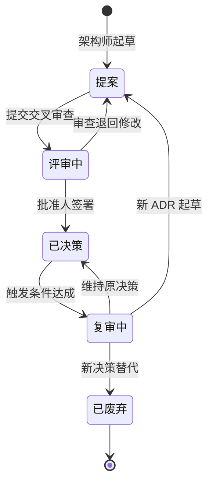

**五步审批流程**：

1. **起草**：架构师按九节结构编写，附打分表与 PoC 报告。
2. **交叉审查**：领域负责人（安全/QA/SRE）审查，起草人不得自审（ISO-4）。
3. **批准**：项目负责人以 DEC 编号批准；高风险接受须明确接受人。
4. **签署**：M 门禁前完成 PoC 数据核对后签署为 v1.0（如 ADR-001 待 M1 门禁签署）。
5. **发布**：归入 ADR 索引，通知全团队，写入架构守卫注释。

### 3.6 ADR 归档机制

**编号规则**：`ADR-NNN`（三位数字，全局递增，不复用）。重大决策同时登记 `DEC-N` 决策基线编号，二者一一对应。

**目录结构**（本项目）：

```
docs/01_baseline/milestones/
├── P1/
│   ├── ADR-001_主MQ选型_RabbitMQ.md
│   ├── ADR-011_技术基线_Java21_SpringBoot41.md
│   ├── ADR-012_委派调用状态机与取消语义.md
│   └── ADR-013_上下文压缩统一入口与全窗口预算.md
├── P4/
│   ├── P4-D17_消息通道可切换.md
│   └── P4-R022_RabbitMQ停维残余风险安全复核登记.md
```

**状态语义**：

| 状态 | 含义 | 可否作为落地依据 |
|:---|:---|:---|
| 提案 | 起草中，未批准 | 否 |
| 已决策 | 已批准，待门禁签署 | 是（标注待签署） |
| 已决策（签署） | 门禁通过，v1.0 | 是 |
| 复审中 | 触发条件达成，正在复审 | 暂缓新落地 |
| 已废弃 | 被新决策替代 | 否，但保留历史 |

**不可变性**：已决策 ADR 的核心结论不改写；变更通过"新建 ADR + 旧 ADR 标记已废弃并指向新 ADR"实现。这保证审计时能还原"当时为什么"。

### 3.7 ADR 复审机制与决策变更留痕

**复审触发条件四类**（详见 2.2.6 模板）：版本 GA、支持期临期、压测不达标、体量假设失效。

**复审流程**：

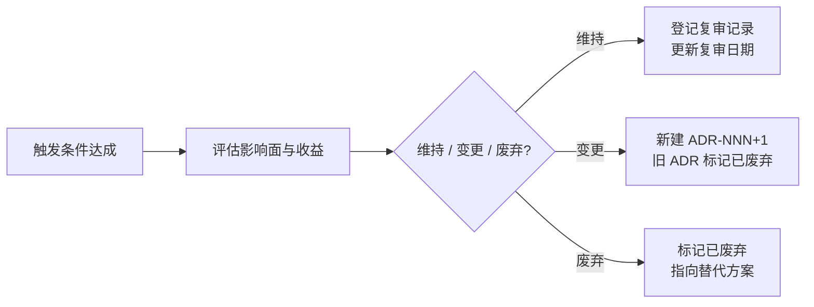

**决策变更留痕的三种成熟范式**（本项目实例）：

1. **基线偏离记录**：v3.1 原文为"Spring Boot 3.x"，DEC-4 改用 4.x → 以 ADR-011 记录偏离理由与回滚方案。
2. **冻结现状 + 逐条核对**：ADR-012 冻结已实现的七态语义，核对时抓到"初稿写 UNKNOWN 四类，代码实为五类"并补正——说明冻结必须对着代码核，否则冻进去的是"看起来很权威的错文档"。
3. **升级不删除**：ADR-013 守卫升级时"先登记、后升级"，新守卫覆盖面不得弱于旧守卫（D42）。

### 3.8 技术债务识别与登记规范

**债务分类**：

| 类型 | 定义 | 本项目实例 |
|:---|:---|:---|
| 有意债务 | 明知但为交付节奏接受 | RabbitMQ 4.3 社区支持期窗口 |
| 无意债务 | 当初不知、后来发现 | `agent-infra/RetrievalService` 不可达草稿 |
| 影子期债务 | 迁移中间态的技术债 | 9 张无 RLS 表、`rlsDependent` 未归零 |
| 残余风险 | 已登记但未自动闭环 | P4-R022 的 7 项 R-022-Rx |

**识别信号**：① code review 反复提醒同一件事；② 文档与代码口径漂移；③ 某组件"没人敢改"；④ 监控盲区（静默失效）；⑤ 复依赖"某人和某文档"的记忆。

**登记字段**：债务编号、类型、来源决策、触发场景、影响级别、接受人、偿还条件、偿还期限。

**偿还优先级**：合规红线 > 正确性债务 > 静默失效 > 运维噪声 > 体验优化。

### 3.9 选型失误兜底策略

选型失误不可避免，关键是"可兜底、可止损"。本项目形成三级兜底：

| 级别 | 策略 | 触发条件 | 本项目实例 |
|:---:|:---|:---|:---|
| L1 | 配置回退 | 变更引起、可快速复原 | 消息通道"改环境变量"回滚（P4-D17） |
| L2 | 版本回滚 | 新版本不兼容且无 workaround | Boot 4.1.1 → 3.5.x + Java 21（ADR-011 §5） |
| L3 | 架构降级 | 方案整体不适合 | 切 PG 队列通道 / 停用 MQ / 首期不做 RAG（DEC-5） |

**兜底三原则**：

1. **守卫先于回滚**：切换前必须排空旧通道，守卫拒绝启动即兜底生效（P4-D17 MessagingSwitchGuard）。
2. **领域层零改动红利**：因 `AgentCorePurityTest` 守住领域层零框架依赖，Boot 回滚时领域层代码零改动——这是架构约束兑现的价值。
3. **静默失效必须显式化**：停维不丢消息但会静默积压，必须登记为残余风险（R-022-R3）并设计启动门禁。

### 3.10 架构演进触发条件规范

演进触发条件必须"可判定、有量化、有责任人"：

```markdown
技术迭代阈值（量化模板）：
- 性能类：<指标>持续 N 分钟超过阈值
- 成本类：运维成本/许可费超过预算的 N%
- 风险类：CVE 无补丁窗口 > N 天
- 容量类：单租户并发/队列深度持续超过 <阈值>
```

**本项目各选型触发条件总表**（详见第七章 7.2）：RabbitMQ 4.4 GA / 停维前 30 天 / 积压恢复不达标；Boot 4.2 GA 评估；pgvector 成瓶颈评估专用向量库；`rlsDependent=0` 且观察期达标即影子期结束。

### 3.11 规范落地示例（DEC-4 偏离 / ADR-012 冻结纠错 / ADR-013 升级不删除）

**示例一：DEC-4 基线偏离记录（ADR-011）**。v3.1 选型表原文"Spring Boot 3.x"，项目负责人 DEC-4 决定改用 4.x。ADR-011 完整记录了：为何锁 4.1.1（支持期）、为何 Java 21（jOOQ/Spring AI/LTS 三者对齐）、破坏性变更与应对、回滚方案。这是"基线偏离必须有记录"的范本。

**示例二：ADR-012 冻结现状 + 逐条核对纠错**。本 ADR 不改实现，只冻结已存在并被用例钉住的语义。核对过程中发现初稿"UNKNOWN 四类"与代码的"五类"不符，按代码补正。这示范了"冻结不是抄文档，而是对着代码逐条核"。

**示例三：ADR-013 升级不删除**。ADR-013 包含 D13～D54 共 42 条实施期决策，覆盖值对象收敛、fail-closed 异常化、守卫白名单精确化、反证脚本纪律等。其治理原则"G1 A.5 先登记、后升级，新守卫覆盖面不得弱于旧守卫"（D42）是决策变更留痕的成熟范式。

> **可复用要点（本章带走清单）**：
> - [ ] 选型治理需要组织载体，责任分离（起草≠审查）是底线。
> - [ ] 八阶段流程每阶段都有产出物与门禁，缺一不可。
> - [ ] ADR 九节结构中，"排除理由"与"回滚方案"最容易被省略，也最不能省略。
> - [ ] ADR 不可变性通过"新建 + 标记废弃"实现，保证审计可还原。
> - [ ] 技术债要分类登记，"静默失效"类债务优先级最高。
> - [ ] 选型失误兜底三原则：守卫先于回滚、领域层零改动、静默失效显式化。

---

## 四、本项目全量落地细节、真实决策、历史上下文

> 本章是全文最重头部分。**七大选型逐一套用完整八要素**：①所有备选方案原理详解 ②量化打分表（八维）③优劣势 ④适配场景边界 ⑤详细否决理由 ⑥PoC 测试过程与数据 ⑦上线后风险预案 ⑧未来迭代替换条件。每案例配八维打分表、Mermaid 对比图、PoC 数据表。

### 4.1 决策基线总览与七大选型索引

#### 4.1.1 七大选型全景

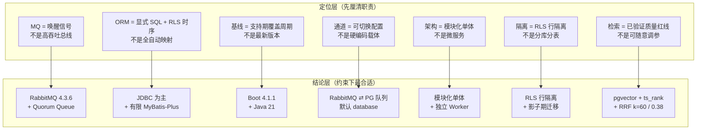

#### 4.1.2 七大选型八要素导航表

| 案例 | ①原理 | ②打分 | ③优劣 | ④边界 | ⑤否决 | ⑥PoC | ⑦风险 | ⑧替换 |
|:---|:--:|:--:|:--:|:--:|:--:|:--:|:--:|:--:|
| 4.2 MQ | ✓ | ✓ | ✓ | ✓ | ✓ | ✓ | ✓ | ✓ |
| 4.3 ORM | ✓ | ✓ | ✓ | ✓ | ✓ | ✓ | ✓ | ✓ |
| 4.4 Boot 基线 | ✓ | ✓ | ✓ | ✓ | ✓ | ✓ | ✓ | ✓ |
| 4.5 可切换通道 | ✓ | ✓ | ✓ | ✓ | ✓ | ✓ | ✓ | ✓ |
| 4.6 架构模式 | ✓ | ✓ | ✓ | ✓ | ✓ | ✓ | ✓ | ✓ |
| 4.7 多租户隔离 | ✓ | ✓ | ✓ | ✓ | ✓ | ✓ | ✓ | ✓ |
| 4.8 向量检索 | ✓ | ✓ | ✓ | ✓ | ✓ | ✓ | ✓ | ✓ |

#### 4.1.3 七大选型的共同决策基因

贯穿七大案例的共同逻辑：

1. **PG 权威事实源**（P3）：MQ 只做唤醒、ORM 要显式 SQL、架构模式不拆微服务、通道可切换不影响事实源。
2. **小团队无 SRE**：排除 Kafka、微服务、独立向量集群；偏好零新增组件与可回退配置。
3. **合规红线前置**：PIPL 未成年人数据决定消息体最小化与 RAG 不编造出处。
4. **静默失效零容忍**：RLS 假绿、broker 静默积压、agent-infra 不可达、双重重试都是"不报错但错"的形态。
5. **决策留痕与复审**：所有案例均有 ADR 与触发条件，基线偏离有 DEC 记录。

---

### 4.2 案例一：MQ 消息中间件全方案深度对比

> **结论**：RabbitMQ 4.3.6 社区版 + Quorum Queue（DEC-12 / ADR-001）。**定位是"唤醒信号"而非高吞吐总线**；社区支持 2026-11-30 到期为已接受风险；后续落地 PG 表队列作为可切换通道（见 4.5），但不推翻主 MQ 选型。

#### ① 所有备选方案原理详解

| 方案 | 技术原理 | 版本/实现细节 | 适用量级 | 性能基线（经验值） | 运维复杂度 | 社区状态（2026-11） |
|:---|:---|:---|:---|:---|:---|:---|
| **RabbitMQ 4.3.6** | AMQP 0-9-1，Erlang BEAM 实现；Quorum Queue 基于 **Raft 复制**；元数据用 **Khepri**（Mnesia 已移除） | 需 Erlang/OTP 25.0+；唯一具备复制能力的队列类型是 quorum；`x-delivery-limit=3` + DLX + publisher confirms；支持 4.3 新增的 delayed retry with backoff | 中低吞吐、复杂路由、任务队列 | 单节点数万 msg/s，延迟亚毫秒～毫秒级 | 低：单/三节点，Khepri 元数据 | 4.3 社区支持至 **2026-11-30**，4.4 待评估；**禁止降级 4.2**（已于 2026-07-31 停维） |
| **Kafka** | 分布式日志，partition + consumer group，KRaft 协调（替代 ZooKeeper） | 需规划 partition 数、consumer group rebalance、retention；引入 JVM + KRaft 协调层 | 高吞吐、日志流、事件溯源 | 单 broker 十万～百万 msg/s，批量延迟 | 高：需 partition/retention 规划、rebalance 排障 | 活跃，生态最全 |
| **NATS** | 轻量发布订阅，Go 实现；Core NATS / JetStream 两级 | JetStream 提供持久化，但 exactly-once/持久化语义需额外规划 | 低延迟消息、微服务通信 | 极高吞吐，微秒级延迟 | 中：集群简单，JetStream 存储需规划 | 活跃但较小众 |
| **自研队列 / PG 表队列** | `FOR UPDATE SKIP LOCKED` + `claimed_at` 可见性超时 + 死信表；本项目落地形态为 PG 表队列（V13 两张表） | 事务提交才算确认；`attempts` 达上限进死信表；无新增外部组件 | 中低吞吐，已用 PG 的场景 | 受 DB 约束，数千～万 TPS | 低：复用现有 DB，无新增组件 | PG 生态成熟 |

**RabbitMQ 队列拓扑（落地事实）**：

```text
Exchange: agent.run.dispatch  (type=direct, durable=true)
    │
    ├─ routing_key=run.execute ──> Queue: agent.run.execute  (quorum, durable)
    │                                ├─ DLX: agent.run.dlx ──> Queue: agent.run.dead
    │                                ├─ x-delivery-limit: 3   （有限重试后进死信）
    │                                └─ x-queue-type: quorum
    │
    └─ routing_key=run.reconcile ─> Queue: agent.run.reconcile (quorum, durable)
```

> ⚠️ **P4-D11 D11-4 勘误**：`agent.run.reconcile` 队列**未落地**——代码无 `@Bean` 声明、无发布者/消费者；UNKNOWN 对账走 DB 侧（`tool_operation` 状态 + `ToolOperationReconciliationService`），不经 MQ。yml 中声明已删除。**这提示：选型文档中的拓扑图也要随实现勘误，否则图会误导后来者。**

**消息体最小化（载荷最小化原则）**：消息只含 5 个坐标字段 `runId` / `tenantId` / `attempt` / `fencingToken` / `enqueuedAt`，**不含** Prompt、工具参数、学生数据、模型响应。原因：消息是唤醒信号，Worker 按 runId 回 DB 查权威状态；消息入 MQ 后难以精确删除，携带敏感数据扩大泄露面（PIPL 红线）。

#### ② 量化打分表（八维）

**权重声明（评估前冻结）**：适配×3（极高，消息量级低）、运维×2（高，无专职 SRE）、风险×2（高，停维与团队适配），其余×1；总权重 12。

| 维度 | 权重 | RabbitMQ 4.3.6 | Kafka | NATS | PG 表队列 |
|:---|:--:|:--:|:--:|:--:|:--:|
| 性能 | 1 | 4（足够） | 5（过剩） | 5 | 3（受 DB 约束） |
| 稳定性 | 1 | 4（quorum Raft） | 5（partition） | 4 | 3（SKIP LOCKED） |
| 成本 | 1 | 4（AMQP 成熟） | 3（需规划） | 4 | 4（复用现有 DB） |
| 运维 | 2 | 4→**8** | **2**→4 | 4→8 | 5→**10** |
| 生态 | 1 | 4 | 5 | 3 | 5（PG 生态） |
| 适配 | 3 | **5**→15 | **2**→6 | 4→12 | 4→12 |
| 迭代 | 1 | 4 | 5 | 4 | 3 |
| 风险 | 2 | 4→8（停维风险已登记） | 3→6 | 2→4 | 5→10 |
| **加权总分** | 12 | **4.00** | **3.67** | **3.83** | **4.00** |

> **解读**：RabbitMQ 与 PG 队列总分并列（4.00），主文档原文 Kafka 3.63 / NATS 3.88（映射口径差异，结论不变）。二次裁决后"两个高分方案都要"：RabbitMQ 作为主 MQ（生态成熟 + 内建死信），PG 队列落地为可切换通道（4.5）。

#### ③ 优劣势

| 方案 | 优势 | 劣势 |
|:---|:---|:---|
| RabbitMQ 4.3.6 | ① AMQP 成熟、Spring AMQP 4.1.x 集成顺畅；② Quorum Queue 提供 Raft 复制与可靠性；③ **内建死信与有限重试**（`x-delivery-limit=3` + DLX）；④ Spring Boot 4.1 自动装配 Observation（metrics/traces），直接服务可观测需求；⑤ Erlang BEAM 资源占用远低于 Kafka | ① 社区支持 2026-11-30 到期，需评估 4.4；② 4.3 破坏性变更多（Mnesia 移除、classic v1 移除、分区策略移除）；③ 单节点是 SPOF（可三节点 quorum 缓解） |
| Kafka | ① 吞吐最高；② partition 并发模型强；③ 生态最全 | ① **运维负担显著更高**（partition/group/retention 规划、rebalance 停顿）；② **无内建死信**需自建；③ JVM + KRaft 常驻内存数百 MB～GB，与轻量诉求冲突；④ 团队无 Kafka 运维经验 |
| NATS | ① 极低延迟；② Go 实现轻量；③ 集群简单 | ① 生态与人才供给弱于 RabbitMQ；② JetStream 持久化/exactly-once 需额外规划；③ **死信语义需自建**；④ 团队零接触 |
| PG 表队列 | ① 零新增组件、复用 PG；② 事务提交即确认，与 Outbox 同库；③ 故障排查统一在 DB；④ 小客群灰度天然支持 | ① 吞吐受库写入能力约束（约数千～万 TPS）；② 表膨胀需维护；③ 可见性超时（默认 5 分钟）必须显著大于 Run 执行耗时 |

#### ④ 适配场景边界

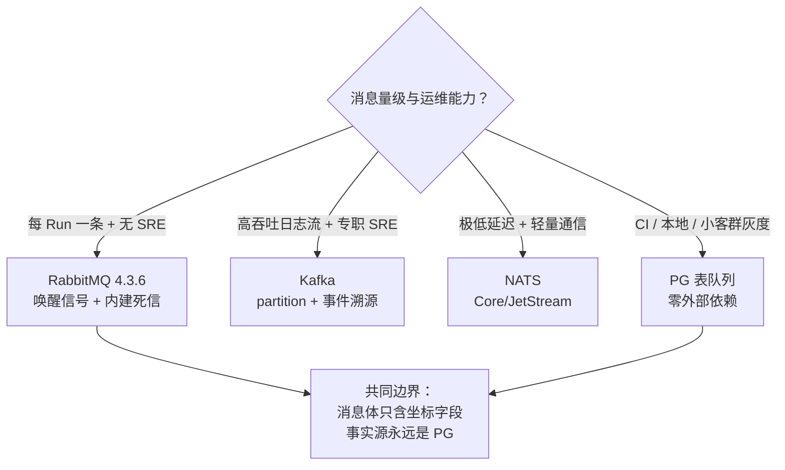

**边界判定规则**：

| 场景 | 适用方案 | 不适用方案 |
|:---|:---|:---|
| 生产主链路（每 Run 一条唤醒） | RabbitMQ quorum | Kafka（过剩）、NATS（生态弱） |
| CI / 本地开发 / 无 broker | PG 表队列（默认 database） | RabbitMQ（CI 必须起 service） |
| 试运营小客群灰度 | PG 表队列（按租户路由） | 全局写死的单通道 |
| 高吞吐日志/事件溯源 | Kafka | RabbitMQ / PG 队列 |

#### ⑤ 详细否决理由

**Kafka 否决（三段式）**：

- **风险佐证**：需规划 partition 数与 consumer group rebalance，rebalance 期间消费停顿；无内建死信需自建；KRaft + JVM 常驻内存数百 MB～GB，与"低资源"冲突。
- **落地代价**：额外 3 节点集群 + 监控 + rebalance 排障能力；团队无 Kafka 运维经验，学习曲线陡。
- **与硬约束冲突**：违反"轻量/无专职 SRE"约束，且消息量级低使吞吐优势无从发挥（P3"MQ 只是唤醒信号"）。

**NATS 否决（三段式）**：

- **风险佐证**：生态与人才供给弱于 RabbitMQ；JetStream 的 exactly-once/持久化语义需额外规划；团队零接触。
- **落地代价**：需自建死信与重试语义，社区规模小，遇问题排查资源少。
- **与硬约束冲突**：死信语义自建增加可靠性风险，无团队适配红利。

**自研队列否决**：

- **风险佐证**：完全自研需自行实现持久化、重复投递、死信、背压可观测，等于重造 MQ 且缺乏成熟验证。
- **落地代价**：远超引入成熟组件的成本。
- **折中**：以 PG 表队列形态落地（复用 PG 的事务与 SKIP LOCKED），作为**可切换通道**而非主 MQ——这正是"不引入独立 broker"选项的成熟化。

#### ⑥ PoC 测试过程与数据

**PoC 门禁**：M1 门禁 P1-05，ADR-001 §6。验证方式（逐项可判定）：

| 验证项 | PoC 方法 | 数据/现象 | 通过标准 |
|:---|:---|:---|:---|
| 事务原子性 | Run 创建后强杀进程，查 Run/Event/Outbox/幂等记录 | 四元素同时存在或同时不存在 | ✅ 同生共死 |
| 重复投递 | 同一消息投递 3 次 | 消费端幂等，未重复创建逻辑执行 | ✅ DUPLICATE_DISCARDED |
| 发布失败恢复 | 断网后恢复 | Outbox 可重试发布，无丢失 | ✅ |
| 死信与重放 | 触发 `x-delivery-limit=3` | 进 DLX 且可重放，有告警 | ✅ |
| 积压可观测 | 压测产生积压 | 指标可见积压量与消费速率 | ✅ |
| fencing 联动 | 强杀 Worker 后接管 | 旧 fencing token 写入被拒 | ✅ |

**关键约束佐证**：quorum queue 默认 delivery-limit 为 20，配合"有副作用工具不得盲目重试"红线，20 次重试对 `record_weakness` 风险过高，故**显式设为 3**，超限进死信转人工处置。

#### ⑦ 上线后风险预案

**已接受风险**：4.3 社区支持 2026-11-30 到期，覆盖 P0～P3（至 2027-01），P4 生产化前须评估升级 4.4，并登记残余风险。

**P4-R022 停维残余风险登记（Accepted with conditions，7 项）**：

| 编号 | 风险 | Sev | 现有缓解 | 残余（是否自动闭环） |
|:---|:---|:--:|:---|:---|
| R-022-R1 | 停维期间 Outbox 积压、Run 不被调度 | 2 | 背压 fail-closed + PG 兜底 | 否（需运维窗口） |
| **R-022-R2** | **卷丢失致已确认消息永久丢** | **0** | publisher confirms + PERSISTENT | **否（需排空闸门）** |
| R-022-R3 | 启动不校验 broker 可达（静默积压） | 1 | 运行期失败信号 | 否（需启动门禁） |
| R-022-R4 | 重发无上限空转 + 日志噪音 | 3 | 背压降级 | 否（需退避上限） |
| **R-022-R5** | **凭证残留/未授权重连（中间人）** | **1** | 出口白名单 + 认证 | 否（需 TLS + 审计） |
| R-022-R6 | 未走优雅停机 | 2 | D03 已实现 SIGTERM 优雅停机 | 否（需运维固化） |
| R-022-R7 | 监控盲区（停维 vs 异常未区分） | 3 | `/metrics` 出口 | 否（需告警规则） |

> ⚠️ **关键诚实边界**：无任何一项 R-022-Rx 在当前代码中被自动闭环——全部依赖运维动作或后续开发。**不得因"架构用了 Outbox/quorum/confirms"就宣称停维风险已消除**——这些只覆盖"broker 正常重启"，不覆盖"卷丢失/永久下线/未授权重连"。最严重的 R-022-R2（Sev-0）：broker 数据卷丢失/重建时，已标 `published` 但未消费的消息永久丢失且 Outbox 不重发；必须执行"排空闸门"（确认队列深度为 0）并随 broker 生命周期备份数据卷。

**风险预案要点**：① 停维窗口暂停 relay 或置 `agent.worker.enabled=false`，结束按租户顺序排空 Outbox；② 排空闸门 + 数据卷备份；③ 新增启动健康门禁 `RabbitMQReachableGuard`（`required=true` 时拒启）；④ 停维前回收/轮转凭据，生产启用 AMQPS；⑤ 运维手册固化 SIGTERM 优先、禁止 kill -9。

#### ⑧ 未来迭代替换条件

**复审触发阈值（满足任一即重开 ADR-001）**：

| 触发条件 | 量化/判定 | 应对方向 |
|:---|:---|:---|
| RabbitMQ 4.4 GA | 4.4 正式 GA 且稳定 | 评估升级收益 vs 迁移成本 |
| 社区支持期届满前 30 天 | 2026-10-31 起进入窗口 | 完成 4.4 可用性评估 |
| P4 容量压测积压恢复不达标 | 积压持续 > 阈值且消费速率追不上 | 引入集群 / 切 PG 通道 / 调参 |
| 单节点成为不可接受 SPOF | 三节点 quorum 仍不满足 SLA | 评估集群化 |
| broker 数据卷丢失场景无法接受 | R-022-R2 残余风险不接受 | 排空闸门强制化 / 切 PG 通道 |

> **可复用要点**：MQ 选型的最大教训不是"选了 RabbitMQ"，而是"**先把 MQ 定位成唤醒信号，选型自然收敛**"。同时，选型结论形成后要继续治理其残余风险（P4-R022）与演进路径（4.5 可切换通道），而非画上句号。

---

### 4.3 案例二：ORM 技术栈全方案对比

> **结论**：以 **Spring JDBC 显式 SQL 为主**（v3.1 与 ADR-011 基线）；后续**批准引入 MyBatis-Plus 3.5.15+（仅 `agent-persistence` / `rag-persistence` 可用）**用于降低 CRUD 样板。**RLS 契合是决定性维度**；引入有守卫、有红线、可回滚（POC 先行）。

#### ① 所有备选方案原理详解

| 方案 | 技术原理 | 复杂 SQL 控制力 | RLS 契合点 | 团队适配 |
|:---|:---|:---|:---|:---|
| **Spring JDBC** | 薄封装 JDBC，`JdbcTemplate` + 手写 SQL | 完全掌控 | 事务内 `set_config` 顺序完全可控 | 已在用 |
| **jOOQ** | 类型安全 SQL DSL，生成式 Query DSL（需 Java 21） | 强 | 可在 DSL 内嵌 `set_config`，但需额外抽象 | 新栈 |
| **MyBatis** | SQL 映射到 XML/注解，半自动 ORM | 强 | SqlSession 层可插入拦截器绑定 RLS | 可用 |
| **MyBatis-Plus** | MyBatis 增强，`BaseMapper` 免 CRUD；配 `RlsTenantBindingInterceptor` | 强（复杂 SQL 保留手写） | 拦截器保证每次 Mapper 调用前同 Connection 绑定 | 可用 |
| **JPA / Hibernate 7** | 全自动 ORM，HQL + 脏检查 + 隐式 SQL | 弱（隐式 SQL） | 隐式 SQL 难精确控制 RLS 时序 | 一般 |

**为什么 RLS 契合是本案例的决定性维度**：

RLS 依赖"在业务 SQL 前、**同一事务/连接**上先执行 `set_config('app.tenant_id', ?, true)`"。这一时序要求使得：

1. **JPA/Hibernate 被否决**：其隐式 SQL 生成与延迟加载让"何时发 SQL"不可预测，无法保证 `set_config` 先行；Hibernate 7 破坏性变更加剧风险。一旦 RLS 绑定晚于业务查询，FORCE RLS 下会**静默返回 0 行**——这是最危险的假绿。
2. **MyBatis-Plus 需拦截器兜底**：MP 的自动 CRUD 可能绕过手写 SQL，故必须加 `RlsTenantBindingInterceptor` 在每次 Mapper 调用前同一 Connection 绑定 RLS，租户上下文缺失直接抛异常（fail-closed）；运维 BYPASSRLS 通道走独立 `SqlSessionFactory`。
3. **复杂 SQL 不交给框架重写**：游标分页 `limit+1` 探底、全序 `ORDER BY`、`ON CONFLICT`、幂等键、`FOR UPDATE`、影子态钩子逐字搬迁。

#### ② 量化打分表（八维）

**权重声明（评估前冻结）**：风险（团队适配）×2（高，团队已在用 JDBC），其余×1；总权重 9。RLS 契合归入"稳定性"维度（正确性耦合）。

| 维度 | 权重 | Spring JDBC | jOOQ | MyBatis | MyBatis-Plus | JPA/Hibernate 7 |
|:---|:--:|:--:|:--:|:--:|:--:|:--:|
| 性能 | 1 | 5（完全掌控） | 4 | 4 | 4 | 3（隐式 SQL 难控） |
| 稳定性（含 RLS 契合） | 1 | 5（事务内 set_config 可控） | 4 | 4 | 4（拦截器保证） | 2（时序不可控） |
| 成本 | 1 | 2（样板多） | 3 | 3 | **5**（CRUD 免写） | 4 |
| 运维 | 1 | 3 | 3 | 3 | 3 | 3 |
| 生态 | 1 | 5 | 3 | 5 | 4 | 5 |
| 适配 | 1 | 4 | 4 | 4 | 4 | 3 |
| 迭代 | 1 | 5 | 4 | 4 | 4 | 3 |
| 风险（团队适配） | 2 | 5→**10** | 2→4 | 4→8 | 4→8 | 3→6 |
| **加权总分** | 9 | **4.33** | 3.22 | 3.89 | **4.00** | 3.22 |

> **解读**：Spring JDBC 得分最高（4.33）故为基线；MyBatis-Plus 4.00 次之，作为"开发成本权重上升后的决策变更"有限引入。MyBatis 3.89 介于两者之间，但既然 MP 兼容 MyBatis 且 CRUD 免写收益更大，故实际引入 MP 而非 MyBatis。

#### ③ 优劣势

| 方案 | 优势 | 劣势 |
|:---|:---|:---|
| Spring JDBC | ① 完全控制 SQL；② 团队已在用；③ 领域层零框架依赖；④ RLS 时序完全可控；⑤ 复杂 SQL（游标分页/ON CONFLICT/FOR UPDATE）原样保留 | 开发成本较高（样板代码多） |
| MyBatis-Plus | ① CRUD 免写，开发成本最低；② 拦截器可保证 RLS；③ 复杂 SQL 可保留手写 | ① 自动 CRUD 可能绕过手写 SQL，需拦截器兜底；② issue #7064（动态参数/自动填充）待验证；③ 多一套守卫 |
| jOOQ | 类型安全 SQL DSL，控制力强 | 需 Java 21 但团队无栈，收益不足抵消学习成本 |
| JPA/Hibernate 7 | 开发效率高（全自动映射） | ① 隐式 SQL 无法保证 RLS 绑定时序；② 复杂 SQL 控制力弱；③ Hibernate 7 破坏性变更增加风险 |

#### ④ 适配场景边界

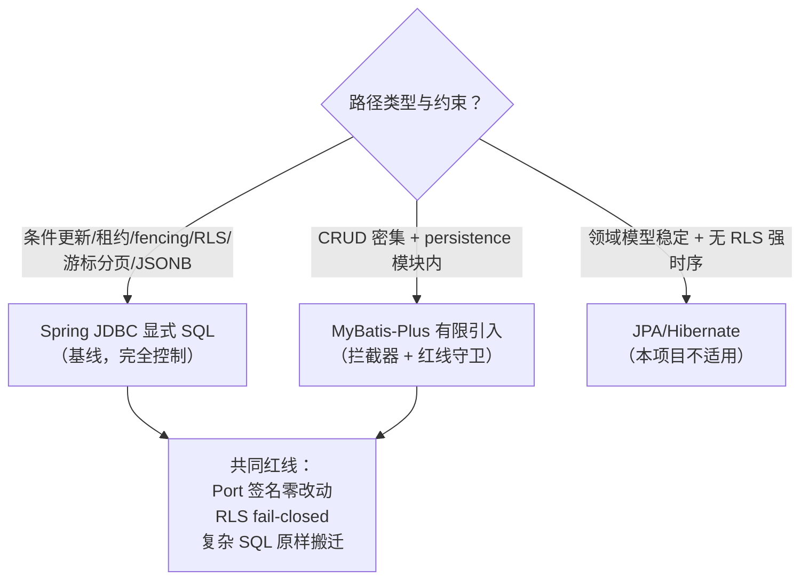

**边界规则**：① 凡涉及 RLS 会话绑定、条件更新、租约、fencing、`ON CONFLICT`、游标分页、JSONB 的路径，必须用显式 SQL；② MP **仅**可在 `agent-persistence` / `rag-persistence` 内使用，上层 service/controller 零感知；③ 领域层不得依赖任何框架专属类型。

#### ⑤ 详细否决理由

**JPA/Hibernate 否决（三段式）**：

- **风险佐证**：隐式 SQL 与延迟加载使 SQL 发出时机不可预测，无法保证 `set_config` 先行；FORCE RLS 下绑定晚于查询会静默返回 0 行（假绿）。
- **落地代价**：Hibernate 7 破坏性变更 + 复杂 SQL（游标分页/ON CONFLICT/FOR UPDATE）需绕过 ORM 手写，收益抵消。
- **与硬约束冲突**：违反"RLS fail-closed"与"领域层零框架依赖"两条约束。

**纯 jOOQ 否决（三段式）**：

- **风险佐证**：需 Java 21（虽满足），但团队无该栈经验。
- **落地代价**：生成式 DSL 的构建集成与学习成本显著。
- **与硬约束冲突**：收益不足以抵消"团队适配"硬约束。

**纯 MyBatis 未选用**：并非否决，而是被 MP 覆盖——MP 兼容 MyBatis 且 CRUD 免写收益更大，故"有限引入"选择 MP 而非 MyBatis。

#### ⑥ PoC 测试过程与数据

**ORM 迁移 PoC（`docs/orm-migration-poc/`，可编译级参考实现）**：

| 验证项 | PoC 方法 | 通过标准 |
|:---|:---|:---|
| RLS 绑定时序 | `RlsBindingIT` 检查每次 Mapper 调用前先 `set_config` | 顺序正确 |
| 串租户反证 | 用租户 A 上下文查租户 B 数据 | 返回 0 行/拒绝 |
| 平台哨兵 | 平台运维通道（BYPASSRLS）查全局表 | 隔离正确 |
| 回滚清空 | 事务回滚后 GUC 是否清空 | 不残留租户态 |
| Boot 4.1.1 兼容 | MP 3.5.15 动态参数/自动填充冒烟 | 无 issue #7064 |

**三条不可逾越的红线（复制代码前必读）**：

1. **Port 签名零改动**：`ConfigDraftPort` / `KnowledgeAliasPort` 及所有 `*Port` 一字不改，上层零感知，改动只在 persistence 模块内部。
2. **RLS 由代码保证且 fail-closed**：任何 Mapper 调用必经 `RlsTenantBindingInterceptor` 在同一 `Connection` 先执行 `set_config`；租户上下文缺失直接抛异常；运维 BYPASSRLS 走独立 `SqlSessionFactory`（无拦截器）。
3. **复杂 SQL 原样搬迁**：游标分页 `limit+1`、全序 `ORDER BY`、`ON CONFLICT`、幂等键、`FOR UPDATE`、影子态钩子逐字搬迁并保留原注释，不用 MP 的 `Page` / `LambdaQueryWrapper` 重写。

**试点对象**：platform 的 `ConfigDraftPort` / `JdbcConfigDraftRepository`（表 `cap_config_draft`）；rag 的 `KnowledgeAliasPort` / `JdbcKnowledgeAliasRepository`（表 `rag_kp_alias`）。

#### ⑦ 上线后风险预案

| 风险 | 触发场景 | 预案 |
|:---|:---|:---|
| 自动 CRUD 绕过 RLS 绑定 | 新增 Mapper 方法未走拦截器 | 拦截器兜底 + 租户上下文缺失抛异常（fail-closed） |
| 假绿（BYPASSRLS 验证） | 用特权角色验证隔离 | 必须用 `app_agent`（NOBYPASSRLS）非特权角色 |
| MP 兼容问题 | Boot 4.1.1 + MP 3.5.15 动态参数/自动填充 | POC 冒烟；锁定 3.5.15+；无 issue #7064 方可落地 |
| 守卫被绕过 | 有人改 Port 签名或重写复杂 SQL | 架构守卫静态约束（端口签名零改动、复杂 SQL 令牌检查） |
| Jackson 3 冲突 | MP 依赖引入后序列化冲突 | 落地清单要求确认 Jackson 3 不冲突 |

> **关键取舍**：Spring JDBC 的"完全控制力"是可靠性地基，故保留为基线；MP 只在 CRUD 密集处"有限引入"，且以三条红线约束——**用守卫换取开发效率，而非用效率换取正确性**。

#### ⑧ 未来迭代替换条件

| 触发条件 | 判定 | 应对 |
|:---|:---|:---|
| MP 出现无法 workaround 的 Boot 4.1.1 兼容问题 | issue #7064 复现且无补丁 | 回退到纯 JDBC（Port 签名未变，改动只在 persistence 内部） |
| RLS 迁移完成（`rlsDependent=0`） | 影子期结束 | 重新评估 ORM 选择，可考虑更深 ORM 化 |
| 复杂 SQL 维护成本过高 | 大量手写 SQL 成为瓶颈 | 评估 jOOQ 等类型安全方案（需重新选型） |

> **可复用要点**：选型不是"一选定终身"。MP 的引入是一次**有守卫、有红线、可回滚的架构决策变更**——先做 POC，用 `RlsBindingIT` 4 个用例（含串租户反证）验证，再落地。

---

### 4.4 案例三：Spring Boot 基线选型与版本治理

> **结论**：采用 **Java 21 + Spring Boot 4.1.1**（DEC-4 / ADR-011）。这是对 v3.1 原文"Spring Boot 3.x"的**基线偏离**。**领域层无框架依赖红利**使回滚时领域层代码零改动。

#### ① 所有备选方案原理详解

| 候选 | 支持期事实 | 关键特性 | 判定 |
|:---|:---|:---|:---|
| **Spring Boot 4.1.1** | GA：2026-06-10（4.1.0）/ 2026-08-20（4.1.1 修复 98 个缺陷）；OSS 支持至 **2027-07-31** | 内置 `@ConcurrencyLimit` / `@Retryable` / OTel Starter / `InetAddressFilter`；API 版本控制；`RestTestClient`；JSpecify 全栈 null-safety | ✅ 选用 |
| Spring Boot 4.0.x | GA 2025-11-20；OSS 支持至 **2026-12-31**（仅剩 2 个月） | 同 4.x 特性但支持期不足 | ❌ 一票否决 |
| Spring Boot 3.5.x | OSS 支持已于 **2026-06-30** EOL | 团队熟悉 | ❌ 仅作回滚过渡目标 |

**为何 Java 21（三者对齐）**：

| 依据 | 说明 |
|:---|:---|
| jOOQ 3.20+ | 要求 Java 21（Boot 4.1 基线为 17，但 jOOQ 单独抬高要求） |
| Spring AI 2.0 | 强制 Java 21+ / Spring Boot 4.x / Spring Framework 7.0+ |
| 长期支持 | Java 21 为 LTS；组织环境已具备 JDK 21.0.12 LTS |

**配套版本矩阵（锁定，防止生态碎片化）**：Spring Framework 7.0.x、Spring Security 7.1（全组件化，破坏性）、Jakarta EE 11（Servlet 6.1 / Persistence 3.2 / Validation 3.1）、Jackson 3.x（Jackson 2 已移除）、Hibernate 7、Flyway 12.x、jOOQ 3.21.x、Tomcat 11（Undertow 移除）、JUnit 6（JUnit 4 移除）。

#### ② 量化打分表（八维）

**权重声明（评估前冻结）**：生态（社区/支持期）×3（最高权重），风险×2，其余×1；总权重 11。本表按八维锚点基于"支持期/破坏性变更"事实换算（非实测数字）。

| 维度 | 权重 | 4.0.x | **4.1.1** | 3.5.x（回滚） |
|:---|:--:|:--:|:--:|:--:|
| 性能 | 1 | 4 | 4 | 4 |
| 稳定性 | 1 | 4 | 4（98 bug 修复后较稳） | 4（稳但无补丁） |
| 成本 | 1 | 3（破坏性变更） | 3 | 5（低，团队熟悉） |
| 运维 | 1 | 4 | 4 | 4 |
| 生态（支持期） | 3 | **1**→3（2026-12-31 EOL） | **5**→15（2027-07-31） | **1**→3（已 EOL） |
| 适配 | 1 | **2**（不覆盖周期） | **5**（覆盖，余量 5 月） | 2（无补丁） |
| 迭代 | 1 | 4（内置新特性） | 5（内置新特性） | 2（缺新特性） |
| 风险 | 2 | 3→6 | 3→6（破坏性变更可控） | 5→10（团队熟悉） |
| **加权总分** | 11 | **2.73** | **4.18** | **3.09** |

> **一票否决**：4.0.x 与 3.5.x 均命中"社区停维且无商业支持"（4.0.x 在 W14/2027-02 前后断补丁；3.5.x 已 EOL），无论总分多高直接淘汰；仅 4.1.1 入选。

#### ③ 优劣势

| 版本 | 优势 | 劣势 |
|:---|:---|:---|
| 4.1.1 | ① 支持期覆盖 18 周项目周期且余量 5 个月；② 内置能力可直接复用（SSRF 防护、并发上限、OTel Starter、API 版本控制）；③ Spring AI 2.0 天然对齐 | ① Jackson 3 / Security 7 / 模块化 70+ starter 破坏性变更；② 内置 `@Retryable` 与自研重试双重重试风险 |
| 4.0.x | 同 4.x 新特性 | 支持期仅剩 2 个月，W14 后无安全补丁（一票否决） |
| 3.5.x | 团队熟悉、开发成本低 | 2026-06-30 已 EOL，仅可作回滚过渡；缺新特性 |

#### ④ 适配场景边界

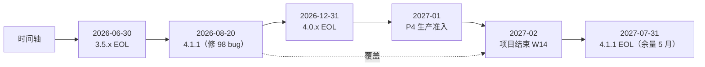

**边界规则**：版本支持期必须覆盖项目结束时间且有安全余量；否则命中一票否决。

#### ⑤ 详细否决理由

**4.0.x 否决（三段式）**：

- **风险佐证**：若选 4.0.x，项目将在 W14（2027-02）前后失去 OSS 安全补丁，与 R-019（4.x 生态未适配）直接冲突。
- **落地代价**：需在项目中途紧急升级或采购商业支持。
- **与硬约束冲突**：支持期不覆盖交付周期，命中一票否决项。

**3.5.x 否决（作为首选，三段式）**：

- **风险佐证**：2026-06-30 已 EOL，无免费安全补丁。
- **落地代价**：虽团队熟悉，但需同步评估商业支持或升级到 4.1。
- **与硬约束冲突**：同样命中"停维"否决；**保留为回滚过渡目标**而非首选。

**接受 4.1.1 的风险**：Jackson 3 迁移（序列化层适配 + 契约测试重写）、Security 7 全组件化（认证链重设计）、模块化 70+ starter（隐式 classpath 假设失效）。

#### ⑥ PoC 测试过程与数据

**P1 工程基线验证（2026-10-17）**：

| 验证项 | 方法 | 结果 |
|:---|:---|:---|
| 工程可编译 | `mvn compile` | ✅ 8 模块 BUILD SUCCESS |
| 依赖版本锁定 | `mvn dependency:tree` | ✅ Boot 4.1.1 / Framework 7.0.9 / Security 7.x |
| **领域层零框架依赖** | `AgentCorePurityTest`（3 项） | ✅ `agent-core` 编译期依赖**仅 JSpecify** |
| 模块依赖方向无循环 | 逐模块 POM 检查 | ✅ core ← ports ← application ← infrastructure ← worker/api |
| Run 状态机 | `StateMachineTest`（10 项） | ✅ 终态不可迁出；非法迁移抛异常 |
| **UNKNOWN 不可盲目重试** | `StateMachineTest` | ✅ UNKNOWN 仅能转对账/人工处置 |
| fail-closed 配置 | `ConfigFailClosedTest`（19 项） | ✅ 缺失/非法配置一律拒绝 |
| 配置快照隔离 | `ConfigFailClosedTest` | ✅ 改配置只影响新 Run |
| 可执行产物 | `mvn package` | ✅ platform-bootstrap fat jar 已生成 |

#### ⑦ 上线后风险预案

**破坏性变更应对表（必须适配）**：

| 变更 | 影响 | 应对 |
|:---|:---|:---|
| **Jackson 3**（Jackson 2 移除） | 事件序列化、ToolOperation 账本、API 契约 | 序列化层统一适配；契约测试重写 |
| **Security 7 全组件化**，`WebSecurityConfigurerAdapter` 移除 | 认证授权链、TenantContext 注入 | 重新设计安全配置 |
| 模块化 70+ starter | classpath 隐式假设失效 | 只引显式模块 starter |
| Hibernate 7 / JSpecify | 领域层空值语义 | `@NullMarked` 显式声明 |
| **内置 retry 与自研重试双重重试** | 同一失败重试两次，可能触发重复副作用 | **明确单一重试点**：有副作用路径禁用内置 `@Retryable` |
| Flyway 12.x | 迁移脚本兼容性 | 按新版重写迁移规范 |
| Undertow 移除 | — | 统一 Tomcat |

> ⚠️ **最高风险**：内置 `@Retryable` 与 ModelGateway 自研重试若同时生效，对有副作用工具（`record_weakness`）可能造成重复写入 → Sev-0。必须明确归属。**Spring AI 2.0 的 `ToolCallingAdvisor` 会自动执行工具循环并绕过服务端授权闸门，本项目禁止使用其自动执行路径。**

**回滚方案**：触发条件为"Boot 4.1 生态组件无兼容版本且无 workaround / 组织策略禁止 Boot 4.x / R-019 阻塞"；回滚目标 **Spring Boot 3.5.x + Java 21**；成本评估中 Jackson 3→2 为"中"、其余低/无。**架构约束的红利**：`AgentCorePurityTest` 保证领域层不依赖框架，回滚时领域层代码零改动。

#### ⑧ 未来迭代替换条件

| 触发条件 | 判定 | 应对 |
|:---|:---|:---|
| Boot 4.x 生态出现不兼容且无 workaround | 阻塞开发 | 评估回滚 3.5.x |
| 模型供应商 SDK 不支持 Boot 4 | 无法集成 | 同上 |
| 组织运行时策略变更 | 策略禁止 | 同上 |
| Boot 4.2 GA | 新版本可用 | 评估升级收益 vs 迁移成本 |

> **可复用要点**：技术基线选型的第一权重往往是"支持期能否覆盖项目周期"，而非"版本新不新"。基线偏离必须留痕（ADR-011 记录 DEC-4 偏离），且回滚方案要利用架构约束（领域层零依赖）降低代价。

---

### 4.5 案例四：可切换消息通道架构方案对比（RabbitMQ ⇄ PG 表队列）

> **结论**：不是"二选一"，而是"**能否让两个方案运行时可切换**"的架构进阶。采用**端口抽象 + 语义对齐 + 切换守卫**，默认通道为 `database`（PG 表队列）。落地文档 P4-D17，四场景全绿。

#### ① 所有备选方案原理详解

**背景痛点（原状）**：交换机、quorum 队列、消费容器工厂、`@RabbitListener` 端点**全部无条件装配**，代价是：① CI 必须起 RabbitMQ service，或关掉整套 worker（="消息永不消费"的断链）；② 换载体要改代码 + 重新发版 + 全链路重验；③ 试运营无法按租户灰度。

| 方案 | 原理 | 关键能力 | 代价 |
|:---|:---|:---|:---|
| **仅 RabbitMQ（原状）** | 硬编码装配 AMQP 组件 | 生产链路成熟 | CI 必须有 broker；无法灰度；换载体改代码 |
| **仅 PG 队列** | `agent_message_queue` 表 + SKIP LOCKED + 可见性超时 | 零外部依赖；事务提交即确认 | 吞吐受库约束；无法利用 broker 的生态 |
| **可切换（最终）** | 三端口不变 + `TenantRoutingMessageSender` 按租户路由 + `CompositeQueueDepthProbe` + `MessagingSwitchGuard` | 改环境变量切换；按租户灰度；CI 零 broker | 多一套实现；必须逐条对齐语义 |

**关键设计决策（体现架构深度）**：

1. **端口不变**：复用 `MessageSender` / `MessageHandler` / `QueueDepthProbe` 三端口，业务代码零改动。这是"端口前移到 `agent-ports`"的价值兑现。
2. **按租户路由**：`TenantRoutingMessageSender` 命中 `tenant-modes` 覆盖用指定通道，否则用全局默认。
3. **背压看两条通道但只纳入活动通道**：纯 DB 部署若纳入 Rabbit 探测 → broker 不存在 → 探测抛异常 → 背压恒超限 → **消息永不发布**。
4. **切换前排空旧通道**：`MessagingSwitchGuard` 启动期检查残留，未排空拒绝启动——"无法检查 ≠ 通过"。
5. **配置 fail-closed**：缺省 `database`，非法值拒绝启动。

**语义对齐清单（切换正确的前提）**：

| 语义项 | RabbitMQ 实现 | PG 队列实现 | 对齐要求 |
|:---|:---|:---|:---|
| 持久化 | broker 落盘 + publisher confirms | 事务提交才算确认 | 都"提交/确认后才算数" |
| 至少一次 | unacked 重投 | `claimed_at` + 可见性超时回收 | 都允许重复，消费端幂等 |
| 有限重试 | `x-delivery-limit=3` → DLX | `attempts` 达上限 → 死信表 | 重试次数口径一致 |
| 死信 | `agent.run.dead` 队列 | `agent_message_dead_letter` 表 | 都只进不出、可重放 |
| 背压 | 队列 ready 深度 | 各租户 PENDING 行数之和 | 同口径 |
| 外部依赖 | RabbitMQ 实例 | 无（复用 PG） | — |

> ⚠️ **为什么独立成表而不复用 `outbox_event`**：`outbox_event` 是**发布侧**事务日志（是否已交给通道）；新表是**通道侧**队列（是否已被消费）。混用导致旧状态机残留、新旧消费端争抢、且"已发布但未消费"这一最危险状态无法表达。

#### ② 量化打分表（八维）

**权重声明（评估前冻结）**：适配×3（环境异构是核心痛点）、迭代×2（把选型变配置）、风险×2（灰度与断链风险），其余×1；总权重 12。本表按八维锚点基于 P4-D17 事实换算。

| 维度 | 权重 | 仅 RabbitMQ | 仅 PG 队列 | **可切换** |
|:---|:--:|:--:|:--:|:--:|
| 性能 | 1 | 4 | 3 | 4 |
| 稳定性 | 1 | 4 | 4 | 5（语义对齐 + 守卫） |
| 成本（变更成本） | 1 | 3（改代码） | 3（改代码） | 5（改环境变量） |
| 运维 | 1 | 3 | 5（零新增组件） | 3（多一套实现） |
| 生态 | 1 | 4 | 5 | 4 |
| 适配（多环境） | 3 | 3→9（CI 无依赖❌） | 5→15 | 5→15 |
| 迭代（可切换性） | 2 | 2→4 | 2→4 | 5→10 |
| 风险 | 2 | 3→6（CI 断链） | 3→6（吞吐未压测） | 4→8（语义对齐已逐条处理） |
| **加权总分** | 12 | **2.92** | **3.83** | **4.33** |

> **解读**：可切换方案得分最高。它把"选型"升维为"配置"——但代价是必须逐条对齐语义，否则"切换"等于"换 bug"。

#### ③ 优劣势

| 方案 | 优势 | 劣势 |
|:---|:---|:---|
| 仅 RabbitMQ | 生产链路成熟、生态好 | CI 强依赖 broker；无法灰度；换载体需发版 |
| 仅 PG 队列 | 零外部依赖、复用 PG | 吞吐上限受库写入约束；无法利用 broker 生态 |
| 可切换 | ① CI/本地零依赖；② 改环境变量即可切换；③ 按租户灰度；④ 回滚=改配置 | ① 多一套实现与死信表维护；② 必须逐条对齐语义；③ 切换操作手册必须严格执行 |

#### ④ 适配场景边界

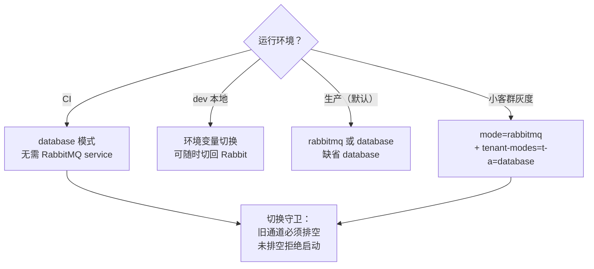

**三阶段切换配置**：

| 阶段 | 配置 | 说明 |
|:---|:---|:---|
| CI | `AGENT_MESSAGING_MODE=database`（ci.yml 显式声明） | 不需要 RabbitMQ service；broker 端到端由 `RealBrokerEndToEndIT` 单独验 |
| dev 本地 | 改环境变量 | `./scripts/dev-rabbitmq.sh start` 可随时切回 Rabbit |
| 试运营小客群 | `mode=rabbitmq` + `tenant-modes=t-a=database` | 存量租户不动，灰度租户走 DB 队列；回滚=改一个环境变量 |

#### ⑤ 详细否决理由

**否决"仅保留单一通道"（三段式）**：

- **风险佐证**：原状 CI 必须起 RabbitMQ service，否则 worker 全关＝消息永不消费的断链；换载体要改代码 + 重新发版 + 全链路重验。
- **落地代价**：试运营阶段无法按租户灰度；每次环境差异都要一次代码变更。
- **与硬约束冲突**：与"多租户灰度试运营"和"CI 零外部依赖"诉求冲突。

**否决"切换时不排空旧通道"**：

- **风险佐证**：两通道各有积压，切换后旧通道消息不被新通道接管，会安静滞留、Run 永不执行，而系统表面完全正常。
- **落地代价**：`MessagingSwitchGuard` 启动期检查残留，未排空拒绝启动（"无法检查 ≠ 通过"）。

#### ⑥ PoC 测试过程与数据

**P4-D17 本机实跑（非纸面推演）**：

| 场景 | 配置 | 结果 |
|:---|:---|:---|
| CI / database + 有 broker | `AGENT_MESSAGING_MODE=database` | ✅ BUILD SUCCESS · **822 项 · 0 跳过** |
| database + **无 broker**（容器已停） | 环境变量切换 | ✅ BUILD SUCCESS · **0 次 broker 连接尝试** |
| rabbitmq + 有 broker | `mode=rabbitmq` | ✅ BUILD SUCCESS |
| 小客群灰度（t-a=DB / t-b=Rabbit） | 租户覆盖 | ✅ 装配测试 3/3：路由正确、背压覆盖两通道、租户保序 |
| DB 队列 IT（语义/RLS/死信/超时回收） | 真库 IT | ✅ 11/11 |
| 通道装配 IT（database 模式 Bean 图） | 装配 IT | ✅ 11/11 |
| **切换守卫反证**（残留 → 拒绝启动） | 残留注入 | ✅ 3/3 |
| CI 等价执行（两 job + 断言） | — | ✅ unit 524 项/跳过 25 · integration 822 项/跳过 0 |

#### ⑦ 上线后风险预案

**切换操作手册（重要）**：

```bash
# ① 停止 worker（不再领取新任务）
# ② 用旧通道启动一次，让旧通道排空
#    - 旧通道是 database：等 agent_message_queue 的 PENDING 归零
#    - 旧通道是 rabbitmq：等 agent.run.execute 深度归零
# ③ 改通道配置并重启
# ④ 未排空就切 → 守卫会**拒绝启动**并给出处置指引（这正是设计意图）
```

**隐性风险与预案**：

| 风险 | 表现 | 预案 |
|:---|:---|:---|
| 切换期两通道同时在途 | 背压只探一条 → 另一条无限堆积无人看见 | `CompositeQueueDepthProbe` **只纳入活动通道**求和 |
| 纯 DB 部署纳入 Rabbit 探测 | broker 不存在 → 探测抛异常 → 背压恒超限 → 消息永不发布 | 同上规避 |
| 可见性超时过短 | 默认 5 分钟必须显著大于单次 Run 执行耗时 | 租约 + fencing 保证重复消费安全，但浪费一个租约周期 |
| 非热切 | 不支持运行期零停机切换 | 必须先排空旧通道（守卫强制） |
| 多实例覆盖表 | 各实例只对清单内租户生效 | 清单外 slug 点名告警，不静默失效 |

**诚实边界（不得扩大解释）**：① broker 端到端 E-1/E-2/E-3 不在 CI 覆盖内（CI 无 rabbitmq service），需有 broker 环境单独跑（本机已验通 3/3）；② DB 队列吞吐上限受库写入约束，本项目量级（单租户并发 Run ≤ 5）够用但**未经压测**；③ 切换不是热切。

#### ⑧ 未来迭代替换条件

| 触发条件 | 判定 | 应对 |
|:---|:---|:---|
| 灰度租户规模扩大，PG 队列吞吐成瓶颈 | 容量压测不达标 | 评估全量切回 RabbitMQ 或引入分区 |
| RabbitMQ 4.4 升级窗口 | 4.4 GA | 升级主 MQ 并重新验证双通道语义 |
| 某通道长期不使用 | 维护成本 > 收益 | 评估退役该通道（需新 ADR） |
| 可见性超时导致租约浪费频繁 | 超时 < Run 时长 | 调大超时并重新压测 |

> **可复用要点**：最高级的选型是**把"选型"变成"配置"**。当环境差异（CI/dev/灰度）无法用单一方案满足时，用端口抽象 + 语义对齐 + 切换守卫把二选一升维为可运行时切换——但代价是必须逐条对齐语义，否则"切换"等于"换 bug"。

---

### 4.6 案例五：架构模式选型（分层 / DDD / 事件驱动 / 管道反应器）

> **结论**：**模块化单体 + 独立 Worker**（控制面/执行面分离）。以 DDD 的限界上下文与端口-适配器为骨架，吸收事件驱动（Outbox/SSE）与管道反应器（Worker 执行循环）的思想；**首期不拆微服务**。

#### ① 所有备选方案原理详解

| 模式 | 原理 | 在本项目的体现 | 适用量级 |
|:---|:---|:---|:---|
| **分层架构** | 按 presentation / application / domain / infrastructure 切分，依赖单向流动 | `agent-api` → `agent-application` → `agent-core` → `agent-persistence`；静态测试守依赖方向 | 小团队/小体量 |
| **DDD（领域驱动）** | 限界上下文、聚合、领域事件、端口-适配器；领域层不依赖框架 | `agent-core` 纯领域（仅 JSpecify），端口前移到 `agent-ports`，`AgentCorePurityTest` 守住 | 中大型、领域复杂 |
| **事件驱动** | 组件通过事件异步协作，松耦合 | Run Event 持久化 + Outbox + SSE（Last-Event-ID 续传）；MQ 唤醒信号 | 需要异步解耦 |
| **管道反应器** | 请求经一串处理器/反应器链式处理 | Worker 执行循环（`RunExecutionLoop`）、Tool SPI 调用链、上下文装配管线 | 执行流程密集 |
| **微服务** | 服务按业务能力拆分，独立部署/扩展 | 首期不采用；保留沿模块边界抽出的能力 | 大团队/大规模 |

**部署形态对比（与架构模式正交的维度）**：

| 模式 | 适用团队/体量 | 一致性成本 | 运维复杂度 | 部署形态 |
|:---|:---|:---|:---|:---|
| 单体 | 小团队/小体量 | 低（本地事务） | 低 | 单进程 |
| **模块化单体** | 小团队/中小体量 | 低（共享 DB + 事务） | 中（守卫防腐蚀） | 少量进程（API/Worker 分离） |
| 微服务 | 大团队/大规模 | 高（分布式事务/Saga） | 高（服务网格/注册发现） | 多进程多机 |

**决策**：采用模块化单体 + 独立 Worker。`agent-api` / `agent-application` 与 `agent-worker` 可独立部署（控制面/执行面分离），但首期不拆过多微服务。**扩展通道**：模块边界清晰（端口-适配器），未来某模块成为瓶颈时可沿边界抽出为独立服务。

#### ② 量化打分表（八维）

**权重声明（评估前冻结）**：适配×3（小团队低体量是硬现实）、风险×2、迭代×2（未来可抽出），其余×1；总权重 12。

| 维度 | 权重 | 分层单体 | DDD 模块化单体 | 事件驱动 | 管道反应器 | 微服务 |
|:---|:--:|:--:|:--:|:--:|:--:|:--:|
| 性能 | 1 | 4 | 4 | 3 | 4 | 4 |
| 稳定性 | 1 | 4 | 5（强一致 + 守卫） | 3（最终一致） | 4 | 3（分布式一致性） |
| 成本 | 1 | 5 | 4 | 3 | 3 | 2 |
| 运维 | 1 | 5 | 4 | 3 | 4 | 2 |
| 生态 | 1 | 5 | 5 | 4 | 4 | 5 |
| 适配 | 3 | 5→15 | 5→15 | 3→9 | 4→12 | 2→6 |
| 迭代 | 2 | 3→6 | 5→10（可抽出） | 4→8 | 4→8 | 5→10 |
| 风险（团队适配） | 2 | 5→10 | 5→10 | 4→8 | 3→6 | 2→4 |
| **加权总分** | 12 | **4.50** | **4.75** | 3.42 | 3.92 | 3.00 |

> **解读**：DDD 模块化单体得分最高（4.75），兼顾强一致性、团队适配与未来抽出能力；分层单体 4.50 次之但迭代性弱。**最终方案是组合式**：以 DDD 模块化单体为骨架，叠加事件驱动与管道反应器思想，而非单选一种。

#### ③ 优劣势

| 模式 | 优势 | 劣势 |
|:---|:---|:---|
| 模块化单体 | ① 本地事务保证一致性（Run/Outbox 同事务）；② 控制面/执行面可独立伸缩；③ 未来抽出服务有清晰边界；④ 守卫防腐蚀 | 边界若不守会退化为"大泥球" |
| 微服务 | 独立扩展、技术异构 | ① 需 Saga/分布式事务，破坏"PG 权威源"；② 需服务注册发现/配置中心/链路追踪/独立流水线；③ 小团队故障排查复杂 |
| 事件驱动 | 松耦合、异步解耦 | 最终一致性、事件版本治理复杂 |
| 管道反应器 | 执行流程清晰、可插拔 | 管道过长难调试，需防止隐式副作用 |

#### ④ 适配场景边界

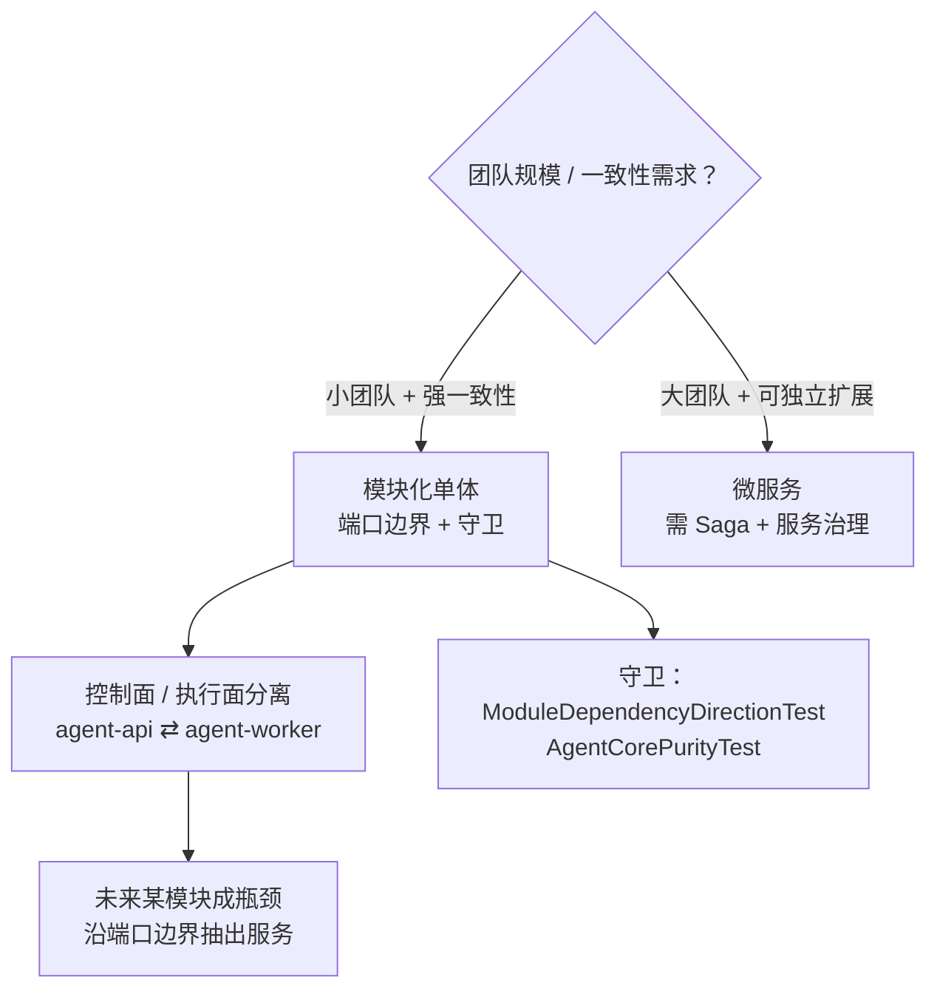

#### ⑤ 详细否决理由

**微服务否决（三段式）**：

- **一致性代价**：Run/Outbox 同事务在微服务下需 Saga 或分布式事务，违背"PG 权威源 + 本地事务"的可靠性地基。
- **运维代价**：需服务注册发现、配置中心、链路追踪基础设施、独立部署流水线——小团队无专职 SRE 难以承受。
- **团队适配**：无微服务运维经验，故障排查复杂度陡增。

**纯分层单体未单独采用**：分层是必要基础，但缺乏限界上下文与端口抽象时模块边界模糊、未来难抽出；故升级为 DDD 模块化单体。

**事件驱动 / 管道反应器未作为整体架构**：二者是"战术模式"而非"整体骨架"，本项目以局部叠加方式使用（Outbox/SSE、Worker 循环），避免全局最终一致性。

#### ⑥ PoC 测试过程与数据

**架构约束守卫验证（反映模式落地）**：

| 验证项 | 方法 | 结果 |
|:---|:---|:---|
| 模块依赖方向无循环 | 逐模块 POM 检查 | ✅ core ← ports ← application ← infrastructure ← worker/api |
| 领域层零框架依赖 | `AgentCorePurityTest`（3 项） | ✅ `agent-core` 编译期依赖仅 JSpecify |
| 状态机正确性 | `StateMachineTest`（10 项） | ✅ 终态不可迁出、UNKNOWN 不可盲目重试 |
| 模块方向守卫 | `ModuleDependencyDirectionTest` | ✅ 跨层反向依赖被拦截 |
| 可执行产物 | `mvn package` | ✅ fat jar 生成 |

#### ⑦ 上线后风险预案

| 风险 | 表现 | 预案 |
|:---|:---|:---|
| 模块化单体退化为大泥球 | 边界被突破、跨层 import | 静态守卫（`ModuleDependencyDirectionTest` / `AgentCorePurityTest`）拦截 |
| 控制面/执行面耦合 | Worker 与 API 无法独立伸缩 | 保持端口边界、`agent-worker` 独立部署 |
| 双 reactor 边界模糊 | platform 与 rag 互相依赖 | 各自独立模块树，通过明确契约交互 |
| UNKNOWN 盲目重放 | 结果不确定时重跑产生重复副作用 | 状态机约束 + 对账路径（ADR-012） |

#### ⑧ 未来迭代替换条件

| 触发条件 | 判定 | 应对 |
|:---|:---|:---|
| 某模块（如 rag 检索、Worker 执行）成为明确性能瓶颈且单体内容错无效 | 压测确认 | 沿端口边界抽出为独立服务 |
| 团队规模扩张到可支撑独立运维 | 组织条件成熟 | 评估微服务化 |
| 出现"控制面与执行面必须不同 SLA"的硬性需求 | 业务要求 | 分离部署升级为独立服务 |

> **可复用要点**：架构模式选型不是四选一，而是"**骨架 + 战术模式**"的组合。模块化单体提供骨架，DDD 提供边界，事件驱动与管道反应器提供局部机制。微服务的否决不是因为它"不好"，而是因为它与"小团队 + 强一致性"约束冲突。

---

### 4.7 案例六：多租户隔离方案全对比

> **结论**：**RLS 行隔离 + 影子期迁移**。以 RLS 为主 + 应用层授权为辅 + 逐跳重新授权；当前处于"RLS→应用层权限迁移"的影子期，**真出口是 `rlsDependent=0` + 观察期达标**。

#### ① 所有备选方案原理详解

| 方案 | 原理 | 隔离强度 | 适用量级 | 运维复杂度 |
|:---|:---|:---|:---|:---|
| **行隔离（PostgreSQL RLS）** | GUC `app.tenant_id` + FORCE RLS + POLICY，数据库层强制 | 高（数据库兜底） | 中小～中 | 中（策略管理） |
| **列隔离（应用层校验）** | 每表加 `tenant_id` 列，每个查询手动带过滤条件 + 代码纪律 | 中（依赖人不漏写） | 中小 | 中 |
| **库隔离（分库分表）** | 物理隔离，按 tenant 路由数据源 | 最高 | 大规模 | 高（路由/迁移/扩容） |
| **混合隔离** | 行隔离 + 库隔离组合 | 最高 | 大规模 | 高 |

**RLS 关键实现要点（均为项目血泪经验）**：

1. **GUC 绑定时序**：`set_config('app.tenant_id', ?, true)` 必须在**事务内、业务 SQL 前**设置；验隔离须用 NOBYPASSRLS 角色（`app_agent`），**BYPASSRLS = 假绿**。
2. **全局 Agent 表隔离**：FORCE RLS 下，`agent` / `agent_version` 等表无 `tenant_id`，任何租户路径读这些表都必须 JOIN/EXISTS `tenant_agent_binding` 且**谓词在 ON 子句内**（静态守卫只认 ON 内谓词，放 WHERE 会被 `JoinTenantPredicateArchitectureTest` 判红）。
3. **版本 fail-closed**：`pinned_version` 非空时只解析已发布版本，坏版本 fail-closed 不回退最新。
4. **影子期基线**：9 张无 RLS 表是影子期基线，禁止直接补 RLS；当前处于"RLS→应用层权限迁移"影子期（M4 影子开启、差真实流量）。

#### ② 量化打分表（八维）

**权重声明（评估前冻结）**：风险（合规红线）×3（PIPL 极高）、稳定性×2、适配×2，其余×1；总权重 12。

| 维度 | 权重 | 列隔离（应用层） | **行隔离（RLS）** | 库隔离（分库） | 混合隔离 |
|:---|:--:|:--:|:--:|:--:|:--:|
| 性能 | 1 | 4 | 4 | 3 | 3 |
| 稳定性 | 2 | 3→6 | 5→**10** | 5→10 | 5→10 |
| 成本 | 1 | 3（每查询带 tenant_id） | 4（GUC 绑定） | 2（路由/迁移） | 2 |
| 运维 | 1 | 3 | 3（策略管理） | 5 | 5 |
| 生态 | 1 | 5 | 5 | 3 | 3 |
| 适配 | 2 | 4→8 | 5→**10**（中小～中） | 3→6 | 4→8 |
| 迭代 | 1 | 3 | 4 | 3 | 4 |
| 风险（合规） | 3 | 3→9（漏写即泄露） | 4→**12**（数据库兜底） | 3→9 | 3→9 |
| **加权总分** | 12 | **3.17** | **3.92** | 3.00 | 3.25 |

> **解读**：RLS 行隔离得分最高（3.92）。分库分表在中小体量下路由复杂度、跨租户查询困难、迁移成本远超收益，且破坏"Run/Outbox 同事务"的单库前提。

#### ③ 优劣势

| 方案 | 优势 | 劣势 |
|:---|:---|:---|
| RLS 行隔离 | ① 数据库层强制兜底；② 与业务数据同库，一致性好；③ 策略集中管理 | ① 策略随结构变更同步（platform 49 条 + rag 43 条）；② 全局表需 JOIN 绑定表且谓词位置受限；③ 影子期有 9 张无 RLS 表 |
| 列隔离（应用层） | 实现简单、无数据库特性依赖 | 完全依赖代码纪律，漏写 tenant_id 即泄露，无兜底 |
| 库隔离 | 物理隔离强度最高 | ① 路由/迁移/扩容复杂；② 跨租户查询困难；③ 破坏单库事务前提 |
| 混合隔离 | 兼顾隔离强度与灵活性 | 复杂度高，中小体量过度设计 |

#### ④ 适配场景边界

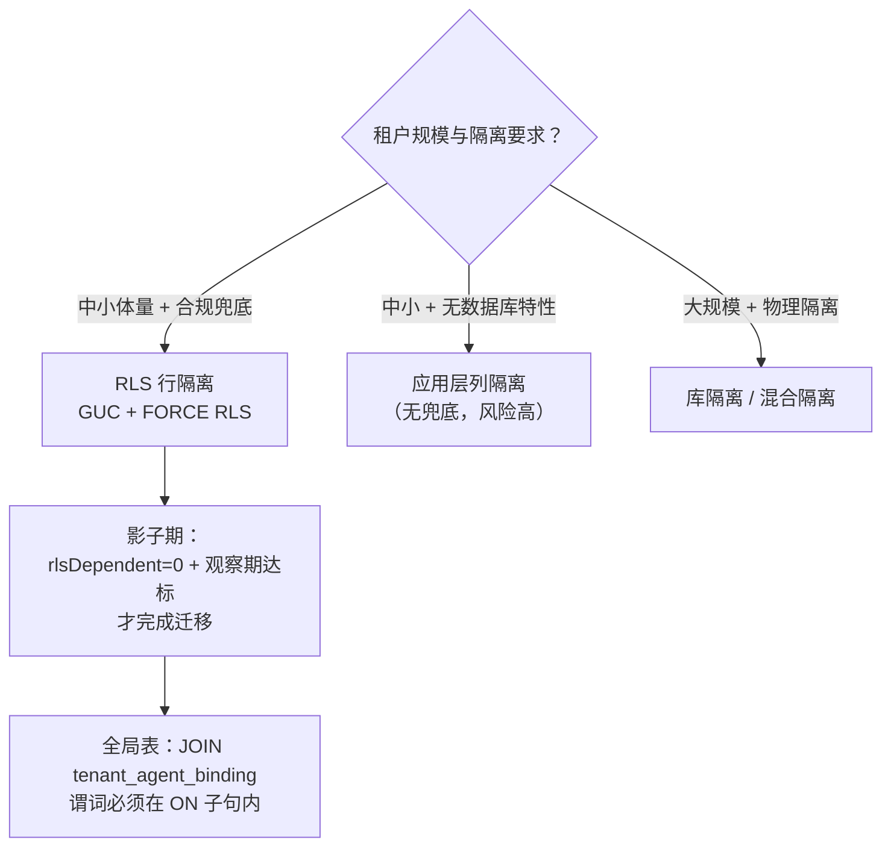

#### ⑤ 详细否决理由

**分库分表否决（三段式）**：

- **风险佐证**：中小体量下路由复杂度、跨租户查询困难、迁移成本远超收益。
- **落地代价**：破坏"Run/Outbox 同事务"的单库前提，需引入分布式事务。
- **与硬约束冲突**：与"PG 唯一权威事实源 + 本地事务"冲突。

**纯应用层列隔离否决（三段式）**：

- **风险佐证**：完全依赖代码纪律，一旦某条新查询漏写 tenant_id 即泄露；缺少数据库层兜底。
- **落地代价**：需在 code review 中反复提醒"记得带 tenant_id"，靠人肉记忆。
- **与硬约束冲突**：不满足纵深防御与 PIPL 合规要求。

**混合隔离否决**：大规模场景才需要，本项目当前为中小体量，过度设计。

#### ⑥ PoC 测试过程与数据

**RLS 验证（M0/M1/M3）**：

| 验证项 | 方法 | 结果 |
|:---|:---|:---|
| RLS 事务绑定 | `set_config` 必须在事务内、业务 SQL 前；`TenantSessionBinder` 绑定连接 | ✅ |
| 反证用例 | 用 BYPASSRLS 角色验证会得到假绿，故必须用 `app_agent`（NOBYPASSRLS） | ✅ 非特权真库验证 |
| FORCE RLS 静默行为 | 不绑租户删/查静默 0 行 | ✅ 已识别此风险形态 |
| 全局表谓词位置 | 谓词在 ON 子句内（静态守卫只认 ON 内） | ✅ `JoinTenantPredicateArchitectureTest` |
| 影子期验证 | `RAG_SHADOW_ENABLED=true` 双跑比对，承认"差真实流量" | ✅ 真出口仍以 `rlsDependent=0` + 观察期达标为准 |

#### ⑦ 上线后风险预案

| 风险 | 表现 | 预案 |
|:---|:---|:---|
| 假绿（BYPASSRLS） | 用特权角色验证隔离通过 | 必须用 NOBYPASSRLS 的 `app_agent` 角色 |
| 全局表谓词位置错误 | WHERE 中放谓词被守卫判红 | 谓词必须在 ON 子句内 |
| 策略不同步 | 结构变更后 RLS 策略未更新 | platform 49 条 + rag 43 条策略随变更同步 |
| 9 张无 RLS 表 | 影子期基线 | 禁止直接补 RLS；等影子期迁移完成 |
| pinned_version 坏版本 | 回退到最新导致越权 | fail-closed 不回退 |
| 静默 0 行 | 未绑租户查询静默返回空 | 租户上下文缺失 fail-closed |

**影子期迁移纪律**：真出口是 `rlsDependent=0` + 观察期达标，而非"双跑看起来一致"。影子期"差真实流量"必须被诚实承认，不能把双跑一致当作迁移完成。

#### ⑧ 未来迭代替换条件

| 触发条件 | 判定 | 应对 |
|:---|:---|:---|
| `rlsDependent=0` 达成且观察期达标 | 迁移完成 | 结束影子期，清理 9 张无 RLS 表的基线 |
| 租户规模增长到单库成为瓶颈 | 容量压测确认 | 评估分库分表或混合隔离 |

> **可复用要点**：多租户隔离选型的决定性因素是"**是否能在数据库层兜底**"。RLS 行隔离胜出不是因为它最强（库隔离更强），而是因为它在"中小体量 + 合规兜底 + 单库事务"约束下最合适。影子期的存在说明**迁移也是选型的一部分**——真出口必须有量化判定（`rlsDependent=0`）。

---

### 4.8 案例七：向量检索引擎全方案对比

> **结论**：二期采用 **PG + pgvector**（`halfvec(4096)`，刻意不用 HNSW）+ 双通道检索（稠密 + 词法 `ts_rank`）+ **RRF 融合 k=60** + **阈值 0.38**，相关性分（门禁）与融合分（排序）分离。首期（DEC-5）不做 RAG，用模型参数内知识。

#### ① 所有备选方案原理详解

| 方案 | 技术原理 | 适用量级 | 性能基线 | 运维复杂度 |
|:---|:---|:---|:---|:---|
| **Milvus（专用向量库）** | 专用 ANN 索引（HNSW/IVF），独立服务，支持分布式 | 大规模、高维、高并发 | 检索延迟最低，支持分布式 | 高（独立集群 + 数据同步） |
| **pgvector（PG 扩展）** | `halfvec(4096)` 余弦 + `ts_rank` 词法，RRF 融合 | 中小规模 | 单库毫秒级，受 PG 资源约束 | 低（复用 PG，无新组件） |
| **FAISS** | Meta 开源向量检索库（库非服务），内存索引，需自建持久化与服务化 | 中大规模、离线检索 | 检索性能高，支持 GPU | 中高（需自建服务与持久化） |
| **模型参数内知识** | 不检索，依赖模型参数记忆 | 首期/通用问答 | 无检索开销 | 最低 |

**两阶段决策**：

- **首期（DEC-5）**：不做 RAG，用模型参数内知识——首场景是错题归因，"不编造出处"是硬红线，不可信外部知识弊大于利。
- **二期**：采用 PG + pgvector，双通道（稠密 + 词法 `ts_rank`）+ RRF 融合（k=60）+ 阈值 0.38，相关性分（门禁）与融合分（排序）分离。复用 PG 降低运维成本，与业务数据同库保障一致性。

**检索编排七步**：知识点解析 → 多路召回 → 版本硬过滤 → 角色硬过滤 → 知识点补全 → RRF 融合 → 分数门禁。准入为四轴 + 阈值 `min-score=0.38` + `min-trust-tier=OFFICIAL_TUTORIAL`；词法侧用 `to_tsvector('simple', text_jieba)`。

#### ② 量化打分表（八维）

**权重声明（评估前冻结）**：适配×3、运维×2、风险×2（PIPL + 编造红线），其余×1；总权重 12。

| 维度 | 权重 | Milvus | **pgvector** | FAISS | 模型参数内知识 |
|:---|:--:|:--:|:--:|:--:|:--:|
| 性能 | 1 | 5 | 4（halfvec） | 5 | 3（无召回能力） |
| 稳定性 | 1 | 4 | 5（与业务同库事务） | 3 | 4 |
| 成本 | 1 | 2 | 5（复用 PG） | 3 | 5 |
| 运维 | 2 | 2→4 | 5→**10** | 3→6 | 5→10 |
| 生态 | 1 | 4 | 5 | 4 | 3 |
| 适配 | 3 | 4→12 | 5→**15** | 3→9 | 5→15（首期） |
| 迭代 | 1 | 4 | 4 | 3 | 3 |
| 风险 | 2 | 3→6（新组件+数据同步） | 4→**8**（质量红线已验证） | 3→6 | 2→4（编造风险） |
| **加权总分** | 12 | **3.50** | **4.58** | 3.25 | 3.67 |

> **解读**：pgvector 得分最高（4.58）。首期采用参数内知识（3.67）是独立的两阶段决策（DEC-5），不推翻二期选型。

#### ③ 优劣势

| 方案 | 优势 | 劣势 |
|:---|:---|:---|
| pgvector | ① 复用 PG，零新组件；② 与业务数据同库保障一致性（摄取状态/代际/权限）；③ 双通道 + RRF 质量已验证 | ① 规模增长后成为瓶颈；② halfvec(4096) 与云 embedding API 维度（最高 3072）不匹配，不能混填 |
| Milvus | ANN 索引性能最强、支持分布式 | ① 独立集群运维与数据同步成本高；② 跨库一致性（摄取状态/代际/权限）难保证 |
| FAISS | 检索性能高、库形态灵活 | ① 需自建服务化与持久化；② 无事务一致性；③ 与业务数据跨库 |
| 参数内知识 | 零检索开销、首期验证足够 | ① 无法引用出处；② 无法覆盖长尾知识 |

#### ④ 适配场景边界

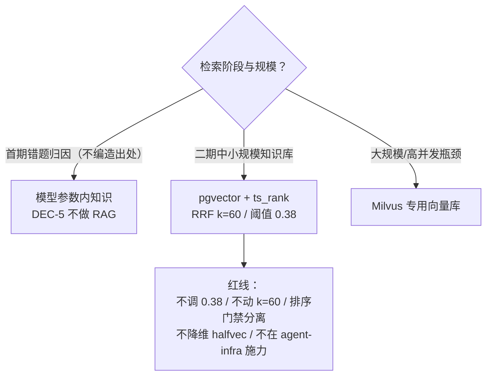

#### ⑤ 详细否决理由

**专用向量库（Milvus/FAISS）否决（三段式）**：

- **风险佐证**：中小体量下独立向量集群的运维与数据同步成本不划算；业务数据已在 PG，跨库一致性（摄取状态、代际、权限）难以保证。
- **落地代价**：独立集群 + 数据同步管道 + 跨库对账。
- **与硬约束冲突**：与小团队无 SRE、一致性优先冲突。

**首期否决 RAG（DEC-5，三段式）**：

- **风险佐证**：首场景错题归因要求"不编造出处"，不可信外部知识引入编造风险。
- **落地代价**：RAG 链路（摄取/检索/融合/门禁）建设成本在首期收益不明。
- **与硬约束冲突**：与"不编造出处"红线冲突。

#### ⑥ PoC 测试过程与数据

**RAG-D09 门禁验证**：

| 验证项 | PoC 方法 | 通过标准 |
|:---|:---|:---|
| 双通道检索 | 稠密 pgvector 余弦（只读 ACTIVE 代际）+ 词法 `ts_rank` + `to_tsvector('simple', text_jieba)` | 双路召回有效 |
| RRF 融合 | `1/(k+rank)`，k=60、候选 ×3；相关性分（门禁）与融合分（排序）分离 | 融合与门禁口径分离 |
| 准入 | 四轴 + 阈值 `min-score=0.38` + `min-trust-tier=OFFICIAL_TUTORIAL` | 低分/低信任被门禁拦截 |
| 检索编排七步 | 知识点解析→多路召回→版本硬过滤→角色硬过滤→知识点补全→RRF→分数门禁 | 七步顺序正确 |
| 评测集 | 评测集驱动，输出无编造出处 | ✅ 无编造 |
| 维度一致性 | 嵌入式维度一致性 fail-fast（配置/库列一致） | 不一致即启动失败 |

#### ⑦ 上线后风险预案

**四条红线沉淀（选型后形成的禁区）**：

| 红线 | 原因 | 守卫 |
|:---|:---|:---|
| ⛔ 不调低 0.38 阈值 | 调低会引入编造出处 | 阈值常量化 + 配置 fail-closed |
| ⛔ 不动 RRF k=60 与"排序键=融合分/门禁键=相关性分"分离 | 破坏已验证的检索质量 | 常量化 + 反证用例 |
| ⛔ 不在不可达的 `agent-infra` 引擎施力 | **生产链路在 rag 模块 `JdbcRetrievalRepository`**；`agent-infra/RetrievalService` 是草稿（未注册父 pom、含编译错误、未验证，见 P3-D10） | 模块归属核对 |
| ⛔ 不降维 halfvec / 不强建 HNSW | 破坏已验证质量与一致性 | 配置校验 |

**隐性风险与预案**：

| 风险 | 表现 | 预案 |
|:---|:---|:---|
| 维度治理不匹配 | 云 embedding API 维度最高 3072 与 halfvec(4096) 不匹配 | 不能为便宜混填；换维须独立代际 + 列改造 + 重算重评 |
| 施力位置错误 | 在 `agent-infra` 写检索逻辑，生产不生效 | 认准 `rag` 模块 `JdbcRetrievalRepository` 为生产链路 |
| 静默编造 | 外部不可信内容升级为系统指令 | 外部内容一律不可信输入（P9），四轴 + 信任层级门禁 |

#### ⑧ 未来迭代替换条件

| 触发条件 | 判定 | 应对 |
|:---|:---|:---|
| 评测显示参数内知识不足以支撑归因准确性 | 首期验证不达标 | 触发二期 RAG（DEC-5 → 二期） |
| 数据规模增长到 pgvector 成为瓶颈 | 压测确认 | 评估专用向量库（Milvus） |
| 维度治理需要换维 | 供应商变更 | 独立代际 + 列改造 + 重算重评 |
| 检索质量评测下降 | 评测集回归 | 优先检查红线是否被破坏，而非调参 |

> **可复用要点**：向量检索选型的核心不是"哪个 ANN 更快"，而是"**如何在中小体量下用最小运维成本保住已验证的检索质量**"。选型后形成的四条红线（0.38 / k=60 / 排序门禁分离 / halfvec 不降维）比选型本身更重要——它们是防止后续"优化"破坏质量的护栏。尤其要认准生产链路在 `rag` 模块，而非不可达的 `agent-infra`。

---

> **第四章小结**：七大选型呈现出高度一致的决策基因——**先定位（PG 权威源 / 唤醒信号 / 显式 SQL / 支持期 / 配置化 / 数据库兜底 / 质量红线），再评估，后治理**。每一个结论都配套了排除理由、PoC 数据、风险预案与复审触发；每一次偏离（如 Boot 3.x→4.1.1、JDBC→有限 MP）都有 ADR 或 POC 留痕。这正是"可追溯、可验证、可推翻"的架构决策体系的具体落地。

---

## 五、深度问题剖析、踩坑复盘、边界风险

> 本章从"事后视角"审视选型治理中的真实问题。所有复盘均来自事实基线，不做戏剧化演绎；重点提炼"为什么会错"与"如何不再错"。

### 5.1 十二个典型踩坑复盘

#### 坑 1：定位跑偏——把 MQ 当高吞吐总线

- **表现**：选型初期若按"高吞吐消息中间件"定位，Kafka 的吞吐维度必然碾压，结论会倒向 Kafka。
- **根因**：跳过"七问清单"，直接从功能表开始比。
- **真实后果**：Kafka 的 partition/rebalance/retention 运维负担与"无 SRE"现实冲突；吞吐优势无从发挥（每 Run 一条消息）。
- **纠正**：先答七问，锁定"MQ 只作唤醒信号"，评估维度自然收敛（ADR-001）。
- **教训**：**定位决定维度，维度决定选型**。

#### 坑 2：事后加权——看完结果再调权重

- **表现**：为了让心仪方案胜出，把它的强项临时调成 ×3。
- **根因**：权重声明未冻结，缺乏签名留痕。
- **真实后果**：决策不诚实，复审时无法还原"当时为什么"，答辩时经不起追问。
- **纠正**：权重在评估前声明并签名；事后调整必须走新 ADR。
- **教训**：**诚实是决策质量的上限**。

#### 坑 3：支持期未纳入选型——RabbitMQ 4.3 停维窗口

- **表现**：ADR-001 选定 4.3.6 时，社区支持 2026-11-30 到期已明确，但覆盖 P0～P3。
- **根因**：接受风险但未形成残余风险登记。
- **真实后果**：P4 生产化前须评估升级 4.4；若无 P4-R022 登记，停维风险会被"Outbox/quorum/confirms 已覆盖"的错觉掩盖。
- **纠正**：P4-R022 正式登记 7 项残余风险，定级 Accepted with conditions。
- **教训**：**支持期是硬维度，接受风险必须显式化并定级**。

#### 坑 4：ORM 隐式 SQL 导致 RLS 假绿

- **表现**：JPA/Hibernate 的隐式 SQL 与延迟加载让 `set_config` 时序不可控；用 BYPASSRLS 角色验证会得到"隔离通过"的假绿。
- **根因**：把"看起来隔离"当"真的隔离"。
- **真实后果**：FORCE RLS 下绑定晚于查询会静默返回 0 行（业务假装正常但没有数据）。
- **纠正**：选显式 JDBC；验隔离必须用 `app_agent`（NOBYPASSRLS）；MP 引入配 `RlsTenantBindingInterceptor`。
- **教训**：**静默失效比报错更危险**。

#### 坑 5：基线偏离无记录——Boot 3.x → 4.1.1

- **表现**：v3.1 原文为 Spring Boot 3.x，DEC-4 决定改用 4.x。
- **根因**：若无 ADR-011，偏离会成为"口头变更"。
- **真实后果**：团队无法回答"为什么不用组织已验证的 3.x"，复盘的回滚路径也无人知晓。
- **纠正**：ADR-011 完整记录偏离理由、影响面、验证与回滚。
- **教训**：**基线偏离必须留痕**。

#### 坑 6：双重重试——内置 @Retryable + 自研重试

- **表现**：Spring Boot 4.1 内置 `@Retryable` 与 ModelGateway 自研重试若同时生效。
- **根因**：同一失败被两层重试机制处理。
- **真实后果**：对有副作用工具（`record_weakness`）可能造成重复写入 → **Sev-0**。
- **纠正**：明确唯一重试点：模型/工具调用重试统一走 ModelGateway 自研逻辑，内置 `@Retryable` 不用于有副作用路径（ADR-011 §3.2）。
- **教训**：**能力叠加不等于能力增强，要明确责任归属**。

#### 坑 7：切换通道语义未对齐——"切换=换 bug"

- **表现**：RabbitMQ 与 PG 队列在持久化、至少一次、有限重试、死信、背压口径上若不一致，切换就是行为改变。
- **根因**：把"能切"当"切得对"。
- **真实后果**：切换后出现难以定位的行为差异。
- **纠正**：P4-D17 逐条对齐 6 项语义；MessagingSwitchGuard 守卫排空。
- **教训**：**可切换的前提是语义等价**。

#### 坑 8：纯 DB 部署纳入 Rabbit 探测——背压恒超限

- **表现**：`CompositeQueueDepthProbe` 若把 Rabbit 探测纳入纯 DB 部署。
- **根因**："多探一条更保险"的直觉。
- **真实后果**：broker 不存在 → 探测抛异常 → 背压恒超限 → **消息永不发布**（系统表面正常）。
- **纠正**：只纳入活动通道求和（P4-D17 §3.3）。
- **教训**：**over-engineering 的守卫本身会成为故障源**。

#### 坑 9：切换期旧通道未排空——Run 永不执行

- **表现**：切换后旧通道消息不被新通道接管，会安静滞留。
- **根因**：以为"切换后新通道自动接管旧消息"。
- **真实后果**：Run 永不执行且系统表面完全正常。
- **纠正**：`MessagingSwitchGuard` 启动期检查残留，未排空拒绝启动；"无法检查 ≠ 通过"（P4-D17 §3.4）。
- **教训**：**迁移必须有排空闸门**。

#### 坑 10：冻结现状写错——UNKNOWN 四类 vs 五类

- **表现**：ADR-012 初稿写"UNKNOWN 四类，穷举"，代码实为五类（子执行自身返回 UNKNOWN 直接流入委派终态）。
- **根因**：冻结时只照着记忆/文档写，未对着代码逐条核。
- **真实后果**：若不补正，会把一份"看起来很权威的错文档"冻结下来，误导后续评审。
- **纠正**：按代码补正为五类，并注明"冻结必须对着代码逐条核"。
- **教训**：**冻结不是抄文档，是核对事实**。

#### 坑 11：施力位置错误——agent-infra 不可达

- **表现**：P3-D10 在 `agent-infra` 写了 `RetrievalService`（草稿，含编译错误，未注册父 pom、未验证）。
- **根因**：以为"写了检索服务就接通了检索"。
- **真实后果**：生产链路在 `rag` 模块 `JdbcRetrievalRepository`，agent-infra 的代码**运行期不可达**，在错误的地方施力等于无效。
- **纠正**：形成红线"不在不可达的 agent-infra 施力"，认准生产链路。
- **教训**：**先确认生产链路，再动手优化**。

#### 坑 12：RAG 红线被"优化"破坏

- **表现**：后续"优化"中调低 0.38 阈值、改 RRF k=60、改排序/门禁分离、降维 halfvec、强建 HNSW。
- **根因**：把已验证的质量参数当"可调旋钮"。
- **真实后果**：破坏已验证的检索质量，引入编造出处风险（PIPL 未成年人场景）。
- **纠正**：四条红线沉淀为禁区 + 常量化 + 反证用例。
- **教训**：**选型形成的禁区要显式沉淀，防止被后续"优化"破坏**。

> **踩坑共性归纳**：12 个坑中，7 个属于"静默失效"（假绿、不报错但错、表面正常），3 个属于"定位/归属错误"，2 个属于"治理缺失"。这印证了本项目的核心工程取向——**fail-closed、可观测、留痕、守卫**。

### 5.2 选型失误的兜底与止损

#### 5.2.1 三级兜底体系

| 级别 | 策略 | 触发条件 | 恢复时间 | 本项目实例 |
|:---:|:---|:---|:---|:---|
| L1 | 配置回退 | 变更引起、可快速复原 | 分钟级 | 消息通道"改环境变量"回滚（P4-D17） |
| L2 | 版本回滚 | 新版本不兼容且无 workaround | 小时～天级 | Boot 4.1.1 → 3.5.x + Java 21（ADR-011 §5） |
| L3 | 架构降级 | 方案整体不适合 | 迭代级 | 切 PG 队列通道 / 首期不做 RAG（DEC-5） |

#### 5.2.2 止损三原则

1. **守卫先于回滚**：切换前必须排空旧通道，守卫拒绝启动即兜底生效。守卫的价值是"在错误发生前拦住"。
2. **领域层零改动红利**：因 `AgentCorePurityTest` 守住领域层零框架依赖，Boot 回滚时领域层代码零改动——兜底成本在选型时就已被架构约束压低。
3. **静默失效必须显式化**：broker 停维不丢消息但会静默积压，必须登记为残余风险（R-022-R3）并设计启动门禁（RabbitMQReachableGuard）。

#### 5.2.3 兜底能力的前置设计

兜底不是出事后补救，而是选型时的必备要素：

| 前置设计 | 作用 | 本项目证据 |
|:---|:---|:---|
| 端口抽象 | 换实现不改业务层 | `MessageSender` 前移到 `agent-ports` |
| 可配置通道 | 切换=改配置 | `AGENT_MESSAGING_MODE` |
| 领域层零依赖 | 版本回滚零改动 | `AgentCorePurityTest` |
| 模块边界清晰 | 未来可抽出服务 | 端口-适配器 |
| 三级回滚开关 | 分层降级 | `enabled=false` → `strategy=OFF` → `TRIM_ONLY`（ADR-013） |

### 5.3 技术债务的识别、登记与偿还

#### 5.3.1 债务分类与本项目清单

| 类型 | 定义 | 本项目实例 | 优先级 |
|:---|:---|:---|:---:|
| 合规债务 | 触碰合规红线的待办 | RAG 不编造出处、消息体最小化 | 最高 |
| 正确性债务 | 影响结果正确性的待办 | UNKNOWN 对账、RLS 绑定时序 | 高 |
| 静默失效债务 | 不报错但错的待办 | P4-R022 的 7 项残余 | 高 |
| 影子期债务 | 迁移中间态 | 9 张无 RLS 表、`rlsDependent` 未归零 | 中 |
| 停维风险 | 支持期到期后的风险 | RabbitMQ 4.3 社区支持 2026-11-30 | 中 |
| 实现草稿债务 | 写了但未接线/未验证 | `agent-infra/RetrievalService` 草稿 | 中 |

#### 5.3.2 识别信号

- code review 反复提醒同一件事（如"记得先 set_config 再查询"）。
- 文档与代码口径漂移（如 ADR-001 拓扑图中的 reconcile 队列未落地，需 P4-D11 勘误）。
- 某组件"没人敢改"或"只有某人懂"。
- 监控盲区（静默失效）。
- 复依赖"某人和某文档"的记忆，无 ADR 可查。

#### 5.3.3 登记字段

`债务编号 | 类型 | 来源决策 | 触发场景 | 影响级别（Sev） | 接受人 | 偿还条件 | 偿还期限`。

> **纪律**（P4-R022）：风险登记不是修复，"建议处置"不得在台账里记为"已缓解"除非对应动作落地。**登记只负责把风险显式写出来并定级**。

#### 5.3.4 偿还优先级

合规红线 > 正确性债务 > 静默失效 > 运维噪声 > 体验优化。

### 5.4 架构演进触发条件与风险边界

#### 5.4.1 七大选型演进触发条件总表

| 选型 | 触发条件 | 量化/判定 | 应对方向 |
|:---|:---|:---|:---|
| MQ | 4.4 GA / 停维前 30 天 / 积压恢复不达标 | 积压持续 > 阈值 | 升级 4.4 / 切 PG 通道 / 集群化 |
| ORM | MP 兼容问题 / RLS 迁移完成 | issue #7064 复现 / `rlsDependent=0` | 回退纯 JDBC / 重估 ORM |
| Boot 基线 | 生态不兼容 / SDK 不支持 / 4.2 GA | 阻塞开发或新版本可用 | 回滚 3.5.x / 评估升级 |
| 可切换通道 | 灰度吞吐瓶颈 / 4.4 升级窗口 | 压测不达标 | 全量切回 Rabbit / 分区 |
| 架构模式 | 模块成瓶颈 / 团队扩张 / 不同 SLA | 压测或组织条件 | 沿边界抽出服务 |
| 多租户隔离 | `rlsDependent=0` + 观察期 / 单库瓶颈 | 迁移完成或容量告警 | 结束影子期 / 分库分表 |
| 向量检索 | 参数内知识不足 / pgvector 瓶颈 / 换维 | 评测不达标 / 压测瓶颈 | 二期 RAG / 专用向量库 |

#### 5.4.2 边界风险清单（诚实边界）

| 边界 | 不得扩大解释的事实 |
|:---|:---|
| 消息通道 | broker 端到端不在 CI 覆盖内；DB 队列吞吐**未经压测**；切换不是热切 |
| RabbitMQ 停维 | Outbox/quorum/confirms **只覆盖 broker 正常重启**，不覆盖卷丢失/永久下线/未授权重连 |
| RLS 影子期 | 双跑比对"差真实流量"，真出口是 `rlsDependent=0` + 观察期达标 |
| RAG 检索 | `agent-infra` 运行期不可达；halfvec(4096) 与云 embedding API 最高 3072 维度不匹配 |
| MyBatis-Plus | 是"有限引入"而非全面替代；复杂 SQL 必须原样搬迁 |
| 上下文压缩 | 影子期零请求字节变更；G2 技术证据齐备但签核状态为"待落笔"，不得写成"门禁已过" |

> **风险边界纪律**：任何"已解决""已覆盖""已签核"的表述，必须能在事实基线中找到对应证据；否则一律以"已登记""待验证""待签核"表述。**诚实的边界声明本身就是决策质量的一部分**。

---

## 六、最佳实践固化、可复用范式沉淀

> 本章把前四章的经验抽象为可带走的范式。每个范式给出"适用条件 → 机制 → 本项目证据 → 复用步骤"。

### 6.1 可复用范式总表

| # | 范式 | 一句话 | 本项目证据 |
|:--:|:---|:---|:---|
| 1 | 先定位后选型 | 定位决定维度，维度决定选型 | ADR-001"MQ 只是唤醒信号" |
| 2 | 七问清单 | 用七个问题锁定组件职责与边界 | 2.2.2 |
| 3 | 权重先冻结 | 评估前声明权重并签名 | 各案例权重声明 |
| 4 | 一票否决独立记录 | 合规/停维/无运维能力独立于分数 | Boot 4.0.x 否决 |
| 5 | 把选型变成配置 | 端口抽象 + 语义对齐 + 切换守卫 | P4-D17 |
| 6 | 有守卫可回滚的决策变更 | 先 PoC 再落地，三层红线 | MyBatis-Plus 引入 |
| 7 | 冻结现状 + 逐条核对 | 对着代码核，不抄文档 | ADR-012 四类→五类纠错 |
| 8 | 升级不删除 | 先登记后升级，覆盖面不弱化 | ADR-013 D42 |
| 9 | 反证真红 | 撤点必须恰好红 1 条 + Skipped=0 | ADR-013 G2/M15 反证 |
| 10 | 红线沉淀 | 选型形成的禁区常量化 + 守卫 | RAG 四条红线 |

### 6.2 "先定位后选型"范式

- **适用条件**：任何存在多个可行方案的组件选型。
- **机制**：① 用一句话说清组件职责；② 答七问（职责/失败模式/事实源/量级/运维/回退/不引入）；③ 用定位反推评估维度与权重。
- **本项目证据**：ADR-001 的第一句话是"MQ 的定位必须先厘清，否则选型会跑偏"；锁定"唤醒信号"后，吞吐维度权重下降、运维/适配权重上升，Kafka 自然出局。
- **复用步骤**：写 ADR 第 1 节时强制先答七问，未答完不得进入打分。

### 6.3 "把选型变成配置"范式

- **适用条件**：环境差异（CI/dev/灰度/生产）无法用单一方案满足。
- **机制**：① 端口前移到中立层（业务代码零改动）；② 逐条对齐语义（持久化/至少一次/重试/死信/背压）；③ 切换守卫强制排空；④ 配置 fail-closed；⑤ 按租户路由支持灰度。
- **本项目证据**：P4-D17 复用三端口、`TenantRoutingMessageSender`、`CompositeQueueDepthProbe`、`MessagingSwitchGuard`，默认 database 通道，四场景全绿。
- **复用步骤**：先问"能否不引入"→ 若能，把两种方案都实现为端口的实现 → 用配置选择 → 写语义对齐清单 → 写守卫。

### 6.4 "有守卫、可回滚的决策变更"范式

- **适用条件**：选型后需要引入新组件/新框架（如 MyBatis-Plus）。
- **机制**：① 先做 PoC（可编译级参考实现）；② 定三条不可逾越的红线；③ 端口签名零改动；④ 守卫静态约束；⑤ 灰度/有限引入；⑥ 明确回退路径。
- **本项目证据**：ORM PoC 三条红线（Port 零改动、RLS fail-closed、复杂 SQL 原样搬迁）+ `RlsBindingIT` 4 用例（含串租户反证）+ 双 `SqlSessionFactory`。
- **复用步骤**：变更决策也要写 ADR/变更记录 → PoC 先行 → 红线前置 → 守卫落地 → 有限范围试点 → 留存回退开关。

### 6.5 "冻结现状 + 逐条核对"范式

- **适用条件**：某些语义已实现但未文档化，需要正式冻结（如状态机、取消语义）。
- **机制**：① 明确"冻结现状而非新设计"；② 对着代码/用例逐条核；③ 发现不一致按代码补正并记录；④ 把每条语义变成可验证的验收项。
- **本项目证据**：ADR-012 冻结七态语义，核对时抓到"UNKNOWN 四类→五类"并补正；新增 MA-T24a～MA-T24i 验收项把语义变成可验证项。
- **复用步骤**：列出散落在 javadoc/实现中的语义 → 逐条对照代码 → 用表格固化 → 补验收项 → 声明"以本 ADR 为准修实现"。

### 6.6 红线沉淀与反证纪律

**红线沉淀**：选型后形成的禁区（如 RAG 四条红线、RLS 谓词位置、`x-delivery-limit=3`）必须：① 写成显式禁令；② 常量化/配置 fail-closed；③ 配反证用例；④ 在 ADR 中写明"为何是禁区"。

**反证纪律**（本项目成熟形态）：

- **撤点真红**：故意破坏关键点（如 `ON CONFLICT DO UPDATE` → `DO NOTHING`、装配结果回退 legacy、模型桩固定 usage），测试必须恰好红 1 条。
- **判定标准**：`Skipped=0`，否则是假绿（环境跳过或编译失败不可区分）。
- **复原纪律**：`trap` INT/TERM 保护、备份 md5 校验、`git diff --check` PASS。
- **累计证据**：本项目累计反向验证 148 组（ADR-013 D54）。
- **守卫升级**：按 G1 A.5"先登记、后升级"，新守卫覆盖面不得弱于旧守卫（D42）。

### 6.7 培训与答辩话术沉淀

| 常见质疑 | 标准应答（基于事实基线） |
|:---|:---|
| "为什么不用 Kafka？" | MQ 只是唤醒信号，每 Run 一条消息，无专职 SRE；Kafka 吞吐优势无从发挥，运维负担显著更高且无内建死信（ADR-001） |
| "PG 队列总分和 RabbitMQ 一样，为什么不只用 PG？" | 两者都要：RabbitMQ 作主 MQ（生态+内建死信），PG 队列作可切换通道（零外部依赖+灰度），见 4.5 |
| "为什么用 Boot 4.1.1 不用组织验证过的 3.x？" | 3.x 已 EOL 无补丁；4.0.x 支持期仅剩 2 个月；4.1.1 支持至 2027-07-31 覆盖项目周期，偏离已由 ADR-011/DEC-4 记录 |
| "为什么不改用 JPA 提高开发效率？" | RLS 要求事务内 `set_config` 先于业务 SQL；JPA 隐式 SQL 时序不可控，FORCE RLS 下会静默返回 0 行（假绿） |
| "为什么要引入 MyBatis-Plus，不是定了 JDBC 吗？" | 是有守卫的有限引入：Port 零改动 + RLS 拦截器 + 复杂 SQL 原样搬迁三条红线，先 PoC 再落地，可回滚 |
| "向量检索为什么不用 Milvus？" | 中小体量下独立集群运维与跨库一致性成本不划算；pgvector 复用 PG，RRF k=60 / 阈值 0.38 的质量已验证 |
| "0.38 阈值能不能调低提高召回？" | 不能，这是红线——调低会引入编造出处，违反 PIPL 未成年人场景的"不编造出处"硬约束 |
| "检索逻辑写在 agent-infra 对不对？" | 不对，生产链路在 rag 模块 `JdbcRetrievalRepository`；agent-infra 的 `RetrievalService` 是不可达草稿 |

> **可复用要点（本章带走清单）**：
> - [ ] 十个范式可独立使用，也可组合：定位类（1-2）+ 评估类（3-4）+ 架构类（5-6）+ 治理类（7-10）。
> - [ ] 反证纪律是"证据可信"的最后防线——绿测试证明不了链路，撤点真红才能。
> - [ ] 红线沉淀要与反证用例配套，否则红线只是文档上的字。
> - [ ] 答辩话术的本质是"能报出 ADR 编号与具体事实"，而非临场发挥。

---

## 七、未来迭代优化路线

### 7.1 分阶段演化路线图

| 阶段 | 选型治理重点 | 关键动作 | 门禁 |
|:---|:---|:---|:---|
| P0 地基 | 定位与约束冻结 | 完成七问清单、DEC 决策基线 | 不可妥协原则确认 |
| P1 工程基线 | 版本与依赖治理 | ADR-001 / ADR-011 签署；PoC 验证 | M1 门禁（P1-05） |
| P2～P3 功能与隔离 | 隔离与检索落地 | RLS 策略、影子期双跑、RAG-D09 | M3/M4 门禁 |
| P4 生产化 | 残余风险与可切换 | P4-D17 四场景、P4-R022 残余登记 | 生产准入评审 |
| 未来 | 复审与替换 | 4.4 GA 评估、`rlsDependent=0`、pgvector 容量 | 触发即重开 ADR |

### 7.2 复审触发条件总表（执行版）

| 选型 | 触发条件 | 量化判定 | 监控/责任 |
|:---|:---|:---|:---|
| MQ | 4.4 GA / 停维前 30 天 / 积压恢复不达标 | 积压持续 N 分钟 > 阈值 | SRE 监控 + 架构师复审 |
| ORM | MP 兼容回归 / RLS 迁移完成 | issue #7064 复现 / `rlsDependent=0` | QA 回归 + DBA |
| Boot 基线 | 生态不兼容 / SDK 不支持 / 4.2 GA | 阻塞或新版本可用 | 技术负责人 |
| 通道 | 灰度吞吐瓶颈 / 4.4 升级 | 压测不达标 | SRE |
| 架构模式 | 模块瓶颈 / 不同 SLA | 压测或业务需求 | 架构师 |
| 隔离 | `rlsDependent=0` + 观察期 / 单库瓶颈 | 迁移完成或容量告警 | DBA + 架构师 |
| 检索 | 评测不足 / pgvector 瓶颈 / 换维 | 评测回归不达标 | RAG 负责人 |

### 7.3 风险与依赖

| 类别 | 风险/依赖 | 缓解 |
|:---|:---|:---|
| 外部支持期 | RabbitMQ 4.3 社区支持 2026-11-30；Boot 4.1.1 支持至 2027-07-31 | 提前评估 4.4 / 4.2；残余风险登记 |
| 供应商 | 云 embedding API 维度最高 3072 与 halfvec(4096) 不匹配；SDK 不支持 Boot 4 | 维度治理独立代际；SDK 兼容性 PoC |
| 组织 | 无专职 SRE；小团队 | 偏好零新增组件与可回退配置 |
| 内部实现 | `agent-infra` 不可达草稿；9 张无 RLS 表 | 认准生产链路；影子期迁移纪律 |

---

### 7.4 交付物一：通用技术选型模板

> 用途：任何组件选型均可复制此模板填写。**填写说明 + 样例 + 禁止项**三段齐全。

**模板正文**：

```markdown
# 技术选型报告：<组件名>

| 字段 | 内容 |
|---|---|
| 选型编号 | SEL-NNN |
| 组件定位（一句话） | <职责，先厘清再选型> |
| 触发条件 | <跨模块/难回退/多方案/新领域，满足任一> |
| 起草人 / 日期 | |
| 权重冻结日期 / 签名 | <评估前冻结，禁止事后调整> |
| 交叉审查人 | <非起草人，ISO-4> |

## 1. 定位与约束（七问清单）
| # | 问题 | 回答 |
|:--:|:---|:---|
| 1 | 承担什么职责（一句话） | |
| 2 | 失败模式是什么？失败时系统能否自洽 | |
| 3 | 是不是权威事实源？若不是，谁是 | |
| 4 | 数据量级与频率 | |
| 5 | 谁运维？有无专职团队 | |
| 6 | 是否难以回退 | |
| 7 | 是否可以不引入 | |

## 2. 备选方案（含"不引入"）
| 方案 | 原理 | 适用量级 | 是否为陪跑 | 理由 |
|:---|:---|:---|:--:|:---|

## 3. 评估维度与权重（评估前冻结）
| 维度 | 权重 | 理由 |
|:---|:--:|:---|

## 4. 八维打分表
| 维度 | 权重 | 方案A | 方案B | 方案C |
|:---|:--:|:--:|:--:|:--:|
| 性能 | | | | |
| 稳定性 | | | | |
| 成本 | | | | |
| 运维 | | | | |
| 生态 | | | | |
| 适配 | | | | |
| 迭代 | | | | |
| 风险 | | | | |
| **加权总分** | | | | |

## 5. 一票否决判定
| 否决类型 | 方案 | 判定 | 佐证 |
|:---|:---|:--:|:---|

## 6. PoC 计划（六要素）
| 验证项 | 假设 | 方法 | 数据 | 通过标准 | 反证 | 边界 |

## 7. 决策与排除理由
- 最终选型：<方案 + 版本>
- 选择理由：<决定性维度>
- 排除方案A：<风险佐证/落地代价/硬约束冲突>
- 排除方案B：...

## 8. 风险登记
| 风险 | 触发 | Sev | 现有缓解 | 残余 | 接受人 |
|:---|:---|:--:|:---|:---|:---|

## 9. 复审触发与回滚
- 复审触发：<版本 GA / 支持期临期 / 压测不达标 / 体量假设失效 / 策略变化>
- 回滚方案：<触发条件 + 目标版本 + 成本>
```

**填写说明**：

| 节 | 怎么填 | 样例（MQ） |
|:---|:---|:---|
| 定位（一句话） | 用动词短语说清职责，不写选型结论 | "MQ 只作唤醒信号" |
| 七问 | 每问必须落文字，不许留空 | "事实源是 PG 不是 MQ" |
| 备选 | 至少 2 主流候选 + "不引入" | RabbitMQ/Kafka/NATS/PG 队列 |
| 权重 | 评估前冻结并签名 | 适配×3、运维×2、风险×2 |
| 打分 | 1～5 整数，按锚点 | RabbitMQ 4.00 |
| 否决 | 独立于分数判定 | Boot 4.0.x 支持期不足 |
| PoC | 二元通过标准 + 撤点反证 | 6 项验证表 |
| 排除理由 | 三段式具体 | Kafka 三段式 |
| 风险 | 触发/Sev/接受人齐全 | P4-R022 七项 |

**禁止项**：

| 禁止 | 原因 |
|:---|:---|
| 禁止先写结论再补定位 | 定位会被结论反向污染 |
| 禁止缺"不引入"选项 | 导致过度设计 |
| 禁止事后调权重 | 决策不诚实，无法复审 |
| 禁止排除理由写"综合考虑" | 无法答辩 |
| 禁止 PoC 只测正常路径 | 故障态暴露即事故 |
| 禁止无复审触发与回滚方案 | 决策不可推翻、不可止损 |

---

### 7.5 交付物二：ADR 标准模板

> 用途：每个正式技术决策输出一份 ADR。源自主文档 §3.10，本文补充填写说明/样例/禁止项。

**模板正文**：

```markdown
# ADR-XXX <决策标题>

| 字段 | 内容 |
|---|---|
| ADR 编号 | ADR-NNN |
| 状态 | 提案 / 已决策 / 已废弃 / 复审中 |
| 决策人 / 日期 | |
| 起草 / 交叉审查 | <起草人不得自审，ISO-4> |
| 关联决策 / 风险 | DEC-N / R-NNN |
| 复审触发条件 | <满足任一即重开> |

## 1. 背景与定位（先厘清要解决什么）
## 2. 备选方案（全部可落地方案，含"不引入"）
## 3. 评估维度与权重（评估前声明）
## 4. 逐方案分析（优势/劣势/适用场景/风险点）
## 5. 决策与理由（选什么 + 为什么 + 排除理由）
## 6. 影响面与应对
## 7. 验证方式
## 8. 回滚方案
## 9. 决策记录（决策人/起草/交叉审查/日期/签署状态）
```

**填写说明**：

| 节 | 填写说明 | 本项目样例（ADR-001） |
|:---|:---|:---|
| 背景与定位 | 用七问清单厘清职责 | "MQ 只作唤醒信号" |
| 备选方案 | 全部可落地方案，含"不引入" | RabbitMQ/Kafka/NATS/PG 队列 |
| 评估维度与权重 | 评估前冻结 | 适配×3、运维×2 |
| 逐方案分析 | 优/劣/场景/风险四要素 | 逐维度打分表 + 原理表 |
| 决策与理由 | 选什么 + 为什么 + 排除理由 | 排除 Kafka/NATS 三段式 |
| 影响面与应对 | 连带变更与应对 | 4.3 停维窗口登记残余风险 |
| 验证方式 | 可判定验收标准 | 6 项 PoC 验证表 |
| 回滚方案 | 触发 + 目标 + 成本 | 回滚 3.5.x + 领域层零改动 |
| 决策记录 | 责任人齐全 | DEC-12 批准，AG-SRE+AG-QA 交叉审查 |

**禁止项**：

| 禁止 | 原因 |
|:---|:---|
| 禁止无背景定位直接给结论 | 无法还原"当时为什么" |
| 禁止只列最终方案的陪跑 | 比较失真 |
| 禁止模糊排除理由 | 无法答辩/复审 |
| 禁止忽略连带影响 | 停维等风险被掩盖 |
| 禁止"上线看看"式验证 | 不可判定 |
| 禁止无回滚路径 | 失误不可止损 |
| 禁止交叉审查为起草人本人 | 违反 ISO-4 责任分离 |
| 禁止改写已决策 ADR 核心结论 | 破坏审计可还原性；应新建 + 标记废弃 |

---

### 7.6 交付物三：量化打分工具表

> 用途：八维打分的统一计算工具。**填写说明 + 样例 + 禁止项**三段齐全。

**工具表正文**：

```markdown
# 量化打分工具表

## A. 权重声明（评估前冻结）
| 维度 | 权重(1/2/3) | 理由 |
|:---|:--:|:---|
| 性能 | | |
| 稳定性 | | |
| 成本 | | |
| 运维 | | |
| 生态 | | |
| 适配 | | |
| 迭代 | | |
| 风险 | | |
| **权重合计 ΣW** | | |

## B. 打分表（1～5 整数）
| 维度 | 权重 | 方案A | 方案B | 方案C |
|:---|:--:|:--:|:--:|:--:|
| 性能 | | | | |
| 稳定性 | | | | |
| 成本 | | | | |
| 运维 | | | | |
| 生态 | | | | |
| 适配 | | | | |
| 迭代 | | | | |
| 风险 | | | | |

## C. 加权计算
加权总分 = Σ(维度得分 × 维度权重) / ΣW
方案A = ____ / ΣW = ____
方案B = ____ / ΣW = ____
方案C = ____ / ΣW = ____

## D. 一票否决判定（独立于分数）
| 否决类型 | 方案 | 命中? | 佐证 |
|:---|:---|:--:|:---|

## E. 二次裁决（总分差 ≤ 0.3 时）
裁决优先级：可回退性 > 团队适配 > 运维简单
裁决结论：____

## F. 风险独立记录
| 风险 | 触发 | Sev | 接受人 |
|:---|:---|:--:|:---|
```

**填写说明**：

1. **先填 A 再填 B**：权重必须在看到打分结果前冻结并签名。
2. **打分锚点**：5=远超需求、3=满足、1=明显瓶颈；2/4 为插值。
3. **计算**：每个方案按"得分×权重"求和，除以权重合计；保留两位小数。
4. **一票否决**：合规不达标 / 停维无支持 / 团队无运维能力，命中即淘汰，不参与总分排序。
5. **二次裁决**：总分差 ≤0.3 视为无显著差异，按可回退性>团队适配>运维简单裁决。
6. **风险独立**：打分表外单列高风险，明确接受人。

**样例（MQ 选型，权重 ΣW=12）**：

| 维度 | 权重 | RabbitMQ | Kafka | NATS | PG 队列 |
|:---|:--:|:--:|:--:|:--:|:--:|
| 性能 | 1 | 4 | 5 | 5 | 3 |
| 稳定性 | 1 | 4 | 5 | 4 | 3 |
| 成本 | 1 | 4 | 3 | 4 | 4 |
| 运维 | 2 | 8 | 4 | 8 | 10 |
| 生态 | 1 | 4 | 5 | 3 | 5 |
| 适配 | 3 | 15 | 6 | 12 | 12 |
| 迭代 | 1 | 4 | 5 | 4 | 3 |
| 风险 | 2 | 8 | 6 | 4 | 10 |
| **加权总分** | 12 | **4.00** | **3.67** | **3.83** | **4.00** |

一票否决：无（RabbitMQ 4.2 若有则会命中"停维"否决，本项目锁定 4.3.6）。二次裁决：RabbitMQ 与 PG 队列并列 4.00 → 按"可回退性 + 生态"裁决为"两者都要"（主 MQ + 可切换通道）。

**禁止项**：

| 禁止 | 原因 |
|:---|:---|
| 禁止使用非 1～5 的整数分值 | 口径不统一，跨决策不可比 |
| 禁止权重合计为 0 或留空 | 无法计算 |
| 禁止事后修改 A 表权重 | 决策不诚实 |
| 禁止用总分掩盖一票否决项 | 合规风险不能被分数抵消 |
| 禁止风险栏留空 | 高风险无人接受 |
| 禁止在分数接近时凭直觉裁决 | 必须按二次裁决优先级 |

---

### 7.7 结尾声明

1. **事实边界**：本文所有"本项目"事实均来自 `系统架构设计思路与企业级工程化实践.md` 第 3 章、ADR-001/011/012/013、P4-D17、P4-R022、`docs/orm-migration-poc/README.md`、架构方案 v3.1 及 P3-D10；通用方法论部分为可复用内容，与本项目事实已明确分界。**对基线未给出的精确数值，本文只标"经验量级/按锚点换算"，不伪造实测数据**。
2. **时效性**：本文事实基线截至 **2026-11-23**；RabbitMQ 社区支持期、Spring Boot 版本支持期、各组件版本状态均以此日期为准，后续须以复审机制更新。
3. **使用边界**：三件交付物为可直接复用的模板，但**模板中的样例仅作填写示范**，使用时须替换为真实选型事实；不得照抄样例结论。
4. **治理责任**：本文及各 ADR 的维护责任人为架构师（AG-ARC）；任何复审触发条件达成，须在下一个迭代内重开对应 ADR，不得静默沿用。
5. **诚实声明**：本文反复强调"静默失效"与"诚实边界"——选型治理的终极目标不是产出一份好看的对比表，而是让每一个决策**可追溯、可验证、可推翻**，并在出问题时**可兜底、可止损**。

> **全文完**。本白皮书独立成文，七章结构固定；配套三件交付物可直接用于团队技术选型与 ADR 治理落地。

