# 分布式多层架构、领域拆分与全链路数据流设计专题白皮书

| 元信息项 | 内容 |
|:---|:---|
| 文档名称 | 分布式多层架构、领域拆分与全链路数据流设计专题白皮书 |
| 专题编号 | 专题 4（架构结构层核心专题） |
| 版本 | v1.0 |
| 日期 | 2026-11-23 |
| 定位 | 架构结构层设计方法论教材 + 多租户 SaaS Agent 平台落地实录 + 全链路数据流与状态机答辩支撑材料；**独立成文**，读者无需阅读主文档即可完整理解 |
| 适用对象 | 架构师、技术负责人、后端/平台负责人、领域建模负责人、DBA、测试与安全负责人、SRE、审计与合规评审人 |
| 事实基线 | `系统架构设计思路与企业级工程化实践.md` 第 4 章（§4.1～§4.9，六层架构/业务域/模块边界/数据流/调用链/状态机）与 §0.4 项目坐标；架构方案 v3.1（§2/§3/§5/§6/§7/§11/§附录 D）；`platform/pom.xml`、`rag/pom.xml`；`capabilities/01-架构与编排模型.md`、`capabilities/04-流式输出.md`、`capabilities/10-可观测性与审计.md`、`capabilities/README-撰写规范.md`；P2-D05、P4-D17 |
| 引用纪律 | 本文所有"本项目"事实均来自上述基线，逐条可溯源；方法论部分为通用可复用内容，明确标注"通用"与"本项目"边界；**不臆造未见于基线的决策、数值与数据**；基线与用户事实速查冲突时以事实基线为准并显式标注 |
| 阅读约定 | `NFR-N` 为非功能需求编号，`DEC-N` 为项目决策基线编号，`ADR-NNN` 为技术架构决策记录，`BR-NN` 为业务规则，`P-N` 为 v3.1 不可妥协原则，`Dnn` 为实施期补充决策，`Sev-N` 为故障严重级别 |
| 写作原则 | 通用性与复用性优先：每个方法论模块给出「通用框架 → 本项目落地 → 可复用要点」三层结构；每层、每域、每链路、每状态均给出可判定结构与可验证反证 |
| 配套输出 | 文末附四件可直接使用的交付物：完整架构图谱、数据流大图、域边界清单、链路故障自查手册（均含 Mermaid 图 + 表格） |

---

## 目录

> 本目录为自包含导航结构；七个一级章节固定，不随内容增删，便于培训、答辩与审计时精确定位。

- **一、章节背景与复杂度分析**
  - 1.1 为什么"分层 + 领域拆分 + 全链路数据流"值得单独成篇
  - 1.2 项目背景速览（自包含介绍）
  - 1.3 复杂度分析：一个"看起来只是分层"的问题为何如此棘手
  - 1.4 本专题的使用方式、阅读路径与边界声明
  - 1.5 事实基线与引用索引
- **二、通用行业标准方法论（可复用）**
  - 2.1 分层架构理论：从依赖方向到职责边界
  - 2.2 DDD 领域拆分：限界上下文、聚合与上下文映射
  - 2.3 数据流建模：三类数据流与五态模型
  - 2.4 质量属性推演：ATAM 思路的通用方法
  - 2.5 方法论反模式清单
- **三、企业级落地流程、清单、模板、规范**
  - 3.1 结构设计的端到端落地流程
  - 3.2 分层落地清单与依赖守卫规范
  - 3.3 领域拆分工作坊流程与清单
  - 3.4 数据流五态矩阵模板
  - 3.5 质量属性推演（ATAM 精简版）落地模板
  - 3.6 调用链与状态机设计规范
  - 3.7 架构静态守卫与门禁规范
  - 3.8 落地检查清单汇总
- **四、本项目全量落地细节、真实决策、历史上下文**
  - 4.1 六层架构逐层专项拆解
  - 4.2 业务域完整拆分理论与本项目域模型落地
  - 4.3 三大数据流专项深度解析
  - 4.4 调用链、状态机与任务流转完整解析
  - 4.5 系统质量属性架构推演
  - 4.6 双 Reactor 模块架构专项深度原理与落地实现
  - 4.7 系统启动、初始化、运行、终止全生命周期架构设计
- **五、深度问题剖析、踩坑复盘、边界风险**
  - 5.1 Sev-0 级结构性风险复盘
  - 5.2 异常分支与失败场景全集
  - 5.3 链路异常 Case 深度剖析
  - 5.4 边界风险与已知局限
- **六、最佳实践固化、可复用范式沉淀**
  - 6.1 分层与领域边界最佳实践
  - 6.2 数据流与状态机最佳实践
  - 6.3 可复用范式库
- **七、未来迭代优化路线**
  - 7.1 迭代路线总览
  - 7.2 近中长期优化项
  - 7.3 架构复审触发条件
  - 7.4 四件交付物（完整架构图谱 / 数据流大图 / 域边界清单 / 链路故障自查手册）
  - 7.5 结尾声明

---

## 一、章节背景与复杂度分析

### 1.1 为什么"分层 + 领域拆分 + 全链路数据流"值得单独成篇

架构设计可分为三层产出：**决策层**（为什么这样切，见专题 2、专题 3）、**结构层**（是什么：分层、模块、边界、数据流、调用链、状态机）、**工程层**（如何不跑偏：规范、守卫、门禁）。本专题聚焦于其中最容易被轻视、却最决定系统长期命运的一层——**结构层**。

实践中，大量团队对"分层"的理解停留在"画一个 N 层方框 + 箭头"的层面，对"领域拆分"的理解停留在"按数据库表切服务"，对"数据流"的理解停留在"画一条请求响应线"。结果是：架构图在答辩时很漂亮，落地三个月后出现三种典型退化——

1. **依赖反转**：接入层 Controller 直接调用持久化实现，领域层 import 了框架注解，分层名存实亡；
2. **边界模糊**：两张表被两个域同时写，Run 状态与业务数据在不同事务里各写一半，出现"半状态"；
3. **链路失真**：消息重复投递导致终态 Run 被重新执行，UNKNOWN 结果被盲目重放造成重复副作用，SSE 把 403 伪装成"网络异常"导致客户端无限轮询。

这三类退化的共同根因是：**结构没有被当作一组可追溯、可验证、可推翻的决策来对待**。本专题的核心主张是——

> 每一层结构都必须有需求来源（NFR/BR），每一条 NFR 都必须有结构承接；每一次状态迁移、每一条数据流分支、每一个跨域调用，都必须能回答"为什么这样设计、异常时怎么办、如何证明它没跑偏"。

本专题把主文档第 4 章的结构层内容**独立成文、系统展开、深度加厚**：六层架构逐层给出职责、组件、输入输出、依赖规范、禁止职责、异常处理；业务域给出完整拆分理论与本项目域模型落地；三大数据流给出正常/异常/重试/降级/超时五态；调用链、状态机、任务流转给出图文解析；并从 NFR 逐条推演质量属性结构。

### 1.2 项目背景速览（自包含介绍）

> 本节使本文完全自包含，读者无需阅读主文档即可理解后续所有"本项目"事实。

**项目定位**：`java-multi-agent` 是一个面向 **K12 未成年人学生**（首个场景为初中生错题归因与个性化辅导）的**多租户 SaaS Agent 平台**，包名 `cn.studykid.multiagent`。平台让租户（学校/教辅机构）的作者配置 Agent、发布不可变执行快照，学生提交问题后由平台创建 Run、由 Worker 驱动单 Agent Loop、经唯一闸门调用受控工具、持久化步骤与事件，最终通过 SSE 实时推送进度并写入审计。

**技术基线（已冻结）**：Java 21 LTS · Spring Boot 4.1.1 · Spring Framework 7 · Jakarta EE 11 · PostgreSQL 17 · RabbitMQ 4.3.6 · MyBatis-Plus 3.5.17 · Druid 1.2.28 · RE2/J 1.8 · JUnit 6。

**物理结构**：`platform/`（控制面 + 执行面，13 个 Maven 模块）与 `rag/`（知识检索子系统，11 个 Maven 模块）构成**双 reactor**；前端为 `frontend`（React18 + Vite6，学生/租户端）与 `admin-console`（React18 + AntD5，平台管理端 `/admin/`）；数据层为 PG（权威事实源 + FORCE RLS）、RabbitMQ（Quorum Queue，可切换为 PG 表队列）、Redis（限流/缓存）、对象存储、ModelGateway（OpenAI 兼容 / MiniMax / Fake）。

**核心业务闭环**：创建/发布 Agent → 绑定不可变执行快照 → 创建 Run → Outbox/MQ 投递 → Worker 执行单 Agent Loop → ModelGateway 决策 → 经唯一闸门调用受控工具 → 持久化步骤/事件/结果 → 查询轨迹与审计。

**三条设计主线**：① 治理期把能力算成**不可变闭包**并双人复核发布；② 运行期每个 Run **钉死配置快照**、工具调用穿过唯一闸门；③ 全链路以 PG 为权威源、以租约/fencing/UNKNOWN 对账保障可靠性。

**关键约束与事实速查**（后文反复引用）：

| 约束维度 | 取值/事实 | 对结构的直接影响 |
|:---|:---|:---|
| 体量与团队 | 单/少租户试运营，小团队、无专职 SRE | 模块化单体 + 独立 Worker，拒绝微服务过度设计 |
| 权威事实源 | PostgreSQL 唯一事实源；所有任务状态写 PG | MQ/缓存/消息体都不是事实源 |
| 消息机制 | Outbox + PG 表队列（默认 `database` 通道，**有效并发=1**）+ 独立 Worker | 低吞吐，at-least-once + 死信；Kafka 吞吐优势无用武之地 |
| 执行可靠性 | 执行快照钉死配置；租约 + fencing token | 防脑裂、防旧世代写入、防配置漂移 |
| 多租户隔离 | RLS 行隔离；GUC `app.tenant_id` 事务内、业务 SQL 前设置 | 越权在数据库层被拒，不依赖应用自觉 |
| Agent 可见性 | 全局 Agent 表**无** `tenant_id`，租户可见性靠 `tenant_agent_binding(ACTIVE)` | 全局定义 + 多对多绑定，零复制 |
| 合规红线 | 面向未成年人，PIPL 第 31 条；采集白名单、脱敏、保留期、模型零保留硬闸门 | 合规优先于数据丰富度，fail-closed |
| 三条链路 | 平台 SSE `/api/agent/chat/stream`；租户 SSE `/api/knowledge/agent/chat/stream`（**禁带 tenantId**）；编排 Run 链 | 双通道按 `eventType` 分流 |
| SSE 协议 | **13 事件 + 第 14 checkpoint + `done` 终帧**；不写 outbox、不发 MQ | 终态/权限错误显式终态 + 停轮询 + 不给重试 |

### 1.3 复杂度分析：一个"看起来只是分层"的问题为何如此棘手

分布式多层架构的复杂度不来自"层数多"，而来自**多个正交维度的叠加**。本项目的复杂度可归纳为五组张力：

| 张力维度 | 一端 | 另一端 | 本项目的裁决方向 |
|:---|:---|:---|:---|
| 静态结构 vs 运行时行为 | 六层依赖单向、领域零框架依赖 | 执行链需要跨层驱动、异步协作 | 端口-适配器 + Worker 驱动 L2/L4，反向依赖由静态测试判红 |
| 权威一致 vs 异步解耦 | PG 为唯一事实源、状态+事件+Outbox 同事务 | MQ/缓存解耦、可切换通道、背压 | Outbox 同事务 + 消息载荷最小化 + Worker 回读 DB |
| 可靠性 vs 副作用安全 | at-least-once 需要重试 | 真实副作用（写库、记薄弱点）禁止重复 | UNKNOWN 转对账、禁 attempt、fencing 防旧世代写入 |
| 多租户共享 vs 隔离 | 全局 Agent 定义零复制 | 未成年人数据强隔离（PIPL） | Agent 全局表 + 绑定表可见性；RLS + 执行时授权 |
| 首期小体量 vs 未来演化 | 模块化单体、有效并发=1 | 新供应商/工具/检索算法可插拔 | 端口前移 + 配置快照 + 双 reactor 边界 |

这些张力决定了：本专题讨论的"分层"绝不是静态方框，而是**约束下的一组可验证决策**。每一层、每一域、每一条数据流的设计，都必须同时满足这几组张力，并在冲突时有明确裁决（详见第五章与专题 2 的冲突裁决体系）。

### 1.4 本专题的使用方式、阅读路径与边界声明

**阅读路径建议**：

| 读者 | 重点章节 | 关注点 |
|:---|:---|:---|
| 架构师 / 技术负责人 | 二、四（4.5/4.6）、五、七 | 方法论、质量属性推演、双 reactor、风险与路线 |
| 后端 / 平台开发 | 一（1.2）、四（4.1～4.4）、六 | 六层边界、数据流五态、调用链与状态机、范式 |
| 领域建模 / DBA | 二（2.2）、四（4.2/4.3）、六 | 限界上下文、上下文映射、数据归属与隔离 |
| 测试 / 安全 / SRE | 三（3.7/3.8）、四（4.4）、五、七（7.4） | 静态守卫、状态一致性反证、链路故障自查 |

**边界声明**：
1. 本文是**结构层**专题，不重复专题 2（原则与冲突裁决）与专题 3（选型与 ADR）的完整内容，仅在需要时引用其结论编号；
2. 本文聚焦"是什么"与"如何验证"，涉及"为什么选它不选它"的深水区见专题 3；
3. 本文所有精确数值（并发数、表数、事件数等）均来自基线，不臆造实测数据；对基线未给出的性能数值只标"经验量级/待压测建基线"。

### 1.5 事实基线与引用索引

| 引用编号 | 事实来源 | 覆盖内容 |
|:---|:---|:---|
| BASE-4 | `系统架构设计思路与企业级工程化实践.md` 第 4 章 | 六层架构、业务域、模块边界、数据流、调用链、状态机 |
| BASE-0.4 | 同上 §0.4 | 项目坐标、技术基线、规模与约束 |
| V3.1 | 架构方案 v3.1 | Run 状态迁移表、DDL、租约/fencing、Outbox、工具协议、SSE、附录 D 协议 |
| POM-P | `platform/pom.xml` | platform 13 模块、版本基线、依赖管理、F-14 failsafe 教训 |
| POM-R | `rag/pom.xml` | rag reactor 11 模块、与 platform 的协作关系声明 |
| CAP-01 | `capabilities/01-架构与编排模型.md` | DB 驱动编排、UNKNOWN 不重放、双通道分流、铁律 |
| CAP-10 | `capabilities/10-可观测性与审计.md` | 采集链路双向防御、专用队列、Sev-0 防重跑 |
| CAP-规范 | `capabilities/README-撰写规范.md` | 铁律 5（双通道分流）、SSE 双链与 13+第14 事件 |

---

## 二、通用行业标准方法论（可复用）

> 本章给出**可直接迁移到任何后端项目**的通用方法：分层架构理论、DDD 领域拆分、数据流建模、质量属性推演（ATAM 思路）。每个方法均按「理论 → 步骤 → 反模式」展开，本项目落地细节放在第四章。

### 2.1 分层架构理论：从依赖方向到职责边界

#### 2.1.1 分层的本质与价值（通用）

分层（Layering）的本质是**关注点分离 + 依赖方向控制**：把系统中"变化原因不同"的部分放在不同层，并强制依赖单向流动，从而使某一层的变化不波及其他层。

一个健康的分层结构带来四项收益：
- **可理解性**：新人能快速定位"某类代码应该在哪一层"；
- **可替换性**：端口-适配器（六边形）思想使适配器可替换而不动领域；
- **可测试性**：领域层零框架依赖，可纯单元测试；
- **可守性**：依赖方向可被静态测试守护，违反即构建失败。

#### 2.1.2 经典分层的演进与选择（通用）

| 形态 | 典型层次 | 适用 | 局限 |
|:---|:---|:---|:---|
| 三层 | 表现层 / 业务层 / 数据层 | 简单 CRUD | 业务层易膨胀为"大泥球" |
| 四层（DDD 战术） | 接口 / 应用 / 领域 / 基础设施 | 中等复杂度 | 端口与适配器未显式分离 |
| 五层（六边形） | 接口 / 应用 / 领域 / 端口 / 适配器 | 领域驱动、多适配器 | 执行循环/装配位置未明确 |
| 六层（本项目） | 接入 / 应用 / 领域 / 端口 / 适配 / 执行装配 | 有独立 Worker、需显式驱动与装配 | 层次多，需强守卫防止退化 |

**关键认知**：层数不是越多越好，而是**由运行形态决定**。当系统存在"独立执行Worker"这一运行时角色时，把"驱动执行循环 + 依赖装配"显式提升为一层，能避免"Controller 直接调 persistence"这类退化。

#### 2.1.3 依赖方向与依赖倒置（通用）

```
通用依赖铁律：
  L1 接入 → L2 应用 → L3 领域 → L4 端口 ← L5 适配
  执行/装配层 L6 驱动 L2 / L4，并负责运行时依赖注入

  ✗ 禁止：L3 领域 → L5 适配（领域不得依赖具体技术）
  ✗ 禁止：L1 接入 → L5 适配（接入不得绕过应用与领域）
  ✓ 允许：L5 适配 → L4 端口（实现依赖抽象，依赖倒置）
```

依赖倒置原则（DIP）要求：**高层不依赖低层，二者都依赖抽象**。端口层（SPI）就是这里的抽象，领域层通过端口表达"我需要什么能力"，适配层提供"如何实现"。

#### 2.1.4 分层的代价与反模式（通用）

| 反模式 | 表现 | 后果 | 对策 |
|:---|:---|:---|:---|
| 分层泄漏 | 上层直接 new 下层实现类 | 依赖方向失控 | 构造器注入 + 静态守卫 |
| 领域贫血 | 领域层只有 DTO，无行为 | 业务逻辑散落应用层 | 状态机/不变量下沉领域层 |
| 万能适配 | 适配层写业务判断 | 业务规则无法复用与测试 | 适配层只做协议转换与错误分类 |
| 层次过深 | 简单查询穿透六层 | 性能与可读性下降 | ReadModel 只读通道，允许适度绕过 |

### 2.2 DDD 领域拆分：限界上下文、聚合与上下文映射

#### 2.2.1 限界上下文（通用）

限界上下文（Bounded Context）是 DDD 战略设计的核心：一个显式的边界，在此边界内领域模型有其特定含义与规则。拆分域的三个经典依据：

1. **按变化原因切**：不同域由不同角色驱动变更（如"身份"由 IAM 团队变更、"检索算法"由 RAG 团队变更）；
2. **按数据归属切**：每个域 owning 自己的表，禁止"两个域写同一张表"；
3. **按一致性边界切**：必须在同一事务内一致的数据归同一域（如 Run 状态与 Outbox）。

#### 2.2.2 聚合与领域不变量（通用）

聚合（Aggregate）是一组强一致关联的实体集合，以聚合根为唯一入口。聚合设计要点：
- **不变量在聚合根维护**：状态迁移白名单、终态守卫、预算一致性校验在根上执行；
- **聚合内强一致、聚合间最终一致**；
- **聚合边界 = 事务边界 = 一致性边界**。

#### 2.2.3 上下文映射模式（通用）

域间协作标准模式（本项目用到了其中四种）：

| 模式 | 含义 | 适用 |
|:---|:---|:---|
| 共享内核（Shared Kernel） | 共享一小部分通用模型 | 全域统一概念，如 TenantContext |
| 发布/订阅 | 上游发布事件/快照，下游消费 | 解耦，如不可变快照 |
| 客户/供应商（Customer/Supplier） | 供应商通过明确契约服务客户 | 独立演进，如 RAG 检索 |
| 事件溯源 | 领域事件落库，可重放 | 审计、可重放 |
| 防腐层（ACL） | 隔离外部模型，翻译为本域模型 | 对接遗留/外部系统 |
| 开放主机服务（OHS） | 定义稳定协议供多方消费 | 平台化能力 |

#### 2.2.4 跨域协作规则（通用）

- 域间只经**端口/事件**协作，禁止直接 import 其他域的领域实体（用 DTO/ReadModel）；
- 跨域写操作必须明确**归属与事务边界**；
- 每个域对外暴露**契约**而非内部实现，契约版本可独立演进。

### 2.3 数据流建模：三类数据流与五态模型

#### 2.3.1 三类数据流分类（通用）

| 类型 | 特征 | 典型 | 核心纪律 |
|:---|:---|:---|:---|
| 同步控制面 | 请求-响应、原子事务 | 创建 Run | 事务边界内四元素同生共死；失败不留半事务 |
| 异步执行面 | 消息驱动、可重试 | Worker 执行 | 权威回读、幂等、有限重试 |
| 推送事件流 | 服务端推送、可续传 | SSE | 事件持久化、游标续传、终帧明确 |

#### 2.3.2 权威单向原则（通用）

> **所有权威状态只写一处（本项目的 PG），消息/缓存/消息体都不是事实源。**

这带来两条推论：
- **最小化载荷**：消息体只放标识符（如 runId），Worker 回权威源读取状态，避免敏感数据扩散与状态分叉；
- **敏感数据不扩散**：敏感字段在入口即受控，日志/Trace/对象内容独立脱敏与保留策略。

#### 2.3.3 五态模型：正常/异常/重试/降级/超时（通用）

任何一条数据流的健壮性都必须回答五个状态：

| 状态 | 定义 | 必须回答的问题 |
|:---|:---|:---|
| 正常 | 预期路径 | 主链路每一步的输入/输出/持久化点 |
| 异常 | 可预期的失败 | 错误分类？是否有终态语义？用户可见什么？ |
| 重试 | 可恢复失败 | 谁重试？次数上限？退避？幂等键？ |
| 降级 | 能力受损但可用 | 降级边界在哪？是否 fail-closed？绝不允许 fail-open |
| 超时 | 时间边界 | 单次超时 + 总 deadline？恢复时是否重算？ |

**关键纪律**：降级必须区分"安全降级"（如拒绝服务、转对账）与"危险降级"（fail-open）。凡涉及权限、状态、租户上下文的缺失，一律 fail-closed。

#### 2.3.4 数据流建模步骤（通用）

1. 画出主链路的每一步与持久化点；
2. 为每一步标注五态行为；
3. 标注消息载荷与权威源；
4. 标注敏感数据与保留策略；
5. 为每类异常配反证用例。

### 2.4 质量属性推演：ATAM 思路的通用方法

#### 2.4.1 ATAM 核心概念（通用）

ATAM（Architecture Tradeoff Analysis Method）的核心是用**质量属性场景**驱动架构评价，识别**敏感点（Sensitivity Point）、权衡点（Tradeoff Point）、风险点（Risk）**。其思想可简化为一套"NFR → 结构 → 验证"的推演链。

#### 2.4.2 质量属性场景六要素（通用）

一个可判定的质量属性场景包含六要素：**刺激源、刺激、环境、制品、响应、响应度量**。例如："（刺激源）Worker 崩溃 →（刺激）进程被强杀 →（环境）Run 处于 RUNNING →（制品）租约与 fencing →（响应）新 Worker 接管 →（响应度量）接管成功且旧世代写入被拒"。

#### 2.4.3 推演步骤（通用）

1. 列出关键 NFR（可用性、扩展性、容错、安全、性能…）；
2. 为每个 NFR 写出至少一条六要素场景；
3. 推导承接该场景的结构机制；
4. 给出可判定验收/度量；
5. 识别敏感点与权衡点，记录取舍理由。

#### 2.4.4 五大质量属性推演模板（通用）

| 属性 | 典型刺激 | 典型结构承接 | 典型验收 |
|:---|:---|:---|:---|
| 可用性 | 进程崩溃 | 租约接管 + 死信 + 对账 | 强杀后可接管、死信可重放 |
| 扩展性 | 新增供应商/工具 | 端口 + 多实现 + 配置 | 加实现不改领域层 |
| 可维护性 | 需求变更 | 依赖单向 + 静态守卫 | 方向测试绿 |
| 安全性 | 越权/注入 | RLS + 执行时授权 + 白名单 | 跨租户反证、红队 |
| 性能 | 负载上升 | 背压/限流 + 明确约束 | 压测建基线后再定档 |

#### 2.4.5 需求 ↔ 结构双向可追溯（通用）

> **每一条结构都有需求来源，每一条 NFR 都有结构承接。** 这是避免"为设计而设计"的关键，也是架构答辩时最有说服力的证据链。

### 2.5 方法论反模式清单（通用）

| 反模式 | 表现 | 根因 | 对策 |
|:---|:---|:---|:---|
| 为分层而分层 | 无运行形态支撑的过度分层 | 照搬大厂架构 | 由运行形态决定层数 |
| 领域贫血 | 领域层无行为 | 业务逻辑写在应用层/适配层 | 状态机与不变量下沉 |
| 消息当事实源 | 状态存在 MQ/缓存 | 未确立权威单向 | 消息只放 ID，回权威源读 |
| 盲目重试 | UNKNOWN 直接重放 | 忽视副作用 | 转对账、禁 attempt |
| 空话 NFR | "高性能高可用"无场景 | 未写六要素场景 | 每 NFR 配场景与验收 |
| 权限 fail-open | 无上下文仍继续执行 | 降级边界错误 | fail-closed 硬闸门 |

---

## 三、企业级落地流程、清单、模板、规范

> 本章把第二章的方法论固化为**可执行的流程、清单、模板、规范**，使方法论能在团队中稳定复用，而不依赖个人经验。

### 3.1 结构设计的端到端落地流程

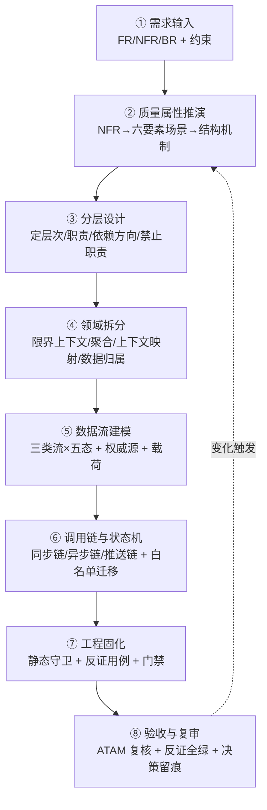

**每阶段的出口判据**：

| 阶段 | 出口产物 | 判据 |
|:---|:---|:---|
| 质量属性推演 | NFR→结构推演表 | 每条 NFR 有场景、机制、验收 |
| 分层设计 | 分层图 + 六层职责表 | 每层有职责/组件/依赖/禁止/异常归属 |
| 领域拆分 | 域模型图 + 上下文映射表 | 每域有边界/数据归属/上下游/依赖规则 |
| 数据流建模 | 三类流×五态矩阵 | 每流五态齐全，权威源唯一 |
| 调用链与状态机 | 三条链 + 状态机图 | 白名单迁移、终态不可迁、世代校验 |
| 工程固化 | 守卫测试 + 反证用例 | 反向验证"撤掉修复点会红" |

### 3.2 分层落地清单与依赖守卫规范

**分层设计检查清单**：

- [ ] 每一层是否明确了"职责"与"明确不做什么"？
- [ ] 每一层是否列出真实组件清单（到类名/模块名）？
- [ ] 依赖方向是否单向，且由静态测试守护？
- [ ] 领域层是否零框架依赖（仅 JSpecify 等纯注解）？
- [ ] 数据库访问是否有唯一边界模块？
- [ ] 异常/失败处理是否有明确归属层？

**依赖守卫规范（通用）**：

| 守卫 | 检查内容 | 违反后果 |
|:---|:---|:---|
| 模块方向测试 | L1→L2→L3→L4、L5→L4、L6→L2/L4 | 构建失败（判红） |
| 领域纯度测试 | 领域层不 import 框架注解 | 构建失败 |
| 数据库边界测试 | 只有 persistence 模块访问 JDBC/ORM | 构建失败 |
| 反向依赖扫描 | 无 L3→L5、L1→L5 | 构建失败 |

### 3.3 领域拆分工作坊流程与清单

**拆分工作坊五步**：
1. **事件风暴**：列出领域事件，按时间线排列；
2. **识别边界**：把"变化原因/数据归属/一致性边界"不同的部分分开；
3. **命名上下文**：为每个域命名，明确 owning 的表与模型；
4. **绘制上下文映射**：标注域间协作模式（共享内核/发布订阅/客户供应商/事件溯源）；
5. **确定跨域规则**：禁止直接 import 领域实体，写操作明确归属。

**领域拆分检查清单**：
- [ ] 每个域是否有唯一的数据归属（owning 表）？
- [ ] 一致性要求高的数据是否在同一域/同一事务？
- [ ] 域间是否只经端口/事件协作？
- [ ] 是否有明确的上下文映射模式？
- [ ] 是否存在"两个域写同一张表"？若有，是否已消除？

### 3.4 数据流五态矩阵模板

> 对每一类数据流填写下表；五态缺一视为设计未完成。

| 数据流类型 | 正常链路 | 异常链路 | 重试链路 | 降级链路 | 超时处理 |
|:---|:---|:---|:---|:---|:---|
| 同步控制面 | （填写主链路步骤与持久化点） | （错误分类/是否终态/用户可见） | （谁重试/幂等键/上限） | （降级边界/是否 fail-closed） | （请求超时/不留半事务） |
| 异步执行面 | （唤醒→回读→领取→闸门→执行→终态） | （重复丢弃/孤儿收敛/UNKNOWN） | （有限重试/error 分类） | （供应商不可用分类处理） | （单消息超时 + 总 deadline） |
| 推送事件流 | （事件持久化→续传→终帧） | （游标过期/受众越权） | （Last-Event-ID 续传） | （心跳保活） | （终帧 + 停轮询） |

### 3.5 质量属性推演（ATAM 精简版）落地模板

**质量属性推演表模板**（每条 NFR 一行）：

| NFR | 六要素场景（刺激源/刺激/环境/制品/响应/度量） | 结构承接 | 验收/度量 | 敏感点 | 权衡点 |
|:---|:---|:---|:---|:---|:---|
| NFR-可用性 | （填写） | （填写） | （填写） | （填写） | （填写） |

**填写纪律**：
1. 场景必须可判定，杜绝"高性能"式空话；
2. 性能允许"暂不量化"，但必须写明"禁止预先承诺 SLA"与替代门禁；
3. 识别出的权衡点必须记录取舍理由与复审触发条件。

### 3.6 调用链与状态机设计规范

**调用链设计规范**：
- 每条链明确：入口、跨越的层、持久化点、幂等键、异常终止语义；
- 同步链强调"原子提交"；异步链强调"世代校验"；推送链强调"终帧明确"；
- 禁止把外部调用（模型/工具）放进长事务。

**状态机设计规范**：
1. **白名单迁移**：只接受预定义迁移，其余返回冲突错误；
2. **终态不可迁出**：终态集合明确，终态后禁止补写；
3. **世代/fencing**：关键写入校验 `id + owner + fencing token`；
4. **乐观锁 version**：防并发双写覆盖；
5. **绝对 deadline**：恢复时不重算完整时长；
6. **HITL 复用闭环**：优先复用已有挂起/唤醒闭环，避免新建语义分裂的状态。

### 3.7 架构静态守卫与门禁规范

> 把架构约定固化为"违反即构建失败"的自动检查，是防止架构随代码腐蚀的关键工程手段。

| 门禁 | 工具形态 | 守护对象 | 本项目对应 |
|:---|:---|:---|:---|
| 领域纯度 | 单元测试扫描 import | 领域层零框架依赖 | `AgentCorePurityTest` / `RagCorePurityTest` |
| 模块方向 | 单元测试扫描依赖 | 六层依赖方向 | `ModuleDependencyDirectionTest` |
| 集成测试纳入 | 构建插件显式注册 | 防止 IT "一条没跑" | failsafe `*IT.java`（F-14 教训） |
| 编译处理器 | 编译器参数 | 防止缓存掩盖红灯 | `-proc:full`（JDK 23+ 注解处理） |

**反证纪律**：每个守卫必须配"反向验证"——撤掉修复点后测试必须变红，否则守卫是假阳性。基线中多次出现"红灯被缓存掩盖""IT 从未运行"的教训，正是忽视反证的代价。

### 3.8 落地检查清单汇总

**结构层总验收清单**：

- [ ] 六层职责表完整（职责/组件/输入输出/依赖/禁止/异常）；
- [ ] 业务域边界表完整（边界/职责/上下游/依赖规则）；
- [ ] 三类数据流五态矩阵齐全，权威源唯一；
- [ ] 三条调用链 + Run 状态机 + step.state 语义明确；
- [ ] 五大质量属性均有 NFR→结构→验收链；
- [ ] 双 reactor 边界与协作方式清晰；
- [ ] 全生命周期（启动/初始化/运行/终止）设计完整；
- [ ] 静态守卫与反证用例齐全且经反向验证；
- [ ] 四件交付物（架构图谱/数据流大图/域边界清单/故障自查手册）齐备。

---

## 四、本项目全量落地细节、真实决策、历史上下文

> 本章是全文核心，逐项落实七个必答点。所有事实来自事实基线，逐条可溯源。

### 4.1 六层架构逐层专项拆解

本项目采用**六层逻辑架构**（物理上分布在 platform/rag 两个 reactor 中）。下图给出层次与依赖方向（`L6` 为执行/装配层，驱动 `L2/L4`）：

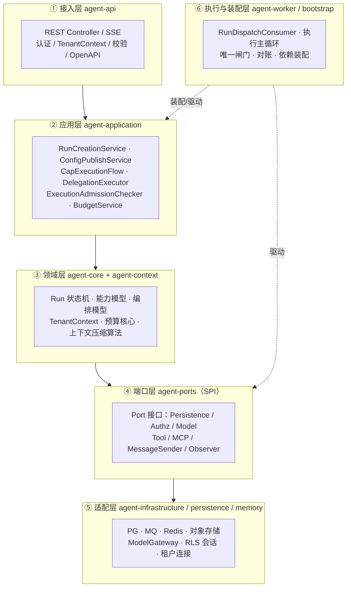

**依赖铁律重申**：`L1→L2→L3→L4→L5` 单向；`L6` 装配并驱动 `L2/L4`；任何反向依赖（如 L3 依赖 L5）由 `ModuleDependencyDirectionTest` 判红。领域层零框架依赖（仅 JSpecify），由 `AgentCorePurityTest` 守护。

下面对每一层按统一六维度（职责 / 组件清单 / 输入 / 输出 / 依赖规范 / 禁止职责 / 异常处理）逐层拆解。

#### 4.1.1 ① 接入层 agent-api

| 维度 | 内容 |
|:---|:---|
| **职责** | 协议适配（REST/SSE）、认证、TenantContext 建立、请求校验、OpenAPI 契约；SSE 推送 |
| **组件清单** | `RunController`、`RunEventController`、`AgentChatController`、`SecurityConfiguration`；平台 SSE `/api/agent/chat/stream`、租户 SSE `/api/knowledge/agent/chat/stream` |
| **输入** | HTTP 请求、JWT（平台域/租户域双 JWT）、幂等键、SSE 的 `Last-Event-ID` |
| **输出** | RunId 响应、SSE 事件帧（13 事件 + 第 14 checkpoint + `done` 终帧）、稳定错误码 |
| **依赖规范** | 只依赖应用层端口/用例；不改领域模型；租户链**禁带 tenantId**，租户身份从 JWT/上下文推导 |
| **禁止职责** | 不含业务规则；不直接调 `agent-persistence`；不在本层拼装领域对象；不伪装 401/403/404 为"稍后重试" |
| **异常处理** | 参数校验失败、401/403 在此映射为稳定错误码；SSE 终态/权限错误显式终态 + 停轮询 + 不给重试 |

**设计要点**：
- 接入层是"协议边界"，核心是把外部协议（HTTP/SSE/JWT）翻译成应用层能理解的用例调用，并把错误翻译回稳定码。
- 双链路隔离：平台链与租户链是两个独立端点，租户链禁带 `tenantId` 是防止"客户端伪造租户"的关键约束——租户身份只能来自可信上下文（JWT/会话），不能来自请求参数。
- SSE 不写 outbox、不发 MQ：事件来自已持久化的 `RunEvent`，SSE 控制器按受众隔离 + `Last-Event-ID` 续传。

#### 4.1.2 ② 应用层 agent-application

| 维度 | 内容 |
|:---|:---|
| **职责** | 用例编排、事务边界、跨领域协调；持有单事务的原子提交 |
| **组件清单** | `RunCreationService`、`ConfigPublishService`、`CapExecutionFlow`、`DelegationExecutor`、`ExecutionAdmissionChecker`、`BudgetService` |
| **输入** | 来自接入层的用例请求（创建 Run、发布配置、委派、预算校验） |
| **输出** | 领域事件、持久化指令、对上层的用例结果 |
| **依赖规范** | 依赖领域层 + 端口层；持有事务边界；不依赖具体适配实现 |
| **禁止职责** | 不含领域不变量（不变量在领域层）；不直接访问数据库实现；不把外部调用放进长事务 |
| **异常处理** | 用例级回滚、跨领域协调失败在此收敛；预算校验 fail-closed；能力目录缺失 fail-closed |

**设计要点**：
- `RunCreationService` 是原子提交的核心：单事务内插入 `run(QUEUED)` + `run_event` + `idempotency_record` + `outbox_event` 四元素，任一失败整体回滚（PG 事务内做不到 fail-soft）。
- 应用层是"事务边界的持有者"——这是它与领域层的核心分工：领域决策不关心事务，事务由应用用例统一编排。

#### 4.1.3 ③ 领域层 agent-core + agent-context

| 维度 | 内容 |
|:---|:---|
| **职责** | 领域模型、状态机、不变量、纯算法；上下文压缩算法（ADR-013） |
| **组件清单** | `Run` 状态机、`CapabilitySnapshot`、`TenantContext`、预算核心、`CompactionPipeline`；编排模型、能力模型 |
| **输入** | 应用层的领域命令、查询 |
| **输出** | 领域决策（状态迁移结果、不变量校验、压缩结果） |
| **依赖规范** | 仅 JSpecify + 端口层；零框架依赖；`agent-context` 只依赖 `agent-ports`，位于 ports 之上、application 之下 |
| **禁止职责** | 不 import 任何框架注解；不访问数据库；不发消息；不依赖具体供应商 |
| **异常处理** | 领域不变量违反抛领域异常（如 `RUN_STATE_CONFLICT`），由上层翻译为稳定错误码 |

**设计要点**：
- 领域层是"纯决策核心"——状态机白名单迁移、终态守卫、预算一致性、上下文压缩都是纯逻辑，可脱离框架与数据库单元测试。
- 领域纯度由 `AgentCorePurityTest`（platform）与 `RagCorePurityTest`（rag，同构）守护，违反即构建失败。
- `agent-context` 作为纯算法层独立（ADR-013），统一上下文压缩入口与全窗口预算，避免压缩逻辑散落。

#### 4.1.4 ④ 端口层 agent-ports（SPI）

| 维度 | 内容 |
|:---|:---|
| **职责** | 定义能力契约（SPI, Service Provider Interface），不含实现 |
| **组件清单** | `PersistencePort`、`AuthzPort`、`ModelGateway`、`ToolHandler`、`MessageSender`、`QueueDepthProbe`、`Observer`（及 RAG 侧 `HttpRagRetrievalGateway` 契约） |
| **输入** | 领域层/应用层表达的"能力需求" |
| **输出** | 抽象能力接口（由适配层实现） |
| **依赖规范** | 只定义契约，不依赖任何实现；位于领域层之下、适配层之上，是依赖倒置的"抽象点" |
| **禁止职责** | 不含实现逻辑；不写 SQL；不做业务决策 |
| **异常处理** | 端口定义超时/错误分类契约（如错误分类枚举、超时语义），由适配层遵循 |

**设计要点**：
- 端口层是"可插拔的灵魂"——新模型供应商、新工具、新消息通道都只需新增实现，不改领域层。
- 端口前移（P4-D17）使消息通道可切换（RabbitMQ ⇄ PG 表队列），按租户灰度。

#### 4.1.5 ⑤ 适配层 agent-infrastructure / persistence / memory

| 维度 | 内容 |
|:---|:---|
| **职责** | 实现端口、对接外部系统；RLS 会话绑定；错误分类与上报 |
| **组件清单** | `JdbcRunClaimRepository`、`OpenAiCompatibleModelGateway`、`TenantSessionBinder`、`PgQueueMessageSender`；`agent-persistence`（数据库访问**唯一边界**）、`agent-infra`（MQ/Outbox/ModelGateway）、`agent-memory`（跨 Run 记忆） |
| **输入** | 端口调用、外部系统响应（PG/MQ/Redis/对象存储/模型） |
| **输出** | 持久化数据、外部调用结果、分类后的错误 |
| **依赖规范** | 实现端口；RLS 会话绑定在此；`agent-persistence` 是数据库访问唯一边界；`agent-memory` 复用 infrastructure 的租户事务连接，夹在 persistence 与 worker 之间 |
| **禁止职责** | 不含业务决策；不自行改变领域状态；不做租户越权的"兜底放行" |
| **异常处理** | 下游不可用、超时在此分类并上报；RLS 越权在数据库层拒绝；fail-closed |

**设计要点**：
- RLS 落地关键：GUC `app.tenant_id` 必须在**事务内、业务 SQL 前**设置（`TenantSessionBinder`），否则查询会以错误租户上下文执行或绕过行隔离。这是无数"跨租户数据泄露"的根源。
- `agent-infra` 承载 MQ/Outbox/ModelGateway，`agent-persistence` 承载所有 JDBC/ORM——单一数据库边界由静态测试守护。

#### 4.1.6 ⑥ 执行与装配层 agent-worker / platform-bootstrap

| 维度 | 内容 |
|:---|:---|
| **职责** | 驱动执行循环、消费幂等、唯一闸门、对账、依赖注入装配 |
| **组件清单** | `RunDispatchConsumer`、`RunExecutionLoop`、`ToolInvocationGate`、`ToolOperationReconciliationService`、`ApprovalDecidedWakeupConsumer`、`platform-bootstrap` |
| **输入** | MQ/PG 队列消息、审批唤醒、到期重试 |
| **输出** | 执行推进（条件领取、世代校验、租约续期、闸门准入、终态提交）、装配好的依赖图 |
| **依赖规范** | 驱动 `application/core/ports`；装配依赖；不反向被 L1 直接调用 |
| **禁止职责** | controller 不直接调 persistence（由装配层保证依赖正确）；不在无授权/无上下文时执行 |
| **异常处理** | 消费幂等（重复丢弃）、租约丢失、UNKNOWN 对账在此；终态后禁补 attempt；外部调用不放长事务 |

**设计要点**：
- 执行/装配层是"运行时心脏"：`RunDispatchConsumer` 做重复丢弃/孤儿收敛，条件更新领取 Run 并获得 fencing token；`RunExecutionLoop` 做世代校验、在途委派收养、租约续期、审批挂起检查；`ToolInvocationGate` 做 15 步准入（授权/审批/预算）；`ToolOperationReconciliationService` 做 UNKNOWN 对账。
- 这一层独立存在，正是本项目从"五层"演进为"六层"的原因：把"驱动与装配"显式化，可从结构上杜绝"Controller 直接调 persistence"。

**六层职责精修总表**（来自基线，作为逐层速查）：

| 层 | 典型组件（真实类） | 依赖约束 | 异常/失败处理归属 |
|:---|:---|:---|:---|
| ① 接入层 | `RunController`、`RunEventController`、`AgentChatController`、`SecurityConfiguration` | 只依赖应用层端口；不改领域模型 | 参数校验失败、401/403 映射稳定错误码 |
| ② 应用层 | `RunCreationService`、`ConfigPublishService`、`DelegationExecutor`、`ExecutionAdmissionChecker`、`BudgetService` | 依赖领域 + 端口；持有事务边界 | 用例级回滚、跨领域协调失败收敛 |
| ③ 领域层 | `Run` 状态机、`CapabilitySnapshot`、`TenantContext`、`CompactionPipeline` | 仅 JSpecify + 端口；零框架依赖 | 领域不变量违反抛领域异常 |
| ④ 端口层 | `ModelGateway`、`ToolHandler`、`MessageSender`、`QueueDepthProbe`、`PersistencePort` | 只定义契约，不含实现 | 定义超时/错误分类契约 |
| ⑤ 适配层 | `JdbcRunClaimRepository`、`OpenAiCompatibleModelGateway`、`TenantSessionBinder`、`PgQueueMessageSender` | 实现端口；RLS 会话绑定在此 | 下游不可用、超时分类上报 |
| ⑥ 执行/装配层 | `RunDispatchConsumer`、`RunExecutionLoop`、`ToolInvocationGate`、`ToolOperationReconciliationService`、`platform-bootstrap` | 驱动 application/core/ports；装配依赖 | 消费幂等、租约丢失、UNKNOWN 对账 |

### 4.2 业务域完整拆分理论与本项目域模型落地

#### 4.2.1 拆分理论回顾与本项目应用

按限界上下文（Bounded Context）拆分的三大依据（变化原因 / 数据归属 / 一致性边界）在本项目的具体应用：
- **按变化原因切**：身份由 IAM 驱动、Agent 配置由作者驱动、检索算法由 RAG 团队驱动、审批策略由合规驱动；
- **按数据归属切**：每域 owning 自己的表（如执行域 owning run/step/lease，RAG 域 owning rag 库 15 表）；
- **按一致性边界切**：Run 状态与 Outbox 必须同事务 → 归执行域；审批与操作参数快照必须先持久化 → 归执行域。

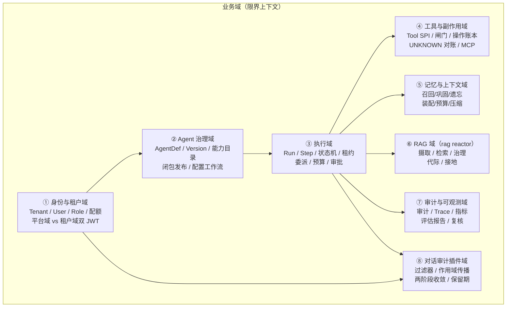

#### 4.2.2 域边界定义 / 职责 / 上下文映射 / 跨域依赖规则

| 域 | 边界定义（owning 的表/模型） | 领域职责 | 上游依赖 | 下游消费者 | 跨域依赖规则 |
|:---|:---|:---|:---|:---|:---|
| ① 身份与租户 | tenant/user/role/配额/binding | 认证、授权、租户归属 | IAM/OIDC | 所有域 | 提供 TenantContext，是唯一可信身份源 |
| ② Agent 治理 | agent/version/snapshot/能力目录 | 闭包发布、配置工作流 | ① | ③ | 产出不可变快照供③绑定 |
| ③ 执行 | run/step/lease/fencing/预算/审批 | 状态机、编排、可靠性 | ①② | ④⑤⑥⑦⑧ | 权威事实源，其他域只读其事件 |
| ④ 工具与副作用 | tool_operation/attempt/approval | 工具执行、幂等、对账 | ③ | 业务系统/MCP | 每次执行回查③授权与预算 |
| ⑤ 记忆与上下文 | 记忆表/上下文快照 | 召回/巩固/遗忘、装配压缩 | ③ | ③（回填） | 不直接写 run 状态 |
| ⑥ RAG 域（rag） | rag 库 15 表 + 代际 | 摄取/检索/治理/接地 | ③（检索请求） | ③（检索结果） | 通过端口 `HttpRagRetrievalGateway` 跨进程 |
| ⑦ 审计与可观测 | 审计/Trace/指标/评估 | 记录、评估、复核 | 全域事件 | 运维/管理端 | 只读，不参与业务决策 |
| ⑧ 对话审计插件 | chat_audit 三表 + config | 对话留痕、两阶段收敛 | ①③ | ⑦ | HIGHEST_PRECEDENCE+2 早于安全链 |

> **全局 Agent 可见性特例**：全局 Agent 表**无** `tenant_id`，租户可见性靠 `tenant_agent_binding(ACTIVE)`。这是"全局定义 + 多对多绑定"的刻意设计——新增租户/Agent 零复制；可见性由绑定表的 ACTIVE 状态决定，而非在 Agent 表上加租户列。

#### 4.2.3 域内聚合（Aggregate）设计

| 域 | 聚合根 | 聚合内实体/值对象 | 不变量 |
|:---|:---|:---|:---|
| ③ 执行 | Run | Step、Lease、预算预留、审批 | 状态白名单迁移、终态不可迁出、fencing 世代校验、预算一致性 |
| ② Agent 治理 | AgentVersion | 能力目录、工具绑定、快照 | 发布后不可变、闭包完整、双人复核 |
| ④ 工具与副作用 | ToolOperation | Attempt、Approval、结果 | 执行时授权、幂等键、UNKNOWN 禁 attempt |
| ⑥ RAG | 语料代际 | 切分块、索引、引用 | 代际隔离、接地引用可溯源 |

#### 4.2.4 上下文映射模式（域间协作方式）

- **①→③ 共享内核**：`TenantContext` 作为共享内核，全域统一。
- **②→③ 发布/订阅（快照）**：治理域发布不可变快照，执行域绑定消费，运行中改配置只影响新 Run。
- **③↔⑥ 客户/供应商（隔离进程）**：RAG 作为供应商，经端口 `HttpRagRetrievalGateway` 提供检索，契约明确、版本可独立演进。
- **③→⑦ 事件溯源**：执行域发事件，审计域消费落库，解耦且可重放。

> **跨域依赖纪律**：域间只经端口/事件协作，禁止直接 import 其他域的领域实体（用 DTO/ReadModel）；跨域写操作必须明确归属与事务边界，避免"两个域写同一张表"。

### 4.3 三大数据流专项深度解析

系统存在三类主要数据流，各有明确边界。本节先给出三类流的总体视图，再按"正常主链路 / 异常降级 / 异步补偿"三种链路形态逐一深度解析，并对每条流给出**正常/异常/重试/降级/超时**五态。

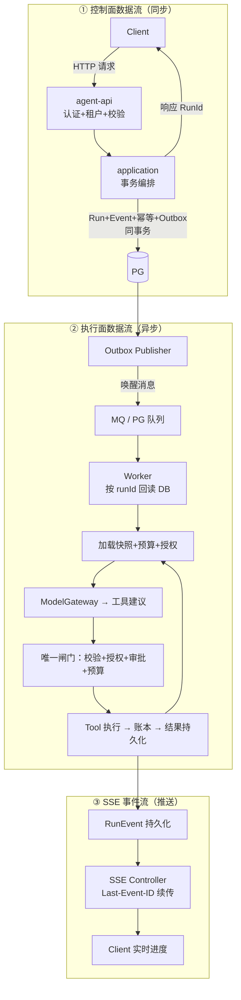

**数据流的三条纪律**：
1. **权威单向**：所有任务状态写入 PG；MQ/缓存/消息体都不是事实源。
2. **最小化载荷**：消息体不含敏感数据（学生数据、Prompt、工具参数），Worker 回 DB 取权威状态。
3. **敏感数据不扩散**：未成年人采集白名单字段在入口即受控；日志/Trace/对象内容独立脱敏与保留策略。

#### 4.3.1 正常主链路全流程（同步控制面 + 异步执行面 + SSE 推送）

**链路 A：创建 Run 的同步主链路（原子提交）**——见 4.4.1 时序。核心是单事务四元素：`INSERT run(QUEUED)` + `run_event` + `idempotency_record` + `outbox_event`，四者同生共死，返回 RunId。

**链路 B：Worker 执行主链路（异步）**——`Outbox Publisher` 发布唤醒消息 → `MQ/PG 队列` → `RunDispatchConsumer`（重复丢弃/孤儿收敛）→ 条件更新领取 Run、获得 fencing token → `RunExecutionLoop` 主循环（世代校验 → 在途委派收养 → 租约续期 → 审批挂起检查）→ `ModelGateway` 调用 → `ToolInvocationGate` 15 步准入 → `Tool` 执行 → `ToolOperation` 账本 → 终态提交（校验 lease_owner + fencing_token）。

**链路 C：SSE 推送主链路**——`RunEvent` 持久化 → `SSE Controller`（受众隔离 + `Last-Event-ID` 续传）→ 13 事件 + 第 14 checkpoint + `done` 终帧 → Client 实时进度。

**正常主链路的五态矩阵**（来自基线）：

| 数据流 | 正常链路 | 异常链路 | 重试链路 | 降级链路 | 超时处理 |
|:---|:---|:---|:---|:---|:---|
| ① 控制面（同步） | 认证→校验→四元素同事务→返回 RunId | 幂等冲突返回已存在 RunId；授权失败终态 | 无自动重试（客户端幂等键重放） | DB 不可用时拒绝服务（fail-closed），不降级为"内存态" | 请求超时显式返回，不留半事务 |
| ② 执行面（异步） | 唤醒→回读 DB→领取→闸门→执行→终态 | 消息重复丢弃；孤儿收敛；UNKNOWN 进对账 | 有限重试（delivery-limit=3/max_attempts），可重试错误进 RETRYING | 模型供应商不可用时按错误分类处理，不盲目切换 | per-message 超时 + 总 deadline（绝对时间，恢复不重算） |
| ③ SSE（推送） | 事件持久化→Last-Event-ID 续传→done 终帧 | 游标过期明确重置；受众越权拒绝 | 客户端按 Last-Event-ID 续传 | 无事件时心跳保活 | 终态/权限错误发终帧 + 停轮询，绝不伪装临时故障 |

> **关键区分**：控制面"拒绝服务"是可接受的降级（安全），执行面"UNKNOWN 对账"是可接受的降级（正确性），但两者都**不允许 fail-open**——即不允许在无权限/无状态/无租户上下文时继续执行。

#### 4.3.2 异常降级链路深度解析

异常降级的核心命题是：**当能力受损时，如何在保证安全与正确的前提下给出明确语义**。三类流的降级路径截然不同：

| 流 | 异常触发 | 降级动作 | 是否 fail-open | 用户/客户端可见 |
|:---|:---|:---|:---|:---|
| 控制面 | DB 不可用 | 拒绝服务（fail-closed） | 否 | 明确错误，不留半事务 |
| 执行面 | UNKNOWN 结果 | 转对账，不盲目重放、禁 attempt | 否 | 显示"待核对" |
| 执行面 | 租约过期仍写 | fencing 校验拒绝写入 | 否 | Run 被新世代接管 |
| SSE | 受众越权 | 拒绝读取，403 终态 + 停轮询 | 否 | 明确终态，不伪装网络问题 |
| SSE | 游标过期 | 明确重置语义 | 否 | 从头续传或重置 |

**UNKNOWN 降级的深层逻辑**（来自 CAP-01）：在存在真实副作用（写库、记薄弱点）的场景，盲目重放 = 重复写入 = Sev-0。本平台用 `Outcome.UNKNOWN_RESULT → ack 丢弃` 切断重放，代价只是"需要对账通道"，换来的是**账实相符、可对账、不重复副作用**的硬保证。这是 durable-execution 文献承认的"at-least-once 执行 + exactly-once 记录结果"的现实形态。

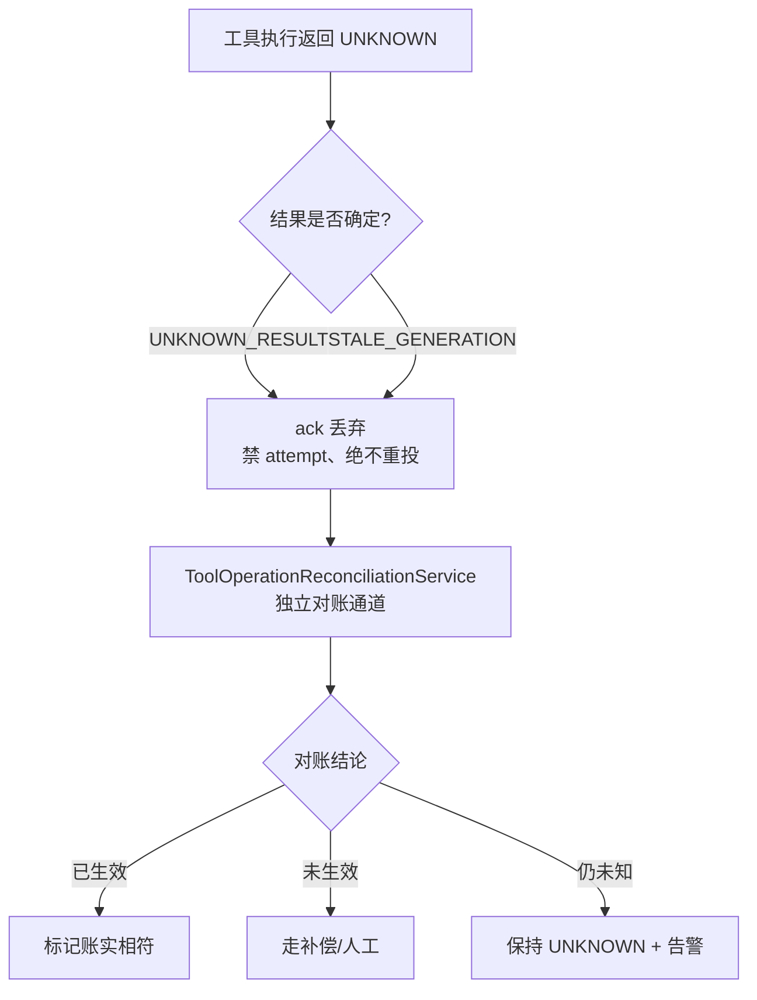

#### 4.3.3 异步补偿链路深度解析（含五态）

异步补偿链路解决"消息丢失/重复/崩溃/超时"下的最终一致性问题，核心机制有四个：

| 机制 | 作用 | 落地 |
|:---|:---|:---|
| Outbox | 业务数据与待发事件同事务，杜绝"状态写了消息没发" | `outbox_event.state='PENDING'` 同事务写入 |
| 幂等键 | 客户端重放/消息重复不产生重复副作用 | `idempotency_record` + 消费者幂等 |
| 租约 + fencing | Worker 崩溃后新世代接管，旧世代写入被拒 | `lease_owner` + `fencing_token` 单调递增 |
| 对账通道 | UNKNOWN/孤儿收敛，不盲目重放 | `ToolOperationReconciliationService` |

**异步补偿五态模型**：

| 状态 | 触发 | 系统行为 | 边界 |
|:---|:---|:---|:---|
| 正常 | 消息首次消费 | 领取 → 执行 → 终态提交 | 校验 `run_id + lease_owner + fencing_token` |
| 异常 | 消息重复/孤儿/UNKNOWN | 重复丢弃、孤儿收敛、UNKNOWN 对账 | 禁盲目重放、禁 attempt |
| 重试 | 明确可重试错误 | `RETRYING` + `next_attempt_at`，有限次数 | delivery-limit=3 / max_attempts |
| 降级 | 供应商不可用 | 按错误分类处理，不盲目切换 | 不 fail-open |
| 超时 | per-message 超时 / 总 deadline | 超时进对账，deadline 绝对时间不重算 | 恢复不无限续命 |

> **双通道分流纪律（Sev-0 防线）**：消息必须按 `eventType` 分流——执行唤醒走 `agent.run.execute`（由 `RunDispatchConsumer` 消费），SSE 事件走 `run_event`/NOTIFY 通道，采集走 `agent.trace.collect` 专用队列。**绝不能让采集/SSE 事件复用执行队列**，否则终态 Run 会被当成"唤醒执行"再次跑一遍（重复执行 = Sev-0）。本项目采用"发送侧不误发 + 消费侧按 eventType 分流拒绝"的双向防御（`EventRoutedMessageHandler`、`TraceCollectMessageHandler`）。

---

### 4.4 调用链、状态机与任务流转完整解析

#### 4.4.1 三条调用链

**链路一：Run 创建（同步，原子）**

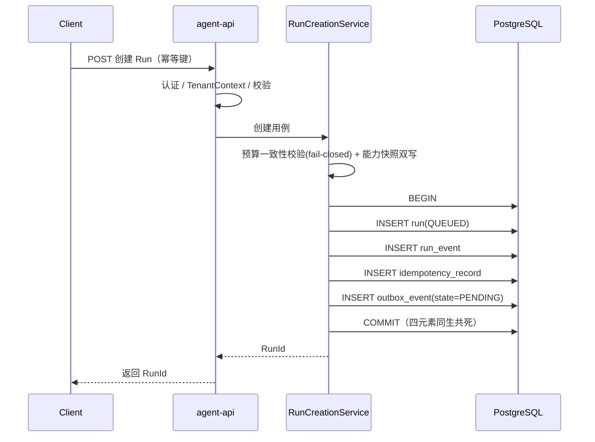

不变量：四元素同生共死；预算一致性校验 fail-closed；能力快照双写。任一 SQL 失败整体回滚（PG 事务内做不到 fail-soft）。

**链路二：Worker 执行（异步，带世代校验）**

```
MQ/PG队列 → RunDispatchConsumer(重复丢弃/孤儿收敛)
  → 条件更新领取 Run，获得 fencing_token
  → 主循环：世代校验 → 在途委派收养 → 租约续期 → 审批挂起检查
  → ModelGateway 调用（超时/错误分类/重试唯一入口）
  → ToolInvocationGate 15 步准入 → Tool 执行 → ToolOperation 账本
  → 终态提交（校验 lease_owner + fencing_token）
```

不变量：每次状态更新校验 `run_id + lease_owner + fencing_token`；终态后禁补 attempt；外部调用不放进长事务。

**链路三：SSE 事件推送**

```
RunEvent 持久化 → SSE Controller（受众隔离 + Last-Event-ID 续传）
  → 13 事件 + 第 14 checkpoint + done 终帧
```

不变量：平台链 `/api/agent/chat/stream`，租户链 `/api/knowledge/agent/chat/stream`（禁带 tenantId）；不写 outbox、不发 MQ；终态/权限错误显式终态 + 停轮询 + 不给重试（禁止伪装成"网络问题稍后再试"）。

**三条调用链的异常 Case 全集**：

| 链路 | 异常 Case | 系统行为 | 用户/客户端可见 |
|:---|:---|:---|:---|
| Run 创建 | 幂等键冲突（同摘要） | 返回已存在 RunId，不重复创建 | 拿到同一 RunId |
| Run 创建 | 幂等键冲突（不同摘要） | 拒绝，返回冲突错误 | 明确错误，不改状态 |
| Run 创建 | 预算校验失败 | fail-closed 拒绝创建 | 预算不足提示 |
| Run 创建 | 能力目录缺失 | fail-closed 拒绝 | 配置错误提示 |
| Worker 执行 | 消息重复投递 | `DUPLICATE_DISCARDED` 幂等丢弃 | 无感 |
| Worker 执行 | 租约过期仍写 | fencing 校验拒绝写入 | Run 被新世代接管 |
| Worker 执行 | 模型超时/下游不可用 | 错误分类 → RETRYING 或 FAILED | 进度显示重试/失败 |
| Worker 执行 | 工具结果 UNKNOWN | 进对账，不盲目重放 | 显示"待核对" |
| Worker 执行 | 审批挂起 | WAITING_APPROVAL，不占线程 | 显示"待审批" |
| SSE | Last-Event-ID 过期 | 明确重置语义 | 从头续传或重置 |
| SSE | 受众越权 | 拒绝读取 | 403 终态，停轮询 |
| SSE | 断连/超时 | done 终帧或重连续传 | 明确终态，不伪装网络问题 |

> **反模式警示**：404/403/401 若伪装成"正在处理/网络问题/稍后再试"，会让客户端无限轮询、用户困惑、掩盖真实权限问题——这是本项目明确禁止的。

#### 4.4.2 Run 状态机：白名单迁移 + 终态不可迁 + 世代/fencing

状态机是执行域的心脏。本项目 Run 状态机体现"安全的状态迁移"设计范式：

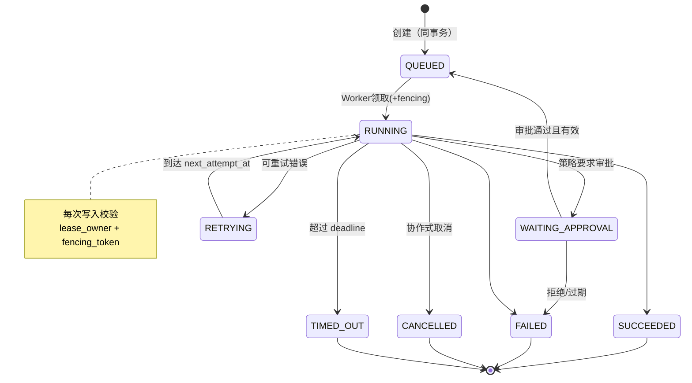

**Run 状态迁移表**（来自 v3.1 §3.3，含必须校验项）：

| 当前状态 | 目标状态 | 触发条件 | 必须的校验 |
|:---|:---|:---|:---|
| `QUEUED` | `RUNNING` | Worker 领取成功 | 条件更新、租约设置、fencing 递增 |
| `RETRYING` | `RUNNING` | 到达 `next_attempt_at` 并领取成功 | 次数、截止时间、取消标志、租约校验 |
| `RUNNING` | `RETRYING` | 明确可重试错误 | 记录错误、attempt、下次执行时间 |
| `RUNNING` | `WAITING_APPROVAL` | 策略要求人工审批 | Approval 与操作参数快照先持久化 |
| `WAITING_APPROVAL` | `QUEUED` | 审批通过且仍有效 | 参数摘要、权限、预算、资源状态重新校验 |
| `WAITING_APPROVAL` | `FAILED` | 审批拒绝或过期 | 审批决策与原因审计 |
| `RUNNING` | `SUCCEEDED` | 全部步骤完成 | 租约世代校验；结果、终态、事件同事务提交 |
| `RUNNING` | `FAILED` | 不可恢复错误 | 租约世代校验；错误和终态事件同事务提交 |
| `RUNNING` | `CANCELLED` | 协作式取消完成 | 停止新操作；处理在途未知结果 |
| `RUNNING` | `TIMED_OUT` | 总截止时间到达 | 停止新操作；在途副作用进对账 |

所有其他未列出的迁移默认拒绝并返回 `RUN_STATE_CONFLICT`。

**状态机设计要点**：
- **白名单迁移**：所有未列出的迁移默认拒绝，返回 `RUN_STATE_CONFLICT`。
- **终态不可迁出**：`SUCCEEDED/FAILED/CANCELLED/TIMED_OUT` 为终态。终态不意味着外部系统每个动作都已回滚，而是平台对当前 Run 的执行生命周期已结束；若终态时仍有未决 `ToolOperation.UNKNOWN`，必须显式暴露，不得隐藏在成功响应中。
- **审批不占线程**：`WAITING_APPROVAL` 不占用持续运行线程；审批通过由 `ApprovalDecidedWakeupConsumer` 唤醒。
- **HITL 闭环**：已有 PARK/RESUME 闭环（`WAITING_APPROVAL` + 唤醒消费者 + `claimParkedRunForResume`），**不新建 PAUSED 状态**——这是避免重复造轮子、避免语义分裂的关键纠偏。审批通过需重新校验参数摘要、权限、预算、资源状态。
- **新建 Run 不持久化 `CREATED`**：创建事务直接写 `QUEUED`。

#### 4.4.3 run_step.state 语义（恒 RUNNING 看 completed_at）

**这是一个极易踩坑的语义约定**：`run_step.state` 复用 `run_state` 枚举且**恒为 `'RUNNING'`**，表示"步骤已发生"；步骤是否完成**看 `completed_at` 是否有值**。

| 错误做法 | 后果 | 正确做法 |
|:---|:---|:---|
| 按字面显示"执行中" | 用户看到已完成步骤仍显示"执行中"，困惑 | 按 `completed_at` 判断完成 |
| 加两阶段 UPDATE（先 RUNNING 后 DONE） | 多余写入、状态语义分裂 | 单阶段写 + `completed_at` 标记 |

> **铁律**：禁止改 `run_step.state` 恒 RUNNING 语义（CAP-01 铁律 16）；禁止加两阶段 UPDATE。

#### 4.4.4 状态一致性保障与非法状态拦截细节

| 保障机制 | 实现方式 | 拦截的非法场景 |
|:---|:---|:---|
| 白名单迁移表 | 状态机只接受预定义迁移，其余抛 `RUN_STATE_CONFLICT` | 任意状态回退、跳变 |
| 乐观锁 version | 每次更新比对 version | 并发双写覆盖 |
| fencing token + lease_owner | 关键写入校验 run_id + lease_owner + fencing_token | 旧世代写入、脑裂 |
| 终态守卫 | 终态不可迁出；终态后禁补 attempt | 终态后残留写入 |
| 事务边界 | 状态 + 事件 + Outbox 同事务 | 半状态（有状态无事件） |
| 不可变触发器 | AgentVersion/Snapshot 发布后禁改 | 配置漂移 |
| deadline 绝对时间 | 恢复时不重算完整时长 | 崩溃后无限续命 |

**状态一致性反证用例（验收必配）**：
1. 强杀 Worker 后接管 → 旧 fencing 世代写入被拒（防脑裂）。
2. 终态后尝试补 attempt → 拒绝（防状态回退）。
3. 并发领取同一 Run → 仅一个成功（乐观锁/fencing）。
4. 崩溃恢复后 deadline 未重置 → 仍按绝对时间超时。
5. 取消标记与工具启动竞态 → 有明确裁定（协作式取消）。

### 4.5 系统质量属性架构推演

本节用 ATAM 思路，从 NFR 逐条推演到结构。基线给出"质量属性 → 架构决策"推演表：

| 需求/质量属性 | 推导出的架构决策 |
|:---|:---|
| 多租户 + 数据隔离（NFR-002） | RLS + TenantContext + 租户事务连接；全局 Agent 表靠绑定表 JOIN 隔离 |
| Run 状态权威、可恢复（NFR-003/005） | PG 为事实源；Outbox 同事务；租约 + fencing；UNKNOWN 对账 |
| 工具副作用不可滥用（BR-04） | 唯一闸门 ToolInvocationGate；ToolOperation 账本；执行时授权 |
| Agent 配置可解释、可追溯（BR-02） | 不可变 AgentVersion + ExecutionSnapshot 快照 |
| 异步解耦 + 可切换（P4-D17） | 端口前移 + 消息通道可切换 + 背压护栏 |
| 可观测、可运维（NFR-007） | 全链路 ID + OTel + 指标口径纪律 + 死信/对账通道 |
| 首期小体量、团队小 | 模块化单体 + 独立 Worker，拒绝微服务过度设计 |
| 未成年人数据合规（DEC-6） | 采集白名单 + 脱敏 + 保留期 + 零保留硬闸门 |

**五大质量属性的架构落地细节（从"要什么"到"怎么做、怎么验"）**：

| 质量属性 | 架构落地点 | 具体机制 | 验收/度量 |
|:---|:---|:---|:---|
| 可用性 | 租约 + fencing + 死信 + 对账 + 孤儿收敛 | Worker 崩溃可接管；有限重试进死信；UNKNOWN 人工兜底 | 强杀 Worker 后接管成功；死信可重放 |
| 可扩展性 | 端口-适配器 + 配置快照 + 多对多绑定 + 可切换通道 | 新供应商/工具只加实现；策略改配置只影响新 Run | 加一种 ModelGateway 不改领域层 |
| 可维护性 | 六层依赖单向 + 静态守卫 + 领域零框架依赖 | 模块边界清晰；约定固化为测试 | `ModuleDependencyDirectionTest` 绿 |
| 安全性 | RLS + 执行时授权 + 唯一闸门 + fail-closed + 白名单 | 越权拒绝；配置缺失拒绝；未成年人数据受控 | 跨租户反证；Prompt 注入红队 |
| 性能 | 明确约束下取舍（不预先承诺 SLA）+ 后备压/限流 | `@ConcurrencyLimit`、租户并发上限、`limit+1` 游标分页 | 压测建基线后再定档 |

**逐条推演示例（以可用性为例）**：

| 推演步骤 | 内容 |
|:---|:---|
| NFR | Run 状态权威、Worker 崩溃可恢复（NFR-003/005） |
| 六要素场景 | 刺激源=Worker 进程；刺激=强杀；环境=Run 处于 RUNNING；制品=lease/fencing/Run 状态；响应=新 Worker 接管且旧世代写入被拒；度量=接管成功、无重复副作用 |
| 结构承接 | PG 唯一事实源 + 条件领取 + 租约续期 + fencing token + UNKNOWN 对账 + 死信 |
| 验收 | 强杀 Worker → 接管成功；旧 fencing 写入被拒；死信可重放 |
| 敏感点 | 租约时长、fencing 递增策略 |
| 权衡点 | 租约越短接管越快但续期开销越大；对账越及时成本越高 |

> **关键纪律**：性能是唯一"允许暂不量化"的属性，但必须明确"禁止预先承诺 SLA"——用策略与门禁替代空话（见主文档 §1.7 NFR 量化策略）。其余四属性均有可判定的验收手段。

### 4.6 双 Reactor 模块架构专项深度原理与落地实现

#### 4.6.1 为什么分离：platform 与 rag 两个 Maven reactor

从 `platform/pom.xml` 与 `rag/pom.xml` 可确认：这是**两个独立的 Maven reactor**（各自有独立的 `<groupId>`、`<artifactId>`、`<modules>`、`<dependencyManagement>`），而非同一 reactor 下的父子模块。

| 维度 | platform reactor | rag reactor |
|:---|:---|:---|
| groupId | `cn.studykid.multiagent` | `cn.studykid.rag` |
| artifactId | `java-saas-agent-platform` | `java-saas-rag` |
| 模块数 | 13（pom 明确列出） | 11（rag-core/ports/premise/application/infrastructure/persistence/worker/api/management/bootstrap） |
| 定位 | 控制面 + 执行面（Run/Worker/审批/预算） | 知识检索子系统（语料/切分/索引/召回/引用/溯源） |
| 技术基线 | Java 21 / Boot 4.1.1 | 与 platform 对齐（Java 21 / Boot 4.1.1） |
| 领域纯度 | `AgentCorePurityTest` | `RagCorePurityTest`（同构） |

**分离的深层原理**（来自 `rag/pom.xml` 注释与 CAP-01）：
1. **职责正交**：platform 是 Agent 执行平台（Run/Worker/审批/预算），rag 是知识检索子系统（语料/切分/索引/召回/引用/溯源），二者关注点不同、变化原因不同；
2. **独立演进**：RAG 的检索算法、向量模型、语料治理可独立迭代，不被执行平台的发布节奏绑架；
3. **隔离进程边界**：二者通过"检索工具（Tool SPI 实现）+ 引用校验"对接，而非把 RAG 代码塞进 platform 模块；
4. **同版本矩阵**：都对齐 Java 21 + Boot 4.1.1，使 RAG 可作为 platform 的 Tool SPI 实现被直接装配（POM-R 注释明确）。

**注意**：本白皮书与基线一致，采用"platform 13 模块 + rag 11 模块"的口径；`rag/pom.xml` 的 `<modules>` 当前显式列出 10 个子模块名（rag-bootstrap 在内），叙述以基线口径为准，实施时以实际 pom 为准。

#### 4.6.2 如何协作：双向对接

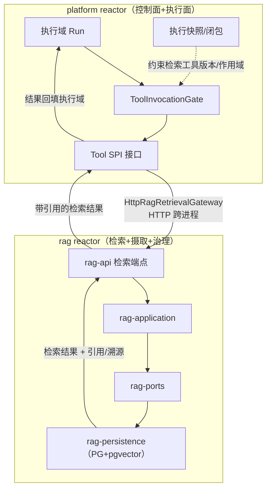

协作要点：
- **跨进程端口**：执行域通过 `HttpRagRetrievalGateway` 端口跨进程调用 RAG 检索，契约明确、版本可独立演进；
- **Tool SPI 实现**：RAG 检索作为 Tool SPI 的一种实现接入，仍须穿过 `ToolInvocationGate` 的统一准入（授权/审批/预算）；
- **引用校验与接地**：RAG 返回检索结果必须带引用/溯源，接地（grounding）校验防编造出处；
- **作用域约束**：子 Agent 的工具调用带自己的执行作用域（固定 release + 闭包指纹），不能调未声明工具。

#### 4.6.3 双 reactor 的工程一致性

| 一致性维度 | 机制 |
|:---|:---|
| 版本矩阵 | 两 reactor 都锁 Java 21 / Boot 4.1.1 / MyBatis-Plus 3.5.17 / Druid 1.2.28 |
| 领域纯度 | `AgentCorePurityTest` 与 `RagCorePurityTest` 同构 |
| 数据库边界 | 各自 `persistence` 模块为唯一数据库访问边界 |
| 构建可靠性 | 都显式注册 failsafe `*IT.java`（F-14 教训：防止 IT 一条没跑） |
| 协作纪律 | RAG 检索作为 Tool SPI 实现，穿过唯一闸门；不绕过授权 |

### 4.7 系统启动、初始化、运行、终止全生命周期架构设计

#### 4.7.1 四阶段生命周期总览

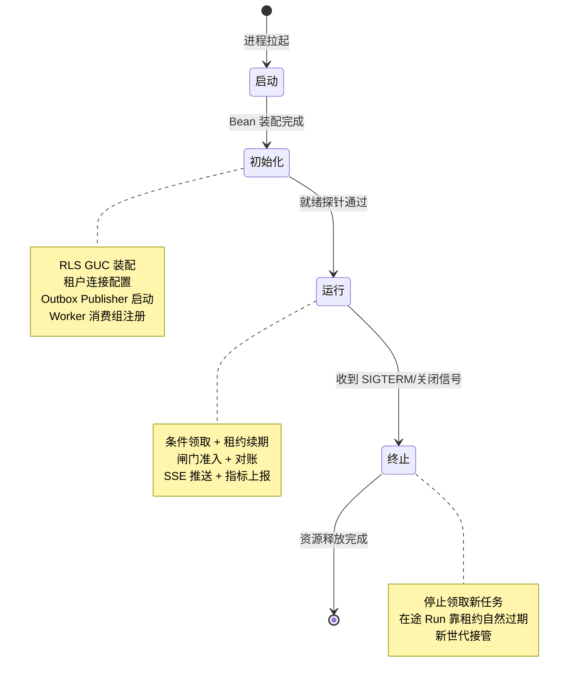

#### 4.7.2 启动阶段

- **依赖装配**：`platform-bootstrap` / `rag-bootstrap` 负责依赖注入，建立六层依赖关系；
- **配置加载**：读取技术基线配置（数据库、MQ、ModelGateway 供应商、通道类型 `database`/`rabbitmq`）；
- **安全链装配**：`SecurityConfiguration` 注册安全过滤链；对话审计插件以 `HIGHEST_PRECEDENCE+2` 早于安全链。

#### 4.7.3 初始化阶段

- **RLS 会话装配**：`TenantSessionBinder` 准备租户事务连接，确保 GUC `app.tenant_id` 在事务内、业务 SQL 前设置；
- **数据源初始化**：三个 `*DataSourceConfiguration`（显式装配，不用 Druid starter，避免与显式 Bean 抢注册顺序）；
- **消息基础设施**：Outbox Publisher 启动、`PgQueueListener`/MQ 消费者注册、`EventRoutedMessageHandler` 按 `eventType` 装配分流；
- **Worker 就绪**：`RunDispatchConsumer` 进入轮询/监听，按 eventType 分流消费者装配完毕；
- **就绪探针**：就绪探针通过后才接收流量，避免"未装配完先接请求"。

#### 4.7.4 运行阶段

- **控制面**：认证 → TenantContext → 校验 → 四元素同事务 → 返回 RunId；
- **执行面**：条件领取 → fencing → 主循环（世代校验/租约续期/审批检查）→ 闸门 → 工具 → 终态；
- **推送面**：RunEvent 持久化 → SSE 受众隔离 + 续传 → 终帧；
- **后台**：租约续期、UNKNOWN 对账、孤儿收敛、死信处理、指标上报、限流背压（活动通道深度）。

#### 4.7.5 终止阶段

- **优雅停机**：收到 SIGTERM 后停止领取新任务，不再发起新的工具副作用；
- **在途处理**：在途 Run 靠租约自然过期，由新世代 Worker 接管（不试图在终止窗口内硬做完）；
- **资源释放**：关闭消费者、连接池、发布者；
- **恢复保证**：因状态在 PG、deadline 为绝对时间、fencing 单调递增，重启后崩溃的 Run 能被正确接管，且不重复副作用。

> **生命周期设计的关键洞察**：正是因为采用了"PG 权威源 + 租约 + fencing + 绝对 deadline + Outbox"，终止阶段可以"简单粗暴"地停止领取——可靠性由结构保证，而非由优雅停机的复杂度保证。这是架构简化带来的运维收益。

---

## 五、深度问题剖析、踩坑复盘、边界风险

> 本章从"结构层"角度复盘真实踩坑与风险，聚焦异常分支、失败场景、链路异常 Case。所有案例来自基线，不臆造。

### 5.1 Sev-0 级结构性风险复盘

#### 5.1.1 双通道误分流导致终态 Run 被重跑（Sev-0）

**问题本质**：系统存在多条消息通道（执行唤醒 `agent.run.execute`、SSE `run_event`、采集 `agent.trace.collect`）。若采集/SSE 事件误用执行队列，`RunDispatchConsumer` 会把终态 Run 当成"唤醒执行"再次跑一遍 → 重复副作用（如 `record_weakness` 重复写入）→ Sev-0。

**根因**：共享队列 + 靠 type 字段区分，一旦分流写错就重复执行。

**修复（双向防御）**：
- 发送侧：`publishTraceCollect` 走专用队列，绝不用 `agent.run.execute`（`RunExecutionLoop.java` 注释明确）；
- 消费侧：`TraceCollectMessageHandler` 按 `eventType` 分流拒绝——只处理采集事件，其它事件走到这里说明分流配错，按不可恢复处理进死信；
- I-5 NOTIFY 加速必须用独立 channel，仅加速不替代轮询，且按 eventType 分流。

**反证用例**：撤掉 `EventRoutedMessageHandler` 分流（或让 `PgQueueListener` 直接挂执行消费者）→ "采集事件进死信 / 终态 Run 不被重领"断言必须变红。

#### 5.1.2 UNKNOWN 结果盲目重放导致重复副作用（Sev-0）

**问题本质**：工具执行返回 UNKNOWN（结果未知），若按 at-least-once 直觉重放，会重复执行真实副作用。

**修复**：`Outcome.UNKNOWN_RESULT → ack 丢弃`、`STALE_GENERATION → ack 丢弃`；绝不重投、禁 attempt；转独立对账通道。代价是需要"对账通道"，换来账实相符。

**联动风险**：对账逻辑必须**单一实现**（维度 01 定义策略、维度 11 承载调度），否则"两个 job 各对账一次、预算重复释放"= Sev-0。

#### 5.1.3 子 Agent 权限下放（Sev-0）

**问题本质**：子 Agent 若继承父 Agent 全部工具权限，等于权限下放 → Sev-0。

**修复**：子 Agent 的工具调用仍走 `ToolInvocationGate`，且带自己的执行作用域（固定 release + 闭包指纹）——既不能调父工具，也不能调未声明工具。

#### 5.1.4 跨租户 RLS 绕过（合规 + 安全）

**问题本质**：GUC `app.tenant_id` 未在事务内、业务 SQL 前设置，导致查询以错误上下文执行或绕过行隔离 → 未成年人数据跨租户泄露（PIPL 红线）。

**修复**：`TenantSessionBinder` 统一在事务内、业务 SQL 前设置 GUC；跨租户反证用例必须验证越权被数据库层拒绝。

### 5.2 异常分支与失败场景全集

| 编号 | 失败场景 | 所属层/域 | 系统行为 | 严重级别 | 防线 |
|:---|:---|:---|:---|:---|:---|
| F-01 | 幂等键同摘要冲突 | 接入/应用 | 返回已存在 RunId | 低 | 幂等记录 |
| F-02 | 幂等键异摘要冲突 | 接入/应用 | 拒绝，返回冲突错误 | 中 | 摘要比对 |
| F-03 | 预算校验失败 | 应用/领域 | fail-closed 拒绝创建 | 中 | 预算一致性校验 |
| F-04 | 能力目录缺失 | 应用/领域 | fail-closed 拒绝 | 中 | 能力快照双写 |
| F-05 | 消息重复投递 | 执行层 | `DUPLICATE_DISCARDED` 丢弃 | 中 | 消费者幂等 |
| F-06 | 租约过期仍写 | 执行/领域 | fencing 拒绝写入 | 高 | fencing token |
| F-07 | 模型超时/下游不可用 | 适配/执行 | 错误分类 → RETRYING/FAILED | 中 | 错误分类契约 |
| F-08 | 工具结果 UNKNOWN | 执行/工具 | 进对账，禁 attempt | 高 | 对账通道 |
| F-09 | 审批挂起/拒绝/过期 | 执行/领域 | WAITING_APPROVAL / FAILED | 中 | HITL 闭环 |
| F-10 | SSE Last-Event-ID 过期 | 接入层 | 明确重置语义 | 低 | 游标重置 |
| F-11 | SSE 受众越权 | 接入层 | 403 终态 + 停轮询 | 高 | 受众隔离 |
| F-12 | SSE 断连/超时 | 接入层 | done 终帧或重连续传 | 低 | 终帧明确 |
| F-13 | 双通道误分流 | 执行/可观测 | 专用队列 + 消费侧拒绝 | **Sev-0** | 双向防御 |
| F-14 | 集成测试从未运行 | 工程层 | failsafe 显式注册 `*IT.java` | 高（静默） | 构建门禁 |
| F-15 | 缓存掩盖红灯 | 工程层 | `-proc:full` + clean 验证 | 高（静默） | 编译参数 |

### 5.3 链路异常 Case 深度剖析

#### 5.3.1 静默失效类：最危险的"测试绿但没跑"

基线记录了两次极其深刻的"静默失效"教训，值得作为结构层工程化的反面教材：

**F-14（集成测试从未运行）**：`platform/pom.xml` 原先没有配置 failsafe，而 surefire 默认 include 不含 `*IT.java`——于是 14 个集成测试类在 `mvn verify` 中一条都不会执行，构建依然 BUILD SUCCESS。这是最坏的失效形态：**不是测试红，而是测试从未运行**；台账上"集成测试 N 项"在 CI 里实际等于 0。修复：显式注册 failsafe 并把 `*IT.java` 纳入 integration-test 阶段，IT 自身用 `@EnabledIfEnvironmentVariable(IT_PG_URL)` 守门（无数据库时跳过而非失败）。

**红灯被缓存掩盖（`-proc:full`）**：JDK 23 起 javac 默认不再从类路径隐式加载注解处理器，Lombok 处理器不运行 → `@Slf4j` 不生成 log 字段 → 编译报"找不到符号"。但这个红灯被 `target/` 陈旧产物掩盖：类文件已是最新时 Maven 跳过编译（Nothing to compile），**增量构建永远绿**，只有 `mvn clean compile` 才暴露。基线自承"此前三次栽在同形态上（反证假阴性/测试没跑起来/断言无判别力），这次是第四次"。修复：`-proc:full` 恢复隐式处理器发现。

**共性教训**：
1. 验证机制本身必须被验证（反证纪律："撤掉修复点会红吗"）；
2. 缓存/增量机制是静默失效的温床，定期 clean 构建是必要体检；
3. "测试绿"不等于"机制在工作"，必须检查执行数/跳过数报告。

#### 5.3.2 竞态类：并发领取与取消竞态

| 竞态 | 风险 | 裁定机制 |
|:---|:---|:---|
| 并发领取同一 Run | 双 Worker 同时执行 | 条件更新 + 乐观锁 + fencing，仅一个成功 |
| 取消标记 vs 工具启动 | 取消后工具仍启动产生副作用 | 协作式取消：启动前查 `cancel_requested_at`，有明确裁定 |
| 租约过期 vs 续期 | 旧世代继续写 | fencing token 单调递增拒绝旧写入 |
| 审批通过 vs 参数漂移 | 审批后参数被改仍执行 | 重新校验参数摘要、权限、预算、资源状态 |

#### 5.3.3 语义失真类：状态与错误被伪装

- **404/403/401 伪装成"稍后重试"**：客户端无限轮询、掩盖权限问题 → 明确终态 + 停轮询 + 不给重试；
- **run_step.state 按字面显示"执行中"**：已完成步骤显示错误状态 → 看 `completed_at`；
- **终态隐藏 UNKNOWN**：成功响应里藏未决副作用 → 必须显式暴露 `RECONCILIATION_REQUIRED`；
- **新建 PAUSED 状态**：与已有 WAITING_APPROVAL 闭环语义分裂 → 复用 PARK/RESUME 闭环。

### 5.4 边界风险与已知局限

| 风险/局限 | 说明 | 缓解/复审 |
|:---|:---|:---|
| 消息通道 `database` 有效并发=1 | PG 表队列默认通道并发受限 | 量级小可接受；负载上升时切 RabbitMQ 通道，按租户灰度 |
| RabbitMQ 社区支持期窗口 | 已登记 P4-R022 残余风险安全复核 | 锁定 4.3.6；按复审触发条件跟踪 |
| 性能未预先承诺 SLA | 不写空话，压测建基线后再定档 | `@ConcurrencyLimit`/租户并发上限/`limit+1` 游标分页护栏 |
| 终态 ≠ 外部副作用回滚 | CANCELLED/TIMED_OUT 不代表下游已撤销 | 在途副作用进对账，结果摘要明确暴露 |
| 对账 SLA 口径一致性 | 多维度各起 job 会造成重复对账 | 单一实现，调度与策略职责分离 |
| 小团队无专职 SRE | 运维能力有限 | 选型以"运维简单"为高权重；死信/对账操作手册 |

---

## 六、最佳实践固化、可复用范式沉淀

> 本章把第四章的落地经验抽象为可带走的范式，供其他项目复用。

### 6.1 分层与领域边界最佳实践

**实践 1：用运行形态决定层数，而非照搬**
当有独立 Worker 时，把"驱动执行循环 + 依赖装配"显式提升为第 6 层，从结构上杜绝 Controller 直接调 persistence。

**实践 2：依赖方向必须由静态测试守护，而非靠 code review 提醒**
`ModuleDependencyDirectionTest` + `AgentCorePurityTest` + `ModuleDependencyDirectionTest` 把约定固化为"违反即构建失败"。人肉记忆会随人员流动失效，测试不会。

**实践 3：数据库访问设唯一边界**
`agent-persistence` / `rag-persistence` 是各自 reactor 的唯一数据库访问边界；禁止其他模块 import JDBC/ORM。

**实践 4：按三依据拆域，数据归属唯一**
变化原因 / 数据归属 / 一致性边界三依据切分限界上下文；"两个域写同一张表"是必须消除的坏味道。

**实践 5：全局定义 + 绑定表实现零复制可见性**
全局 Agent 表无 tenant_id，靠 `tenant_agent_binding(ACTIVE)` 控制租户可见性——新增租户/Agent 零复制，是"共享定义、隔离访问"的典范。

**实践 6：跨域只经端口/事件，用 DTO/ReadModel 隔离**
禁止直接 import 其他域的领域实体；RAG 作为供应商经 `HttpRagRetrievalGateway` 跨进程，契约明确、版本独立演进。

### 6.2 数据流与状态机最佳实践

**实践 7：权威单向 + 最小化载荷**
PG 唯一事实源；消息只放 runId 等标识符；Worker 回权威源读取；敏感数据不进 MQ。

**实践 8：五态矩阵作为数据流设计的强制模板**
每条流必须写全正常/异常/重试/降级/超时五态；缺一视为设计未完成。

**实践 9：降级必须 fail-closed**
控制面 DB 不可用拒绝服务、执行面 UNKNOWN 转对账、SSE 越权 403 终态——凡涉及权限/状态/租户上下文缺失，一律 fail-closed。

**实践 10：双通道按 eventType 分流 + 双向防御**
发送侧不误发、消费侧按 eventType 拒绝误收；专用队列隔离执行/采集/SSE。

**实践 11：状态机白名单 + 终态不可迁 + fencing**
所有未列迁移默认拒绝；终态后禁补 attempt；关键写入校验 `run_id + lease_owner + fencing_token`。

**实践 12：HITL 复用已有闭环，不新建状态**
已有 PARK/RESUME 闭环（WAITING_APPROVAL + 唤醒消费者 + claimParkedRunForResume）时，禁止新建 PAUSED 造成语义分裂。

**实践 13：step.state 恒 RUNNING，完成看 completed_at**
禁止按字面显示"执行中"，禁止加两阶段 UPDATE。

**实践 14：deadline 用绝对时间**
恢复时不重算完整时长，防崩溃后无限续命。

### 6.3 可复用范式库

| 范式编号 | 范式名称 | 适用场景 | 核心要点 | 反证/验收 |
|:---|:---|:---|:---|:---|
| PAT-01 | 六层依赖单向 + 静态守卫 | 有独立 Worker 的中大型后端 | 执行装配层显式化 + 方向测试 | 撤掉守卫测试变红 |
| PAT-02 | 端口前移 + 可切换通道 | 多供应商/多消息载体 | SPI 抽象 + 按租户灰度 | 加实现不改领域层 |
| PAT-03 | Outbox 同事务四元素 | 需原子提交的服务 | Run+Event+幂等+Outbox 同事务 | 任一失败整体回滚 |
| PAT-04 | 租约 + fencing 防脑裂 | 多 Worker 竞争任务 | owner + 单调递增 token | 强杀后旧世代写入被拒 |
| PAT-05 | UNKNOWN 转对账禁重放 | 有真实副作用的工具调用 | ack 丢弃 + 独立对账通道 | 不重复副作用、账实相符 |
| PAT-06 | 双通道 eventType 双向防御 | 多类消息共存 | 专用队列 + 消费侧拒绝 | 误分流进死信、终态不重跑 |
| PAT-07 | RLS + 事务内 GUC 设置 | 多租户数据隔离 | 业务 SQL 前设 `app.tenant_id` | 跨租户反证被拒 |
| PAT-08 | 不可变快照钉死配置 | 配置可解释可追溯 | AgentVersion + ExecutionSnapshot | 发布后禁改、漂移被拦 |
| PAT-09 | 终态显式 + 停轮询 | SSE/异步进度推送 | 终帧明确、不伪装网络问题 | 403 不无限轮询 |
| PAT-10 | 五态数据流矩阵 | 任何健壮性设计 | 正常/异常/重试/降级/超时 | 五态齐全 |
| PAT-11 | 反证纪律 | 所有修复与守卫 | "撤掉修复点会红吗" | 反证假阴性被识别 |
| PAT-12 | 构建可靠性门禁 | Maven/Gradle 工程 | failsafe 显式注册 IT + `-proc:full` | IT 执行数>0、clean 构建绿 |

> **可复用要点的统一表述**：本项目的每一项"最佳实践"都遵守同一范式——**先识别约束与质量属性，再推导结构与机制，最后用静态守卫和反证用例固化**。方法论是通用的，机制是本项目特定的；复用时应复用"推导链条"，而非照抄"机制本身"。

---

## 七、未来迭代优化路线

### 7.1 迭代路线总览

架构不是一次性交付，而是随需求与约束演化。本项目的迭代路线遵循"扩展点预留但不过度设计"的原则，由基线中的"架构如何支撑未来迭代"表驱动：

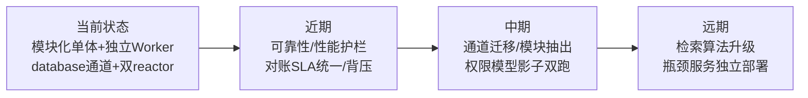

### 7.2 近中长期优化项

| 周期 | 优化项 | 架构支撑点 | 验收/门禁 |
|:---|:---|:---|:---|
| 近期 | 对账 SLA 口径统一 | 对账逻辑单一实现，策略/调度职责分离 | 无"对账两次、预算重复释放" |
| 近期 | 背压护栏精细化 | `@ConcurrencyLimit`、租户并发上限、活动通道深度 | 压测建基线，不预先承诺 SLA |
| 近期 | NOTIFY 低延迟唤醒（I-5，可选开启） | 独立 channel、按 eventType 分流、仅加速不替代轮询 | 开启 P99<50ms；丢弃时轮询兜底不卡死 |
| 近期 | 静态守卫补全 | 六层方向 + 领域纯度 + 数据库边界 | 反证全绿 |
| 中期 | 消息载体迁移（database ⇄ RabbitMQ） | 端口不变 + 可切换通道 + 按租户灰度 | 灰度期双通道一致性 |
| 中期 | 权限模型迁移 | 影子期双跑 + `rlsDependent=0` 观察期出口 | 影子期无越权、出口判定明确 |
| 中期 | 瓶颈模块抽出为服务 | 清晰边界使 worker/api 可沿边界抽出 | 抽出不改领域层 |
| 远期 | 新模型供应商 | ModelGateway 端口 + 多实现 | 领域层零改动 |
| 远期 | 检索算法升级 | RAG 域独立 reactor，检索/摄取/治理解耦 | 版本独立演进 |
| 远期 | 策略调整 | 配置化 + 快照隔离 | 运行中改配置只影响新 Run |

### 7.3 架构复审触发条件

> 当基线中的约束发生变化时，应依照对应 ADR/DEC 的"复审触发条件"重新打开决策，不得静默沿用。

| 触发条件 | 需复审的决策 | 复审动作 |
|:---|:---|:---|
| 体量增长、并发上升 | 消息通道（database→RabbitMQ）、模块化单体 | 重估通道与部署形态 |
| RabbitMQ 社区停维 | MQ 选型（ADR-001、P4-R022） | 重开选型、登记残余风险 |
| 合规收紧 | 采集白名单、保留期、零保留策略 | 重估合规优先级 |
| 团队扩大/SRE 就位 | 运维简单权重、服务拆分 | 重估服务化边界 |
| 新供应商/新工具频繁接入 | 端口/SPI 设计 | 重估扩展点是否足够 |
| 静默失效再次出现 | 构建可靠性门禁 | 补反证用例与 clean 体检 |

### 7.4 四件交付物

> 本节提供四件可直接使用的交付物，均含 Mermaid 图与表格，可用于团队评审、培训、答辩与运维。

#### 交付物一：完整架构图谱

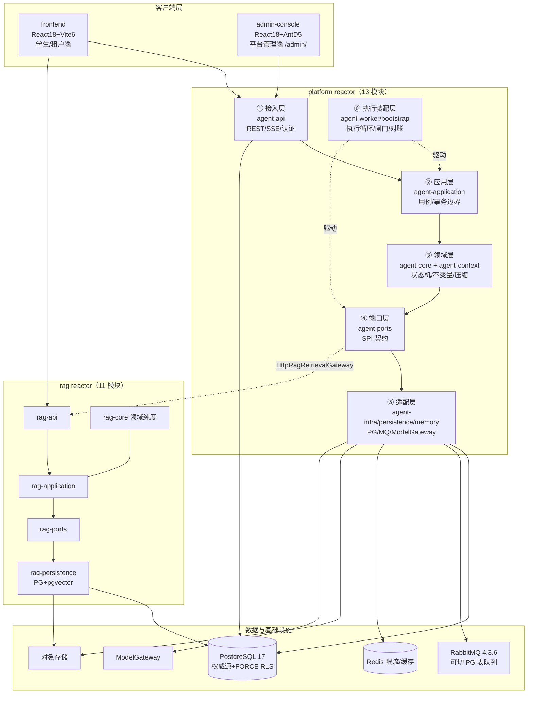

**架构层次与职责速查表**：

| 层 | 模块 | 核心职责 | 禁止职责 |
|:---|:---|:---|:---|
| ① 接入 | agent-api | 协议/认证/校验/SSE | 不含业务规则 |
| ② 应用 | agent-application | 用例/事务边界 | 不含领域不变量 |
| ③ 领域 | agent-core/context | 模型/状态机/算法 | 零框架依赖 |
| ④ 端口 | agent-ports | 能力契约 | 不含实现 |
| ⑤ 适配 | infra/persistence/memory | 实现端口/RLS | 不含业务决策 |
| ⑥ 执行装配 | worker/bootstrap | 驱动循环/装配 | 不直接调 persistence |

#### 交付物二：数据流大图

```mermaid
flowchart TB
    subgraph 控制面["① 控制面（同步原子）"]
        direction TB
        A1["Client"] --> A2["agent-api 认证/租户/校验"]
        A2 --> A3["RunCreationService 事务编排"]
        A3 --> A4[("PG：run+event+幂等+outbox 同事务")]
        A3 --> A1
    end
    subgraph 执行面["② 执行面（异步五态）"]
        direction TB
        B1["Outbox Publisher"] --> B2["MQ/PG队列（按eventType分流）"]
        B2 --> B3["RunDispatchConsumer 重复丢弃/孤儿收敛"]
        B3 --> B4["条件领取+fencing"]
        B4 --> B5["RunExecutionLoop 主循环"]
        B5 --> B6["ModelGateway → ToolInvocationGate 15步准入"]
        B6 --> B7["Tool 执行 → 账本 → 终态提交"]
        B7 --> B5
    end
    subgraph 推送面["③ SSE（推送终帧）"]
        direction TB
        C1["RunEvent 持久化"] --> C2["SSE Controller 受众隔离+续传"]
        C2 --> C3["13事件+第14checkpoint+done终帧"]
    end
    A4 --> B1
    B7 --> C1
    B2 -.agent.trace.collect 专用队列.-> D["采集/审计（消费侧按eventType拒绝误收）"]
```

**数据流五态速查表**：

| 数据流 | 正常 | 异常 | 重试 | 降级 | 超时 |
|:---|:---|:---|:---|:---|:---|
| 控制面 | 四元素同事务 | 幂等冲突/授权失败终态 | 客户端幂等键重放 | DB 不可用拒绝服务 | 显式返回不留半事务 |
| 执行面 | 唤醒→领取→闸门→终态 | 重复丢弃/UNKNOWN 对账 | 有限重试进 RETRYING | 错误分类不盲目切换 | 单消息超时+绝对 deadline |
| SSE | 持久化→续传→done | 游标过期/越权拒绝 | Last-Event-ID 续传 | 心跳保活 | 终帧+停轮询 |

#### 交付物三：域边界清单

| 域 | owning 数据 | 领域职责 | 上游 | 下游 | 协作模式 | 数据归属纪律 |
|:---|:---|:---|:---|:---|:---|:---|
| ① 身份与租户 | tenant/user/role/配额/binding | 认证授权/租户归属 | IAM | 全域 | 共享内核(TenantContext) | 唯一可信身份源 |
| ② Agent 治理 | agent/version/snapshot/能力目录 | 闭包发布/配置工作流 | ① | ③ | 发布/订阅(不可变快照) | 产出快照供③绑定 |
| ③ 执行 | run/step/lease/fencing/预算/审批 | 状态机/编排/可靠性 | ①② | ④⑤⑥⑦⑧ | 事件溯源 | 权威事实源 |
| ④ 工具与副作用 | tool_operation/attempt/approval | 工具执行/幂等/对账 | ③ | 业务系统/MCP | 端口 | 每次回查③授权预算 |
| ⑤ 记忆与上下文 | 记忆表/上下文快照 | 召回/巩固/遗忘/压缩 | ③ | ③(回填) | 端口 | 不直接写 run 状态 |
| ⑥ RAG | rag 库 15 表+代际 | 摄取/检索/治理/接地 | ③ | ③ | 客户/供应商(跨进程) | HttpRagRetrievalGateway |
| ⑦ 审计与可观测 | 审计/Trace/指标/评估 | 记录/评估/复核 | 全域事件 | 运维/管理端 | 事件溯源 | 只读不参与决策 |
| ⑧ 对话审计插件 | chat_audit 三表+config | 对话留痕/两阶段收敛 | ①③ | ⑦ | 过滤器 | HIGHEST_PRECEDENCE+2 |

#### 交付物四：链路故障自查手册

**故障定位决策树**：

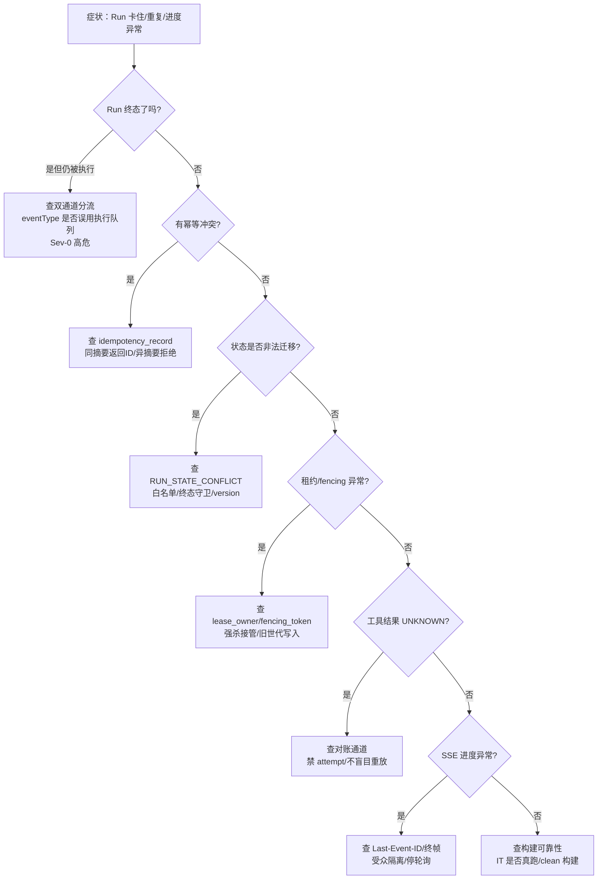

**故障 → 排查点 → 预期行为速查表**：

| 症状 | 首要排查点 | 关键代码/机制 | 预期行为 |
|:---|:---|:---|:---|
| 终态 Run 被重跑 | 双通道 eventType 分流 | `EventRoutedMessageHandler`、`agent.trace.collect` 专用队列 | 误收进死信，终态不重跑 |
| 重复创建 Run | 幂等记录 | `idempotency_record` + 摘要 | 同摘要返回已存在 ID |
| 状态回退/跳变 | 状态机守卫 | 白名单 + version + 终态守卫 | `RUN_STATE_CONFLICT` |
| 双 Worker 抢同一 Run | 租约/fencing | 条件更新 + `lease_owner` + fencing | 仅一个成功 |
| 重复副作用 | UNKNOWN 处理 | `Outcome.UNKNOWN_RESULT → ack 丢弃` + 对账 | 不重放、账实相符 |
| 待审批卡住 | HITL 闭环 | `ApprovalDecidedWakeupConsumer` + `claimParkedRunForResume` | 审批通过后重新校验并唤醒 |
| 步骤显示"执行中" | step.state 语义 | `run_step.state` 恒 RUNNING + `completed_at` | 按 completed_at 判断完成 |
| SSE 无限轮询 | 终态语义 | 终帧 + 停轮询 + 不给重试 | 403/401 明确终态 |
| 跨租户数据 | RLS GUC | 事务内、业务 SQL 前设 `app.tenant_id` | 越权被数据库拒绝 |
| 测试绿但没跑 | 构建门禁 | failsafe `*IT.java` + `-proc:full` + clean | IT 执行数>0、红灯暴露 |

**Sev-0 三条红线（运维速记）**：
1. **双通道按 eventType 分流**——采集不复用执行队列，否则终态 Run 被重跑；
2. **UNKNOWN 禁重放**——转对账、禁 attempt，否则重复副作用；
3. **权限/状态/租户缺失一律 fail-closed**——绝不 fail-open。

### 7.5 结尾声明

1. **事实边界**：本文所有"本项目"事实均来自 `系统架构设计思路与企业级工程化实践.md` 第 4 章与 §0.4、架构方案 v3.1、`platform/pom.xml`、`rag/pom.xml`、`capabilities/` 系列规范与 P2-D05/P4-D17 等基线，逐条可溯源；通用方法论部分为可复用内容，与本项目事实已明确分界。**对基线未给出的精确数值，本文只标"经验量级/待压测建基线"，不伪造实测数据**。
2. **时效性**：本文事实基线截至 **2026-11-23**；技术版本、消息通道状态、RabbitMQ 支持期、并发基线等均以此日期为准，后续须以复审机制更新。
3. **独立性**：本文独立成文，开篇含"项目背景速览"自包含介绍，七个一级章节固定不增删；读者无需阅读主文档即可完整理解本专题。
4. **使用边界**：四件交付物中的图谱、清单与手册为可直接使用的模板，其中"关键代码/机制"为导航提示，实际排查须以当前代码库与运行日志为准；不得照抄样例结论。
5. **治理责任**：本文及其中结构的维护责任人为架构师（AG-ARC）；任何复审触发条件达成，须在下一个迭代内重开对应决策或 ADR，不得静默沿用。
6. **诚实声明**：本专题反复强调"反证纪律"与"静默失效"——结构设计的目标不是产出一张好看的架构图，而是让每一层、每一域、每一条数据流、每一次状态迁移都**可追溯、可验证、可推翻**，并在出问题时**可定位、可兜底、可止损**。

> **全文完**。本白皮书独立成文，七章结构固定；配套四件交付物（完整架构图谱 / 数据流大图 / 域边界清单 / 链路故障自查手册）可直接用于团队评审、培训、答辩与运维自查。
