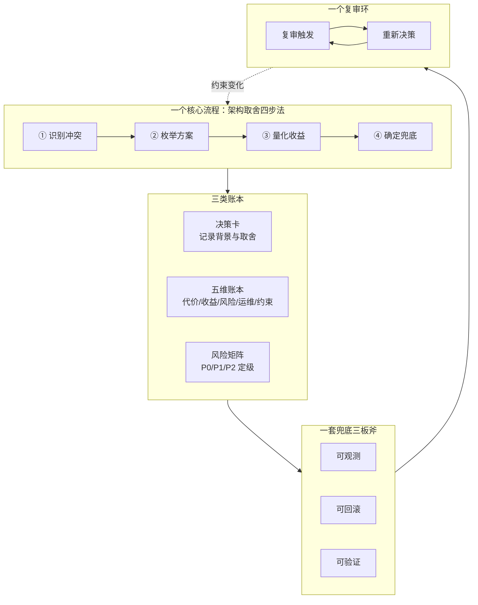
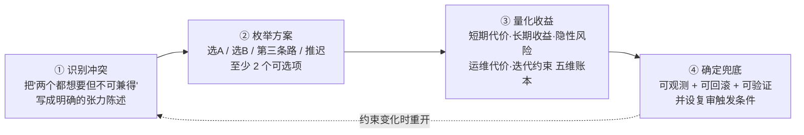
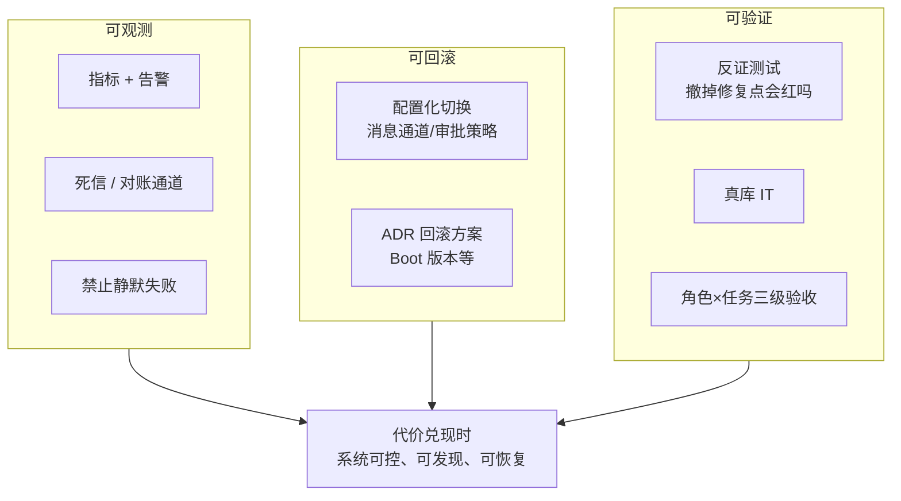
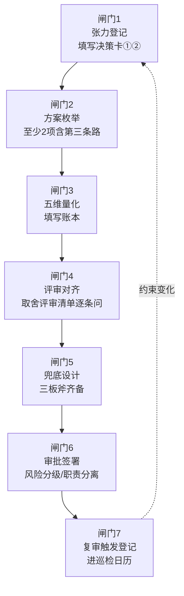
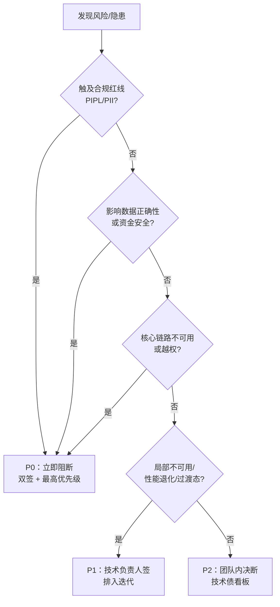
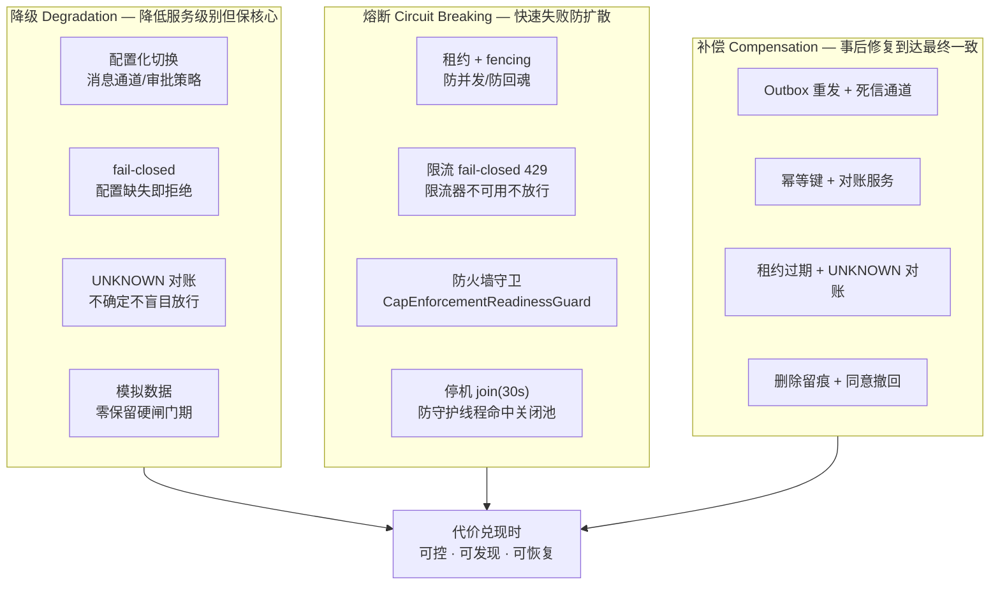
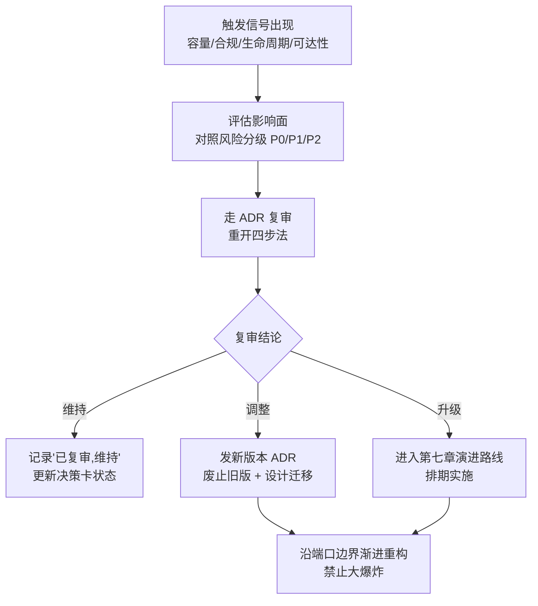

# 软件架构权衡取舍、成本收益分析与风险兜底体系专题白皮书

> **文档元信息**
>
> | 项目 | 内容 |
> |:---|:---|
> | 文档编号 | 专题 5 / TOPIC-05 |
> | 版本 | v1.0 |
> | 成文日期 | 2026-11-23 |
> | 文档定位 | 企业级架构专题白皮书（独立成文，不依赖主文档） |
> | 事实基线 | 《系统架构设计思路与企业级工程化实践》（架构方案 v3.1）第 2.8、5、7 章；`问题记录/` 全量记录 |
> | 适用对象 | 架构评审委员会、技术负责人、后端/平台/数据工程师、SRE、合规与内审接口人 |
> | 密级 | 内部技术资料 |
> | 核心命题 | 架构的本质是取舍；成熟的取舍 = 明确放弃什么 + 可观测的代价 + 可回滚的路径 + 可验证的兜底 + 可重开的复审 |

---

## 目录

- **一、章节背景与复杂度分析（含"项目背景速览"）**
  - 1.1 项目背景速览（自包含介绍）
  - 1.2 为什么需要独立的"取舍—成本—兜底"专题
  - 1.3 架构复杂度的三维来源
  - 1.4 本专题的方法论框架与阅读指引
- **二、通用行业标准方法论（可复用）：架构取舍四步法**
  - 2.1 四步法总览
  - 2.2 第一步：识别冲突（张力显式化）
  - 2.3 第二步：枚举方案（含"第三条路"与"推迟"）
  - 2.4 第三步：量化收益（五维账本）
  - 2.5 第四步：确定兜底（可观测、可回滚、可验证）
  - 2.6 决策卡（Decision Card）通用模板
  - 2.7 与原则裁决优先级的衔接
  - 2.8 复审触发：让取舍可以被重新打开
- **三、企业级落地流程、清单、模板、规范**
  - 3.1 落地流程总览（七道闸门）
  - 3.2 ADR/DEC 决策记录规范
  - 3.3 取舍评审清单（评审现场逐条问）
  - 3.4 量化收益账本模板
  - 3.5 兜底设计模板
  - 3.6 复审触发规范与例外管理
  - 3.7 治理角色与职责分离

---

## 一、章节背景与复杂度分析（含"项目背景速览"）

### 1.1 项目背景速览（自包含介绍）

本白皮书独立成文。为使任何未在上下文中的读者都能无障碍理解后续所有取舍，本节先以自包含方式陈述项目背景。以下事实全部来自既有基线与问题记录，不做推测与扩写。

**业务定位。** 本项目是一个**多租户 SaaS Agent 平台**，代码包名 `cn.studykid.multiagent`，面向 **K12 未成年人学生**提供智能体（Agent）对话、工具调用、学习档案与教学辅助能力。服务对象是未成年人，因此《个人信息保护法》（PIPL）是不可逾越的合规红线——这一点不是"若干约束之一"，而是**最高优先级约束**：它决定了采集白名单、保留期、审批强度与失败默认行为。

**技术栈。** 后端 **Java 21 / Spring Boot 4.1.1**，主库 **PostgreSQL 17**，消息中间件 **RabbitMQ 4.3.6**。系统有**双 reactor 进程**：`platform`（平台与业务主域）与 `rag`（检索增强域），二者各有独立数据源与启动入口。

**核心架构事实（决策的"物理边界"）。**

1. **PG 是唯一事实源。** 运行权威状态只认 PostgreSQL；Redis/MQ 不作为事实源。`Run + Event + 幂等键 + Outbox` 同事务写入，消息只是"唤醒信号"，不携带业务数据，Worker 收到信号后**回读数据库**判定真实状态。
2. **表队列与 Worker。** 除 RabbitMQ 外保留 PG 表队列作为默认通道（配置默认 `database`），**有效执行并发 = 1**。Worker 通过**租约（lease）+ fencing token（世代号）**保证同一 Run 不被并发执行；写入时校验世代号，防止旧执行者"回魂"。
3. **副作用正确性优先。** 模型调用、工具调用等副作用路径采用 **UNKNOWN 对账**语义——结果不确定时不盲目重放，而是进入对账服务 + 人工处置通道。配置采用**快照钉死**（Run 创建时固化生效配置），运行期不热更。
4. **权限模型处于迁移影子期。** 采用 **RLS（行级安全）行隔离**，当前正处于 **RLS → 应用层的影子迁移期**：M4 影子已开启但**差真实流量**；真实出口的达成条件是 `rlsDependent=0` 且通过观察期；库中有 **9 张无 RLS 表**是影子期基线，**禁止直接补建 RLS**（会破坏影子对照口径）。
5. **分级保留期。** 画像 12 个月 / Prompt 90 天 / 审计 180 天 / Trace 30 天，兼顾隐私、成本与合规。
6. **风险分级审批。** 高风险动作（如 `WRITE_PROFILE`）的审批策略可在 `OPTIONAL → REQUIRED` 之间**单向收紧**，由风险等级驱动弹性审批。
7. **架构形态。** 采用**模块化单体 + 独立 Worker**，不拆微服务；沿模块边界保留未来抽出能力。
8. **不可动摇的规则红线（本项目强制约束）。** 不调低 RAG 相似度阈值 **0.38**；不改动 RRF 的 **k=60**；**不新建 PAUSED 状态**（HITL 已有 PARK/RESUME 闭环）；**不在 `agent-infra` 引擎施力**（生产链路在 rag 模块，agent-infra 不可达）。

**一句话概括本项目的工程气质：** 一个面向未成年人、强合规、强一致性、中小体量、以可审计与可恢复为第一要务的多租户 Agent 平台；它的每一个架构决策都发生在"想要更多"与"必须克制"的张力之中。

### 1.2 为什么需要独立的"取舍—成本—兜底"专题

主文档第 5 章已经列出了五类权衡、速查表与兜底原则，但它们是**压缩的形态**——告诉读者"选了什么、放弃了什么"，却未充分展开"为什么当时只能这样选、代价如何量化、隐性风险如何被发现、兜底如何真正落地到代码与运维"。本专题的目的，是把这些压缩的决策**还原成完整的工程叙事**：

- 主文档回答 **"是什么"**；本专题回答 **"为什么、凭什么、代价几何、如何兜底、何时重开"**。
- 主文档给出 **结论**；本专题给出 **可复用的决策机器**（四步法 + 决策卡 + 账本 + 复审触发）。
- 主文档陈述 **取舍清单**；本专题给出 **逐条决策复盘**（背景 / 可选项 / 限制条件 / 代价 / 收益 / 隐性风险）。

架构取舍之所以需要专门的方法论，根源在于一个常被忽视的事实：**大多数架构事故并非源于"选错了技术"，而是源于"没有承认自己在取舍"**。当团队说"既要高性能又要强一致、既要灵活又要安全、既要快上线又要零技术债"时，真正发生的往往是——代价没有被登记、兜底没有被设计、复审触发没有被定义，于是隐性成本在系统运行一年后以事故形式集中爆发。本专题的核心纪律只有一条：**把取舍显性化，把代价账本化，把兜底工程化**。

### 1.3 架构复杂度的三维来源

本项目的架构复杂度可以归纳为三个相互叠加的维度，理解它们是理解后续所有取舍的前提。

**维度一：合规温度的不可逆性。** 面向未成年人 + PIPL，意味着某些决策是"单向门"：采集字段一旦越界、保留期一旦设置过长、审计一旦可篡改，代价不是"性能下降"而是"合规事故"。因此在本项目中，安全/合规在裁决序中处于绝对顶端：`安全/合规 > 一致性/正确性 > 可恢复性 > 可用性 > 性能 > 开发效率`。这一裁决序不是口号，而是贯穿第 2 章到第 7 章的"默认值生成器"。

**维度二：分布式不确定性的不可消除性。** 双 reactor + MQ + 表队列 + Worker + 外部模型/工具调用，构成典型的分布式系统。网络分区、超时、重复投递、进程崩溃、时钟漂移都是常态。PG 同事务与 Outbox 解决了"本地原子性"，但跨进程、跨系统的副作用仍需 UNKNOWN 对账、租约 fencing、幂等键来兜底。复杂性不在于"消除不确定性"，而在于"把不确定性收敛到可观测、可对账的少数通道"。

**维度三：演进阶段的过渡态。** RLS 影子期、CAP 双写、legacy 与 CAP 两套能力模型并存、社区版 MQ 的支持窗口——这些都是"过渡态"。过渡态是最容易出架构事故的阶段，因为**两套机制同时在场，任何一套的守卫失效都不会立刻表现为失败，而只表现为"另一套还在兜着"**。本专题第五章的隐患识别清单与第六章的运行期可达性审计，重点正是针对过渡态的"看似有、实则没接线"问题。

> **复杂度共识**：取舍不是一次性动作，而是贯穿系统生命周期的持续治理。一个决策在今天正确，不代表在约束变化后仍然正确——所以必须有复审触发机制（2.8 节、3.6 节）。

### 1.4 本专题的方法论框架与阅读指引

本专题的方法论框架可以概括为"一个核心流程 + 三类账本 + 一套兜底 + 一个复审环"：



**阅读指引：**

- 若你是**架构评审委员会**成员，重点读第 2、3、5 章——它们提供评审流程、清单与风险定级标准。
- 若你是**一线开发工程师**，重点读第 4、5 章——它们用真实决策与踩坑案例说明"为什么这么写"。
- 若你是**SRE / 运维**，重点读第 5、6 章——兜底三板斧与隐患巡检会直接落到你的告警与巡检脚本。
- 若你是**新人**，从第 1.1 节开始顺序阅读；文末的三件模板（决策模板、风险矩阵、巡检清单）可直接复制到日常工作中。

---

## 二、通用行业标准方法论（可复用）：架构取舍四步法

> 本章给出的方法论**与具体项目无关**，可在任何企业级系统的架构决策中复用。第四章再把它应用到本项目的具体决策上。

### 2.1 四步法总览

架构取舍四步法是对主文档"四步法"的标准化表达，其核心是把一次决策拆解为四个不可跳过的动作：



**四步法的纪律：** 四步缺一不可，且顺序不可颠倒。跳过"识别冲突"会导致伪命题；跳过"枚举方案"会导致假装只有一条路；跳过"量化收益"会导致凭直觉决策；跳过"确定兜底"会导致"代价兑现时无预案"。

### 2.2 第一步：识别冲突（张力显式化）

**目标：** 把模糊的"纠结"写成一句可证伪的张力陈述。

**做法：** 使用统一句式——"我们想要 **A**，但也想要 **B**；在 **约束 C** 下，二者不可兼得"。其中：

- **A 与 B 必须是同一层级的诉求**。例如"写入吞吐 vs 强一致性"是对层的；"写入吞吐 vs 代码可读性"则不是——后者应当先转化为"开发效率 vs 稳定性"这一对。
- **必须点明约束 C**。约束是让冲突"此时此地不可兼得"的原因，通常是体量、团队规模、合规要求、时间窗口或技术债务现状。没有约束的"取舍"是伪取舍。
- **必须说明冲突的原则归属**。把 A、B 映射到裁决序（2.7 节）中的具体原则，例如"吞吐→性能、强一致→一致性/正确性"。

**反面案例（本项目真实教训）：** 早期讨论"要不要上专用向量库"时，张力被表述为"性能 vs 成本"，但真实冲突是"检索性能的可扩展性 vs 新增独立集群的运维成本 + 数据同步一致性风险"。前者把问题缩小成了性能abc，后者才暴露出"省组件"才是真正的诉求。张力识别错误，会导致后续量化完全偏离。

**产出物：** 一条张力陈述 + 冲突原则映射。写入决策卡的"取舍主题"字段。

### 2.3 第二步：枚举方案（含"第三条路"与"推迟"）

**目标：** 避免"假两难"。绝大多数架构冲突存在超过两个选项。

**标准方案清单（至少覆盖以下四类）：**

| 选项类型 | 含义 | 示例（本项目） |
|:---|:---|:---|
| 选 A | 完全满足 A 诉求，放弃 B | 选强一致：Run+Outbox 同事务，牺牲部分写吞吐 |
| 选 B | 完全满足 B 诉求，放弃 A | 选性能：异步写状态，接受短暂不一致 |
| 第三条路 | 用架构手段两者兼顾 | 同事务 + Outbox 异步批量发布：既保原子性又缓解吞吐 |
| 推迟（都不选） | 在信息不足时先不决策 | 未压测前不承诺固定 SLA；RLS 影子期先不切真出口 |

**"第三条路"是本方法最有价值的一步。** 本项目的多个关键决策都靠升维而非二选一解决：

- 消息通道"选 MQ 还是选 PG 表队列" → 升维为"**端口抽象 + 运行时可切换**"，按租户灰度。
- 审批"放松以提效还是收紧以合规" → 升维为"**风险分级审批**"，高风险单向收紧、低风险可保持 OPTIONAL。
- 权限"一步到位切应用层还是死守 RLS" → 升维为"**影子迁移期**"，用观察期数据驱动真正切换。

**"推迟"是合法的选项，但必须附带条件。** 推迟不等于"不做"，必须记录"等到什么信号就重新决策"。例如"未压测前不承诺 SLA"附带"P4 演练后确认"；"RLS 影子期"附带"真出口 `rlsDependent=0` 且度过观察期"。

**产出物：** 2–4 个可选项，每项一行，写入决策卡的"可选项"字段。

### 2.4 第三步：量化收益（五维账本）

**目标：** 用统一的五个维度给每个方案"标价"，把隐性成本显性化。

**五维账本定义：**

| 维度 | 定义 | 评审时必须回答的问题 |
|:---|:---|:---|
| 短期代价 | 本迭代内额外付出的成本 | 要多写多少代码？要多做几次 PoC？要改造多少调用路径？ |
| 长期收益 | 未来可预见的回报 | 一年后它帮我们省了什么？避免了什么事故？ |
| 隐性风险 | 不明显但可能爆发的风险 | 什么情况下"本来以为没问题"会突然出问题？是否静默失败？ |
| 运维代价 | 对部署/监控/排障的影响 | 多一套组件/连接池/配置吗？排障链路变长了吗？ |
| 迭代约束 | 对后续演进的限制与优化入口 | 它锁死了什么？将来如何补回放弃的部分？ |

**量化方法：** 五个维度都要求"可核对的证据"，而非形容词。例如：

- 短期代价写"PoC + RLS 拦截器 + 4 个反证 IT 改造"，而非"成本较高"。
- 隐性风险写"`ON CONFLICT DO UPDATE` 需 UPDATE 授权；若只授 INSERT，运行时静默失败"，而非"可能有授权问题"。
- 运维代价写"多一套 SqlSessionFactory；双通道切换期两通道在途消息滞留"，而非"运维稍复杂"。

**收益/成本比的判定：** 用裁决序作为权重。当收益落在更高优先级原则（如合规、一致性）上、代价落在更低优先级原则（如开发效率、性能）上时，取舍基本成立；反之则必须走"例外管理"（3.6 节）。本项目的所有核心取舍都符合"高优先级收益换低优先级代价"这一模式——这正是它们经得起时间检验的原因。

> **反面教训（本项目 DAT-01）**：`execution_capability_snapshot` 全库 0 行的根因是五层写链断链，其中一层是"三层失败都被 `catch (RuntimeException)` 吞掉并记 WARN"。这是典型的**隐性风险未被量化**——当初只看到了"fail-soft 提升可用性"的收益，没有量化"断链不体现为失败，只体现为表一直是空的"这一隐性风险。教训：**任何 catch 吞异常的设计都必须回答"链路断了在哪里可观测"**。

### 2.5 第四步：确定兜底（可观测、可回滚、可验证）

**目标：** 为每一个被接受的代价配备兜底，确保"代价兑现时"系统不会失控。

兜底三板斧是本项目的标准配置：



**可观测——任何代价都必须可观测。** 指标、告警、死信/对账通道是"代价的传感器"。本项目的反面教训极其深刻：`RunRecoverySweeper` 崩溃恢复扫描器的租户枚举曾"裸奔在 try/catch 之外"，异常被 Spring 调度包装器兜住，健康检查端点照样报 healthy——"恢复链路已死"没有落到任何可告警的地方（CON-06）。可观测兜底的落地要求是：**降级路径必须置位健康状态**（`unhealthyReason`），让健康检查端点能报出来。

**可回滚——配置化切换 + ADR 回滚方案。** 消息通道（RabbitMQ ↔ PG 表队列）与审批策略（OPTIONAL ↔ REQUIRED）都做成配置化切换，使"选错"可以低成本撤回。Boot 版本等无法配置化的决策，则在 ADR 中写明回滚方案。

**可验证——反证测试 + 真库 IT + 三级验收。** "反证"是本项目极具特色的验证纪律：每个守卫都要问一句 **"撤掉修复点，测试会红吗？"** 如果撤掉守卫测试仍然绿，说明这个守卫形同虚设（假绿）。这一纪律直接针对"有测试不等于测试有效"的问题。

**兜底的完成标准：** 三板斧全部落地，且在决策卡中逐项写明"兜底预案"与"未来优化入口"。如果某项代价找不到兜底，说明该取舍尚不成熟，应回到第二步重新枚举方案。

### 2.6 决策卡（Decision Card）通用模板

决策卡是四步法的载体，一次决策一张卡。以下是可直接复用的通用模板（第三章给出填写规范，文末附录给出带样例的完整版）：

```markdown
### 决策卡：DEC-XXX <取舍主题>

- **日期**：YYYY-MM-DD
- **状态**：提案 / 已采纳 / 已复审 / 已废止
- **决策人**：<姓名>  **风险接受人**：<姓名>（高风险例外必填）

| 字段 | 内容 |
|:---|:---|
| ① 取舍主题 | <一句张陈述：想要 A，但受约束 C，与 B 不可兼得> |
| ② 可选项 | 选A / 选B / 第三条路 / 推迟（至少 2 项） |
| 约束条件 | <体量、团队、合规、时间限制> |
| 冲突原则 | <按裁决序映射到具体原则> |
| ③ 五维账本 | 短期代价 / 长期收益 / 隐性风险 / 运维代价 / 迭代约束 |
| ④ 决策 | <选了什么，依据裁决序哪条> |
| ④ 放弃 | <诚实列出放弃了什么，禁止"既要又要"> |
| ④ 兜底预案 | 可观测：<...>；可回滚：<...>；可验证：<...> |
| 未来优化入口 | <何时、如何补回放弃的部分> |
| 复审触发条件 | <什么信号出现时重新决策，尽量量化> |
```

**决策卡的填写纪律：**

1. **"放弃"栏不得留空**。留空意味着决策者没有正视代价。
2. **"隐性风险"栏不得写空话**。"可能有风险"不算填写；必须写清触发条件与表现形态。
3. **"复审触发条件"尽量量化**。写"体量增大时"不如写"当队列积压 P95 持续超过 X 达 Y 分钟时"。
4. **高风险例外必须填写"风险接受人"**，并配到期日（见 3.6 节）。

### 2.7 与原则裁决优先级的衔接

四步法的第三步（量化收益）需要一个"权重器"来判断收益与代价哪个更重要。这个权重器就是项目级原则裁决序：

```
安全/合规 > 一致性/正确性 > 可恢复性 > 可用性 > 性能 > 开发效率
```

**使用方式：** 当张力涉及两条原则时，默认让高优先级原则胜出；用低优先级原则的代价换取高优先级原则的收益。本项目典型裁决：

| 冲突场景 | 冲突原则 | 裁决结果 | 依据 | 第三条路/兜底 |
|:---|:---|:---|:---|:---|
| 提高写入吞吐 vs 四元素同事务 | 性能 vs 一致性 | 保留同事务 | 一致性优先 | Outbox 异步批量发布 |
| 真实学生数据接入 vs 零保留未确认 | 效率/价值 vs 合规 | 延后接入 | 合规最高（DEC-10） | P1 用模拟数据，设 GATE 1/2/3 |
| 自动重试 vs UNKNOWN 对账 | 可用性 vs 正确性 | 选对账 | 正确性优先 | 对账服务 + 人工处置 |
| 审批放松提效 vs 门禁不可降级 | 效率 vs 安全 | 拒绝放松 | 安全最高 | 风险分级（OPTIONAL→REQUIRED 单向收紧） |
| 缓存状态加速 vs PG 权威源 | 性能 vs 一致性 | 缓存只做读加速 | 一致性优先 | 决策仍回 DB 判定 |
| 微服务独立扩展 vs 强一致性 | 可扩展性 vs 一致性 | 模块化单体 | 一致性优先 + 体量小 | 端口边界保留未来抽出能力 |

**裁决纪律（重要）：** 优先级是**默认序**，不是**绝对序**。若业务上确有理由让低优先级原则胜出（如极端性能场景），必须走 ADR 记录"为何破例 + 补偿措施 + 到期日 + 正式风险接受人"，对应高风险例外规则（3.6 节）。绝不允许"事实上破例但文档不写"——那正是隐性风险的温床。

### 2.8 复审触发：让取舍可以被重新打开

**核心认知：取舍不是永久的。** 当约束变化时，今天的正确决策可能变成明天的枷锁。复审触发机制的作用，是让每个决策都带着一个"闹钟"。

**复审触发的四类信号：**

| 信号类别 | 示例（本项目） | 关联的决策 |
|:---|:---|:---|
| 体量信号 | 队列积压 P95 持续超标；有效并发=1 成为瓶颈 | PG 表队列、模块化单体 |
| 合规信号 | 模型零保留条款确认（DEC-10）；PIPL 口径变化 | 分级保留期、采集白名单 |
| 技术生命周期信号 | 社区版 MQ 停维前 30 天；4.4 GA | 社区版 MQ 残余风险 |
| 能力成熟度信号 | 真出口 `rlsDependent=0` 且度过观察期 | RLS → 应用层迁移 |

**复审的执行：** 复审触发后，重新走四步法——不是推翻原决策，而是用当前约束重新评估。复审结论有三种：维持原决策（记录"已复审，维持"）、调整决策（发新版本 ADR，废止旧版）、升级为演进任务（进入第七章路线图）。每一次复审都要在决策卡的"状态"字段留痕。

---

## 三、企业级落地流程、清单、模板、规范

> 第二章给出"怎么想"，本章给出"怎么落地"。方法论如果不能固化为流程、清单与模板，就会停留在 PPT 层面。

### 3.1 落地流程总览（七道闸门）

一次架构取舍从产生到闭环，要经过七道闸门。任何一道缺失，都会留下隐患。



**七道闸门的强制程度：**

- **闸门 1–3（登记、枚举、量化）**：强制。缺任何一项，决策不得进入评审。
- **闸门 4（评审对齐）**：强制。用 3.3 节清单逐条问，答案为"否/不清楚"的必须补充。
- **闸门 5（兜底设计）**：强制。三板斧缺一，决策不得 Approved。
- **闸门 6（审批签署）**：按风险分级。P0 级需架构委员会 + 风险接受人双签；P1 需技术负责人签；P2 可团队内决断（详见第五章风险分级）。
- **闸门 7（复审触发登记）**：强制。无复审触发条件的决策视为"未完成"。

### 3.2 ADR/DEC 决策记录规范

**ADR（Architecture Decision Record）与 DEC（Decision）** 是本项目的决策记录载体。规范要求：

1. **一决策一记录**，编号唯一（如 DEC-10、ADR-013），不得合并记录多个决策。
2. **不可原地改写**。决策变更时发新版本并废止旧版（状态字段改为"已废止"，并注明被哪个新版本替代），保留完整历史。
3. **必填字段**：日期、状态、决策人、风险接受人（高风险）、取舍主题、可选项、约束、冲突原则、五维账本、决策、放弃、兜底、复审触发。
4. **存放位置**：架构决策统一存放于 `docs/` 下的决策/ADR 目录，与代码同仓、同评审、同版本。
5. **与代码联动**：涉及代码行为的决策（如"副作用路径禁内置 `@Retryable`"），需在代码评审清单中常驻一条，并在相关代码处留注释指向 DEC 编号。

**本项目已有决策编号示例（基线中可查）：** DEC-9（运行期容量配置档）、DEC-10（零保留条款未确认前禁止真实学生数据）、ADR-013（上下文压缩 S4 定为后续阶段）。这些编号在白皮书中被引用时保持原编号，不重新编号。

### 3.3 取舍评审清单（评审现场逐条问）

由主文档第 5.8 节"架构隐患识别点"扩展而来，评审现场逐条问，任一答案为"否/不清楚"即视为隐患，必须补充后才能通过：

| # | 自查问题 | 若答案为"否/不清楚"的隐患 |
|:--:|:---|:---|
| 1 | 每个取舍是否记录了"放弃了什么"？ | 隐性代价未登记，未来爆发无预案 |
| 2 | 每个代价是否可观测（指标/告警/对账通道）？ | 静默失败，问题积累到事故才暴露 |
| 3 | 是否有可回滚路径？ | 一旦选错无法低成本撤回 |
| 4 | 是否有反证用例验证守卫判别力？ | 守卫形同虚设，假绿 |
| 5 | 是否定义了复审触发条件与阈值？ | 约束变化后决策无人重开 |
| 6 | 效率提升是否带护栏？ | 技术债积累 |
| 7 | 是否有"写了但没接线"的能力？ | 运行期可达性缺口（有类 ≠ 被装配） |
| 8 | 是否有"链路成功 ≠ 任务成功"的指标误读？ | 虚假安全感 |
| 9 | 是否有高风险例外未登记责任人/到期日？ | 例外变成永久后门 |
| 10 | 是否有终态/权限错误被伪装成临时故障？ | 客户端无限轮询、掩盖真实问题 |

> **运行期可达性专项（本项目特别强调）**：评审时须额外问一句"这个能力在生产链路真的可达吗"。主文档深度报告第三章明确指出"有类/有表/有测 ≠ 被装配/被写入/被注入/被触发告警"。典型如 `GroundingService` / `ReviewAttributionHook` 曾存在生产无 Bean / 未接线的问题；`rag_answer_citation` 表有注释声明"引用可回溯"但无任何生产写入方（DAT-12）。

### 3.4 量化收益账本模板

用于决策卡"③ 五维账本"字段的展开。模板如下（空白版，可直接复制）：

```markdown
| 维度 | 本方案取值 | 证据/来源 | 是否可观测 |
|:---|:---|:---|:---:|
| 短期代价 | <本迭代额外成本，量化到 PoC/IT/改造点> | <代码/工时证据> | — |
| 长期收益 | <未来回报，量化到避免的事故/节省的组件> | <测算依据> | — |
| 隐性风险 | <触发条件 + 表现形态，禁止空话> | <问题记录编号> | 是/否 |
| 运维代价 | <新增组件/连接/配置/排障链路> | <部署拓扑> | — |
| 迭代约束 | <锁死什么 + 未来如何补回> | <路线图条目> | — |
```

**填写样例（取自本项目 Run+Outbox 同事务决策）：**

```markdown
| 维度 | 本方案取值 | 证据/来源 | 是否可观测 |
|:---|:---|:---|:---:|
| 短期代价 | 写吞吐受限、事务稍长 | 四元素同事务实现 | 是（事务时长监控） |
| 长期收益 | 状态永不半截、可恢复 | Outbox + Worker 回读 | — |
| 隐性风险 | 长事务锁竞争 | 压测待验（P0 待验项） | 是（锁等待告警） |
| 运维代价 | 需监控事务时长 | 监控项清单 | 是 |
| 迭代约束 | Outbox 批量发布；压测后按瓶颈优化 | 路线图 | — |
```

### 3.5 兜底设计模板

用于决策卡"④ 兜底预案"字段。每个代价至少配一条兜底，归入三板斧之一：

```markdown
### 兜底设计：<代价名称>

- **代价来源**：<决策卡的哪一项代价>
- **可观测**：
  - 指标：<指标名与阈值>
  - 告警：<告警规则与通知对象>
  - 死信/对账通道：<队列或人工通道>
  - 禁止静默失败的具体措施：<如 catch 必须置位 unhealthyReason>
- **可回滚**：
  - 切换开关：<配置项与默认值>
  - 回滚步骤：<1-2-3>
  - ADR 回滚方案：<针对不可配置化的部分>
- **可验证**：
  - 反证用例：<"撤掉修复点会红吗"的测试用例>
  - 真库 IT：<测试类/用例编号>
  - 三级验收：<角色×任务的验收项>
- **兜底有效性巡检频率**：<如每季度>
```

### 3.6 复审触发规范与例外管理

**复审触发规范：**

- 每个决策的"复审触发条件"字段必须**可量化或可判定**。使用"当 <信号> 达到 <阈值> 持续 <时长> 时"的句式。
- 复审触发登记进第六章的季度架构巡检日历，由架构委员会跟踪。
- 复审结论必须在决策卡状态字段留痕（维持/调整/废止）。

**高风险例外管理（对应 P0-D03 红线 10）：** 当业务确需让低优先级原则胜出时：

1. 必须在 ADR 中记录"为何破例"；
2. 必须定义"补偿措施"（如何对冲破例带来的风险）；
3. 必须设置"到期日"（例外不是永久的）；
4. 必须有"正式风险接受人"（具名，非集体）；
5. 例外的状态要在季度巡检中复检，到期未续期则自动失效。

> **红线提醒**：本项目存在不可破例的硬红线——不调低 RAG 阈值 0.38、不动 RRF k=60、不建 PAUSED 状态、不在 agent-infra 施力。这些**不属于"可走例外管理"的范畴**，它们是tribute级约束，任何 ADR 都不得破例。

### 3.7 治理角色与职责分离

取舍决策的落地需要明确的角色分工，避免"谁决策谁兜底全包"或"没人负责"：

| 角色 | 职责 | 在取舍流程中的动作 |
|:---|:---|:---|
| 架构评审委员会 | 裁决冲突原则、审批 P0 决策 | 闸门 4 评审、闸门 6 双签 |
| 技术负责人 | 审批 P1 决策、复核五维账本 | 闸门 3/5/6 |
| 决策人（模块 Owner） | 填写决策卡、枚举方案、设计兜底 | 闸门 1/2/5 |
| 风险接受人 | 对高风险例外签字担责 | 闸门 6（例外必签） |
| SRE/运维 | 落地可观测、维护对账/死信通道 | 闸门 5、第六章巡检 |
| 合规/内审接口人 | 审核合规相关取舍（PIPL、保留期、采集） | 闸门 4（合规类必审） |

**职责分离要点（本项目真实教训 DBP-15）：** 发布头约束 `cap_config_release_two_person_ck` 的谓词写成 `approver_id IS NULL OR requester_id IS NULL OR approver_id <> requester_id`，导致"两人都为空"也放行——名字叫"两人复核"，实现却是"可无人复核"。这是典型的职责分离被 NULL 三值逻辑架空。正确的复核约束应当是**肯定式**：两人**都非空且不相等**才成立。这一案例说明：职责分离不能只写在文档里，必须落到数据库约束/审批流的"肯定式"判定上。

---

## 四、本项目全量落地细节、真实决策、历史上下文

> 本章是白皮书的核心。前两章给出方法论，本章把方法论**逐一套用到本项目的真实决策上**。所有账本、决策卡、踩坑案例均来自基线文档与 `问题记录/`，不编造。

### 4.1 五大核心架构权衡场景专项深度拆解

本节按用户指定的五大权衡场景逐一拆解。每个场景都给出统一五维账本（短期代价 / 长期收益 / 隐性风险 / 运维代价 / 迭代约束），并配真实项目证据。

#### 4.1.1 场景一：性能 vs 一致性

**张力陈述：** 我们想要**更高的写入吞吐与更低的响应延迟**，但也想要**状态永不半截、可恢复、可对账**；在"分布式多进程 + 外部模型/工具调用不确定性"约束下，二者不可兼得。

**冲突原则映射：** 性能 ↔ 一致性/正确性。按裁决序，一致性优先；性能诉求只能用"第三条路"与"兜底"满足。

**五维账本：**

| 维度 | 内容 | 真实证据 |
|:---|:---|:---|
| 短期代价 | 写吞吐受限、事务稍长；每次预算调用多一次 DB 写 | 四元素（Run+Event+幂等+Outbox）同事务；预算原子预留 |
| 长期收益 | 状态永不半截、崩溃可恢复、每笔钱可追溯 | Worker 回读 DB 判定；预留账本唯一记录防超发 |
| 隐性风险 | 长事务锁竞争；UNKNOWN 下预留释放时机；`ON CONFLICT DO UPDATE` 需 UPDATE 授权（只授 INSERT 会静默失败） | 主文档 5.2 反面教训；DAT-10 预留外键缺口 |
| 运维代价 | 需监控事务时长、锁等待；预留表增长需清理（分级保留期回收） | 监控项清单；分级保留期 |
| 迭代约束 | Outbox 批量发布缓解吞吐；压测后按瓶颈优化，不预先承诺 SLA | 主文档 5.7 清单 #1/#2/#3 |

**深度剖析。** 本项目在"性能 vs 一致性"上的选择是**毫不动摇的一致性优先**，但用三层设计把性能代价压到可接受：

1. **本地原子性用同事务解决**——Run、Event、幂等键、Outbox 写入同一数据库事务。这保证了"要么全成要么全不成"，状态永不半截。
2. **跨进程一致性用"信号 + 回读"解决**——消息只是唤醒信号，不携带业务数据；Worker 收到信号后回读数据库判定真实状态。这避免了"消息里的数据与数据库不一致"的整类问题。
3. **性能用"批量/异步"缓解**——Outbox 采用批量异步发布，把事务内的开销摊薄；而非牺牲一致性去换吞吐。

RAG 侧还有一条特殊的性能 vs 质量张力：检索延迟 vs 质量。本项目选择双通道 + RRF + 阈值 0.38，放弃低延迟，兜底是"候选 ×3、只读 ACTIVE 代际"。**阈值 0.38 与 RRF k=60 是硬红线**，禁止通过调低阈值来"提召回"——因为那会引入噪声，违反"不编造"的质量底线。

**决策结论与复审触发：** 维持一致性优先。复审触发：当压测显示 Outbox 发布成为明确瓶颈（队列积压 P95 持续超标）时，才按瓶颈优化；不预先承诺 SLA。

#### 4.1.2 场景二：复杂度 vs 稳定性

**张力陈述：** 我们想要**通过引入抽象/组件获得能力**（重试、通道切换、微服务扩展），但也想要**系统足够简单、故障面小、排障链路短**；在"小团队、中小体量、强一致性"约束下，二者不可兼得。

**冲突原则映射：** 可扩展性/开发效率 ↔ 稳定性/可恢复性。默认稳定性优先，"简单"往往意味着**不增加新东西**。

**五维账本：**

| 维度 | 内容 | 真实证据 |
|:---|:---|:---|
| 短期代价 | 保持简单需守依赖纪律、复用已有闭环（而非造新轮子） | 模块化单体需静态守卫守边界 |
| 长期收益 | 故障隔离在模块内、排障链路短、边界清晰可抽 | 沿边界保留抽出能力 |
| 隐性风险 | 边界失守退化为"大泥球"；"过度扩展"引入不可达代码 | 主文档 5.4 纠偏：HITL 已有 PARK/RESUME，勿建 PAUSED；agent-infra 不可达勿施力 |
| 运维代价 | 单体内故障隔离弱于微服务 | 主文档 5.4 账本 |
| 迭代约束 | 静态守卫守边界；瓶颈模块沿边界抽出 | 复审：灰度扩大后 PG 队列成瓶颈则抽出 |

**深度剖析。** 本项目对"复杂度 vs 稳定性"的回答非常克制，核心结论有三条：

1. **模块化单体 + 独立 Worker，不拆微服务。** 小团队、低体量下，微服务带来的运维复杂度与一致性损耗远大于收益。沿模块边界保留抽出能力，需要时再抽。
2. **单一重试点，拒绝双重重试。** 项目约定 Worker 侧保持唯一重试实现，副作用路径**禁用 Spring 内置 `@Retryable`**——因为框架重试 + 自研重试叠加会导致重复副作用（Sev-0 级风险）。这里"简单"直接等于"稳定"。
3. **"简单"有时是不增加新东西。** 主文档明确纠偏：HITL 已有 PARK/RESUME 闭环，不要新建 PAUSED 状态；RAG 生产链路在 rag 模块，不要在不可达的 `agent-infra` 引擎施力；halfvec/HNSW 是刻意取舍，不要夹带降维。这三个"不要"是本场景最值钱的工程智慧——**每一次"加一个新状态/新模块/新算法"的冲动，都应当先问"现有闭环是否已经覆盖"**。

**决策结论与复审触发：** 维持模块化单体 + 单一重试点。复审触发：当某模块成为明确瓶颈且沿边界可独立时，按端口边界抽出；当团队规模显著扩大时重评微服务。

#### 4.1.3 场景三：开发效率 vs 可维护性

**张力陈述：** 我们想要**快速交付、减少样板代码**，但也想要**SQL 可控、权限边界清晰、长期可维护**；在"合规强约束、RLS 由代码保证"约束下，二者不可兼得。

**冲突原则映射：** 开发效率 ↔ 一致性/正确性 + 治理（合规）。效率优先必须"带护栏"。

**五维账本：**

| 维度 | 内容 | 真实证据 |
|:---|:---|:---|
| 短期代价 | PoC + RLS 拦截器 + 守卫改造成本；需统一改造所有调用路径 | 引入 MyBatis-Plus 的三条红线 |
| 长期收益 | CRUD 样板大幅减少；杜绝双重重试副作用 | MP 免 CRUD；单一重试点 |
| 隐性风险 | 自动 CRUD 绕过手写 RLS 绑定；遗漏某路径仍可能双重试 | 主文档 5.3 账本 |
| 运维代价 | 多一套 SqlSessionFactory；评审清单需常驻检查项 | 主文档 5.3 账本 |
| 迭代约束 | 红线：端口零改动 / RLS 拦截器 / 复杂 SQL 原样搬迁；副作用路径禁内置 `@Retryable` | 主文档 5.3、5.4 |

**深度剖析。** 本项目最具代表性的"效率带护栏"案例是**引入 MyBatis-Plus（MP）**。团队看中 MP 的免 CRUD 能力以提升开发效率，但清醒地认识到风险：MP 自动生成 CRUD 可能绕过手写的 RLS 绑定，造成租户数据越权。因此引入时配套**三条红线**：

1. **端口零改动**——MP 不得改变已有的 Repository 端口契约；
2. **RLS 拦截器**——通过 MP 拦截器保证租户上下文注入，使自动 CRUD 也受 RLS 约束；
3. **复杂 SQL 原样搬迁**——复杂 SQL 保持手写，不迁就 MP 的自动能力。

并配套 **4 个反证 IT** 验证守卫判别力。这里的方法论要点是：**开发效率的提升必须带护栏——MP 引入配套 RLS 拦截器与反证 IT，重试简化配套唯一重试点约定。没有护栏的效率提升是技术债。**

**决策结论与复审触发：** 维持"MP + 三红线 + 反证 IT"。复审触发：当 MP 版本升级导致拦截器机制变化时，重新验证三红线；当出现绕过 RLS 的自动 CRUD 路径时，立即收紧。

#### 4.1.4 场景四：通用性 vs 业务定制

**张力陈述：** 我们想要**通用、可配置、可切换的架构能力**，但也想要**贴合业务定制、避免配置成为后门**；在"安全合规为最高优先级"约束下，二者不可兼得。

**冲突原则映射：** 可扩展性/灵活性 ↔ 安全/合规。灵活性不得以"配置成后门"为代价。

**五维账本：**

| 维度 | 内容 | 真实证据 |
|:---|:---|:---|
| 短期代价 | 配置管理复杂度；消息通道可切换需多一套实现 + 语义对齐 | 主文档 5.4、5.5 账本 |
| 长期收益 | 策略调整无需发版；零 broker 运行；按租户灰度 | 端口抽象 + 运行时可切 |
| 隐性风险 | 配置成后门（放松门禁）；切换期两通道在途消息滞留 | fail-closed + 快照隔离；切换操作手册 |
| 运维代价 | 配置审计成本；切换操作手册须严格执行 | 主文档 5.4 账本 |
| 迭代约束 | fail-closed + 只能收紧不能放松；复审：灰度扩大后 PG 队列成瓶颈 | 风险分级审批 OPTIONAL→REQUIRED 单向收紧 |

**深度剖析。** 本场景有三个关键设计：

1. **消息通道"二选一"升维为"可切换"。** 不纠结"选 MQ 还是选 PG 表队列"，而是用端口抽象把两者做成运行时可切（配置默认 `database`），支持按租户灰度。这把"通用性 vs 定制"的矛盾用架构手段化解。
2. **配置化 + fail-closed + 快照隔离。** 策略调整通过配置化实现灵活性，但**配置不能成为后门**——配置缺失/授权未知一律拒绝（fail-closed），策略只能收紧不能放松，运行配置用快照钉死（Run 创建时固化，运行期不热更）。项目真实教训 CFG-01/02/03 表明，配置默认值不一致、命名空间挂错会导致"通道永远关闭"却无告警，因此配套了 `ApplicationConfigKeyAlignmentTest` 白名单守卫。
3. **风险分级审批。** 审批强度不搞一刀切，而是由风险等级驱动：`WRITE_PROFILE` 等高风险动作可将审批从 `OPTIONAL` 切到 `REQUIRED`，且**单向收紧**（只能从松到紧，不能反向放松）。这既满足了"灵活性"，又守住了"安全"。

**决策结论与复审触发：** 维持可切换 + fail-closed + 风险分级。复审触发：当灰度扩大后 PG 表队列成为瓶颈（有效并发=1 限制），重评通道默认策略。

#### 4.1.5 场景五：短期落地 vs 长期演进

**张力陈述：** 我们想要**快速上线、快速验证业务价值**，但也想要**架构经得起未来演进、不被短期决策锁死**；在"合规底线不可破、容量未验证"约束下，二者不可兼得。

**冲突原则映射：** 开发效率/价值 ↔ 合规 + 可恢复性。合规是底线，允许阶段延后；演进靠"端口 + 复审 + 路线图"保障。

**五维账本：**

| 维度 | 内容 | 真实证据 |
|:---|:---|:---|
| 短期代价 | 零保留条款未确认前只能用模拟数据（P1）；不承诺固定 SLA；影子期差真实流量 | DEC-10；主文档 5.5 账本 |
| 长期收益 | 合规零风险；复用 PG 省独立集群；隐私/成本/合规三赢 | 分级保留期；PG+pgvector |
| 隐性风险 | 延期真实业务验证；删除不彻底留隐患；社区版停维后无免费 CVE 补丁 | GATE 1/2/3；社区版 MQ 残余风险登记 |
| 运维代价 | GATE 管理成本；清理任务运维；升级演练成本 | 主文档 5.5 账本 |
| 迭代约束 | 条款确认后放开（DEC-10）；复审：规模增长考虑专用库；4.4 GA / 停维前 30 天重评 | 主文档 5.5 |

**深度剖析。** 本场景集中体现"用时间换空间"的克制：

- **DEC-10 零保留硬闸门**：模型零保留条款未确认前，禁止接入真实学生数据，P1 阶段只能用模拟数据。这是"宁可延后业务验证，也不冒合规风险"的决断——合规是底线，允许阶段延后。配套 GATE 1/2/3 管理。
- **分级保留期**：画像 12 月 / Prompt 90 天 / 审计 180 天 / Trace 30 天。相比"无限保留"，牺牲了数据丰富度，换取隐私、成本、合规三赢。隐性风险是"删除不彻底留隐患"，兜底是删除留痕 + 同意撤回 30 日内删画像。
- **PG+pgvector 替代专用向量库**：复用 PG 省去独立集群与数据同步的运维成本，中小体量够用；复审触发是"数据规模增长后考虑专用库"。这是典型的"当下从简、预留演进"决策。
- **社区版 MQ**：成本约束下接受支持期窗口的残余风险，但**登记残余风险 + 升级演练**，复审触发是"4.4 GA / 停维前 30 天"。

**决策结论与复审触发：** 维持阶段化落地。复审触发：条款确认（DEC-10）、数据规模增长、社区版停维窗口临近——三者任一出现即重开相应决策。

### 4.2 本项目架构折中决策逐条复盘

本节以"决策卡 + 账本表"形式，对用户指定的关键折中决策逐条复盘。为避免冗余，采用"完整决策卡（重点决策）+ 精简账本表（其余决策）"的组合。

#### 4.2.1 决策全景表

| # | 决策主题 | 选择 | 放弃 | 兜底 | 风险级别 |
|:--:|:---|:---|:---|:---|:--:|
| 1 | 权威状态载体 | PG（唯一事实源） | Redis/MQ 作事实源 | 事件/Outbox 同事务 | P0 |
| 2 | 消息职责 | 唤醒信号 | 携带业务数据 | Worker 回读 DB | P0 |
| 3 | 副作用处理 | UNKNOWN 对账 | 盲目重试 | 对账服务 + 人工处置 | P0 |
| 4 | 执行并发 | 租约 + fencing | 无脑并发 | 世代号校验 + 排空守卫 | P0 |
| 5 | 配置策略 | 快照隔离 | 运行中热更 | 新 Run 生效 + fail-closed | P1 |
| 6 | 权限模型 | RLS + 应用层 + 影子迁移 | 一步到位切应用层 | 观察期达标才切换 | P0 |
| 7 | RAG | 二期上，pgvector | 首期上/专用向量库 | 阈值/k/分离键红线 | P1 |
| 8 | 架构形态 | 模块化单体 | 微服务 | 边界保留抽出能力 | P1 |
| 9 | 重试 | 单一重试点 | 框架+自研双重试 | 副作用路径禁内置 | P0 |
| 10 | 数据保留 | 分级保留期 | 无限期 | 删除留痕 + 同意撤回 | P1 |
| 11 | ORM 策略 | MyBatis-Plus + 三红线 | 纯手写 / 全自动 | RLS 拦截器 + 反证 IT | P1 |
| 12 | 审批策略 | 风险分级审批 | 一刀切 | OPTIONAL→REQUIRED 单向收紧 | P1 |
| 13 | 真实数据接入 | 零保留硬闸门（DEC-10） | 快速接入 | 模拟数据 + GATE 1/2/3 | P0 |
| 14 | 前沿探索 | 不建 PAUSED / 不在 agent-infra 施力 | 造新状态/新引擎能力 | 复用 PARK/RESUME 闭环 | P2 |
| 15 | MQ 版本 | 社区版 + 残余风险登记 | 商业支持 | 升级演练 + 窗口监控 | P2 |

#### 4.2.2 重点决策卡（完整版）

**决策卡 DEC-A：Run + Event + 幂等 + Outbox 同事务**

```markdown
### 决策卡：DEC-A Run/Outbox 同事务

- **状态**：已采纳  **决策人**：架构委员会  **冲突原则**：性能 vs 一致性

| 字段 | 内容 |
|:---|:---|
| 背景 | 分布式写链中，Run 状态、事件、幂等键、Outbox 若分开提交，会出现"状态已变但事件未发"或"事件已发但状态未变"的半截状态 |
| 可选项 | ①同事务（选A）②异步写状态换吞吐（选B）③同事务+Outbox批量发布（第三条路） |
| 限制条件 | 中小体量、强一致性要求、PG 唯一事实源 |
| 短期代价 | 写吞吐受限、事务稍长 |
| 长期收益 | 状态永不半截、崩溃可恢复、可对账 |
| 隐性风险 | 长事务锁竞争；ON CONFLICT DO UPDATE 需 UPDATE 授权（漏授则静默失败） |
| 决策 | 选③：同事务保原子性 + Outbox 批量异步发布缓解吞吐 |
| 放弃 | 部分写吞吐；不预先承诺固定 SLA |
| 兜底 | 可观测：事务时长/锁等待告警；可回滚：ADR 回滚方案；可验证：真库 IT + 反证测试 |
| 复审触发 | 压测显示 Outbox 发布成明确瓶颈（积压 P95 持续超标） |
```

**决策卡 DEC-B：RLS → 应用层影子迁移**

```markdown
### 决策卡：DEC-B RLS 影子期

- **状态**：已采纳（影子期进行中）  **决策人**：架构委员会  **风险接受人**：技术负责人
- **冲突原则**：短期落地 vs 长期演进；安全/合规

| 字段 | 内容 |
|:---|:---|
| 背景 | 需从数据库 RLS 行隔离迁往应用层权限模型，但一步到位切换风险极高 |
| 可选项 | ①死守 RLS ②一步到位切应用层 ③影子迁移期（第三条路） |
| 限制条件 | 9 张无 RLS 表为影子期基线；真出口需 rlsDependent=0 + 观察期 |
| 短期代价 | M4 影子开启但差真实流量；迟迟不切真出口 |
| 长期收益 | 用真实流量数据驱动切换决策，避免"凭感觉切换" |
| 隐性风险 | 活库 RLS 策略形态与 DDL 漂移（DBP-18：agent_dev 10 条单策略 vs 生产 35 条读写分策略）；基线取错库导致影子全量 mismatch |
| 决策 | 选③：影子期 + 观察期，达标才切真出口 |
| 放弃 | 一步到位的"干净"；短期权限链路更复杂（两套并存） |
| 兜底 | 可观测：影子比对 mismatch 监控；9 张无 RLS 表禁直接补建；可回滚：保留 RLS 为主；可验证：翻译对照表 + export-rls-policies.sh 三重检测 |
| 复审触发 | 真出口 rlsDependent=0 且度过观察期；对照表基线绑定到具体环境并评审确认 |
```

> **关键纠偏（DEC-B 的血泪教训）**：影子期的最大风险是"基线取错库"。DBP-18 实测发现，同一容器不同库的 RLS 策略形态不一致——`agent_dev`/`rag_it`/`study_rag` 是 10 条单策略（读写共用严格相等），而 `rag_base`/`rag_final` 等是 35 条读写分策略。若影子翻译基线取自 `agent_dev`（单策略），而生产是读写分策略，则同一份翻译表在两环境产出不同结论——**影子阶段会全量 mismatch，但根因是基线取错库，不是翻译错**。因此对照表 `meta.source` 必须绑定具体环境并评审确认。这是"运行期可达性/比对维度"问题的典型案例。

**决策卡 DEC-C：MyBatis-Plus 引入带守卫**

```markdown
### 决策卡：DEC-C MyBatis-Plus 三红线

- **状态**：已采纳  **决策人**：技术负责人  **冲突原则**：开发效率 vs 可维护性/合规

| 字段 | 内容 |
|:---|:---|
| 背景 | 手写 CRUD 样板代码多，开发效率受限；但 MP 自动 CRUD 可能绕过手写 RLS 绑定 |
| 可选项 | ①纯手写 ②全量自动 MP ③MP + 三条红线（第三条路） |
| 限制条件 | RLS 由代码保证；端口契约不可破坏 |
| 短期代价 | PoC + RLS 拦截器 + 守卫改造成本 |
| 长期收益 | CRUD 样板大幅减少 |
| 隐性风险 | 自动 CRUD 绕过 RLS 绑定导致租户越权 |
| 决策 | 选③：端口零改动 + RLS 拦截器 + 复杂 SQL 原样搬迁 |
| 放弃 | MP 全自动能力（复杂 SQL 仍需手写） |
| 兜底 | 可验证：4 个反证 IT 验证守卫判别力（"撤掉 RLS 拦截器会红吗"） |
| 复审触发 | MP 版本升级导致拦截器机制变化；出现绕过 RLS 的自动 CRUD 路径 |
```

#### 4.2.3 其余决策精简账本表

| 决策 | 背景 | 可选项 | 限制条件 | 代价 | 收益 | 隐性风险 |
|:---|:---|:---|:---|:---|:---|:---|
| 租约+fencing（#4） | 多 Worker 可能并发执行同一 Run | 无脑并发/乐观锁/租约+fencing | 有效并发=1、崩溃恢复 | 每次写入校验世代号（开销可忽略） | 同一 Run 不被并发执行、防旧执行者回魂 | releaseLease 只清租约不改状态→热循环（DAT-09/CON-05），靠 PARK/RESUME 分开解决 |
| 配置快照钉死（#5） | 运行期热更配置会导致同一 Run 前后不一致 | 热更/快照 | 策略需可调整 | 新 Run 才生效 | 单 Run 内配置一致、可复现 | CFG-01 写侧默认关+读侧硬依赖→所有 Run 收敛 CONFIG_UNAVAILABLE，改默认值不改 fail-closed |
| UNKNOWN 对账（#3） | 外部调用结果不确定时盲目重试会重复副作用 | 盲目重试/对账 | 副作用不可重复 | 对账积压需人工 | 无重复副作用 | 对账服务需人工处置通道；usage_record 外键缺口致预留泄漏（DAT-10） |
| 模块化单体（#8） | 微服务独立扩展 vs 强一致性 | 微服务/模块化单体 | 小团队、低体量 | 需守依赖纪律 | 一致性 + 未来可抽出 | 边界失守退化大泥球；静态守卫守边界 |
| 分级保留期（#10） | 无限保留 vs 存储成本/隐私 | 无限/分级 | PIPL 合规 | 需实现删除/撤回流程 | 隐私+成本+合规三赢 | 删除不彻底留隐患；删除留痕 + 同意撤回 30 日内删画像 |
| 风险分级审批（#12） | 审批效率 vs 职责分离 | 一刀切/风险分级 | 安全最高 | 策略复杂度 | 风险驱动的弹性审批 | DBP-15：两人复核约束被 NULL 三值逻辑架空（双 NULL 放行），需肯定式谓词 |
| 零保留硬闸门（#13） | 快速接真实数据 vs 零保留未确认 | 接/延后 | PIPL 红线 | P1 只能用模拟数据 | 合规零风险 | 延期真实业务验证；GATE 1/2/3 管理 |
| RAG 红线（#7） | 提召回 vs 质量稳定 | 调低阈值/守红线 | 不编造 | 边缘召回被拒 | 质量稳定 | 调低 0.38 引入噪声；靠评测集而非降阈提召回；RRF k=60 不动 |
| 不建 PAUSED/不施力 agent-infra（#14） | 加新状态/新能力 vs 复用闭环 | 造新/复用 | HITL 已有 PARK/RESUME | 无（减少代码） | 避免不可达代码 | "简单"即不增加新东西；每次"加新东西"先问现有闭环是否覆盖 |
| 社区版 MQ（#15） | 商业支持 vs 成本 | 商业版/社区版 | 成本约束 | 支持期有限 | 零许可费 | 停维后无免费 CVE 补丁；登记残余风险 + 升级演练，停维前 30 天复审 |

#### 4.2.4 历史上下文：取舍是如何在真实事故中被检验的

本项目的诸多取舍并非纸面推演，而是在真实事故中被反复检验和修正。以下三例说明"账本里的隐性风险"如何兑现为真实问题，又如何被兜底机制捕获：

**案例一：五层断链（DAT-01）——隐性风险兑现的典型。** `execution_capability_snapshot` 全库 0 行，读侧 fail-closed 把每个 Run 判成 `CONFIG_UNAVAILABLE`。根因是五层叠加断链：①`cap_agent_def` 无行（1130 个已发布 Agent 中只有 1 个有 CAP 版本行）→②`cap_authz_version` 无真实主体行（唯一那行 `principal_id='worker'`）→③平台对象未登记进发布头（种子绕过发布流程）→④快照对 run 有复合外键→⑤双写方 fail-soft（`catch (RuntimeException)` 吞异常记 WARN）。这个案例完美印证了五维账本中"隐性风险"栏的价值——**断链不体现为失败，只体现为"表一直是空的"**。修复采用回填脚本 + 可观测（缺行时不写且不抛，由 `CapabilitySnapshotWriteChainIT` 3 例钉住契约）。

**案例二：崩溃恢复降级漏网（CON-06）——可观测兜底失效的典型。** `RunRecoverySweeper` 的租户枚举异常被 Spring 调度包装器兜住，健康检查端点照样报 healthy——"恢复链路已死"没有落到任何可告警的地方。叠加 DBP-02 的 `app_agent` 对 `platform` schema 整域失读（崩溃恢复扫描器每 30 秒报 ERROR），worker 崩溃后 Run 永久卡死而系统表面完全正常。修复要求**降级路径必须置位健康状态**（`unhealthyReason`），让健康检查端点能报出来。这个案例说明：可观测兜底不是"有日志"就够了，必须让降级状态进入健康检查的可告警路径。

**案例三：审计不可篡改依赖可自设 GUC（DBP-09）——职责分离被架空的典型。** 审计追加即写由触发器强制，但放行 DELETE 的条件是会话自己声明 `agent.retention.actor` GUC——任何持有 DB 凭据的会话都能 `SET`。这暴露了"把不可篡改建立在调用方可自设身份上"的设计缺陷。修复改为**DB 凭据隔离**：新增独立角色 `agent_retention`（唯一拥有审计表 DELETE 权），触发器改用 `pg_has_role` 判连接凭据成员身份（会话无法自封）。这与 DBP-15 的"两人复核被 NULL 架空"共同说明：**职责分离不能只写在文档里，必须落到"会话无法自封"的强制机制上**。

---

## 五、深度问题剖析、踩坑复盘、边界风险

> 本章聚焦"取舍的代价如何兑现为风险，风险如何被兜底"。风险分级给出优先级，兜底三板斧给出手段，踩坑复盘给出教训，隐患清单给出自查入口。

### 5.1 架构风险分级体系：P0 / P1 / P2

#### 5.1.1 三级风险定义

风险分级是取舍治理的"权重器"与"审批触发器"。本项目采用 P0/P1/P2 三级：

| 级别 | 定义 | 典型影响面 | 触发条件（任一即定级） | 响应时限 | 升级路径 |
|:---:|:---|:---|:---|:---|:---|
| **P0** | 触及合规红线 / 数据正确性 / 资金安全 / 核心链路不可用 | 全局或跨租户；PIPL 违规；Run 大面积失败；预算超发；越权访问 | 未成年人 PII 泄露风险；UNKNOWN 重复副作用；fencing 失效；零保留条款未确认即接真实数据 | 立即（发现即阻断/回滚） | 架构委员会 + 风险接受人双签；纳入最高优先级修复 |
| **P1** | 局部功能不可用 / 性能显著退化 / 过渡态未收口 | 单模块或单租户；影子期未达标；容量未验证；P0 待验项 | 影子期 mismatch；社区版支持窗口；队列积压超标；IT 空白覆盖边界场景 | 本迭代/下迭代 | 技术负责人签；排入迭代计划 |
| **P2** | 体验瑕疵 / 技术债 / 优化机会 / 不可逆性低的探索 | 局部、可绕过；代码风格；非关键路径 | 冗余索引；文档漂移；前沿方向零落地 | 择机 | 团队内决断；进技术债看板 |

#### 5.1.2 风险定级判定流程



**定级纪律：** 就高不就低。一个风险若同时触及多个条件，按最高级别定级。例如"社区版 MQ 停维后无免费 CVE 补丁"表面是 P2（优化机会），但若因此导致安全漏洞无法修复并触及 PII，则升级为 P0。

#### 5.1.3 本项目风险实例清单（来自主文档第 7 章短板）

| 短板 | 现状 | 定级 | 临时规避 |
|:---|:---|:---:|:---|
| 未验证容量与 SLA | 未压测；有效并发=1；deadline=null；无 per-message 超时 | P1 | 压测前不承诺 SLA；租户并发上限 5 + 背压护栏 |
| 权限仍在影子期 | M2 影子差真实流量；M4 SQL 为 DRAFT 未应用 | P0 | 保留 RLS 为主；9 张无 RLS 表为影子基线禁直接补 |
| 若干 P0 待验 | 流式 usage 判空、per-message 超时、队头阻塞未跑 | P0 | 改 `isObject()` 判空 + 本地估算标注"估算"；补 per-message 超时 |
| 运行期可达性缺口 | 有类/有表/有测 ≠ 被装配/被写入/被触发告警 | P0/P1 | 按深度报告第三章逐项核实装配链；补可达性 IT |
| 部分 IT 空白 | 429/超时/断连/平台直连、SSE 6×5、RAG 摄取 | P1 | 按专题清单补 IT |
| 前沿方向零落地 | 上下文压缩 S4 零落地（ADR-013） | P2 | 已有 S0–S3；S4 按路线图推进 |
| 前端 E2E 保守 | 仅单租户试点可用 | P1 | 明确"单租户试点可用"，不夸大；补多租户 E2E |

> **诚实原则**：架构文档的价值不在于展示完美，而在于**清楚知道哪里不完美**。上述短板均有对应专题记录（`问题记录/`、`docs/能力维度深度报告/`），不做掩饰。

#### 5.1.4 升级路径与例外管理

风险级别不是一成不变的。以下情况触发**升级**：

1. **隐患兑现为事故**——P1 隐患一旦触发真实故障，立即升 P0；
2. **复审触发条件达成**——如"社区版停维前 30 天"使 MQ 残余风险从 P2 升 P1；
3. **例外到期未续期**——高风险例外到期自动失效，相关风险回归原级别并重新走审批。

**风险接受人制度：** P0 决策必须有**具名**风险接受人（非集体）。当低优先级原则胜出需破例时，必须记录"为何破例 + 补偿措施 + 到期日 + 风险接受人"四要素，缺一不可（对应 P0-D03 红线 10）。

### 5.2 风险兜底三板斧：降级、熔断、补偿

> 注意区分两个"三板斧"：第 2.5 节的"可观测/可回滚/可验证"是**兜底的属性要求**；本节的"降级/熔断/补偿"是**兜底的手段分类**。前者回答"兜底要做到什么"，后者回答"兜底具体怎么干"。二者正交且互补。



#### 5.2.1 降级（Degradation）：降低服务级别但保核心

**核心思想：** 当依赖失效或约束不满足时，主动降低服务级别，而非让整个系统崩溃或静默错误。

**本项目落地：**

1. **配置化通道切换**。消息通道在 RabbitMQ ↔ PG 表队列间运行时可切（配置默认 `database`），某通道故障时切到另一通道，实现零 broker 运行能力。
2. **fail-closed 默认拒绝**。配置缺失、授权未知一律拒绝，而非"猜一个默认值放行"。项目真实教训：CFG-04 嵌入维度漏配本可静默错乱，但 fail-fast 把"新旧向量混在同一 `<=>` 空间静默错乱"的整类事故关在了索引期——**这是本项目最值钱的报错**。
3. **UNKNOWN 对账降级**。外部调用结果不确定时不返回成功、不盲目重放，降级为"进入对账队列 + 人工处置通道"。
4. **模拟数据降级**。零保留条款未确认前（DEC-10），P1 阶段用模拟数据替代真实学生数据，宁可延后业务验证也不冒合规风险。

**降级纪律：** 拒绝要给明确原因，不伪装成临时故障（主文档 5.6 账本）。否则客户端会无限轮询，掩盖真实问题（隐患清单 #10）。

#### 5.2.2 熔断（Circuit Breaking）：快速失败防扩散

**核心思想：** 当检测到依赖异常时，快速失败并切断故障传播链，防止局部问题演变成系统性问题。

**本项目落地：**

1. **租约 + fencing token**。Worker 通过租约持有执行权，写入时校验世代号（fencing token），旧执行者即便"回魂"也因世代号过期而写入失败——这是对"并发执行/旧执行者复活"的熔断。
2. **限流 fail-closed**。限流器不可用时返回 429 而非放行（CON-09）。项目真实教训 CON-12：限流键非 UUID 导致 `JdbcRateLimiter` 解析异常、fail-closed 伪装成 429——虽然这次是"误伤"（平台用户无 tenantId），但修复方式不是关闭 fail-closed，而是用 `UUID.nameUUIDFromBytes` 派生确定性 v3 UUID 作为平台用户分桶键，既保留 fail-closed 又避免误伤。
3. **就绪守卫熔断启动**。`CapEnforcementReadinessGuard` 在生产启动时必须拒绝带着能力缺口运行；`config.flag.cap-enforcement-required` 作为兜底开关（SEC-01）。
4. **停机顺序熔断**。CON-07 停机竞态：`stop()` 增加 `join(30s)` 等待在途轮次干净退出，避免守护线程命中已关闭连接池；停机窗口内的清理异常由 ERROR 降级为 DEBUG，避免误判污染告警。

**熔断纪律：** 熔断必须可观测。CON-06 的教训是——熔断/降级路径若不置位健康状态，系统会"表面正常但内部已死"。

#### 5.2.3 补偿（Compensation）：事后修复到达最终一致

**核心思想：** 接受短期内不一致，通过可靠的事后机制把系统带到最终一致。

**本项目落地：**

1. **Outbox 重发 + 死信通道**。事件写入 Outbox 同事务，由 Relay 异步发布；发布失败进入重试，最终进入死信队列并告警。这保证"状态已变 → 事件最终必达"。
2. **幂等键 + 对账服务**。每个写操作带幂等键，重复投递不产生重复副作用；UNKNOWN 结果进入对账服务，由人工处置通道兜底。
3. **租约过期 + 崩溃恢复扫描**。`RunRecoverySweeper` 每 30 秒扫描过期租约并接管（但 CON-06 教训：必须置位健康状态，且 app_agent 需有 platform schema 读权限，否则扫描器失效而系统表面正常）。
4. **删除留痕 + 同意撤回**。分级保留期的删除动作留痕；同意撤回后 30 日内删画像——这是对"删除不彻底"风险的补偿。
5. **回填脚本补偿**。DAT-01 的 `12/13/14_*_backfill.sql` 是对五层断链的历史数据补偿，注意"不能写 1"（避免撤权窗口）、"跳过 it-* 夹具"（避免建孤儿）等补偿纪律。

**补偿纪律：** 补偿路径本身必须可证伪。DAT 类问题的统一教训是"写链的每一层都要能被单独证伪"——`CapabilitySnapshotWriteChainIT` 的立意正是如此。

#### 5.2.4 三板斧落地对照表

| 项目机制 | 降级 | 熔断 | 补偿 | 关联决策/问题 |
|:---|:---:|:---:|:---:|:---|
| UNKNOWN 对账 | ✓ | | ✓ | 决策 #3；副作用正确性 |
| 租约 + fencing | | ✓ | ✓ | 决策 #4；DAT-09/CON-05 |
| 幂等键 | | ✓ | ✓ | 决策 #1/#2 |
| Outbox + 死信 | ✓ | | ✓ | 决策 #1 |
| fail-closed | ✓ | ✓ | | 决策 #5；CFG-01~05 |
| 配置化切换 | ✓ | | | 决策 #5/#12 |
| 崩溃恢复扫描 | | ✓ | ✓ | CON-06/DBP-02 |
| 分级保留删除 | | | ✓ | 决策 #10 |

### 5.3 深度踩坑复盘：边界风险

本节精选五个最具方法论价值的踩坑案例，按"现象 → 根因 → 兜底 → 启示"四段式复盘。

#### 5.3.1 坑一：断链不体现为失败，只体现为"表一直是空的"（DAT-01）

- **现象**：`execution_capability_snapshot` 全库 0 行，所有 Run 收敛 `CONFIG_UNAVAILABLE`，但日志只记 WARN。
- **根因**：五层叠加断链，其中双写方 fail-soft 用 `catch (RuntimeException)` 吞掉三层失败。
- **兜底**：回填脚本 + 可观测（缺行不写不抛，由 `CapabilitySnapshotWriteChainIT` 钉住契约）。
- **启示**：**任何 catch 吞异常的设计都必须回答"链路断了在哪里可观测"**。fail-soft 提升可用性，但必须以"可观测"为前提，否则就是隐性风险的温床。

#### 5.3.2 坑二：一个动作被拆成两半，中间没有原子点（CON-03/05/07）

- **现象**：预算校验与写入分离（超支）、租约与状态分离（热循环）、设停止标志与等待退出分离（停机竞态）。
- **根因**：并发缺陷的共同形态——"一个动作被拆成了两半"，而两半之间没有原子点绑定。
- **兜底**：把校验+扣减合并为原子 SQL（`insertRunAtomically`）；引入 `WAITING_APPROVAL` + PARK/RESUME 分开挂起与释放租约；`stop()` 增加 `join(30s)`。
- **启示**：并发审查的判据只有一句——**"这两个半之间有没有一个原子点把它们绑在一起"**（CON 类统一教训）。

#### 5.3.3 坑三：可自设的"身份"不是身份（DBP-09 / DBP-15）

- **现象**：审计不可篡改依赖会话自设 GUC；两人复核约束允许双 NULL 放行。
- **根因**：把安全建立在"调用方可以自己声明的东西"上（会话 GUC、NULL 三值逻辑）。
- **兜底**：改用 `pg_has_role` 判连接凭据成员身份（会话无法自封）；复核约束改肯定式。
- **启示**：**职责分离必须落到"会话无法自封"的强制机制上**；否定式谓词 + NULL 三值逻辑天然把"缺信息"当"不违规"，安全约束一律用肯定式。

#### 5.3.4 坑四：比对维度错了，结论就错了（DBP-17 / DBP-18）

- **现象**：影子翻译阶段全量 mismatch，但根因是基线取自 `agent_dev`（10 条单策略）而生产是 `rag_base`（35 条读写分策略）。
- **根因**：`SchemaDriftIT` 只比对表结构，不比对策略谓词——策略是语义不是结构。
- **兜底**：`export-rls-policies.sh` 增加三重检测（读写不对称、缺口扫描、活库 vs DDL 漂移）；对照表 `meta.source` 绑定具体环境并评审确认。
- **启示**：**凡是要据此做决策的东西，先确认它比对的是什么维度**。结构比对 ≠ 策略比对，测试通过 ≠ 能力可达。

#### 5.3.5 坑五：未压测就不承诺 SLA（主文档 7.2）

- **现象**：有效并发=1、`deadline=null`、无 per-message 超时，规模化发布条件不足。
- **根因**：把"循环边界检查"当成"超时"——不传 timeoutMs 就完全跳过超时检查，单步卡住会越过根 deadline（CON-08）。
- **兜底**：单步抢占式超时（`Future.get(剩余时间)`）；创建路径强制 timeoutMs；租户并发上限 5 + 背压护栏；RPO 24h/RTO 4h 保守初值，P4 演练后确认。
- **启示**：**保守不是缺陷，虚假承诺才是**。不承诺固定 SLA 是对"未验证容量"这一隐性风险的诚实兜底。

### 5.4 架构隐患识别清单（风险自查入口）

综合主文档 5.8 与第六章巡检要求，形成评审现场逐条问的隐患清单（文末附录给出带填写说明与样例的完整版）：

| # | 自查问题 | 若答案为"否/不清楚"的隐患 |
|:--:|:---|:---|
| 1 | 每个取舍是否记录了"放弃了什么"？ | 隐性代价未登记 |
| 2 | 每个代价是否可观测？ | 静默失败 |
| 3 | 是否有可回滚路径？ | 选错无法撤回 |
| 4 | 是否有反证用例验证守卫判别力？ | 假绿 |
| 5 | 是否定义了复审触发条件与阈值？ | 约束变化无人重开 |
| 6 | 效率提升是否带护栏？ | 技术债积累 |
| 7 | 是否有"写了但没接线"的能力？ | 运行期可达性缺口 |
| 8 | 是否有"链路成功≠任务成功"的指标误读？ | 虚假安全感 |
| 9 | 是否有高风险例外未登记责任人/到期日？ | 例外变永久后门 |
| 10 | 是否有终态/权限错误被伪装成临时故障？ | 客户端无限轮询 |

---

## 六、最佳实践固化、可复用范式沉淀

> 本章把前五章的经验固化为可复用的范式与制度，核心是**运行期可达性审计 + 季度架构巡检 + 重构触发机制**三件套。

### 6.1 可复用范式沉淀（六条）

从本项目的取舍实践中，沉淀出六条可跨项目复用的范式：

1. **张力显性化范式**：任何架构决策先写成"想要 A，但受约束 C，与 B 不可兼得"的张力陈述，禁止模糊的"综合考虑"。
2. **第三条路优先范式**：二选一之前先问"能否用架构手段升维"（端口抽象/影子迁移/风险分级），本项目的多个关键决策都靠升维解决。
3. **效率带护栏范式**：任何效率提升（MP、重试简化）必须配套护栏（红线、拦截器、唯一入口、反证 IT），没有护栏的效率提升是技术债。
4. **诚实记录放弃范式**：决策卡"放弃"栏不得留空；不搞"既要又要"。
5. **可观测优先范式**：代价必须可观测；fail-soft 必须以"链路断了在哪里可观测"为前提；降级路径必须置位健康状态。
6. **复审触发范式**：每个决策带"闹钟"，约束变化时可重开；守卫可失效、能力可不可达，只有持续复审能发现。

### 6.2 运行期可达性审计（专项）

**这是本项目最具特色、也最容易被忽视的审计维度。** 核心命题：

> **有类 / 有表 / 有测 ≠ 被装配 / 被写入 / 被注入 / 被触发告警**

一个能力"存在于代码库"与"在生产链路真正生效"是两回事。本项目多次踩坑于此：

| 层级 | "有"的假象 | "可达"的真相 | 真实案例 |
|:---|:---|:---|:---|
| 类 | 有 Java 类 | 是否被 Spring 装配为 Bean | `GroundingService` / `ReviewAttributionHook` 曾生产无 Bean/未接线 |
| 表 | 有数据库表 + 注释 | 是否有生产写入方 | `rag_answer_citation` 表注释称"引用可回溯"但无生产写入方（DAT-12） |
| 测 | 有测试用例 | 是否覆盖真实链路（而非手工插夹具） | `execution_snapshot` 全靠种子脚本建，IT 夹具手工插，"发布→运行"从未被测（DAT-11） |
| 注入 | 有配置项 | 是否被真实读取（而非静默落默认值） | CFG-01 双写开关默认关 + 无 `enable()` 调用点；CFG-03 配置键挂错命名空间 |
| 告警 | 有 try/catch | 是否置位健康状态可被告警 | CON-06 崩溃恢复降级漏网，健康检查照样 healthy |

**审计方法（四步）：**


**审计纪律：**

- 只追"生产链路"，不追"测试夹具链路"——手工插数据的 IT 全绿不能证明能力可达。
- 对每个"声称已实现"的能力问一句"**撤掉它，生产会红吗？**"如果不会，说明它当前不可达。
- 审计结果与第 5.4 节隐患清单 #7 联动，发现缺口即登记 P0/P1 风险。

### 6.3 季度架构巡检方案

**巡检目标：** 让"隐性代价"与"不可达能力"在事故前被发现，而非在事故后被追溯。

**巡检维度与频率：**

| 维度 | 巡检项 | 频率 | 责任人 | 产物 |
|:---|:---|:---:|:---|:---|
| 取舍合规 | 决策卡"放弃/兜底/复审触发"填写完整性 | 季度 | 架构委员会 | 决策卡齐备率报告 |
| 风险例外 | 高风险例外到期复检、风险接受人在位 | 季度 | 技术负责人 | 例外台账 |
| 可达性 | 关键能力生产链路可达性抽查（6.2 节四步） | 季度 | 模块 Owner + SRE | 可达性审计报告 |
| 权限漂移 | RLS 策略 vs DDL 漂移、schema 一致性 | 季度 | DBA + SRE | `export-rls-policies.sh` / `SchemaDriftIT` 报告 |
| 容量/SLA | 队列积压 P95、有效并发、超时覆盖 | 季度 | SRE | 容量评估（指导 SLA 承诺） |
| 技术生命周期 | 社区版 MQ 支持窗口、依赖版本 | 季度 | 技术负责人 | 升级/复审计划 |
| IT 覆盖 | 隐患清单 #4 反证用例有效性抽查 | 季度 | QA | 反证有效性报告 |

**巡检执行纪律：**

- 巡检脚本一律**只读**（如 `check-cap-release-head.sh`、`check-tenant-registry.sh`、`export-rls-policies.sh`），退出码约定 0=一致 / 1=漂移 / 2=连不上，可挂 CI。
- 巡检发现的问题必须登记为 P0/P1/P2 风险并指定责任人，禁止"记录在案但无人跟进"。
- 巡检结论进决策卡的复审状态字段，形成"巡检 → 复审 → 决策"闭环。

### 6.4 重构触发机制

**核心认知：** 取舍不是永久的。重构不应凭"看不顺眼"发起，而应由明确的触发条件驱动。



**重构触发条件表：**

| 触发类别 | 具体信号 | 关联决策 | 重构方向 |
|:---|:---|:---|:---|
| 容量瓶颈 | PG 表队列积压 P95 持续超标、有效并发=1 成瓶颈 | #4/#8/#15 | 沿端口边界抽出队列模块；重评通道策略 |
| 合规变化 | 零保留条款确认；PIPL 口径变化 | #10/#13 | 放开真实数据接入；调整保留期 |
| 生命周期 | 社区版 MQ 停维前 30 天；Boot 版本 EOL | #15 | 升级/切换 + 演练 |
| 可达性缺口 | 审计发现关键能力生产不可达 | #6/#7 | 补装配链 + 可达性 IT |
| 影子期达标 | 真出口 `rlsDependent=0` + 观察期通过 | #6 | 切换应用层权限真出口 |

**重构纪律：** 沿端口边界渐进重构，禁止大爆炸式重写。本项目"模块化单体 + 端口抽象"的设计，正是为了让未来的重构可以沿边界逐块进行，而不必推倒重来。

---

## 七、未来迭代优化路线

### 7.1 迭代优化总原则

架构优化不是"把现状推翻重来"，而是"在约束变化时，沿着既定边界渐进演进"。本项目的未来迭代遵循四条原则：

1. **合规优先，红线不动。** 任何优化不得触及不调低 RAG 阈值 0.38、不动 RRF k=60、不建 PAUSED 状态、不在 agent-infra 施力四条硬红线。
2. **诚实边界，不夸大结论。** 继续坚持"未压测不承诺 SLA""单租户试点可用不夸大为规模化可用"的诚实原则。
3. **复审驱动，不凭冲动。** 每一项优化都由明确的复审触发条件驱动（见 6.4 节），凭"看不顺眼"发起的重构不予采纳。
4. **沿边界渐进，禁止大爆炸。** 依托模块化单体与端口抽象，逐块重构、逐块验证。

### 7.2 分阶段优化路线

| 阶段 | 主题 | 关键动作 | 关联风险/决策 | 出口条件 |
|:---:|:---|:---|:---|:---|
| 近期 | P0 待验收口 | 流式 usage 判空（`isObject()`）、per-message 超时强制、队头阻塞验证；本地估算兜底标注"估算" | 主文档 7.2 P0 待验 | P0 待验项全部跑通 |
| 近期 | 可达性补齐 | 按深度报告第三章逐项核实 `GroundingService`/`ReviewAttributionHook`/`rag_answer_citation` 等装配与写入链；补可达性 IT | 运行期可达性缺口 | 关键能力生产链路可达性审计通过 |
| 近期 | IT 空白覆盖 | 补对话审计 429/超时/断连/平台直连 4 条 + SSE 6×5 + RAG 摄取专用 DB IT | 部分 IT 空白 | 边界场景 IT 覆盖达标 |
| 中期 | 影子期收口 | 比对基线绑定具体环境；真出口 `rlsDependent=0` + 观察期通过 | DEC-B / DBP-18 | 应用层权限真出口切换 |
| 中期 | 容量验证 | 目标环境压测；确认租户并发上限与背压护栏；P4 演练后确认 RPO/RTO | 未验证容量与 SLA | 可给出有依据的 SLA 承诺 |
| 中期 | 配置与授权闭环 | DBP-01 平台发布 API 通道授权补做；DBP-15 双人复核谓词改肯定式（先定"复放免复核"口径） | 授权残余风险 | 授权缺口清零 |
| 远期 | 规模化验证 | 真实多租户 E2E；前端 E2E 从"单租户试点"升级为规模化结论 | 前端 E2E 保守 | 规模化发布条件达成 |
| 远期 | 成本优化 | ADR-013 上下文压缩 S4 按路线图推进；S0–S3 与 G3 签核 | 前沿方向零落地 | 长上下文成本优化落地 |
| 远期 | 组件生命周期 | 社区版 MQ 4.4 GA / 停维前 30 天重评；密钥 KMS 轮换落地（SEC-03） | 社区版 MQ 残余风险 | 升级/切换完成 |

### 7.3 演进优先级决策矩阵

面对多项优化，用"风险级别 × 收益确定性 × 实施成本"三维矩阵排优先级：

| 优化项 | 风险级别 | 收益确定性 | 实施成本 | 优先级 |
|:---|:---:|:---:|:---:|:---:|
| P0 待验收口 | P0 | 高 | 中 | 最高（立即） |
| 可达性补齐 | P0/P1 | 高 | 中 | 最高（立即） |
| 影子期收口 | P0 | 高 | 高 | 高（中期） |
| IT 空白覆盖 | P1 | 高 | 中 | 高（近期） |
| 容量验证 | P1 | 中 | 中 | 中（中期） |
| 配置授权闭环 | P1 | 高 | 低 | 高（中期，低成本高收益） |
| 规模化验证 | P1 | 中 | 高 | 中（远期） |
| 上下文压缩 S4 | P2 | 中 | 高 | 低（远期） |
| MQ 升级/切换 | P2→P1 | 高 | 高 | 由生命周期触发 |

### 7.4 路线图与复审联动

路线图不是一次性的计划，而是**复审触发的累积结果**。每一项优化完成时，要回到对应决策卡更新状态；每一项新风险出现时，要评估是否进入路线图。形成"决策 → 取舍 → 兜底 → 巡检 → 复审 → 演进"的完整闭环。

> **本白皮书的态度**：优化路线只承诺"做什么"与"出口条件"，不承诺具体时间点——这与项目"未压测不承诺 SLA、未验证不夸大结论"的诚实原则一脉相承。

---

### 附录 A：架构权衡决策模板

#### A.1 填写说明

1. **一行一决策**，编号唯一（DEC-XXX / ADR-XXX），不得合并多个决策。
2. **不可原地改写**：变更时发新版本并废止旧版，保留历史。
3. **"放弃"栏必填**——留空视为未完成。
4. **"隐性风险"栏写触发条件 + 表现形态**，禁止"可能有风险"式空话。
5. **"复审触发条件"尽量量化**——使用"当 <信号> 达到 <阈值> 持续 <时长> 时"句式。
6. **高风险例外必填风险接受人 + 到期日**；硬红线（0.38/k=60/PAUSED/agent-infra）不得破例。

#### A.2 空白模板

```markdown
### 决策卡：DEC-XXX <取舍主题>

- **日期**：YYYY-MM-DD
- **状态**：提案 / 已采纳 / 已复审 / 已废止
- **决策人**：<姓名>  **风险接受人**：<姓名（高风险例外必填）>
- **冲突原则**：<按裁决序映射到具体原则>

| 字段 | 内容 |
|:---|:---|
| ① 取舍主题 | <想要 A，但受约束 C，与 B 不可兼得> |
| ② 可选项 | 选A / 选B / 第三条路 / 推迟（至少 2 项） |
| 约束条件 | <体量、团队、合规、时间限制> |
| ③ 短期代价 | <本迭代额外成本，量化到 PoC/IT/改造点> |
| ③ 长期收益 | <未来回报，量化到避免的事故/节省的组件> |
| ③ 隐性风险 | <触发条件 + 表现形态> |
| ③ 运维代价 | <新增组件/连接/配置/排障链路> |
| ③ 迭代约束 | <锁死什么 + 未来如何补回> |
| ④ 决策 | <选了什么，依据裁决序哪条> |
| ④ 放弃 | <诚实列出放弃了什么，不得留空> |
| ④ 兜底预案 | 可观测：<...>；可回滚：<...>；可验证：<...> |
| 未来优化入口 | <何时、如何补回放弃的部分> |
| 复审触发条件 | <可量化或可判定的信号> |
```

#### A.3 填写样例（取自本项目）

```markdown
### 决策卡：DEC-C MyBatis-Plus 引入带守卫

- **日期**：2026-11-XX
- **状态**：已采纳
- **决策人**：技术负责人
- **冲突原则**：开发效率 vs 可维护性/合规

| 字段 | 内容 |
|:---|:---|
| ① 取舍主题 | 想要免 CRUD 提升效率，但 RLS 由代码保证，与自动 CRUD 的越权风险不可兼得 |
| ② 可选项 | 纯手写 / 全量自动 MP / MP + 三条红线（第三条路） |
| 约束条件 | RLS 由代码保证；端口契约不可破坏 |
| ③ 短期代价 | PoC + RLS 拦截器 + 守卫改造成本 |
| ③ 长期收益 | CRUD 样板大幅减少 |
| ③ 隐性风险 | 自动 CRUD 绕过 RLS 绑定导致租户越权（触发条件：新增自动 CRUD 路径未过拦截器） |
| ③ 运维代价 | 多一套 SqlSessionFactory；评审清单常驻检查项 |
| ③ 迭代约束 | 端口零改动 / RLS 拦截器 / 复杂 SQL 原样搬迁 |
| ④ 决策 | 选第三条路：MP + 三红线 |
| ④ 放弃 | MP 全自动能力（复杂 SQL 仍需手写） |
| ④ 兜底预案 | 可验证：4 个反证 IT（"撤掉 RLS 拦截器会红吗"） |
| 未来优化入口 | MP 版本稳定后评估扩大自动 CRUD 范围 |
| 复审触发条件 | MP 升级导致拦截器机制变化；出现绕过 RLS 的自动 CRUD 路径 |
```

#### A.4 禁止项

- 禁止"既要又要"式决策（放弃栏留空）。
- 禁止隐性风险写空话（"可能有风险""需注意"）。
- 禁止复审触发条件不可判定（"以后再说""视情况"）。
- 禁止硬红线破例（0.38 / k=60 / PAUSED / agent-infra）。
- 禁止无风险接受人/到期日的高风险例外。

---

### 附录 B：风险评估矩阵

#### B.1 填写说明

1. 先按 5.1 节判定 P0/P1/P2 级别（就高不就低）。
2. 在矩阵中定位"影响面 × 发生概率"的落点，确定处置优先级。
3. 每个风险必须指定责任人、兜底手段、复审触发条件。
4. 隐患兑现为事故时立即升级。

#### B.2 风险矩阵

| 影响面 \ 发生概率 | 低 | 中 | 高 |
|:---|:---:|:---:|:---:|
| **全局/合规红线** | P1 | P0 | P0 |
| **多租户/核心链路** | P1 | P0 | P0 |
| **单模块/单租户** | P2 | P1 | P1 |
| **局部/可绕过** | P2 | P2 | P1 |

#### B.3 填写样例

```markdown
| 字段 | 内容 |
|:---|:---|
| 风险编号 | RISK-018 |
| 风险描述 | 活库 RLS 策略形态与 DDL 漂移（agent_dev 10 条单策略 vs 生产 35 条读写分策略） |
| 影响面 | 多租户（影子迁移基线不可信） |
| 发生概率 | 高（已实测存在） |
| 矩阵落点 | P0 |
| 触发条件 | 影子翻译基线取自错误环境 → 全量 mismatch |
| 兜底手段 | export-rls-policies.sh 三重检测；对照表 meta.source 绑定具体环境 |
| 责任人 | DBA + 架构委员会 |
| 复审触发 | 迁移 P0 阶段判定 agent_dev 是否重建 |
| 状态 | 🟡 已定位，库对齐待办 |
```

#### B.4 禁止项

- 禁止"就低不就高"定级（把合规风险定成 P2）。
- 禁止风险无责任人、无兜底手段、无复审触发。
- 禁止例外无到期日（例外不得永久化）。
- 禁止把硬红线风险纳入"可例外"范畴。

---

### 附录 C：架构巡检清单

#### C.1 填写说明

1. 每季度执行一次，逐条核对，结果记"通过 / 不通过 / 不适用（注明原因）"。
2. 巡检脚本一律只读，退出码约定 0=一致 / 1=漂移 / 2=连不上。
3. 任一"不通过"必须登记为 P0/P1/P2 风险并指定责任人。
4. 可达性审计只追生产链路，不追测试夹具链路。

#### C.2 巡检清单

| # | 巡检项 | 核对方法 | 通过标准 | 结果 |
|:--:|:---|:---|:---|:---:|
| 1 | 决策卡齐备率 | 抽查决策卡"放弃/兜底/复审触发"填写 | 三栏均非空 | ☐ |
| 2 | 高风险例外台账 | 检查到期日、风险接受人 | 无过期例外 | ☐ |
| 3 | 关键能力可达性 | 6.2 节四步审计 | 生产链路可达 | ☐ |
| 4 | RLS 策略漂移 | `export-rls-policies.sh --ddl` | 退出码 0 | ☐ |
| 5 | schema 一致性 | `SchemaDriftIT` | 通过 | ☐ |
| 6 | 租户镜像一致性 | `check-tenant-registry.sh` | 退出码 0 | ☐ |
| 7 | 发布头完整性 | `check-cap-release-head.sh` | 退出码 0 | ☐ |
| 8 | 队列容量 | 积压 P95、有效并发 | 未超阈值 | ☐ |
| 9 | 超时覆盖 | per-message 超时、抢占式超时 | 已覆盖 | ☐ |
| 10 | 反证有效性 | 抽查守卫"撤点会红吗" | 反证有效 | ☐ |
| 11 | 依赖生命周期 | MQ 支持窗口、依赖 EOL | 无临期未处置 | ☐ |
| 12 | IT 覆盖 | 边界场景 IT 清单 | 无空白 | ☐ |

#### C.3 填写样例（某季度节选）

```markdown
| # | 巡检项 | 结果 | 备注 |
|:--:|:---|:---:|:---|
| 1 | 决策卡齐备率 | 通过 | 抽查 10 张决策卡，三栏均非空 |
| 3 | 关键能力可达性 | 不通过 → 登记 RISK-019（P1） | rag_answer_citation 无生产写入方，责任人：RAG Owner |
| 4 | RLS 策略漂移 | 不通过 → 登记 RISK-018（P0） | agent_dev 单策略，对照表基线须绑定环境 |
| 7 | 发布头完整性 | 通过 | check-cap-release-head.sh 退出码 0 |
```

#### C.4 禁止项

- 禁止巡检脚本带写操作（必须只读）。
- 禁止"不通过"不登记风险、不指定责任人。
- 禁止可达性审计用手工插夹具的 IT 充当证据。
- 禁止巡检结果只记录不闭环（必须进入复审/演进流程）。

---

### 结尾声明

本白皮书以"架构的本质是取舍"为起点，系统给出了**架构取舍四步法（识别冲突 → 枚举方案 → 量化收益 → 确定兜底）**这一可复用决策机器，并将其逐一套用于本项目的五大核心权衡场景与十五项关键折中决策。全文坚守一条工程纪律：**把取舍显性化，把代价账本化，把兜底工程化，把复审制度化**。

文中所有事实、决策、踩坑案例均来自既有基线文档（`系统架构设计思路与企业级工程化实践` v3.1 第 2.8、5、7 章）与 `问题记录/` 全量记录，未做编造。对于尚未闭环的短板（RLS 影子期、P0 待验项、容量未验证、前沿方向零落地等），本白皮书秉持项目一贯的**诚实原则**——清楚标注现状与边界，不以完美叙事掩饰真实缺陷。

架构决策没有终局。当约束变化时，请用文末的决策模板重新打开决策，用风险矩阵重新定级，用巡检清单重新核对。**取舍可以被重开，但代价必须被记得。**

— 文档结束（v1.0 / 2026-11-23）—

