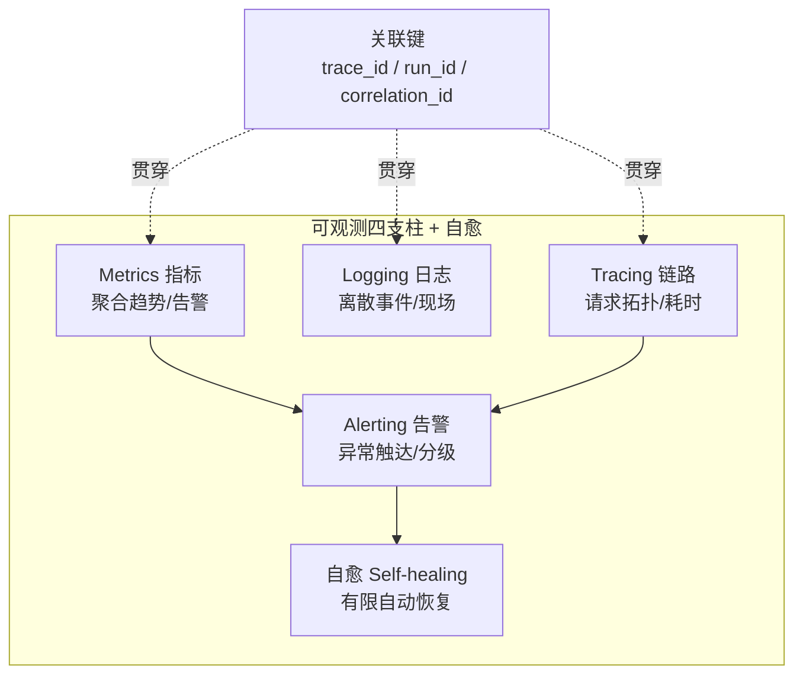
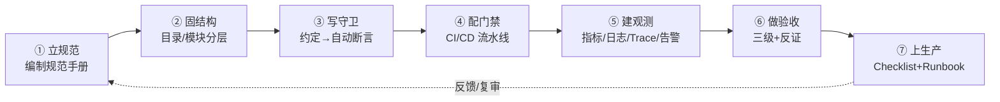
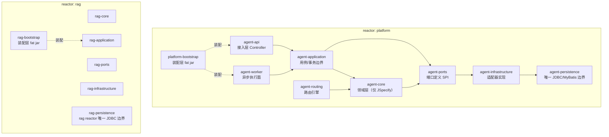
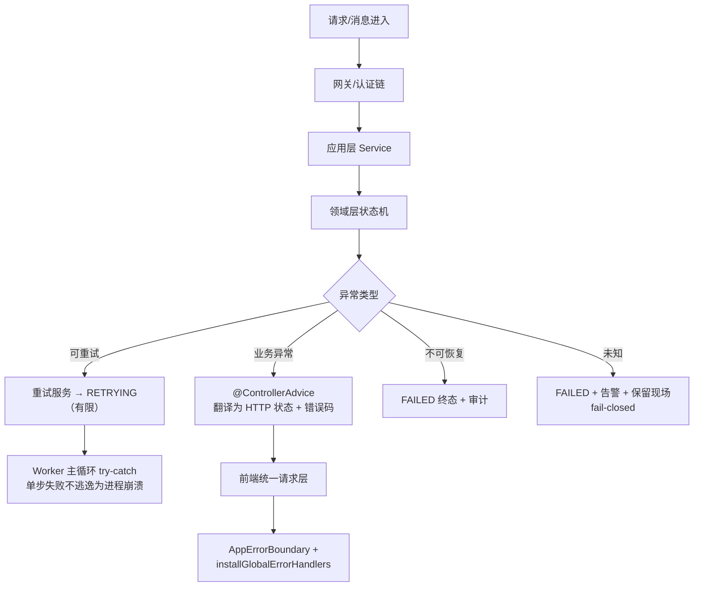
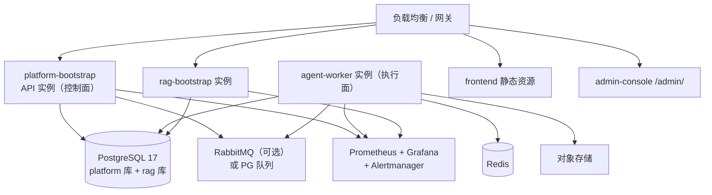
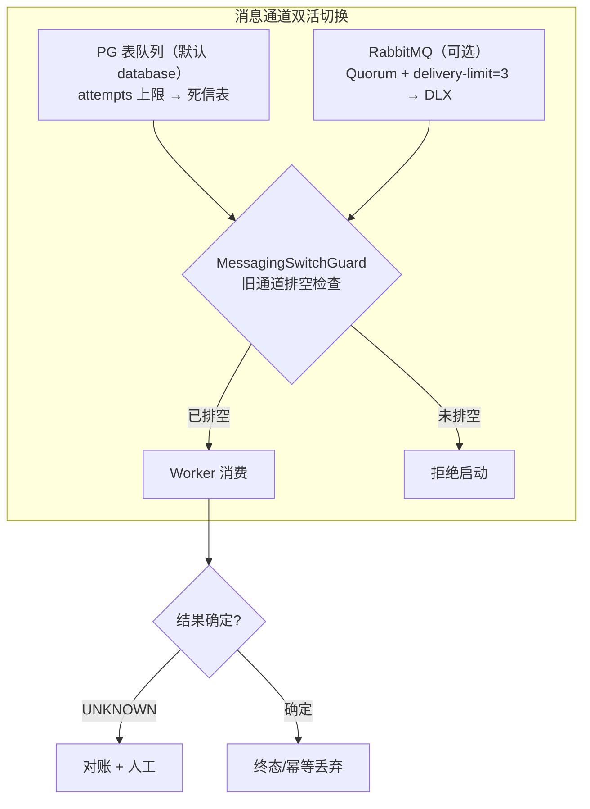
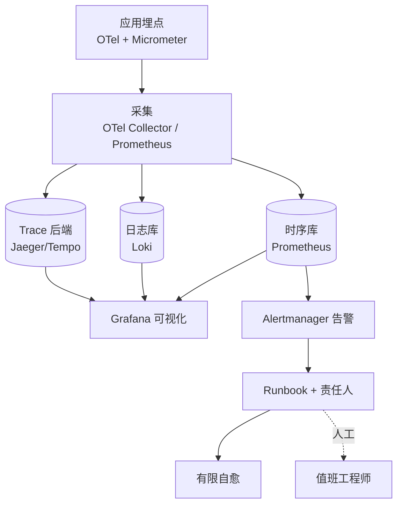
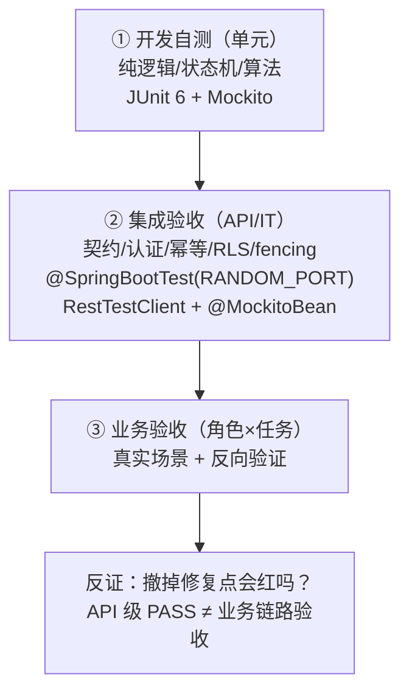
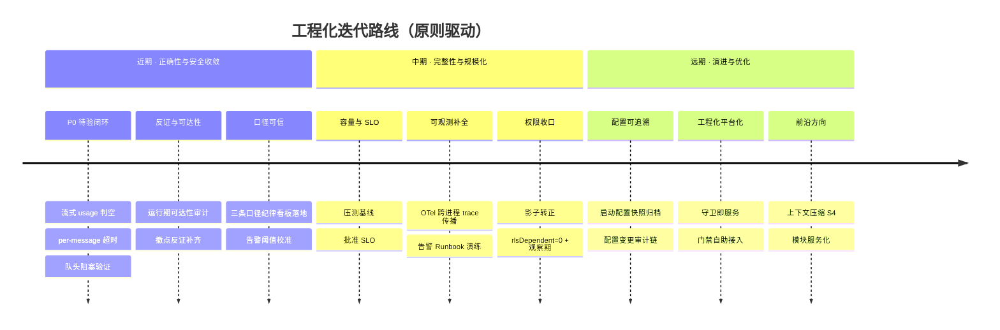

# 企业级 Java 工程化规范、质量守卫与可观测体系专题白皮书

> **文档编号**：专题 6（THESIS-06）
> **版本**：v1.0
> **成文日期**：2026-11-23
> **文档定位**：独立成文的企业级工程化专题技术白皮书，不依赖主文档即可完整阅读
> **适用对象**：架构师、技术负责人、后端/前端工程师、QA、SRE/运维、安全合规负责人
> **事实基线**：`docs/01_baseline/architecture/系统架构设计思路与企业级工程化实践.md`（第 2 章守卫与不可妥协十条原则、第 6 章 6.2～6.12、第 7 章）；`问题记录/`（04 安全与合规、05 API 契约与错误语义、06 前端缺陷、07 测试基建与验证方法论、12 工程环境与运维、静态代码扫描 P0P1 整改报告与 SonarQube/SpotBugs 报告）；项目根 `pom.xml`、`platform/pom.xml`、`monitoring/`、`deploy/`。
> **免责与口径声明**：本文所有"本项目"事实均取自上述基线，版本号、阈值、错误码为写作时点快照；实施前须核对最新基线。凡基线未明确的实现细节，本文以"推荐范式"标注，不作为既成事实。

---

## 目录

- [一、章节背景与复杂度分析](#一章节背景与复杂度分析含项目背景速览)
  - [1.0 项目背景速览（自包含）](#10-项目背景速览自包含)
  - [1.1 为什么需要独立的工程化专题](#11-为什么需要独立的工程化专题)
  - [1.2 复杂度来源的七个维度](#12-复杂度来源的七个维度)
  - [1.3 工程化的目标函数与约束](#13-工程化的目标函数与约束)
  - [1.4 本专题的阅读地图](#14-本专题的阅读地图)
- [二、通用行业标准方法论（可复用）](#二通用行业标准方法论可复用)
  - [2.1 规范落地的三层手段：文档→结构→守卫](#21-规范落地的三层手段文档结构守卫)
  - [2.2 质量守卫的设计理论](#22-质量守卫的设计理论)
  - [2.3 可观测性的方法论基础](#23-可观测性的方法论基础)
  - [2.4 异常与错误语义的工程化方法论](#24-异常与错误语义的工程化方法论)
  - [2.5 配置治理的方法论](#25-配置治理的方法论)
  - [2.6 验收与反证的方法论](#26-验收与反证的方法论)
- [三、企业级落地流程、清单、模板、规范](#三企业级落地流程清单模板规范)
  - [3.1 落地总流程（七阶段）](#31-落地总流程七阶段)
  - [3.2 规范手册的编制模板](#32-规范手册的编制模板)
  - [3.3 代码审查清单模板](#33-代码审查清单模板)
  - [3.4 质量门禁配置模板](#34-质量门禁配置模板)
  - [3.5 上线 Checklist 模板](#35-上线-checklist-模板)
  - [3.6 治理闭环与责任矩阵](#36-治理闭环与责任矩阵)
- [四、本项目全量落地细节、真实决策、历史上下文](#四本项目全量落地细节真实决策历史上下文)
  - [4.1 工程化内容 ①：目录结构、代码分层、包职责、命名与代码禁则](#41-工程化内容-目录结构代码分层包职责命名与代码禁则)
  - [4.2 工程化内容 ②：统一异常体系](#42-工程化内容-统一异常体系)
  - [4.3 工程化内容 ③：日志体系](#43-工程化内容-日志体系)
  - [4.4 工程化内容 ④：配置中心](#44-工程化内容-配置中心)
  - [4.5 工程化内容 ⑤：CI/CD 流水线、静态检查与自动化守卫](#45-工程化内容- cicd-流水线静态检查与自动化守卫)
  - [4.6 工程化内容 ⑥：部署架构](#46-工程化内容-部署架构)
  - [4.7 工程化内容 ⑦：容灾体系](#47-工程化内容-容灾体系)
  - [4.8 工程化内容 ⑧：完整可观测体系](#48-工程化内容-完整可观测体系)
  - [4.9 工程化内容 ⑨：三级验收体系与反证测试规范](#49-工程化内容-三级验收体系与反证测试规范)
- [五、深度问题剖析、踩坑复盘、边界风险](#五深度问题剖析踩坑复盘边界风险)
- [六、最佳实践固化、可复用范式沉淀](#六最佳实践固化可复用范式沉淀)
- [七、未来迭代优化路线](#七未来迭代优化路线)
- [附录 A：全套工程化规范手册](#附录-a全套工程化规范手册)
- [附录 B：代码审查清单](#附录-b代码审查清单)
- [附录 C：生产上线 Checklist](#附录-c生产上线-checklist)
- [结尾声明](#结尾声明)

---

## 一、章节背景与复杂度分析（含"项目背景速览"）

### 1.0 项目背景速览（自包含）

本节使本文完全自包含——读者无需阅读主文档即可理解后续所有工程化决策的来龙去脉。

**产品定位**：本项目是一个面向 K12 未成年学生的**多租户 SaaS Agent 平台**。平台让租户（学校/教育机构）在受控范围内使用 AI Agent 完成"错题归因与个性化辅导"等业务场景。由于服务对象包含未成年人，平台受《个人信息保护法》（PIPL）严格约束，未成年人个人数据（如 `STUDENT_ID`、姓名、学校、班级）是最高级别的合规红线——这一约束贯穿了本文后续的日志脱敏、敏感词扫描、审计豁免、错误码设计等每一个工程化环节。

**技术栈基线**（写作时点快照）：

| 维度 | 选型 | 工程化含义 |
|:---|:---|:---|
| 语言/运行时 | Java 21（虚拟线程） | 虚拟线程不传播普通 `ThreadLocal`/MDC，上下文须用 `InheritableThreadLocal` 或显式 DTO |
| 应用框架 | Spring Boot 4.1.1 / Spring 7 | Boot 版本偏离基线须 ADR 记录；`-proc:full` 恢复隐式注解处理器发现以免 Lombok 失效 |
| 数据库 | PostgreSQL 17 | 唯一权威事实源；启用 FORCE RLS，基于 GUC `app.tenant_id` 做行级隔离 |
| 消息 | RabbitMQ 4.3.6（可选）+ PG 表队列（默认 `database`） | MQ 只是"唤醒信号"，不是事实源；双通道可运行时切换 |
| 包根 | `cn.studykid.multiagent` | 所有模块的包命名空间；分层守卫据此扫描 |
| 构建 | Maven 多模块，双 reactor（`platform` + `rag`） | 每个 reactor 各自一个 `persistence` 模块 |

**架构骨架**：

1. **双 reactor**：`platform`（控制面 + 执行面）与 `rag`（检索增强）各自独立构建。每个 reactor 各有一个 `persistence` 模块，是唯一允许出现 JDBC/MyBatis 访问的地方。
2. **PG 唯一事实源 + Outbox + PG 表队列 + Worker**：Run 状态、事件、Outbox、ToolOperation、Approval、Usage 的唯一事实源是 PostgreSQL。Run 创建时 `run` + `run_event` + 幂等记录 + `outbox_event` 四元素同事务提交。MQ 消息只是唤醒信号，Worker 收到后按 `runId` 回库读取权威状态。默认消息通道是 PG 表队列（`agent.messaging.mode=database`），可零 broker 运行。
3. **安全纵深**：多租户 RLS（数据库连接用 `app_agent`，NOBYPASSRLS）+ 执行时授权（每次工具调用前重新鉴权，防 TOCTOU）+ 唯一工具闸门（`ToolInvocationGate` 15 步准入）+ 未成年人数据白名单 + fail-closed。审计清理用独立角色 `agent_retention` 分离凭据（删除凭证即销毁证据链，连它也不放行业务库）。
4. **双套 JWT 密钥**：平台 JWT 用 `PLATFORM_JWT_PRIVATE_KEY`，租户域 JWT 用 `JWT_PRIVATE_KEY`。二者严格分离，防止身份域串味（历史踩坑：指纹错配导致管理面全部 401）。
5. **对话审计插件**：两段收敛——`finish()` + `seal()` 都到齐才落库，避免短流写出残缺记录；作用域通过 `InheritableThreadLocal` 跨线程传播；平台域无租户时用 nil UUID（全零 UUID）而非 NULL。
6. **前端错误隔离三件套**：顶层 `AppErrorBoundary`（兜底用 `window.location.assign` 整页跳转，避开已坏的 Router）、`main.tsx` 调 `installGlobalErrorHandlers()` 订阅 `onerror`/`unhandledrejection`、写操作前 `window.confirm` 保护。
7. **可观测栈**：OpenTelemetry（Trace）+ Micrometer/Prometheus（指标）+ Grafana（可视化）+ Alertmanager（告警），指标族含 `ai.model.*`、`cap.enforcement_status`。
8. **三条指标口径纪律**：未采集 ≠ 0；覆盖率必须带样本量；"链路成功" ≠ "任务成功"——防止可观测性本身制造虚假安全感。

**不可妥协的十条原则**（评审时的最终裁决依据）：模型只提建议；可信上下文服务端构造；PG 是权威事实源；Run 与 Outbox 同事务；单调递增 fencing；副作用工具须可幂等/对账；发布后快照不可变 + 每次执行重授权；预算服务端强制；外部输入不可信；先单 Agent 闭环。原则冲突时的裁决优先级为：**安全/合规 > 一致性/正确性 > 可恢复性 > 可用性 > 性能 > 开发效率**。

### 1.1 为什么需要独立的工程化专题

架构设计解决"系统应该长什么样"，而工程化解决"如何让系统在日复一日的编码、构建、部署、运维中不长歪"。主文档第 6 章给出了工程化落地的骨架，但作为"设计思路与方法论"文档，它必须克制细节。本专题的定位是把骨架**展开为可直接执行的手册**：每一条规范配"是什么 / 为什么 / 怎么做 / 怎么验 / 禁止什么"，每一项工程化内容配真实决策、历史上下文与审查点。

工程化失败往往不是"不知道该怎么做"，而是"知道了但没坚持"。项目真实历史中曾出现这样的最坏失效形态：**14 个 IT 类因未配置 failsafe 在 `mvn verify` 中一条都没执行，构建仍 BUILD SUCCESS**——不是测试红了，而是测试从未运行。这类"假绿"正是工程化专题要根除的对象。因此本文反复强调两个词：**反证**（撤掉修复点会红吗？）与**可达性**（写了、有类、有测，是否真被装配、被写入、被触发告警？）。

### 1.2 复杂度来源的七个维度

企业级 Java 工程化的复杂度并非来自单点技术难度，而是来自七个维度的叠加与相互作用：

| 维度 | 复杂度来源 | 本项目的具体表现 |
|:---|:---|:---|
| ① 多租户与合规 | 数据隔离 + PIPL 未成年人数据 + 审计不可抵赖 | RLS 谓词位置守卫、STUDENT_ID 扫描、nil UUID、审计删除凭据隔离 |
| ② 一致性 | 状态、预算、事件、Outbox 的原子性 | 四元素同事务、原子预算预留、fencing 世代、UNKNOWN 对账 |
| ③ 并发与异步 | 虚拟线程 + MQ + Worker 集群 | ThreadLocal 不传播、消息重复/乱序、租约接管、脑裂 |
| ④ 配置与发布 | 多环境 + 灰度 + 动态 + 快照 | fail-closed、快照隔离、租户级灰度、审批策略降级须走范围变更 |
| ⑤ 可观测 | 三位一体 + 关联 + 脱敏 + 口径 | trace/run/correlation ID 贯穿、敏感词豁免键、三条口径纪律、OTel 跨进程缺口 |
| ⑥ 前后端一体 | 前端错误隔离 + 401 语义分流 | AppErrorBoundary + installGlobalErrorHandlers + confirm、401 三类语义 |
| ⑦ 工具与流水线 | 静态扫描 + 守卫 + 门禁 | 剥注释保留字符串、DDL 计数口径、S2789/S6218 处理纪律、skip=0 检查 |

这些维度彼此耦合：例如"配置灰度"会放大"数据隔离"的风险（租户级覆盖若解析错误，可能让 A 租户用上 B 租户的审批策略）；"可观测脱敏"与"审计不可抵赖"存在张力（脱敏过度会让审计失去证据价值）。工程化的价值，正是在这些张力之间建立**可被自动验证的秩序**。

### 1.3 工程化的目标函数与约束

本文将工程化的目标函数形式化为：

```
最大化  Correctness（行为正确） × Observability（可观测） × Recoverability（可恢复）
约束于  Compliance（PIPL/审计） ∧ Determinism（故障行为确定） ∧ Cost（团队可负担）
手段    让正确的做法成为默认的、低成本的、自动的
```

其中三条关键约束的含义：

- **Compliance 是硬约束**：涉及未成年人数据的任何工程化设计，若不满足白名单、脱敏、审计不可抵赖，一律否决，不参与"权衡"。
- **Determinism 是可靠性前提**：故障时行为确定（fail-closed、明确终态、不伪装临时故障）比"永不宕机"更重要。
- **Cost 是落地可行性**：小团队无专职 SRE，守卫与门禁必须自动化、低维护成本，否则会因维护负担被绕过。

### 1.4 本专题的阅读地图

- 想理解**方法论与通用范式** → 读第二章。
- 想直接落地**流程与模板** → 读第三章与附录 A/B/C。
- 想知道**本项目每一条规范的具体决策与历史** → 读第四章（9 项工程化内容，逐项含规范表/清单/样例/禁则/审查点）。
- 想理解**踩过的坑与边界风险** → 读第五章。
- 想沉淀**可复用范式** → 读第六章。
- 想规划**未来演进** → 读第七章。

---

## 二、通用行业标准方法论（可复用）

本章提炼可跨项目复用的工程化方法论，不绑定本项目细节；本项目的具体落地在第四章。

### 2.1 规范落地的三层手段：文档→结构→守卫

规范落地有三种手段，约束力由弱到强：

| 手段 | 约束力 | 失效模式 | 适用边界 |
|:---|:---|:---|:---|
| 文档约定 | 弱（靠人记） | 人员流动、记忆衰减、版本漂移 | 原则性、难以结构化的约定 |
| 目录/模块结构 | 中（结构性暗示） | 可通过 import 绕过 | 可以物理隔离的访问边界 |
| 编译期/静态守卫 | 强（自动拒绝） | 守卫本身写错、无判别力 | 可被静态判定的约定 |

**核心洞察**：规范不是写在文档里就生效，而是**约束力越强越可靠**。工程化的投资优先级应当是"优先投资强约束"——能把约定写成守卫的，绝不停留在文档。但强约束成本更高，因此需要分层：原则性约定用文档，结构性边界用目录，可机械判定的约定用守卫。

一个成熟工程体系的演进路径通常是：

1. 一开始只有文档（"我们应该这样做"）；
2. 出现第一次违规后，把边界固化到目录结构（"想违规都找不到路径"）；
3. 出现第二次违规后，把约定写成静态守卫（"违规即构建失败"）；
4. 发现守卫本身失真后，补上反证测试（"确认守卫真有判别力"）。

### 2.2 质量守卫的设计理论

守卫（Guard）本质上是一个**把架构约定表达为可执行断言**的测试。其设计遵循四条原则与一条验收纪律。

**四原则**：

1. **确定性**：不依赖随机数据。若某问题只在含 8+ 连续数字 UUID 时复现，守卫必须构造固定 UUID，而非随机生成。
2. **剥噪**：静态源码扫描要剥注释、保留字符串，避免"修复说明里的示例代码"造成恒定假红。
3. **可判定**：断言结论明确（红/绿），禁止"可能/通常/大概率"等模糊表述。
4. **可维护**：白名单与期望值集中管理，新增元素须同步登记（如某上下文文件白名单从 9 增至 12，须同时更新 ALLOWED 与 REQUIRED 并补台账）。

**反证验收纪律**：每写一个守卫，必须问自己"撤掉修复点会红吗？"——如果不会，守卫无判别力，等于没写。反证是守卫的"单元测试"。

**守卫类型与反证方法对照表**：

| 守卫类型 | 实现要点 | 反证验收方法 |
|:---|:---|:---|
| 依赖方向守卫 | 解析 import/模块依赖图，禁止反向边 | 故意加一条反向 import，构建应红 |
| 领域纯净守卫 | 扫描领域层编译期依赖白名单 | 故意 import 框架类，测试应红 |
| SQL 谓词位置守卫 | 解析 JOIN 的 ON 子句是否含 tenant_id | 把谓词移到 WHERE，测试应红 |
| 配置 fail-closed 守卫 | 断言缺失/非法配置抛异常 | 删配置项，测试应红 |
| DDL 计数守卫 | 只校验口径明确的表/RLS/策略数 | 加一张表但不更新期望值，测试应红 |
| 白名单完整性守卫 | 新增文件须同时登记 ALLOWED 与 REQUIRED | 新增文件不登记，测试应红 |

### 2.3 可观测性的方法论基础

可观测性由四个支柱构成，外加第五个能力：



**关联是可观测的灵魂**：日志、指标、Trace 若不能通过统一关联键串起来，就只是三座数据孤岛。可排查性标准是：任意一条 ERROR 日志，应能在 1 分钟内通过 trace_id 串起"请求→Run→步骤→工具调用→外部响应"的完整链路。

**三条口径纪律**（防止可观测性制造虚假安全感）：

1. **未采集 ≠ 0**：指标缺失只能说明"没上报"，不能说明"没发生"。
2. **覆盖率必须带样本量**：说"覆盖率 99%"时必须同时给出分母（多少样本），否则无意义。
3. **链路成功 ≠ 任务成功**：HTTP 200 只说明请求链路完成，不代表业务目标达成。

**低基数原则**：指标标签禁止使用高基数敏感字段（如 student_id、run_id），否则既撑爆时序库又泄漏 PII。

### 2.4 异常与错误语义的工程化方法论

异常体系工程化的目标是**稳定分类 + 明确语义 + 不误导**。

- **稳定分类**：每类异常有稳定的错误码与语义，前端可以依赖它做分支。错误码形如 `{DOMAIN}_{ERROR_TYPE}`，见码知因、分层归属、稳定不变。
- **明确终态语义**：404/403/401/状态冲突/预算不足是**终态**，必须明确告知，禁止伪装成"正在处理/网络问题/稍后再试"，否则前端反复重试、用户被误导。
- **不误导**：UNKNOWN 表示"外部结果不确定"，必须进对账，禁止盲目重试或直接释放预算。
- **跨端一致**：前后端对同一错误码的理解必须一致；前端对 401 至少区分"未登录""跨身份域""配置/验签失败"三类，不能一律清会话跳登录。

**异常分级**：业务异常（可预期，终态，不重试）、可重试异常（下游超时/限流，有限次数）、不可恢复异常（数据损坏/不变量违反，终态+审计）、未知异常（fail-closed，FAILED+告警+保留现场）。

### 2.5 配置治理的方法论

配置治理有三原则：**fail-closed、集中化、快照隔离**。

- **fail-closed**：配置缺失/非法一律拒绝启动或拒绝执行，绝不"静默放行"。理由是避免"悄悄用了没审过的配置"——这在安全与合规场景下等同于后门。
- **集中化**：版本集中锁定（父 POM `dependencyManagement`），配置项有明确默认值与边界，禁止散落的 `System.getProperty` 与硬编码 `if(true)`。
- **快照隔离**：成本上限、并发上限、审批策略在 Run 创建时写入不可变快照，运行中改配置只影响新 Run。这既保证可解释性，也使灰度成为可能。

**警惕配置成为后门**：配置灵活性必须受控。"把审批策略从 REQUIRED 调为非 REQUIRED"属于安全门禁降级，不能当作普通配置改动——必须走范围变更模板 + 外部抽检。这是配置治理中最容易被忽视的治理风险。

**动态配置的二分**：区分"可热更"与"须快照"两类。消息通道可运行时切换；成本/并发/审批策略须快照。二者的混淆会导致"配置改了但不生效"（字段存在但无判定逻辑）或"配置改了立刻影响在途 Run"（破坏可解释性）。

### 2.6 验收与反证的方法论

验收采用**三级 + 反证**结构：

1. **第一级 开发自测（单元）**：纯逻辑、状态机、算法，无外部依赖。
2. **第二级 集成验收（API/IT）**：`@SpringBootTest` + `RestTestClient` 做契约与认证；failsafe + 真库做事务/RLS/幂等/fencing。
3. **第三级 业务验收（角色×任务）**：真实场景 + 反向验证，覆盖跨模块业务链路。

**反证纪律**：API 级 PASS ≠ 业务链路验收。每项安全/一致性改动必须配反证用例——"撤掉修复点会红吗？"

**假绿防范**：

- 必断言 `skipped=0`，杜绝"测试从未运行"的假绿；
- 用例数按 XML `<testcase>` 计，不信控制台摘要；
- IT 用环境变量守门：无库时**跳过**（不是失败），有库时**必须真跑**且跳过数如实记录；
- 撤点/恢复后必须 `touch` 源码 + `mvn clean install`——文件系统的 clone 保留 mtime，恢复的源码比 `target/classes` 旧会跳过编译，导致"改了没用"的假结论。

---

## 三、企业级落地流程、清单、模板、规范

本章给出可直接套用的落地流程与模板。模板的通用结构是"填写说明 + 样例 + 禁止项"，附录 A/B/C 给出本项目填好的成品。

### 3.1 落地总流程（七阶段）



每个阶段的退出条件（Exit Criteria）：

| 阶段 | 关键动作 | 退出条件 |
|:---|:---|:---|
| ① 立规范 | 编写规范手册、命名约定、禁则清单 | 规范评审通过，责任人与复审触发明确 |
| ② 固结构 | 建立模块/包结构、依赖方向 | 目录结构落地，反向依赖被结构阻断 |
| ③ 写守卫 | 把可判定约定写成静态测试 | 守卫全绿且逐条通过反证验证 |
| ④ 配门禁 | 编译/静态分析/单测/守卫/IT/E2E 进流水线 | 门禁失败能阻断合并与发布 |
| ⑤ 建观测 | 埋点、关联键、脱敏、告警、Runbook | 任意 ERROR 可 1 分钟串链，告警有责任人 |
| ⑥ 做验收 | 三级验收 + 反证 + skip=0 检查 | 三级全绿，安全/一致性项有反证 |
| ⑦ 上生产 | Checklist、灰度、回滚预案 | Checklist 全签，回滚演练通过 |

### 3.2 规范手册的编制模板

一份可执行的规范手册，每条规范应包含六个字段：

| 字段 | 内容要求 | 反例（禁止） |
|:---|:---|:---|
| 编号 | 全局唯一，如 `R-STRUCT-01` | 无编号、重复编号 |
| 规范陈述 | 一句话可判定陈述（"必须/禁止"） | "建议尽量""一般应该" |
| 适用范围 | 明确到模块/层/场景 | "全项目"（过于宽泛） |
| 理由 | 说明防范的风险 | "因为规范这么写的" |
| 校验方式 | 人工审查 or 哪个守卫/门禁 | 无校验方式 |
| 反证/例外 | 撤点验证方法或例外审批路径 | 无例外治理 |

### 3.3 代码审查清单模板

代码审查清单应按"变更类型 → 检查项"组织，避免一张巨型清单无人能完整执行：

- **通用项**：是否违反禁则清单？是否有"写了没接线"的可达性问题？
- **安全/一致性项**：是否有反证用例？终态/权限错误是否被伪装成临时故障？
- **配置/DDL 项**：是否 fail-closed、是否需快照隔离？是否同步种子/基线 YAML/init 脚本？
- **架构项**：是否触碰十条不可妥协原则的禁止场景？新增文件是否登记白名单守卫（ALLOWED + REQUIRED）？
- **可观测项**：新增 ERROR 是否带关联 ID、是否有告警责任人？

### 3.4 质量门禁配置模板

流水线的阶段与门禁模板：

| 阶段 | 执行内容 | 失败处理 |
|:---|:---|:---|
| 编译 | `mvn clean verify`（双 reactor 串行）、`-proc:full` | 编译失败阻断 |
| 静态分析 | SonarQube + SpotBugs（`target/spotbugsXml.xml`） | 新缺陷阻断；误报须 `@SuppressWarnings`/`@SuppressFBWarnings` + 注释说明 |
| 单元测试 | surefire（`*Test`） | 失败阻断 |
| 架构守卫 | 依赖方向/纯净性/谓词位置/配置 fail-closed | 失败阻断（约定被破坏） |
| 集成测试 | failsafe（`*IT`），IT 库守门 | 有库必真跑；`skipped>0` 需说明 |
| E2E | 前端真链路 | 阻断规模化发布门禁 |

### 3.5 上线 Checklist 模板

上线 Checklist 的三个必备部分：

1. **填写说明**：每个勾选项由谁填、何时填、依据是什么；"不适用"必须写理由。
2. **样例**：至少给出一个填好的示范条目，避免"无从下手"。
3. **禁止项**：禁止未做先勾、禁止"稍后补"无责任人、禁止跳过回滚演练。

### 3.6 治理闭环与责任矩阵

工程体系要"活"起来，需六件套治理闭环：决策留痕（DEC/ADR）、需求追踪（RTM）、静态守卫、反证纪律、诚实边界、复审触发。其执行节奏：

| 机制 | 执行流程 | 落地节奏 | 审查机制 |
|:---|:---|:---|:---|
| 决策留痕 | 变更提出→写 DEC/ADR→交叉审查→批准 | 重大决策即时 | 架构评审会；偏离基线须 ADR |
| 需求追踪 | 需求变更→更新 RTM 受影响行→验收后置 Done | 每迭代同步 | 评审抽查双向链 |
| 静态守卫 | 新增约定→写守卫→反证验证→纳入 CI | 随代码提交 | CI 强制，失败阻断 |
| 反证纪律 | 修复点→写反证用例→撤点验证会红 | 每个安全/一致性改动 | code review 逐条问 |
| 诚实边界 | 识别短板→登记专题→定规避方案 | 每阶段复盘 | 阶段门禁核对 |
| 复审触发 | 监控触发条件→重开决策→评估→更新 ADR | 按触发条件 | 季度架构复审会 |

> 以上三章为通用方法论与模板。第四章开始进入本项目的全量落地细节——这是本文最重头、最具工程深度的部分。

---

## 四、本项目全量落地细节、真实决策、历史上下文

本章逐项展开 9 项工程化内容。每一项都按统一结构组织：**规范表 → 清单 → 样例（代码/配置）→ 禁止项 → 审查点 → 历史上下文**。所有"本项目"事实来自基线；标注"推荐"的部分是可复用范式而非既成事实。

### 4.1 工程化内容 ①：目录结构、代码分层、包职责、命名与代码禁则

#### 4.1.1 双 reactor 与模块拓扑

本项目采用 Maven 多模块构建，分为两个 reactor：`platform` 与 `rag`，二者串行构建。每个 reactor **各自一个 `persistence` 模块**——这是 ADR-011 的核心约束：数据库访问只能在 persistence 模块，main 侧的 JDBC import 只许出现在 persistence。



**模块职责表**：

| 模块 | 职责 | 允许依赖 | 禁止依赖 |
|:---|:---|:---|:---|
| `agent-core` | 领域模型、状态机、值对象 | 仅 JSpecify + 端口 | Spring/MQ/DB 驱动/Web 框架 |
| `agent-ports` | 端口接口（SPI）定义 | 领域模型 | 任何具体实现 |
| `agent-application` | 用例服务、事务边界 | core/ports | API 层、persistence 实现类 |
| `agent-api` | Controller、DTO、认证接入 | application | persistence 内部实现类 |
| `agent-worker` | 异步执行循环 | application/core/ports | 把 MQ 消息体当权威状态 |
| `agent-routing` | 路由引擎 | 仅领域层 | application/infrastructure |
| `agent-infrastructure` | 端口适配器 | ports | 被 core 反向依赖 |
| `agent-persistence` | JDBC/MyBatis、SQL、RLS | 端口实现所需 | 被 core/api 直接穿透 |
| `platform-bootstrap` | 显式装配、启动守卫 | 各模块 | 承载业务逻辑 |
| `rag-persistence` | rag reactor 唯一 DB 边界 | rag 端口 | 被 rag-core 依赖 |

#### 4.1.2 模块内标准包结构

每个模块内部采用"领域 / 端口 / 应用 / 适配 / 配置"五段式包结构（可复用模板）：

```
agent-<module>/
├── src/main/java/cn/studykid/multiagent/<module>/
│   ├── <domain>/          # 领域模型、状态机、值对象（无框架依赖）
│   ├── port/              # 端口接口（SPI）定义
│   ├── application/       # 用例服务、事务边界（若本模块含应用层）
│   ├── adapter/           # 端口实现（外部系统/Gateway）
│   └── config/            # 显式配置装配（@Configuration）
├── src/main/resources/
│   └── application.yml    # 配置项：默认值 + 边界声明
└── src/test/...
    ├── <domain>/*Test.java       # 单元测试
    └── <domain>/*IT.java         # 集成测试（真库，failsafe 执行）
```

**命名规范**：

| 对象 | 规范 | 示例 |
|:---|:---|:---|
| 包名 | 全小写，`cn.studykid.multiagent.<模块>.<分层>` | `cn.studykid.multiagent.agent.core.run` |
| 类名 | 大驼峰，职责单一 | `RunCreationService`、`ToolInvocationGate` |
| 端口接口 | 能力语义命名，不带 impl | `ModelGateway`、`MessageSender`、`QueueDepthProbe` |
| 适配器实现 | 以技术后缀区分 | `RabbitMessageSender`、`DatabaseMessageSender` |
| 测试类 | `*Test` 单元、`*IT` 集成、`*GuardTest` 守卫 | `AgentCorePurityTest` |
| 配置项 | `agent.<域>.<项>` 前缀统一管理 | `agent.messaging.mode`、`agent.rag.min-score` |

#### 4.1.3 版本集中管理与编译参数（真实决策）

- **版本集中**：父 POM `dependencyManagement` 锁定所有版本，子模块禁止覆盖。锁定项包括 Boot 4.1.1、MyBatis-Plus 3.5.17、Druid 1.2.28、RE2/J 1.8。
- **编译参数**：`-parameters`（保留参数名，支撑反射与契约）、`-proc:full`（JDK 23+ 恢复隐式注解处理器发现，避免 Lombok 失效）。
- **注解与空值**：jspecify `@NonNull` 不可标全限定/嵌套类型（须先 import 用简单名）；领域层 `@NullMarked` 显式声明空值语义。
- **组件扫描**：组件扫描类若有 ≥2 个构造函数，必须 `@Autowired` 显式标注；多 Bean 注入点用 `@Qualifier`。这是"Spring 隐式行为破坏分层依赖"的常见暗门，已写入项目铁律。
- **静态守卫常量顺序**：静态守卫正则常量须声明在使用它的静态字段**之前**，否则读到默认 flag=0，大小写不敏感静默失效。

```xml
<!-- 父 pom.xml 关键片段（示意，事实来自基线） -->
<properties>
  <java.version>21</java.version>
  <spring-boot.version>4.1.1</spring-boot.version>
  <mybatis-plus.version>3.5.17</mybatis-plus.version>
  <druid.version>1.2.28</druid.version>
  <re2j.version>1.8</re2j.version>
</properties>
<compilerArgs>
  <arg>-parameters</arg>
  <arg>-proc:full</arg>
</compilerArgs>
```

#### 4.1.4 代码禁则清单（10 条禁止写法，评审逐条 Check）

这是本项目最核心的代码层禁则，源自主文档第 6.2 节：

| # | 禁止写法 | 正确做法 | 原因 |
|:--:|:---|:---|:---|
| 1 | controller 直接注入 Repository | 注入 application Service | 业务规则绕过应用层 |
| 2 | 领域层 import Spring/MQ/JDBC | 只依赖 JSpecify + 端口 | 领域纯净性（守卫判红） |
| 3 | `List.of(nullable)` | 逐参数绑定 + `setNull` | `List.of` 拒绝 null 元素，抛 NPE |
| 4 | 读完目标列后又读别的列再取 `wasNull()` | 读完立刻取 `wasNull()` | `wasNull()` 只反映最近一次读取的列 |
| 5 | `!node.isMissingNode()` 判 JSON 空 | `node.isObject()` 判空 | `"usage":null` 时 isMissingNode=false 但取到 0 |
| 6 | 事务内 SQL 失败后 fail-soft 继续 COMMIT | 连接标记 POISONED | 脏数据被提交 |
| 7 | 裸写 `set_config` 在业务 SQL 之后 | 事务内、业务 SQL 前 | FORCE RLS 静默 0 行 |
| 8 | 枚举用字符串裸拼 | `?::enum` 类型转换 | 类型错误 |
| 9 | 跨线程传 ThreadLocal 上下文 | `InheritableThreadLocal` 或显式 DTO | 虚拟线程不传播 |
| 10 | `Map.of` 超过 10 组 | `Map.ofEntries` | `Map.of` 上限 10 |

**补充踩坑沉淀**：

- `Map.of` 最多 10 组键值对，超了改 `Map.ofEntries`；
- record 加字段时必须逐字段带过兼容构造器的转换，否则静默清空（与静态扫描 `S6218` 处理相关，见 4.5、第五章）；
- 含环视的 PII 正则与 `OutputModeration` 只留 JDK `java.util.regex` 的替代方案——RE2/J 不支持环视，而用户输入的回溯正则有 ReDoS 风险（原则 9）。

#### 4.1.5 分层依赖禁止项（F-1～F-7）

| 编号 | 禁止项 | 检测手段 |
|:---|:---|:---|
| F-1 | `agent-core` 依赖 Spring/MQ/DB 驱动 | `AgentCorePurityTest` 编译期检查 |
| F-2 | `agent-api` 直接 import persistence 内部实现类 | `ModuleDependencyDirectionTest` |
| F-3 | controller 直接调 persistence | 代码评审 + 架构守卫 |
| F-4 | DB 访问出现在 persistence 之外 | 包级 import 扫描守卫 |
| F-5 | `agent-routing` 依赖 application/infrastructure | `ModuleDependencyDirectionTest` |
| F-6 | 全局 Agent 表租户读路径谓词放 WHERE 而非 ON | `JoinTenantPredicateArchitectureTest` |
| F-7 | 异步边界依赖 ThreadLocal 传上下文 | 代码评审 + 集成测试 |

> **F-6 的历史权重**：全局 Agent 表开了 FORCE RLS，租户读路径必须 JOIN 绑定表且 `tenant_id` 谓词在 ON 内；若误放 WHERE，RLS 语义会导致读不到数据或数据泄露。这是 `JoinTenantPredicateArchitectureTest` 只认 ON 内谓词的原因，也是不可妥协原则的直接体现。

#### 4.1.6 审查点（Review Checklist）

- [ ] 是否违反 10 条禁止写法（逐条 Check）？
- [ ] 是否触碰 F-1～F-7 分层依赖禁止项？
- [ ] main 侧 JDBC import 是否只出现在 persistence 模块？
- [ ] 每个 reactor 是否只有一个 persistence 模块，无新增 DB 访问点？
- [ ] 新增文件是否登记白名单守卫（ALLOWED + REQUIRED）？
- [ ] 组件扫描类 ≥2 构造函数是否 `@Autowired` 显式标注？多 Bean 是否 `@Qualifier`？
- [ ] `@NonNull` 是否用简单名（先 import）？领域层是否 `@NullMarked`？

---

### 4.2 工程化内容 ②：统一异常体系

#### 4.2.1 异常分级规范

| 级别 | 定义 | 处理方式 | 是否重试 |
|:---|:---|:---|:---|
| 业务异常（可预期） | 参数错、权限不足、状态冲突、预算不足 | 稳定错误码 + 明确提示 | 否（终态） |
| 可重试异常 | 下游超时、限流、临时不可用 | 错误分类 → RETRYING，有限次数 | 是（有限） |
| 不可恢复异常 | 数据损坏、不变量违反 | FAILED 终态 + 审计 | 否 |
| 未知异常 | 未分类异常 | FAILED + 告警 + 保留现场 | 否（fail-closed） |

#### 4.2.2 异常码规范（稳定分类）

错误码形如 `{DOMAIN}_{ERROR_TYPE}`，本项目实例：`RUN_STATE_CONFLICT`、`AGENT_UNAUTHORIZED`、`BUDGET_EXCEEDED`、`TOOL_UNKNOWN_RESULT`。三条原则：

1. **稳定不变**：前端可依赖其做分支，一旦发布不得随意更改语义；
2. **语义明确**：见码知因；
3. **分层归属**：领域/应用/接入各域前缀分明。

**稳定错误分类**：参数校验失败、认证失败、授权失败、资源不存在、状态冲突、限流、下游不可用——每类有稳定错误码与语义。

#### 4.2.3 全局捕获规则



- **后端**：`@ControllerAdvice` 统一把领域异常翻译为 HTTP 状态 + 错误码；Worker 侧主循环 `try-catch` 保证单步失败不逃逸为进程崩溃。
- **前端**：顶层 `AppErrorBoundary` + `installGlobalErrorHandlers()` 双保险；兜底 `window.location.assign` 整页跳转，避开已坏的 Router。

```java
// @ControllerAdvice 统一翻译（示意）
@RestControllerAdvice
public class GlobalExceptionHandler {
    @ExceptionHandler(RunStateConflictException.class)
    public ResponseEntity<ErrorResponse> onStateConflict(RunStateConflictException ex) {
        // 终态语义：明确返回 409 + 稳定错误码，禁止伪装"稍后重试"
        return ResponseEntity.status(HttpStatus.CONFLICT)
            .body(ErrorResponse.of("RUN_STATE_CONFLICT", ex.getMessage()));
    }

    @ExceptionHandler(BudgetExceededException.class)
    public ResponseEntity<ErrorResponse> onBudget(BudgetExceededException ex) {
        return ResponseEntity.status(HttpStatus.PAYMENT_REQUIRED)
            .body(ErrorResponse.of("BUDGET_EXCEEDED", ex.getMessage()));
    }

    @ExceptionHandler(Exception.class)
    public ResponseEntity<ErrorResponse> onUnknown(Exception ex) {
        // fail-closed：未知异常 FAILED + 告警 + 保留现场
        log.error("UNKNOWN_EXCEPTION error_code=UNKNOWN trace_id={}", Mdc.get("trace_id"), ex);
        return ResponseEntity.status(HttpStatus.INTERNAL_SERVER_ERROR)
            .body(ErrorResponse.of("UNKNOWN", "系统内部错误"));
    }
}
```

#### 4.2.4 异常处理铁律

| 场景 | 正确处理 | 错误做法（禁止） |
|:---|:---|:---|
| 终态/权限错误 | 显式终态 + 停轮询 + 不给重试 | 伪装成"正在处理/网络问题/稍后再试" |
| 404/403/401 | 明确终态语义 | 当作临时故障让前端反复重试 |
| MQ 重复/延迟/乱序 | 消费端幂等 + 回读 DB | 相信消息体状态 |
| UNKNOWN | 进对账 + 人工处置 | 盲目重放或释放预算 |
| 事务内 SQL 失败 | 连接标记 POISONED，禁止 fail-soft 后 COMMIT | 吞异常继续提交 |
| 前端渲染异常 | 顶层 `AppErrorBoundary` + 全局 handler | 白屏 |

#### 4.2.5 前端错误隔离三件套（工程化延伸到前端）

这是本项目前端工程化的标志性实践，源自 `问题记录/06-前端缺陷.md` 的真实踩坑：

1. **顶层 `AppErrorBoundary`**：兜底用 `window.location.assign` 整页跳转，避开已坏的 Router（历史坑：admin-console `router.tsx` 无 `path="*"` 兜底路由 → 输错 URL 白屏，FE-13）。
2. **`main.tsx` 调 `installGlobalErrorHandlers()`**：订阅 `onerror` / `unhandledrejection`，兜住异步与资源加载异常。
3. **写操作改值前 `window.confirm`**：防止误操作（如清空操作加确认提示）。

配套纪律：

- 翻页失败只记独立 `loadMoreError`，不写全局 `error`；多视图切换前清空局部 error；
- `Object.entries` 入参先判非 null/非数组/`typeof === object`；
- 路由守卫回跳 `state.from` 须 `pathname + search`（不能只取 pathname，否则丢失查询参数）；
- **401 三类语义分流**（API-06/FE-01/FE-28）：401 至少表示"未登录""跨身份域""配置/验签失败"三类，不能一律清会话跳登录。`ACCESS_DENIED` 与跨域 401 绝不跳登录，交页面提示或渲染无权限整页；登录端点 401 表示凭据错误，须单独处理；仅在"本地会话确实已过期"时才清会话跳登录。新端点必须复用统一请求层 `client.ts`——FE-28 正是因 `chatStreamPost` 写独立 401 分支绕过统一层，导致有效会话被误清。

```tsx
// 前端错误隔离三件套（示意）
// main.tsx
import { installGlobalErrorHandlers } from './errorHandlers';
installGlobalErrorHandlers(); // 订阅 onerror / unhandledrejection

// AppErrorBoundary.tsx 兜底
componentDidCatch(error) {
  // Router 已坏时不能用 navigate，整页跳转避开
  window.location.assign('/error?reason=render');
}

// 写操作 confirm 保护
const onClear = () => {
  if (window.confirm('确认清空？此操作不可撤销')) doClear();
};
```

#### 4.2.6 业务兜底策略

| 场景 | 兜底 |
|:---|:---|
| 模型返回格式错误 | 解析失败 → FAILED 或重试（按错误分类），不编造结果 |
| 工具下游不可用 | UNKNOWN → 对账，不假设成功/失败 |
| 对象存储读取失败 | 返回明确错误，不返回空内容伪装成功 |
| 配置读取异常 | fail-closed 拒绝执行 |

#### 4.2.7 审查点

- [ ] 终态/权限错误是否被伪装成"网络问题/稍后再试"（命中即打回）？
- [ ] 401/403 是否有明确终态语义，前端是否按三类分流、复用统一请求层？
- [ ] UNKNOWN 是否进对账而非盲目重试/释放预算？
- [ ] `@ControllerAdvice` 是否覆盖所有异常域？错误码是否稳定、见码知因？
- [ ] 前端是否有 `AppErrorBoundary` + `installGlobalErrorHandlers` + `confirm` 三件套？
- [ ] Worker 主循环是否保证单步失败不逃逸为进程崩溃？

---

### 4.3 工程化内容 ③：日志体系

#### 4.3.1 日志分级规范

| 级别 | 使用场景 | 本项目示例 | 注意 |
|:---|:---|:---|:---|
| ERROR | 需要人工介入的失败 | UNKNOWN 进对账、死信产生、fencing 冲突 | 必须配告警责任人 |
| WARN | 可恢复异常/降级 | 消息通道切换 WARN、审批策略接近上限 | 不告警但可排查 |
| INFO | 关键业务节点 | Run 创建/终态、配置发布、审批决策 | 带 run_id/trace_id |
| DEBUG | 排查细节 | 闸门 15 步准入的中间判定 | 生产默认关闭 |

#### 4.3.2 结构化日志字段规范（必带字段）

| 字段 | 含义 | 必带场景 |
|:---|:---|:---|
| `trace_id` / `correlation_id` | 跨链路关联 | 所有 INFO 及以上 |
| `run_id` | Run 标识 | 执行链所有日志 |
| `tenant_id` | 租户标识（平台域用 nil UUID） | 所有租户上下文日志 |
| `actor_id` | 操作主体 | 审计相关 |
| `error_code` | 稳定错误码 | ERROR/WARN |
| `duration_ms` | 耗时 | 模型/工具调用 |

**可排查性标准**：任意一条 ERROR 日志，应能在 1 分钟内通过 trace_id 串起"请求→Run→步骤→工具调用→外部响应"的完整链路；缺少关联 ID 的 ERROR 视为不合格日志。

#### 4.3.3 上下文传播与对话审计作用域

- **结构化日志 + correlation/run/trace ID** 贯穿全链路。
- **对话审计作用域用 `InheritableThreadLocal` 传播**：虚拟线程下普通 `ThreadLocal`/MDC 都不传播，必须用 `InheritableThreadLocal` 或显式 DTO（对应禁则 #9）。
- **关联**：日志/Trace/指标通过 `run_id`、`trace_id`、correlation ID 关联。
- **保留分级**：Prompt/工具结果 90 天、审计 180 天、Trace/指标 30 天。

#### 4.3.4 脱敏规则（PIPL 红线）

三条脱敏规则：

1. **密钥、凭据、Token 绝不进 Prompt/消息/日志/Trace。**
2. **未成年人数据白名单**：仅白名单字段入日志，姓名/学校/班级禁入；`STUDENT_ID`（**8–12 位连续数字**）按 PII 扫描。
3. **结构性标识符豁免**：UUID、confidence 小数在敏感词扫描中豁免，避免误判；但豁免键限于 `VALUE_SCAN_EXEMPT_KEYS` 白名单——这是防止"豁免被滥用成后门"的关键约束。

**审计明细标识符的豁免键设计**：审计明细中用 `runId`/`operationId` 等豁免键承载结构性标识符，防 PIPL 误判；同时为做确定性反证，须在测试中固定包含 **8+ 连续数字的 UUID** 作为反证样本——即"若豁免逻辑失效，这条日志必须被扫描命中"。

```java
// 敏感词扫描豁免键（示意）
public static final Set<String> VALUE_SCAN_EXEMPT_KEYS = Set.of(
    "runId", "operationId", "traceId", "correlationId", "confidence"
);
// STUDENT_ID 8–12 位连续数字，必须扫描（不豁免）
private static final Pattern STUDENT_ID_PATTERN = Pattern.compile("\\d{8,12}");

// 确定性反证：固定含 8+ 连续数字的 UUID
String fixture = "1858c9e1-2026-1123-8abc-12345678abcd"; // 含连续数字段
assert-sensitive-scan-hits(fixture); // 撤掉豁免逻辑应命中
```

#### 4.3.5 对话审计插件：两段收敛 + nil UUID + 过滤器优先级

这是本项目日志/审计体系最具特色的工程实践：

- **两阶段收敛 `finish()` + `seal()`**：两段都到齐才落库，避免短流（如请求中断、超时）写出残缺审计记录。`finish()` 标记主体数据完成，`seal()` 封口确认；只到其一不落库。
- **`InheritableThreadLocal` 传作用域**：审计作用域跨虚拟线程传播。
- **nil UUID 平台域**：平台域无租户时用 nil UUID（全零 UUID）而非 NULL，保证 `tenant_id` 非空、便于聚合与反证（历史上下文：`问题记录/12-工程环境与运维.md` 中 `granted_by` 默认授权人 `e2eadmin` 在全新库不存在，已按 nil UUID 记账）。
- **过滤器优先级 `HIGHEST_PRECEDENCE + 2`**：审计过滤器必须早于安全链执行，才能记录 401（若在安全链之后，401 请求会被安全链短路，审计日志缺失）。

```java
// 对话审计两段收敛（示意）
@Component
public class ConversationAuditPlugin {
    private static final InheritableThreadLocal<AuditScope> SCOPE = new InheritableThreadLocal<>();

    public void finish(AuditRecord record) {
        SCOPE.get().markFinished(record);   // 第一段：主体完成
    }

    public void seal() {
        AuditScope scope = SCOPE.get();
        if (scope.isFinished() && !scope.isSealed()) {
            scope.seal();
            auditRepository.insert(scope.toRecord()); // 两段到齐才落库
        }
        SCOPE.remove();
    }
}

// 过滤器优先级 HIGHEST_PRECEDENCE + 2，早于安全链才能记录 401
@Order(Ordered.HIGHEST_PRECEDENCE + 2)
public class AuditFilter extends OncePerRequestFilter { /* ... */ }
```

#### 4.3.6 排查标准与审查点

**排查标准**：以 trace_id 为轴，Grafana/Loki/Jaeger 三处可交叉定位；ERROR 日志必带 error_code + 关联 ID + duration_ms（若涉及调用）。

- [ ] 每条 ERROR 是否带 trace_id / run_id / tenant_id / error_code？
- [ ] 是否有密钥/Token/PII（姓名/学校/班级/STUDENT_ID）泄漏入日志？
- [ ] 敏感词扫描是否保留 STUDENT_ID 8–12 位连续数字检测？豁免键是否限于 `VALUE_SCAN_EXEMPT_KEYS`？
- [ ] 审计是否两段收敛（finish + seal）？平台域是否用 nil UUID？
- [ ] 审计过滤器优先级是否 `HIGHEST_PRECEDENCE + 2`，早于安全链？
- [ ] 跨线程作用域是否用 `InheritableThreadLocal` 或显式 DTO？
- [ ] 新增 ERROR 是否配告警责任人（见 4.8）？

> 日志体系的三条口径纪律与 OTel 跨进程 trace 缺口，见 4.8 与第五章。

---

### 4.4 工程化内容 ④：配置中心

#### 4.4.1 配置三原则与四维度

**三原则**：fail-closed、集中化、快照隔离（详见 2.5）。

| 原则 | 本项目落地 |
|:---|:---|
| fail-closed | 配置缺失/非法 → 拒绝启动（`ConfigFailClosedTest` 19 项验证）；审批策略只能收紧不能放松，放松=安全门禁降级需走变更评审 |
| 集中化 | 版本集中锁定；`@ConfigurationProperties` 与 `@Value` 管理；配置项有明确默认值与边界 |
| 快照隔离 | 成本上限、并发上限、审批策略在 Run 创建时写入 `ExecutionSnapshot`；运行中改配置只影响新 Run |

**四维度细化**：

| 维度 | 机制 | 本项目落地 |
|:---|:---|:---|
| 多环境隔离 | 环境变量覆盖 + profile + `.env.example` 模板 | `platform.env.example`/`rag.env.example` 完整列出；敏感值仅存 `.env`（gitignore） |
| 动态配置 | 区分"可热更"与"须快照" | 消息通道可运行时切；成本/并发/审批策略在 Run 创建时快照 |
| 配置灰度 | 按租户覆盖 + 全局默认 | `agent.messaging.tenant-modes` 支持小客群灰度，回滚=改环境变量 |
| 配置校验 | 启动期 fail-closed + 一致性守卫 | `ConfigFailClosedTest`（19 项）；RAG 维度配置/库列一致性 fail-fast；时长类缺失/越界拒绝启动 |

#### 4.4.2 配置校验四条规则（启动期）

1. **存在性**：必填项缺失 → 拒绝启动（不回落默认值，避免"悄悄用了没审过的配置"）。
2. **合法性**：枚举值、数值边界、时长单位校验，非法拒绝。
3. **一致性**：跨项约束（如 RAG 配置维度 = 库列维度）不一致 fail-fast。
4. **归属**：租户级覆盖的 slug 不在本实例清单 → 启动日志点名告警（不静默忽略）。

#### 4.4.3 关键默认值（本项目）

消息通道 `mode=database`（默认，零 broker）；Worker 并发 4；租户并发 5；单 Run `max-cost=2.00` / `max-steps=20`；RAG `min-score=0.38`；留存 12 个月；十余项特性开关。

```yaml
# application.yml（关键默认值示意）
agent:
  messaging:
    mode: database                    # 默认 PG 表队列，零 broker
    tenant-modes:                     # 租户级灰度覆盖
      t-a: database
      t-b: rabbitmq
  worker:
    concurrency: 4
  tenant:
    concurrency: 5
  run:
    max-cost: 2.00
    max-steps: 20
  rag:
    min-score: 0.38
  retention:
    months: 12
```

#### 4.4.4 配置成后门风险（R-020）与 AgentOverrides 唯一权限解析

这是配置治理中最重要的安全决策：

> **配置成后门风险（R-020）**：配置灵活性必须受控——"审批策略从 REQUIRED 调为非 REQUIRED"属安全门禁降级，必须走范围变更模板 + 外部抽检（ISO-5）。

**AgentOverrides 唯一权限解析**：审批策略、能力覆盖等的解析必须收敛到唯一入口（`AgentOverrides`），禁止在业务代码里散落"读配置再判断"。唯一入口的价值：① 审计可定位（所有覆盖都经过它）；② fail-closed 可统一施加；③ 灰度可统一回滚。

**审批策略降级需走范围变更**：`ApprovalSource` 配置化（`none` / `policy-engine`），与 `live-source-enabled` 保持一致性的 fail-closed（新增 `ApprovalReadinessGuard` 等守卫）。把 REQUIRED 调为 OPTIONAL 等操作被视为安全门禁降级，必须：① 提范围变更单；② 外部抽检；③ 不得通过普通配置 PR 悄悄完成。

#### 4.4.5 动态配置、快照与灰度切换纪律

- **消息通道切换**：`agent.messaging.mode` 可运行时切换；切换前 `MessagingSwitchGuard` 检查旧通道排空，未排空拒绝启动。切换行为记 WARN。
- **fail-closed 的边界**：Broker/DB 不可达时——"通道在用但连不上"**拒绝启动**（否则消息永不消费）；"通道不在用（纯 DB）"**放行 + WARN**（消息仍在 broker 未丢，只是无人消费）。
- **快照隔离**：成本/并发/审批策略在 Run 创建时写入 `ExecutionSnapshot`，运行中改配置不改变在途 Run 的行为。历史坑（CFG-14）：`maxLlmCalls`/`maxCostPerRun` 字段存在于快照且有判定方法，但生产零调用——"字段存进快照 ≠ 字段生效"，须有可达性验证（见第五章）。

```java
// 配置 fail-closed 守卫（示意）
@Test
void missingRequiredConfigRejectsStartup() {
    // 反证：删除必填项，断言启动抛异常
    assertThrows(ConfigViolationException.class,
        () -> ConfigValidator.validate(Map.of() /* 缺失 agent.messaging.mode */));
}
```

#### 4.4.6 审查点

- [ ] 新增配置是否 fail-closed（缺失/非法拒绝启动）？
- [ ] 是否需快照隔离（成本/并发/审批策略）？判定方法是否真的被生产调用（可达性）？
- [ ] 配置降级（如审批策略放松）是否走了范围变更 + 外部抽检？
- [ ] AgentOverrides 是否仍是唯一权限解析入口，无散落读取？
- [ ] 租户级灰度 slug 是否在本实例清单内？回滚路径是否明确（改环境变量）？
- [ ] `.env.example` 是否同步新增项？敏感值是否只存 `.env`（gitignore）？

---

### 4.5 工程化内容 ⑤：CI/CD 流水线、静态检查、自动化守卫、门禁规则

#### 4.5.1 静态守卫体系（本项目最具特色）

把架构约定写成自动化测试，让违反约定在 CI 阶段就失败：

| 守卫 | 守护的约定 | 失败后果 |
|:---|:---|:---|
| `AgentCorePurityTest` | 领域层零框架依赖 | 编译期依赖混入框架即红 |
| `ModuleDependencyDirectionTest` | 模块依赖单向流动 | 反向/跨层依赖即红 |
| `JoinTenantPredicateArchitectureTest` | 读全局 Agent 表的租户路径必须 JOIN 绑定表且谓词在 ON 内 | 谓词放 WHERE 即红 |
| `ContextCompressionM6GuardTest` | 上下文状态文件白名单完整性 | 新增文件未登记即红 |
| `ConfigFailClosedTest` | 配置缺失/非法一律拒绝 | 静默放行即红 |
| DDL 计数守卫 | 表/RLS/策略基线数量 | 结构漂移即红 |
| `MessagingSwitchGuard` | 切换前旧通道排空 | 未排空拒绝启动 |
| `ApprovalReadinessGuard` | 审批源一致性 fail-closed | 不一致即红 |

**守卫设计三条经验**（源自主文档 6.3）：

1. **静态守卫要剥注释、保留字符串**（`stripCommentsKeepStrings`），否则修复说明里的示例代码造成恒定假红。
2. **DDL 计数守卫只校验口径明确项**，避免口径不清导致误报。
3. **守卫必须可被反证**：问自己"撤掉修复点会红吗？"——若不会，守卫无判别力，等于没写。

#### 4.5.2 静态扫描纪律：S2789 / S6218 处理（真实踩坑）

来自 `问题记录/静态代码扫描P0P1整改报告_2026-11-15.md` 与 `静态代码扫描报告_SonarQube_SpotBugs_2026-11-15.md`：

**S2789（Optional 的 null 检查）——两处均为误报，已回滚"清理"并显式豁免**：

| 文件 | 处理 | 理由 |
|:---|:---|:---|
| `RollingStateMerger.java:136` | 恢复 `extracted == null || extracted.isEmpty()`，加 `@SuppressWarnings("java:S2789")` + 契约注释 | `RollingStateMergerTest#extractorFailuresFailClosed` 明确要求"抽取器返回 null 一律回落，绝不伪造状态" |
| `ConsoleChatController.java:171` | 恢复 `consoleBudgetPort == null ? null : consoleBudgetPort.orElse(null)`，加 `@SuppressWarnings("java:S2789")` + 注释 | `ContextCompressionM9GuardTest#controllerSendsOnlyBudgetedRequestAndNeverFallsBack` 逐字断言该写法存在 |

反证证据：删掉判空 → 跑测试立即打红（NPE / 契约断言失败）⇒ 判空承重，恢复。复扫 S2789 由 2→0，且行为零变化。**纪律：当 lint 方向与验收契约冲突时，改验收契约去迁就 lint 是方向反了；应恢复承重代码并显式豁免。**

**S6218（含数组字段的 record 未重写 equals）——已修**：初版只补 `equals/hashCode` 未清零；S6218 的实际诉求是 `toString` 打印引用地址（`[B@1a2b3c`）而非内容，补按内容的 `toString()`（`Arrays.toString`）后才归零。纪律：与 record 加字段"逐字段带过兼容构造器"的踩坑结合——record 的相等性与字符串表示须按内容实现，否则静默清空/误判。

> 静态分析配置：SonarQube + SpotBugs，SpotBugs 结果输出到 `target/spotbugsXml.xml`。误报须 `@SuppressWarnings`/`@SuppressFBWarnings` + 注释说明，禁止裸删承重逻辑。

#### 4.5.3 CI 校验流水线（阶段与门禁）

| 阶段 | 执行内容 | 失败处理 |
|:---|:---|:---|
| 编译 | `mvn clean verify`（双 reactor 串行）、`-proc:full` | 编译失败阻断 |
| 静态分析 | SonarQube + SpotBugs | 新缺陷阻断；误报须豁免+注释 |
| 单元测试 | surefire（`*Test`） | 失败阻断 |
| 架构守卫 | 依赖方向/纯净性/谓词位置/配置 fail-closed | 失败阻断 |
| 集成测试 | failsafe（`*IT`），IT 库守门 | 有库必真跑；`skipped>0` 需说明 |
| E2E | 前端真链路 | 阻断规模化发布门禁 |

**最坏失效形态警示**：曾出现"14 个 IT 类因未配置 failsafe 在 `mvn verify` 中一条都没执行，构建仍 BUILD SUCCESS"——不是测试红，而是测试从未运行。故 failsafe 必须显式注册 `*IT.java`，且不设 `failIfNoSpecifiedTests=false` 放宽项。

#### 4.5.4 DDL 计数守卫口径与撤点反证

- **DDL 计数守卫口径**：只校验口径明确项（表数、RLS 数、策略数基线），对口径不清的对象不计数，避免误报。
- **撤点反证规范**：每个安全/一致性守卫须做"撤掉修复点会红吗"的验证：

```java
// 反证示例：DDL 计数守卫
@Test
void addingTableWithoutBaselineUpdateFails() {
    int actual = countTables();
    assertEquals(EXPECTED_TABLE_COUNT, actual,
        "新增表须同步更新 EXPECTED_TABLE_COUNT 与迁移脚本");
}
// 反证操作：临时加一张表但不更新期望值 → 测试应红
```

- **确定性要求**：守卫若涉及 UUID 触发条件，须构造含 8+ 连续数字的固定 UUID（如 `1858c9e1-2026-1123-...`），而非随机。

#### 4.5.5 审查点

- [ ] 静态守卫是否剥注释保留字符串（`stripCommentsKeepStrings`）？
- [ ] DDL 计数守卫是否只校验口径明确项？
- [ ] 每个守卫是否通过反证验证（撤点会红）？
- [ ] 静态扫描告警处理是否遵循纪律（承重逻辑恢复+豁免，不迁就 lint）？
- [ ] failsafe 是否显式注册 `*IT.java`，`skipped=0` 是否检查？
- [ ] 误报豁免是否带 `@SuppressWarnings`/`@SuppressFBWarnings` + 注释说明？

---

### 4.6 工程化内容 ⑥：部署架构

#### 4.6.1 部署视图



- **构建产物**：`platform-bootstrap` / `rag-bootstrap` 为可执行 fat jar。
- **控制面与执行面可独立部署**：API 实例与 Worker 实例按需伸缩。
- **编排**：`deploy/` 与 `monitoring/docker-compose.yml` 提供本地/试运营编排；DDL/种子/角色/增量迁移脚本在 `deploy/sql/`。
- **迁移路径**：结构变更 = 01 终态 + 02 种子 + 活库 ALTER；同步 init 脚本期望值与基线 YAML。

#### 4.6.2 部署运行规范

| 维度 | 规范 | 本项目落地 |
|:---|:---|:---|
| 资源配额 | 按角色设 JVM 堆、连接池、并发上限 | Druid 连接池显式装配；Worker 并发 4；租户并发 5 |
| 启动规范 | 启动期守卫全过才对外服务 | `MessagingSwitchGuard`、`ConfigFailClosedTest`、RAG 一致性守卫 |
| 健康检查 | liveness + readiness 分离 | health 端点；broker 不可达时通道在用则拒绝就绪 |
| 优雅下线 | 停领新任务→在途完成/交还→释放租约 | worker 先停领取，租约自然过期由新世代接管 |
| 滚动升级 | 新旧世代共存 fencing 保证不脑裂 | 世代 token 单调递增，旧世代写入被拒 |

**优雅下线三步法**：① 停止领取（Worker 停止 poll 新消息）；② 处理在途（当前步骤完成，无法完成的靠租约到期交还）；③ 释放资源（关闭连接池、刷新 Outbox、退出；重启后新世代 fencing 接管遗留 Run）。

**fail-closed 启动约束**：Broker/DB 不可达时——"通道在用但连不上"拒绝启动；"通道不在用（纯 DB）"放行 + WARN。

#### 4.6.3 平台 JWT 与租户域 JWT 密钥分离（安全硬约束）

这是部署配置层面的身份域隔离红线：

- **平台 JWT 用 `PLATFORM_JWT_PRIVATE_KEY`**，租户域 JWT 用 `JWT_PRIVATE_KEY`，二者**严格分离**。
- 历史踩坑（`问题记录/06-前端缺陷.md`、04 安全）：身份域错配会产生 401——平台令牌跨租户豁免、验签指纹错配（`0deff367522fc36f` ≠ `340be45292284d01`）导致管理面全部 401。前端按 4xx/5xx 分流文案（401 归因"令牌没验过"，不再误说成"身份域隔离"）。
- `AuthConfiguration.resolveKeyPair()` 在 dev profile 下允许 `JWT_PRIVATE_KEY` 留空并启动时生成新密钥；但健康探针豁免、**未配公钥时 fail-closed（构造期抛异常）**。
- 部署 checklist 必检：两把密钥来自不同 Secret，不得复用；轮换时先轮换公钥再切私钥。

```yaml
# 部署密钥分离（示意）
env:
  - name: PLATFORM_JWT_PRIVATE_KEY   # 平台域专用
    valueFrom: { secretKeyRef: { name: platform-jwt, key: private } }
  - name: JWT_PRIVATE_KEY            # 租户域专用
    valueFrom: { secretKeyRef: { name: tenant-jwt, key: private } }
# 禁止：两者指向同一 secret key（身份域串味 → 401）
```

#### 4.6.4 审查点

- [ ] 两把 JWT 密钥是否分离、来自不同 Secret？
- [ ] liveness / readiness 是否分离？broker 不可达时通道在用是否拒绝就绪？
- [ ] Worker 优雅下线三步法是否实现？滚动升级 fencing 是否验证？
- [ ] 资源配额是否按角色设置（连接池/并发/堆）？
- [ ] DDL/种子/基线 YAML/init 脚本期望值是否同步？

---

### 4.7 工程化内容 ⑦：容灾体系

#### 4.7.1 容灾机制全景

| 机制 | 应对场景 | 设计 |
|:---|:---|:---|
| 租约 + fencing | Worker 崩溃/脑裂 | 租约过期可接管，旧世代写入被拒 |
| Outbox 重投 | 发布失败/重复 | 消费端幂等，重复丢弃（DUPLICATE_DISCARDED） |
| 死信队列/表 | 有限重试后仍失败 | `x-delivery-limit=3` → DLX；PG 队列 attempts 上限 → 死信表，转人工 |
| UNKNOWN 对账 | 外部结果不确定 | 对账服务 + 人工处置，不盲目重放 |
| 孤儿收敛 | 无主任务 | `RunDispatchConsumer` 孤儿收敛 |
| 僵尸清扫 | 卡住的任务 | `IngestJobSweeper`（30 分钟僵尸） |
| 背压护栏 | 队列积压 | `BackpressureController` + `QueueDepthProbe`（只看活动通道） |
| 切换守卫 | 通道切换残留 | 启动期排空检查，未排空拒绝启动 |

#### 4.7.2 故障分级与降级预案

| 故障级别 | 场景 | 降级预案 | 恢复方式 |
|:---|:---|:---|:---|
| 单机故障 | 单 API/Worker 实例宕机 | 负载均衡摘除；租约到期由健康实例接管 | 实例重启，fencing 新世代 |
| 节点故障 | Worker 集群部分节点失联 | 租约过期 + 孤儿收敛 + 新世代接管 | 自动（无需人工） |
| 依赖故障 | RabbitMQ / Redis / 对象存储不可达 | 双通道切换到 PG 表队列；读失败返回明确错误 | 依赖恢复后切回，WARN 记录 |
| 数据层故障 | PG 主库不可用 | 拒绝启动/拒绝就绪（fail-closed），不伪装成功 | 主库恢复后按 fencing 接管 |

**双通道切换（RabbitMQ ⇄ PG 表队列）**：

- 默认 `database`（PG 表队列），零 broker 可运行；
- RabbitMQ 通道为可选，Quorum Queue + `x-delivery-limit=3` → DLX；
- 切换前 `MessagingSwitchGuard` 检查旧通道排空，未排空拒绝启动；
- 通道切换记 WARN；`QueueDepthProbe` 只看活动通道，避免死通道深度误导背压。



#### 4.7.3 自愈纪律

**有限自动恢复**：

- 临时性下游失败 → 有限重试（delivery-limit/max_attempts）后进死信；
- Worker 崩溃 → 租约到期 + 孤儿收敛 + 新世代接管（自动）；
- 消息重复 → 消费端幂等丢弃（DUPLICATE_DISCARDED，自动）；
- **UNKNOWN → 不自动"自愈"为成功，必须进对账/人工**（刻意不自愈，避免掩盖副作用）。

**UNKNOWN 对账的三不原则**：不盲目重放、不假设成功、不释放预算。历史教训（原则 6）：副作用工具 UNKNOWN 若自动重试，会造成重复写入画像（Sev-0）或预算错误释放。

#### 4.7.4 审查点

- [ ] 是否实现租约 + fencing（旧世代写入被拒）？滚动升级是否验证？
- [ ] 死信（DLX / 死信表）是否有监控告警与人工处置 Runbook？
- [ ] UNKNOWN 是否进对账而非自动成功/重试/释放预算？
- [ ] 双通道切换是否检查旧通道排空？`QueueDepthProbe` 是否只看活动通道？
- [ ] 孤儿收敛、僵尸清扫、背压护栏是否接线可达（非"写了没接线"）？

---

### 4.8 工程化内容 ⑧：完整可观测体系

#### 4.8.1 三位一体 + 自愈

可观测栈：OpenTelemetry（Trace）+ Micrometer/Prometheus（指标）+ Grafana（可视化）+ Alertmanager（告警）+ 有限自愈。指标族：`ai.model.*`（模型调用）、`cap.enforcement_status`（能力执行）、RAG 摄取告警规则等。



#### 4.8.2 分层指标清单

| 层级 | 指标示例 | 用途 |
|:---|:---|:---|
| 业务层 | Run 成功率、按状态分布、审批等待时长、UNKNOWN 数量 | 业务健康度 |
| 模型层 | `ai.model.*`（调用次数、延迟、错误率、token/成本） | 模型成本与稳定性 |
| 能力层 | `cap.enforcement_status`（闸门准入/拒绝分布） | 安全门禁有效性 |
| 队列层 | 队列深度（按活动通道）、消费速率、死信数 | 积压与背压 |
| 数据层 | 事务时长、锁等待、RLS 策略命中 | 一致性基础设施 |
| RAG 层 | 摄取任务状态、代际构建、检索延迟/空召回率 | 检索质量 |

#### 4.8.3 指标口径纪律（防止虚假安全感）

- **未采集 ≠ 0**；
- **覆盖率必须带样本量**；
- **"链路成功" ≠ "任务成功"**；
- 指标标签低基数，不使用高基数敏感字段。

> 这三条是本项目从"可观测"走向"可信可观测"的关键——指标本身若口径错误，会成为误导源（见 2.5、5.8 节）。

#### 4.8.4 告警规范

**告警分级**：

| 级别 | 定义 | 响应时限 | 示例 |
|:---|:---|:---|:---|
| P1 严重 | 数据不一致/安全事件/服务不可用 | 立即 | fencing 冲突、跨租户越权、死信积压 |
| P2 重要 | 性能退化/部分失败 | 当班 | 队列持续积压、模型错误率上升 |
| P3 提示 | 趋势性/容量预警 | 工作日 | 存储接近阈值、RAG 空召回率上升 |

**阈值设定原则**：① 由压测与观察期数据确定，不拍脑袋；② 带持续时间（如"积压 > X 持续 5 分钟"）避免抖动误报；③ 与 SLO 对齐（未定 SLO 的指标只观察不告警）。

**告警要素**：每条告警须配——阈值表达式、`for` 持续时间、分级、责任人、Runbook 链接、恢复条件。告警规则在 `monitoring/prometheus/alerts.yml`；Runbook（`CAP_运维检查清单`）记录告警责任人、处置步骤、恢复演练。

```yaml
# monitoring/prometheus/alerts.yml（示意）
groups:
  - name: agent-critical
    rules:
      - alert: DeadLetterBacklog
        expr: agent_dead_letter_count > 100
        for: 5m                       # 持续时间避免抖动误报
        labels: { severity: P1, owner: oncall-platform }
        annotations:
          runbook: "CAP_运维检查清单#死信积压"
          summary: "死信积压，任务无人消费"
      - alert: ModelErrorRateHigh
        expr: rate(ai_model_errors[5m]) / rate(ai_model_calls[5m]) > 0.1
        for: 10m
        labels: { severity: P2, owner: oncall-platform }
```

#### 4.8.5 OTel 跨进程 trace 缺口（诚实边界）

**现状短板**：当前 OTel 链路在跨进程边界（如 API → Worker 经 MQ/PG 表队列异步传递、HTTP 出站到外部模型/工具）存在 trace 断点——消息体只携带 runId/tenantId/attempt/fencingToken，未完整传播 W3C `traceparent`。这导致"请求→Run→异步步骤→外部响应"的全链路 trace 不连续，排查依赖 run_id 在日志侧手工串联。

**临时规避**：以 `run_id` 为业务关联键，在日志/指标侧补齐串联；ERROR 日志必带 trace_id + run_id，通过 Loki/Grafana 交叉查询。
**演进方向**：在 Outbox 事件与 MQ 消息体中注入 `traceparent`/`tracestate`，Worker 消费时续接 Span，实现真正的跨进程 trace（见第七章）。

#### 4.8.6 审查点

- [ ] 任意 ERROR 是否可 1 分钟内通过 trace_id 串起完整链路？
- [ ] 指标标签是否低基数（无 student_id/run_id 等高基数字段）？
- [ ] 三条口径纪律是否在看板/告警中落实（未采集≠0、覆盖率带样本量、链路≠任务）？
- [ ] 每条告警是否有阈值、持续时间、分级、责任人、Runbook、恢复条件？
- [ ] 告警阈值是否来自压测/观察期数据，是否与 SLO 对齐？
- [ ] 是否登记 OTel 跨进程 trace 缺口并有规避方案？

---

### 4.9 工程化内容 ⑨：三级验收体系与反证测试规范

#### 4.9.1 三级验收结构



**测试类型矩阵**：

| 类型 | 工具/方式 | 守护目标 |
|:---|:---|:---|
| 单元 | JUnit 6 + Mockito | 逻辑正确性 |
| 架构守卫 | 静态测试 | 约定不退化 |
| API | `@SpringBootTest` + RestTestClient | 契约与认证 |
| IT | failsafe + 真库 | 事务/RLS/幂等/fencing |
| 契约 | 契约测试 | 跨端一致性 |
| E2E | 前端真链路 | 业务闭环 |
| 故障注入 | 故障注入框架 | 容错语义 |
| 红队 | Prompt 注入回归 | 安全边界 |

#### 4.9.2 真实测试基建决策

- **单元/API**：`@SpringBootTest(RANDOM_PORT)` + `RestTestClient` + `@MockitoBean`。
- **替换编排器**：用 `@TestConfiguration` + `@Bean @Primary`，**不用** `@MockitoBean` 替换编排器——因为 `@MockitoBean` 会把被测装饰器一起换掉。这是源自主文档 6.11 的关键决策。
- **IT 守门**：`@EnabledIfEnvironmentVariable(IT_PG_URL)`；无库跳过（不是失败），有库必真跑，跳过数如实记录。IT 库独立：`agent_it`/`study_rag_it`，通过 `IT_HOST/IT_PORT/IT_ADMIN_USER` 守门。
- **验 RLS 用 `app_agent`（NOBYPASSRLS）**：BYPASSRLS = 假绿。端点 IT 造夹具时，Spring 注入的是非特权 app_agent + 强制 RLS，读不到快照——夹具须另开管理连接（`问题记录/07-测试基建与验证方法论.md`）。
- **`-pl` 单模块构建**：吃本地 m2 陈旧 jar → 先 `mvn -o -q -DskipTests install`。

```java
// 替换编排器：@TestConfiguration + @Bean @Primary（不用 @MockitoBean）
@TestConfiguration
static class StubOrchestratorConfig {
    @Bean @Primary
    Orchestrator stubOrchestrator() {
        return new FakeOrchestrator(); // 保留被测装饰器
    }
}

@SpringBootTest(webEnvironment = WebEnvironment.RANDOM_PORT)
@Import(StubOrchestratorConfig.class)
class RunApiIT {
    @Autowired RestTestClient client; // 契约/认证断言
}
```

#### 4.9.3 skip=0 与撤点恢复纪律

- **必断言 `skipped=0`**：用例数按 XML `<testcase>` 计，杜绝"测试从未运行"的假绿。
- **撒点→恢复后 `touch` 源码 + `mvn clean install`**：APFS clone 保留 mtime，恢复的源码比 `target/classes` 旧会跳过编译，导致"改了没用"的假结论（`问题记录/07`、`问题记录/12`）。这是反证验证环节的硬性操作规范。
- **verify 显式 source 环境脚本**：必须传入 `IT_HOST/IT_PORT/IT_ADMIN_USER` 三个 env，否则 `source` 直接退出 = 假失败（`.env` 中 `RABBITMQ_PASSWORD` 留空 → ACCESS_REFUSED 也是同类环境坑）。

#### 4.9.4 反证测试规范

- **撤点反证**：对每个安全/一致性修复，临时撤销修复点，确认对应测试打红，再恢复。
- **业务 SQL 用 `app_agent`**：所有业务验收 SQL 一律以 `app_agent`（NOBYPASSRLS）执行；审计清理用 `agent_retention` 分离凭据（`问题记录/03-数据库权限与RLS.md`：新增独立角色 `agent_retention`，NOSUPERUSER + NOBYPASSRLS，连它也不放行业务库，删除凭证即销毁证据链）。
- **反证与验收判据（Given/When/Then）**：Given 前置状态，When 触发动作，Then 可判定结果；安全需求必配反证。示例：Given Run 处于 RUNNING 且旧世代 token=5；When 旧世代尝试写终态；Then 写入被拒且状态不变。

#### 4.9.5 DoD（Definition of Done）

- [ ] 单元测试 + 架构守卫 + IT 全绿，`skipped=0`（或有说明）；
- [ ] 涉及安全/一致性的需求有反证用例（撤点会红）；
- [ ] RTM 状态更新为 Done（非仅代码合并）；
- [ ] 若有配置/DDL 变更，同步种子/基线 YAML/init 脚本期望值；
- [ ] 若有架构决策变更，ADR/DEC 已更新并交叉审查；
- [ ] 代码审查 7 点全部通过（见 4.1.6 等各节审查点汇总）。

#### 4.9.6 审查点

- [ ] 三级验收是否齐全？角色×任务业务验收是否覆盖真实场景 + 反向验证？
- [ ] 替换编排器是否用 `@TestConfiguration` + `@Bean @Primary`？
- [ ] 是否断言 `skipped=0`？撤点恢复后是否 `touch` + `mvn clean install`？
- [ ] 业务 SQL 是否用 `app_agent`（NOBYPASSRLS）？审计清理是否用 `agent_retention`？
- [ ] 安全/一致性改动是否有反证用例（撤点会红）？

> 第四章 9 项工程化内容到此结束。第五章将剖析真实踩坑与边界风险，第六章沉淀可复用范式。

---

## 五、深度问题剖析、踩坑复盘、边界风险

本章从真实问题记录中提炼最具工程价值的踩坑案例，按"现象 → 根因 → 后果 → 修复 → 沉淀规范"的结构复盘。这些不是假想场景，而是本项目实际发生并留下记录的问题。

### 5.1 假绿类：测试从未运行（最坏失效形态）

- **现象**：14 个 IT 类因未配置 failsafe，在 `mvn verify` 中一条都没执行，构建仍 BUILD SUCCESS。
- **根因**：Surefire 默认只跑 `*Test`，不跑 `*IT`；failsafe 未显式注册 `*IT.java`，且存在 `failIfNoSpecifiedTests=false` 放宽项。
- **后果**：集成测试形同虚设，事务/RLS/幂等/fencing 全部无验证，却给出"全绿"的虚假安全感。
- **修复**：failsafe 显式注册 `*IT.java`，移除放宽项；必断言 `skipped=0`，用例数按 XML `<testcase>` 计。
- **沉淀规范**：CI 门禁必须校验"测试是否真的运行过"，而非只看退出码。这是 4.5、4.9 反复强调的纪律。

### 5.2 缓存假象类：撤点恢复后"改了没用"

- **现象**：反证测试中临时撤掉修复点（APFS clone 恢复源码），再跑测试却"没变化"——误以为修复点不承重。
- **根因**：APFS clone 保留原 mtime，恢复的源码文件时间戳比 `target/classes` 旧，Maven 增量编译判定"无需重编译"。
- **后果**：得出"守卫无判别力"的错误结论，可能错误删除承重守卫。
- **修复**：撤点/恢复后必须 `touch` 所有改动源码 + `mvn clean install`，强制重新编译。
- **沉淀规范**：写入反证操作手册，作为"撤点反证"流程的强制步骤（4.9.3）。

### 5.3 lint 与契约冲突类：S2789 承重判空误删

- **现象**：SonarQube 报 S2789（Optional 的 null 检查）2 处，初版"清理"删除判空后，两个守卫测试立即打红。
- **根因**：判空是承重逻辑——`RollingStateMerger` 要求"抽取器返回 null 一律回落，绝不伪造状态"；`ConsoleChatController` 的 `consoleBudgetPort == null ? null : ...` 被守卫逐字断言。lint 规则不理解业务契约。
- **后果**：若按 lint 方向"修改验收契约迁就"，会破坏 fail-closed 语义与验收契约。
- **修复**：恢复承重判空，加 `@SuppressWarnings("java:S2789")` + 契约注释；复扫 2→0 且行为零变化。
- **沉淀规范**：当 lint 方向与验收契约冲突，改验收契约迁就 lint 是方向反了。承重逻辑须恢复并显式豁免，且豁免必须带理由注释（4.5.2）。

### 5.4 record 相等性类：S6218 与兼容构造器

- **现象**：含数组字段的 record 未重写 `equals`，初版只补 `equals/hashCode`，扫描未清零。
- **根因**：S6218 的实际诉求是 `toString` 打印引用地址（`[B@1a2b3c`）而非内容；且与"record 加字段须逐字段带过兼容构造器"的踩坑同源——record 的结构性方法若按引用/默认生成，会导致误判或静默清空。
- **后果**：日志/审计中 record 内容不可读、相等性判断错误、加字段后数据静默丢失。
- **修复**：补按内容的 `toString()`（`Arrays.toString`）；record 加字段时逐字段带过兼容构造器转换。
- **沉淀规范**：record 的相等性与字符串表示须按内容实现；加字段必须同步兼容构造器（4.1.4、4.5.2）。

### 5.5 配置与快照类：字段存在但生产零调用（CFG-14）

- **现象**：`maxLlmCalls` / `maxCostPerRun` 有配置、有快照、有判定方法 `allowsLlmCall()`，但生产零调用，`¥2.00` 上限未真正生效。
- **根因**：把判定方法写在快照类（数据载体）里，误以为"字段存进快照 = 字段生效"，但执行链未调用。
- **后果**：MAX_COST 闸门形同虚设，成本失控风险。
- **修复**：在执行链显式调用判定方法；补可达性 IT 验证"字段确实被消费"。
- **沉淀规范**：**运行期可达性纪律**——有类/有表/有测 ≠ 被装配/被写入/被触发告警。快照字段必须有可执行的消费点与可达性验证（4.4、4.9）。

### 5.6 配置 fail-closed 类：快照漂移与 19 行快照之谜

- **现象**：`RootAgentModelConfigProvider` 把"有快照"升级为执行准入硬前置，读不到即 fail-closed；但 2026-10-28 白天出现的 19 行能力快照是谁写的未能确定（最可能是带着未提交的 yml 改动启动的进程）。
- **根因**：配置来源不可追溯——"进程启动时的生效配置快照"未落盘归档。
- **后果**：合规审计无法回答"当时生效的是什么配置"。
- **修复**：短期改默认值但不改 fail-closed（fail-closed 本身是对的，它拦的正是"配置缺失伪装成配置正常"）；长期把启动时的生效配置快照落盘归档。
- **沉淀规范**：配置来源可追溯是 fail-closed 的补充；关键开关的启动取值应打印并归档（4.4、第七章）。

### 5.7 权限/凭据类：切 app_agent 后整域失读与审计凭据隔离

- **现象**：2026-10-30 把主数据源切到 `app_agent`（NOBYPASSRLS）后，`app_agent` 对 `platform` schema 一张表都读不到，崩溃恢复扫描器每 30 秒报 ERROR（DAT-13/DBP-02）。
- **根因**：切角色只改了连接身份，未补 `platform.tenant`、`platform.tenant_quota` 等的只读授权。
- **后果**：平台域表整域失读；同时暴露"用 owner 巡检会失真"——`public.tenant` 开 RLS，用 `app_agent` 连只看得到自己租户，巡检结论会失真，巡检须用库 owner。
- **修复**：给 `app_agent` 补只读 `platform.tenant` + `platform.tenant_quota`；巡检用 owner 身份；审计清理另建 `agent_retention`（NOSUPERUSER + NOBYPASSRLS），连它也不放行业务库，删除凭证即销毁证据链。
- **沉淀规范**：① 业务 SQL 一律 `app_agent`（NOBYPASSRLS），BYPASSRLS = 假绿；② 审计清理用 `agent_retention` 分离凭据；③ 切角色必须同步核对授权矩阵（4.9、3.6）。

### 5.8 指标口径类：虚假安全感的三个来源

- **现象**：看板显示"覆盖率 99%""链路成功率 100%"，但实际存在大量未采集与任务失败。
- **根因**：① 未采集被当成 0；② 覆盖率未带样本量；③ HTTP 链路成功被当成业务任务成功。
- **后果**：指标本身成为误导源，问题被掩盖。
- **修复**：确立三条口径纪律并在看板/告警中强制执行；指标标签低基数，禁用高基数敏感字段。
- **沉淀规范**：可观测性必须先解决"口径可信"，再谈"覆盖全面"（4.8、2.3）。

### 5.9 身份域类：JWT 密钥串味导致 401 语义混乱

- **现象**：平台令牌跨租户豁免、验签指纹错配（`0deff367522fc36f` ≠ `340be45292284d01`）导致管理面全部 401；前端把 401 一律当"未登录"清会话跳登录（FE-01/FE-28）。
- **根因**：① 平台 JWT 与租户域 JWT 密钥分离落实不到位；② 前端对 401 语义理解单一。
- **后果**：用户刚输完密码就被弹回登录页（FE-02）；有效会话被误清（FE-28）。
- **修复**：① 严格分离 `PLATFORM_JWT_PRIVATE_KEY` 与 `JWT_PRIVATE_KEY`；② 前端 401 三类语义分流、复用统一请求层；③ 按 4xx/5xx 分流文案，401 归因"令牌没验过"，不再误说成"身份域隔离"；④ 仅在本地会话确实过期时才清会话跳登录。
- **沉淀规范**：身份域隔离是部署硬约束，错误语义是前后端共同契约（4.2、4.6）。

### 5.10 边界风险清单（诚实边界）

| 风险 | 现状 | 影响 | 临时规避 |
|:---|:---|:---|:---|
| 未验证容量/SLA | 未压测；有效并发=1，deadline=null，无 per-message 超时 | 规模化发布条件不足 | 压测前不承诺 SLA；租户并发上限 5 + 背压护栏 |
| 权限仍在影子期 | RLS→应用层 M2 影子（差真实流量），M4 SQL 为 DRAFT 未应用 | 权限迁移彻底性 | 保留 RLS 为主；9 张无 RLS 表为影子基线，禁直接补 |
| 若干 P0 待验 | 流式 usage 判空、per-message 超时、队头阻塞未跑 | MAX_COST 闸门失效 | 改 `isObject()` 判空 + 本地估算标"估算"；补超时 |
| 运行期可达性缺口 | 有类/有表/有测 ≠ 被装配/被写入/被触发告警 | 能力"写了没接线" | 逐项核实装配链；补可达性 IT |
| OTel 跨进程 trace 缺口 | 异步边界未传播 traceparent | 全链路 trace 不连续 | 以 run_id 在日志侧串联 |
| 前端 E2E 保守 | 仅单租户试点验证 | 规模化用户体验 | 明确"单租户试点可用"结论，补多租户 E2E |

### 5.11 裁决优先级在踩坑中的应用

上述踩坑的处理大多遵循统一裁决优先级：**安全/合规 > 一致性/正确性 > 可恢复性 > 可用性 > 性能 > 开发效率**。例如：

- "删掉承重判空让 lint 过"是开发效率/工具友好 vs 正确性 → 选正确性（恢复判空）；
- "把审批策略调松提效"是效率 vs 安全 → 选安全（走范围变更）；
- "UNKNOWN 自动重试提高可用性"是可用性 vs 正确性 → 选正确性（进对账）。

当低优先级原则确需胜出，必须走 ADR 记录"为何破例 + 补偿措施 + 到期日 + 风险接受人"，禁止临时拍脑袋。

---

## 六、最佳实践固化、可复用范式沉淀

本章把分散在各章的工程化实践提炼为可跨项目复用的范式，便于在新项目中直接套用。

### 6.1 范式一：约定守卫化（Convention-as-Code）

**核心**：凡可被静态判定的架构约定，都写成测试；守卫须满足确定性、剥噪、可判定、可维护四原则，并通过反证验证。

**可复用步骤**：
1. 列出架构约定清单（依赖方向、纯净性、谓词位置、配置 fail-closed…）；
2. 为每条约定写静态测试；
3. 做反证：临时破坏约定，确认测试打红；
4. 纳入 CI 强制门禁；
5. 白名单/期望值集中管理，新增元素同步登记。

**适用边界**：仅适用于可机械判定的约定；人际协作、审美类约定仍靠文档与评审。

### 6.2 范式二：反证驱动验收（Counterfactual-Driven Acceptance）

**核心**：每项安全/一致性修复，必须证明"撤掉修复点会红"。

**可复用步骤**：
1. 修复点写好后，先写验收用例（Given/When/Then）；
2. 临时撤销修复点（注意 `touch` + `clean install` 防缓存假象）；
3. 确认用例打红，否则说明用例无判别力；
4. 恢复修复点，确认用例转绿；
5. 把反证过程记录到 RTM/代码审查意见。

### 6.3 范式三：fail-closed 三处落点

**核心**：把"默认拒绝"贯彻到配置、授权、迁移链每一处。

| 落点 | 默认行为 | 反例（禁止） |
|:---|:---|:---|
| 配置 | 缺失/非法拒绝启动 | 静默回落默认值 |
| 授权 | 未知角色默认拒绝 | 未知角色放行 |
| 迁移链 | SQL 失败连接标记 POISONED | fail-soft 后 COMMIT |

### 6.4 范式四：快照隔离实现配置灰度

**核心**：成本/并发/审批策略在"实体创建时"写入不可变快照，运行中改配置只影响新实体。这同时解决可解释性与灰度可控性。

**可复用步骤**：
1. 识别"须快照"的配置项（影响单次执行的策略）；
2. 实体创建时写入 `ExecutionSnapshot`；
3. 执行链显式消费快照字段（可达性验证！）；
4. 灰度通过"新实体用新配置、在途用旧快照"实现；
5. 回滚 = 改回配置（只影响新实体）。

### 6.5 范式五：可观测三纪律 + 告警闭环

**核心**：先解决口径可信，再谈覆盖全面；每条告警有责任人 + Runbook + 恢复条件。

**可复用清单**：
- [ ] 看板/告警落实"未采集≠0、覆盖率带样本量、链路≠任务"；
- [ ] 指标标签低基数，无高基数敏感字段；
- [ ] 每条 ERROR 带关联 ID，1 分钟可串链；
- [ ] 告警带阈值 + `for` 持续时间 + 分级 + owner + Runbook + 恢复条件；
- [ ] 阈值来自压测/观察期数据，与 SLO 对齐；
- [ ] 登记可观测缺口（如跨进程 trace）并有规避方案。

### 6.6 范式六：错误语义前后端一致

**核心**：错误码稳定不变；终态/权限错误明确语义，不伪装临时故障；前端按语义分流而非单看状态码。

**可复用做法**：
- 错误码 `{DOMAIN}_{ERROR_TYPE}`，见码知因；
- 401 至少区分"未登录/跨身份域/配置验签失败"三类；
- 前端统一请求层 + 顶层 ErrorBoundary + 全局 handler + confirm；
- UNKNOWN 进对账，不盲目重试。

### 6.7 范式七：三件交付物模板化

**核心**：把工程化沉淀为三件"活文档"——规范手册、代码审查清单、上线 Checklist，每件都含"填写说明 + 样例 + 禁止项"。

**可复用结构**：
- 规范手册：编号 + 陈述 + 范围 + 理由 + 校验方式 + 反证/例外；
- 审查清单：按变更类型分组，避免巨型清单；
- 上线 Checklist：填写说明 + 样例 + 禁止项 + 回滚演练。

（本项目的三件成品见附录 A/B/C。）

### 6.8 范式八：治理六件套闭环

**核心**：决策留痕、需求追踪、静态守卫、反证纪律、诚实边界、复审触发形成闭环，使架构"活"起来而非一次性交付。

**落地节奏速查**：决策留痕与反证"随变更即时"；需求追踪"每迭代同步"；守卫"随代码提交"；诚实边界"每阶段复盘"；复审触发"按条件 + 季度例会"。

> 以上范式均可脱离本项目直接复用。第七章将给出面向未来的迭代优化路线。

---

## 七、未来迭代优化路线

迭代规划遵循"原则驱动、非固定日期"，按"正确性→完整性→演进"分层，并用复审触发条件决定何时推进。

### 7.1 迭代路线总览



### 7.2 1/3/6/12 个月迭代路线图

| 周期 | 优先级 | 改造点 | 预期收益 | 改造风险 | 前置条件 |
|:---|:--:|:---|:---|:---|:---|
| 1 个月 | P0 | 网关 usage 判空改 `isObject()` + 流式 usage 本地估算兜底 | MAX_COST 闸门恢复有效 | 低（局部改动，需反证） | 构造固定 null usage 用例 |
| 1 个月 | P0 | 补 per-message 超时 + deadline=null 处理 | 消除队头阻塞 | 中（端到端验证） | 确认超时语义 |
| 1 个月 | P0 | 对话审计 4 条边界 IT（429/超时/断连/平台直连） | 边界场景有证据 | 低 | 审计方案已定 |
| 3 个月 | P0 | 运行期可达性审计 + 反证补齐 | 消除"写了没接线" | 中（可能发现能力其实无效） | 深度报告清单 |
| 3 个月 | P1 | SSE 6 端点×5 场景真库 IT + RAG 摄取专用 DB IT | 边界覆盖完整 | 中 | IT 环境稳定 |
| 3 个月 | P1 | 压测建立容量基线 + 批准 SLO | 可对外承诺 SLO | 中（数据可能不达预期） | 目标环境就绪 |
| 3 个月 | P1 | 三条口径纪律看板落地 + 告警阈值校准 | 可观测可信 | 低 | 埋点数据齐备 |
| 6 个月 | P1 | 权限迁移收口（影子转正，`rlsDependent=0` + 观察期） | 权限模型彻底化 | 高（迁移风险，须灰度） | 观察期数据达标 |
| 6 个月 | P1 | OTel 跨进程 trace 传播（traceparent 注入 Outbox/MQ） | 全链路 trace 连续 | 中 | 消息契约扩展 |
| 6 个月 | P1 | 上下文压缩 S4（M11/M12/M14） | 长上下文成本优化 | 中 | S0–S3 稳定、G3 签核 |
| 6 个月 | P2 | RabbitMQ 4.4 升级评估与演练 | 消除停维残余风险 | 中 | 4.4 GA |
| 12 个月 | P2 | 瓶颈模块沿边界服务化（如 rag 检索独立部署） | 独立伸缩 | 高（分布式复杂度） | 明确瓶颈 + 团队扩张 |
| 12 个月 | P2 | 对话审计高级特性 + 前端多租户 E2E | 规模化能力补全 | 中 | 试点反馈 |
| 12 个月 | P2 | 工程化平台化（守卫即服务、门禁自助接入） | 降低规范落地成本 | 中 | 守卫体系稳定 |

### 7.3 工程化专项优化项

1. **反证自动化**：把"撤点反证"从人工操作升级为半自动工具——对标记为"承重"的守卫自动生成变异体（mutation），验证测试是否打红。
2. **配置可追溯**：启动时打印并归档关键开关取值，解决"19 行快照之谜"类问题；配置变更纳入审计链。
3. **可达性扫描**：建立"定义→装配→写入→告警"四段可达性检查，自动发现"写了没接线"的能力。
4. **可观测口径治理**：把三条口径纪律固化为看板校验规则；未带样本量的覆盖率、未采集当 0 的图表自动标红。
5. **告警 Runbook 演练**：定期做告警触发→Runbook 处置→恢复的演练，验证责任人、步骤、恢复条件的有效性。

### 7.4 迭代治理原则（红线不可破）

1. **红线不可破**：检索阈值 0.38、RRF k=60、RLS 谓词位置、未成年人白名单等禁区不因迭代突破。
2. **每次变更走 ADR/DEC**：影响面跨模块或难回退的变更，必须有决策记录与回滚方案。
3. **反证验收**：每项优化以"撤掉修复点会红吗"验证判别力。
4. **约束驱动重估**：用复审触发条件（社区支持到期、压测不达标、观察期数据）决定何时重开决策。

### 7.5 复审触发条件

| 触发条件 | 重开的决策 | 动作 |
|:---|:---|:---|
| Boot/依赖社区支持到期 | ADR-011 技术基线 | 评估升级或回滚，记录影响面 |
| 压测不达标 | SLO/并发上限 | 调整容量承诺与背压参数 |
| 观察期数据达标 | 权限影子转正 | M2→M4 转正，灰度切换 |
| RabbitMQ 4.4 GA | 消息通道选型 | 评估升级与演练 |
| 多租户 E2E 通过 | 规模化发布门禁 | 从"单租户试点"升级结论 |

---

## 附录 A：全套工程化规范手册

> 本手册是本项目工程化规范的成品集合，可直接作为团队开发手册使用。每条规范含"陈述 + 校验方式 + 禁止项"。

### A.1 结构与分层规范（R-STRUCT）

| 编号 | 规范陈述 | 校验方式 | 禁止项 |
|:---|:---|:---|:---|
| R-STRUCT-01 | 数据库访问只出现在 persistence 模块；main 侧 JDBC import 只许在 persistence | 包级 import 扫描守卫 | 在非 persistence 模块 import JDBC/MyBatis |
| R-STRUCT-02 | 每个 reactor 各有且仅有一个 persistence 模块 | 目录结构评审 | 新增第二个 DB 访问模块 |
| R-STRUCT-03 | `agent-core` 编译期依赖仅 JSpecify | `AgentCorePurityTest` | 领域层 import Spring/MQ/DB |
| R-STRUCT-04 | 模块依赖单向流动，禁止反向/跨层穿透 | `ModuleDependencyDirectionTest` | api 直接 import persistence 实现类 |
| R-STRUCT-05 | 全局 Agent 表租户读路径 JOIN 绑定表且谓词在 ON 内 | `JoinTenantPredicateArchitectureTest` | 谓词放 WHERE |
| R-STRUCT-06 | 异步边界用 `InheritableThreadLocal` 或显式 DTO 传上下文 | 代码评审 + IT | 跨线程传普通 ThreadLocal |
| R-STRUCT-07 | 版本由父 POM 集中锁定，子模块禁止覆盖 | POM 评审 | 子模块自定义版本号 |
| R-STRUCT-08 | 编译参数含 `-parameters` 与 `-proc:full` | POM 评审 | 移除注解处理器发现参数 |

### A.2 代码禁则（10 条，见 4.1.4）

R-CODE-01～R-CODE-10 对应 4.1.4 表格的 10 条禁止写法；每条校验方式为"代码评审 + 对应守卫/测试"。关键三条重申：
- 禁止 controller 直接注入 Repository（R-CODE-01）；
- 禁止 JSON 空判断用 `!isMissingNode()`，须 `isObject()`（R-CODE-05）；
- 禁止 `Map.of` 超过 10 组（R-CODE-10）。

### A.3 异常规范（R-ERR）

| 编号 | 规范陈述 | 校验方式 |
|:---|:---|:---|
| R-ERR-01 | 错误码 `{DOMAIN}_{ERROR_TYPE}`，稳定不变、见码知因 | 代码评审 + 前端契约测试 |
| R-ERR-02 | 终态/权限错误显式终态，禁止伪装临时故障 | 代码评审 + 反证用例 |
| R-ERR-03 | UNKNOWN 进对账，禁止盲目重试/释放预算 | 状态机测试 |
| R-ERR-04 | 后端 `@ControllerAdvice` 统一翻译异常 | 代码评审 |
| R-ERR-05 | 前端三件套：AppErrorBoundary + installGlobalErrorHandlers + confirm | 前端评审 + E2E |
| R-ERR-06 | 401 三类语义分流，复用统一请求层 | 前端评审 + FE-28 回归 |

### A.4 日志规范（R-LOG）

| 编号 | 规范陈述 | 校验方式 |
|:---|:---|:---|
| R-LOG-01 | INFO 及以上必带 trace_id/run_id/tenant_id 等关联字段 | 日志采样评审 |
| R-LOG-02 | 密钥/Token 绝不进日志；未成年人数据白名单 | 敏感词扫描 |
| R-LOG-03 | STUDENT_ID 8–12 位连续数字必须扫描 | 确定性反证（固定 UUID） |
| R-LOG-04 | 豁免键限于 `VALUE_SCAN_EXEMPT_KEYS` 白名单 | 代码评审 |
| R-LOG-05 | 审计两段收敛 finish()+seal() 才落库 | 审计 IT |
| R-LOG-06 | 平台域用 nil UUID；过滤器优先级 HIGHEST_PRECEDENCE+2 | 代码评审 + IT |
| R-LOG-07 | 任意 ERROR 可 1 分钟通过 trace_id 串链 | 可排查性演练 |

### A.5 配置规范（R-CFG）

| 编号 | 规范陈述 | 校验方式 |
|:---|:---|:---|
| R-CFG-01 | 必填配置缺失/非法拒绝启动（fail-closed） | `ConfigFailClosedTest`（19 项） |
| R-CFG-02 | 成本/并发/审批策略在 Run 创建时快照隔离 | 快照 IT + 可达性检查 |
| R-CFG-03 | AgentOverrides 为权限解析唯一入口 | 代码评审 |
| R-CFG-04 | 审批策略降级须走范围变更 + 外部抽检 | 治理流程审查 |
| R-CFG-05 | 通道切换前检查旧通道排空 | `MessagingSwitchGuard` |
| R-CFG-06 | 租户灰度 slug 不在清单则告警；回滚=改环境变量 | 启动日志 + 评审 |

### A.6 门禁与验收规范（R-GATE）

| 编号 | 规范陈述 | 校验方式 |
|:---|:---|:---|
| R-GATE-01 | 守卫须剥注释保留字符串、可反证、口径明确 | 守卫代码评审 + 反证 |
| R-GATE-02 | failsafe 显式注册 `*IT.java`，`skipped=0` | CI 校验 |
| R-GATE-03 | 替换编排器用 `@TestConfiguration`+`@Bean @Primary` | 代码评审 |
| R-GATE-04 | 业务 SQL 用 `app_agent`，审计清理用 `agent_retention` | IT + 权限核验 |
| R-GATE-05 | 撤点恢复后 touch + `mvn clean install` | 反证操作手册 |
| R-GATE-06 | 安全/一致性改动须有反证用例 | code review |
| R-GATE-07 | 静态扫描误报须豁免+注释，不迁就 lint 改契约 | 扫描报告复核 |

### A.7 部署与容灾规范（R-OPS）

| 编号 | 规范陈述 | 校验方式 |
|:---|:---|:---|
| R-OPS-01 | 平台 JWT 用 `PLATFORM_JWT_PRIVATE_KEY`，租户域用 `JWT_PRIVATE_KEY`，严格分离 | 部署 checklist |
| R-OPS-02 | liveness/readiness 分离；通道在用但连不上拒绝就绪 | 部署演练 |
| R-OPS-03 | Worker 优雅下线三步法；滚动升级 fencing | 故障演练 |
| R-OPS-04 | UNKNOWN 不自动自愈，进对账 | 状态机测试 |
| R-OPS-05 | 双通道切换检查旧通道排空；背压只看活动通道 | 切换演练 |
| R-OPS-06 | 每条告警有阈值/持续时间/分级/责任人/Runbook/恢复条件 | 告警评审 |

---

## 附录 B：代码审查清单

> 按变更类型分组，审查者只需执行与本组相关的项。每项为"是/否/不适用（写理由）"。

### B.1 通用项（所有 PR）

- [ ] 是否违反 10 条禁止写法（R-CODE-01～10）？
- [ ] 是否触碰不可妥协十条原则的禁止场景？
- [ ] 是否有"写了没接线"的运行期可达性问题？
- [ ] 新增文件是否登记白名单守卫（ALLOWED + REQUIRED）？
- [ ] 终态/权限错误是否被伪装成临时故障？

### B.2 结构与依赖变更

- [ ] main 侧 JDBC import 是否只在 persistence？
- [ ] 是否保持每 reactor 一个 persistence 模块？
- [ ] 模块依赖是否单向（无反向/跨层穿透）？
- [ ] 租户读路径谓词是否在 ON 内？
- [ ] 组件扫描类 ≥2 构造函数是否 `@Autowired`？多 Bean 是否 `@Qualifier`？

### B.3 安全/一致性变更

- [ ] 是否有反证用例（撤点会红）？
- [ ] 是否验证 RLS 隔离（用 `app_agent` NOBYPASSRLS，非 BYPASSRLS）？
- [ ] fencing/租约语义是否保持（旧世代写入被拒）？
- [ ] UNKNOWN 是否进对账而非盲目重试？
- [ ] 未成年人数据是否白名单、未泄漏 PII？

### B.4 配置/DDL 变更

- [ ] 配置是否 fail-closed、是否需快照隔离？
- [ ] 判定方法是否真的被调用（可达性）？
- [ ] AgentOverrides 是否仍为唯一解析入口？
- [ ] 配置降级是否走范围变更 + 外部抽检？
- [ ] DDL 变更是否同步种子/基线 YAML/init 脚本期望值？

### B.5 日志/可观测变更

- [ ] ERROR 是否带 trace_id/run_id/tenant_id/error_code？
- [ ] 脱敏是否保留 STUDENT_ID 扫描、豁免键是否受限？
- [ ] 新增告警是否有阈值/持续时间/分级/责任人/Runbook？
- [ ] 指标标签是否低基数？三条口径纪律是否落实？

### B.6 前端变更

- [ ] 是否有 AppErrorBoundary + installGlobalErrorHandlers + confirm？
- [ ] 401 是否三类语义分流、复用统一请求层？
- [ ] 是否复用 `pathname + search` 回跳、`Object.entries` 入参判空？
- [ ] 翻页失败是否只记局部 `loadMoreError`？

### B.7 审查结论

- [ ] 全部通过 → 允许合并；
- [ ] 命中禁止项 → 打回并记录；
- [ ] 涉及安全/一致性改动但无反证 → 打回。

---

## 附录 C：生产上线 Checklist

### C.1 填写说明

1. 每项由**指定责任人**在**指定阶段**填写，依据必须为可核验证据（测试报告、扫描报告、演练记录），不得凭记忆勾选。
2. "不适用"必须在备注写理由并获架构负责人确认。
3. 带 ★ 的项为**阻断项**：未通过一律不得上线。
4. 上线前由发布负责人逐项复核签字；回滚演练记录须附在发布单后。

### C.2 填好的样例（示范条目）

| 项 | 责任人 | 阶段 | 证据 | 结论 |
|:---|:---|:---|:---|:---|
| ★ 单元+守卫+IT 全绿 skipped=0 | QA | 发布前 | CI build#1024 报告：0 skipped | ✅ 通过 |
| ★ 安全/一致性反证用例齐备 | 架构师 | 评审 | RTM 第 12/18 行反证记录 | ✅ 通过 |
| ★ 两把 JWT 密钥分离 | 运维 | 部署前 | K8s Secret 清单 platform-jwt ≠ tenant-jwt | ✅ 通过 |
| OTel 跨进程 trace 缺口 | 架构师 | 评审 | 已登记，规避=run_id 串联 | ⚠ 不适用（有规避） |

### C.3 禁止项

- **禁止未做先勾**、禁止"稍后补"无责任人；
- **禁止跳过回滚演练**（★ 项）；
- **禁止带 ★ 项未通过上线**；
- **禁止把"不适用"当作逃避验证的借口**（须写理由 + 确认）；
- **禁止在灰度未观察达标前全量发布**。

### C.4 上线前检查项

**质量门禁**

- [ ] ★ 编译/静态分析/单测/守卫/IT/E2E 全绿，`skipped=0`（或有说明）；
- [ ] ★ 涉及安全/一致性的需求有反证用例（撤点会红）；
- [ ] 静态扫描新缺陷=0，误报均带豁免+注释；
- [ ] RTM 状态更新为 Done（非仅代码合并）。

**配置与数据**

- [ ] 配置均 fail-closed；成本/并发/审批策略已快照隔离；
- [ ] AgentOverrides 唯一解析入口确认；审批策略未降级（或已走范围变更）；
- [ ] DDL/种子/基线 YAML/init 脚本期望值同步；
- [ ] 迁移脚本有回滚路径。

**安全与合规**

- [ ] ★ 平台 JWT 与租户域 JWT 密钥分离且来自不同 Secret；
- [ ] 未成年人数据白名单生效；审计删除凭据 `agent_retention` 隔离；
- [ ] 敏感词扫描保留 STUDENT_ID 8–12 位检测，豁免键受限；
- [ ] 审计过滤器优先级 HIGHEST_PRECEDENCE+2，两段收敛 finish+seal 验证通过。

**部署与容灾**

- [ ] liveness/readiness 分离；通道在用但连不上拒绝就绪；
- [ ] Worker 优雅下线三步法 + 滚动升级 fencing 验证通过；
- [ ] 双通道切换守卫、背压护栏、死信告警就绪；
- [ ] ★ 回滚演练通过（含配置回滚=改环境变量、数据回滚路径）。

**可观测与运维**

- [ ] 任意 ERROR 可 1 分钟通过 trace_id 串链；
- [ ] 三条口径纪律在看板/告警落实；
- [ ] 每条告警有阈值/持续时间/分级/责任人/Runbook/恢复条件；
- [ ] Runbook 责任人确认，恢复演练已排期；
- [ ] OTel 跨进程 trace 缺口已登记并有规避方案。

### C.5 上线后观察项

- [ ] 灰度期间监控 Run 成功率、UNKNOWN 数量、死信数、模型错误率；
- [ ] 告警误报/漏报记录并校准阈值；
- [ ] 观察期数据达标后再推进全量发布（权限影子转正等按复审触发条件）；
- [ ] 发布后 24h 内复盘，更新诚实边界与迭代 backlog。

---

## 结尾声明

本白皮书以"让正确的做法成为默认的、低成本的、自动的"为主线，系统阐述了企业级 Java 工程化的完整体系：从规范落地的三层手段，到质量守卫的反证设计；从异常、日志、配置、CI/CD、部署、容灾、可观测到三级验收的 9 项工程化内容；从真实踩坑复盘到可复用范式沉淀与未来迭代路线。

需要重申三条贯穿全文的纪律：

1. **反证纪律**——任何守卫、测试、验收若不能通过"撤掉修复点会红"的验证，就是无效的；
2. **可达性纪律**——有类、有表、有测不等于被装配、被写入、被触发告警；
3. **口径纪律**——未采集≠0、覆盖率带样本量、链路成功≠任务成功，否则可观测性本身会成为虚假安全感的来源。

本白皮书所有本项目事实均取自 `docs/01_baseline/architecture/系统架构设计思路与企业级工程化实践.md`（第 2/6/7 章）及 `问题记录/`、`pom.xml`、`monitoring/`、`deploy/` 等基线材料；标注"推荐/示意"的代码与配置为工程范式，实施时须核对最新基线并结合实际环境调整。本文为独立成文文档，不依赖主文档即可完整阅读与执行。

*文档结束 · 专题 6 · v1.0 · 2026-11-23*
