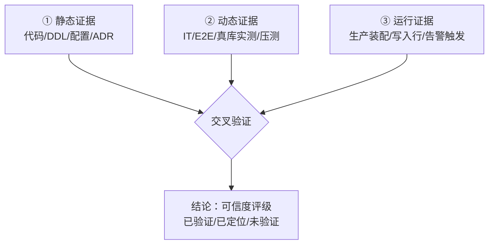
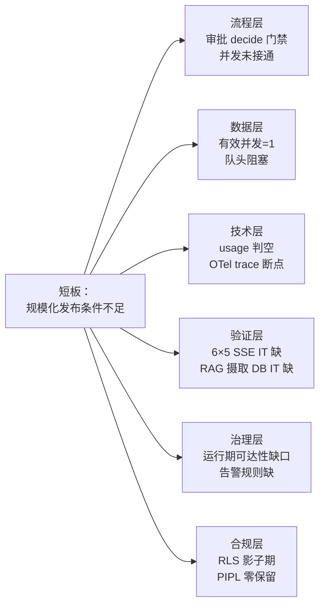
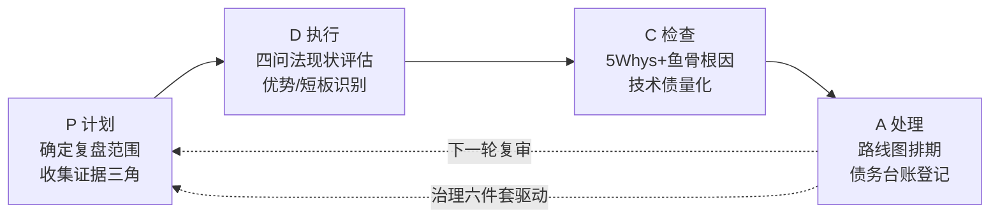
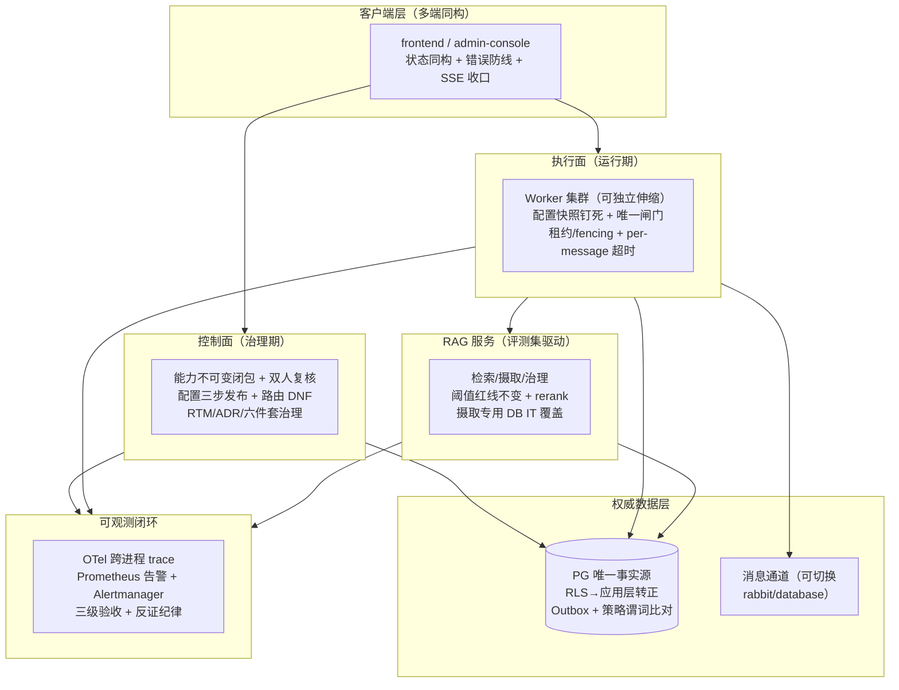
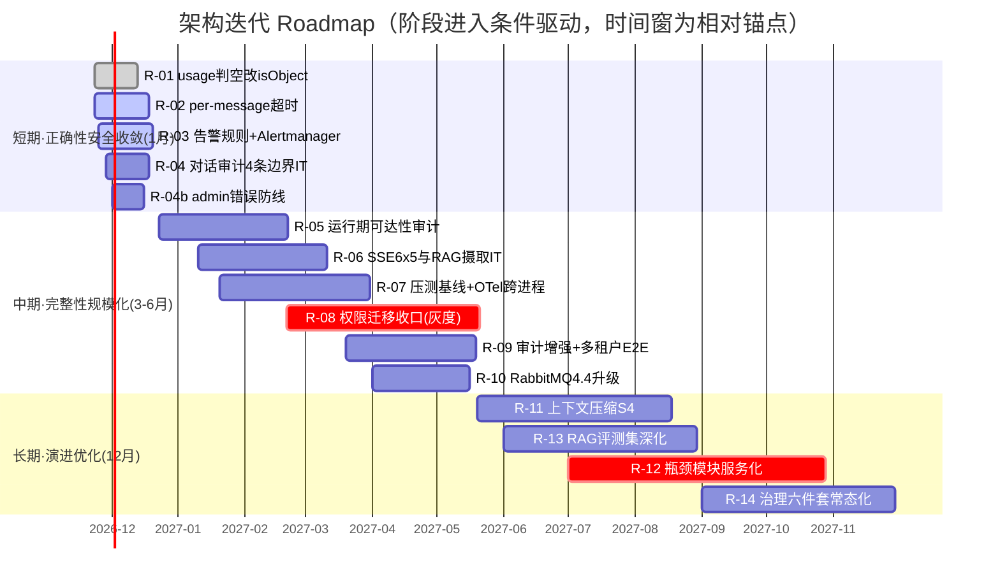
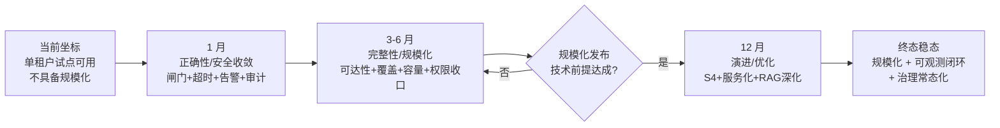

# 架构复盘、短板治理与中长期演进路线专题白皮书

> **文档编号**：专题 7（THESIS-07）
> **版本**：v1.0
> **成文日期**：2026-11-23
> **文档定位**：独立成文的企业级架构复盘与治理专题技术白皮书，不依赖主文档即可完整阅读；开篇含"项目背景速览"自包含介绍。
> **适用对象**：架构师、技术负责人（TL）、后端/前端工程师、QA、SRE/运维、安全合规负责人、产品与项目管理方。
> **文风与边界声明**：本文为严谨工程化白皮书，坚持**诚实边界**原则——明确写出"哪里强、哪里弱、哪里还没验证"，不以措辞掩盖短板。凡"项目事实"均取自下述基线；凡基线未明确的实现细节，以"推荐范式/建议口径"标注，不作为既成事实。版本、阈值、错误码为写作时点快照，实施前须核对最新基线。
> **事实基线来源**：
> ① 主文档 `docs/01_baseline/architecture/系统架构设计思路与企业级工程化实践.md`（尤其第 7 章 §7.1～7.6、第 0 章 §0.4）；
> ② 架构方案 v3.1 `docs/01_baseline/architecture/Java SaaS Agent 平台：规划与技术架构设计方案 v3.1.md`；
> ③ 源码视角功能规划 `项目功能点与优化规划_源码视角_2026-11-17.md`（P0/P1/P2 优化项 O1～O20）；
> ④ `问题记录/` 全量分类专题（01 配置、02 数据一致性、03 权限与 RLS、04 安全合规、05 API 契约、07 测试基建、08 治理发布、09 RAG 检索、10 并发状态机、12 工程运维、13 业务模型缺口）；
> ⑤ ADR-001/011/013、E2E 五轮闭环报告、`docs/05_archive/能力维度实现方式梳理报告.md`。

---

## 目录

- [一、章节背景与复杂度分析（含"项目背景速览"）](#一章节背景与复杂度分析含项目背景速览)
  - [1.0 项目背景速览（自包含）](#10-项目背景速览自包含)
  - [1.1 为什么架构复盘需要独立成文](#11-为什么架构复盘需要独立成文)
  - [1.2 复杂度来源：六个维度](#12-复杂度来源六个维度)
  - [1.3 本专题的目标函数与诚实原则](#13-本专题的目标函数与诚实原则)
  - [1.4 阅读地图与证据分级](#14-阅读地图与证据分级)
- [二、通用行业标准方法论（可复用）](#二通用行业标准方法论可复用)
  - [2.1 架构复盘方法论：四问法与证据三角](#21-架构复盘方法论四问法与证据三角)
  - [2.2 短板根因分析：5Whys 与鱼骨图](#22-短板根因分析5whys-与鱼骨图)
  - [2.3 技术债量化：从定性到定量](#23-技术债量化从定性到定量)
  - [2.4 演进路线规划通用方法](#24-演进路线规划通用方法)
- [三、企业级落地流程、清单、模板、规范](#三企业级落地流程清单模板规范)
  - [3.1 复盘治理总流程（PDCA-架构版）](#31-复盘治理总流程pdca-架构版)
  - [3.2 架构复盘执行清单](#32-架构复盘执行清单)
  - [3.3 根因分析模板与短板登记卡](#33-根因分析模板与短板登记卡)
  - [3.4 技术债台账模板](#34-技术债台账模板)
  - [3.5 演进路线评审规范与决策门禁](#35-演进路线评审规范与决策门禁)
  - [3.6 架构治理六件套的执行规范](#36-架构治理六件套的执行规范)
- [四、本项目全量落地细节、真实决策、历史上下文](#四本项目全量落地细节真实决策历史上下文)
  - [4.1 复盘的历史上下文：五轮 E2E 与结论收敛](#41-复盘的历史上下文五轮-e2e-与结论收敛)
  - [4.2 架构优势的真实决策与落地证据链](#42-架构优势的真实决策与落地证据链)
  - [4.3 短板的发现路径：从现象到登记](#43-短板的发现路径从现象到登记)
  - [4.4 边界的量化：容量、并发、数据规模](#44-边界的量化容量并发数据规模)
  - [4.5 治理六件套在本项目的真实运作](#45-治理六件套在本项目的真实运作)
- [五、深度问题剖析、踩坑复盘、边界风险](#五深度问题剖析踩坑复盘边界风险)
  - [5.1 核心优势专项固化（逐条配落地佐证）](#51-核心优势专项固化逐条配落地佐证)
  - [5.2 现存短板根因深度剖析（逐条：现象→根因→影响→触发→规避）](#52-现存短板根因深度剖析逐条现象根因影响触发规避)
  - [5.3 边界风险与"未验证≠不存在"的纪律](#53-边界风险与未验证不存在-的纪律)
- [六、最佳实践固化、可复用范式沉淀](#六最佳实践固化可复用范式沉淀)
  - [6.1 十条可复用范式](#61-十条可复用范式)
  - [6.2 反脆弱设计范式的沉淀](#62-反脆弱设计范式的沉淀)
  - [6.3 从本项目抽象出的通用检查项](#63-从本项目抽象出的通用检查项)
- [七、未来迭代优化路线（1/3-6/12 月 + 终态蓝图）](#七未来迭代优化路线1-3-6-12-月--终态蓝图)
  - [7.1 演进原则与红线约束](#71-演进原则与红线约束)
  - [7.2 短期（1 月）：正确性与安全收敛](#72-短期1-月正确性与安全收敛)
  - [7.3 中期（3-6 月）：完整性与规模化](#73-中期3-6-月完整性与规模化)
  - [7.4 长期（12 月）：演进与优化](#74-长期12-月演进与优化)
  - [7.5 终态蓝图与稳态目标](#75-终态蓝图与稳态目标)
- [输出物一：架构迭代 Roadmap（Mermaid 甘特/路线图）](#输出物一架构迭代-roadmapmermaid-甘特路线图)
- [输出物二：技术债台账](#输出物二技术债台账)
- [输出物三：季度架构复盘模板（含填写说明+样例+禁止项）](#输出物三季度架构复盘模板含填写说明样例禁止项)
- [结尾声明](#结尾声明)

---

## 一、章节背景与复杂度分析（含"项目背景速览"）

### 1.0 项目背景速览（自包含）

本节确保本文独立成文——读者无需阅读主文档即可理解全部复盘语境。

**（1）项目是什么**

`java-multi-agent` 是一个**多租户 SaaS Agent 平台**，包名 `cn.studykid.multiagent`，面向 **K12 未成年人学生**，首个业务场景为"初中生错题归因与个性化辅导"。因为服务对象是未成年人，平台受 **PIPL（《个人信息保护法》）第 31 条**约束：处理不满十四周岁未成年人个人信息须取得监护人单独同意，数据最小化、模型零保留、数据不出境是架构的硬约束，优先级高于数据丰富度与功能便利。

**（2）技术基线（写作时点已冻结）**

| 维度 | 取值 |
|:---|:---|
| 语言/运行时 | Java 21 LTS |
| 框架 | Spring Boot 4.1.1 / Spring Framework 7 / Jakarta EE 11 |
| 数据库 | PostgreSQL 17（同时承担关系与向量检索，`halfvec(4096)`） |
| 消息中间件 | RabbitMQ 4.3.6（Quorum Queue；可切换为 PG 表队列） |
| 其他 | MyBatis-Plus 3.5.17、Druid 1.2.28、RE2/J 1.8、JUnit 6 |
| 构建单元 | 双 reactor：`platform`（13 个 Maven 模块，控制面+执行面）+ `rag`（11 个 Maven 模块，检索+摄取+治理） |
| 前端 | `frontend`（Vite6+React18，学生/租户端）、`admin-console`（Vite6+React18+AntD5，平台管理端，部署于 `/admin/`） |

**（3）核心架构主线（理解全部取舍的前提）**

平台采用**控制面/执行面分离 + 端口-适配器（六边形）+ 模块化单体 + 独立 Worker**的整体形态。三条设计主线贯穿全部决策：

1. **治理期**：把 Agent 可用能力算成**不可变闭包**，经**双人复核**后发布；
2. **运行期**：每个 Run **钉死配置快照**（`ExecutionSnapshot`），工具调用必须穿过**唯一闸门** `ToolInvocationGate`；
3. **全链路**：以 **PG 为唯一权威事实源**，以 **Outbox 同事务**、**租约/fencing**、**UNKNOWN 对账**、**死信**保障可靠性。

核心业务闭环：创建/发布 Agent → 绑定不可变执行快照 → 创建 Run（Run+事件+幂等+Outbox 四者同事务）→ Outbox/MQ 投递 → Worker 执行单 Agent Loop → ModelGateway 决策 → 经唯一闸门调用受控工具 → 持久化步骤/事件/结果 → 查询轨迹与审计。

**（4）规模与约束基线**

| 约束维度 | 取值/事实 | 对架构的直接影响 |
|:---|:---|:---|
| 业务体量 | 单/少租户试运营 | 拒绝微服务过度设计；模块化单体 + 独立 Worker |
| 消息量级 | 每 Run 一条唤醒消息，低吞吐 | MQ 只需 at-least-once + 死信，Kafka 吞吐优势无用武之地 |
| 并发模型 | 默认消息通道 `database`（PG 表队列）；Worker 并发 4、租户并发 5、单 Run max-steps 20、max-cost ¥2.00 | **有效并发=1**（由队列 + 租约控制）；背压护栏看活动通道深度 |
| 数据规模 | platform 库 75 表 / 41 RLS / 49 策略；rag 库 15 表 / 43 策略（含增量）；向量 `halfvec(4096)` | 单库可承载，无需分库分表 |
| 团队/运维 | 小团队、无专职 SRE | 选型以"运维简单"为高权重；社区版 + 接受支持期窗口 |
| 合规 | 未成年人敏感信息、模型零保留、数据不出境 | 采集白名单 + 监护人单独同意 + 零保留硬闸门 |
| 时间窗 | 18 周分阶段交付（P0～P4） | Boot 版本须覆盖全周期（故选 4.1.1 而非 4.0.x） |

**（5）复盘结论的一句话快照**

经五轮 E2E 端到端闭环判定，当前架构的结论是：**单租户试点可用，但不具备规模化发布条件**。这个结论不是失败宣言，而是诚实坐标——它把"已经扎实的部分"与"尚未验证的部分"清晰分开，正是本白皮书全部治理动作的起点。

### 1.1 为什么架构复盘需要独立成文

架构设计文档（主文档）回答的是"应该怎么设计、当时为什么这样取舍"；而架构复盘白皮书回答的是另一组问题：

| 维度 | 设计文档侧重 | 复盘白皮书侧重 |
|:---|:---|:---|
| 时间视角 | 面向决策当时 | 面向交付之后的真实状态 |
| 关注对象 | 原则、结构、 tooling 的完整叙述 | 优势是否被固化、短板是否有根因、债是否可清偿 |
| 诚实度要求 | 呈现"应然"体系 | 呈现"实然"边界，不掩饰未验证项 |
| 输出物 | 决策记录 ADR、设计图 | 路线图、债务台账、复盘模板 |

独立的价值在于：**复盘必须敢于推翻"文档说已完成"的叙事**。本项目反复出现的教训（大量登记在 `问题记录/`）是"有类/有表/有测 ≠ 被装配/被写入/被注入/被触发告警"、"文档声称 WAITING_APPROVAL 而代码里根本没有"——这类"文档与代码漂移"若在同一份设计文档里自我复盘，容易陷入"用措辞规避矛盾"。独立成文 + 明确事实基线 + 强制诚实边界，是对抗这种漂移的制度性设计。

### 1.2 复杂度来源：六个维度

本次复盘的复杂度，不在于"系统有多大"，而在于"判断什么是真的"所要跨越的层次：

1. **证据层级复杂**：一个能力可能有"设计文档声明 / 代码存在 / 生产装配 / 真实写入 / 触发告警"五个不同层级的状态。停在任一层都会误判。例如 `cap_authz_version` 表建了、读取路径建了，但**没有生产写入方**；`GroundingService.verify()` 五步闸门写了，但**零调用**。
2. **合规约束刚性**：PIPL 未成年人条款使"是否可保存正文""是否可跨进程传原文"不是优化题而是红线题，压缩 S4 的 checkpoint 表因此被明确推迟。
3. **并发与一致性交织**：有效并发=1 的队列模型下，租约、fencing、UNKNOWN 对账、状态机、幂等相互耦合，任一处"把动作拆成两半"（校验与写入分离）就产生竞态窗口。
4. **迁移期双轨并存**：RLS→应用层权限迁移处于 M2 影子期（M4 SQL 为 DRAFT 未应用）；CAP 新链与 legacy 旧链并存（live DB 中 legacy 表有数据、CAP 表全空）；两套审批模型 `approval`/`cap_approval` 并存。双轨本身就制造"哪条链路真的生效"的判断成本。
5. **多技术栈叠加**：双 reactor、双前端（frontend + admin-console）、SSE 三种形态、双 JWT 域，任一"双份"都可能漂移（如两工程 Agent 状态同构字段已漂移：admin-console 缺 `estimated`）。
6. **验证方法自身的复杂度**：本项目最深刻的教训之一是"测试自己骗了自己"——假绿、假阴性、夹具盖缺陷、环境变量守门跳过、基准库本身错。复盘若采信"全绿"而不追问"绿的来源是否被污染"，结论必然失真。

### 1.3 本专题的目标函数与诚实原则

本专题的目标函数不是"证明架构很好"，而是最大化三个量：

- **决策价值**：读者读完能判断"现在能不能上规模、还差什么、先做什么"；
- **可操作性**：每条短板都有根因、影响、触发、规避，每条路线都有改造点、收益、风险、优先级、验收标准；
- **抗失真能力**：用反证、证据三角、诚实边界记录，抑制"文档自证清白"的天然倾向。

诚实原则的三条硬规则：

1. **未验证不等于通过**：被 `@EnabledIfEnvironmentVariable` 守门跳过的 IT、被环境变量关掉的链路、只写日志不告警的规则，一律登记为"未验证/未生效"，不计入证据。
2. **声明不等于实现**：文档、注释、类名、表名声称的能力，必须在生产链路找到"被装配/被写入/被触发"的证据，否则标注"写而未接线"。
3. **不以措辞规避矛盾**：如双人复核 DB CHECK 允许双 NULL 放行（`DBP-15`），须直书"名不符实"，而非称"已落实双人复核"。

### 1.4 阅读地图与证据分级

- **架构师/TL**：重点读第五章（优势佐证 + 短板根因深挖）、第七章（路线图 + 终态蓝图）、输出物二（债务台账）。
- **后端/前端工程师**：重点读第四章（落地细节与历史上下文）、第五章短板根因。
- **QA**：重点读第三章清单、第五章"运行期可达性缺口"与"IT 空白"、输出物三（复盘模板）。
- **运维/SRE**：重点读第五章"有效并发=1/容量 SLA""Prometheus 告警规则""OTel 跨进程 trace"、第七章规模化路线。

**证据分级**（本文引用事实时按此分级表述）：

| 级别 | 含义 | 本文表述方式 |
|:---|:---|:---|
| E1 事实 | 有源码/DDL/配置/实测报告直接支撑 | "已落地""实测为……"（给出处） |
| E2 定位 | 已定位根因但修复未闭环 | "已定位未修/部分已修" |
| E3 未验证 | 存在但无生产可达性证据 | "未验证""待核实装配链" |
| E4 推荐 | 本文提出的建议口径 | "建议/推荐范式"，明确非既成事实 |

---

## 二、通用行业标准方法论（可复用）

本章给出可迁移到任何企业级系统的通用方法——每个方法都遵循"通用框架 → 本项目映射 → 可复用要点"三层结构，便于"学方法"与"看落地"两种阅读目的。

### 2.1 架构复盘方法论：四问法与证据三角

**通用框架**：一次有效的架构复盘，必须回答四个递进的问题，缺一不可：

| 问 | 名称 | 核心问题 | 典型误答 |
|:---|:---|:---|:---|
| Q1 | 现状是什么 | 系统真实运行态是什么样（不是文档说的） | 拿架构图当现状 |
| Q2 | 哪里强/哪里弱 | 哪些决策被验证有效，哪些是未验假设 | 只列优点或只列问题 |
| Q3 | 为什么 | 短板的根因是什么（不是现象） | 把现象当根因（"因为并发低"） |
| Q4 | 怎么办 | 按什么优先级、什么节奏演进 | 拍脑袋排日期，无验收标准 |

**证据三角**——回答每一问时，至少要有三类证据交叉验证：



**本项目映射**：
- Q1：现状不是"设计文档 v2.0 描述的样子"，而是"E2E 五轮实测判定单租户试点可用"这个诚实坐标（E1）。
- Q2：优势用"决策可追溯、边界清晰、可靠性扎实"等七条 + 逐条佐证案例固化（§5.1）；短板用七类现状表诚实列出（§5.2）。
- Q3：每条短板追到根因层，如"流式 usage 判空致 MAX_COST 闸门失效"追到 `!isMissingNode()` 判空方式（E1，`main doc §7.2`）。
- Q4：按"正确性→完整性→演进"分层，用原则驱动而非固定日期（主文档 7.4 的 timeline 明确标注"原则驱动，非固定日期"）。

**可复用要点**：
- [ ] 复盘结论必须区分"已验证/已定位/未验证"三档，不允许笼统的"已完成"。
- [ ] 每个结论至少两类证据支撑；只有静态证据的结论一律降级为"未验证"。
- [ ] 复盘报告开篇就要给出"一句话现状坐标"（如本项目"单租户试点可用、不具备规模化发布条件"）。

### 2.2 短板根因分析：5Whys 与鱼骨图

**通用框架一：5Whys（纵向追问）**

对每条短板连续追问"为什么"，直到触及"可采取系统性措施的层"。以本项目"权限仍在影子期"为例：

```
现象：真出口 rlsDependent=0 未达成，M4 四批 SQL DRAFT 未应用。
Why1：为什么 M4 没应用？→ 因为四批 SQL 仍是 DRAFT，未在生产库执行。
Why2：为什么未执行？→ 因为影子转正需要"观察期数据达标"作为前置门禁。
Why3：为什么观察期没达标？→ 因为 M2 影子期差真实流量（生产流量规模不足以覆盖所有谓词分支）。
Why4：为什么差真实流量？→ 因为当前是单/少租户试点，真实租户与主体规模小，无法触发长尾权限路径。
Why5：为什么试点规模小？→ 因为产品处于验证阶段，尚未规模化发布（这是业务约束，非技术缺陷）。
→ 根因定位：不是"SQL 没写"，而是"业务规模约束下无法积累足够观察证据"。
→ 系统性措施：① 用影子比对 + 合成流量补齐长尾分支覆盖；② 明确观察期量化判据，避免无限期影子。
```

这个追问揭示了关键洞察：**很多"技术短板"的根因在业务约束层**。若停在 Why1，措施就是"把 DRAFT 应用掉"——这在观察证据不足时反而是高风险动作。

**通用框架二：鱼骨图（横向归类）**



鱼骨图用于避免"归因单一化"——规模化发布条件不足不是任一单点造成，而是六类因素共同作用。

**本项目映射**：主文档 §7.2 的"根因/影响范围/触发场景/临时规避方案"四列表，本质就是 5Whys 结论 + 鱼骨归类后的结构化沉淀（详见 §5.2 逐条展开）。

**可复用要点**：
- [ ] 5Whys 的终止条件是"触及可采取系统性措施的层"，若停在"某人没做"就还没到底。
- [ ] 鱼骨图按"流程/数据/技术/验证/治理/合规"六类归因子因，强制多因审视。
- [ ] 根因若落在业务约束层，措施应是"补齐证据/明确判据"，而非"强行推进"。

### 2.3 技术债量化：从定性到定量

**通用框架**：技术债若只说"有债"无法排优先级。通用量化模型是给每笔债打五个维度分：

```
债务分 = 影响面(W) × 严重度(S) × 触发概率(P) × 时效衰减(T) × 清偿难度倒数(1/D)
```

| 维度 | 含义 | 评分刻度（1-5） |
|:---|:---|:---|
| W 影响面 | 波及模块/链路数量 | 1=单文件；5=跨系统 |
| S 严重度 | 触发后后果 | 1=体验瑕疵；5=数据泄露/资金损失/合规事故 |
| P 触发概率 | 在目标场景被触发的可能性 | 1=极罕见；5=常态 |
| T 时效衰减 | 越拖越贵/社区停维等时间压力 | 1=无压力；5=临近红线 |
| D 清偿难度 | 改动成本与风险 | 1=局部低风险；5=跨版本/需灰度迁移 |

**优先级映射**：得分高且 D 低 → P0 立即清偿；得分高但 D 高 → 需列入路线图并准备灰度；得分低 → 登记台账持续观察。

**本项目映射**：以下为本白皮书用该模型对主要债务的量化（详细台账见输出物二）：

| 债务项 | W | S | P | T | D | 得分≈ | 优先级判断 |
|:---|:-:|:-:|:-:|:-:|:-:|:---:|:---|
| 流式 usage 判空→MAX_COST 失效 | 3 | 5 | 4 | 4 | 2 | 120 | P0（资金/预算闸门，局部可修） |
| RLS 影子期未转正 | 5 | 5 | 3 | 3 | 5 | 75 | P1（需灰度，不能硬推） |
| 有效并发=1 / 容量未验 | 5 | 4 | 4 | 4 | 4 | 80 | P1（需压测建立基线） |
| 运行期可达性缺口 | 4 | 4 | 3 | 3 | 3 | 48 | P0/P1（可能发现能力其实无效） |
| Prometheus 告警规则缺 | 4 | 4 | 4 | 3 | 2 | 96 | P0（有指标无告警=虚假安全感） |
| 上下文压缩 S4 零落地 | 3 | 2 | 3 | 1 | 4 | 9 | P2（成本优化，非 correctness） |

> 得分仅用于**相对排序**与对话基线，不是绝对真理；边界条件变化（如进入规模化发布）须重算。

**可复用要点**：
- [ ] 债务台账必须有量化列，否则评审会退化为"谁嗓门大谁优先"。
- [ ] 清偿难度 D 高的债不等于不做，而是要配"灰度/观察期/回滚方案"一起排期。
- [ ] 时效衰减 T 捕捉"社区支持到期/压测不达标"等时间压力，是复审触发条件的量化入口。

### 2.4 演进路线规划通用方法

**通用框架**：演进路线采用"三横四纵"结构。

**三横（时间层）**：
- 短期（≈1 月）：**正确性与安全收敛**——修闸门、补超时、补告警、补关键 IT；
- 中期（≈3-6 月）：**完整性与规模化**——权限迁移收口、压测建 SLO、IT 覆盖补齐、前端多租户验证；
- 长期（≈12 月）：**演进与优化**——上下文压缩 S4、瓶颈模块服务化、RAG 深化。

**四纵（每项改造必答）**：

| 纵向 | 问题 | 验收标准写法 |
|:---|:---|:---|
| 改造点 | 具体改什么（可定位到模块/类/SQL） | 不允许"优化性能"这种空话 |
| 收益 | 改完能解决哪条短板/债 | 能量化则量化（如延迟、覆盖率） |
| 风险 | 改造本身引入什么风险 | 必须写回滚/灰度方案 |
| 优先级 | P0/P1/P2 + 前置条件 | 与债务量化得分对齐 |

**原则驱动而非日期驱动**：本项目主文档 timeline 明确"架构迭代路线（原则驱动，非固定日期）"。原因是小团队 + 合规约束下，日期会被前置条件（观察期数据、社区 GA、签核）打破；用"进入某阶段的条件"替代"某月某日"更抗变化。

**红线不可破**：演进中以下约束不因迭代突破——检索阈值 0.38、RRF k=60、RLS 谓词位置、未成年人白名单、模型零保留、不降维 halfvec、不在 agent-infra 施力。

**本项目映射**：主文档 §7.4 的 1/3/6/12 月表已按"改造点/收益/风险/优先级/前置条件"给出；本白皮书 §7.2～7.4 在此基础上逐条细化验收标准，并新增"终态蓝图"（§7.5）。

**可复用要点**：
- [ ] 路线图分"正确性→完整性→演进"三层，禁止一上来做远期优化而搁置 correctness。
- [ ] 每项改造必须写清"改什么/收益/风险/优先级/验收"，缺任一项不予评审通过。
- [ ] 用"阶段进入条件"而非"固定日期"作为节奏锚点，红线在全部阶段不可破。

---

## 三、企业级落地流程、清单、模板、规范

本章把第二章的方法论固化为可执行的流程、清单、模板与规范，是企业级落地的"操作手册"。

### 3.1 复盘治理总流程（PDCA-架构版）

架构复盘治理是一个闭环，采用 PDCA 的架构版：



**六阶段执行节奏**：

| 阶段 | 关键动作 | 输出物 | 节奏 |
|:---|:---|:---|:---|
| ① 范围界定 | 确定复盘边界（全架构/单域）、时间窗、参与者 | 复盘计划书 | 季度首周 |
| ② 证据收集 | 拉取 ADR/DEC、IT/E2E 报告、真库实测、生产告警/写入证据 | 证据清单（分 E1-E4） | 季度首两周 |
| ③ 现状评估 | 四问法评估，优势/短板/边界三张表 | 现状评估草稿 | 季度第 3 周 |
| ④ 根因与量化 | 5Whys + 鱼骨 + 债务打分 | 根因分析卡、债务台账 | 季度第 3 周 |
| ⑤ 路线与决策 | 三横四纵排期，重大变更走 ADR/DEC | 迭代路线图、新 ADR | 季度末 |
| ⑥ 复审触发 | 核对触发条件（社区停维/压测不达标/观察期数据） | 复审决议 | 按条件 + 季度例会 |

### 3.2 架构复盘执行清单

以下清单在每次复盘时逐项核对（勾选式）：

**A. 证据层**
- [ ] A1 已收集本季度全部新增/变更 ADR、DEC，核对是否有"偏离基线未记录"；
- [ ] A2 已收集本季度 IT/E2E/压测报告，并标注每项证据是 E1/E2/E3/E4；
- [ ] A3 已核对"被环境变量/条件注解守门跳过"的测试数量，未计入通过证据；
- [ ] A4 已拉取生产/类生产环境的告警触发记录与关键表写入行数（如 `rlsDependent`、审计落库行）。

**B. 优势层**
- [ ] B1 每条声称的优势都有至少一条"落地佐证案例 + 证据位置"；
- [ ] B2 佐证案例经过反证验证（撤掉该机制，系统是否退化）。

**C. 短板层**
- [ ] C1 每条短板都写清"现象/根因/影响范围/触发场景/临时规避"五项；
- [ ] C2 根因已追到"可采取系统性措施的层"，非停在现象或"某人没做"；
- [ ] C3 已区分"未验证"与"已确认缺陷"，前者不写成后者。

**D. 边界层**
- [ ] D1 已明确"适配什么/不适配什么/什么条件下升级"；
- [ ] D2 容量/SLA 结论与压测数据一致，未压测则不承诺；
- [ ] D3 合规红线（PIPL 零保留/白名单）在全部方案中保持。

**E. 路线层**
- [ ] E1 每条路线项都有改造点/收益/风险/优先级/验收标准；
- [ ] E2 重大变更配 ADR 与回滚方案；
- [ ] E3 红线在全部阶段标注为不可破。

### 3.3 根因分析模板与短板登记卡

**根因分析卡模板**（每条短板一张）：

```markdown
### 短板编号：[SHORT-XXX]
- 一句话现象：[可观察事实，不含推测]
- 证据等级：E1/E2/E3/E4 + [出处]
- 5Whys 链：
  - Why1：[…]
  - Why2：[…]
  - Why3：[…]
  - Why4：[…]
  - Why5：[…] → 根因：[…]
- 鱼骨归类：流程/数据/技术/验证/治理/合规（可多选）
- 影响范围：[模块/链路/角色]
- 触发场景：[什么条件下被触发]
- 临时规避方案：[当下可做的兜底]
- 根治方向：[对应路线图条目编号]
- 复审触发条件：[什么信号出现须重开]
```

**填写样例**（本项目"流式 usage 判空"实填）：

```markdown
### 短板编号：SHORT-P0-01
- 一句话现象：两个 ModelGateway 用 !isMissingNode() 判 usage，流式返回 usage 为 null 时取到 0，
  导致 MAX_COST 成本闸门失效（主文档 §7.2 E1）
- 证据等级：E1 + 主文档 §7.2 / 功能规划 O20
- 5Whys 链：
  - Why1：成本闸门没拦住超额？→ usage 被算成 0。
  - Why2：为什么算成 0？→ 判空用 !isMissingNode()，流式 null 节点通过判空后取 0。
  - Why3：为什么用这个判空？→ 编码时按"字段缺失"处理，未区分"字段存在但值为 null"。
  - Why4：为什么没发现？→ 测试用固定 usage 夹具，未构造流式 null usage 用例。
  - Why5：为什么没构造？→ 流式模型的 usage 语义未被纳入边界用例清单。
    → 根因：流式 usage 的 null 语义未进入判定契约与测试矩阵。
- 鱼骨归类：技术 + 验证
- 影响范围：成本闸门 MAX_COST、预算一致性、MiniMax 流式链路
- 触发场景：流式模型调用且网关返回 null usage（如 MiniMax）
- 临时规避方案：改 isObject() 判空 + 本地估算兜底并标注"估算"；构造固定 null usage 反证
- 根治方向：路线图 1 月 P0 项 R-01
- 复审触发条件：出现任一"usage 为 0 但实际有 token 消耗"的账单差异
```

### 3.4 技术债台账模板

台账采用表格 + 量化分，字段固定：

```markdown
| 编号 | 债务描述 | 分类 | W | S | P | T | D | 得分 | 优先级 | 现状 | 责任人 | 清偿路线 | 复审触发 |
|:---|:---|:---|:-:|:-:|:-:|:-:|:-:|:---:|:---|:---|:---|:---|:---|
| DEBT-XXX | [一句话] | 正确/安全/工程/债 | 1-5 | 1-5 | 1-5 | 1-5 | 1-5 | 计算 | P0/P1/P2 | 未验/已定位/已修 | 角色 | 路线项 | 条件 |
```

**填写规范**：
- 分类限定为"正确性/安全/工程化/体验/合规"五类，避免分类膨胀；
- 得分按 §2.3 公式计算，仅用于相对排序；
- "现状"三态与证据分级对齐，禁止把 E3 写成"已修"；
- 每笔债必须有"复审触发条件"，否则无法在约束变化时重开。

### 3.5 演进路线评审规范与决策门禁

**评审门禁**（任一不满足则路线项不得进入实施）：

| 门禁 | 检查内容 | 不通过的典型 |
|:---|:---|:---|
| G-证据 | 短板是否有 E1/E2 证据支撑 | 凭感觉列问题 |
| G-根因 | 是否追到系统性措施层 | 根因写"历史原因" |
| G-红线 | 改造是否触碰红线 | 为性能降 halfvec 维度 |
| G-回滚 | 是否有回滚/灰度方案 | 直接改生产库无备份 |
| G-反证 | 验收是否含"撤点会红" | 只有正向用例 |
| G-ADR | 跨模块/难回退变更是否有 ADR | 无决策记录直接改 |

**重大变更判定**（满足任一即须 ADR/DEC）：跨模块影响、难回退（DDL/迁移）、触碰红线、改变对外契约、改变一致性/可靠性语义。

### 3.6 架构治理六件套的执行规范

主文档 §7.5 定义治理六件套：规范、模板、审计、巡检、复盘、迭代（本文按此六件套展开；主文档等价表述为"决策留痕/需求追踪/静态守卫/反证纪律/诚实边界/复审触发"，二者一一对应）。其执行流程、落地节奏、审查机制如下：


| 机制 | 执行流程 | 落地节奏 | 审查机制 | 主文档对应 |
|:---|:---|:---|:---|:---|
| 规范 | 约定成文→写守卫→纳入 CI | 随代码提交 | CI 强制失败阻断 | 静态守卫 |
| 模板 | 变更先填 ADR/DEC/RTM | 每个重大决策即时 | 架构评审会抽查 | 决策留痕 + 需求追踪 |
| 审计 | 逐项核实"声称 vs 实现" | 每阶段/季度 | 审计清单逐条打勾 | 诚实边界 |
| 巡检 | 只读脚本比对活库/配置/策略 | 每日 CI + 发布前 | 退出码 0/1/2 判定 | 静态守卫延伸 |
| 复盘 | 四问法 + 根因 + 量化 | 季度例会 | 反证验收 + 证据三角 | 复审触发 |
| 迭代 | 排期→实施→反证→关闭债 | 1/3/6/12 月滚动 | 门禁 G-证据～G-ADR | 迭代规划 |

**落地节奏总原则**：决策留痕与反证"随变更即时"；需求追踪"每迭代同步"；守卫与巡检"随代码提交 + 每日 CI"；审计与诚实边界"每阶段复盘"；复审触发"按条件 + 季度例会"。六件套形成闭环，使架构"活"起来而非一次性交付。

**审查机制要点**：
- 巡检脚本一律**只读 + 退出码约定**（0 一致 / 1 违规 / 2 连不上），可挂 CI——本项目已有 `check-cap-release-head.sh`（5 项）、`check-tenant-registry.sh`（4 项）、`check-rag-ops-role.sh`（13 项）等先例。
- 审计要回答"这条能力在生产代码的哪个调用点上被执行"——这是对抗 M2 类"看起来有防线实际不存在"的核心提问。

---

## 四、本项目全量落地细节、真实决策、历史上下文

本章还原本项目架构复盘的**真实语境**——不是从零推理"应该怎样"，而是基于 18 周交付、五轮 E2E、207 条问题登记、13+11 个 Maven 模块的历史事实，说明"为什么当前是这个状态"。所有内容均带事实出处，不以推测填充。

### 4.1 复盘的历史上下文：五轮 E2E 与结论收敛

本项目的架构判断不是纸面推演，而是被**五轮端到端（E2E）闭环**反复冲刷后收敛的。理解这五轮的结论演进，是理解"诚实边界"从何而来的关键。

| 轮次 | 日期 | 主要发现 | 对架构判断的影响 |
|:---|:---|:---|:---|
| 第一轮 | 2026-11-10 | API 契约、错误语义、RLS 挂载问题集中暴露 | 确认"API 级 PASS 不等于业务链路验收" |
| 第二轮 | 2026-11-13 | 管理端 admin-console 链路实测，发现人工审批闭环未接通等流程类缺陷 | 触发 HITL（PARK/RESUME）改造立项 |
| 第三轮 | 2026-11-14～16 | 学生视角 + 教师评审视角，前端体验与 401 误跳登录等问题 | 确认"状态码是契约"与双身份域分流 |
| 第四轮 | 2026-11-17 | 复跑，UI 视觉评审，SSE 帧二次包裹等序列化层缺陷暴露 | 确认"mock 假绿"必须补真实链路取证 |
| 第五轮 | 2026-11-20～21 | MyBatis 迁移验证、手动发布策略验证 | 确认"真实多租户规模化验证仍未完成" |

**结论收敛过程**：从早期"看起来功能和测试都全绿"，到逐步识别"全绿被污染"（`TST-01～TST-20` 的假绿/假阴性族），最终 E2E 五轮闭环收敛到同一句诚实判词——

> **单租户试点可用，不具备规模化发布条件。**

这句话是本文全部短板治理的"坐标原点"。它的价值在于**明确区分了两个容易被混淆的命题**：

- 命题 A："系统能跑通一个租户的核心闭环"——**已验证为真**（E1，多轮真库 E2E 支撑）。
- 命题 B："系统能支撑多租户规模化生产"——**未验证，且存在明确反证**（有效并发=1、容量未压测、权限影子期、P0 待验项等）。

架构复盘的首要纪律，就是不允许用 A 的成功暗示 B 的结论。主文档 §7.2 对此有一句定性："文档的价值不在于展示完美，而在于清楚知道哪里不完美。"本白皮书延续这一纪律。

**历史上下文中的三条重要"纠偏结论"**（避免后来人重踩/重复造轮子）：

1. **`scenario` 恒 NULL 是真缺口**（`13-业务模型缺口`）：数据模型中的 `scenario` 字段始终为 NULL，属于真实缺口，不是"设计如此"。
2. **9 张无 RLS 表是影子期基线，禁补**（主文档事实速查）：这 9 张表在 RLS→应用层迁移期刻意保持无 RLS 状态作为对照基线，直接补 RLS 会破坏影子比对，**禁止"顺手补上"**。
3. **HITL 已有 PARK/RESUME 闭环，禁建 PAUSED**（主文档事实速查）：挂起等待语义已通过 `RunState.WAITING_APPROVAL` + PARK/RESUME 检查点实现，不要重复设计 `PAUSED` 状态（避免 GOV-03 的"加一个状态动三层"重演）。

### 4.2 架构优势的真实决策与落地证据链

本项目的优势不是"设计得好看"，而是每一条都经历了**决策留痕 → 落地实现 → 反证验证**的完整链条。下面按主文档 §7.1 的七条优势还原其真实决策背景与证据位置（详细佐证案例在 §5.1 展开）。

**（1）决策可追溯**：项目建立了 DEC-1～12（需求层决策基线）与 ADR-001～013（技术层架构决策记录）双轨留痕。典型案例：Boot 3.x→4.1.1 的偏离有 ADR-011 记录影响面与回滚方案；PG 权威源选型有 ADR；主 MQ 选型有 ADR-001（RabbitMQ）。任何偏离基线的决定都有"当时为什么"与"何时复审"。

**（2）边界清晰、依赖可控**：六层逻辑架构 + 端口-适配器 + 静态守卫，领域层零框架依赖（仅 JSpecify）。`AgentCorePurityTest`、`ModuleDependencyDirectionTest` 把"反向依赖"变成构建失败，`contextModuleIsFrameworkFree` 守卫锁死纯算法层零 Spring/JDBC。换 MQ 载体时业务代码零改动，只改环境变量（`P4-D17`）。

**（3）可靠性设计扎实**：PG 权威源 + Outbox 同事务（Run+初始事件+幂等记录+Outbox 四者同事务，`RunCreationService.java`）+ 租约/fencing（`JdbcRunClaimRepository.java:513` 事务内 set_config）+ UNKNOWN 对账（不盲目重试，走 `UnknownOperationController`）+ 死信（`PgQueueListener`）。强杀 Worker 后旧 fencing 世代写入被拒（ADR-001 §6 PoC、fencing 反证 IT）。

**（4）安全纵深**：多租户 RLS（基于 GUC `app.tenant_id`，41 张表 FORCE RLS）+ 执行时授权 + 唯一闸门（`ToolInvocationGate` 15 步准入）+ 未成年人数据白名单 + fail-closed。跨租户访问用 `NOBYPASSRLS` 角色验证被拒（跨租户反证 IT）。

**（5）可演进**：配置快照隔离（运行中改配置只影响新 Run）、消息通道可切换（`mode=database`/rabbit，按租户灰度，回滚=改环境变量）、全局 Agent + 多对多绑定已落地（75 表 / 41 RLS / 49 策略）、权限影子迁移机制（`RagShadow`、`AuthzShadowBinding`）。

**（6）工程化成熟**：静态守卫体系 + 三级验收 + 反证纪律 + 三位一体可观测。failsafe 显式纳入 `*IT.java`（`platform/pom.xml`），避免"测试从未运行"的假绿。

**（7）约束固化**：架构约定写成守卫（`ModuleDependencyDirectionTest`、`AgentCorePurityTest`、配置 fail-closed 19 项），避免纸面架构随时间腐蚀。

> **优势的"反证可信度"**：上述优势之所以可信，是因为多数都配了"撤掉机制会红"的反证。例如 fencing 有反证 IT、跨租户有反证 IT、反证脚本 `counterproof-p4d13.sh`/`counterproof-fed10.sh`（A-1～A-7、B-1/B-2/T-A/T-B/T-C）可重跑。**但必须诚实指出**：也有反证承诺未完全落地——`TST-19` 记录 D15 的 S-1～S-4 四条反证"列了设计，实际未落地"，导致"收紧判定/理由校验/RLS/快照生效"四道防护**只有正向用例**。这说明优势的固化程度并非均匀，存在"强项中的局部薄弱点"。

### 4.3 短板的发现路径：从现象到登记

本项目对短板的处理形成了一条可复用的发现路径，值得固化为方法论：


`问题记录/` 目录按**根因所在位置**（而非症状所在模块）分为 13 类，共 207 条：

| 类别 | 文件 | 条数 | 一句话判据 |
|:---|:---|:-:|:---|
| 配置与开关 | 01 | 14 | 配置项/开关/命名空间取错或默认错 |
| 数据一致性与写链 | 02 | 14 | 数据写不进去/写歪/两份数据打架 |
| 数据库权限与 RLS | 03 | 18 | 库结构/角色授权/RLS/迁移 |
| 安全与合规 | 04 | 27 | 权限边界被绕过/校验缺失 |
| API 契约与错误语义 | 05 | 17 | 接口契约/状态码/数据形状 |
| 前端缺陷 | 06 | 29 | 前端代码/交互/渲染 |
| 测试基建与验证方法 | 07 | 20 | 测试自己骗了自己 |
| 治理与发布流程 | 08 | 10 | 审批/发布/复核流程没接通 |
| RAG 与检索质量 | 09 | 12 | 检索算法/阈值/占位实现 |
| 并发与状态机 | 10 | 12 | 并发窗口/超时/限流 |
| 文档与代码漂移 | 11 | 12 | 文档说的和代码做的不是一回事 |
| 工程环境与运维 | 12 | 15 | 环境/工具链/运维动作 |
| 业务模型缺口 | 13 | 7 | 业务模型尚未设计完成 |

**登记纪律**：每条固定三段——**问题描述**（可观察事实，不含推测）/**产生原因**（根因链，落到具体代码/SQL/配置）/**相关解决方案**（怎么修/为何不修）。状态分为 ✅ 有明确修复动作、🟡 定位未修/待决策、⛔ 未闭环、⚪ 证伪留档、🔧 代码已改待真实复跑。

**高频根因模式（M1～M7）**是本项目从 207 条里抽象出的共性，是复盘时的"快速对照表"：

| 模式 | 形态 | 本白皮书短板的对应 |
|:---|:---|:---|
| M1 开关默认关+读侧硬依赖 | 出厂即不可用 | P0 待验项、cap-enforcement 开关 |
| M2 看起来有防线实际不存在 | 防线写在呈现层，强制层没接线 | 运行期可达性缺口、ReviewAttributionHook 无 Bean |
| M3 静默失败 | 链路断了但不体现为失败 | Prometheus 告警缺、usage 判空 |
| M4 夹具/种子/基准本身错 | 造假数据盖住缺陷 | SSE 真库 IT 缺、RAG 摄取 DB IT 缺 |
| M5 值来源被覆盖 | "我这边好你那边坏" | 配置命名空间漂移 |
| M6 授权漏一张表/动作 | 顺序即语义 | RLS 影子期、9 张无 RLS 表 |
| M7 文档与代码各说各话 | 用措辞规避矛盾 | S4 零落地、HITL 文档矛盾 |

这七种模式在第五章短板根因剖析中会反复出现——它们是"同一类坑换了不同模块的马甲"。

### 4.4 边界的量化：容量、并发、数据规模

诚实边界不是"说一句不具备规模化"就够，必须量化到具体数字与量级。

**（1）并发边界**

| 并发维度 | 配置值 | 真实有效值 | 说明 |
|:---|:---|:---|:---|
| 消息通道 | 默认 `database`（PG 表队列） | — | 可切换 rabbit，但默认走 DB 队列 |
| Worker 并发 | 4 | 受队列 + 租约约束 | Worker 数为 4 |
| 租户并发 | 5 | 上限 5 | 背压护栏看活动通道深度 |
| **有效并发** | — | **=1** | 单 Run 维度实际串行执行，这是规模化最大瓶颈 |
| 单 Run max-steps | 20 | 20 | 步数上限 |
| 单 Run max-cost | ¥2.00 | 依赖 usage 判空正确性（见短板） | 预算闸门可能因 usage 判空失效 |

> **有效并发=1 的根因**：默认 `database` 消息通道下，PG 表队列 + 租约机制使同一时刻单个 Run 实际串行执行；`deadline=null`（未传超时则跳过超时检查，`CON-08`）与无 per-message 超时叠加，会产生队头阻塞（一个卡住的 Run 阻塞后续）。这不是"Worker 只能开 1 个"，而是"队列+租约语义下的有效执行串行"。

**（2）容量与 SLA 边界**

- 未做目标环境压测 → **不承诺固定吞吐/SLA**；
- 未建立容量基线 → 无法回答"多少租户、多少 Run/分钟下 P95 延迟达标"；
- 结论：`docs/系统优化建议-全量评审.md` 与功能规划 O20 均把"队头阻塞、deadline 生效、trace 断点"列为待评估项。

**（3）数据规模边界**

| 库 | 表数 | RLS 表 | 策略数 | 向量 |
|:---|:-:|:-:|:-:|:---|
| platform | 75 | 41 | 49 | — |
| rag | 15（含增量 13/37 快照口径） | 全部 FORCE+ENABLE | 43（含增量）/37 快照 | `halfvec(4096)` |

- 当前 287 个 RAG 片段可全表精确扫描（单次查询 <2s，主要耗时在嵌入模型）；但 `halfvec(4096)` 超 pgvector HNSW 上限 4000（`RAG-04`），**无 ANN 索引**——万级片段后精确扫描会先崩，这是明确的数据规模天花板。
- 单库可承载当前规模，无需分库分表；但规模化后向量检索是第一个要处理的瓶颈。

**（4）适配边界的诚实陈述**

当前适配：
- ✅ 中小体量、单/少租户试运营、强一致性与可审计要求高的场景；
- ✅ 未成年人数据合规敏感、副作用需对账的业务（教育辅导类）；
- ✅ 小团队、无专职 SRE、需快速验证业务闭环的阶段。

当前不适配（需升级或另立方案）：
- ❌ 大规模高并发、多地域、需独立伸缩的超大租户场景；
- ❌ 需要完整商业计费/发票能力（首期仅预算与 usage 一致性）；
- ❌ 通用工作流/DAG 编排、插件市场、不可信脚本沙箱（明确非目标）。

### 4.5 治理六件套在本项目的真实运作

治理六件套不是纸面制度，在本项目有具体载体：

| 件套 | 本项目真实载体 | 已产生的效果 |
|:---|:---|:---|
| 规范 | 不可妥协十条原则、ADR 约束、`docs/权限管控体系/`契约文档 | 约束固化进守卫 |
| 模板 | ADR 模板、DEC 决策基线、RTM 需求追踪矩阵、复盘卡 | 决策可追溯 |
| 审计 | 13 类问题记录、能力维度深度报告第三章可达性审计、`反证纪律` | 发现"写而未接线" |
| 巡检 | `check-cap-release-head.sh`(5 项)、`check-tenant-registry.sh`(4 项)、`check-rag-ops-role.sh`(13 项)、`export-rls-policies.sh` 三重检测 | 漂移当天发现 |
| 复盘 | 五轮 E2E 闭环、季度架构复审、本文 | 结论收敛为诚实坐标 |
| 迭代 | ADR 复审触发条件、1/3/6/12 月路线图、债务台账 | 约束变化重开决策 |

一个真实运作的典范是**巡检的"双向反证"**：`check-cap-release-head.sh` 在当前库 0 违规退出 0；把指针回拨成修复前状态时同一批 SQL 报 12/1/10 行违规（`DAT-05`）——证明巡检不是"永远全绿"的仪式。`export-rls-policies.sh` 的三重检测（读写不对称、缺口扫描、活库 vs DDL 漂移，`DBP-18`）则展示了审计如何发现"结构比对查不出的策略谓词漂移"。

**但六件套的运作也不均匀**：审计与巡检在 CAP/租户/RLS 域做得扎实，而在 SSE 序列化、RAG 摄取、运行期 Bean 装配等域存在空白（见第五章短板）——这正是"诚实边界"要暴露的治理覆盖差异。

---

## 五、深度问题剖析、踩坑复盘、边界风险

本章是全文核心，分三部分：先把**优势逐条配落地佐证**固化下来（避免把强项也说得含糊），再对**现存短板逐条做根因深挖**，最后讨论边界风险的纪律。所有短板均按"现象→根因→影响范围→触发场景→临时规避方案"五要素展开，并尽可能给出历史约束与出处。

### 5.1 核心优势专项固化（逐条配落地佐证）

以下七条优势，每条配"佐证案例 + 证据位置 + 反证可信度"，做到"优势也有证据，不靠自夸"。

**（1）决策可追溯 → 佐证：Boot 版本偏离有 ADR 记录，回滚时领域层零改动**
- 佐证案例：Spring Boot 3.x→4.1.1 的升级偏离，ADR-011 §5 记录了影响面（全 reactor）与回滚方案；因领域层零框架依赖，回滚时领域层零改动。
- 证据位置：`ADR-011_技术基线_Java21_SpringBoot41.md §5`；DEC-1～12 决策基线。
- 反证可信度：高——每次复审可核对"偏离是否有 ADR"。

**（2）边界清晰 → 佐证：换 MQ 载体业务代码零改动，领域层仅 JSpecify 依赖**
- 佐证案例：消息通道从 rabbit 切到 database（PG 表队列）只改环境变量，业务代码零改动；`AgentCorePurityTest` 锁死领域层零框架依赖。
- 证据位置：`P4-D17 §4`、`AgentCorePurityTest`、`ModuleDependencyDirectionTest`（反向依赖构建失败）。
- 反证可信度：高——`ModuleDependencyDirectionTest` 反向依赖即红。

**（3）可靠性扎实 → 佐证：强杀 Worker 后旧 fencing 世代写入被拒**
- 佐证案例：强杀 Worker 后，旧 fencing 世代（单调递增世代号）的写入被拒；四元素（Run+事件+幂等+Outbox）同生共死。
- 证据位置：`ADR-001 §6` PoC、fencing 反证 IT、`JdbcRunClaimRepository.java:513` 事务内 set_config。
- 反证可信度：高——fencing 反证 IT 可重跑。

**（4）安全纵深 → 佐证：跨租户访问用 NOBYPASSRLS 角色验证被拒**
- 佐证案例：用 `NOBYPASSRLS` 的角色 `app_agent` 做跨租户访问，被 RLS 拒绝；未成年人数据白名单落地。
- 证据位置：跨租户反证 IT、`P0-D00 §4`（采集白名单）、`RagJwtAuthFilter`（租户令牌强制 `X-Tenant-Id`==令牌 claim）。
- 反证可信度：高——跨租户反证 IT；但注意 9 张无 RLS 表是影子期基线（禁补），故"纵深"在迁移期并非全覆盖。

**（5）可演进 → 佐证：消息通道按租户灰度，回滚=改一个环境变量**
- 佐证案例：运行中改配置（cap 指针 CAS）只影响新 Run，在途 Run 沿用钉死的快照；消息通道按租户灰度，回滚=改环境变量。
- 证据位置：`P4-D17 §4`、配置快照隔离机制、`ExecutionSnapshot`。
- 反证可信度：中高——需确认灰度切换的真库 E2E 证据完整。

**（6）工程化成熟 → 佐证：failsafe 显式纳入 *IT.java，避免"测试从未运行"**
- 佐证案例：`platform/pom.xml` 的 failsafe 配置把 `*IT.java` 显式纳入，避免 IT 从未运行；三级验收（单元/集成/E2E）+ 反证纪律。
- 证据位置：`platform/pom.xml` failsafe 配置、反证脚本 `counterproof-p4d13.sh`/`counterproof-fed10.sh`、`mvn -o clean verify` XML `<testcase>` 口径。
- 反证可信度：中——`TST-19` 显示 D15 的 S-1～S-4 反证承诺未落地，强项中存在局部薄弱点。

**（7）约束固化 → 佐证：ModuleDependencyDirectionTest 让反向依赖构建失败；配置 fail-closed 19 项**
- 佐证案例：`ModuleDependencyDirectionTest` 使反向依赖构建失败；配置 fail-closed 19 项（如占位端口 `rag.local-ports.enabled` 默认 false，装配期抛异常拒绝启动）。
- 证据位置：静态守卫体系、`ApplicationConfigKeyAlignmentTest`（配置键命名空间白名单）、`LocalPortGate`。
- 反证可信度：高——构建失败即证；但"配置项存在≠生效"仍需生效断言（CFG-13/14 的教训）。

> **优势固化的诚实结论**：七条优势均有真实落地证据，但"工程化成熟"与"约束固化"两条存在局部反证空白（D15 反证未落地、部分配置缺生效断言）。把强项中的薄弱点也写出来，正是诚实边界的要求——否则"优势"会变成掩盖问题的遮羞布。

### 5.2 现存短板根因深度剖析（逐条：现象→根因→影响→触发→规避）

以下逐条剖析 11 类短板。每条均给出五要素 + 历史约束 + 出处。为避免"现象罗列"，每条根因追到系统性措施层。

#### 短板 1：有效并发=1，容量与 SLA 未验证

- **现象**：默认消息通道 `database`（PG 表队列），Worker 并发 4、租户并发 5，但**有效并发=1**；未做目标环境压测，不承诺固定吞吐/SLA。
- **根因（深挖）**：不是"Worker 开少了"，而是三层机制耦合——① PG 表队列 + 租约使单 Run 维度实际串行；② `deadline=null` 时完全跳过超时检查（`CON-08`）；③ 无 per-message 超时，单次长调用（模型/工具）不会被中断。三者叠加造成**队头阻塞**：一个卡住的 Run 阻塞后续 Run。历史约束是"低吞吐设计"——首期每 Run 一条唤醒消息，Kafka 的吞吐优势无用武之地，故选了 at-least-once + 死信即可的简单方案；这在试运营期合理，但成为规模化的第一瓶颈。
- **影响范围**：规模化发布（首要阻塞项）、SLA 承诺、队头阻塞下的用户体验；所有 Run 执行链路。
- **触发场景**：高负载、单租户大量 Run、流式模型长调用、MiniMax 慢响应。
- **临时规避方案**：压测前不承诺 SLA；租户并发上限 5 + 背压护栏（看活动通道深度）；创建路径强制 timeoutMs（不给"无超时"选项）。
- **根治方向**：路线图 R-07（压测建容量基线 + 批准 SLO）、R-02（per-message 超时）。
- **出处**：主文档 §7.2、`CON-08`、`功能规划 O20`。

#### 短板 2：RLS→应用层影子期（M4 差真实流量，四批 SQL DRAFT 未应用）

- **现象**：RLS→应用层权限迁移中，M0/M1/M3 已收口，**M2 处于影子期**（差真实流量），**M4 四批 SQL 仍为 DRAFT 未应用**；真出口 `rlsDependent=0` 未达成。
- **根因（深挖）**：根因不是"SQL 没应用"，而是**观察证据不足**。影子转正需要"观察期数据达标"作为前置门禁，而当前单/少租户试运营下真实流量规模小，无法覆盖所有谓词分支（尤其读写不对称语义——单策略读写共用谓词会分类成 `TENANT_ONLY`，读写分策略的读侧会分类成 `TENANT_WITH_SHARED`，合并会丢掉写侧闸门导致越权，`DBP-18`）。叠加两个子根因：① 活库 RLS 策略形态不一致（`agent_dev` 是 10 条单策略旧形态，生产是 35 条读写分策略），迁移基线取错库会导致影子全量 mismatch；② `SchemaDriftIT` 只比对表结构，**不比对策略谓词**（策略谓词是语义不是结构）。历史约束：RLS 是既有防线，应用层权限是渐进迁移目标，必须保证迁移期不降低隔离强度。
- **影响范围**：权限迁移彻底性、跨租户隔离的长期正确性、影子比对可信度。
- **触发场景**：迁移收尾决策、多环境库对齐、`agent_dev` 作为开发主库被误当基线。
- **临时规避方案**：保留 RLS 为主；9 张无 RLS 表是影子期基线，**禁直接补**；对照表 `meta.source` 绑定具体环境并评审确认；`export-rls-policies.sh` 三重检测（读写不对称/缺口/漂移）。
- **根治方向**：路线图 R-08（权限迁移收口，影子转正 + 观察期达标 + 策略谓词比对进门禁）。
- **出处**：主文档 §7.2、`DBP-18`、`03-数据库权限与RLS.md`、权限管控体系迁移方案。

#### 短板 3：若干 P0 待验——两 gateway usage 判空致流式 MAX_COST 闸门失效

- **现象**：两个 ModelGateway（OpenAI 兼容 / MiniMax）用 `!isMissingNode()` 判 usage，流式返回 usage 为 null 时"字段存在但值为 null"通过判空后取到 0，导致 `maxCostPerRun`（¥2.00）成本闸门**失效**。
- **根因（深挖）**：判空语义错误——`!isMissingNode()` 只判断"节点是否缺失"，不判断"节点是否为 null 或对象"。流式模型（如 MiniMax）的 usage 字段常为 null 或分片返回，取 0 后成本累计恒为 0，`allowsLlmCall()` 等判定被架空。这与 `CFG-14`（`maxLlmCalls`/`maxCostPerRun` 有配置有快照有方法但生产零调用）是同族：**"声明了成本闸门"不等于"成本闸门生效"**。历史约束：首期模型网关按 OpenAI 兼容非流式响应设计，usage 是稳定对象；流式接入（SSE 对话）是后加能力，判空逻辑未随之升级。
- **影响范围**：预算一致性、成本闸门 MAX_COST、MiniMax/流式链路、账单可信度。
- **触发场景**：流式模型调用、MiniMax usage 恒 null、usage 分片返回。
- **临时规避方案**：改 `isObject()` 判空（区分"缺失/null/对象"）；本地估算兜底并明确标注"估算"；构造固定 null usage 用例 + 反证（撤掉修复点成本闸门应失效）。
- **根治方向**：路线图 R-01（1 月 P0，usage 判空改 `isObject()` + 估算兜底）。
- **出处**：主文档 §7.2（明确 "网关用 `!isMissingNode()` 判 usage，流式 null 取到 0"）、`CFG-14`、`功能规划 O20`。

#### 短板 4：队头阻塞（per-message 超时 / deadline=null）

- **现象**：`deadline=null` 时完全跳过超时检查；超时检查只在每轮迭代开头，单次长调用（模型/工具）不会被中断，可越过根 deadline；形成队头阻塞。
- **根因（深挖）**：把"超时"实现成了"循环边界检查"而非"每次阻塞调用都带 deadline"（`CON-08`）。两个缺口叠加：① 不传 timeoutMs = 无超时；② 单步卡住 = 越过根截止。历史约束：早期为简化实现，把超时放在循环开头，且允许"无超时"作为选项（调试便利）；生产创建路径未强制 timeoutMs。这是并发缺陷的典型形态——"一个动作被拆成两半"（设置截止时间与检查截止时间分离）。
- **影响范围**：Run 执行链、有效并发的实际表现、租户间公平性。
- **触发场景**：单次模型/工具长调用（10 分钟级）、模型服务慢/挂起、高负载排队。
- **临时规避方案**：单步抢占式超时（每次调用包进 `Future.get(剩余时间)`，已部分落地）；创建路径**强制** timeoutMs，取消"无超时"选项；Worker 侧保持唯一重试实现（不引入 `@Retryable` 防双重重试）。
- **根治方向**：路线图 R-02（1 月 P0，补 per-message 超时 + deadline=null 处理）。
- **出处**：`CON-08`（状态：🟡 部分已修）、主文档 §7.2、`功能规划 O20`。

#### 短板 5：运行期可达性缺口（有类/有表/有测 ≠ 被装配/被写入/被注入/被触发告警）

- **现象**：部分能力"写了但没接线"——类存在、表存在、测试存在，但在生产链路中未被装配/未被写入/未被注入/未触发告警。典型如 `GroundingService.verify()` 五步溯源闸门零调用（`RAG-10`）、`rag_answer_citation` 表无任何生产写入方（`DAT-12`）、`cap_authz_version` 表无生产写入方（`DAT-03`）。
- **根因（深挖）**：根因是**"设计层能力"与"强制层接线"分离**，即 M2 模式"看起来有防线，实际不存在"。防线写在呈现层（给模型看的 Schema、文档、测试里验证的死代码），强制层没写或没接线。深层原因是缺乏"能力可达性"的验收维度——现有验收停留在"API 级 PASS"，而 API 级 PASS 不能证明能力在生产链路真正生效。历史约束：能力维度深度报告第三章才系统性提出"有类/有表/有测 ≠ 被装配/被写入/被注入/被触发告警"这一判据，此前评审普遍默认"代码存在即生效"。
- **影响范围**：安全声明的可信度（如"即便被注入也只能在闭包内活动"在默认链路上不成立，`SEC-01`）、审计可追溯性、所有"声称已实现"的能力。
- **触发场景**：任何新增能力的接线评审、审计/接地/归因 hook、从"设计文档"推断现状时。
- **临时规避方案**：按深度报告第三章逐项核实装配链（grep 生产调用点、查真库写入行、查告警触发）；能力声明要么落实要么删掉，不允许用措辞规避矛盾（`M7`）；文档口径如实标注"当前不生效"（如五步溯源闸门、引用"不落库不可回溯"）。
- **根治方向**：路线图 R-05（3 月 P0，运行期可达性审计 + 反证补齐）。
- **出处**：主文档 §1808（运行期可达性专项）、`RAG-10`、`DAT-12`、`DAT-03`、`README M2`。

#### 短板 6：上下文压缩 S4（M11/M12/M14）零落地（ADR-013）

- **现象**：上下文压缩的 S0～S3 已收口（累计反证 148 组，G2 技术证据齐备、TL/QA 待落签），但 **S4（M11/M12/M14）零落地**——checkpoint 表、`ContextCheckpointPort` 落库、W3 真摘要均未启用。
- **根因（深挖）**：这是**主动的合规与门禁决策，不是遗漏**。ADR-013 明确：① SSE 压缩态默认走**客户端 carry-over**，不落正文（零保留 / PIPL 未成年人）；S4 的 checkpoint 表会触及"是否可保存压缩态正文"的红线。② G2 放行边界禁止提前启用 S4，必须等 S0～S3 稳定 + G3（TL/QA）签核；③ ADR-013 的 D49/D50/D54 反复强调"不启用 S4 的 checkpoint 表 / W3 摘要"，把 S4 明确列为后续阶段。历史约束：未成年人数据在"社会化大模型场景"下须监护人单独同意且最小保留，压缩态若含原文会扩大数据 footprint。
- **影响范围**：长上下文成本优化（未实现）、超长对话的 token 效率；不影响 correctness。
- **触发场景**：上下文膨胀、长对话 token 成本敏感、产品放开会话正文持久化（ADR-013 复审触发条件⑤）。
- **临时规避方案**：维持 S3 的 W1/W2 预算保护（零 LLM、逐位等价）；SSE carry-over 不落正文；G3 签核前禁止接线；复审触发条件出现（如换模型窗口变化 >2×、平台库装 pgvector）再重开。
- **根治方向**：路线图 R-11（6 月 P1，S4 落地，须 G3 签核 + 合规评估）。
- **出处**：`ADR-013`（S4 零落地、148 组反证、G3 待签）、主文档 §7.2。

#### 短板 7：6 端点 × 5 场景 SSE 真库 IT 缺

- **现象**：SSE 相关 6 个端点 × 5 类场景的真库 IT 覆盖缺失；已有测试多为 mock 字符串帧，未覆盖框架真实序列化。
- **根因（深挖）**：`TST-20` 揭示了根因——mock 字符串帧测试**全绿却从未覆盖框架真实序列化**：测试断言的是"自己拼的 `event: delta\ndata: …` 字符串"，而 Spring Framework 7 的真实字节是 `data:event: delta`（二次包裹，事件名全丢，`API-17`）。夹具绕过了 `SseEmitter` 的序列化路径，缺陷被完整盖住，直到看真实 DevTools 字节才暴露。深层原因是 M4 模式"夹具本身是错的"——mock 越贴近实现细节，越容易和实现对着一起错。历史约束：SSE 是后加的对话能力，早期用 mock 快速验证业务逻辑，未同步建立真库字节级取证纪律。
- **影响范围**：SSE 对话正确性（事件分派、流收尾）、前端体验、序列化层契约。
- **触发场景**：涉及序列化/协议帧的改动、Spring 版本升级、SSE 端点新增。
- **临时规避方案**：涉及序列化/协议帧的改动，单测之外必须留一次真实链路取证（curl 看原始字节 + Node fetch 看浏览器视角收尾）；后端替身改捕获 `SseEventBuilder`（name/data 分字段）并加"禁止 send(String) 双重包裹"守卫；前端补"Spring 原生无空格帧 `event:delta`"与"流不 close 也靠 done 收口"用例。
- **根治方向**：路线图 R-06（3 月 P1，SSE 6×5 真库 IT）。
- **出处**：主文档 §7.2、`TST-20`、`API-17`、`功能规划 O8`。

#### 短板 8：Prometheus 告警规则缺（有指标无告警）

- **现象**：`monitoring/prometheus/prometheus.yml` 无 `rule_files`/Alertmanager 配置；RAG 摄取告警 `IngestAlertEvaluator.java` 只写日志、阈值硬编码（`IngestAlertRules.java:32-44`），声称"平台统一收集"但仓库无该规则。
- **根因（深挖）**：根因是 M3 模式"静默失败——链路断了但不体现为失败"。指标层建了（Micrometer 指标族 `ai.model.*`、`cap.enforcement_status`、Agent 指标），但"从指标到告警到通知"的最后一公里没接——没有 rule_files、没有 Alertmanager 路由、阈值硬编码不可配置。更深的根因是 CON-06 揭示的"记录错误"与"让健康检查知道"是两件事：异常被 Spring 调度包装器兜住 → 程序不崩 → 健康位永远绿 → "恢复链路已死"无处告警。历史约束：可观测性先做了"指标采集 + Grafana 展示"，告警作为后续能力被搁置，导致"有图可看但没人被叫醒"。
- **影响范围**：故障发现能力、值班响应、虚假安全感（监控看起来正常但无告警）。
- **触发场景**：失败率 >20%、队列积压 >50、崩溃恢复链路失效、Worker 永久卡死而系统表面正常。
- **临时规避方案**：补 alert rules + Alertmanager 路由，阈值配置化；降级路径必须置位健康状态（`unhealthyReason`）让健康检查端点报出来；制造失败率/积压验证告警送达。
- **根治方向**：路线图 R-03（1 月 P0，告警链路补全，对应功能规划 O6）。
- **出处**：`功能规划 O6`（`prometheus.yml:1-15` 无 rule_files）、`CON-06`、`12-工程环境与运维.md`。

#### 短板 9：ReviewAttributionHook 生产无 Bean（运行期可达性的典型实例）

- **现象**：`ReviewAttributionHook`（复核归因钩子）在生产无 Bean 装配；同族的 `GroundingService.verify()` 五步闸门零调用、`HallucinationDetector` 与 RAG 正确引用必然冲突（`RAG-08`）。
- **根因（深挖）**：这是短板 5（运行期可达性缺口）的一个**具体高危实例**，单列因为它是"安全/合规相关能力写了没接线"。根因是能力以类/接口形式存在于源码与测试中，但生产 bootstrap 的组合根未装配对应 Bean；调用点（如归因写入、复核触发）未接入生产链路。`功能规划 O5` 明确指出"内存态身份/授权实现的生产装配核对"——`InMemoryPlatformPrincipalRepository`、`InMemoryAuthzDecisionRecorder`、`NoopAuthzDecisionRecorder` 可能在生产被装配，导致重启即失、审计不落库。历史约束：HITL/复核归因是后期叠加的治理能力，测试用内存/Noop 替身跑绿，未逐一核对生产装配。
- **影响范围**：复核归因与决策审计的可信度、合规留痕完整性、`DecisionAuditService` 是否真落库。
- **触发场景**：生产 bootstrap 装配核对、决策审计查询、复核队列归因展示、重启后数据是否仍在。
- **临时规避方案**：核对生产 bootstrap 装配；内存态补 JDBC 实现，审计 Noop 必须替换；生产建租户/用户/授权后重启验证仍在，决策审计有落库行（O5 验收口径）。
- **根治方向**：路线图 R-05（3 月 P0，运行期可达性审计含此类 hook）。
- **出处**：主文档 §1808（点名 `ReviewAttributionHook` 生产无 Bean）、`功能规划 O5`、`RAG-08`。

#### 短板 10：RAG-3 摄取链无专用 DB IT（真库覆盖空白）

- **现象**：RAG 摄取链（解析→切分→嵌入→索引，状态机 PARSING→CHUNKING→EMBEDDING→INDEXING→SUCCEEDED）缺**专用真库 IT**；管理面审计写入覆盖不全（`RAG-11`：`rag_answer_citation` 无生产写入方、登记/校验决定/字典变更未落 `rag_access_audit`）。
- **根因（深挖）**：`TST-14` 的两处典型揭示了根因——夹具手工插数据把缺陷盖住：`execution_snapshot` 的所有 IT 夹具都是手工插，"发布→运行"真实链路从未被任何 IT 覆盖，于是"经 API 发布的 Agent 永远不可运行"这个缺陷测试全绿。RAG 摄取链同理：若 IT 手工插 chunk/embedding 行，就测不出"摄取状态机真实流转、去重预检、索引代际蓝绿、平台档上传"等真实路径。叠加 `RAG-12`：平台档上传文档必 500（去重预检对 PLATFORM 调 `requireTenant()`），正是"两处设计各自都对、交汇点没人校验"，缺一条平台档上传 IT 就防不住回归。历史约束：RAG 是后建服务，测试基建先围绕检索建，摄取链的端到端真库验证滞后。
- **影响范围**：摄取链正确性、平台档上传可用性、RAG 审计覆盖、引用溯源。
- **触发场景**：平台全局档上传、批量上传、摄取任务重试、重索引/代际切换。
- **临时规避方案**：补 RAG 摄取专用 DB IT（含平台档上传一条——它是唯一能防住 `RAG-12` 回归的证据）；夹具走与被测系统同一条写入路径（`M4`）；异常路径至少留可观测日志。
- **根治方向**：路线图 R-06（3 月 P1，RAG 摄取专用 DB IT）。
- **出处**：主文档 §7.2、`TST-14`、`RAG-11`、`RAG-12`、`功能规划 O10-O12`。

#### 短板 11：治理审批并发 decide 门禁（Run 状态/审批闭环的并发风险）

- **现象**：治理审批的 `decide` 门禁存在并发风险——CAS 失败（原状态不符）被误当作"迁移非法"而非"别人先动了"（`GOV-10`）；审批关联键与幂等键粒度不同导致审批行孤儿化（`GOV-04`）；`approval` 表无 `operation_id` 唯一约束，幂等靠应用层（`GOV-09`）。
- **根因（深挖）**：根因是**"并发冲突"与"非法操作"用同一个异常表达**，运维无法区分"撞车可重试"与"迁移根本不允许"（`GOV-10`，与 `CON-11` 同源）。深层是并发缺陷的典型形态——"一个动作被拆成两半"：原状态检查与状态迁移分离、审批绑定与幂等绑定分离。审批按 `operation_id` 绑定，而工具幂等键含模型 call id，Run 重投未必产生同一 operation → 审批行孤儿化（`GOV-04`）。历史约束：审批模型从 legacy `approval` 迁到 CAP `cap_approval`，两套并存且口径不一（`GOV-08`），SoD（职责分离）不彻底（`CONFIG_PUBLISH` 共用申请/审批/执行权）。
- **影响范围**：审批闭环正确性、治理发布的一致性、SoD 合规性、并发下的决策幂等。
- **触发场景**：并发审批、Run 重投、CAS 竞争、生命周期迁移决策。
- **临时规避方案**：区分可重试（基线冲突 `ConfigPublishBaselineConflictException`）与不可重试（非法迁移）两类失败并给不同退避建议；审批与 Run 关联改用稳定标识（Run 级 + 挂起点）；`WHERE NOT EXISTS` 原子 INSERT 保证幂等，后续加 `WHERE state='PENDING'` 部分唯一索引。
- **根治方向**：路线图 R-05/R-08 联动（可达性审计 + 权限治理收口时统一审批模型）。
- **出处**：`GOV-04`、`GOV-08`、`GOV-09`、`GOV-10`、`CON-11`。

#### 短板 12：OTel 跨进程 trace 断点

- **现象**：`TracedRunExecutor.java:16,26` 的 trace 不含 MQ→领租约前置段；OTel 跨进程 trace 未贯通；MDC 上下文未透传到异步模型调用线程（`ENV-06`）。
- **根因（深挖）**：根因是 trace 包装只覆盖了"执行段"（RunExecutionLoop 之后），而消息投递（Outbox→MQ→消费者）、领租约（claim）等前置段没有被纳入同一个 trace 上下文；跨进程传播（trace context 通过消息头传递）未实现。MDC 是 `ThreadLocal`（InheritableThreadLocal 变体），子线程执行模型调用时主线程的租户/请求/链路标识丢失（`ENV-06`）。深层是"链路 trace"与"任务 trace"口径混淆——`admin-console` 指标页虽有三条口径纪律（未采集≠0、覆盖率带样本量、链路成功≠任务成功），但 trace 本身的跨进程连续性无守卫。历史约束：OTel 是后加的可观测能力，先做了进程内 trace 包装，跨进程传播需改消息头契约与消费者解析，未纳入首期。
- **影响范围**：端到端可观测性、故障定位效率、跨服务链路比对、MDC 日志关联。
- **触发场景**：跨进程调用（platform→MQ→worker→rag）、异步模型调用、故障根因追踪。
- **临时规避方案**：`AbstractModelGateway` 在提交异步任务前捕获 MDC 上下文并透传（`ENV-06`）；先把 trace 前置段（MQ→领租约）纳入同一 trace id；明确"链路成功≠任务成功"口径，避免虚假安全感。
- **根治方向**：路线图 R-07/R-09 联动（压测建基线与端到端可观测补齐时实现跨进程传播）。
- **出处**：`功能规划 O20`（`TracedRunExecutor.java:16,26`）、`ENV-06`、主文档 §1304（OTel 目标）。

### 5.3 边界风险与"未验证≠不存在"的纪律

上述 12 条短板中，有相当一部分属于"未验证"（E3）而非"已确认缺陷"（E2）。二者的治理方式截然不同：

| 类别 | 定义 | 治理方式 | 例子 |
|:---|:---|:---|:---|
| E2 已确认缺陷 | 有明确反证/实测证明失效 | 立即修 + 反证 | usage 判空、SSE 二次包裹 |
| E3 未验证 | 未做真实验证，可能有效也可能失效 | 先补验证，再决策 | 6×5 SSE IT、RAG 摄取 IT、OTel 跨进程 |
| E4 推荐 | 本文建议，尚未实施 | 列入路线图 | 终态蓝图部分 |

**"未验证≠不存在"的三条纪律**：

1. **禁止把"未验证"升级为"已确认失败"**：如 S4 零落地是主动合规决策，不是缺陷；若误判为"压缩能力缺失"而强行推进，会触碰 PIPL 红线。
2. **禁止把"未验证"降级为"已通过"**：被环境变量守门跳过的 IT（`TST-09`）、只写日志无告警的规则（`O6`）、内存态 Noop 装配（`O5`），都不得计入通过证据。
3. **禁止用"文档说已完成"替代验证**：`GOV-01` 的"审批台装了门把手通向墙壁"、`DAT-12` 的"引用可回溯不成立"，都是文档按"已实现"写而实际未接线。

**边界风险的最终陈述**：当前架构在"单租户、强一致、可审计、合规敏感"的边界内是扎实的、可交付的；一旦越过边界进入"规模化、高并发、多地域、完整计费、通用编排"，上述 12 条短板会从"可接受的未验证项"转化为"必须解决的阻塞项"。路线图（第七章）的本质，就是把这些边界风险按"正确性→完整性→演进"分层、逐条消除或明确"不做"的决策过程。

---

## 六、最佳实践固化、可复用范式沉淀

前五章讲的是"本项目是什么样"，本章讲的是"从这里能带走什么"。复盘的最高价值不是修好这一个项目，而是把踩过的坑抽象为可复用的范式，让下一个项目不再重踩。

### 6.1 十条可复用范式

以下十条范式均可直接从本项目迁移到其他企业级系统，每条给出"范式名 → 它解决的问题 → 落地形态"。

**范式一：诚实边界优于虚假完美**
- 解决问题：架构文档自我美化导致"文档说完成、实际没接线"。
- 落地形态：每份架构文档必须有"现存短板（诚实边界）"章节，明确"适配/不适配/未验证"，并给出一句话现状坐标。本项目的"单租户试点可用、不具备规模化"即典范。

**范式二：证据三角与证据分级**
- 解决问题：结论只有单一来源（如只看测试全绿）。
- 落地形态：任何能力声明须有静态证据（代码/DDL）+ 动态证据（IT/E2E）+ 运行证据（装配/写入/告警）至少两类；结论标注 E1-E4 分级，"未验证"不得写成"已通过"。

**范式三：运行期可达性审计（有类有表有测≠被装配/被写入/被注入/被触发告警）**
- 解决问题：M2 模式"看起来有防线实际不存在"——防线写在呈现层，强制层没接线。
- 落地形态：对每个安全/一致性能力，问一句"它在生产代码的哪个调用点被执行、在真库有没有写入行、失败有没有触发告警"。grep 生产调用点 + 查真库 + 查告警三件套。

**范式四：反证纪律（撤掉修复点会红吗）**
- 解决问题：正向用例全绿但无判别力；反证脚本自身假阴性（`mvn -q` 抑制汇总行、`failsafe-summary.xml` 读上一轮）。
- 落地形态：每个安全/一致性改动配"撤点反证"——注入异常期望转红，且验证"注入生效时红、未生效时不红"双向；反证脚本数 XML `<testcase>` 而非 grep 文本；每轮清理遗留报告。本项目累计反证 148 组即此范式的量化成果。

**范式五：PG 唯一事实源 + 同事务 + 租约/fencing + UNKNOWN 对账**
- 解决问题：分布式状态不一致、脑裂、外部调用结果不确定。
- 落地形态：状态与事件同事务提交（Outbox）；执行用单调递增 fencing token 防旧世代写入；外部调用结果不确定时标 UNKNOWN 走对账而非盲目重试。这是可靠性设计的"四件套"。

**范式六：配置快照隔离与 fail-closed**
- 解决问题：运行中改配置导致在途任务漂移；配置缺失被当成"配置正常"。
- 落地形态：每个 Run 钉死不可变配置快照，在途任务不漂移；配置缺失/授权未知时默认拒绝；"有配置项"须有"生效断言"测试（防 CFG-13/14 的"声明但不执行"）。

**范式七：不可变闭包 + 双人复核（强制层而非呈现层）**
- 解决问题：能力闭包只在呈现层裁剪给模型看，强制层不校验（SEC-01）。
- 落地形态：治理期算能力不可变集合并双人复核发布；运行期工具调用必经唯一闸门按工具名校验；DB CHECK 用肯定式（两人都非空且不等）而非否定式（避免 DBP-15 双 NULL 放行）。

**范式八：迁移用影子期 + 观察期门禁，而非硬切**
- 解决问题：RLS→应用层、CAP 新链→legacy 旧链切换时隔离强度下降。
- 落地形态：影子期双跑比对（应用层判定 vs RLS 基线），积累观察期数据达标才转正；对照表绑定具体环境（防 DBP-18 基线取错库）；保留旧防线为主直到新出口达标；9 张无 RLS 表作为影子基线禁补。

**范式九：巡检只读 + 退出码 + 双向反证**
- 解决问题："和基准库一致≠能执行"、漂移无人发现。
- 落地形态：巡检脚本只读 + 退出码约定（0 一致/1 违规/2 连不上）挂 CI；验证时做双向反证（当前库 0 违规退出 0，回拨到坏状态报违规）。本项目 `check-cap-release-head.sh`、`export-rls-policies.sh` 即典范。

**范式十：红线清单不可破 + 复审触发条件**
- 解决问题：迭代中为了性能/便利突破合规或一致性红线。
- 落地形态：维护一份红线清单（阈值 0.38、RRF k=60、RLS 谓词位置、未成年人白名单、零保留、不降维 halfvec、不在 agent-infra 施力），全部阶段不可破；每个 ADR 写"复审触发条件"（社区停维、压测不达标、观察期数据、模型窗口变化>2×），约束变化时重开决策。

### 6.2 反脆弱设计范式的沉淀

本项目在"对抗自身退化"上沉淀了若干反脆弱范式——系统不仅能工作，还能在被人改动时主动暴露问题：

**（1）守卫升级"先登记后升级，覆盖不减弱"**：ADR-013 的 G1 A.5 要求，新守卫覆盖面不得弱于旧守卫，白名单精确到"文件→令牌"级别，防止整文件豁免让越界接线静默通过（`D42`、`D51`）。这是让"约束"本身可演进而不退化的范式。

**（2）构造级保证优于测试级保证**：关闭态"逐位等价"用"返回同一引用"构造级保证（`D38` 的 `ContextAssembler` 请求变换器、`D52` 的 `BudgetResult.passthrough(legacy)`），而非靠测试逐字段比对。构造级保证让"多改一个字段"在编译/类型层就 impossible。

**（3）fail-closed 的默认姿态**：从占位端口（`rag.local-ports.enabled` 默认 false）、配置开关到授权判定，默认拒绝而非放行；显式逃生门打 ERROR 横幅。这让"配置漏了"表现为"拒绝"而非"静默放行"，把风险暴露在明处。

**（4）静默失败必须转为显式失败或可告警健康位**：`CON-06` 的教训——异常被调度包装器兜住导致健康位永远绿，修复是"降级路径必须置位健康状态"。范式：链路失败必须体现为显式失败，或至少一个可告警的健康位被置位。

**（5）证据越界主动标注**：ADR-013 的 `D45` 明确"不声称验过压缩态不重复落库（因 checkpoint 表未落地）"，`D51` 明确"不声称引入新中间件"。范式：报告/文献只声称真正验证过的边界，主动标注"未覆盖"比夸大覆盖更有价值。

**（6）同族缺陷的"必须排除项"**：`API-11` 的 `RequestDigest.escape` 漏控制字符刻意不修（因为它是幂等摘要输入，改了会让在途请求摘要全对不上）。范式：修缺陷前先判断"这个字段的消费者是谁"，存在"同族缺陷里必须排除的一个"，盲目统一修法会引入更大问题。

### 6.3 从本项目抽象出的通用检查项

以下检查项可直接纳入任何企业级架构评审 Checklist（按阶段归类）：

**设计阶段**
- [ ] 每条能力声明是否回答"在生产代码哪个调用点被执行"？
- [ ] 是否有"适配/不适配/未验证"三边界的明确陈述？
- [ ] 关键决策是否有 ADR/DEC（含备选、理由、复审触发条件）？
- [ ] 是否区分了"设计层能力"与"强制层接线"？

**编码阶段**
- [ ] 配置项是否有"生效断言"测试（防"声明但不执行"）？
- [ ] 开关默认值是否与读侧依赖方向一起评审过（防 M1）？
- [ ] 涉及序列化的改动是否有真实字节级取证（防 TST-20）？
- [ ] 助手/占位/内存态实现是否被 fail-closed 闸门挡在生产启动外？

**测试阶段**
- [ ] 本轮确实跑了用例吗（防 `mvn -q` 假阴性、守门跳过）？
- [ ] 断言有判别力吗（防恒真断言）？
- [ ] 夹具会不会把缺陷盖住（防手工插数据）？
- [ ] 反证脚本"撤点会红"验证过吗（双向）？
- [ ] 测试基建（连接池/vhost/库）与运行实例隔离了吗？

**发布阶段**
- [ ] 活库 vs DDL 快照/策略谓词是否比对（`SchemaDriftIT` + 策略比对）？
- [ ] 迁移脚本顺序是否正确（DDL→种子→授权→撤权→回填，顺序即语义）？
- [ ] 告警规则 + Alertmanager 路由是否就位（防"有指标无告警"）？
- [ ] 灰度/回滚方案是否就绪（改一个环境变量可回滚）？

**复盘阶段**
- [ ] 优势是否都有落地佐证 + 反证可信度评级？
- [ ] 短板是否追到系统性措施层（5Whys 到底）？
- [ ] 债务是否量化并在台账中登记（W/S/P/T/D）？
- [ ] 复审触发条件是否明确（约束变化能重开决策）？

**可复用要点的最终提炼**：架构复盘的成熟度，不体现在"发现了多少问题"，而体现在三件事——**是否诚实标注了未验证项**、**是否把每条短板追到了根因层**、**是否把经验固化成了可迁移的范式与检查项**。本项目的 207 条问题记录、13 类根因分类、7 种高频模式、148 组反证、十条可复用范式，共同构成了一套"把坑变成资产"的工程化实践——这正是本文最值得带走的东西。

---

## 七、未来迭代优化路线（1/3-6/12 月 + 终态蓝图）

### 7.1 演进原则与红线约束

本章把第五章的 12 条短板转化为可执行的迭代任务。演进遵循四条原则（主文档 §7.4 迭代治理原则）：

1. **红线不可破**：检索阈值 0.38、RRF k=60、RLS 谓词位置、未成年人白名单、模型零保留、不降维 halfvec、不在 agent-infra 施力——全部阶段不可突破。
2. **每次变更走 ADR/DEC**：影响面跨模块或难回退的变更，必须有决策记录与回滚方案。
3. **反证验收**：每项优化以"撤掉修复点会红吗"验证判别力，只有正向用例不予关闭。
4. **约束驱动重估**：用复审触发条件（社区支持到期、压测不达标、观察期数据、模型窗口变化 >2×）决定何时重开决策。

**节奏是原则驱动而非固定日期**：下表的时间窗（1/3/6/12 月）是相对节奏锚点，实际进入条件以前置条件为准。

**任务编号说明**：R-01～R-14 为本白皮书新增的路线图任务编号，与第五章短板编号、功能规划 O1～O20 相互对应，便于追踪。

### 7.2 短期（1 月）：正确性与安全收敛

聚焦"正确性闸门失效"与"虚假安全感"两类最高优先级问题。每项按"改造点/收益/风险/优先级/验收标准"给出。

| 编号 | 改造点 | 改造收益 | 改造风险 | 优先级 | 前置条件 | 验收标准 |
|:---|:---|:---|:---|:--:|:---|:---|
| **R-01** | 两个 gateway 的 usage 判空由 `!isMissingNode()` 改为 `isObject()`；流式 usage null 时本地估算兜底并标注"估算" | MAX_COST 成本闸门恢复有效，预算一致性可信 | 低（局部改动，需反证） | **P0** | 构造固定 null usage 用例（含 MiniMax） | 投喂流式 null usage，成本累计 >0 且闸门按 ¥2.00 拦截；撤掉 `isObject()` 判空反证转红；估算值带"估算"标识 |
| **R-02** | 创建路径强制 timeoutMs（取消"无超时"选项）；补 per-message 单步抢占式超时（`Future.get(剩余时间)`） | 消除队头阻塞，单步卡住不再越过根 deadline | 中（需端到端验证，超时语义需确认） | **P0** | 确认超时语义与错误码 | 构造 10 分钟级单步长调用，能在 deadline 内中断收敛；deadline=null 不再跳过检查；端到端 E2E 验证无队头阻塞 |
| **R-03** | 补 Prometheus alert rules + Alertmanager 路由；阈值配置化（失败率>20%/积压>50）；降级路径置位健康状态 | 告警送达，"有指标无告警"的虚假安全感消除 | 低-中（配置为主） | **P0** | 目标 Prometheus/Alertmanager 环境 | 制造失败率>20%/积压>50，确认告警送达；崩溃恢复降级时健康端点报 unhealthy（`CON-06` 反证） |
| **R-04** | 对话审计 4 条边界 IT：429/超时/断连/平台直连 | 边界场景有证据 | 低 | **P0** | 审计方案已定 | 4 条 IT 真库全绿；含反向验证；不把守门跳过的用例计入证据 |
| **R-04b** | admin-console 补顶层 `AppErrorBoundary` + 内容边界 + `installGlobalErrorHandlers()`（功能规划 O1） | 消除整站白屏，与 frontend 三层防护对等 | 低 | **P1** | 无 | 注入渲染异常/未捕获 Promise 页面不白屏；撤掉边界反证必现白屏 |

**1 月阶段的完成判据**：R-01/R-02/R-03/R-04 全部关闭且反证通过；成本闸门、超时、告警三条"正确性/安全"链路有真实运行证据。此阶段不触碰红线，不引入架构级变更。

### 7.3 中期（3-6 月）：完整性与规模化

聚焦"验证覆盖补齐"与"权限模型彻底化"，为规模化发布准备条件。

| 编号 | 改造点 | 改造收益 | 改造风险 | 优先级 | 前置条件 | 验收标准 |
|:---|:---|:---|:---|:--:|:---|:---|
| **R-05** | 运行期可达性审计 + 反证补齐：逐项核实 Grounding/Review/归因等 hook 的装配/写入/注入/告警；内存态 Noop 装配核对（O5） | 消除"写了没接线"，安全声明可信 | 中（可能发现能力其实无效，需决策补接或删声明） | **P0** | 能力维度深度报告第三章清单 | 每个安全/一致性能力都有"生产调用点 + 真库写入行 + 告警"证据；无法落实的声明删除或标注不生效；`DecisionAuditService` 有落库行 |
| **R-06** | SSE 6 端点×5 场景真库 IT + RAG 摄取专用 DB IT（含平台档上传一条） | 边界覆盖完整，防序列化/摄取回归 | 中 | **P1** | IT 环境稳定隔离 | 6×5 SSE 真库字节级断言全绿；平台档上传 IT 防住 `RAG-12`；夹具走真实写入路径 |
| **R-07** | 压测建立容量基线 + 批准 SLO；OTel 跨进程 trace 前置段（MQ→领租约）贯通；MDC 异步透传（O20/ENV-06） | 可对外承诺 SLO；端到端可观测 | 中（数据可能不达预期） | **P1** | 目标环境就绪 | 给出"多少租户/Run 每分钟下 P95 达标"的容量曲线；SLO 经业务/运维批准；trace 跨进程连续；异步线程 MDC 不丢 |
| **R-08** | 权限迁移收口：影子转正，`rlsDependent=0` + 观察期达标；策略谓词比对进漂移门禁；审批模型统一 + SoD 拆分（GOV-08） | 权限模型彻底化，隔离强度不降级 | **高**（迁移风险，须灰度） | **P1** | 观察期数据达标、对照表绑定目标环境 | 真出口 `rlsDependent=0`；策略谓词漂移被门禁捕获；统一到 CAP 审批模型，`CONFIG_PUBLISH` 拆申请/审批/执行三权；灰度可一键回滚到 RLS 主 |
| **R-09** | 对话审计增强：`includeRoutingModelCalls`；前端多租户真实 E2E | 审计完整性与规模化体验 | 中 | **P1** | 试点反馈 | 路由模型调用纳入审计；多租户 E2E 覆盖并发场景 |
| **R-10** | RabbitMQ 4.4 升级评估与演练 | 消除停维残余风险 | 中（跨版本升级） | **P2** | 4.4 GA | 升级演练通过；回滚方案就绪 |

**中期阶段的完成判据**：R-05 审计关闭（所有能力可达性有证据）、R-07 容量基线建立、R-08 权限迁移收口——三项达成后，才具备"规模化发布条件"的技术前提。

### 7.4 长期（12 月）：演进与优化

聚焦成本优化与架构演进，此阶段以"稳态目标"为导向。

| 编号 | 改造点 | 改造收益 | 改造风险 | 优先级 | 前置条件 | 验收标准 |
|:---|:---|:---|:---|:--:|:---|:---|
| **R-11** | 上下文压缩 S4（M11/M12/M14）：checkpoint 表 + `ContextCheckpointPort` 落库 + W3 真摘要 | 长上下文成本优化 | 中（合规敏感，须评估 PIPL） | **P1** | S0–S3 稳定、G3 签核、合规评估通过 | G3 TL/QA 落签；checkpoint 不含未成年人原始正文或走 SERVER 显式例外并经监护人同意；全窗口预算生效；反证不突破零保留红线 |
| **R-12** | 瓶颈模块沿边界服务化（如 rag 检索独立部署） | 独立伸缩，突破有效并发=1 天花板 | **高**（分布式复杂度） | **P2** | 明确瓶颈（压测数据）+ 团队扩张 | 先有 R-07 压测证据证明瓶颈；服务化后独立部署/伸缩演练通过；跨服务 trace 连续 |
| **R-13** | RAG 深化：评测集驱动的检索质量迭代（阈值 0.38/RRF k=60 红线不变）；rerank / 结构化过滤破解"同体裁无关内容" | 检索质量提升 | 中（方法层改动） | **P2** | 评测集护栏就绪（先有护栏再改方法，防 RAG-03 重演） | 正负例分数分布重叠分析驱动方法选型；红线不破；评测集回归通过 |
| **R-14** | 对话审计高级特性 + 前端多租户 E2E 全面覆盖；治理六件套全量运作 | 规模化能力补全 | 中 | **P2** | 试点反馈 + 组织就绪 | 季度复盘例会机制运行；债务台账清零 P0/P1；六件套执行节奏落地 |

**长期阶段的完成判据**：从"具备规模化发布条件"演进到"规模化稳态运行"——有效并发瓶颈解除（R-12）、长上下文成本可控（R-11）、检索质量持续提升（R-13）、治理闭环常态运行（R-14）。

### 7.5 终态蓝图与稳态目标

**终态架构稳态目标**（用可验证的判据定义"稳态"，而非模糊的"更好"）：

| 维度 | 当前状态 | 终态目标（可验证判据） |
|:---|:---|:---|
| 正确性 | 若干 P0 待验 | usage 判空/超时/闸门全部有反证证据；关闭态逐位等价；无"声明但不执行"的配置项 |
| 一致性 | 有效并发=1、影子期 | 有压测容量基线 + 批准 SLO；权限迁移 `rlsDependent=0`；PG 事实源 + fencing + 对账持续有效 |
| 可观测 | 有指标无告警、trace 断点 | 告警规则 + Alertmanager 送达；OTel 跨进程 trace 连续；"未采集≠0/覆盖率带样本量/链路≠任务"三口径纪律落地 |
| 安全合规 | RLS 主 + 影子迁移 | 应用层权限转正且隔离强度不降；未成年人白名单/零保留硬闸门持续；S4 在合规评估通过后启用 |
| 可演进 | 守卫覆盖不均 | 六件套全覆盖；能力可达性审计常态化；红线清单 + 复审触发条件驱动决策重开 |
| 边界 | 单租户试点可用 | 规模化发布条件具备（R-05/R-07/R-08 达成）；明确的适配/不适配边界持续维护 |

**终态蓝图（分层稳态形态）**：



**稳态的三条不变量**（无论怎么演进都不变）：
1. **PG 是唯一权威事实源**——任何"新增第二真相"（如配置快照读源分叉、两表镜像无约束）都被守卫拦下；
2. **合规红线不可交易**——未成年人零保留、白名单、数据不出境优先于任何性能/成本优化；
3. **诚实边界持续维护**——"单租户试点可用"的坐标随证据更新而更新，但"未验证不写成通过"的纪律不变。

---

## 输出物一：架构迭代 Roadmap（Mermaid 甘特/路线图）

### Mermaid 甘特图（原则驱动，非固定日期）



### Mermaid 路线图（阶段目标视图）



> **说明**：甘特图时间为相对锚点，实际以"前置条件满足"为准（`crit` 标注的是高风险/关键路径任务 R-08 权限迁移、R-12 服务化）。进入条件见 §7.2～7.4 各任务的"前置条件"列。

---

## 输出物二：技术债台账

下表为本文量化后的技术债台账（量化模型见 §2.3，得分仅用于相对排序）。分类限定"正确性/安全/工程化/体验/合规"。现状三态：未验/已定位/已修。

| 编号 | 债务描述 | 分类 | W | S | P | T | D | 得分 | 优先级 | 现状 | 责任人 | 清偿路线 | 复审触发 |
|:---|:---|:---|:-:|:-:|:-:|:-:|:-:|:---:|:---|:---|:---|:---|:---|
| DEBT-01 | 两 gateway usage 判空致流式 MAX_COST 闸门失效 | 正确性 | 3 | 5 | 4 | 4 | 2 | 120 | P0 | 已定位 | 后端负责人 | R-01 | 账单差异/usage=0 实耗>0 |
| DEBT-02 | Prometheus 无告警规则 + 降级无健康位 | 安全 | 4 | 4 | 4 | 3 | 2 | 96 | P0 | 已定位 | SRE/运维 | R-03 | 故障无告警/健康位假绿 |
| DEBT-03 | deadline=null + 无 per-message 超时→队头阻塞 | 正确性 | 5 | 4 | 4 | 4 | 4 | 80 | P1 | 已定位 | 后端负责人 | R-02 | 长调用越界/租户饥饿 |
| DEBT-04 | 有效并发=1 + 容量/SLA 未验证 | 工程化 | 5 | 4 | 4 | 4 | 4 | 80 | P1 | 未验 | 架构师 | R-07 | 规模化发布决策/压测不达标 |
| DEBT-05 | RLS→应用层影子期，M4 DRAFT 未应用，`rlsDependent=0` 未达 | 合规 | 5 | 5 | 3 | 3 | 5 | 75 | P1 | 已定位 | 架构师+安全 | R-08 | 观察期达标/基线取错库 |
| DEBT-06 | 运行期可达性缺口（Grounding/Review 等 hook 未接线） | 安全 | 4 | 4 | 3 | 3 | 3 | 48 | P0 | 已定位 | 后端负责人 | R-05 | 能力声明与生产不符 |
| DEBT-07 | SSE 6×5 真库 IT 缺（mock 帧假绿） | 工程化 | 4 | 3 | 4 | 3 | 3 | 36 | P1 | 未验 | QA | R-06 | 序列化改动/Spring 升级 |
| DEBT-08 | 治理审批并发 decide 门禁（CAS 误判/审批孤儿/SoD 不全） | 正确性 | 4 | 4 | 3 | 3 | 4 | 48 | P1 | 已定位 | 后端负责人 | R-08 | 并发审批异常/重投孤儿 |
| DEBT-09 | OTel 跨进程 trace 断点 + MDC 异步丢失 | 工程化 | 3 | 3 | 4 | 2 | 3 | 24 | P2 | 未验 | SRE/运维 | R-07 | 跨服务故障难定位 |
| DEBT-10 | RAG 摄取链无专用 DB IT（含平台档上传必 500） | 工程化 | 3 | 3 | 4 | 3 | 3 | 36 | P1 | 已定位 | QA+RAG | R-06 | 平台档上传失败/摄取回归 |
| DEBT-11 | 上下文压缩 S4 零落地（成本未优化） | 工程化 | 3 | 2 | 3 | 1 | 4 | 9 | P2 | 未验（主动推迟） | 架构师 | R-11 | 模型窗口变化>2×/平台库装 pgvector/产品放开持久化 |
| DEBT-12 | admin-console 无错误防线（整站白屏） | 体验 | 3 | 3 | 3 | 2 | 2 | 27 | P1 | 已定位 | 前端负责人 | R-04b | 页面白屏反馈 |
| DEBT-13 | RAG 词法/稠密量纲不同、halfvec 超索引上限、同体裁分不开 | 工程化 | 3 | 3 | 3 | 3 | 4 | 36 | P2 | 已定位 | RAG 负责人 | R-13 | 万级片段延迟/评测集显示质量瓶颈 |
| DEBT-14 | 反证承诺未落地（D15 的 S-1～S-4 四道防护无反证） | 工程化 | 3 | 3 | 2 | 2 | 2 | 12 | P2 | 已定位 | QA | R-05 | 四道防护被改动无判别力 |

**台账使用说明**：
- **排序**：优先清偿"得分高 × D 低"的债（R-01/DEBT-01、R-03/DEBT-02）；"得分高 × D 高"的债（DEBT-05 权限迁移、DEBT-04 容量）列入路线图并配灰度/压测，不硬推。
- **状态纪律**：未验（E3）的债先补验证再决策，禁止直接写成"已修"；DEBT-11 是"主动推迟"而非缺陷，复审触发条件出现才重开。
- **季度更新**：每季度复盘重算得分（约束变化会改变 P/T），更新现状与路线映射；P0/P1 清零前不得宣告"规模化发布条件达成"。

---

## 输出物三：季度架构复盘模板（含填写说明+样例+禁止项）

### 模板正文（可直接复制使用）

```markdown
# 季度架构复盘报告 · [YYYY-Qn]

> 版本：v1.0 ｜ 复盘周期：[起始日期]～[结束日期] ｜ 主笔：[姓名/角色]
> 事实基线：[列出本期依赖的 ADR/报告/真库快照版本]
> 一句话现状坐标：[如"单租户试点可用，不具备规模化发布条件"]

## 1. 证据清单（分级 E1-E4）
| 证据 | 类型 | 级别 | 出处 |
|:---|:---|:--:|:---|
| [证据1] | 静态/动态/运行 | E? | [路径:行号或报告] |

## 2. 优势与佐证（逐条）
| 优势 | 佐证案例 | 证据位置 | 反证可信度(高/中/低) |
|:---|:---|:---|:--:|

## 3. 新增/变化短板（逐条五要素）
### 短板编号：[SHORT-XXX]
- 现象：
- 根因（5Whys 到底）：
- 影响范围：
- 触发场景：
- 临时规避方案：
- 鱼骨归类：流程/数据/技术/验证/治理/合规
- 根治方向（路线项编号）：

## 4. 技术债台账更新
| 编号 | 债务描述 | 分类 | W | S | P | T | D | 得分 | 优先级 | 现状 | 清偿路线 | 复审触发 |
（沿用输出物二格式，本期新增/变化行标注）

## 5. 路线图进展
| 路线项 | 计划 | 实际 | 状态(未启/进行/完成/阻塞) | 反证是否通过 | 阻塞原因 |

## 6. 复审触发条件核对
| 触发条件 | 本期是否触发 | 需重开的决策/ADR |
|:---|:---|:---|
| 例：社区支持到期 | 否/是 | ADR-001 |

## 7. 本季结论与下季重点
- 结论：[诚实陈述，含未验证项]
- 下季 P0：[…]
- 需要升级决策的事项：[…]
```

### 填写说明

1. **一句话现状坐标必填**：它是复盘的"北极星"，必须诚实——若本期仍不具备规模化条件，就照写，不因"想表现进展"而模糊。
2. **证据须分级**：E1 事实（源码/DDL/实测）/E2 定位（根因已明未修）/E3 未验证（无生产可达性证据）/E4 推荐。被守门跳过的测试、只写日志的告警、内存态 Noop 装配一律 E3。
3. **根因须 5Whys 到底**：终止于"可采取系统性措施的层"，若停在"某人忘了"就重写。
4. **每条短板写满五要素**：现象/根因/影响/触发/规避缺一不可；"临时规避"要与"根治方向"分开。
5. **债务重算得分**：约束变化会改变 P（触发概率）与 T（时效衰减），每季度重算，避免沿用旧分。
6. **路线项须标反证状态**：只有正向用例的项不得标"完成"。

### 填写样例（节选，取自本项目真实事实）

```markdown
> 一句话现状坐标：单租户试点可用，不具备规模化发布条件（E2E 五轮闭环判定）

## 2. 优势与佐证（节选）
| 优势 | 佐证案例 | 证据位置 | 反证可信度 |
|:---|:---|:---|:--:|
| 可靠性扎实 | 强杀 Worker 后旧 fencing 世代写入被拒 | ADR-001 §6 PoC、fencing 反证 IT | 高 |
| 安全纵深 | 跨租户用 NOBYPASSRLS 角色验证被拒 | 跨租户反证 IT | 高（注：9 张无 RLS 表为影子基线） |

## 3. 新增短板（节选）
### SHORT-P0-01
- 现象：两 gateway 用 !isMissingNode() 判 usage，流式 null 取到 0，MAX_COST 闸门失效。
- 根因：判空只判"节点缺失"不判"值为 null"；流式 usage 语义未进判定契约与测试矩阵（5Whys 到底）。
- 影响范围：成本闸门、预算一致性、MiniMax 流式链路。
- 触发场景：流式模型调用且网关返回 null usage。
- 临时规避：改 isObject() 判空 + 本地估算标注"估算" + 固定 null usage 反证。
- 鱼骨归类：技术 + 验证
- 根治方向：R-01

## 6. 复审触发条件核对（节选）
| 触发条件 | 本期是否触发 | 需重开的决策 |
|:---|:---|:---|
| 模型窗口变化 >2× | 否 | ADR-013 |
| 平台库安装 pgvector | 否 | ADR-013（向量索引路径） |
| RabbitMQ 4.4 GA | 待观察 | ADR-001 |
```

### 禁止项（复盘报告的红线）

1. **禁止用措辞规避矛盾**：不得把"双 NULL 放行的 CHECK"写成"已落实双人复核"（DBP-15 的教训）；不生效的能力要么落实要么删声明。
2. **禁止把"未验证"写成"已通过"**：被环境变量守门跳过的 IT、`mvn -q` 抑制汇总行导致的假绿、只写日志无告警的规则，一律不得计入通过证据。
3. **禁止用"文档说已完成"替代生产验证**：必须回答"在生产代码哪个调用点被执行、真库有没有写入行、失败有没有告警"。
4. **禁止把现象当根因**：根因必须追到系统性措施层；"因为并发低/历史原因/某人忘了"不算根因。
5. **禁止无反证的"完成"判定**：任何安全/一致性改动，只有正向用例不得关闭，必须有"撤掉修复点会红"的证据。
6. **禁止突破红线**：复盘提出的改进不得突破检索阈值/RRF k/RLS 谓词位置/未成年人白名单/零保留/halfvec 不降维/不在 agent-infra 施力七条红线。
7. **禁止编造历史**：如 CFG-01 中"2026-10-28 白天 19 行快照谁写的未能确定"——登记为未闭环，**不编故事**。

---

## 结尾声明

本白皮书独立成文，围绕"架构复盘、短板治理与中长期演进路线"这一主题，完成了从方法论到本项目落地、从优势固化到短板根因深挖、从短期收敛到终态蓝图的完整闭环。文末三件输出物——**架构迭代 Roadmap、技术债台账、季度架构复盘模板**——可直接用于工程实践。

本文坚持三条底线：**诚实边界**（明确"单租户试点可用、不具备规模化发布条件"的坐标，不掩饰短板）、**证据纪律**（区分 E1-E4，未验证不写成通过）、**红线不可破**（PIPL 未成年人零保留、检索阈值等禁区在全部阶段不突破）。

需要特别强调的边界：本文所引版本、阈值、行号、测试条数均为 **2026-11-23 写作时点的基线快照**；其中 ADR-013 的 G2/G3 签核状态、M11/M12/M14 的推进节奏、RabbitMQ 4.4 的 GA 时间等，均可能随时间变化。实施前须核对最新基线与 ADR 的复审触发条件，以"约束变化重开决策"的机制保持架构决策的新鲜度。

架构的价值不在于它此刻有多完美，而在于它是否具备"清楚知道自己哪里不完美、并有纪律地持续改进"的能力。这，正是本白皮书想留下的最重要的东西。

> **文档状态**：v1.0 ｜ 成文日期 2026-11-23 ｜ 事实基线快照 ｜ 后续更新走 ADR/DEC 与季度复盘流程。
