# 系统架构设计思路与企业级工程化实践

> **文档定位**：架构设计全流程方法论 + 多租户 SaaS Agent 平台落地实践
> **文档类型**：企业级架构设计思路文档（设计思想与决策过程导向，非代码实现手册）
> **适用项目**：`java-multi-agent` — 面向初中生错题归因与个性化辅导的多租户 SaaS Agent 平台
> **版本**：v2.0（深度加厚版）　|　**日期**：2026-11-23　|　**状态**：体系化思路基线
> **写作原则**：通用性与复用性优先；每个方法论模块均给出「通用框架 → 本项目落地 → 可复用要点」三层结构。
> **v2.0 变更**：在不改变原有结构与结论的前提下，对全文逐段深度补强——补全通用标准流程/检查清单/决策模板/正反案例、项目真实上下文与踩坑细节、量化打分表与 PoC 细节、架构异常链路与状态一致性、工程化落地规范与守卫规则、迭代路线图与治理流程；新增附录 E（自查/评审/校验清单）。

---

## 目录

- [第 0 章 导读：架构设计到底在设计什么](#第-0-章-导读架构设计到底在设计什么)
- [第 1 章 需求分析与梳理体系](#第-1-章-需求分析与梳理体系)
- [第 2 章 架构设计核心原则](#第-2-章-架构设计核心原则)
- [第 3 章 技术方案对比与选型体系](#第-3-章-技术方案对比与选型体系)
- [第 4 章 整体架构设计思路](#第-4-章-整体架构设计思路)
- [第 5 章 关键问题与架构取舍](#第-5-章-关键问题与架构取舍)
- [第 6 章 工程化落地设计](#第-6-章-工程化落地设计)
- [第 7 章 架构总结与迭代规划](#第-7-章-架构总结与迭代规划)
- [附录 A～D](#附录)
- [附录 E：架构自查 / 评审 / 校验清单](#附录-e架构自查--评审--校验清单)

---

## 第 0 章 导读：架构设计到底在设计什么

### 0.1 一句话理解架构设计

架构设计不是画几张图、选几个框架，而是**在约束条件下，对"系统如何切分、如何协作、如何演化"做出一组可追溯、可验证、可推翻的决策**。

拆开这句话，包含四个关键词，它们构成本文全部章节的底层逻辑：

| 关键词 | 含义 | 在本文中的落点 |
|:---|:---|:---|
| **约束条件** | 业务体量、团队规模、合规要求、技术栈、时间窗、成本——架构不是追求"最优"，而是追求"约束下最合适" | 第 1 章需求边界、第 5 章取舍 |
| **切分 / 协作 / 演化** | 对应结构的三个维度：静态边界（怎么切）、运行时交互（怎么连）、时间维度（怎么变） | 第 4 章整体架构、第 7 章迭代 |
| **可追溯** | 每个决策都有"当时为什么"，不依赖口头记忆 | DEC 决策基线、ADR（第 1.5、3.10 节） |
| **可验证 / 可推翻** | 决策有验收标准，也有明确的"何时重新打开"的触发条件 | 反证纪律、复审触发条件（第 6.11、3.1 节） |

> **反面定义**（帮助建立边界感）：架构设计**不是**——① 技术选型清单（那只回答"用什么"，不回答"为什么这样切"）；② 数据库表设计（那是详细设计，不是架构）；③ 一次性的画图交付（架构必须随需求演化持续维护）；④ 架构师的独角戏（必须有决策留痕供团队评审与推翻）。

它回答四类根本问题：

| 问题 | 架构要给出的答案 | 本项目的具体答案（速览） |
|:---|:---|:---|
| **切什么** | 边界与职责：系统拆成哪些部分 | 控制面/执行面分离；platform 与 rag 双 reactor；13+11 个 Maven 模块 |
| **怎么连** | 依赖与数据流：部分之间如何协作 | 端口-适配器隔离；PG 权威事实源 + Outbox + 可切换消息通道；SSE 推送 |
| **凭什么稳** | 可靠性与安全：异常下如何自洽 | 租约 + fencing 防脑裂；UNKNOWN 对账不盲目重试；RLS + 执行时授权 |
| **怎么变** | 演化与治理：未来如何低成本迭代 | ADR 决策留痕；配置快照隔离；架构守卫静态约束；分层可回滚 |

### 0.2 架构设计的三层产出

一套完整的架构设计，产出物分为三层，缺一不可：

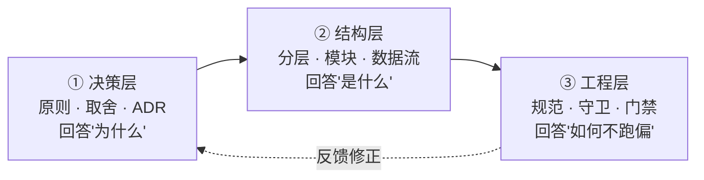

- **决策层**是架构的灵魂：原则、权衡、技术选型及理由。本项目的 ADR-001～013、DEC-1～12 即属此层。
- **结构层**是架构的骨架：分层、模块边界、依赖关系、调用链、状态机。
- **工程层**是架构的肌肉：把决策和结构固化为规范、静态守卫、测试门禁，防止代码随时间腐蚀架构。

**三层各自的验收标准**（如何判断这一层是否"做完了"）：

| 层 | 完成的判定标准 | 本项目的对应证据 |
|:---|:---|:---|
| 决策层 | 每个关键决策有 ADR/DEC，含背景、备选、理由、复审触发条件 | ADR-001（MQ）、ADR-011（基线）、DEC-1～12 |
| 结构层 | 有分层图、模块边界表、依赖规则、核心调用链、状态机，且能回答"为什么这样切" | `系统架构图.md`、v3.1 §2、本文第 4 章 |
| 工程层 | 架构约定有静态守卫或门禁，违反即构建失败，且有反证用例 | `AgentCorePurityTest`、模块方向测试、fail-closed 测试 |

> **关键认知**：很多团队只有结构层（一张模块图），缺少决策层（为什么这样切）与工程层（如何防止被改坏），于是架构在 3～6 个月内退化。本项目的实践特别强调决策留痕与架构守卫，见第 2.7、6.3 节。

**架构退化的典型路径（可识别的早期信号）**：
1. 新人问"为什么用 RabbitMQ 不用 Kafka"，无人能答，或答案与代码不符 → 决策层缺失。
2. 出现 `agent-api` 直接 import `agent-persistence` 内部实现类 → 结构层的依赖约束被突破。
3. code review 反复提醒"记得先 set_config 再查询" → 工程层缺少守卫，靠人肉记忆。
4. 以上任一信号出现，应在下一个迭代内补 ADR 或补守卫，而非等到事故后补救。

### 0.3 本文档的双层结构

每一章都遵循统一的三段式，便于"学方法"与"看落地"两种阅读目的：

1. **通用方法论**：给出可直接迁移到任何后端项目的框架、维度、清单、决策模板。
2. **本项目落地**：映射到 `java-multi-agent` 的真实决策、约束与证据（引用真实文档与模块）。
3. **可复用要点**：把本项目经验抽象为可带走的原则或检查项。

> **阅读建议**：架构师/技术负责人重点读决策层章节（第 2、3、5 章）；后端开发重点读结构层与工程层（第 4、6 章）；产品/业务方重点读第 1、7 章。所有人建议先读 0.4 节的项目坐标。

### 0.4 项目坐标（一眼看懂本项目）

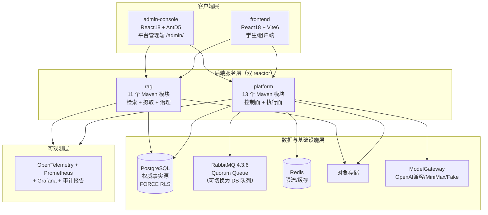

**技术基线（已冻结）**：Java 21 LTS · Spring Boot 4.1.1 · Spring Framework 7 · Jakarta EE 11 · PostgreSQL 17 · RabbitMQ 4.3.6 · MyBatis-Plus 3.5.17 · Druid 1.2.28 · RE2/J 1.8 · JUnit 6。

**核心业务闭环**：创建/发布 Agent → 绑定不可变执行快照 → 创建 Run → Outbox/MQ 投递 → Worker 执行单 Agent Loop → ModelGateway 决策 → 经唯一闸门调用受控工具 → 持久化步骤/事件/结果 → 查询轨迹与审计。

**三条设计主线**：治理期把能力算成**不可变闭包**并双人复核发布；运行期每个 Run **钉死配置快照**、工具调用穿过唯一闸门；全链路以 PG 为权威源、以租约/fencing/UNKNOWN 对账保障可靠性。

**规模与约束基线**（理解本项目所有取舍的前提，后文反复引用）：

| 约束维度 | 取值/事实 | 对架构的直接影响 |
|:---|:---|:---|
| 业务体量 | 单/少租户试运营，首个场景为初中生错题归因 | 拒绝微服务过度设计；模块化单体 + 独立 Worker |
| 消息量级 | 每 Run 一条唤醒消息，低吞吐 | MQ 只需 at-least-once + 死信，Kafka 吞吐优势无用武之地 |
| 并发模型 | 默认消息通道 `database`（PG 表队列）；Worker 并发 4、租户并发 5、单 Run max-steps 20、max-cost 2.00 | 有效并发由队列 + 租约控制；背压护栏看活动通道深度 |
| 数据规模 | platform 库 75 表 / 41 RLS / 49 策略；rag 库 15 表 / 43 策略（含增量）；向量 `halfvec(4096)` | 单库可承载，无需分库分表；PG 同时承担关系与向量检索 |
| 团队/运维 | 小团队、无专职 SRE | 选型以"运维简单"为高权重；社区版 + 接受支持期窗口 |
| 合规 | 未成年人敏感个人信息（PIPL 第 31 条）、模型零保留、数据不出境 | 采集白名单 + 监护人单独同意 + 零保留硬闸门，合规优先于数据丰富度 |
| 时间窗 | 18 周分阶段交付（P0～P4） | Boot 版本须覆盖全周期（故选 4.1.1 而非 4.0.x） |

> 上述基线是**决策的输入，不是结论**。当其中任一项发生变化（如体量增长、社区停维、合规收紧），应依照对应 ADR 的"复审触发条件"重新打开决策——这正是第 3、5、7 章反复强调的演化机制。

---

## 第 1 章 需求分析与梳理体系

> 本章回答：如何把一个模糊的业务诉求，拆解为可设计、可开发、可验收、可追溯的需求体系。

### 1.1 需求分层模型（通用框架）

需求不是一个平面清单，而是**四层递进的金字塔**。每一层回答不同问题，越往下越具体、越可验证：

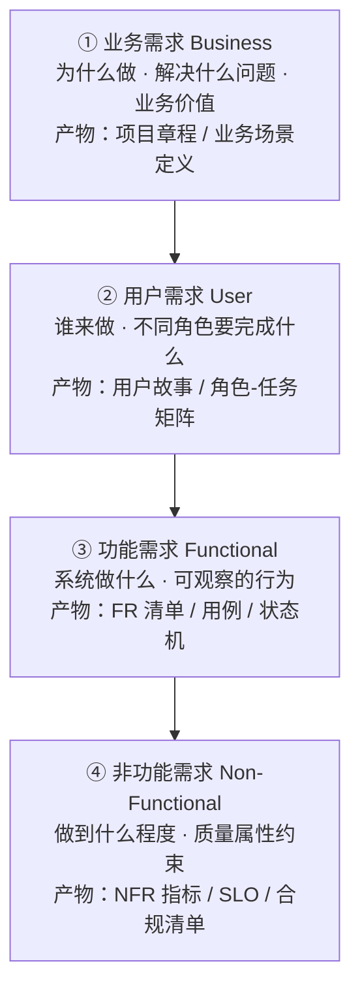

**四层的分工与衔接规则**：

| 层级 | 核心问题 | 典型产物 | 撰写要点 | 常见错误 |
|:---|:---|:---|:---|:---|
| 业务需求 | 为什么做，价值是什么 | 项目章程、场景定义、成功判据 | 用业务语言，可度量价值；明确"不做什么" | 一上来就写接口和表 |
| 用户需求 | 谁用，各自要完成什么 | 角色清单、用户故事、角色-任务矩阵 | 一个角色一条主线；区分主/次参与者与外部系统 | 把所有角色混成"用户" |
| 功能需求 | 系统要提供哪些可观察行为 | FR 编号清单、用例、API 契约、状态机 | 每条 FR 可独立验收；用"系统应……"句式 | 把实现方案写成需求 |
| 非功能需求 | 质量属性与约束的量化要求 | NFR 表、SLO、合规清单 | 尽量可量化；无法量化时给策略与门禁 | 只写"高性能、高可用"等空话 |

**分层的价值**：它建立了"业务变化 → 功能变化 → 技术变化"的追踪链。当业务方说"要加一个审批角色"时，可以沿着链路快速定位受影响的 FR、状态机、表结构与测试用例，而不是全系统盲改。

**四类需求逐项落地字段清单（可直接套用的填写模板）**：

> 字段清单的意义在于"防止漏项"。评审时逐字段检查是否填写，未填即视为需求未定义完成。

**① 业务需求字段清单**：
| 字段 | 填写说明 | 本项目样例 |
|:---|:---|:---|
| 业务目标 | 要解决的业务问题，用价值语言 | 降低初中生错题归因的人工成本 |
| 成功判据 | 可度量的业务结果 | SB-01～07：归因准确、讲解可执行、薄弱点被记录 |
| 目标用户群 | 明确的业务人群 | 12–18 岁初中生，由家长/教师代发 |
| 业务约束 | 法规、政策、伦理限制 | PIPL 第 31 条、监护人单独同意 |
| 不做什么 | 明确的业务边界 | 不做作业批改打分、不做实时在线辅导 |
| 业务负责人 | 谁对业务价值负责 | 产品负责人（AG-PO） |

**② 用户需求字段清单**：
| 字段 | 填写说明 | 本项目样例 |
|:---|:---|:---|
| 角色名称 | 具体角色，非泛化"用户" | 租户管理员、Agent 作者、审批人、平台运维 |
| 角色目标 | 该角色要达成什么 | 审批人：审核具体工具操作及参数摘要 |
| 主线任务 | 该角色的核心操作序列 | 提交 Run → 查看进度 → 处理结果/审批 |
| 权限范围 | 可见/可操作的数据边界 | 只看本租户的 Run |
| 触发方式 | 主动/被动/定时 | 学生提交错题触发 |
| 异常诉求 | 失败时角色期望如何处理 | 连续 3 次失败转人工教师 |

**③ 功能需求字段清单**：
| 字段 | 填写说明 | 本项目样例 |
|:---|:---|:---|
| FR 编号 | 全局唯一 | FR-003 |
| 需求描述 | "系统应……"句式 | 系统应在单事务内创建 Run、事件、幂等记录、Outbox |
| 优先级 | P0/P1/P2 | P0 |
| 前置条件 | 触发前的状态 | 已认证、有 Agent 权限、幂等键有效 |
| 后置条件 | 完成后的状态 | Run=QUEUED，事件/Outbox 已落库 |
| 验收条件 | 可判定通过条件 | 强杀进程后四元素同生共死 |
| 关联 NFR | 约束该 FR 的质量属性 | NFR-003 一致性、NFR-004 幂等 |

**④ 非功能需求字段清单**：
| 字段 | 填写说明 | 本项目样例 |
|:---|:---|:---|
| NFR 编号 | 全局唯一 | NFR-002 |
| 质量维度 | 性能/并发/可用性/安全等 | 数据隔离 |
| 目标值/策略 | 量化或策略化 | 关键表有租户归属和隔离测试 |
| 验证方式 | 如何证明达标 | 跨租户访问反证 IT（NOBYPASSRLS 角色） |
| 责任人 | 谁对达标负责 | 架构 + 安全 |
| 不达标后果 | 风险等级 | 数据泄露，阻断上线 |

> **正反案例**：
> - ✅ 好需求："系统应在 Run 创建事务内写入 Outbox 事件，强杀进程后二者同生共死（NFR-003）。" —— 有行为、有边界、有可判定验收。
> - ❌ 坏需求："系统要支持高并发、性能好、安全可靠。" —— 无具体行为、无量化、无法验收，属于典型的"空话 NFR"。

### 1.2 需求拆解方法：从场景到验收的五级分解

需求拆解是把上层诉求逐层落成可执行单元的标准动作。推荐**五级分解法**：

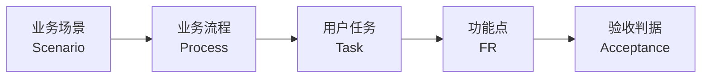

**分解规则**：

1. **场景**：一个完整的、有业务价值的端到端情境（如"学生提交一道错题并获得归因辅导"）。
2. **流程**：场景内的时序步骤，明确触发、输入、处理、输出、异常分支。
3. **任务**：按角色切分流程中的人工动作，形成"角色 × 任务"矩阵。
4. **功能点**：把每个任务中"系统要做什么"抽取为独立 FR，编号管理。
5. **验收判据**：每条 FR 配可判定的通过条件（"能在……时……，且……"），避免主观判断。

**拆分粒度经验法则（INVEST）**：好的功能需求应当独立（Independent）、可协商（Negotiable）、有价值（Valuable）、可估算（Estimable）、小粒度（Small）、可测试（Testable）。当一条 FR 无法单独验收时，通常说明拆得不够或混入了实现细节。

**五级拆解的完整操作步骤（可复用 SOP）**：

| 步骤 | 输入 | 动作 | 输出 | 完成判定 |
|:---|:---|:---|:---|:---|
| S1 定场景 | 业务目标 | 用"谁在什么情况下做什么，得到什么结果"写 1 段场景描述 | 场景卡（含触发/输入/输出/价值） | 场景有明确业务价值且端到端完整 |
| S2 画流程 | 场景卡 | 按时序画出主流程 + 异常分支，标注每个步骤的触发条件 | 流程图（含正常/异常路径） | 每条分支都有起点和终点 |
| S3 切任务 | 流程图 | 把人工动作按角色归类，形成"角色 × 任务"矩阵 | 角色-任务矩阵 | 每个任务有唯一责任角色 |
| S4 抽 FR | 任务矩阵 | 把"系统要做什么"逐句抽出，编号，检查 INVEST | FR 清单 | 每条 FR 可独立验收 |
| S5 写验收 | FR 清单 | 为每条 FR 写 Given/When/Then 形式的可判定判据 | 验收判据表 | 判据无主观形容词 |

**拆解模板（Scenario → FR → Acceptance）**：

```markdown
## 场景 SC-XX：<一句话场景>
- 触发：<什么事件启动>
- 主角色：<谁发起>　次要角色：<谁参与>
- 前置：<系统/数据处于什么状态>
- 输入：<结构化输入字段>
- 主流程：
  1. <步骤1> → 系统行为 → FR-XXX
  2. <步骤2> → 系统行为 → FR-XXX
- 异常分支：
  - 若<条件> → <系统如何处理>（对应 FR-XXX 的异常判据）
- 输出：<结构化输出>
- 成功判据：<可度量的业务结果>

## 拆解出的 FR
| FR | 描述 | 优先级 | 验收判据（Given/When/Then） |
|----|------|--------|---------------------------|
| FR-XXX | 系统应…… | P0 | Given … When … Then … |
```

**错误拆解反例（本项目评审中真实出现过的形态）**：

| 反例 | 表现 | 为什么错 | 正确做法 |
|:---|:---|:---|:---|
| 拆解混入实现 | FR 写成"用 RabbitMQ 发送 run.execute 消息" | 把技术选型当需求，锁死实现 | 写成"系统应异步派发 Run，消息可切换载体" |
| 拆解粒度过粗 | 一条 FR="管理 Run 生命周期" | 无法单独验收，掩盖状态机复杂度 | 拆成创建/查询/取消/重试/终态等多条 FR |
| 拆解粒度过细 | 把"校验幂等键格式"和"校验幂等键冲突"拆成两条独立 FR | 割裂同一业务语义，增加追踪成本 | 合并为"幂等键校验"一条，含两个判据 |
| 角色混淆 | "用户提交 Run"未区分学生/家长/教师代发 | 权限与合规边界丢失 | 明确代发关系，绑定审计主体 |
| 验收含主观词 | "响应要快""体验要好" | 无法判定通过 | 改为"P95 < X ms（压测后定档）" |

> **避坑要点**：拆解时若发现某条 FR 反复提到具体技术名词（MQ、表名、框架），大概率是"把设计写成需求"，应回退到"系统应做什么"的行为描述。反之，若某条 FR 无法写出 Given/When/Then，说明粒度或边界有问题。

### 1.3 边界定义：MVP、非目标与红线

需求管理的第一要务不是"加什么"，而是**明确"不加什么"**。边界定义包含三类：

| 边界类型 | 作用 | 表达方式 | 本项目示例 |
|:---|:---|:---|:---|
| **MVP 范围** | 首期必须交付的最小闭环 | "必须包含"清单 + 不可妥协验收边界 | Agent 管理、Run 生命周期、异步执行、租户安全、审批、预算……（P0-D03 §2） |
| **非目标** | 明确排除，防止范围蔓延 | "首期不做"清单 + 重新纳入条件 | 通用多 Agent 协作、DAG 引擎、插件市场、完整账单、首期 RAG……（P0-D03 §3） |
| **红线/不可妥协** | 安全与一致性底线，任何取舍不可突破 | 编号化的硬约束 | 17 条验收红线（P0-D03 §4）、"不能妥协的十条原则"（v3.1 §0.4） |

**关键设计**：非目标不是"永远不做"，而是**附带"重新纳入条件"**。例如本项目"未经验证的 RAG"的重新纳入条件是：需同时满足数据 owner、评测集、访问模型、收益指标，且评测显示参数内知识不足以支撑归因准确性。这样既守住了首期边界，又保留了演进通道。

**边界三步落地法（如何定义并守住边界）**：
1. **列必做**：从 MVP 闭环倒推，列出"不做就不成立"的能力（如 Run 创建、状态持久化、租户隔离）。
2. **列不做并为每项写重新纳入条件**：防止范围蔓延，同时留下演进通道（见下表）。
3. **列红线**：把"即使压缩范围也绝不让步"的安全/一致性底线编号化（17 条验收红线）。

**本项目非目标 / 阶段性舍弃点 / 未来可扩展点完整清单**：

| 类别 | 项目 | 舍弃/延后原因 | 重新纳入条件（触发点） |
|:---|:---|:---|:---|
| 非目标 | 通用多 Agent 协作 | 增加调度/上下文/故障语义复杂度 | 单 Agent 业务价值被验证并形成独立需求 |
| 非目标 | 通用 DAG/工作流引擎 | 超出首期闭环必要范围 | 有明确业务流程、用例和产品负责人 |
| 非目标 | 插件市场 | 涉及分发/版本兼容/供应链/租户治理 | 插件治理模型与安全沙箱专项评审通过 |
| 非目标 | 任意脚本执行/不可信插件沙箱 | 高风险执行面 | 独立威胁模型 + 隔离方案 + 安全批准 |
| 非目标 | 完整商业账单/发票/支付 | 首期只需预算与 usage 一致性 | 商业计费需求与财务口径确认 |
| 非目标 | 通用 BPM 审批中心 | 首期仅约束具体工具操作 | 多业务线复用需求成立且另立项目 |
| 阶段性舍弃 | 首期 RAG/知识库（DEC-5） | 首场景用模型参数内知识，避免编造出处 | 数据 owner + 评测集 + 访问模型 + 收益指标齐备，且评测证明参数内知识不足 |
| 阶段性舍弃 | 无限期保存 Token 流 | 隐私/成本/存储压力 | 明确业务理由 + 保留策略 + 费用审批 |
| 阶段性舍弃 | 固定吞吐 SLA 承诺 | 未完成容量评估 | 压测完成 + 业务/运维批准 SLO |
| 阶段性舍弃 | 自动重试所有失败工具 | 可能重复执行副作用 | 仅针对幂等/可查询且策略明确的操作 |
| 未来扩展点 | 上下文压缩 S4（M11/M12/M14） | ADR-013 定为后续阶段 | 长上下文成本成为瓶颈 |
| 未来扩展点 | RLS→应用层权限彻底迁移 | 影子期需观察真实流量 | `rlsDependent=0` + 观察期达标（M4） |
| 未来扩展点 | 瓶颈模块服务化 | 当前模块化单体已够用 | 某模块成为明确性能/部署瓶颈 |

> **红线判定依据**：是否为红线不看"业务价值高低"，而看三点——① 是否涉及**法律合规**（未成年人数据、PIPL）；② 是否涉及**数据一致性底线**（事务原子、幂等、fencing）；③ 是否涉及**安全隔离**（租户边界、授权）。三条中命中任一，即列为红线，不参与优先级裁剪。

### 1.4 优先级划分：从 P0/P1/P2 到价值-风险双轴

**通用方法**：优先级不是单一维度排序，而是"价值 × 风险 × 依赖"的综合判断。推荐两层法：

- **第一层：阶段标签**。P0 = 首期闭环/安全/一致性所必需，不满足不得进入下一阶段；P1 = 首期需要但可按阶段交付；P2 = 明确延期或后续增强。
- **第二层：价值-风险四象限**。在标签内，用"业务价值高低"与"技术/安全风险高低"进一步排序。

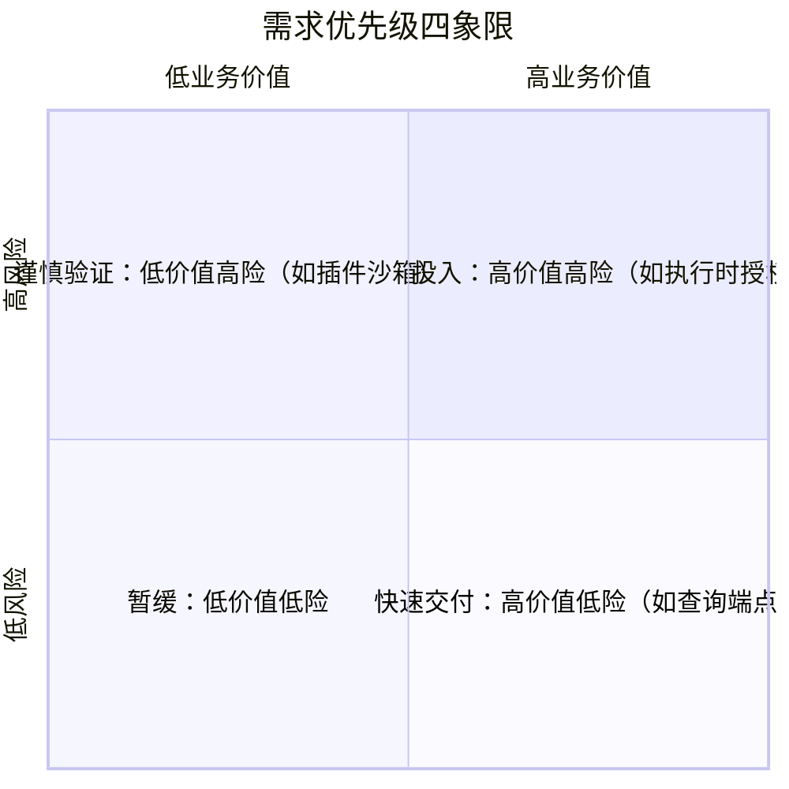

**取舍铁律**：**安全性与一致性相关的需求，优先级不参与"价值"折价**。即使没有直接业务价值，只要涉及租户隔离、副作用幂等、未成年人数据合规，一律 P0。本项目 `record_weakness` 的幂等与 UNKNOWN 对账即属此类。

**P0/P1/P2 判定标准（决策树）**：

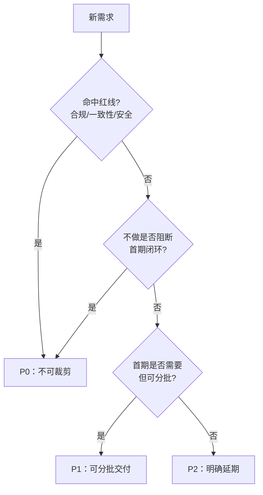

**优先级裁剪规则**（当时间/资源不足时，按此顺序砍需求）：
1. **先砍 P2**：直接移入 backlog，附带重新纳入条件。
2. **再砍 P1 的"分批"部分**：P1 按 MVP-A/B/C/D 分批，保留核心批次，延后增强批次。
3. **绝不砍 P0**：若 P0 无法完成，应**缩减场景范围**（如减少工具数量），而非降低安全/一致性标准。
4. **裁剪必须留痕**：每次裁剪记录"砍了什么、为什么、何时补回"，更新 RTM 状态为 Deferred。

> **本项目实例**：MVP 分批 A（Agent/认证/Run 创建）→ B（Outbox/Worker/ModelGateway）→ C（SSE/授权/预算审批）→ D（UNKNOWN/fencing/故障注入）。但明确声明"此分批不表示可在未满足安全门禁时把有副作用工具提前开放给真实用户"——即分批只管交付顺序，不管安全底线。

### 1.5 需求取舍的标准化决策：DEC 决策基线

**问题**：需求冲突时（如"要快上线" vs "要先确认模型零保留条款"），如何做出可追溯、可推翻、可审计的取舍？

**通用框架 —— 决策基线（DECision baseline）**。每条决策固定记录六个字段：

| 字段 | 含义 |
|:---|:---|
| 编号 | DEC-N，全局唯一 |
| 决策内容 | 一句话结论 |
| 背景/冲突 | 当时面临的两个或多个选项及张力 |
| 决策依据 | 基于什么事实与原则 |
| 影响与约束 | 对其他需求/设计/阶段的连带影响 |
| 复审触发条件 | 什么情况下重新打开该决策 |

**本项目落地**：项目用 DEC-1～12 冻结了 12 项关键取舍，例如：

| 决策 | 内容 | 取舍逻辑 |
|:---|:---|:---|
| DEC-1 | AI Agent 承担产品/业务分析角色 | 项目资源约束下的角色分配决策 |
| DEC-2 | 首个业务场景冻结为"初中生错题归因与个性化辅导" | 用单一真实场景收敛范围，避免泛化 |
| DEC-5 | 首期不做 RAG，使用模型参数内知识 | 排除不可信外部知识，优先保证"不编造出处" |
| DEC-6 | 未成年人数据白名单 + 监护人单独同意 | 合规底线优先于数据丰富度 |
| DEC-9 | 预算/并发/审批策略配置化，fail-closed，快照隔离 | 灵活性不能以"配置成后门"为代价 |
| DEC-10 | 模型零保留条款未确认前禁止真实学生数据进 Prompt | 合规硬闸门，允许阶段延后但不允许越线 |

**DEC 决策逐条释义（完整 12 条，按影响域归类）**：

| 决策 | 内容 | 背景/冲突 | 决策依据 | 影响与约束 | 复审触发 |
|:---|:---|:---|:---|:---|:---|
| DEC-1 | AI Agent 承担产品/业务分析角色 | 团队资源有限 vs 需要完整角色配置 | 项目资源约束 | 需 AI 审查独立性（ISO-1/2）对冲 | 角色配置到位 |
| DEC-2 | 首场景冻结为错题归因辅导 | 场景泛化 vs Single 场景收敛 | 单一真实场景可验证 | 工具限定 get_student_profile/record_weakness | 业务价值被证伪 |
| DEC-3 | IAM/PG/模型等由负责人自提供 | 自建 vs 复用 | 复用降低成本 | 版本/HA 待登记 | 环境策略变化 |
| DEC-4 | 技术基线 Java 21 + Boot 4.x | Boot 3.x vs 4.x | 生态对齐（ADR-011） | Jackson 3/Security 7 破坏性变更 | 生态不兼容 |
| DEC-5 | 首期不做 RAG | 外部知识丰富度 vs 不编造出处 | 首场景用参数内知识 | 需评测证明参数内知识不足才重开 | 评测不达标 |
| DEC-6 | 未成年人数据白名单 + 监护人同意 | 数据丰富度 vs 合规 | PIPL 第 31 条 | 采集限于随机 ID/年级/学科/薄弱点 | 法规变化 |
| DEC-7 | AI 审查独立性 | 效率 vs 客观性 | 避免自审自 | Sev-0/1 外部抽检 ≥30% | 无 |
| DEC-9 | 预算/并发/审批配置化 + fail-closed + 快照 | 硬编码 vs 灵活性 | 灵活不能以配置成后门为代价 | 配置缺失拒绝；快照隔离 | 压测调优 |
| DEC-10 | 零保留条款未确认前禁真实数据进 Prompt | 进度 vs 合规 | 合规硬闸门 | P1 用模拟数据；GATE 1/2/3 | 条款确认 |
| DEC-11 | 审批策略配置化 | 硬编码审批 vs 风险分级 | record_weakness=WRITE_PROFILE/OPTIONAL | 放松属门禁降级需评审 | 风险策略调整 |
| DEC-12 | 主 MQ 用 RabbitMQ | 见 ADR-001 | 定位为唤醒信号 | 接受社区支持期窗口 | 4.4 GA / 停维 |

> DEC 编号中 DEC-8 在决策基线中留空/未单列，属编号连续性处理，不影响决策完整性。

> **方法论要点**：DEC 与后文 ADR（第 3 章）是互补的——**DEC 记录"需求层"的取舍**（做什么、什么边界），**ADR 记录"技术层"的取舍**（怎么做、选哪个方案）。二者共同构成"决策留痕"，是架构可推翻、可复审的基础。

### 1.6 需求追踪矩阵（RTM）：让每条需求有归宿

**通用做法**：建立"需求 → 设计 → 代码 → 测试"的双向追踪矩阵，确保：

- 每条需求都有对应的设计文档与实现；
- 每条需求都有对应的验收用例；
- 每个测试用例都能回溯到某条需求（防止"测试了不该测的"）。

| 需求 ID | 设计文档 | 实现模块 | 验收用例 | 状态 |
|:---|:---|:---|:---|:---|
| FR-003 Run 创建 | P0-D03 / v3.1 §4 | `RunCreationService` | RunCreationIT：四元素同事务 | Draft→Done |
| FR-017 fencing | v3.1 §3.5 / ADR-001 | `JdbcRunClaimRepository` | fencing 接管反证 IT | Done |
| NFR-002 数据隔离 | P1 PoC | `TenantSessionBinder` | 跨租户访问反证 | Done |

**本项目落地**：`P0-D04_验收标准与需求追踪矩阵.md` 及 `multi-level-agent/09_需求追踪矩阵.md`、`permission-sys/P6_需求追踪终态矩阵.md` 分别覆盖主线与专题的需求追踪。

**RTM 完整字段与维护规则**：

| 字段 | 说明 | 填写要求 |
|:---|:---|:---|
| 需求 ID | FR-XXX / NFR-XXX | 与 SRS 严格一致 |
| 需求描述 | 一句话 | 不得含实现细节 |
| 优先级 | P0/P1/P2 | 与判定树一致 |
| 设计文档 | 定位到章节 | 精确到 § |
| 实现模块/类 | 代码落点 | 精确到类或包 |
| 验收用例 | 测试类/方法 | 精确到方法名 |
| 验收级别 | 单元/API/业务 | 三级之一 |
| 状态 | Draft/In Review/Approved/Deferred/Rejected/Done | 只用枚举值 |
| 反向覆盖标记 | 是否有反证用例 | 安全/一致性需求必须有 |

**RTM 的四条维护纪律**：
1. **双向性**：既要"需求→测试"（防漏测），也要"测试→需求"（防测无用功能）。评审时抽查反向链。
2. **状态即真相**：需求状态只以 RTM 为准，禁止口头宣称"已完成"。代码合并 ≠ Done，须验收通过才置 Done。
3. **红线需求强制反证**：涉及安全/一致性的 FR，验收用例必须包含反证（撤掉修复点会红），否则不予 Done。
4. **变更同步**：需求变更（CHG-编号）必须同步更新 RTM 的受影响行，否则视为变更未完成。

> **本项目落地证据**：主线有 `P0-D04`，多 Agent 专题有 `09_需求追踪矩阵.md`，权限专题有 `P6_需求追踪终态矩阵.md`；每条需求状态用 `Draft/In Review/Approved/Deferred/Rejected`（SRS §1 定义），使"进行到哪一步"一目了然。

### 1.7 落地全景：本项目需求体系地图

把上述方法论映射到本项目，形成一张完整的需求体系地图：

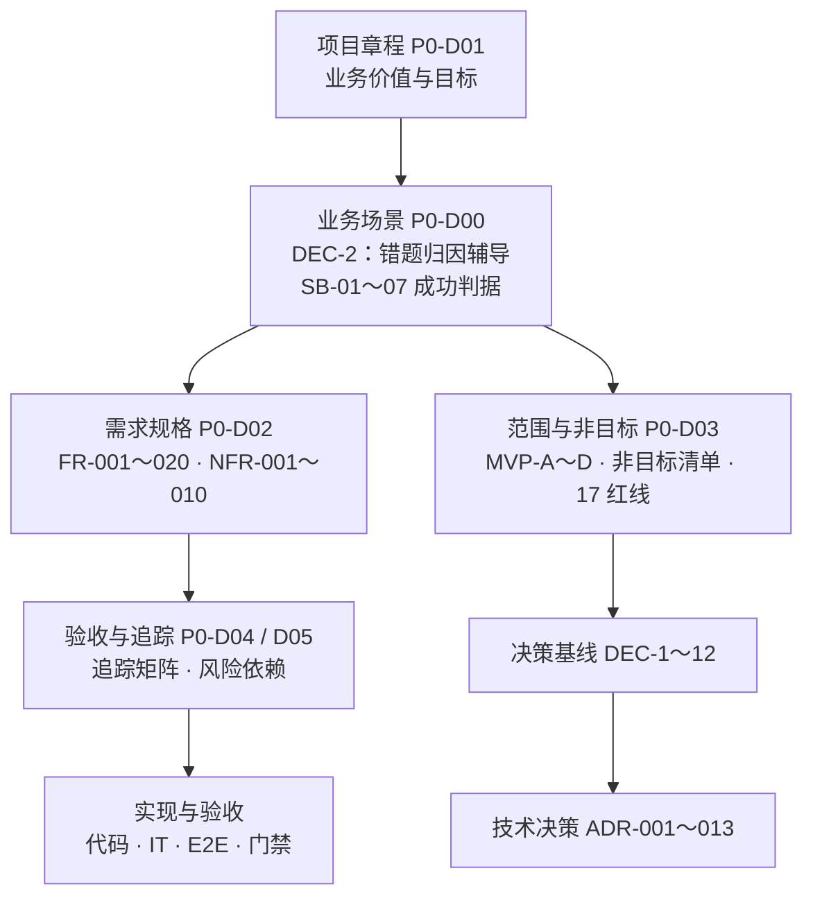

**需求分层对照表（本项目）**：

| 层级 | 本项目内容 |
|:---|:---|
| 业务需求 | 为初中生提供错题归因与个性化辅导；输出归因结论、错因讲解、可执行步骤、薄弱点更新；成功判据 SB-01～07 |
| 用户需求 | 租户管理员、Agent 作者/业务用户（学生，家长/教师代发）、审批人、平台运维/SRE；外部系统 IAM/OIDC、模型服务、MQ、PG、业务工具 |
| 功能需求 | FR-001～020：Agent 版本、Run 创建、状态持久化、异步 Worker、ModelGateway、Tool SPI、执行时授权、UNKNOWN 对账、协作式取消、预算、审批、多租户隔离、Outbox、fencing、审计…… |
| 非功能需求 | NFR-001～010：安全、数据隔离、一致性、幂等、可恢复性、性能、可观测性、隐私、可维护性、灾备 |

**非功能需求的量化策略**（本项目体现"能量化则量化，不能量化则给策略与门禁"）：

| 维度 | 本项目处理 |
|:---|:---|
| 性能 | 建基线但不预先承诺 SLA："数值待容量评估，禁止预先承诺"；内置 `@ConcurrencyLimit`、租户并发上限 5、单 Run max-steps 20 |
| 并发 | 单租户并发、模型并发、Worker 并发可配置；消息通道默认 database，有效并发由队列与租约控制 |
| 可用性 | RPO 24h / RTO 4h 作为可配置初值（DEC-9），P4 演练后确认 |
| 可扩展性 | 端口-适配器架构、消息通道可切换、配置快照隔离 |
| 可维护性 | 模块边界清晰、接口契约与自动化测试同步、架构守卫 |
| 安全性 | 未成年人数据白名单、PIPL 第 31 条监护人单独同意、RLS + 执行时授权、模型零保留硬闸门 |
| 兼容性 | Java 21 / Boot 4.1.1 基线，配套 Jackson 3 / Security 7 / Jakarta EE 11 矩阵与回滚方案（ADR-011） |

### 1.8 可复用要点（本章带走清单）

- [ ] 用"业务→用户→功能→非功能"四层金字塔组织需求，拒绝平面清单。
- [ ] 用"场景→流程→任务→功能点→验收"五级分解，每条 FR 独立可验收（INVEST）。
- [ ] 边界三件套：MVP 范围、非目标（含重新纳入条件）、不可妥协红线。
- [ ] 优先级 = 阶段标签（P0/P1/P2）+ 价值-风险象限；安全/一致性需求不参与价值折价。
- [ ] 需求层取舍用 DEC 决策基线（六字段），技术层取舍用 ADR（第 3 章）。
- [ ] 建立双向需求追踪矩阵（RTM），让每条需求有设计、有实现、有测试。
- [ ] NFR 能量化则量化，不能量化则给"策略 + 门禁"，杜绝"高性能/高可用"空话。

---

## 第 2 章 架构设计核心原则

> 本章回答：架构设计应遵循哪些工程化原则，以及在本项目场景中如何具体落地。原则是"道"，选型（第 3 章）是"术"。

### 2.1 原则体系总览

企业级后端架构的原则可分为四组，彼此支撑、偶有张力（张力在第 5 章处理）：

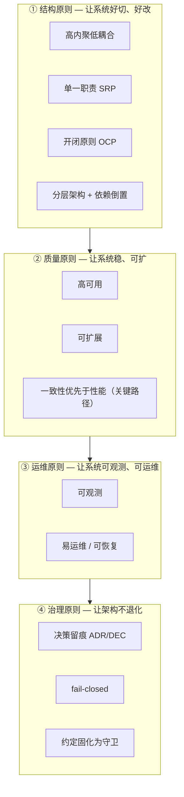

### 2.2 结构原则：高内聚低耦合、单一职责、开闭

**通用内涵**：

| 原则 | 定义 | 落地手法 | 反面信号 |
|:---|:---|:---|:---|
| 高内聚低耦合 | 相关功能聚在一起，跨模块依赖最小化 | 按业务域/限界上下文切模块；端口隔离外部依赖 | 改一个功能要动 5 个模块 |
| 单一职责 | 一个模块/类只有一个变化原因 | 控制面与执行面分离；Service 按职责拆分 | 一个类既校验、又调用、又持久化、又推送 |
| 开闭原则 | 对扩展开放、对修改封闭 | 接口 + 多实现；策略/注册表；特性开关 | 每加一种模型供应商都改核心代码 |

**本项目落地**：

- **控制面与执行面分离**：`agent-api`/`agent-application`（同步治理与编排）与 `agent-worker`（异步执行）物理分模块，避免执行循环的重负载拖垮管理端点。
- **端口-适配器实现开闭**：`agent-ports` 定义 `ModelGateway`、`ToolHandler`、`MessageSender`、`QueueDepthProbe` 等端口，`agent-infrastructure` 提供多实现。新增模型供应商（OpenAI 兼容 / MiniMax / Fake）只需加实现类，不改领域层。
- **消息通道可切换是 OCP 的教科书案例**：`MessageSender` 端口前移到 `agent-ports`，使"换异步载体"从"改代码 + 重新发版 + 全链路重验"变成"改一个环境变量"（见第 3.6 节）。

> **证据**：ADR-011 明确"领域层零框架依赖"由 `AgentCorePurityTest` 在编译期守住——`agent-core` 编译期依赖**仅 JSpecify**。这是"开闭 + 依赖倒置"被固化为自动检查的典范，也是 Boot 版本可回滚的红利来源。

### 2.3 分层架构与依赖方向

**通用做法**：分层架构的价值不在"分了几层"，而在**依赖只能单向流动**。一旦出现反向依赖或跨层穿透，分层就名存实亡。

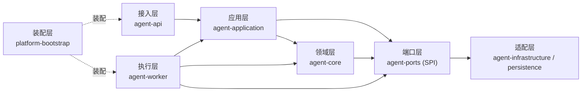

**本项目的依赖铁律**：

1. `agent-core` 不依赖 Spring AI、MQ SDK、Web 框架、数据库驱动——只认 JSpecify 与端口。
2. 数据库访问只在 `agent-persistence` 一个模块（ADR-011）；main 侧 JDBC import 只允许出现在 persistence。
3. `agent-worker` 不把 MQ 消息体当作权威任务状态，收到消息后回数据库读取。
4. 异步边界通过持久化 ID 与 DTO 传递，不依赖跨线程 `ThreadLocal`。
5. 模块依赖方向由 `ModuleDependencyDirectionTest` 等静态测试守护，方向错了构建就红。

> **实践警示（来自项目真实踩坑）**：组件扫描类若有 ≥2 个构造函数，必须用 `@Autowired` 显式标注；多 Bean 注入点必须 `@Qualifier`。这类"Spring 隐式行为"是分层依赖在运行时被破坏的常见暗门，已被写入项目铁律。

**分层依赖禁止项清单（评审逐条 Check）**：

| 编号 | 禁止项 | 为什么禁止 | 检测手段 |
|:---|:---|:---|:---|
| F-1 | `agent-core` 依赖 Spring/MQ/DB 驱动 | 领域层失去纯净性，无法跨版本回滚 | `AgentCorePurityTest` 编译期检查 |
| F-2 | `agent-api` 直接 import `agent-persistence` 内部实现类 | 跨层穿透，绕过应用层事务边界 | `ModuleDependencyDirectionTest` |
| F-3 | controller 直接调 persistence | 业务逻辑散落，无法复用与测试 | 代码评审 + 架构守卫 |
| F-4 | 数据库访问出现在 `agent-persistence` 之外的模块 | 多数据源实现分散，RLS 难以统一 | 包级 import 扫描守卫 |
| F-5 | `agent-routing` 依赖 application/infrastructure | 路由引擎应只认领域层 | `ModuleDependencyDirectionTest` |
| F-6 | 全局 Agent 表的租户读路径把谓词放 WHERE 而非 ON | FORCE RLS 下 JOIN 语义错误，数据泄露 | `JoinTenantPredicateArchitectureTest`（只认 ON 内谓词） |
| F-7 | 异步边界依赖 ThreadLocal 传递上下文 | 虚拟线程/跨线程不传播，上下文丢失 | 代码评审 + 集成测试 |

**模块隔离细则**：
- **一个 persistence 边界**（ADR-011）：所有 SQL/ORM 集中在 `agent-persistence`，其余模块只见 Port 接口。
- **配置读取单一机制**：`@ConfigurationProperties` 与 `@Value` 集中管理，禁止散落的 `System.getProperty`。
- **特性开关隔离**：十余项特性开关通过 `agent.*` 前缀统一入口，禁止硬编码 `if(true)`。

**边界契约规范**：

| 契约类型 | 规范 | 本项目示例 |
|:---|:---|:---|
| 端口契约 | 只定义能力，不含实现；签名稳定 | `ModelGateway`、`ToolHandler`、`MessageSender` |
| DTO 契约 | 跨模块传递用 DTO，不暴露领域实体 | Run 查询结果用 ReadModel 而非 Run 实体 |
| 异步契约 | 用持久化 ID + 明确 DTO，不传对象引用 | 消息体只含 runId/tenantId/attempt/fencingToken |
| 事件契约 | 事件有单调 seq、可续传、可授权过滤 | `(tenant_id, run_id, seq)` 唯一且单调 |

> **边界失效的典型信号**：某天要换 MQ，发现业务代码里到处 `new RabbitTemplate()`——说明 F-4/F-7 被突破。本项目把 `MessageSender` 前移到 `agent-ports`，正是为了让"换载体"变成改配置（第 3.6 节）。

### 2.4 质量原则：高可用、可扩展、一致性优先

**高可用**：不是"永远不宕机"，而是"**故障时行为确定、可恢复、不产生错误副作用**"。

- 本项目以 PG 为权威事实源，MQ 仅为"唤醒信号"，Worker 收到消息后按 DB 状态领取任务——这使"消息重复/延迟/乱序"不会破坏状态一致性。
- 租约（lease）+ fencing token：Worker 崩溃后租约过期，新世代接管并递增 fencing；旧世代的写入因 token 不匹配被拒绝，杜绝脑裂。
- UNKNOWN 状态：外部调用结果不确定时进入对账，禁止盲目重试或直接释放预算。

**可扩展**：通过"端口 + 配置 + 快照"实现低成本扩展。

- 配置快照隔离：成本上限、并发上限、审批策略在 Run 创建时写入 `ExecutionSnapshot`，运行中改配置只影响新 Run——这既保证可解释性，也使"策略灰度"成为可能。
- 多对多 Agent 绑定：Agent 全局化 + `tenant_agent_binding` 绑定表，使"新增租户可用 Agent"无需复制 Agent 定义。

**一致性优先于性能**：在关键路径（Run 状态、预算、事件、Outbox）宁可牺牲吞吐也要保证原子性。

- Run 创建：`run` + `run_event` + 幂等记录 + `outbox_event` **四元素同事务**提交。
- 预算：调用前原子预留、调用后结算，禁止"先查余额再插入"的非原子实现。

### 2.5 运维原则：可观测、易运维、可恢复

| 原则 | 通用要求 | 本项目落地 |
|:---|:---|:---|
| 可观测 | 日志/指标/Trace 三位一体，且可关联 | OpenTelemetry + Micrometer + Prometheus/Grafana；`ai.model.*`、`cap.enforcement_status` 指标族；run/trace/correlation ID 贯穿 |
| 低基数与脱敏 | 指标标签不得高基数敏感字段 | 指标标签基数受控；日志不泄漏密钥与 PII；敏感词扫描豁免结构性标识符 |
| 易运维 | 有 Runbook、告警责任人、恢复演练 | `CAP_运维检查清单_Runbook`；死信队列可重放；`scripts/` 提供 init-db、迁移、种子、JWT 密钥生成 |
| 可恢复 | 失败可定位、可重放、可人工兜底 | 死信表/队列、UNKNOWN 对账服务、孤儿收敛、僵尸任务清扫 |

> **指标口径纪律（本项目沉淀）**：未采集 ≠ 0；覆盖率必须带样本量；"链路成功" ≠ "任务成功"。这三条防止了可观测性本身制造虚假安全感。

### 2.6 治理原则：决策留痕、fail-closed、约定固化

这三条是本项目最有辨识度的原则，也是"架构不退化"的关键：

1. **决策留痕**：DEC 决策基线 + ADR 技术决策，每条都记录背景、依据、影响、复审触发条件。任何偏离基线（如 Boot 3.x→4.1.1）都必须有 ADR 记录影响面与回滚方案。
2. **fail-closed（默认拒绝）**：
   - 配置缺失或非法 → 拒绝启动/拒绝执行，绝不"静默放行"。
   - 授权判定默认拒绝（`RoleBasedAuthorizationService`）；未知角色前端 fail-closed。
   - 迁移链异常 → 连接标记 POISONED，禁止 fail-soft 后 COMMIT。
   - 能力快照 fail-closed：能力目录缺失时拒绝 Run 创建。
3. **约定固化为守卫**：把架构约定写成自动化测试（静态守卫），使"违反约定 = 构建失败"，而非依赖 code review 的人肉记忆。

### 2.7 本项目"不可妥协的十条原则"

v3.1 架构方案 §0.4 明确十条红线，它们是所有后续设计的地基：

| # | 原则 | 一句话 |
|:--:|:---|:---|
| 1 | 模型只提建议 | 平台负责授权、调度、执行、持久化与交付 |
| 2 | 可信上下文服务端构造 | tenant_id/actor/权限/run_id/trace_id 不接受模型覆盖 |
| 3 | PG 是权威事实源 | MQ 只负责唤醒与分发 |
| 4 | Run 与 Outbox 同事务 | 状态与事件原子提交 |
| 5 | 单调递增 fencing | 旧世代不能更新新世代状态 |
| 6 | 副作用工具须可幂等/对账 | 结果未知禁止盲目重放 |
| 7 | 发布后快照不可变 + 每次执行重授权 | 安全在每次工具执行前动态检查 |
| 8 | 预算服务端强制 | 调用前预留、调用后结算、幂等 usage |
| 9 | 外部输入不可信 | 网页/检索/工具结果不得升级为系统指令 |
| 10 | 先单 Agent 闭环 | 不以复杂编排替代可靠性基础 |

> 这十条对应第 1 章的"红线"、第 5 章的"取舍底线"，是全项目判断"能否妥协"的最终依据。

**十条原则逐条深度展开（释义 / 落地场景 / 禁止场景 / 违规后果 / 校验方式）**：

**原则 1｜模型只提建议**
- **释义**：LLM 的输出是"计划与工具调用建议"，不是可执行指令；平台是唯一的执行主体。
- **落地场景**：`RunExecutionLoop` 接收模型建议后，经 `ToolInvocationGate` 校验才执行；模型建议的 tenant_id、权限范围一律忽略。
- **禁止场景**：禁止 Spring AI `ToolCallingAdvisor` 的自动工具循环（它绕过闸门）；禁止按 Bean 名自动解析工具。
- **违规后果**：模型可绕过授权直接调用工具，等于把执行权交给不可信输入（Sev-0）。
- **校验方式**：代码评审检查工具调用唯一入口；禁用自动 Advisor 的架构约束（ADR-011 §3.3）。

**原则 2｜可信上下文服务端构造**
- **释义**：tenant_id、actor_id、权限范围、run_id、trace_id 由服务端从认证态构造，不接受模型或客户端覆盖。
- **落地场景**：`TenantContext` 由认证链注入；消息体只带最小化 ID，Worker 回 DB 复核租户归属。
- **禁止场景**：禁止把 client 传来的 tenantId 作为授权依据（租户链 SSE 明确禁带 tenantId）。
- **违规后果**：跨租户越权，数据泄露。
- **校验方式**：跨租户访问反证 IT（NOBYPASSRLS）；SSE 受众隔离测试。

**原则 3｜PG 是权威事实源**
- **释义**：Run 状态、事件、Outbox、ToolOperation、Approval、Usage 的唯一事实源是 PostgreSQL。
- **落地场景**：MQ 消息只是唤醒信号，Worker 收到后按 runId 回 DB 读取权威状态。
- **禁止场景**：禁止把消息体、Redis、内存变量当作任务状态；禁止"先查缓存状态再决定执行"。
- **违规后果**：消息重复/延迟/乱序导致状态错乱或重复执行。
- **校验方式**：重复投递 3 次幂等测试；强杀进程后状态-from-DB 一致性检查。

**原则 4｜Run 与 Outbox 同事务**
- **释义**：Run 创建时，`run` + `run_event` + 幂等记录 + `outbox_event` 在同一 DB 事务提交。
- **落地场景**：`RunCreationService` 的事务边界覆盖四元素。
- **禁止场景**：禁止"先提交 Run 再发消息"（崩溃窗口导致任务永不执行）；禁止"先发消息再提交 Run"（幽灵消息）。
- **违规后果**：任务丢失或幽灵执行。
- **校验方式**：创建后强杀进程，检查四元素同生共死（ADR-001 §6）。

**原则 5｜单调递增 fencing**
- **释义**：每个 Worker 执行世代持有 fencing_token，领取/接管时单调递增；旧世代写入被拒。
- **落地场景**：`JdbcRunClaimRepository` 在事务内 set_config + fencing 字段更新；关键写入校验 run_id + lease_owner + fencing_token。
- **禁止场景**：禁止终态后补 attempt；禁止不校验世代就写状态。
- **违规后果**：Worker 崩溃接管后，旧世代"复活"写入，脑裂导致状态回退或重复副作用。
- **校验方式**：强杀 Worker 后接管的反证 IT（旧 token 写入被拒）。

**原则 6｜副作用工具须可幂等/对账**
- **释义**：有副作用的工具必须有下游幂等键、可查询对账或受控人工处理；UNKNOWN 不得盲目重试。
- **落地场景**：`record_weakness` 幂等键 = student_id + run_id + knowledge_point；UNKNOWN 进 `ToolOperationReconciliationService`。
- **禁止场景**：禁止对 UNKNOWN 自动重试；禁止无限重投（delivery-limit 固定为 3）。
- **违规后果**：重复写入画像（Sev-0），或预算被错误释放。
- **校验方式**：UNKNOWN 状态机测试（仅能转对账/人工）；重复幂等键测试。

**原则 7｜发布后快照不可变 + 每次执行重授权**
- **释义**：Agent 版本与 ExecutionSnapshot 发布后不可变；每次工具执行前重新检查当前授权。
- **落地场景**：Run 绑定快照 ID；`ToolInvocationGate` 15 步准入含执行时授权。
- **禁止场景**：禁止原地修改已发布版本；禁止用 Run 创建时的授权结果贯穿整个执行期（TOCTOU）。
- **违规后果**：行为不可解释；权限被回收后仍可执行。
- **校验方式**：不可变触发器测试；执行时授权拒绝路径测试。

**原则 8｜预算服务端强制**
- **释义**：预算由服务端强制执行，调用前原子预留、调用后结算，重复 usage 幂等。
- **落地场景**：`BudgetService` 原子预留账本；judge 成本绝不混入 `usage_record`。
- **禁止场景**：禁止"先查余额再插入"的非原子实现；禁止把配置上限当实际扣费依据（配置只作输入，DB 原子更新为准）。
- **违规后果**：并发超发；重复计费。
- **校验方式**：并发预留测试（不超发）；幂等 usage 测试。

**原则 9｜外部输入不可信**
- **释义**：网页、检索内容、工具结果均为不可信数据，不得升级为系统指令（Prompt Injection 防护）。
- **落地场景**：RE2/J 线性正则做注入检测（禁环视）；工具输出限流 `ToolOutputLimiter`。
- **禁止场景**：禁止把检索文本拼进系统 Prompt 模板的指令区；禁止用 java.util.regex 的回溯正则处理用户输入（ReDoS）。
- **违规后果**：提示词注入，模型被劫持执行非授权操作。
- **校验方式**：Prompt 注入红队回归（P3-D09）。

**原则 10｜先单 Agent 闭环**
- **释义**：首期交付可靠单 Agent 闭环，不以复杂编排替代可靠性基础。
- **落地场景**：MVP 顺序 A→B→C→D，先可靠性后编排；多 Agent 列为非目标。
- **禁止场景**：禁止在 fencing/UNKNOWN/授权未可靠前引入 DAG 或多 Agent 调度。
- **违规后果**：在可靠性地基未稳时叠加复杂度，故障语义不可控。
- **校验方式**：MVP 范围评审（P0-D03）；非目标清单守住。

> **使用方式**：这十条是**评审清单**。任何设计评审都可逐条问"本设计是否触碰某条原则的禁止场景"，命中即打回。它们也是新人培训的"架构红线第一课"。

### 2.8 原则间的张力与裁决优先级

原则之间并非总是和谐。当冲突发生时，本项目采用明确的裁决优先级：

```
安全/合规 > 一致性/正确性 > 可恢复性 > 可用性 > 性能 > 开发效率
```

**典型裁决示例**：

- "提高性能" vs "Run 与 Outbox 同事务" → 选同事务（一致性优先），用 Outbox 批量发布缓解性能。
- "快速接入真实学生数据" vs "模型零保留条款未确认" → 选延后接入（合规优先，DEC-10）。
- "自动重试一切失败" vs "副作用幂等/对账" → 选对账（正确性优先，拒绝盲目重试）。

**完整裁决流程（五步法）**：

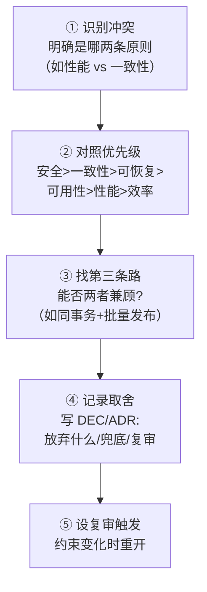

**裁决判定案例（扩充）**：

| 冲突场景 | 冲突的原则 | 裁决结果 | 依据 | 第三条路/兜底 |
|:---|:---|:---|:---|:---|
| 提高写入吞吐 vs 四元素同事务 | 性能 vs 一致性 | 保留同事务 | 一致性优先 | Outbox 异步批量发布缓解 |
| 真实学生数据接入 vs 零保留未确认 | 效率/价值 vs 合规 | 延后接入 | 合规最高（DEC-10） | P1 用模拟数据，设 GATE 1/2/3 |
| 自动重试 vs UNKNOWN 对账 | 可用性 vs 正确性 | 选对账 | 正确性优先 | 对账服务+人工处置 |
| 审批策略放松提效 vs 门禁不可降级 | 效率 vs 安全 | 拒绝放松 | 安全最高 | 风险分级（OPTIONAL→REQUIRED 单向收紧） |
| 缓存状态加速 vs PG 权威源 | 性能 vs 一致性 | 缓存只做读加速 | 一致性优先 | 决策仍回 DB 判定 |
| 微服务独立扩展 vs 强一致性 | 可扩展性 vs 一致性 | 模块化单体 | 一致性优先+体量小 | 端口边界保留未来抽出能力 |

> **裁决纪律**：优先级是"默认序"，不是"绝对序"。若业务上确有理由让低优先级原则胜出（如极端性能场景），必须走 ADR 记录"为何破例 + 补偿措施 + 到期日 + 正式风险接受人"（对应 P0-D03 红线 10 的高风险例外规则）。

### 2.9 可复用要点（本章带走清单）

- [ ] 原则分四组：结构（内聚/单一职责/开闭/分层）、质量（高可用/扩展/一致性）、运维（可观测/可恢复）、治理（留痕/fail-closed/守卫）。
- [ ] 分层的核心不是"分层数"，而是依赖单向流动；用静态测试守住依赖方向。
- [ ] 高可用 = 故障行为确定 + 可恢复 + 无错误副作用，而非"不宕机"。
- [ ] 关键路径坚持一致性优先于性能（事务原子、预算原子、fencing）。
- [ ] fail-closed 要贯彻到配置、授权、迁移链、能力快照每一处。
- [ ] 把约定固化为守卫（测试），否则架构会在 3～6 个月内腐蚀。
- [ ] 预先定义原则冲突的裁决优先级，避免临时拍脑袋。

---

## 第 3 章 技术方案对比与选型体系

> 本章回答：面对一个技术决策，如何系统性地列出备选方案、统一评估、做出可追溯的选择。**本章完整展示对比过程，而非只给结论**——这是架构决策可取信于人的关键。

### 3.1 选型方法论：何时选型、如何评估、如何留痕

**选型的触发条件**（不是所有决策都需要正式选型）：满足任一条件即应启动正式选型流程——① 影响面跨多个模块；② 一旦选定难以回退（如数据库、MQ）；③ 存在多个可行方案且各有明显取舍；④ 涉及团队不熟悉的领域。

**标准选型五步法**：


**关键心法**：**先厘清组件的定位，再选型**。本项目 ADR-001 的第一句话就是"MQ 的定位必须先厘清，否则选型会跑偏"——MQ 只是"唤醒信号"而非"高吞吐消息总线"，这个定位直接排除了 Kafka。定位错了，评估维度就会错，选型必然跑偏。

**定位澄清的标准提问清单（选型前必答，防止跑偏）**：
1. 这个组件在系统里**承担什么职责**？（唤醒/存储/计算/传输？用一句话说清）
2. 它的失败模式是什么？**失败时系统能否自洽**？（如 MQ 挂了，Run 是否仍安全）
3. 它是不是**权威事实源**？如果不是，谁是？（避免把缓存/队列当状态）
4. 它承载的**数据量级与频率**是多少？（决定吞吐需求是真实还是想象）
5. 它引入后**谁运维**？有无专职团队？（决定维护成本权重）
6. 它是否**难以回退**？（决定是否需要 PoC 与回滚方案）
7. 是否可以**不引入**？（永远保留"用现有组件替代"这个选项）

> **本项目答案示例（MQ）**：职责=唤醒信号；失败时 Run 仍在 DB 安全；事实源是 PG 不是 MQ；量级=每 Run 一条；无专职 SRE；难回退（故有 ADR-001）；可以不引入（PG 表队列替代，后落地为可切换通道）。这七个答案直接锁定了评估维度与权重。

**选型反模式（务必避免）**：
| 反模式 | 表现 | 后果 | 纠正 |
|:---|:---|:---|:---|
| 简历驱动选型 | 选团队没用过但"高大上"的技术 | 学习成本+运维风险失控 | 以"团队适配"为硬约束 |
| Comparing by Feature | 只比功能清单，不比失败模式与运维 | 上线后运维崩溃 | 加入维护成本/失败模式维度 |
| 事后加权 | 看完结果再调权重让心仪方案胜出 | 决策不诚实，无法复审 | 权重在评估前声明并留痕 |
| 隐瞒退出选项 | 不评估"不引入"方案 | 过度设计 | 强制把"不引入"列入备选 |

### 3.2 统一评估维度定义

所有技术选型使用**同一套 8 维度**评估，保证跨决策的可比性：

| 维度 | 评估要点 | 打分锚点（1～5） |
|:---|:---|:---|
| **性能** | 吞吐、延迟、资源效率 | 5=远超需求；3=满足；1=明显瓶颈 |
| **并发能力** | 高并发下的正确性、隔离 | 5=原生强隔离；1=需大量补丁 |
| **开发成本** | 上手难度、样板代码量 | 5=开箱即用；1=需造轮子 |
| **维护成本** | 运维复杂度、排障难度 | 5=零运维；1=专职团队 |
| **社区生态** | 活跃度、文档、人才供给 | 5=主流；1=小众/停维 |
| **适配业务体量** | 与当前及可预见规模匹配 | 5=恰好匹配；1=严重过剩或不足 |
| **扩展性** | 应对未来变化的能力 | 5=端口化可插拔；1=硬编码 |
| **团队技术栈适配** | 与现有栈/技能契合 | 5=同栈；1=全新栈 |

> **加权规则**：不同决策可对维度加权，但必须**在评估前声明权重**，不得看完结果后调整。例如 MQ 选型中"适配业务体量"与"维护成本"权重最高；技术基线选型中"社区生态/支持期"权重最高。

**量化打分计算规则（统一口径，保证可比）**：

```
加权总分 = Σ(维度得分 × 维度权重) / Σ(权重)
其中：维度得分 ∈ {1,2,3,4,5}，权重 ∈ {1(普通), 2(高), 3(极高)}
```

- **一票否决项**：合规不达标、社区已停维且无商业支持、团队完全无能力运维——命中任一，无论总分多高直接淘汰（如 RabbitMQ 4.2 已停维、Kafka 无专职运维）。
- **分数接近时的裁决**：总分差 ≤0.3 视为"无显著差异"，此时按"可回退性 > 团队适配 > 运维简单"二次裁决。
- **风险独立记录**：打分表之外单列"关键风险"，高风险项即使总分高也须在 ADR 中登记接受人。

**权重声明模板（评估前填写）**：

```markdown
本次选型：<组件名>
维度权重声明（评估前冻结）：
- 适配业务体量：×3（极高）—— 理由：<...>
- 维护成本：×2（高）—— 理由：<...>
- 团队技术栈适配：×2（高）—— 理由：<...>
- 其余维度：×1（普通）
一票否决项：<合规/停维/无运维能力...>
声明日期：<...>  声明人：<...>
```

### 3.3 选型案例一：主消息中间件（MQ）

**步骤① 明确约束与定位**：
- MQ 只作**唤醒信号**：Worker 收到消息后按数据库状态领取任务，消息体最小化（只含 runId/tenantId/attempt/fencingToken/enqueuedAt），不含 Prompt、工具参数、学生数据。
- 因此真实需求只有五项：at-least-once 投递、死信与有限重试、积压可观测、低资源占用、运维简单。
- 硬约束：只用一种主 MQ，禁止双栈；无专职 SRE；单人/小团队项目，消息量级低（每 Run 一条唤醒消息）。

**步骤② 备选方案**：RabbitMQ 4.3.6（Quorum Queue）、Kafka、NATS、PostgreSQL 表队列（作为对照，后来独立落地为可切换通道）。

**步骤③ 统一评估**：

| 维度（权重） | RabbitMQ 4.3.6 | Kafka | NATS | PG 表队列 |
|:---|:---|:---|:---|:---|
| 性能 | 4（足够） | 5（过剩） | 5 | 3（受 DB 约束） |
| 并发能力（高） | 4（quorum Raft） | 5（partition） | 4 | 3（SKIP LOCKED） |
| 开发成本 | 4（AMQP 成熟） | 3（需规划） | 4 | 4（复用现有 DB） |
| 维护成本（高） | 4（单/三节点易） | **2**（KRaft+JVM 重） | 4 | 5（无新增组件） |
| 社区生态 | 4 | 5 | 3 | 5（PG 生态） |
| 适配业务体量（高） | **5**（恰好） | **2**（严重过剩） | 4 | 4 |
| 扩展性 | 4 | 5 | 4 | 3 |
| 团队技术栈适配 | 4 | 3 | 2 | 5 |
| **关键风险** | 4.3 社区支持 2026-11-30 到期 | 无内建死信、运维重 | 生态小、死信需自建 | 吞吐上限、表膨胀 |

**步骤④ 决策与排除理由（ADR-001）**：
- **最终选型**：RabbitMQ 4.3.6 社区版 + Quorum Queue（`x-delivery-limit=3`、DLX、publisher confirms）。
- **排除 Kafka**：为日志流设计，需规划 partition/consumer group/retention，运维负担显著更高；本项目消息量级低，吞吐优势无从发挥；无内建死信；引入 JVM + KRaft 与"轻量"诉求冲突。
- **排除 NATS**：生态与团队适配度低，死信语义需自建。
- **已接受风险**：4.3 社区支持 2026-11-30 到期，覆盖 P0～P3，P4 生产化前须评估升级 4.4，并登记残余风险。
- **补充演进**：后续独立落地了 PG 表队列作为**可切换通道**（见 3.6 节），使 CI/本地/小客群灰度可零 broker 运行——但这不推翻主 MQ 选型，而是增加了"可切换性"。

**步骤⑤ 复审触发**：RabbitMQ 4.4 GA；社区支持期届满前 30 天；P4 容量压测发现积压恢复不达标。

**备选方案技术原理 / 适用量级 / 性能基线 / 运维复杂度详解**：

| 方案 | 技术原理 | 适用量级 | 性能基线（经验值） | 运维复杂度 | 社区状态（2026-11） |
|:---|:---|:---|:---|:---|:---|
| RabbitMQ 4.3.6 | AMQP 0-9-1，Erlang BEAM，Quorum Queue 基于 Raft 复制 | 中低吞吐、复杂路由、任务队列 | 单节点数万 msg/s，延迟亚毫秒～毫秒级 | 低：单/三节点，Khepri 元数据 | 4.3 社区支持至 2026-11-30，4.4 待评估 |
| Kafka | 分布式日志，partition + consumer group，KRaft 协调 | 高吞吐、日志流、事件溯源 | 单 broker 十万～百万 msg/s，批延迟 | 高：需规划 partition/retention，JVM+KRaft | 活跃，生态最全 |
| NATS | 轻量发布订阅，Go 实现，Core NATS/JetStream | 低延迟消息，微服务通信 | 极高吞吐，微秒级延迟 | 中：集群简单，JetStream 存储需规划 | 活跃但较小众 |
| PG 表队列 | `FOR UPDATE SKIP LOCKED` + 可见性超时 + 死信表 | 中低吞吐，已用 PG 的场景 | 受 DB 约束，数千～万 TPS | 低：无新增组件，复用现有 DB | PG 生态成熟 |

**加权打分明细（权重：适配体量×3、维护成本×2、团队适配×2，其余×1）**：

| 维度 | 权重 | RabbitMQ | Kafka | NATS | PG 队列 |
|:---|:--:|:--:|:--:|:--:|:--:|
| 性能 | 1 | 4 | 5 | 5 | 3 |
| 并发能力 | 1 | 4 | 5 | 4 | 3 |
| 开发成本 | 1 | 4 | 3 | 4 | 4 |
| 维护成本 | 2 | 4(8) | 2(4) | 4(8) | 5(10) |
| 社区生态 | 1 | 4 | 5 | 3 | 5 |
| 适配业务体量 | 3 | 5(15) | 2(6) | 4(12) | 4(12) |
| 扩展性 | 1 | 4 | 5 | 4 | 3 |
| 团队技术栈适配 | 2 | 4(8) | 3(6) | 2(4) | 5(10) |
| **加权总分** | — | **4.00** | **3.63** | **3.88** | **4.00** |

> **解读**：RabbitMQ 与 PG 队列总分并列（4.00），但 PG 队列当时作为"对照方案"存在吞吐上限与表膨胀顾虑，且项目已明确需要一个独立 broker 做唤醒解耦；RabbitMQ 在"生态成熟度 + 死信内建"上更优。最终选 RabbitMQ，并把 PG 队列落地为**可切换通道**（3.6 节）——这是"两个高分方案都要"的优雅解法，而非非此即彼。

**否决理由 + 风险佐证 + 落地代价（详细）**：
- **Kafka 否决**：
  - 风险佐证：需规划 partition 数与 consumer group rebalance，rebalance 期间消费停顿；无内建死信队列需自建；KRaft + JVM 常驻内存数百 MB～GB，与"低资源"冲突。
  - 落地代价：额外 3 节点集群 + 监控 + rebalance 排障能力；团队无 Kafka 运维经验，学习曲线陡。
- **NATS 否决**：
  - 风险佐证：生态与人才供给弱于 RabbitMQ；JetStream 的 exactly-once/持久化语义需额外规划；团队零接触。
  - 落地代价：需自建死信与重试语义，且社区规模小，遇问题排查资源少。

**PoC 验证细节（M1 门禁 P1-05，ADR-001 §6）**：

| 验证项 | PoC 方法 | 数据/现象 | 通过标准 |
|:---|:---|:---|:---|
| 事务原子性 | Run 创建后强杀进程，查 Run/Event/Outbox | 四元素同时存在或同时不存在 | ✅ 同生共死 |
| 重复投递 | 同一消息投递 3 次 | 消费端幂等，未重复创建逻辑执行 | ✅ DUPLICATE_DISCARDED |
| 发布失败恢复 | 断网后恢复 | Outbox 可重试发布，无丢失 | ✅ |
| 死信与重放 | 触发 delivery-limit=3 | 进 DLX 且可重放，有告警 | ✅ |
| 积压可观测 | 压测产生积压 | 指标可见积压量与消费速率 | ✅ |
| fencing 联动 | 强杀 Worker 后接管 | 旧 fencing token 写入被拒 | ✅ |

**迭代触发阈值**：积压持续 > 阈值且消费速率追不上；社区停维临期（2026-11-30）；单节点成为 SPOF 且无法接受——任一触发即重开 ADR（升级 4.4 或切 PG 通道或引入集群）。

### 3.4 选型案例二：数据访问技术

**步骤① 约束与定位**：涉及条件更新、租约、fencing、RLS 会话绑定、`ON CONFLICT`、游标分页、JSONB 的路径，必须能写**显式 SQL**；领域层不得依赖框架专属类型；RLS 上下文须在同一事务/连接上先行绑定且 fail-closed。

**步骤② 备选方案**：纯 Spring JDBC、jOOQ、MyBatis、MyBatis-Plus、JPA/Hibernate。

| 维度 | Spring JDBC | jOOQ | MyBatis | MyBatis-Plus | JPA/Hibernate 7 |
|:---|:---|:---|:---|:---|:---|
| 性能/控制力 | 5（完全掌控） | 4 | 4 | 4 | 3（隐式 SQL 难控） |
| 并发/复杂 SQL | 5（显式） | 5 | 4 | 4 | 2 |
| 开发成本 | 2（样板多） | 3 | 3 | **5**（CRUD 免写） | 4 |
| 维护成本 | 3 | 3 | 3 | 3 | 3 |
| 社区生态 | 5 | 3 | 5 | 4 | 5 |
| 适配体量 | 4 | 4 | 4 | 4 | 3 |
| 扩展性 | 5 | 4 | 4 | 4 | 3 |
| 团队适配（高） | 5（已在用） | 2（新栈+Java21） | 4 | 4 | 3 |
| **RLS 契合** | 5（事务内 set_config） | 4 | 4 | 4（拦截器方案） | 2 |

**步骤③ 决策与演进**：
- **基线选择**：以 **Spring JDBC 显式 SQL** 为主（v3.1 与 ADR-011 基线），原因是对条件更新/租约/RLS 的完全控制力 + 团队已在用 + 领域层零框架依赖。
- **架构决策变更**：后续**批准引入 MyBatis-Plus**（3.5.17，仅 `agent-persistence`/`rag-persistence` 可用），用于降低 CRUD 样板代码。这是"开发成本"维度权重上升后的决策变更，且有严格的落地红线：
  1. **端口签名零改动**——上层 service/controller 零感知；
  2. **RLS 由代码保证且 fail-closed**——Mapper 调用必经 `RlsTenantBindingInterceptor` 在同一 Connection 先执行 `set_config`，租户上下文缺失直接抛异常；运维 BYPASSRLS 走独立 `SqlSessionFactory`；
  3. **复杂 SQL 原样搬迁**——游标分页 `limit+1`、全序 `ORDER BY`、`ON CONFLICT`、幂等键、`FOR UPDATE` 逐字保留，不改用 MP 的 `Page`/`LambdaQueryWrapper` 重写。
- **排除 JPA/Hibernate**：隐式 SQL 难以精确控制 RLS 绑定时序与条件更新语义，且 Hibernate 7 的破坏性变更增加风险。
- **排除纯 jOOQ/jOOQ**：需 Java 21（虽满足）但团队无栈，收益不足以抵消学习成本。

> **方法论启示**：选型不是"一选定终身"。MyBatis-Plus 的引入是一次**有守卫、有红线、可回滚的架构决策变更**——先做 POC（`docs/orm-migration-poc/`），用 `RlsBindingIT` 4 个用例（含串租户反证）验证，再落地。

**备选方案技术原理 / 适用量级 / RLS 契合详解**：

| 方案 | 技术原理 | 适用量级 | 复杂 SQL 控制力 | RLS 契合点 |
|:---|:---|:---|:---|:---|
| Spring JDBC | 薄封装 JDBC，`JdbcTemplate` + 手写 SQL | 任意，尤其复杂 SQL | 完全掌控 | 事务内 `set_config` 顺序完全可控 |
| jOOQ | 类型安全 SQL DSL，生成式 Query DSL | 中大型，强类型偏好 | 强 | 可在 DSL 内嵌 `set_config`，但需额外抽象 |
| MyBatis | SQL 映射到 XML/注解，半自动 ORM | 中大型，SQL 密集 | 强 | SqlSession 层可插入拦截器绑定 RLS |
| MyBatis-Plus | MyBatis 增强，BaseMapper 免 CRUD | 中大型，CRUD 密集 | 强（复杂 SQL 保留手写） | `RlsTenantBindingInterceptor` 保证 |
| JPA/Hibernate | 全自动 ORM，HQL + 脏检查 | 中大型，领域模型稳定 | 弱（隐式 SQL） | 隐式 SQL 难精确控制 RLS 时序 |

**为什么 RLS 契合是本案例的决定性维度**：

RLS 依赖"在业务 SQL 前、同一事务/连接上先执行 `set_config('app.tenant_id', ?, true)`"。这一时序要求使得：

1. **JPA/Hibernate 被否决**：其隐式 SQL 生成与延迟加载会让"何时发 SQL"不可预测，无法保证 `set_config` 先行；且 Hibernate 7 破坏性变更加剧风险。一旦 RLS 绑定晚于业务查询，FORCE RLS 下会静默返回 0 行——这是最危险的假绿。
2. **MyBatis-Plus 需拦截器兜底**：MP 的自动 CRUD 可能绕过手写 SQL，故必须加 `RlsTenantBindingInterceptor` 在每次 Mapper 调用前同一 Connection 绑定 RLS，租户上下文缺失直接抛异常（fail-closed）；运维 BYPASSRLS 通道走独立 `SqlSessionFactory`。
3. **复杂 SQL 不交给框架重写**：游标分页 `limit+1` 探底、全序 `ORDER BY`、`ON CONFLICT`、幂等键、`FOR UPDATE`、影子态钩子逐字搬迁，不改用 MP 的 `Page`/`LambdaQueryWrapper`。

**PoC 验证细节（`docs/orm-migration-poc/`）**：

| 验证项 | PoC 方法 | 通过标准 |
|:---|:---|:---|
| RLS 绑定时序 | `RlsBindingIT` 检查每次 Mapper 调用前先 set_config | 顺序正确 |
| 串租户反证 | 用租户 A 上下文查租户 B 数据 | 返回 0 行/拒绝 |
| 平台哨兵 | 平台运维通道（BYPASSRLS）查全局表 | 隔离正确 |
| 回滚清空 | 事务回滚后 GUC 是否清空 | 不残留租户态 |
| Boot 4.1.1 兼容 | MP 3.5.15 动态参数/自动填充冒烟 | 无 issue #7064 |

> **关键取舍**：Spring JDBC 的"完全控制力"是可靠性地基，故保留为基线；MP 只在 CRUD 密集处"有限引入"，且以端口签名零改动 + RLS 拦截器 + 复杂 SQL 原样搬迁三条红线约束——**用守卫换取开发效率，而非用效率换取正确性**。

### 3.5 选型案例三：技术基线版本（Spring Boot）

**步骤① 背景**：v3.1 架构文档原文为 Spring Boot 3.x，DEC-4 决定改用 4.x，需记录这次基线偏离（ADR-011）。

**步骤② 候选**：4.0.x、4.1.1、3.5.x（回滚目标）。

| 维度 | Spring Boot 4.0.x | **Spring Boot 4.1.1** | 3.5.x（回滚） |
|:---|:---|:---|:---|
| 社区生态/支持期（最高权重） | ❌ 2026-12-31 EOL，仅剩 2 月 | ✅ 2027-07-31 | ❌ 2026-06-30 已 EOL |
| 团队技术栈适配 | 4.x 新 | 4.x 新 | 3.x 熟悉 |
| 开发成本 | 中（破坏性变更） | 中 | 低 |
| 稳定性 | 4.1.0 修 98 bug 后较稳 | 较稳 | 稳但无补丁 |
| 扩展性/新特性 | 内置 @ConcurrencyLimit/@Retryable/OTel Starter/InetAddressFilter | 同左 | 缺 |

**步骤③ 决策依据**：
- 4.0.x 若选用，项目将在 W14（2027-02）前后失去 OSS 安全补丁——直接排除。
- 4.1.1 支持至 2027-07-31，覆盖 18 周项目周期。
- Java 21 由 jOOQ 3.20+、Spring AI 2.0（强制 Java 21+/Boot 4.x/Framework 7）与 LTS 三者对齐。

**步骤④ 影响面与应对**：Jackson 3（Jackson 2 移除）、Security 7 全组件化、模块化 70+ starter 等破坏性变更均有对应任务；最高风险是"内置 `@Retryable` 与 ModelGateway 自研重试双重重试"→ 明确唯一重试点，有副作用的工具路径禁用内置重试。

**步骤⑤ 回滚方案**：回滚目标 3.5.x + Java 21；因领域层无框架依赖（`AgentCorePurityTest` 守住），回滚时领域层代码零改动——**架构约束的红利兑现**。

**版本支持期对比（决定性依据的量化）**：

| 版本 | GA 日期 | OSS 支持截止 | 距项目结束（2027-02） | 判定 |
|:---|:---|:---|:---|:---|
| 4.0.x | 2025-11-20 | 2026-12-31 | 已过期（W14 前后断补丁） | ❌ 一票否决 |
| 4.1.1 | 2026-08-20（修复 98 bug） | 2027-07-31 | 覆盖，余量 5 个月 | ✅ 选用 |
| 3.5.x | — | 2026-06-30 | 已 EOL | ❌ 仅作回滚过渡 |

**配套版本矩阵（锁定，防止生态碎片化）**：Spring Framework 7.0.x、Spring Security 7.1（全组件化，破坏性）、Jakarta EE 11、Jackson 3.x（Jackson 2 已移除）、Hibernate 7、Flyway 12.x、jOOQ 3.21.x、Tomcat 11（Undertow 移除）、JUnit 6（JUnit 4 移除）。

**否决理由 + 风险佐证**：
- **4.0.x 否决**：支持期仅剩 2 个月，与 18 周项目周期直接冲突；W14 后无安全补丁，属一票否决项。
- **3.5.x 否决（作为首选）**：虽团队熟悉，但 2026-06-30 已 EOL，同样无补丁，仅保留为回滚过渡目标。
- **接受 4.1.1 的风险**：Jackson 3 迁移（序列化层适配 + 契约测试重写）、Security 7 全组件化（认证链重设计）、模块化 70+ starter（隐式 classpath 假设失效）。

**PoC/验证细节（P1 工程基线）**：`mvn compile` 8 模块 BUILD SUCCESS；`mvn dependency:tree` 确认版本；`AgentCorePurityTest`（3 项）确认领域层仅 JSpecify；`StateMachineTest`（10 项）确认终态不可迁出 + UNKNOWN 不可盲目重试；`ConfigFailClosedTest`（19 项）确认 fail-closed；`mvn package` 产出 fat jar。

**复审/迭代触发阈值**：Boot 4.x 生态出现不兼容且无 workaround；模型供应商 SDK 不支持 Boot 4；组织运行时策略变更；4.2 GA 后评估升级收益是否大于迁移成本。

### 3.6 选型案例四：消息通道可切换（RabbitMQ ⇄ PG 表队列）

这不是"二选一"，而是**"能否让两个方案运行时可切换"的架构进阶**：

**背景问题**：原状所有 MQ 组件无条件装配 → ① CI 必须起 RabbitMQ service；② 换载体要改代码重新发版；③ 试运营无法按租户灰度。

**方案对比**：

| 维度 | 仅 RabbitMQ（原状） | 仅 PG 队列 | **可切换（最终）** |
|:---|:---|:---|:---|
| CI/本地零依赖 | ❌ | ✅ | ✅ |
| 变更成本 | 高（改代码） | 高（改代码） | ✅ 改环境变量 |
| 灰度能力 | 无 | 无 | ✅ 按租户路由 |
| 语义一致性风险 | 无 | 换载体=换行为 | 需逐条对齐（已做） |
| 维护成本 | 中 | 低 | 中（多一套实现） |

**关键设计决策**（体现架构深度）：
1. **端口不变**：复用 `MessageSender`/`MessageHandler`/`QueueDepthProbe` 三端口，业务代码零改动。
2. **按租户路由**：`TenantRoutingMessageSender` 支持小客群灰度。
3. **背压看两条通道**：`CompositeQueueDepthProbe` 求和但只纳入活动通道——纯 DB 部署纳入 Rabbit 探测会导致"broker 不存在→探测抛异常→背压恒超限→消息永不发布"。
4. **切换前排空旧通道**：`MessagingSwitchGuard` 启动期检查残留，未排空拒绝启动——"无法检查 ≠ 通过"。
5. **配置 fail-closed**：缺省 `database`，非法值拒绝启动。

> **方法论启示**：最高级的选型是**把"选型"变成"配置"**。当环境差异（CI/dev/灰度）无法用单一方案满足时，用端口抽象 + 语义对齐 + 切换守卫，把二选一升维为可运行时切换——但代价是必须逐条对齐语义，否则"切换"等于"换 bug"。

**语义对齐清单（切换正确的前提，逐条核对）**：

| 语义项 | RabbitMQ 实现 | PG 队列实现 | 对齐要求 |
|:---|:---|:---|:---|
| 持久化 | broker 落盘 + publisher confirms | 事务提交才算确认 | 两者都"提交/确认后才算数" |
| 至少一次 | unacked 重投 | `claimed_at` + 可见性超时回收 | 都允许重复，消费端幂等 |
| 有限重试 | `x-delivery-limit=3` → DLX | `attempts` 达上限 → 死信表 | 重试次数口径一致 |
| 死信 | `agent.run.dead` 队列 | `agent_message_dead_letter` 表 | 都只进不出、可重放 |
| 背压 | 队列 ready 深度 | 各租户 PENDING 行数之和 | 同口径 |
| 外部依赖 | RabbitMQ 实例 | 无（复用 PG） | — |

**PoC/验证细节（P4-D17，四场景全绿）**：

| 场景 | 配置 | 验证点 |
|:---|:---|:---|
| CI | `AGENT_MESSAGING_MODE=database` | 无需 RabbitMQ service 即可跑全链路 |
| dev 本地 | 环境变量切换 | 两容器在本机可随时切回 Rabbit |
| 无 broker | 纯 database | 无 broker 不报错、消息正常消费 |
| 小客群灰度 | mode=rabbitmq + tenant-modes=t-a=database | 按租户路由生效，回滚=改环境变量 |
| 真 broker | `RealBrokerEndToEndIT` | 有 broker 环境单独验证端到端 |

**否决"仅保留单一通道"的佐证**：原状 CI 必须起 RabbitMQ service，否则 worker 全关＝消息永不消费的断链；换载体要改代码 + 重新发版 + 全链路重验；试运营无法按租户灰度。这些是"可切换"方案要消除的真实痛点。

**落地代价与隐性风险**：
- 隐性风险：切换期两通道可能同时有在途消息，若背压只探一条 → 另一条无限堆积无人看见（故 `CompositeQueueDepthProbe` 只纳入活动通道求和）。
- 隐性风险：纯 DB 部署若把 Rabbit 探测纳入 → broker 不存在 → 探测抛异常 → 背压恒超限 → 消息永不发布（已通过"只纳入活动通道"规避）。
- 运维代价：多一套 PG 队列实现与死信表维护；切换操作手册（停 worker→旧通道排空→改配置→重启）必须严格执行。
- 复审触发：灰度租户规模扩大后 PG 队列吞吐成为瓶颈；RabbitMQ 4.4 升级窗口。

### 3.7 选型案例五：架构模式（单体 / 微服务 / 模块化单体）

| 维度 | 单体 | **模块化单体** | 微服务 |
|:---|:---|:---|:---|
| 开发成本（低） | 低 | 中 | 高 |
| 维护成本 | 中（易腐化） | 中（守卫防腐蚀） | 高（分布式复杂度） |
| 并发/扩展 | 整体扩展 | 控制面/执行面可分离部署 | 独立扩展 |
| 一致性 | 强（本地事务） | 强（共享 DB + 事务） | 弱（需分布式事务） |
| 适配业务体量（小团队） | ✅ | ✅✅ | ❌ 严重过度设计 |
| 团队适配 | ✅ | ✅ | ❌ 无专职运维 |

**决策**：采用**模块化单体 + 独立 Worker**。`agent-api`/`agent-application` 与 `agent-worker` 可独立部署（控制面/执行面分离），但首期不拆成过多微服务。理由：小团队、低体量、强一致性需求（Run/Outbox 同事务），微服务带来的分布式一致性代价远超收益。**扩展通道**：模块边界清晰（端口-适配器），未来某模块成为瓶颈时可沿边界抽出为独立服务。

**适用量级与运维复杂度对比**：

| 模式 | 适用团队/体量 | 一致性成本 | 运维复杂度 | 部署形态 |
|:---|:---|:---|:---|:---|
| 单体 | 小团队/小体量 | 低（本地事务） | 低 | 单进程 |
| 模块化单体 | 小团队/中小体量 | 低（共享 DB + 事务） | 中（守卫防腐蚀） | 少量进程（API/Worker 分离） |
| 微服务 | 大团队/大规模 | 高（分布式事务/Saga） | 高（服务网格/注册发现） | 多进程多机 |

**否决微服务的详细佐证**：
- 一致性代价：Run/Outbox 同事务在微服务下需 Saga 或分布式事务，违背"PG 权威源 + 本地事务"的可靠性地基。
- 运维代价：需服务注册发现、配置中心、链路追踪基础设施、独立部署流水线——小团队无专职 SRE 难以承受。
- 团队适配：无微服务运维经验，故障排查复杂度陡增。

**落地代价与隐性风险**：
- 模块化单体隐性风险：边界若不守，会退化为"大泥球"——本项目以静态守卫（`ModuleDependencyDirectionTest`、`AgentCorePurityTest`）对冲。
- 收益：本地事务保证一致性；控制面/执行面可独立伸缩；未来抽出服务有清晰边界。

**复审触发**：某模块（如 rag 检索、Worker 执行）成为明确性能瓶颈且无法在单体内容错；团队规模扩张到可支撑独立运维；出现"控制面与执行面必须不同 SLA"的硬性需求。

### 3.8 选型案例六：多租户隔离方案

| 维度 | 应用层层层校验 | **PostgreSQL RLS** | 分库分表 |
|:---|:---|:---|:---|
| 隔离强度 | 中（依赖代码纪律） | 高（数据库层强制） | 最高（物理隔离） |
| 开发成本 | 高（每个查询带 tenant_id） | 中（GUC 绑定） | 高（路由/迁移） |
| 维护成本 | 中 | 中（策略管理） | 高 |
| 扩展性 | 中 | 中 | 高（但复杂） |
| 适配体量 | 中小 | 中小 | 大规模 |

**决策**：以 **RLS 为主 + 应用层授权为辅 + 逐跳重新授权**。关键实现要点（均为项目血泪经验）：
- GUC `set_config('app.tenant_id', ?, true)` 必须在**事务内、业务 SQL 前**设置；验隔离须用 NOBYPASSRLS 角色（`app_agent`），BYPASSRLS = 假绿。
- FORCE RLS 下，全局 Agent 表（agent/agent_version 等）无 tenant_id，任何租户路径读这些表都必须 JOIN/EXISTS `tenant_agent_binding` 且**谓词在 ON 子句内**（静态守卫只认 ON 内谓词）。
- **演进**：当前处于"RLS→应用层权限迁移"的影子期（M4 影子开启、差真实流量），真出口是 `rlsDependent=0` + 观察期达标。9 张无 RLS 表是影子期基线，禁止直接补 RLS。

**三方案技术原理 / 适用量级详解**：

| 方案 | 技术原理 | 隔离强度 | 适用量级 | 运维复杂度 |
|:---|:---|:---|:---|:---|
| 应用层层层校验 | 每个查询手动带 tenant_id + 代码纪律 | 中（依赖人不漏写） | 中小 | 中 |
| PostgreSQL RLS | GUC `app.tenant_id` + FORCE RLS + POLICY，数据库层强制 | 高（数据库兜底） | 中小～中 | 中（策略管理） |
| 分库分表 | 物理隔离，按 tenant 路由数据源 | 最高 | 大规模 | 高（路由/迁移/扩容） |

**否决分库分表的佐证**：中小体量下分库分表的路由复杂度、跨租户查询困难、迁移成本远超收益；且会破坏"Run/Outbox 同事务"的单库前提。
**否决纯应用层校验的佐证**：完全依赖代码纪律，一旦某条新查询漏写 tenant_id 即泄露；缺少数据库层兜底。故采用"RLS 为主 + 应用授权为辅 + 逐跳重授权"的纵深防御。

**PoC/验证细节（M0/M1/M3）**：
- RLS 事务绑定 PoC：`set_config` 必须在事务内、业务 SQL 前；连接由 `TenantSessionBinder` 绑定；验隔离用 `app_agent`（NOBYPASSRLS）角色。
- 反证用例：用 BYPASSRLS 角色验证会得到假绿，故必须用非特权角色；FORCE RLS 下不绑租户删/查静默 0 行。
- 影子期验证：`RAG_SHADOW_ENABLED=true` 双跑比对，但承认"差真实流量"，故真出口仍以 `rlsDependent=0` + 观察期达标为准。

**落地代价与隐性风险**：
- 隐性风险：全局 Agent 表无 tenant_id，租户读路径必须 JOIN `tenant_agent_binding` 且谓词在 ON 内，放 WHERE 会被 `JoinTenantPredicateArchitectureTest` 判红。
- 隐性风险：`pinned_version` 非空时只解析已发布版本，坏版本 fail-closed 不回退最新。
- 运维代价：RLS 策略 49 条（platform）+ 43 条（rag）需随结构变更同步；9 张无 RLS 表是影子期基线。

**复审触发**：`rlsDependent=0` 达成且观察期达标（迁移完成）；租户规模增长到单库成为瓶颈（考虑分库分表）。

### 3.9 选型案例七：向量检索与 RAG 方案

| 维度 | 专用向量库（Pinecone/Milvus） | **PG + pgvector** | 纯模型参数内知识 |
|:---|:---|:---|:---|
| 性能（向量检索） | 5 | 4（halfvec） | — |
| 运维成本 | 高（新组件） | 低（复用 PG） | 最低 |
| 一致性/事务 | 弱 | 强（与业务数据同库） | — |
| 适配体量 | 大规模 | 中小规模 ✅ | 首期 ✅ |
| 团队适配 | 低 | 高 | 高 |

**决策的两阶段**：
- **首期（DEC-5）**：不做 RAG，用模型参数内知识——因为首场景是错题归因，"不编造出处"是硬红线，不可信外部知识弊大于利。
- **二期**：采用 **PG + pgvector**（`halfvec(4096)`，刻意不用 HNSW），双通道检索（稠密 + 词法 ts_rank）+ RRF 融合（k=60），阈值 0.38，相关性分（门禁）与融合分（排序）分离。复用 PG 降低了运维成本，与业务数据同库保障一致性。

> **红线沉淀**：⛔ 不调低 0.38 阈值；⛔ 不动 RRF k=60 与"排序键/门禁键分离"；⛔ 不在不可达的 `agent-infra` 引擎施力（生产链路在 rag 模块 `JdbcRetrievalRepository`）；⛔ 不降维 halfvec——这些都是选型后形成的禁区，防止后续"优化"破坏已验证的检索质量。

**三方案技术原理 / 适用量级 / 性能基线详解**：

| 方案 | 技术原理 | 适用量级 | 性能基线 | 运维复杂度 |
|:---|:---|:---|:---|:---|
| 专用向量库 | 专用 ANN 索引（HNSW/IVF），独立服务 | 大规模、高维、高并发 | 检索延迟最低，支持分布式 | 高（独立集群 + 数据同步） |
| PG + pgvector | `halfvec(4096)` 余弦 + `ts_rank` 词法，RRF 融合 | 中小规模 | 单库毫秒级，受 PG 资源约束 | 低（复用 PG，无新组件） |
| 模型参数内知识 | 不检索，依赖模型参数记忆 | 首期/通用问答 | 无检索开销 | 最低 |

**否决专用向量库的佐证**：中小体量下独立向量集群的运维与数据同步成本不划算；且业务数据已在 PG，跨库一致性（摄取状态、代际、权限）难以保证。
**首期否决 RAG 的佐证（DEC-5）**：首场景错题归因要求"不编造出处"，不可信外部知识引入编造风险；参数内知识足够支撑首期验证。

**PoC/验证细节（RAG-D09 门禁）**：
- 双通道：稠密 pgvector 余弦（只读 ACTIVE 代际）+ 词法 `ts_rank` + `to_tsvector('simple', text_jieba)`。
- RRF 融合：`1/(k+rank)`，k=60、候选 ×3；相关性分（门禁）与融合分（排序）分离。
- 准入：四轴 + 阈值 `min-score=0.38` + `min-trust-tier=OFFICIAL_TUTORIAL`；检索编排七步（知识点解析→多路召回→版本硬过滤→角色硬过滤→知识点补全→RRF→分数门禁）。
- 验证：评测集驱动，输出无编造出处；嵌入式维度一致性 fail-fast（配置/库列一致）。

**落地代价与隐性风险**：
- 隐性风险：`agent-infra/RetrievalService` 运行期不可达（生产链路在 rag 模块），在错误的地方施力等于无效。
- 隐性风险：halfvec(4096)/无 HNSW 是刻意取舍，降维或强建 HNSW 会破坏已验证质量与一致性。
- 隐性风险：云 embedding API 维度（最高 3072）与 halfvec(4096) 不匹配，不能为便宜混填（详见 RAG 数据预处理方案的维度治理）。

**复审触发**：评测显示参数内知识不足以支撑归因准确性（首期→二期触发）；数据规模增长到 pgvector 成为瓶颈（考虑专用向量库）；维度治理需要换维（须独立代际 + 列改造 + 重算重评）。

### 3.10 选型决策记录模板（可复用）

每个正式选型输出一份 ADR，固定结构：

```markdown
# ADR-XXX <决策标题>
| 字段 | 内容 |
| 状态 | 提案/已决策/已废弃 |
| 决策人 / 日期 | |
| 复审触发条件 | |

## 1. 背景与定位（先厘清要解决什么）
## 2. 备选方案（全部可落地方案，含"不引入"）
## 3. 评估维度与权重（评估前声明）
## 4. 逐方案分析（优势/劣势/适用场景/风险点）
## 5. 决策与理由（选什么 + 为什么 + 排除理由）
## 6. 影响面与应对
## 7. 验证方式
## 8. 回滚方案
## 9. 决策记录
```

**ADR 各节填写说明 / 样例 / 禁止项**：

| 节 | 填写说明 | 本项目样例（ADR-001） | 禁止项 |
|:---|:---|:---|:---|
| 背景与定位 | 用七问清单（3.1）厘清职责 | "MQ 只作唤醒信号" | 禁止直接写"选 RabbitMQ 因为它流行" |
| 备选方案 | 全部可落地方案，含"不引入" | RabbitMQ/Kafka/NATS/PG 队列 | 禁止只列最终方案的"陪跑"选项 |
| 评估维度与权重 | 评估前冻结权重 | 适配体量×3、维护成本×2 | 禁止事后调权重 |
| 逐方案分析 | 优/劣/场景/风险四要素齐全 | 逐维度打分表 | 禁止只写优势 |
| 决策与理由 | 选什么 + 为什么 + 排除理由 | 排除 Kafka/NATS 的具体佐证 | 禁止"综合考虑"等模糊结论 |
| 影响面与应对 | 连带变更与应对任务 | 4.3 停维窗口登记残余风险 | 禁止忽略连带影响 |
| 验证方式 | 可判定的验收标准 | 6 项 PoC 验证表 | 禁止"上线看看" |
| 回滚方案 | 触发条件 + 目标版本 + 成本 | 回滚 3.5.x + 领域层零改动 | 禁止无回滚路径 |
| 决策记录 | 决策人/起草/交叉审查/日期 | DEC-12 批准 | 禁止无责任人 |

**复审条件与技术迭代触发阈值（通用模板）**：

```markdown
复审触发条件（满足任一即重开 ADR）：
1. <组件>新版本 GA 且带来显著收益（如 RabbitMQ 4.4 GA）
2. 社区支持期届满前 30 天（如 2026-11-30）
3. 容量压测发现<指标>不达标（如积压恢复）
4. 业务体量增长到原假设失效（如单库成为瓶颈）
5. 团队/组织策略变化（如运行时策略禁止某版本）

技术迭代阈值（量化）：
- 性能类：<指标>持续 N 分钟超过阈值（如积压 > X 且消费速率追不上）
- 成本类：运维成本/许可费超过预算的 N%
- 风险类：CVE 无补丁窗口 > N 天
```

> **落地范例**：ADR-001 的复审触发为"4.4 GA / 停维前 30 天 / 压测积压恢复不达标"；ADR-011 为"生态不兼容 / SDK 不支持 / 组织策略变更"——均满足"可判定、有量化、有责任人"。

### 3.11 可复用要点（本章带走清单）

- [ ] **先厘清组件定位再选型**——定位决定评估维度，维度决定选型。
- [ ] 穷举备选时**必须包含"不引入该组件"**这个选项。
- [ ] 所有选型用**同一套 8 维度**，权重在评估前声明，禁止事后调整。
- [ ] 逐方案写清"优势/劣势/适用场景/风险点"，最终结论必须给出**排除其他方案的具体理由**。
- [ ] 选型不是一锤子买卖：可以用端口抽象把"二选一"升维为"可切换"（但须逐条对齐语义）。
- [ ] 每次选型输出 ADR，含复审触发条件与回滚方案；基线偏离必须有记录。
- [ ] 选型形成的"禁区"（如检索阈值、RLS 谓词位置）要明确沉淀为红线，防止被后续"优化"破坏。

---

## 第 4 章 整体架构设计思路

> 本章回答：如何把原则与选型落成"切分、边界、依赖、数据流、调用链"的整体结构，并让结构既能适配当前业务、又能支撑未来迭代。

### 4.1 架构推演：从需求到结构的因果链

好的结构不是拍脑袋切模块，而是从需求与质量属性**推导**出来的。推荐用"质量属性 → 架构决策"的推演表驱动设计：

| 需求/质量属性 | 推导出的架构决策 |
|:---|:---|
| 多租户 + 数据隔离（NFR-002） | RLS + TenantContext + 租户事务连接；全局 Agent 表靠绑定表 JOIN 隔离 |
| Run 状态权威、可恢复（NFR-003/005） | PG 为事实源；Outbox 同事务；租约 + fencing；UNKNOWN 对账 |
| 工具副作用不可滥用（BR-04） | 唯一闸门 ToolInvocationGate；ToolOperation 账本；执行时授权 |
| Agent 配置可解释、可追溯（BR-02） | 不可变 AgentVersion + ExecutionSnapshot 快照 |
| 异步解耦 + 可切换（P4-D17） | 端口前移 + 消息通道可切换 + 背压护栏 |
| 可观测、可运维（NFR-007） | 全链路 ID + OTel + 指标口径纪律 + 死信/对账通道 |
| 首期小体量、团队小 | 模块化单体 + 独立 Worker，拒绝微服务过度设计 |
| 未成年人数据合规（DEC-6） | 采集白名单 + 脱敏 + 保留期 + 零保留硬闸门 |

> **设计思想**：每一条结构都有需求来源，反过来每一条 NFR 都有结构承接。这形成"需求 ↔ 结构"的双向可追溯，是避免"为设计而设计"的关键。

**五大质量属性的架构落地细节（从"要什么"到"怎么做、怎么验"）**：

| 质量属性 | 架构落地点 | 具体机制 | 验收/度量 |
|:---|:---|:---|:---|
| 可用性 | 租约 + fencing + 死信 + 对账 + 孤儿收敛 | Worker 崩溃可接管；有限重试进死信；UNKNOWN 人工兜底 | 强杀 Worker 后接管成功；死信可重放 |
| 可扩展性 | 端口-适配器 + 配置快照 + 多对多绑定 + 可切换通道 | 新供应商/工具只加实现；策略改配置只影响新 Run | 加一种 ModelGateway 不改领域层 |
| 可维护性 | 六层依赖单向 + 静态守卫 + 领域零框架依赖 | 模块边界清晰；约定固化为测试 | `ModuleDependencyDirectionTest` 绿 |
| 安全性 | RLS + 执行时授权 + 唯一闸门 + fail-closed + 白名单 | 越权拒绝；配置缺失拒绝；未成年人数据受控 | 跨租户反证；Prompt 注入红队 |
| 性能 | 明确约束下取舍（不预先承诺 SLA）+ 后备压/限流 | `@ConcurrencyLimit`、租户并发上限、`limit+1` 游标分页 | 压测建基线后再定档 |

> **关键纪律**：性能是唯一"允许暂不量化"的属性，但必须明确"禁止预先承诺 SLA"——用策略与门禁替代空话（详见第 1.7 节 NFR 量化策略）。其余四属性均有可判定的验收手段。

### 4.2 分层架构总览

本项目采用**六层逻辑架构**（物理上分布在 platform/rag 两个 reactor 中）：

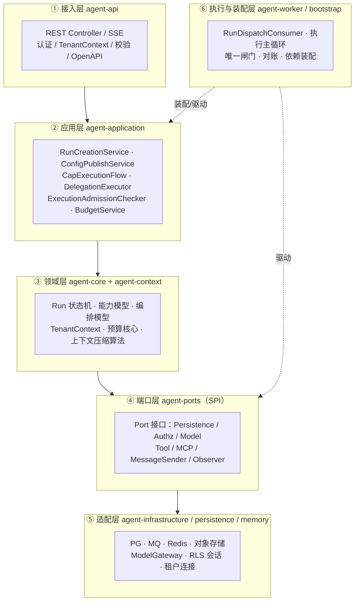

**各层职责边界**：

| 层 | 职责 | 明确不做什么 |
|:---|:---|:---|
| 接入层 | 协议适配、认证、请求校验、SSE 推送 | 不含业务规则 |
| 应用层 | 用例编排、事务边界、跨领域协调 | 不含领域不变量 |
| 领域层 | 领域模型、状态机、不变量、纯算法 | 零框架依赖（仅 JSpecify） |
| 端口层 | 定义能力契约（SPI） | 不含实现 |
| 适配层 | 实现端口、对接外部系统 | 不含业务决策 |
| 执行/装配层 | 驱动执行循环、依赖注入 | controller 不直接调 persistence |

**六层职责精修（典型组件清单 + 依赖约束 + 异常/失败处理归属）**：

| 层 | 典型组件（真实类） | 依赖约束 | 异常/失败处理归属 |
|:---|:---|:---|:---|
| ① 接入层 | `RunController`、`RunEventController`、`AgentChatController`、`SecurityConfiguration` | 只依赖应用层端口；不改领域模型 | 参数校验失败、401/403 在此映射为稳定错误码 |
| ② 应用层 | `RunCreationService`、`ConfigPublishService`、`DelegationExecutor`、`ExecutionAdmissionChecker`、`BudgetService` | 依赖领域 + 端口；持有事务边界 | 用例级回滚、跨领域协调失败在此收敛 |
| ③ 领域层 | `Run` 状态机、`CapabilitySnapshot`、`TenantContext`、`CompactionPipeline` | 仅 JSpecify + 端口；零框架依赖 | 领域不变量违反抛领域异常，由上层翻译 |
| ④ 端口层 | `ModelGateway`、`ToolHandler`、`MessageSender`、`QueueDepthProbe`、`PersistencePort` | 只定义契约，不含实现 | 端口定义超时/错误分类契约 |
| ⑤ 适配层 | `JdbcRunClaimRepository`、`OpenAiCompatibleModelGateway`、`TenantSessionBinder`、`PgQueueMessageSender` | 实现端口；RLS 会话绑定在此 | 下游不可用、超时在此分类并上报 |
| ⑥ 执行/装配层 | `RunDispatchConsumer`、`RunExecutionLoop`、`ToolInvocationGate`、`ToolOperationReconciliationService`、`platform-bootstrap` | 驱动 application/core/ports；装配依赖 | 消费幂等、租约丢失、UNKNOWN 对账在此 |

> **依赖铁律重申**：`L1→L2→L3→L4→L5` 单向；`L6` 装配并驱动 `L2/L4`；任何反向依赖（如 L3 依赖 L5）由 `ModuleDependencyDirectionTest` 判红。

### 4.3 核心业务域拆分

按限界上下文（Bounded Context）拆分业务域，每个域有独立的模型、规则与数据归属：

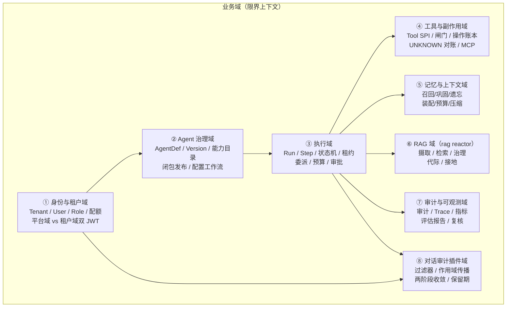

**拆分依据**：① 按**变化原因**切（不同域由不同角色驱动变更）；② 按**数据归属**切（各域 owning 自己的表）；③ 按**一致性边界**切（Run 状态与 Outbox 必须同事务→归同一域）。

**各域边界定义 / 领域职责 / 上下文映射 / 跨域依赖规则**：

| 域 | 边界定义（owning 的表/模型） | 领域职责 | 上游依赖 | 下游消费者 | 跨域依赖规则 |
|:---|:---|:---|:---|:---|:---|
| ① 身份与租户 | tenant/user/role/配额/binding | 认证、授权、租户归属 | IAM/OIDC | 所有域 | 提供 TenantContext，是唯一可信身份源 |
| ② Agent 治理 | agent/version/snapshot/能力目录 | 闭包发布、配置工作流 | ① | ③ | 产出不可变快照供③绑定 |
| ③ 执行 | run/step/lease/fencing/预算/审批 | 状态机、编排、可靠性 | ①② | ④⑤⑥⑦⑧ | 权威事实源，其他域只读其事件 |
| ④ 工具与副作用 | tool_operation/attempt/approval | 工具执行、幂等、对账 | ③ | 业务系统/MCP | 每次执行回查③授权与预算 |
| ⑤ 记忆与上下文 | 记忆表/上下文快照 | 召回/巩固/遗忘、装配压缩 | ③ | ③（回填） | 不直接写 run 状态 |
| ⑥ RAG 域（rag） | rag 库 15 表 + 代际 | 摄取/检索/治理/接地 | ③（检索请求） | ③（检索结果） | 通过端口 `HttpRagRetrievalGateway` 跨进程 |
| ⑦ 审计与可观测 | 审计/Trace/指标/评估 | 记录、评估、复核 | 全域事件 | 运维/管理端 | 只读，不参与业务决策 |
| ⑧ 对话审计插件 | chat_audit 三表 + config | 对话留痕、两阶段收敛 | ①③ | ⑦ | HIGHEST_PRECEDENCE+2 早于安全链 |

**上下文映射模式**（域间协作方式）：
- **①→③ 共享内核**：TenantContext 作为共享内核，全域统一。
- **②→③ 发布/订阅（快照）**：治理域发布不可变快照，执行域绑定消费。
- **③↔⑥ 客户/供应商（隔离进程）**：RAG 作为供应商，经 HTTP 端口提供检索，契约明确、版本可独立演进。
- **③→⑦ 事件溯源**：执行域发事件，审计域消费落库，解耦且可重放。

> **跨域依赖纪律**：域间只经端口/事件协作，禁止直接 import 其他域的领域实体（用 DTO/ReadModel）；跨域写操作必须明确归属与事务边界，避免"两个域写同一张表"。

### 4.4 模块边界与依赖关系

**双 reactor 物理结构**：

```
java-multi-agent/
├── platform/           # 控制面 + 执行面（13 模块）
│   ├── agent-core          领域模型/状态机/不变量
│   ├── agent-routing       路由规则引擎（RE2/J，防 ReDoS）
│   ├── agent-ports         端口/SPI 契约
│   ├── agent-context       上下文压缩纯算法（ADR-013）
│   ├── agent-test-support  测试支撑/场景注册表
│   ├── agent-application   用例编排/事务边界
│   ├── agent-infrastructure基础设施类型（非数据库）
│   ├── agent-persistence   ⚠️ 数据库访问唯一边界
│   ├── agent-memory        跨 Run 记忆
│   ├── agent-infra         MQ/Outbox/ModelGateway
│   ├── agent-worker        执行循环/唯一闸门/对账
│   ├── agent-api           REST/SSE/认证
│   └── platform-bootstrap  依赖装配
├── rag/                # RAG 服务（11 模块）
│   ├── rag-core / rag-ports / rag-premise / rag-application
│   ├── rag-infrastructure / rag-persistence / rag-worker
│   └── rag-api / rag-management / rag-bootstrap
├── frontend/           # 学生/租户端（React18 + Vite6）
├── admin-console/      # 平台管理端（React18 + AntD5，/admin/）
├── deploy/sql/         # DDL/种子/角色/增量迁移
└── monitoring/         # Prometheus + Grafana + Alertmanager
```

**依赖规则（由静态测试守护）**：
- 单向依赖：api → application → core → ports ← infrastructure；worker 可驱动 application/core/ports。
- `agent-persistence` 是数据库访问**唯一边界**。
- `agent-routing` 只认识领域层（+ JSON/RE2/J），方向由 `ModuleDependencyDirectionTest` 守住。
- 跨 Run 记忆模块复用 infrastructure 的租户事务连接，夹在 persistence 与 worker 之间。

### 4.5 数据流设计

系统存在三类主要数据流，各有明确边界：

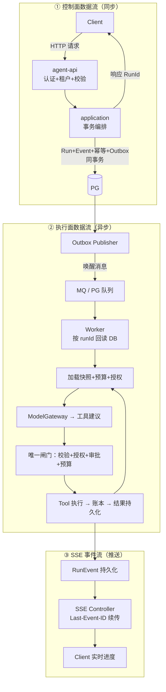

**数据流的三条纪律**：
1. **权威单向**：所有任务状态写入 PG；MQ/缓存/消息体都不是事实源。
2. **最小化载荷**：消息体不含敏感数据（学生数据、Prompt、工具参数），Worker 回 DB 取权威状态。
3. **敏感数据不扩散**：未成年人采集白名单字段在入口即受控；日志/Trace/对象内容独立脱敏与保留策略。

**三类数据流的正常/异常/重试/降级/超时处理矩阵**：

| 数据流 | 正常链路 | 异常链路 | 重试链路 | 降级链路 | 超时处理 |
|:---|:---|:---|:---|:---|:---|
| ① 控制面（同步） | 认证→校验→四元素同事务→返回 RunId | 幂等冲突返回已存在 RunId；授权失败终态 | 无自动重试（客户端幂等键重放） | DB 不可用时拒绝服务（fail-closed），不降级为"内存态" | 请求超时显式返回，不留半事务 |
| ② 执行面（异步） | 唤醒→回读 DB→领取→闸门→执行→终态 | 消息重复丢弃；孤儿收敛；UNKNOWN 进对账 | 有限重试（delivery-limit=3/max_attempts），可重试错误进 RETRYING | 模型供应商不可用时按错误分类处理，不盲目切换 | per-message 超时 + 总 deadline（绝对时间，恢复不重算） |
| ③ SSE（推送） | 事件持久化→Last-Event-ID 续传→done 终帧 | 游标过期明确重置；受众越权拒绝 | 客户端按 Last-Event-ID 续传 | 无事件时心跳保活 | 终态/权限错误发终帧 + 停轮询，绝不伪装临时故障 |

> **关键区分**：控制面"拒绝服务"是可接受的降级（安全），执行面"UNKNOWN 对账"是可接受的降级（正确性），但两者都**不允许 fail-open**——即不允许在无权限/无状态/无租户上下文时继续执行。

### 4.6 核心调用链路

**链路一：Run 创建（同步，原子）**
```
Client → agent-api(认证/租户/校验/幂等键) → RunCreationService
  → 单事务内：INSERT run(QUEUED) + run_event + idempotency_record + outbox_event
  → 返回 RunId
```
不变量：四元素同生共死；预算一致性校验 fail-closed；能力快照双写。

**链路二：Worker 执行（异步，带世代校验）**
```
MQ/PG队列 → RunDispatchConsumer(重复丢弃/孤儿收敛)
  → 条件更新领取 Run，获得 fencing_token
  → 主循环：世代校验 → 在途委派收养 → 租约续期 → 审批挂起检查
  → ModelGateway 调用（超时/错误分类/重试唯一入口）
  → ToolInvocationGate 15 步准入 → Tool 执行 → ToolOperation 账本
  → 终态提交（校验 lease_owner + fencing_token）
```
不变量：每次状态更新校验 `run_id + lease_owner + fencing_token`；终态后禁补 attempt；外部调用不放进长事务。

**链路三：SSE 事件推送**
```
RunEvent 持久化 → SSE Controller（受众隔离 + Last-Event-ID 续传）
  → 13 事件 + 第 14 checkpoint + done 终帧
```
不变量：平台链 `/api/agent/chat/stream`，租户链 `/api/knowledge/agent/chat/stream`（禁带 tenantId）；不写 outbox、不发 MQ；终态/权限错误显式终态 + 停轮询 + 不给重试（禁止伪装成"网络问题稍后再试"）。

**三条调用链的异常 Case 全集**：

| 链路 | 异常 Case | 系统行为 | 用户/客户端可见 |
|:---|:---|:---|:---|
| Run 创建 | 幂等键冲突（同摘要） | 返回已存在 RunId，不重复创建 | 拿到同一 RunId |
| Run 创建 | 幂等键冲突（不同摘要） | 拒绝，返回冲突错误 | 明确错误，不改状态 |
| Run 创建 | 预算校验失败 | fail-closed 拒绝创建 | 预算不足提示 |
| Run 创建 | 能力目录缺失 | fail-closed 拒绝 | 配置错误提示 |
| Worker 执行 | 消息重复投递 | `DUPLICATE_DISCARDED` 幂等丢弃 | 无感 |
| Worker 执行 | 租约过期仍写 | fencing 校验拒绝写入 | Run 被新世代接管 |
| Worker 执行 | 模型超时/下游不可用 | 错误分类 → RETRYING 或 FAILED | 进度显示重试/失败 |
| Worker 执行 | 工具结果 UNKNOWN | 进对账，不盲目重放 | 显示"待核对" |
| Worker 执行 | 审批挂起 | WAITING_APPROVAL，不占线程 | 显示"待审批" |
| SSE | Last-Event-ID 过期 | 明确重置语义 | 从头续传或重置 |
| SSE | 受众越权 | 拒绝读取 | 403 终态，停轮询 |
| SSE | 断连/超时 | done 终帧或重连续传 | 明确终态，不伪装网络问题 |

> **反模式警示**：404/403/401 若伪装成"正在处理/网络问题/稍后再试"，会让客户端无限轮询、用户困惑、掩盖真实权限问题——这是本项目明确禁止的（对应第 2 章原则与第 5 章取舍）。

### 4.7 状态机设计

状态机是执行域的心脏。本项目 Run 状态机体现了"安全的状态迁移"设计范式：

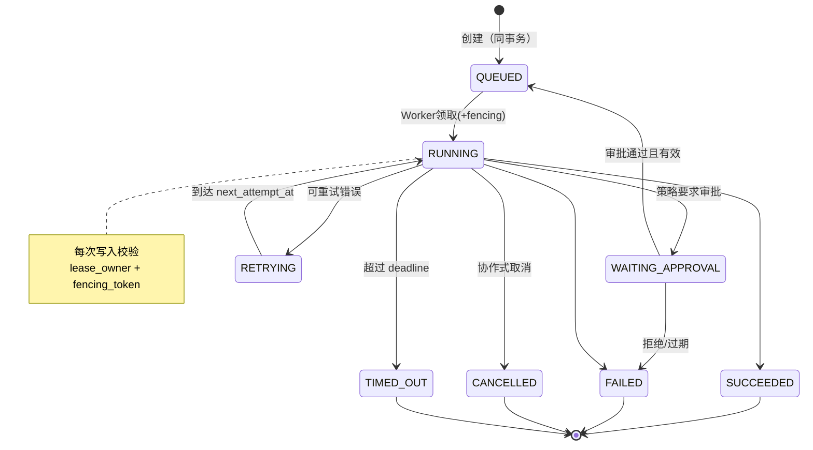

**状态机设计要点**：
- **白名单迁移**：所有未列出的迁移默认拒绝，返回 `RUN_STATE_CONFLICT`。
- **终态不可迁出**：SUCCEEDED/FAILED/CANCELLED/TIMED_OUT 为终态。
- **审批不占线程**：WAITING_APPROVAL 不占用持续运行线程；审批通过由 `ApprovalDecidedWakeupConsumer` 唤醒。
- **HITL 闭环**：已有 PARK/RESUME 闭环（WAITING_APPROVAL + 唤醒消费者 + `claimParkedRunForResume`），**不新建 PAUSED 状态**——这是避免重复造轮子的关键纠偏。
- **run_step.state 语义**：复用 run_state 且恒为 `'RUNNING'` 表示"步骤已发生"，完成看 `completed_at`；禁止按字面显示"执行中"或加两阶段 UPDATE。

**状态一致性保障与非法状态拦截细节**：

| 保障机制 | 实现方式 | 拦截的非法场景 |
|:---|:---|:---|
| 白名单迁移表 | 状态机只接受预定义迁移，其余抛 `RUN_STATE_CONFLICT` | 任意状态回退、跳变 |
| 乐观锁 version | 每次更新比对 version | 并发双写覆盖 |
| fencing token + lease_owner | 关键写入校验 run_id + lease_owner + fencing_token | 旧世代写入、脑裂 |
| 终态守卫 | 终态不可迁出；终态后禁补 attempt | 终态后残留写入 |
| 事务边界 | 状态 + 事件 + Outbox 同事务 | 半状态（有状态无事件） |
| 不可变触发器 | AgentVersion/Snapshot 发布后禁改 | 配置漂移 |
| deadline 绝对时间 | 恢复时不重算完整时长 | 崩溃后无限续命 |

**状态一致性反证用例（验收必配）**：
1. 强杀 Worker 后接管 → 旧 fencing 世代写入被拒（防脑裂）。
2. 终态后尝试补 attempt → 拒绝（防状态回退）。
3. 并发领取同一 Run → 仅一个成功（乐观锁/fencing）。
4. 崩濠恢复后 deadline 未重置 → 仍按绝对时间超时。
5. 取消标记与工具启动竞态 → 有明确裁定（协作式取消）。

> **HITL 闭环纠偏提醒**：已有 PARK/RESUME（WAITING_APPROVAL + `ApprovalDecidedWakeupConsumer` + `claimParkedRunForResume`），禁止新建 PAUSED 状态造成语义分裂；审批通过需重新校验参数摘要、权限、预算、资源状态。

### 4.8 架构如何支撑未来迭代

| 扩展诉求 | 架构提供的支撑点 |
|:---|:---|
| 新模型供应商 | ModelGateway 端口 + 多实现，领域层零改动 |
| 新工具/MCP | Tool SPI + 能力目录 + 闸门统一准入 |
| 新租户/Agent | 全局 Agent + 多对多绑定表，零复制 |
| 消息载体迁移 | 端口不变 + 可切换通道 + 按租户灰度 |
| 权限模型迁移 | 影子期双跑 + `rlsDependent=0` 观察期出口 |
| 策略调整 | 配置化 + 快照隔离，运行中改配置只影响新 Run |
| 检索算法升级 | RAG 域独立 reactor，检索/摄取/治理解耦 |
| 模块独立部署 | 清晰边界使瓶颈模块可沿边界抽出为服务 |

### 4.9 可复用要点（本章带走清单）

- [ ] 用"质量属性 → 架构决策"推演表驱动结构设计，每条结构都有需求来源。
- [ ] 分层的核心价值是依赖单向流动；用静态测试守住方向。
- [ ] 按"变化原因 + 数据归属 + 一致性边界"拆分限界上下文。
- [ ] 区分三类数据流（同步控制面/异步执行面/推送事件流），各设纪律。
- [ ] 消息载荷最小化，敏感数据不进 MQ，Worker 回权威源读取。
- [ ] 状态机用白名单迁移 + 终态不可迁出 + 世代校验；HITL 复用已有闭环而非新建状态。
- [ ] 为未来迭代预留端口/配置/绑定/影子等"扩展点"，但不过度设计。

---

## 第 5 章 关键问题与架构取舍

> 本章回答：架构的本质是取舍。系统梳理本项目面临的典型权衡，给出取舍逻辑、风险兜底与迭代方向。

### 5.1 取舍的方法论：没有最优解，只有适配解

**取舍决策四步法**：


**核心认知**：任何取舍都有代价。成熟的架构决策不是"既要又要"，而是**明确放弃什么、如何兜底、何时重估**。

**可复用的架构取舍决策流程（六步法）**：

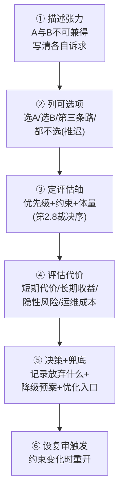

**取舍决策记录卡（可直接复用）**：

| 字段 | 填写说明 |
|:---|:---|
| 取舍主题 | 一句话描述张力 |
| 可选项 | 选 A / 选 B / 第三条路 / 推迟，至少 2 项 |
| 约束条件 | 当时的体量、团队、合规、时间限制 |
| 决策 | 选了什么，依据第 2.8 裁决序的哪条 |
| 短期代价 | 本迭代内多付出的成本 |
| 长期收益 | 未来可预见的回报 |
| 隐性风险 | 不明显但可能爆发的风险 |
| 运维代价 | 对部署/监控/排障的影响 |
| 兜底预案 | 代价兑现时的降级方案 |
| 未来优化入口 | 何时、如何补回放弃的部分 |
| 复审触发条件 | 什么情况下重新决策 |

### 5.2 性能与一致性

| 张力 | 取舍决策 | 放弃什么 | 风险兜底 | 迭代方向 |
|:---|:---|:---|:---|:---|
| Run 状态写入 vs 吞吐 | 一致性优先：Run+Event+幂等+Outbox 同事务 | 部分写吞吐 | Outbox 批量/异步发布缓解 | 压测后按瓶颈优化，不预先承诺 SLA |
| 预算结算 vs 响应速度 | 原子预留（调用前）+ 幂等结算（调用后） | 每次调用的额外写 | 预留账本唯一记录防超发 | 本地判定性能基准（P6R3） |
| RAG 检索延迟 vs 质量 | 双通道 + RRF + 阈值 0.38 | 低延迟 | 候选 ×3、只读 ACTIVE 代际 | 代际蓝绿、索引优化（不动阈值/k） |
| fencing 校验 vs 写入速度 | 每次写入校验世代号 | 少量校验开销 | 条件更新一次完成 | 无需迭代（开销可忽略） |

> **反面教训**：`ON CONFLICT DO UPDATE` 需 UPDATE 授权——若只授 INSERT，运行时静默失败。这类"为性能/简洁选的方案"必须在真库 IT 中验证授权完整性。

**性能与一致性取舍的深度账本（典型项）**：

| 取舍项 | 短期代价 | 长期收益 | 隐性风险 | 运维代价 | 迭代约束/优化入口 |
|:---|:---|:---|:---|:---|:---|
| 四元素同事务 | 写吞吐受限、事务稍长 | 状态永不半截，可恢复 | 长事务锁竞争 | 需监控事务时长 | Outbox 批量发布；压测后按瓶颈优化 |
| 预算原子预留 | 每次调用多一次 DB 写 | 并发不超发、可对账 | UNKNOWN 下预留释放时机 | 账本表增长需清理 | 本地判定基准；分级保留期 |
| RAG 阈值 0.38 | 部分边缘召回被拒（看似"少召回"） | 不编造、质量稳定 | 调低阈值会引入噪声 | 索引/代际维护 | ⛔ 阈值不可调；靠评测集而非降阈提召回 |

### 5.3 开发效率与系统稳定性

| 张力 | 取舍决策 | 逻辑 |
|:---|:---|:---|
| MyBatis-Plus 免 CRUD vs SQL 可控性 | 引入 MP 但设三条红线 | 开发效率提升，但复杂 SQL 原样搬迁、RLS 由代码保证、端口零改动 |
| 内置 `@Retryable` vs 自研重试 | 单一重试点，副作用路径禁内置重试 | 避免双重重试导致重复副作用（Sev-0） |
| 快速接真实数据 vs 合规 | 零保留条款未确认前禁止真实学生数据（DEC-10） | 合规是底线，允许阶段延后 |
| 快速上线 vs 验收充分 | 三级验收 + 反证纪律（"撤掉修复点会红吗"） | 代码合并不等于阶段验收 |

**方法论要点**：开发效率的提升必须"**带护栏**"——MP 引入配套 RLS 拦截器与 4 个反证 IT；重试简化配套唯一重试点约定。没有护栏的效率提升是技术债。

**开发效率与稳定性取舍的深度账本**：

| 取舍项 | 短期代价 | 长期收益 | 隐性风险 | 运维代价 | 迭代约束/优化入口 |
|:---|:---|:---|:---|:---|:---|
| 引入 MyBatis-Plus | PoC + 拦截器 + 守卫改造成本 | CRUD 样板大幅减少 | 自动 CRUD 绕过手写 RLS 绑定 | 多一套 SqlSessionFactory | 红线：端口零改动/RLS 拦截器/复杂 SQL 原样搬迁 |
| 单一重试点 | 需统一改造所有调用路径 | 杜绝双重重试副作用 | 遗漏某路径仍可能双重试 | 需在评审清单常驻 | 副作用路径禁内置 `@Retryable` |
| 零保留硬闸门 | P1 只能用模拟数据 | 合规无风险 | 延期真实业务验证 | GATE 1/2/3 管理成本 | 条款确认后放开（DEC-10） |
| 三级验收 + 反证 | 测试编写与执行成本上升 | 虚假绿大幅减少 | 反证若无意判别力仍假绿 | CI 时长增加 | 每个守卫问"撤点会红吗" |

### 5.4 简单实现与可扩展性

| 张力 | 取舍决策 | 逻辑 |
|:---|:---|:---|
| 单体 vs 微服务 | 模块化单体 + 独立 Worker | 小团队/低体量，强一致性；沿边界保留抽出能力 |
| 单一 MQ vs 可切换通道 | 主 MQ + 端口抽象，运行时可切 | 用端口把"二选一"升维为"可切换" |
| 硬编码策略 vs 配置化 | 配置化 + fail-closed + 快照隔离 | 灵活性不能以"配置成后门"为代价 |
| 直接调 vs 端口调用 | 端口前移（如 MessageSender） | 短期多一点抽象，长期换实现零改动 |

> **关键纠偏（避免错误扩展）**：HITL 已有 PARK/RESUME 闭环，不要新建 PAUSED 状态；RAG 生产链路在 rag 模块，不要在不可达的 `agent-infra` 引擎施力；halfvec/HNSW 是刻意取舍，不要夹带降维。"简单"有时意味着**不增加新东西**。

**简单与可扩展取舍的深度账本**：

| 取舍项 | 短期代价 | 长期收益 | 隐性风险 | 运维代价 | 迭代约束/优化入口 |
|:---|:---|:---|:---|:---|:---|
| 模块化单体 | 需守依赖纪律 | 一致性 + 未来可抽出 | 边界失守退化为大泥球 | 单体内故障隔离弱 | 静态守卫守住边界；瓶颈模块沿边界抽出 |
| 消息通道可切换 | 多一套实现 + 语义对齐成本 | 零 broker 运行 + 按租户灰度 | 切换期两通道在途消息滞留 | 切换操作手册须严格执行 | 复审：灰度扩大后 PG 队列成瓶颈 |
| 配置化 + 快照 | 配置管理复杂度 | 策略调整无需发版 | 配置成后门（放松门禁） | 配置审计成本 | fail-closed + 只能收紧不能放松 |
| 端口前移 | 初始抽象成本 | 换实现零改动 | 过度抽象导致接口臃肿 | 低 | 只在有真实多实现处抽象 |

### 5.5 成本与高可用

| 张力 | 取舍决策 | 逻辑 |
|:---|:---|:---|
| 专用向量库 vs PG+pgvector | 复用 PG | 省新组件运维成本，中小体量够用 |
| 商业支持 vs 社区版 MQ | 社区版 + 接受支持期窗口 | 成本约束下接受残余风险并登记 |
| 多副本 HA vs 单节点 | 视阶段而定，RPO/RTO 配置化 | 未压测前不承诺固定 SLA |
| 无限保留 vs 存储成本 | 分级保留期（画像 12 月/Prompt 90 天/审计 180 天/Trace 30 天） | 隐私、成本、合规三赢 |

**成本与高可用取舍的深度账本**：

| 取舍项 | 短期代价 | 长期收益 | 隐性风险 | 运维代价 | 迭代约束/优化入口 |
|:---|:---|:---|:---|:---|:---|
| PG+pgvector 替代专用向量库 | 单库承载向量，规模受限 | 省独立集群 + 数据同步 | 大规模后检索成瓶颈 | 低（复用 PG） | 复审：数据规模增长后考虑专用库 |
| 社区版 MQ | 支持期有限 | 零许可费 | 停维后无免费 CVE 补丁 | 需登记残余风险 + 升级演练 | 复审：4.4 GA / 停维前 30 天 |
| RPO 24h/RTO 4h 初值 | 未压测，数值保守 | 不虚假承诺 | 真实恢复可能达不到 | 备份/演练成本 | P4 演练后确认；不预先承诺固定 SLA |
| 分级保留期 | 需实现删除/撤回流程 | 隐私+成本+合规 | 删除不彻底留隐患 | 清理任务运维 | 删除留痕；同意撤回 30 日内删画像 |

### 5.6 安全与体验/效率

| 张力 | 取舍决策 | 逻辑 |
|:---|:---|:---|
| 数据丰富度 vs 未成年人合规 | 采集白名单，禁止姓名/学校/班级 | 合规底线优先 |
| 自动放行 vs fail-closed | 配置缺失/授权未知一律拒绝 | 安全默认拒绝 |
| 便捷重试 vs 副作用安全 | UNKNOWN 对账，不盲目重放 | 正确性优先 |
| 展示 token 统计 vs 隐私 | 敏感词扫描豁免结构性标识符 | 避免把 UUID 误判为学号导致 500 |
| 审批效率 vs 职责分离 | 风险分级审批（WRITE_PROFILE/OPTIONAL 可切 REQUIRED） | 风险驱动的弹性审批 |

**安全与体验取舍的深度账本**：

| 取舍项 | 短期代价 | 长期收益 | 隐性风险 | 运维代价 | 迭代约束/优化入口 |
|:---|:---|:---|:---|:---|:---|
| 未成年人采集白名单 | 数据维度受限 | 合规无风险 | 业务可能想要更多字段 | 白名单维护 | ⛔ 禁豁免学号扫描（PII 出境）；stu_ 前缀规避误判 |
| fail-closed | 配置/授权缺失时拒绝，体验受损 | 无静默越权 | 过度拒绝影响可用性 | 需清晰错误提示 | 拒绝要给明确原因，不伪装临时故障 |
| UNKNOWN 对账 | 结果不确定时不立即返回成功 | 无重复副作用 | 对账积压需人工 | 对账队列运维 | 对账服务 + 人工处置通道 |
| 敏感词扫描豁免 | 结构性标识符免扫 | 避免误判 500 | 豁免键被滥用藏 PII | 豁免键清单维护 | 仅限 `VALUE_SCAN_EXEMPT_KEYS` 白名单 |

### 5.7 本项目关键取舍清单（速查）

| # | 取舍主题 | 选择 | 放弃 | 兜底 |
|:--:|:---|:---|:---|:---|
| 1 | 权威状态载体 | PG | Redis/MQ 作事实源 | 事件/Outbox 同事务 |
| 2 | 消息职责 | 唤醒信号 | 携带业务数据 | Worker 回读 DB |
| 3 | 副作用处理 | UNKNOWN 对账 | 盲目重试 | 对账服务 + 人工处置 |
| 4 | 执行并发 | 租约 + fencing | 无脑并发 | 世代号校验 + 排空守卫 |
| 5 | 配置策略 | 快照隔离 | 运行中热更 | 新 Run 生效 + fail-closed |
| 6 | 权限模型 | RLS + 应用层 + 影子迁移 | 一步到位切应用层 | 观察期达标才切换 |
| 7 | RAG | 二期上，pgvector | 首期上/专用向量库 | 阈值/k/分离键红线 |
| 8 | 架构形态 | 模块化单体 | 微服务 | 边界保留抽出能力 |
| 9 | 重试 | 单一重试点 | 框架+自研双重试 | 副作用路径禁内置 |
| 10 | 数据保留 | 分级保留期 | 无限期 | 删除留痕 + 同意撤回 |

### 5.8 风险兜底与迭代方向

**兜底三板斧**：
1. **可观测**：任何取舍的代价都必须可观测（指标 + 告警 + 死信/对账通道），禁止"静默失败"。
2. **可回滚**：配置化切换（消息通道、审批策略）+ ADR 回滚方案（Boot 版本）。
3. **可验证**：反证测试（"撤掉修复点会红吗"）+ 真库 IT + 角色×任务三级验收。

**迭代原则**：取舍不是永久的。当约束变化时（体量增长、合规要求变化、社区支持到期），按 ADR 的"复审触发条件"重新打开决策。

**架构隐患识别点（风险自查清单，评审逐条问）**：

| # | 自查问题 | 若答案为"否/不清楚"的隐患 |
|:--:|:---|:---|
| 1 | 每个取舍是否记录了"放弃了什么"？ | 隐性代价未登记，未来爆发无预案 |
| 2 | 每个代价是否可观测（指标/告警）？ | 静默失败，问题积累到事故才暴露 |
| 3 | 是否有可回滚路径？ | 一旦选错无法低成本撤回 |
| 4 | 是否有反证用例验证守卫判别力？ | 守卫形同虚设，假绿 |
| 5 | 是否定义了复审触发条件与阈值？ | 约束变化后决策无人重开 |
| 6 | 效率提升是否带护栏？ | 技术债积累 |
| 7 | 是否有"写了但没接线"的能力？ | 运行期可达性缺口（有类≠被装配） |
| 8 | 是否有"链路成功≠任务成功"的指标误读？ | 虚假安全感 |
| 9 | 是否有高风险例外未登记责任人/到期日？ | 例外变成永久后门 |
| 10 | 是否有终态/权限错误被伪装成临时故障？ | 客户端无限轮询、掩盖真实问题 |

> **运行期可达性专项**：本项目深度报告第三章专门指出"有类/有表/有测 ≠ 被装配/被写入/被注入/被触发告警"。取舍评审时须额外问一句"这个能力在生产链路真的可达吗"，典型如 `GroundingService`/`ReviewAttributionHook` 曾存在生产无 Bean/未接线的问题。

### 5.9 可复用要点（本章带走清单）

- [ ] 取舍四步：识别张力 → 明确优先级 → 选择并接受代价 → 设计兜底与演进。
- [ ] 诚实记录"放弃了什么"，不搞"既要又要"。
- [ ] 效率提升必须带护栏（红线/反证测试/唯一入口）。
- [ ] "简单"有时是"不增加新东西"——复用已有闭环，避免重复造轮子。
- [ ] 任何取舍的代价都要可观测、可回滚、可验证。
- [ ] 用"复审触发条件"让取舍可随约束变化被重新打开。

---

## 第 6 章 工程化落地设计

> 本章回答：如何把架构决策固化到日常工程实践中，让"设计意图"在代码、构建、部署、运维全生命周期中不走样。这是架构从"纸面"走向"现实"的关键一公里。

### 6.1 工程化体系总览

工程化不是一堆工具的堆砌，而是围绕"**让正确的做法成为默认的、低成本的、自动的**"建立的一套体系：

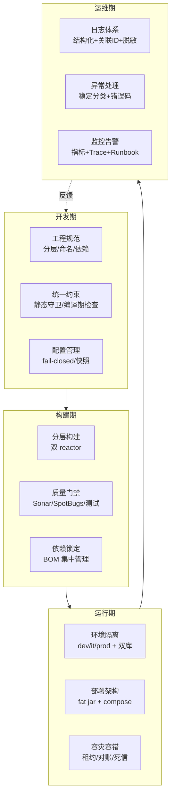

### 6.2 工程规范与代码分层

**规范落地的三层手段**（从软到硬）：

| 手段 | 约束力 | 示例 |
|:---|:---|:---|
| 文档约定 | 弱（靠人记） | 开发手册、README |
| 目录/模块结构 | 中（结构性暗示） | 数据库访问只能在 `agent-persistence` |
| 编译期/静态守卫 | 强（自动拒绝） | `AgentCorePurityTest`、`ModuleDependencyDirectionTest` |

**本项目的代码分层规范**：
- **版本集中管理**：父 POM `dependencyManagement` 锁定所有版本，子模块禁止覆盖（Boot 4.1.1、MyBatis-Plus 3.5.17、Druid 1.2.28、RE2/J 1.8）。
- **数据库访问唯一边界**：`agent-persistence` 是唯一允许 JDBC/MyBatis 的模块；main 侧 JDBC import 只许出现在 persistence。
- **领域层纯净**：`agent-core` 编译期依赖仅 JSpecify，由 `AgentCorePurityTest` 守住。
- **注解与空值**：jspecify `@NonNull` 不可标全限定/嵌套类型（先 import 用简单名）；领域层 `@NullMarked` 显式声明空值语义。
- **编译参数**：`-parameters`（保留参数名）、`-proc:full`（JDK 23+ 恢复隐式注解处理器发现，避免 Lombok 失效）。

> **踩坑沉淀**：`Map.of` 最多 10 组键值对，超了改 `Map.ofEntries`；record 加字段时必须逐字段带过兼容构造器的转换，否则静默清空。

**标准目录结构（模块内包结构规范，可复用）**：

```
agent-<module>/
├── src/main/java/cn/studykid/multiagent/<module>/
│   ├── <domain>/          # 领域模型、状态机、值对象（无框架依赖）
│   ├── port/              # 端口接口（SPI）定义
│   ├── application/       # 用例服务、事务边界（若本模块含应用层）
│   ├── adapter/           # 端口实现（外部系统/Gateway）
│   └── config/            # 显式配置装配（@Configuration）
├── src/main/resources/
│   └── application.yml    # 配置项，默认值 + 边界声明
└── src/test/...
    ├── <domain>/*Test.java       # 单元测试
    └── <domain>/*IT.java         # 集成测试（真库，failsafe 执行）
```

**代码层禁止写法清单（评审逐条 Check）**：

| # | 禁止写法 | 正确做法 | 原因 |
|:--:|:---|:---|:---|
| 1 | controller 直接注入 Repository | 注入 application Service | 业务规则绕过应用层 |
| 2 | 领域层 import Spring/MQ/JDBC | 只依赖 JSpecify + 端口 | 领域纯净性（守卫判红） |
| 3 | `List.of(nullable)` | 逐参数绑定 + `setNull` | `List.of` 拒绝 null 元素，NPE |
| 4 | 读完目标列后又读别的列再取 `wasNull()` | 读完立刻取 `wasNull()` | `wasNull()` 只反映最近一次读取的列 |
| 5 | `!node.isMissingNode()` 判 JSON 空 | `node.isObject()` 判空 | `"usage":null` 时 isMissingNode=false 但取到 0 |
| 6 | 事务内 SQL 失败后 fail-soft 继续 COMMIT | 连接标记 POISONED | 脏数据被提交 |
| 7 | 裸写 `set_config` 在业务 SQL 之后 | 事务内、业务 SQL 前 | FORCE RLS 静默 0 行 |
| 8 | 枚举用字符串裸拼 | `?::enum` 类型转换 | 类型错误 |
| 9 | 跨线程传 ThreadLocal 上下文 | `InheritableThreadLocal` 或显式 DTO | 虚拟线程不传播 |
| 10 | `Map.of` 超过 10 组 | `Map.ofEntries` | `Map.of` 上限 10 |

**最佳实践**：
- 组件扫描类 ≥2 构造函数用 `@Autowired` 显式标注；多 Bean 注入点用 `@Qualifier`。
- 静态守卫正则常量须声明在使用它的静态字段**之前**（否则读到默认 flag=0，大小写不敏感静默失效）。
- 含环视的 PII 正则与 `OutputModeration` 只留 JDK（RE2/J 不支持环视）。

### 6.3 统一约束：静态守卫体系

这是本项目工程化最具特色的部分——**把架构约定写成自动化测试**，让违反约定在 CI 阶段就失败：

| 守卫 | 守护的约定 | 失败后果 |
|:---|:---|:---|
| `AgentCorePurityTest` | 领域层零框架依赖 | 编译期依赖混入框架即红 |
| `ModuleDependencyDirectionTest` | 模块依赖单向流动 | 反向/跨层依赖即红 |
| `JoinTenantPredicateArchitectureTest` | 读全局 Agent 表的租户路径必须 JOIN 绑定表且谓词在 ON 内 | 谓词放 WHERE 即红 |
| `ContextCompressionM6GuardTest` | 上下文状态文件白名单完整性 | 新增文件未登记即红 |
| `ConfigFailClosedTest` | 配置缺失/非法一律拒绝 | 静默放行即红 |
| DDL 计数守卫 | 表/RLS/策略基线数量 | 结构漂移即红 |
| `MessagingSwitchGuard` | 切换前旧通道排空 | 未排空拒绝启动 |

**守卫设计的三条经验**：
1. **静态守卫要剥注释、保留字符串**（`stripCommentsKeepStrings`），否则修复说明里的示例代码造成恒定假红。
2. **DDL 计数守卫只校验口径明确项**，避免口径不清导致误报。
3. **守卫必须可被反证**：问自己"撤掉修复点会红吗"——若不会，守卫无判别力，等于没写。

**自动化守卫规则（编写规范 + 验收标准）**：

| 守卫类型 | 实现要点 | 反证验收方法 |
|:---|:---|:---|
| 依赖方向守卫 | 解析 import/模块依赖图，禁止反向边 | 故意加一条反向 import，构建应红 |
| 领域纯净守卫 | 扫描领域层编译期依赖白名单 | 故意 import Spring 类，测试应红 |
| SQL 谓词位置守卫 | 解析 JOIN 的 ON 子句是否含 tenant_id | 把谓词移到 WHERE，测试应红 |
| 配置 fail-closed 守卫 | 断言缺失/非法配置抛异常 | 删配置项，测试应红 |
| DDL 计数守卫 | 只校验口径明确的表/RLS/策略数 | 加一张表但不更新期望值，测试应红 |
| 白名单完整性守卫 | 新增文件须同时登记 ALLOWED 与 REQUIRED | 新增文件不登记，测试应红 |

**守卫编写四原则**：
1. **确定性**：不依赖随机数据（如含 8+ 连续数字 UUID 才能复现的问题，守卫须构造固定 UUID）。
2. **剥噪**：剥注释保留字符串，避免文档说明造成假红。
3. **可判定**：断言明确（红/绿），无"可能/通常"。
4. **可维护**：白名单/期望值集中管理，新增元素同步登记（如 `ContextCompressionM6GuardTest` 的文件白名单 9→12，须同时更新 ALLOWED 与 REQUIRED 并补 A.5 台账）。

### 6.4 日志体系

| 维度 | 设计 |
|:---|:---|
| 结构化 | 结构化日志 + correlation/run/trace ID 贯穿全链路 |
| 上下文传播 | 对话审计作用域用 `InheritableThreadLocal` 传播（虚拟线程下普通 ThreadLocal/MDC 都不传播） |
| 关联 | 日志/Trace/指标通过 run_id、trace_id、correlation ID 关联 |
| 脱敏 | 密钥不进 Prompt/消息/日志；敏感词扫描豁免结构性标识符（UUID、confidence 小数），但 `STUDENT_ID`（8–12 位连续数字）必须扫描 |
| 保留 | Prompt/工具结果 90 天、审计 180 天、Trace/指标 30 天分级保留 |
| 审计落库 | 两阶段收敛：`finish()` + `seal()` 都到齐才落库，避免短流写出残缺记录 |

> **平台域特殊处理**：平台域无租户时用 nil UUID 而非 NULL；过滤器优先级 `HIGHEST_PRECEDENCE+2`，必须早于安全链才能记录 401。

**日志分级规范（通用）**：

| 级别 | 使用场景 | 本项目示例 | 注意 |
|:---|:---|:---|:---|
| ERROR | 需要人工介入的失败 | UNKNOWN 进对账、死信产生、fencing 冲突 | 必须配告警责任人 |
| WARN | 可恢复异常/降级 | 消息通道切换 WARN、审批策略接近上限 | 不告警但可排查 |
| INFO | 关键业务节点 | Run 创建/终态、配置发布、审批决策 | 带 run_id/trace_id |
| DEBUG | 排查细节 | 闸门 15 步准入的中间判定 | 生产默认关闭 |

**结构化日志字段规范（必带字段）**：

| 字段 | 含义 | 必带场景 |
|:---|:---|:---|
| `trace_id` / `correlation_id` | 跨链路关联 | 所有 INFO 及以上 |
| `run_id` | Run 标识 | 执行链所有日志 |
| `tenant_id` | 租户标识（平台域用 nil UUID） | 所有租户上下文日志 |
| `actor_id` | 操作主体 | 审计相关 |
| `error_code` | 稳定错误码 | ERROR/WARN |
| `duration_ms` | 耗时 | 模型/工具调用 |

**脱敏规则（三条）**：
1. 密钥、凭据、Token 绝不进 Prompt/消息/日志/Trace。
2. 未成年人数据：仅白名单字段入日志，姓名/学校/班级禁入；`STUDENT_ID`（8–12 位连续数字）按 PII 扫描。
3. 结构性标识符（UUID、confidence 小数）在敏感词扫描中豁免，避免误判；但豁免键限于 `VALUE_SCAN_EXEMPT_KEYS` 白名单。

**可排查性标准**：任意一条 ERROR 日志，应能在 1 分钟内通过 trace_id 串起"请求→Run→步骤→工具调用→外部响应"的完整链路；缺少关联 ID 的 ERROR 视为不合格日志。

### 6.5 异常处理体系

**稳定错误分类**：参数校验失败、认证失败、授权失败、资源不存在、状态冲突、限流、下游不可用——每类有稳定错误码与语义。

**异常处理铁律**：

| 场景 | 正确处理 | 错误做法（禁止） |
|:---|:---|:---|
| 终态/权限错误 | 显式终态 + 停轮询 + 不给重试 | 伪装成"正在处理/网络问题/稍后再试" |
| 404/403/401 | 明确终态语义 | 当作临时故障让前端反复重试 |
| MQ 重复/延迟/乱序 | 消费端幂等 + 回读 DB | 相信消息体状态 |
| UNKNOWN | 进对账 + 人工处置 | 盲目重放或释放预算 |
| 事务内 SQL 失败 | 连接标记 POISONED，禁止 fail-soft 后 COMMIT | 吞掉异常继续提交 |
| 前端渲染异常 | 顶层 `AppErrorBoundary` + 全局 handler | 白屏 |

**前端错误隔离**（工程化延伸到前端）：
- 顶层 `AppErrorBoundary`（兜底用 `window.location.assign` 整页跳转，避开已坏的 Router）+ `main.tsx` 调 `installGlobalErrorHandlers()` 订阅 `onerror`/`unhandledrejection`。
- 写操作改值前 `window.confirm`；翻页失败只记独立 `loadMoreError` 不写全局 `error`；多视图切换前清空局部 error。
- `Object.entries` 入参先判非 null/非数组/`typeof==object`；路由守卫回跳 `state.from` 须 `pathname + search`。

**异常分级规范**：

| 级别 | 定义 | 处理方式 | 是否重试 |
|:---|:---|:---|:---|
| 业务异常（可预期） | 参数错、权限不足、状态冲突、预算不足 | 稳定错误码 + 明确提示 | 否（终态） |
| 可重试异常 | 下游超时、限流、临时不可用 | 错误分类 → RETRYING，有限次数 | 是（有限） |
| 不可恢复异常 | 数据损坏、不变量违反 | FAILED 终态 + 审计 | 否 |
| 未知异常 | 未分类异常 | FAILED + 告警 + 保留现场 | 否（fail-closed） |

**异常码规范（稳定分类）**：`{DOMAIN}_{ERROR_TYPE}` 形式，如 `RUN_STATE_CONFLICT`、`AGENT_UNAUTHORIZED`、`BUDGET_EXCEEDED`、`TOOL_UNKNOWN_RESULT`。原则：① 稳定不变（前端可依赖）；② 语义明确（见码知因）；③ 分层归属（领域/应用/接入各域前缀）。

**全局捕获规则**：
- 后端：`@ControllerAdvice` 统一翻译领域异常为 HTTP 状态 + 错误码；Worker 侧主循环 try-catch 保证单步失败不逃逸为进程崩溃。
- 前端：顶层 `AppErrorBoundary` + `installGlobalErrorHandlers()` 双保险；兜底 `window.location.assign` 整页跳转避开坏 Router。

**业务兜底策略**：
| 场景 | 兜底 |
|:---|:---|
| 模型返回格式错误 | 解析失败 → FAILED 或重试（按错误分类），不编造结果 |
| 工具下游不可用 | UNKNOWN → 对账，不假设成功/失败 |
| 对象存储读取失败 | 返回明确错误，不返回空内容伪装成功 |
| 配置读取异常 | fail-closed 拒绝执行 |

### 6.6 配置管理

**配置三原则**：fail-closed、集中化、快照隔离。

| 原则 | 落地 |
|:---|:---|
| fail-closed | 配置缺失/非法 → 拒绝启动（`ConfigFailClosedTest` 19 项验证）；审批策略只能收紧不能放松，放松=安全门禁降级需走变更评审 |
| 集中化 | 版本集中锁定；`@ConfigurationProperties` 与 `@Value` 管理；配置项有明确默认值与边界 |
| 快照隔离 | 成本上限、并发上限、审批策略在 Run 创建时写入 ExecutionSnapshot；运行中改配置只影响新 Run |

**关键默认值**（本项目）：消息通道 mode=database、Worker 并发 4、租户并发 5、单 Run max-cost 2.00/max-steps 20、RAG min-score 0.38、留存 12 个月、十余项特性开关。

> **配置成后门风险（R-020）**：配置灵活性必须受控——"审批策略从 REQUIRED 调为非 REQUIRED"属安全门禁降级，必须走范围变更模板 + 外部抽检（ISO-5）。

**配置体系四维度细化**：

| 维度 | 机制 | 本项目落地 |
|:---|:---|:---|
| 多环境隔离 | 环境变量覆盖 + profile + `.env.example` 模板 | `platform.env.example`/`rag.env.example` 完整列出；敏感值仅存 `.env`（gitignore） |
| 动态配置 | 区分"可热更"与"须快照"两类 | 消息通道可运行时切；成本/并发/审批策略在 Run 创建时快照，运行中改只影响新 Run |
| 配置灰度 | 按租户覆盖 + 全局默认 | `agent.messaging.tenant-modes` 支持小客群灰度，回滚=改环境变量 |
| 配置校验 | 启动期 fail-closed + 一致性守卫 | `ConfigFailClosedTest`（19 项）；RAG 维度配置/库列一致性 fail-fast；时长类缺失/越界拒绝启动 |

**配置校验规则（启动期）**：
1. **存在性**：必填项缺失 → 拒绝启动（不回落默认值，避免"悄悄用了没审过的配置"）。
2. **合法性**：枚举值、数值边界、时长单位校验，非法拒绝。
3. **一致性**：跨项约束（如 RAG 配置维度 = 库列维度）不一致 fail-fast。
4. **归属**：租户级覆盖的 slug 不在本实例清单 → 启动日志点名告警（不静默忽略）。

> **配置样例（消息通道）**：`agent.messaging.mode=database`（默认，零 broker）；`agent.messaging.tenant-modes=t-a=database`（灰度）；非法 mode 值 → 拒绝启动。切换前 `MessagingSwitchGuard` 检查旧通道排空，未排空拒绝启动。

### 6.7 环境隔离

| 环境 | 用途 | 隔离手段 |
|:---|:---|:---|
| 单元 | 纯逻辑验证 | 无外部依赖 |
| API | 端点契约 | `@SpringBootTest(RANDOM_PORT)` + RestTestClient + `@MockitoBean` |
| IT 集成 | 真库验证 | 独立 IT 库：`agent_it`/`study_rag_it`，通过 `IT_HOST/IT_PORT/IT_ADMIN_USER` 守门 |
| E2E | 端到端 | 前端 + 后端真链路 |

**IT 环境纪律（血泪经验）**：
- verify 必须显式 `source` 环境脚本并传入三个 env，否则 `source` 直接退出 = 假失败。
- IT 用 `@EnabledIfEnvironmentVariable(IT_PG_URL)` 守门：无库时跳过（不是失败），有库时必须真跑且跳过数如实记录。
- 验 RLS 隔离用 `app_agent`（NOBYPASSRLS）角色，BYPASSRLS = 假绿。
- `-pl` 单模块构建吃本地 m2 陈旧 jar → 先 `mvn -o -q -DskipTests install`。
- **撤点→恢复后必须 `touch` 源码 + clean install**：APFS clone 保留 mtime，恢复源码比 target/classes 旧会跳过编译，导致"改了没用"的假结论。

### 6.8 部署架构

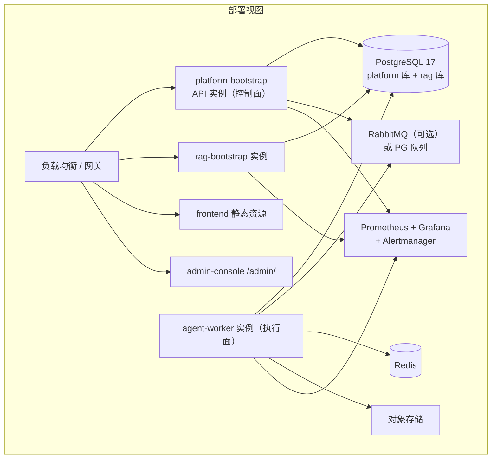

- **构建产物**：`platform-bootstrap` / `rag-bootstrap` 为可执行 fat jar。
- **控制面与执行面可独立部署**：API 实例与 Worker 实例按需伸缩。
- **编排**：`deploy/` 与 `monitoring/docker-compose.yml` 提供本地/试运营编排；DDL/种子/角色/增量迁移脚本在 `deploy/sql/`。
- **迁移路径**：结构变更 = 01 终态 + 02 种子 + 活库 ALTER；同步 init 脚本期望值与基线 YAML。

**部署运行规范（资源配额 / 启停 / 健康检查 / 优雅上下线）**：

| 维度 | 规范 | 本项目落地 |
|:---|:---|:---|
| 资源配额 | 按角色设置 JVM 堆、连接池大小、并发上限 | Druid 连接池显式装配；Worker 并发 4；租户并发 5 |
| 启动规范 | 启动期守卫全过才对外服务 | `MessagingSwitchGuard`、`ConfigFailClosedTest`、RAG 一致性守卫 |
| 健康检查 | 存活探针（liveness）+ 就绪探针（readiness）分离 | health 端点；broker 不可达时通道在用则拒绝就绪 |
| 优雅下线 | 停止领取新任务 → 在途任务完成/交还 → 释放租约 | worker 先停领取，租约自然过期由新世代接管 |
| 滚动升级 | 新旧世代共存时 fencing 保证不脑裂 | 世代 token 单调递增，旧世代写入被拒 |

**优雅下线三步法**：
1. **停止领取**：Worker 停止 poll 新消息（不再领取新 Run）。
2. **处理在途**：正在执行的 Run 完成当前步骤；无法完成的靠租约到期交还。
3. **释放资源**：关闭连接池、刷新 Outbox、退出；重启后新世代 fencing 接管遗留 Run。

> **关键约束**： Broker/DB 不可达时的启动行为必须 fail-closed——"通道在用但连不上"拒绝启动（否则消息永不消费）；"通道不在用（纯 DB）"放行 + WARN（消息仍在 broker 未丢，只是无人消费）。

### 6.9 容灾容错

| 机制 | 应对场景 | 设计 |
|:---|:---|:---|
| 租约 + fencing | Worker 崩溃/脑裂 | 租约过期可接管，旧世代写入被拒 |
| Outbox 重投 | 发布失败/重复 | 消费端幂等，重复丢弃（DUPLICATE_DISCARDED） |
| 死信队列/表 | 有限重试后仍失败 | `x-delivery-limit=3` → DLX；PG 队列 attempts 上限 → 死信表，转人工 |
| UNKNOWN 对账 | 外部结果不确定 | 对账服务 + 人工处置，不盲目重放 |
| 孤儿收敛 | 无主任务 | `RunDispatchConsumer` 孤儿收敛 |
| 僵尸清扫 | 卡住的任务 | `IngestJobSweeper`（30 分钟僵尸） |
| 背压护栏 | 队列积压 | `BackpressureController` + `QueueDepthProbe`（只看活动通道） |
| 切换守卫 | 通道切换残留 | 启动期排空检查，未排空拒绝启动 |

### 6.10 监控告警与可观测性

**三位一体可观测栈**：OpenTelemetry（Trace）+ Micrometer/Prometheus（指标）+ Grafana（可视化）+ Alertmanager（告警）。

**指标族**：`ai.model.*`（模型调用）、`cap.enforcement_status`（能力执行）、RAG 摄取告警规则等。

**指标口径纪律**（防止虚假安全感）：
- 未采集 ≠ 0；
- 覆盖率必须带样本量；
- "链路成功" ≠ "任务成功"。
- 指标标签低基数，不使用高基数敏感字段。

**告警与运维**：告警规则在 `monitoring/prometheus/alerts.yml`；Runbook（`CAP_运维检查清单`）记录告警责任人、处置步骤、恢复演练。

**监控指标清单（分层）**：

| 层级 | 指标示例 | 用途 |
|:---|:---|:---|
| 业务层 | Run 成功率、按状态分布、审批等待时长、UNKNOWN 数量 | 业务健康度 |
| 模型层 | `ai.model.*`（调用次数、延迟、错误率、token/成本） | 模型成本与稳定性 |
| 能力层 | `cap.enforcement_status`（闸门准入/拒绝分布） | 安全门禁有效性 |
| 队列层 | 队列深度（按活动通道）、消费速率、死信数 | 积压与背压 |
| 数据层 | 事务时长、锁等待、RLS 策略命中 | 一致性基础设施 |
| RAG 层 | 摄取任务状态、代际构建、检索延迟/空召回率 | 检索质量 |

**告警分级规范**：

| 级别 | 定义 | 响应时限 | 示例 |
|:---|:---|:---|:---|
| P1 严重 | 数据不一致/安全事件/服务不可用 | 立即 | fencing 冲突、跨租户越权、死信积压 |
| P2 重要 | 性能退化/部分失败 | 当班 | 队列持续积压、模型错误率上升 |
| P3 提示 | 趋势性/容量预警 | 工作日 | 存储接近阈值、RAG 空召回率上升 |

**告警阈值设定原则**：① 由压测与观察期数据确定，不拍脑袋；② 带持续时间（如"积压 > X 持续 5 分钟"）避免抖动误报；③ 与 SLO 对齐（未定 SLO 的指标只观察不告警）。

**自愈逻辑（有限自动恢复）**：
- 临时性下游失败 → 有限重试（delivery-limit/max_attempts）后进死信。
- Worker 崩溃 → 租约到期 + 孤儿收敛 + 新世代接管（自动）。
- 消息重复 → 消费端幂等丢弃（自动）。
- UNKNOWN → 不自动"自愈"为成功，必须进对账/人工（这是**刻意不自愈**，避免掩盖副作用）。

> **口径纪律重申**：告警必须区分"未采集≠0""覆盖率带样本量""链路成功≠任务成功"，否则指标本身成为误导源（见第 2.5、5.8 节）。

### 6.11 测试体系与质量门禁

**三级验收 + 反证纪律**：

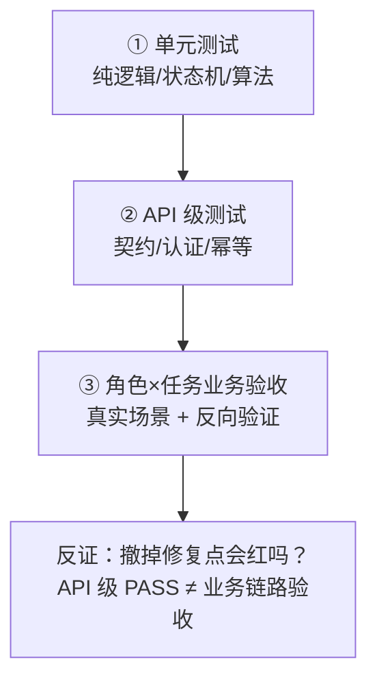

**测试类型矩阵**：

| 类型 | 工具/方式 | 守护目标 |
|:---|:---|:---|
| 单元 | JUnit 6 + Mockito | 逻辑正确性 |
| 架构守卫 | 静态测试 | 约定不退化 |
| API | `@SpringBootTest` + RestTestClient | 契约与认证 |
| IT | failsafe + 真库 | 事务/RLS/幂等/fencing |
| 契约 | 契约测试 | 跨端一致性 |
| E2E | 前端真链路 | 业务闭环 |
| 故障注入 | 故障注入框架 | 容错语义 |
| 红队 | Prompt 注入回归 | 安全边界 |

> **测试纪律**：用例数按 XML `<testcase>` 计；`@SpringBootTest` 替换编排器用 `@TestConfiguration` + `@Bean @Primary`（`@MockitoBean` 会把被测装饰器一起换掉）；必断言 skipped=0，杜绝"测试从未运行"的假绿。

**CI 校验流水线（阶段与门禁）**：

| 阶段 | 执行内容 | 失败处理 |
|:---|:---|:---|
| 编译 | `mvn clean verify`（双 reactor 串行）、`-proc:full` | 编译失败阻断 |
| 静态分析 | SonarQube + SpotBugs（结果 `target/spotbugsXml.xml`） | 新缺陷阻断；误报用 `@SuppressWarnings`/`@SuppressFBWarnings` + 注释说明 |
| 单元测试 | surefire（*Test） | 失败阻断 |
| 架构守卫 | 依赖方向/纯净性/谓词位置/配置 fail-closed | 失败阻断（约定被破坏） |
| 集成测试 | failsafe（*IT），IT 库守门 | 有库必真跑；skipped>0 需说明 |
| E2E | 前端真链路 | 阻断规模化发布门禁 |

**代码审查点（Review Checklist）**：
1. 是否违反第 6.2 禁止写法清单（10 条）？
2. 是否触碰第 2.7 十条不可妥协原则的禁止场景？
3. 新增配置是否 fail-closed、是否需快照隔离？
4. 涉及安全/一致性的改动是否有反证用例？
5. 新增文件是否登记白名单守卫（ALLOWED + REQUIRED）？
6. 是否有"写了没接线"的运行期可达性问题？
7. 终态/权限错误是否被伪装成临时故障？

**验收标准（DoD, Definition of Done）**：
- [ ] 单元测试 + 架构守卫 + IT 全绿，skipped=0（或有说明）。
- [ ] 涉及安全/一致性的需求有反证用例（撤点会红）。
- [ ] RTM 状态更新为 Done（非仅代码合并）。
- [ ] 若有配置/DDL 变更，同步种子/基线 YAML/init 脚本期望值。
- [ ] 若有架构决策变更，ADR/DEC 已更新并交叉审查。
- [ ] 代码审查 7 点全部通过。

> **最坏失效形态警示**：本项目曾出现"14 个 IT 类因未配置 failsafe 而在 `mvn verify` 中一条都没执行，构建仍 BUILD SUCCESS"——不是测试红，而是测试从未运行。故 failsafe 显式注册 `*IT.java` 且不设 `failIfNoSpecifiedTests=false` 放宽项。

### 6.12 可复用要点（本章带走清单）

- [ ] 工程化围绕"让正确做法成为默认、低成本、自动"展开。
- [ ] 规范落地三手段：文档（弱）→ 目录结构（中）→ 静态守卫（强），优先投资强约束。
- [ ] 把架构约定写成守卫测试，且守卫必须可被反证。
- [ ] 异常分类要稳定；终态/权限错误不伪装成临时故障。
- [ ] 配置 fail-closed + 集中化 + 快照隔离；警惕配置成为绕过门禁的后门。
- [ ] IT 环境严格守门，杜绝假失败/假绿；撤点恢复后 clean 重建避免缓存假象。
- [ ] 可观测要有口径纪律（未采集≠0、覆盖率带样本量、链路≠任务），否则制造虚假安全感。
- [ ] 三级验收 + 反向验证；API 级 PASS 不能替代业务链路验收。

---

## 第 7 章 架构总结与迭代规划

> 本章回答：诚实评估当前架构的优势与短板，明确适配边界，给出中长期可执行的迭代规划。

### 7.1 架构优势总结

| 优势 | 体现 |
|:---|:---|
| **决策可追溯** | DEC-1～12 + ADR-001～013 完整留痕，任何偏离有记录、有回滚方案 |
| **边界清晰、依赖可控** | 六层逻辑架构 + 端口-适配器 + 静态守卫，领域层零框架依赖 |
| **可靠性设计扎实** | PG 权威源 + Outbox 同事务 + 租约/fencing + UNKNOWN 对账 + 死信 |
| **安全纵深** | 多租户 RLS + 执行时授权 + 唯一闸门 + 未成年人数据白名单 + fail-closed |
| **可演进** | 配置快照隔离、消息通道可切换、全局 Agent 多对多绑定、权限影子迁移 |
| **工程化成熟** | 静态守卫体系 + 三级验收 + 反证纪律 + 三位一体可观测 |
| **约束固化** | 架构约定写成守卫，避免纸面架构随时间腐蚀 |

**优势的落地佐证案例（逐条配证据）**：

| 优势 | 佐证案例 | 证据位置 |
|:---|:---|:---|
| 决策可追溯 | Boot 3.x→4.1.1 偏离有 ADR 记录影响面与回滚方案；回滚时领域层零改动 | ADR-011 §5 |
| 边界清晰 | 换 MQ 载体时业务代码零改动，只改环境变量；领域层仅 JSpecify 依赖 | P4-D17、`AgentCorePurityTest` |
| 可靠性扎实 | 强杀 Worker 后旧 fencing 世代写入被拒；四元素强杀后同生共死 | ADR-001 §6 PoC、fencing 反证 IT |
| 安全纵深 | 跨租户访问用 NOBYPASSRLS 角色验证被拒；未成年人数据白名单落地 | 跨租户反证 IT、P0-D00 §4 |
| 可演进 | 消息通道按租户灰度，回滚=改一个环境变量；运行中改配置只影响新 Run | P4-D17 §4、配置快照隔离 |
| 工程化成熟 | failsafe 显式纳入 *IT.java，避免"测试从未运行"的假绿；三级验收 | `platform/pom.xml` failsafe 配置 |
| 约束固化 | `ModuleDependencyDirectionTest` 让反向依赖构建失败；配置 fail-closed 19 项 | 静态守卫体系 |

### 7.2 现存短板（诚实边界）

| 短板 | 现状 | 影响 |
|:---|:---|:---|
| 未验证的容量与 SLA | 未压测前不承诺固定吞吐；并发=1 有效执行 | 规模化发布条件不足 |
| 权限仍在影子期 | RLS→应用层 M2 影子（差真实流量），M4 SQL 为 DRAFT 未应用 | 真出口 `rlsDependent=0` 未达成 |
| 若干 P0 待验 | 流式 usage 判空、per-message 超时、队头阻塞等未跑 | 潜在 MAX_COST 闸门失效 |
| 运行期可达性缺口 | 有类/有表/有测 ≠ 被装配/被写入/被触发告警 | 部分能力可能"写了没接线" |
| 部分 IT 空白 | 对话审计 429/超时/断连/平台直连、6 端点×5 场景 SSE、RAG 摄取专用 DB IT | 边界场景未覆盖 |
| 前沿方向零落地 | 上下文压缩 S4（M11/M12/M14）零落地（ADR-013） | 长上下文成本未优化 |
| 前端 E2E 结论保守 | 单租户试点可用，不具备规模化发布条件 | 需真实多租户验证 |

> **诚实原则**：架构文档的价值不在于展示完美，而在于**清楚知道哪里不完美**。上述短板均有对应专题记录（`问题记录/`、`docs/能力维度深度报告/`），不做掩饰。

**短板根因 / 影响范围 / 触发场景 / 临时规避方案（深度展开）**：

| 短板 | 根因 | 影响范围 | 触发场景 | 临时规避方案 |
|:---|:---|:---|:---|:---|
| 未验证容量/SLA | 未做目标环境压测；有效并发=1 + deadline=null + 无 per-message 超时 | 规模化发布、队头阻塞 | 高负载/单租户大量 Run | 压测前不承诺 SLA；租户并发上限 5 + 背压护栏 |
| 权限影子期 | M2 影子差真实流量；M4 SQL 为 DRAFT 未应用 | 权限迁移彻底性 | 迁移收尾决策 | 保留 RLS 为主；9 张无 RLS 表为影子基线，禁直接补 |
| 若干 P0 待验 | 网关用 `!isMissingNode()` 判 usage（流式 null 取到 0）；无 per-message 超时 | MAX_COST 闸门失效、队头阻塞 | 流式模型调用、MiniMax usage 恒 null | 改 `isObject()` 判空 + 本地估算兜底标注"估算"；补 per-message 超时 |
| 运行期可达性缺口 | 有类/有表/有测但未被装配/触发告警 | 部分能力"写了没接线" | 审计/接地/归因 hook | 按深度报告第三章逐项核实装配链；补可达性 IT |
| 部分 IT 空白 | 边界场景用例未覆盖 | 429/超时/断连/平台直连等边界 | 异常流量、断连 | 按专题清单补 IT（对话审计 4 条 + SSE 6×5 + RAG 摄取） |
| 前沿方向零落地 | ADR-013 将 S4 定为后续阶段 | 长上下文成本 | 上下文膨胀 | 已有 S0–S3 与 G3 待签；S4 按路线图推进 |
| 前端 E2E 保守 | 仅单租户试点验证 | 规模化用户体验 | 多租户并发使用 | 明确"单租户试点可用"结论，不夸大；补多租户 E2E |

### 7.3 适配场景边界

**当前架构适配**：
- ✅ 中小体量、单/少租户试运营、强一致性与可审计要求高的场景；
- ✅ 未成年人数据合规敏感、副作用需对账的业务（教育辅导类）；
- ✅ 小团队、无专职 SRE、需要快速验证业务闭环的阶段。

**当前架构不适配（需升级或另立方案）**：
- ❌ 大规模高并发、多地域、需要独立伸缩的超大租户场景；
- ❌ 需要完整商业计费/发票能力（首期仅预算与 usage 一致性）；
- ❌ 通用工作流/DAG 编排、插件市场、不可信脚本沙箱（明确非目标）。

### 7.4 中长期迭代规划

```mermaid
timeline
    title 架构迭代路线（原则驱动，非固定日期）
    section 近期 · 正确性与安全收敛
        P0 待验项闭环 : 流式 usage 判空修正 : per-message 超时 : 队头阻塞验证
        运行期可达性审计 : 装配/写入/告警逐项核实 : 反证测试补齐
        IT 空白补齐 : 对话审计边界 : SSE 真库 IT : RAG 摄取 DB IT
    section 中期 · 完整性与规模化
        权限迁移收口 : RLS→应用层影子转正 : rlsDependent=0 + 观察期达标
        容量与 SLA : 压测建立基线 : 业务/运维批准 SLO
        对话审计增强 : includeRoutingModelCalls : 边界场景覆盖
        前端规模化 : 多租户真实验证 : E2E 覆盖扩展
    section 远期 · 演进与优化
        上下文压缩 S4 : M11/M12/M14 落地 : 长上下文成本优化
        模块服务化 : 瓶颈模块沿边界抽出 : 按需独立部署
        RAG 深化 : 评测集驱动 : 检索质量迭代（阈值/k 红线不变）
```

**1/3/6/12 个月迭代路线图（改造点 / 收益 / 风险 / 优先级）**：

| 周期 | 优先级 | 改造点 | 预期收益 | 改造风险 | 前置条件 |
|:---|:--:|:---|:---|:---|:---|
| 1 个月 | P0 | 网关 usage 判空改 `isObject()` + 流式 usage 本地估算兜底 | MAX_COST 闸门恢复有效 | 低（局部改动，需反证） | 构造固定 null usage 用例 |
| 1 个月 | P0 | 补 per-message 超时 + deadline=null 处理 | 消除队头阻塞 | 中（需端到端验证） | 确认超时语义 |
| 1 个月 | P0 | 对话审计 4 条边界 IT（429/超时/断连/平台直连） | 边界场景有证据 | 低 | 审计方案已定 |
| 3 个月 | P0 | 运行期可达性审计 + 反证补齐（Grounding/Review hook 等） | 消除"写了没接线" | 中（可能发现能力其实无效） | 深度报告第三章清单 |
| 3 个月 | P1 | SSE 6 端点×5 场景真库 IT + RAG 摄取专用 DB IT | 边界覆盖完整 | 中 | IT 环境稳定 |
| 3 个月 | P1 | 压测建立容量基线 + 批准 SLO | 可对外承诺 SLO | 中（数据可能不达预期） | 目标环境就绪 |
| 6 个月 | P1 | 权限迁移收口（影子转正，`rlsDependent=0` + 观察期） | 权限模型彻底化 | 高（迁移风险，须灰度） | 观察期数据达标 |
| 6 个月 | P1 | 上下文压缩 S4（M11/M12/M14） | 长上下文成本优化 | 中 | S0–S3 稳定、G3 签核 |
| 6 个月 | P2 | RabbitMQ 4.4 升级评估与演练 | 消除停维残余风险 | 中（跨版本升级） | 4.4 GA |
| 12 个月 | P2 | 瓶颈模块沿边界服务化（如 rag 检索独立部署） | 独立伸缩 | 高（分布式复杂度） | 明确瓶颈 + 团队扩张 |
| 12 个月 | P2 | 对话审计高级特性 + 前端多租户 E2E | 规模化能力补全 | 中 | 试点反馈 |

**迭代治理原则**：
1. **红线不可破**：检索阈值 0.38、RRF k=60、RLS 谓词位置、未成年人白名单等禁区不因迭代突破。
2. **每次变更走 ADR/DEC**：影响面跨模块或难回退的变更，必须有决策记录与回滚方案。
3. **反证验收**：每项优化以"撤掉修复点会红吗"验证判别力。
4. **约束驱动重估**：用复审触发条件（社区支持到期、压测不达标、观察期数据）决定何时重开决策。

### 7.5 架构治理机制

| 机制 | 作用 |
|:---|:---|
| 决策留痕（DEC/ADR） | 记录为什么，支持推翻与复审 |
| 静态守卫 | 把约定固化为自动检查，防止腐蚀 |
| 需求追踪矩阵 | 需求→设计→代码→测试双向可追溯 |
| 反证纪律 | 确保守卫与测试有判别力 |
| 诚实边界记录 | 明确短板与未验证项，避免虚假安全感 |
| 复审触发条件 | 约束变化时重新打开决策 |

**治理六件套的执行流程 / 落地节奏 / 审查机制**：

```mermaid
flowchart LR
    A["决策留痕<br/>需求变更先写 DEC/ADR"] --> B["需求追踪<br/>同步更新 RTM"]
    B --> C["静态守卫<br/>约定写成测试"]
    C --> D["反证纪律<br/>撤点会红吗"]
    D --> E["诚实边界<br/>记录短板与未验"]
    E --> F["复审触发<br/>约束变化重开决策"]
    F -.下一轮.-> A
```

| 机制 | 执行流程 | 落地节奏 | 审查机制 |
|:---|:---|:---|:---|
| 决策留痕 | 变更提出→写 DEC/ADR→交叉审查→批准 | 每个重大决策即时 | 架构评审会；偏离基线须 ADR |
| 需求追踪 | 需求变更→更新 RTM 受影响行→验收后置 Done | 每迭代同步 | 评审抽查双向链 |
| 静态守卫 | 新增约定→写守卫→反证验证→纳入 CI | 随代码提交 | CI 强制，失败阻断 |
| 反证纪律 | 修复点→写反证用例→撤点验证会红 | 每个安全/一致性改动 | code review 逐条问 |
| 诚实边界 | 识别短板→登记专题→定规避方案 | 每阶段复盘 | 阶段门禁核对 |
| 复审触发 | 监控触发条件→重开决策→评估→更新 ADR | 按触发条件 | 定期架构复审会 |

> **落地节奏建议**：决策留痕与反证"随变更即时"；需求追踪"每迭代同步"；守卫"随代码提交"；诚实边界"每阶段复盘"；复审触发"按条件 + 季度例会"。六件套形成闭环，使架构"活"起来而非一次性交付。

### 7.6 可复用要点（本章带走清单）

- [ ] 诚实总结优势与短板——文档价值在于清楚知道哪里不完美。
- [ ] 明确适配边界：适配什么、不适配什么、什么条件下升级。
- [ ] 迭代规划按"正确性→完整性→演进"分层，用原则驱动而非拍日期。
- [ ] 迭代中红线不可破，重大变更走 ADR/DEC，验收必须反证。
- [ ] 建立"决策留痕 + 守卫 + 追踪 + 反证 + 诚实边界 + 复审触发"六件套治理机制。

---

## 附录

### 附录 A：术语表

| 术语 | 含义 |
|:---|:---|
| Reactor | Maven 多模块构建单元，本项目有 platform 与 rag 两个 |
| 端口-适配器 | 六边形架构，领域定义端口（SPI），适配层实现 |
| Outbox | 事务性发件箱，状态与事件同事务提交，保证原子性 |
| fencing token | 单调递增的执行世代号，防旧世代写新状态（脑裂） |
| UNKNOWN | 外部调用结果不确定的状态，须对账而非盲目重试 |
| RLS | PostgreSQL 行级安全，基于 GUC `app.tenant_id` 隔离 |
| ExecutionSnapshot | Run 创建时钉死的不可变配置快照 |
| 能力闭包 | 治理期算出的 Agent 可用能力不可变集合，双人复核发布 |
| 唯一闸门 | `ToolInvocationGate`，工具调用必经的 15 步准入边界 |
| DEC / ADR | 需求层决策基线 / 技术层架构决策记录 |
| RRF | Reciprocal Rank Fusion，检索融合算法（k=60） |
| fail-closed | 默认拒绝，配置缺失/授权未知时拒绝而非放行 |
| 反证 | "撤掉修复点会红吗"的验证纪律 |

### 附录 B：关键决策索引

| 编号 | 主题 | 结论 |
|:---|:---|:---|
| DEC-2 | 首个业务场景 | 初中生错题归因与个性化辅导 |
| DEC-5 | RAG | 首期不做，用模型参数内知识 |
| DEC-6 | 未成年人数据 | 采集白名单 + 监护人单独同意 |
| DEC-9 | 预算/并发/审批 | 配置化 + fail-closed + 快照隔离 |
| DEC-10 | 模型零保留 | 未确认前禁止真实学生数据进 Prompt |
| DEC-12 | 主 MQ | RabbitMQ 4.3.6 + Quorum Queue |
| ADR-001 | 主 MQ 选型 | RabbitMQ，排除 Kafka/NATS |
| ADR-011 | 技术基线 | Java 21 + Spring Boot 4.1.1 |
| ADR-012 | 委派状态机与取消语义 | 明确委派调用状态机 |
| ADR-013 | 上下文压缩 | 统一入口 + 全窗口预算 |

### 附录 C：可复用模板索引

| 模板 | 所在章节 |
|:---|:---|
| 需求分层金字塔 | 1.1 |
| 五级需求分解法（INVEST） | 1.2 |
| DEC 决策基线六字段 | 1.5 |
| 原则体系四分组 | 2.1 |
| 原则冲突裁决优先级 | 2.8 |
| 选型五步法 + 8 维度 | 3.1 / 3.2 |
| ADR 决策记录模板 | 3.10 |
| 质量属性→架构决策推演表 | 4.1 |
| 取舍四步法 | 5.1 |
| 三级验收 + 反证 | 6.11 |
| 迭代治理六件套 | 7.5 |

**核心模板填写说明 / 样例 / 禁止项（三个高频模板）**：

**模板 1｜DEC 决策基线（6 字段）**：
- **填写说明**：编号全局唯一；"背景/冲突"必须写清两个对立选项；"复审触发"必须可判定。
- **样例**：DEC-10｜决策=零保留未确认前禁真实数据进 Prompt；冲突=进度 vs 合规；依据=PIPL/模型条款未定；影响=P1 用模拟数据 + GATE 1/2/3；复审=条款确认。
- **禁止项**：禁止只写结论不写理由；禁止"复审触发=待定"。

**模板 2｜选型打分表（8 维度 + 权重）**：
- **填写说明**：权重评估前冻结；含"不引入"备选；一票否决项单列。
- **样例**：见 3.3 MQ 选型加权打分明细（总分 4.00 vs 3.63 vs 3.88）。
- **禁止项**：禁止事后调权重；禁止只比功能不比失败模式/运维。

**模板 3｜验收判据（Given/When/Then）**：
- **填写说明**：Given 前置状态，When 触发动作，Then 可判定结果；安全需求必配反证。
- **样例**：Given Run 处于 RUNNING 且旧世代 token=5；When 旧世代尝试写终态；Then 写入被拒且状态不变。
- **禁止项**：禁止主观形容词（"快""好""稳定"）；禁止无反证的安全用例。

### 附录 D：事实来源与证据

本文档的本项目落地部分基于以下真实文档与代码（相对仓库根）：

- 架构基线：`docs/01_baseline/architecture/Java SaaS Agent 平台：规划与技术架构设计方案 v3.1.md`
- 需求体系：`docs/01_baseline/requirements/P0-D01～D06`（章程、SRS、MVP、追踪矩阵、风险、计划）
- 技术决策：`docs/01_baseline/milestones/P1/ADR-001/011/012/013`、`P4/P4-D17`
- 系统视图：`docs/05_archive/系统架构图.md`、`项目功能点与优化规划_源码视角_2026-11-17.md`
- 数据访问选型：`docs/orm-migration-poc/README.md`
- 工程规范：`platform/pom.xml`（版本锁定/模块结构/构建插件）、`deploy/sql/`、`monitoring/`
- 专题进度与红线：`问题记录/`、`docs/能力维度深度报告/`、`.workbuddy/memory/`

> **文档使用声明**：本文档为"设计思路与方法论"文档，侧重决策过程与设计思想。具体实施契约以 v3.1 架构方案、SRS、各 ADR 与源码为准；本文中的数值/版本为写作时点快照，实施前应核对最新基线。

### 附录 E：架构自查 / 评审 / 校验清单

**E.1 架构设计自查清单（设计完成后自问）**：
- [ ] 每条结构是否有需求来源（质量属性→架构决策推演表，4.1）？
- [ ] 分层依赖是否单向，禁止项（F-1～F-7）是否逐条 Check？
- [ ] 业务域边界、上下文映射、跨域依赖规则是否明确（4.3）？
- [ ] 三类数据流是否覆盖正常/异常/重试/降级/超时（4.5）？
- [ ] 状态机是否白名单迁移 + 终态不可迁 + 世代校验（4.7）？
- [ ] 关键取舍是否记录放弃什么/兜底/复审（5.1 决策卡）？
- [ ] 选型是否完整对比 + 权重前置 + 否决理由（3.x）？

**E.2 架构评审清单（评审会逐条过）**：
- [ ] 是否触碰十条不可妥协原则的禁止场景（2.7）？
- [ ] 涉及安全/一致性是否有反证用例（6.3）？
- [ ] 是否有"写了没接线"的运行期可达性问题（5.8）？
- [ ] 是否有终态/权限错误被伪装成临时故障（4.6）？
- [ ] 配置是否 fail-closed + 快照隔离（6.6）？
- [ ] 红线（0.38/k=60/谓词位置/白名单）是否被突破（7.4）？

**E.3 落地校验清单（上线前 DoD）**：
- [ ] 编译/静态分析/单测/守卫/IT/E2E 全绿，skipped=0（6.11）？
- [ ] RTM 状态更新为 Done，非仅代码合并（1.6）？
- [ ] 配置/DDL 变更同步种子、基线 YAML、init 脚本期望值？
- [ ] ADR/DEC 已更新并交叉审查？
- [ ] 告警责任人、Runbook、恢复演练就绪（6.10）？
- [ ] 优雅下线/滚动升级 fencing 语义验证通过（6.8）？

---

*文档结束 · v2.0（深度加厚版） · 2026-11-23*

