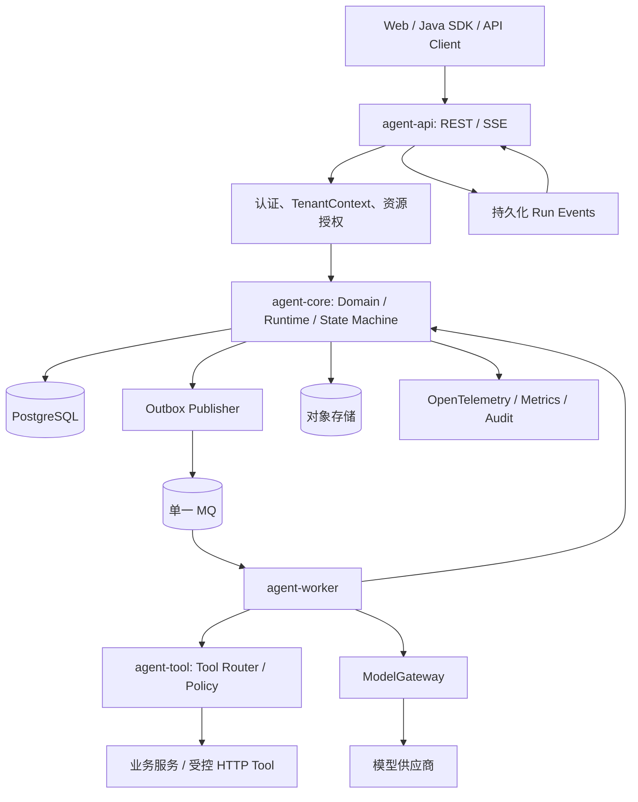
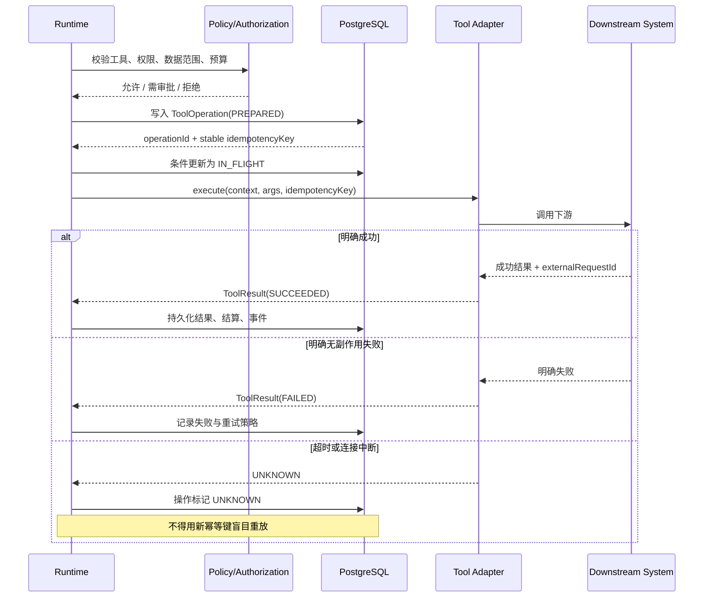
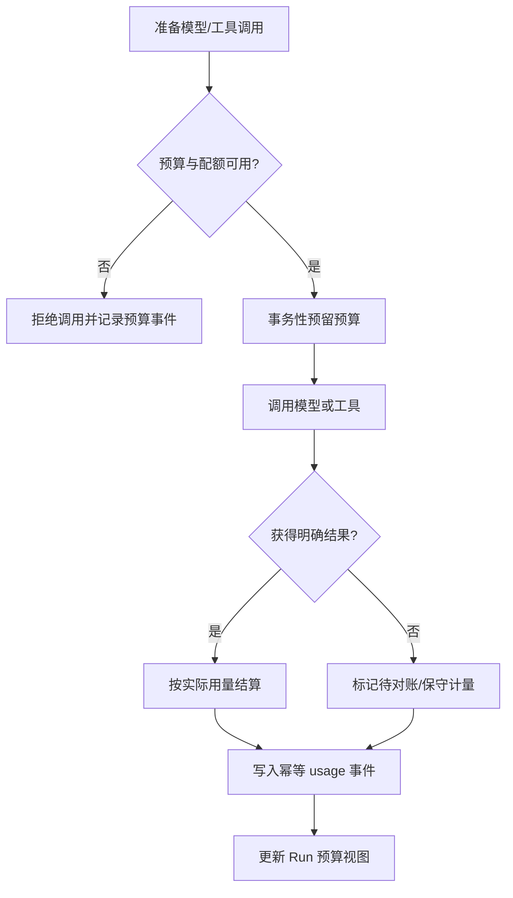
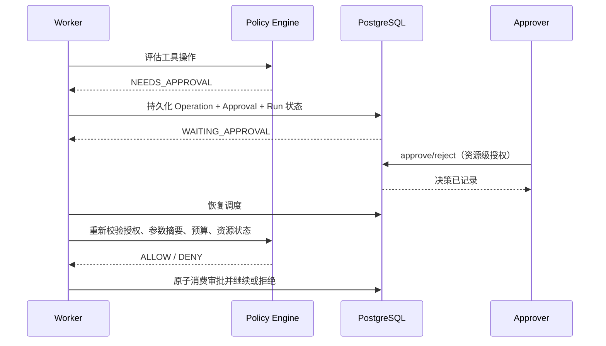
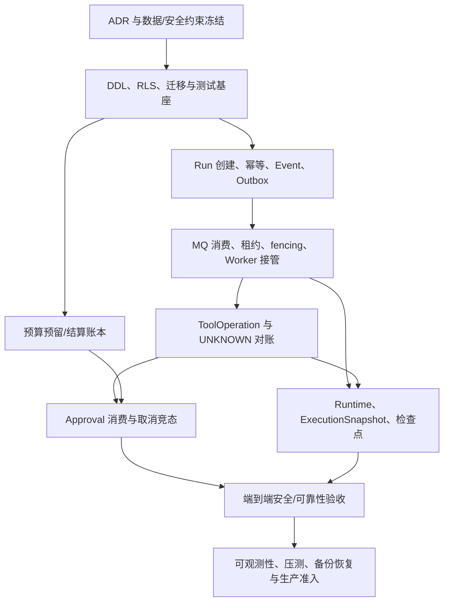

# Java SaaS Agent 平台：规划与技术架构设计方案 v3.1

> **文档类型**：可开发实施版  
> **版本**：v3.1  
> **基线**：v2.1 结构与工程落地优化版  
> **适用范围**：企业级、多租户、可审计、可恢复的 Java SaaS Agent 平台  
> **日期**：2026-10-17  
> **状态**：最终实施设计基线（吸收 v3.0 架构评审结论）。编码前仍须完成 ADR 决策、目标环境验证、威胁建模、容量评估与合规评审。

------------------------------------------------------------------------

## 0. 文档使用说明

### 0.1 目标读者

- 架构师：模块边界、事务边界、状态机、可靠性和扩展策略。
- Java 后端开发：领域接口、数据模型、API 契约、Worker 执行流程。
- DBA / 平台工程：DDL、索引、RLS、迁移、备份和恢复。
- QA / SRE / 安全：故障注入、跨租户测试、生产门禁和运行手册。
- 产品与项目负责人：MVP 边界、分阶段交付和验收条件。

### 0.2 设计约定

本文用以下标签区分实现确定性：

- **\[基线\]**：首期必须遵守的架构约束。
- **\[示例\]**：可作为项目起点，但需按现有 SaaS 平台规范调整。
- **\[待决策\]**：需要由项目负责人在编码前确认。
- **\[非 MVP\]**：明确不进入首期范围。

本文的 DDL 与 Java 片段用于明确契约和实施方向。正式落库前必须通过所选 PostgreSQL 版本、ORM、连接池、消息中间件和部署环境的集成测试。

### 0.3 v3.1 相对 v3.0 的主要修订

本版本不重做总体架构，沿用模块化单体 + 独立 Worker、PostgreSQL 权威状态、Outbox、租约与 fencing、ToolOperation 账本和不可变 ExecutionSnapshot。v3.1 将评审结论转化为可编码的约束：

- 明确 Run 执行尝试、工具逻辑操作与单次工具调用尝试三层语义，禁止把 attempt 编号纳入逻辑操作幂等键。
- MVP 移除无必要的 `CREATED` 持久状态：创建事务直接提交 `QUEUED`、初始事件、幂等记录和 Outbox；历史数据迁移需单独处理。
- 明确租户感知的任务领取和 RLS 上下文；继续使用共享 MQ，不要求每租户独立队列。
- 将预算预留设计为原子、可审计的持久化账本/预留记录；禁止“先查询余额再插入”的非原子实现。
- 明确审批一次性消费、取消检查与 ToolOperation 状态的事务边界；外部调用不得放进长数据库事务。
- 明确取消、超时、租约丢失与在途外部副作用的竞态语义；结果未知必须进入对账，不可盲目释放预算或重放。
- 增加对象存储每次读取的授权校验、旧 Run 快照兼容性恢复、Prompt Injection 输入边界、指标低基数与脱敏要求。
- 增加阶段 0 PoC、可量化验收、任务依赖、术语表、集成反模式和 ADR 待决策清单。

### 0.4 不能妥协的原则

1.  模型只提出计划和工具调用建议；平台负责授权、调度、执行、持久化与最终交付。
2.  `tenant_id`、`actor_id`、权限范围、`run_id`、`trace_id` 等可信上下文由服务端构造，不接受模型覆盖。
3.  PostgreSQL 是任务状态的权威事实来源；MQ 只负责唤醒和分发。
4.  Run 与 Outbox 事件在同一数据库事务中提交。
5.  每个 Worker 执行世代有单调递增的 `fencing_token`；旧世代不能更新新世代状态。
6.  有副作用的工具必须具备下游幂等、可查询对账或受控人工处理策略；结果未知时禁止盲目重放。
7.  发布后的 Agent 版本与执行快照不可变；安全授权在每次工具执行前动态检查。
8.  预算由服务端强制执行；调用前预留、调用后结算，重复结算必须幂等。
9.  外部网页、检索内容和工具结果均为不可信输入，不得升级为系统指令。
10. 首期先交付安全、可靠的单 Agent 闭环，不以复杂编排替代可靠性基础。

------------------------------------------------------------------------

## 1. v3.1 交付范围与实施决策

### 1.1 MVP 必须交付

| 能力域     | v3.1 实施范围                                    | 不纳入首期                     |
|:-----------|:-------------------------------------------------|:-------------------------------|
| Agent 管理 | 草稿、版本、校验、发布、不可变快照               | 模板市场、灰度编排平台         |
| 执行引擎   | 单 Agent Loop、步骤持久化、检查点、结果交付      | 多 Agent、通用 DAG 引擎        |
| 任务可靠性 | 异步 Run、租约、fencing、重试、协作式取消        | 任意工作流补偿引擎             |
| 工具系统   | Tool SPI、Schema 校验、执行时授权、操作账本      | 任意脚本执行、不可信插件沙箱   |
| 副作用治理 | 稳定逻辑幂等键、UNKNOWN、对账、人工处理路径      | 无法审计的“自动重试一切”       |
| 安全       | TenantContext、RBAC、资源授权、RLS、受控 Egress  | 一开始就实现完整通用 ABAC 产品 |
| 审批       | 对具体 operation、参数摘要、目标资源和有效期审批 | 泛化的 BPM 审批中心            |
| 预算计量   | 调用前预留、调用后结算、幂等 usage 事件          | 首期完整商业账单系统           |
| 事件       | 持久化 Run Event、SSE、Last-Event-ID 续传        | 无限期保留所有 Token 流        |
| 运维       | 指标、Trace、告警、死信、恢复演练                | 未验证容量前承诺固定吞吐 SLA   |

### 1.2 技术基线

| 组件     | 基线                                     | 说明                                            |
|:---------|:-----------------------------------------|:------------------------------------------------|
| Java     | Java 21 LTS                              | 以组织运行时兼容矩阵为准                        |
| 框架     | Spring Boot 3.x                          | 采用组织已验证的受支持小版本                    |
| 数据库   | PostgreSQL                               | 任务状态、版本、事件、Outbox、操作账本权威存储  |
| ORM      | Spring JDBC / jOOQ / MyBatis 三选一      | 涉及条件更新、租约和 RLS 的路径优先使用显式 SQL |
| MQ       | Kafka 或 RabbitMQ 二选一                 | 只选一种主 MQ；首期不双栈                       |
| 缓存     | Redis                                    | 限流、热点缓存；不能作为唯一任务状态            |
| 对象存储 | 现有企业对象存储                         | 大结果、附件、长轨迹；引用需授权校验            |
| AI 接入  | 自有 `ModelGateway`，可由 Spring AI 适配 | 领域层不依赖框架专属类型                        |
| 可观测性 | OpenTelemetry + Prometheus/Grafana       | Trace、指标、日志关联                           |
| 密钥     | KMS/Vault 或企业密钥服务                 | 不进入 Prompt、消息和普通日志                   |

### 1.3 编码前必须冻结的决策

- [ ] 主 MQ：Kafka 或 RabbitMQ。
- [ ] 数据访问技术：Spring JDBC、jOOQ 或 MyBatis。
- [ ] ID 策略：UUIDv7、UUID 或数据库生成 ID；全系统统一。
- [ ] 租户 RLS 的角色模型、事务上下文设置和连接池验证方案。
- [ ] 对象存储结果引用、保留期限、删除和导出策略；每次下载都必须重新授权。
- [ ] 单租户并发、模型并发、单 Run 预算和最大运行时长。
- [ ] 每个有副作用工具的下游幂等与对账能力清单。
- [ ] 模型供应商的数据驻留、日志保留和敏感数据策略。
- [ ] RPO/RTO、容量目标和告警阈值；这些数值必须通过业务评审和压测确定。

------------------------------------------------------------------------

## 2. 总体架构与模块边界

### 2.1 逻辑架构



### 2.2 模块职责

``` text
saas-agent-platform/
├── agent-api/        # REST、SSE、认证入口、OpenAPI、请求校验
├── agent-core/       # 领域模型、状态机、Agent Loop、预算、上下文
├── agent-tool/       # Tool SPI、Schema、授权、副作用协议
├── agent-infra/      # PostgreSQL、MQ、Outbox、Redis、对象存储、ModelGateway
├── agent-worker/     # 任务领取、租约、续租、执行、恢复
├── agent-admin/      # Agent 管理、Run 详情、审批 UI/API（可合并现有 Admin）
└── agent-testkit/    # Mock 工具、故障注入、契约测试、固定评测集
```

依赖规则：

- `agent-core` 不直接依赖 Spring AI、MQ SDK、Web 框架或数据库驱动。
- `agent-tool` 的工具执行上下文必须由平台构造；工具仍应调用业务系统自身授权。
- `agent-worker` 不把 MQ payload 当作可信任务状态；必须重新读取数据库。
- 异步边界通过持久化 ID 和明确 DTO 传递上下文，不依赖跨线程 `ThreadLocal`。
- 控制面和 Worker 可独立部署，但首期不拆成过多微服务。

### 2.3 核心执行链路

1.  API 验证身份、租户、Agent 资源权限、请求 Schema 和幂等键。
2.  在单个 PostgreSQL 事务内创建状态为 `QUEUED` 的 Run、初始事件、幂等记录和 Outbox 事件。
3.  Outbox Publisher 至少一次投递任务消息。
4.  Worker 消费消息后通过数据库条件更新领取 Run，并获得新 `fencing_token`。
5.  Runtime 加载不可变执行快照、预算、上下文和当前授权策略。
6.  模型输出工具调用建议；平台校验工具、参数、权限、数据范围、预算与审批要求。
7.  对副作用工具先写入操作账本，再调用下游；未知结果进入 UNKNOWN/对账。
8.  每次步骤更新、租约续期和 Run 终态提交都校验当前执行世代。
9.  持久化事件供 SSE/轮询消费；客户端只能读取自己有权访问的 Run。

------------------------------------------------------------------------

## 3. 核心领域模型与状态机

### 3.1 核心实体

| 实体              | 职责                   | 关键不变量                             |
|:------------------|:-----------------------|:---------------------------------------|
| AgentDefinition   | Agent 的可编辑逻辑实体 | 只代表当前管理对象，不代表历史执行配置 |
| AgentVersion      | 已发布版本             | 发布后不可原地修改                     |
| ExecutionSnapshot | Run 使用的完整配置快照 | 内容摘要固定，可追溯                   |
| Conversation      | 会话与访问边界         | tenant/user/agent 关系一致             |
| Run               | 一次异步任务           | 状态迁移受控；租约和世代可验证         |
| RunStep           | Loop 中的持久化步骤    | 每个逻辑步骤有稳定 `step_key`          |
| ToolOperation     | 一次逻辑工具操作       | 稳定幂等键；UNKNOWN 不得盲目重放       |
| Approval          | 对具体操作的授权决策   | 绑定参数摘要、目标资源、策略和有效期   |
| RunEvent          | 可续传事件流           | `(tenant_id, run_id, seq)` 唯一且单调  |
| UsageRecord       | 用量与费用账本         | 追加写、幂等、可对账                   |
| OutboxEvent       | 事务性待发布事件       | 可重复发布，消费者必须幂等             |
| AuditLog          | 安全与管理审计         | 结构化、不可由普通用户修改             |

### 3.2 Run 状态

MVP 状态：

- `QUEUED`：可被 Worker 领取。
- `RUNNING`：当前执行世代持有有效租约。
- `WAITING_APPROVAL`：等待对具体工具操作的人工决策，不占用持续运行线程。
- `RETRYING`：可重试失败已持久化，等待 `next_attempt_at`。
- `SUCCEEDED`：成功终态，结果引用已持久化。
- `FAILED`：不可恢复失败终态，错误分类与审计已持久化。
- `CANCELLED`：平台已完成协作式取消；不代表外部副作用必然撤销。
- `TIMED_OUT`：达到总时限；不代表下游请求已撤销或未产生副作用。

后续可选状态：`PAUSED`、`WAITING_EXTERNAL`、`COMPENSATING`。只有实现对应协议、恢复路径和测试后才可启用。

### 3.3 Run 状态迁移表

| 当前状态           | 目标状态           | 触发条件                          | 必须的校验                               |
|:-------------------|:-------------------|:----------------------------------|:-----------------------------------------|
| `QUEUED`           | `RUNNING`          | Worker 领取成功                   | 条件更新、租约设置、fencing 递增         |
| `RETRYING`         | `RUNNING`          | 到达 `next_attempt_at` 并领取成功 | 次数、截止时间、取消标志、租约校验       |
| `RUNNING`          | `RETRYING`         | 明确可重试错误                    | 记录错误、attempt、下次执行时间          |
| `RUNNING`          | `WAITING_APPROVAL` | 策略要求人工审批                  | Approval 与操作参数快照先持久化          |
| `WAITING_APPROVAL` | `QUEUED`           | 审批通过且仍有效                  | 参数摘要、权限、预算、资源状态重新校验   |
| `WAITING_APPROVAL` | `FAILED`           | 审批拒绝或过期且策略不允许继续    | 审批决策与原因审计                       |
| `RUNNING`          | `SUCCEEDED`        | 全部步骤完成                      | 租约世代校验；结果、终态、事件同事务提交 |
| `RUNNING`          | `FAILED`           | 不可恢复错误                      | 租约世代校验；错误和终态事件同事务提交   |
| `RUNNING`          | `CANCELLED`        | 协作式取消完成                    | 停止新操作；处理在途操作的未知结果       |
| `RUNNING`          | `TIMED_OUT`        | 总截止时间到达                    | 停止新操作；在途副作用进入对账流程       |
| `RUNNING`          | `QUEUED`           | 仅在明确定义的暂停/重新排队流程   | 不允许任意状态回退；保留检查点与历史     |

所有其他未列出的迁移默认拒绝并返回 `RUN_STATE_CONFLICT`。

> v3.1 新建 Run 不持久化 `CREATED`：创建事务直接写入 `QUEUED`。若升级已有 v3.0 数据库，需在迁移窗口将残留 `CREATED` 记录按 Outbox/事件完整性检查后转为 `QUEUED` 或进入人工修复；不得只修改枚举而忽略历史数据。

### 3.4 终态语义

终态包括 `SUCCEEDED`、`FAILED`、`CANCELLED`、`TIMED_OUT`。终态不是说外部系统中的每个动作都已回滚，而是说明平台对当前 Run 的执行生命周期已结束。

如果终态时存在未决的 `ToolOperation.UNKNOWN` 或 `RECONCILIATION_REQUIRED`，必须通过独立操作状态和 Run 结果摘要明确暴露，不得隐藏在普通成功响应中。

### 3.5 Run 版本与并发控制

Run 至少包含：

- `version`：乐观并发控制版本。
- `lease_owner`：当前 Worker 标识。
- `lease_until`：租约到期时间。
- `fencing_token`：执行世代号，领取或接管时单调递增。
- `cancel_requested_at`：协作式取消标记。
- `deadline_at`：绝对截止时间，恢复时不得重新计算完整时长。
- `attempt`、`max_attempts`、`next_attempt_at`：重试控制。
- `status`：状态机当前状态。

更新 Run、Step、事件或最终结果时，必须校验 `run_id + lease_owner + fencing_token`；关键状态迁移还要校验当前状态和 `version`。

------------------------------------------------------------------------

## 4. PostgreSQL 数据模型与 DDL

> 以下为 PostgreSQL 参考 DDL。生产实施需按现有 ID 类型、审计标准、保留策略和 RLS 角色规范调整。示例统一使用 `uuid`，所有时间戳使用 `timestamptz`。

### 4.1 扩展与通用约定

``` sql
CREATE EXTENSION IF NOT EXISTS pgcrypto;

-- 建议所有业务表显式包含 tenant_id。
-- 通过复合外键确保子资源不能引用其他租户的父资源。
-- created_at/updated_at 由应用或数据库统一维护，团队必须选定一种规则。
```

### 4.2 Agent 定义与版本

``` sql
CREATE TABLE agent_definition (
    tenant_id       uuid        NOT NULL,
    id              uuid        NOT NULL DEFAULT gen_random_uuid(),
    name            varchar(160) NOT NULL,
    description     text,
    status          varchar(24) NOT NULL DEFAULT 'DRAFT'
                    CHECK (status IN ('DRAFT', 'ACTIVE', 'DISABLED', 'ARCHIVED')),
    created_by      uuid        NOT NULL,
    updated_by      uuid        NOT NULL,
    created_at      timestamptz NOT NULL DEFAULT now(),
    updated_at      timestamptz NOT NULL DEFAULT now(),
    PRIMARY KEY (tenant_id, id),
    UNIQUE (tenant_id, name)
);

CREATE TABLE agent_version (
    tenant_id       uuid        NOT NULL,
    id              uuid        NOT NULL DEFAULT gen_random_uuid(),
    agent_id        uuid        NOT NULL,
    version_no      integer     NOT NULL CHECK (version_no > 0),
    config_json     jsonb       NOT NULL,
    content_hash    char(64)    NOT NULL,
    status          varchar(24) NOT NULL
                    CHECK (status IN ('DRAFT', 'PUBLISHED', 'RETIRED')),
    published_by    uuid,
    published_at    timestamptz,
    created_at      timestamptz NOT NULL DEFAULT now(),
    PRIMARY KEY (tenant_id, id),
    UNIQUE (tenant_id, agent_id, version_no),
    UNIQUE (tenant_id, agent_id, id),
    FOREIGN KEY (tenant_id, agent_id)
        REFERENCES agent_definition (tenant_id, id),
    CHECK (
        (status = 'PUBLISHED' AND published_at IS NOT NULL AND published_by IS NOT NULL)
        OR status <> 'PUBLISHED'
    )
);

CREATE TABLE agent_version_tool_binding (
    tenant_id       uuid        NOT NULL,
    agent_version_id uuid       NOT NULL,
    tool_id         varchar(160) NOT NULL,
    tool_version    varchar(80) NOT NULL,
    schema_hash     char(64)    NOT NULL,
    policy_version  varchar(80) NOT NULL,
    required_scopes jsonb       NOT NULL DEFAULT '[]'::jsonb,
    created_at      timestamptz NOT NULL DEFAULT now(),
    PRIMARY KEY (tenant_id, agent_version_id, tool_id),
    FOREIGN KEY (tenant_id, agent_version_id)
        REFERENCES agent_version (tenant_id, id)
);
```

**实施约束：**

- 发布动作应在事务中锁定候选版本、完成校验并转为 `PUBLISHED`。
- 应通过应用权限、触发器或独立发布服务防止已发布版本原地更新。
- `content_hash` 必须由规范化 JSON 计算；不能依赖字段顺序不稳定的普通序列化结果。
- 工具实现和 Schema 的实际制品版本也必须可定位；仅保存工具名称不足以复现和恢复。

### 4.3 执行快照与会话

``` sql
CREATE TABLE agent_execution_snapshot (
    tenant_id       uuid        NOT NULL,
    id              uuid        NOT NULL DEFAULT gen_random_uuid(),
    agent_id        uuid        NOT NULL,
    agent_version_id uuid       NOT NULL,
    snapshot_json   jsonb       NOT NULL,
    content_hash    char(64)    NOT NULL,
    created_by      uuid        NOT NULL,
    created_at      timestamptz NOT NULL DEFAULT now(),
    PRIMARY KEY (tenant_id, id),
    UNIQUE (tenant_id, agent_id, id),
    FOREIGN KEY (tenant_id, agent_id, agent_version_id)
        REFERENCES agent_version (tenant_id, agent_id, id)
);

CREATE TABLE agent_conversation (
    tenant_id       uuid        NOT NULL,
    id              uuid        NOT NULL DEFAULT gen_random_uuid(),
    agent_id        uuid        NOT NULL,
    user_id         uuid        NOT NULL,
    title           varchar(240),
    status          varchar(24) NOT NULL DEFAULT 'ACTIVE'
                    CHECK (status IN ('ACTIVE', 'ARCHIVED', 'DELETED')),
    created_at      timestamptz NOT NULL DEFAULT now(),
    updated_at      timestamptz NOT NULL DEFAULT now(),
    PRIMARY KEY (tenant_id, id),
    FOREIGN KEY (tenant_id, agent_id)
        REFERENCES agent_definition (tenant_id, id)
);

CREATE TABLE agent_message (
    tenant_id       uuid        NOT NULL,
    id              uuid        NOT NULL DEFAULT gen_random_uuid(),
    conversation_id uuid        NOT NULL,
    sequence_no     bigint      NOT NULL CHECK (sequence_no > 0),
    role            varchar(24) NOT NULL
                    CHECK (role IN ('SYSTEM', 'USER', 'ASSISTANT', 'TOOL')),
    content_ref     text,
    content_text    text,
    token_count     integer CHECK (token_count IS NULL OR token_count >= 0),
    source_ref      jsonb       NOT NULL DEFAULT '{}'::jsonb,
    created_at      timestamptz NOT NULL DEFAULT now(),
    PRIMARY KEY (tenant_id, id),
    UNIQUE (tenant_id, conversation_id, sequence_no),
    FOREIGN KEY (tenant_id, conversation_id)
        REFERENCES agent_conversation (tenant_id, id),
    CHECK (content_ref IS NOT NULL OR content_text IS NOT NULL)
);
```

对包含敏感数据或超长内容的消息，优先使用受控对象存储引用。`content_text` 是否可用、加密方式和保留期限必须与合规要求一致。

### 4.4 Run 主表

``` sql
CREATE TABLE agent_run (
    tenant_id           uuid        NOT NULL,
    id                  uuid        NOT NULL DEFAULT gen_random_uuid(),
    agent_id            uuid        NOT NULL,
    agent_version_id    uuid        NOT NULL,
    snapshot_id         uuid        NOT NULL,
    conversation_id     uuid,
    requested_by        uuid        NOT NULL,
    status              varchar(32) NOT NULL
                        CHECK (status IN (
                            'QUEUED', 'RUNNING', 'WAITING_APPROVAL',
                            'RETRYING', 'SUCCEEDED', 'FAILED', 'CANCELLED', 'TIMED_OUT'
                        )),
    version             bigint      NOT NULL DEFAULT 0 CHECK (version >= 0),
    attempt             integer     NOT NULL DEFAULT 0 CHECK (attempt >= 0),
    max_attempts        integer     NOT NULL DEFAULT 3 CHECK (max_attempts >= 0),
    next_attempt_at     timestamptz,
    lease_owner         varchar(160),
    lease_until         timestamptz,
    fencing_token       bigint      NOT NULL DEFAULT 0 CHECK (fencing_token >= 0),
    cancel_requested_at timestamptz,
    deadline_at         timestamptz NOT NULL,
    budget_json         jsonb       NOT NULL,
    result_ref          text,
    result_digest       char(64),
    error_code          varchar(100),
    error_summary       text,
    idempotency_key     varchar(200) NOT NULL,
    request_digest      char(64)    NOT NULL,
    created_at          timestamptz NOT NULL DEFAULT now(),
    started_at          timestamptz,
    finished_at         timestamptz,
    updated_at          timestamptz NOT NULL DEFAULT now(),
    PRIMARY KEY (tenant_id, id),
    UNIQUE (tenant_id, idempotency_key),
    UNIQUE (tenant_id, id, agent_id),
    FOREIGN KEY (tenant_id, agent_id, agent_version_id)
        REFERENCES agent_version (tenant_id, agent_id, id),
    FOREIGN KEY (tenant_id, agent_id, snapshot_id)
        REFERENCES agent_execution_snapshot (tenant_id, agent_id, id),
    FOREIGN KEY (tenant_id, conversation_id)
        REFERENCES agent_conversation (tenant_id, id),
    CHECK ((lease_owner IS NULL) = (lease_until IS NULL)),
    CHECK (
        (status IN ('SUCCEEDED', 'FAILED', 'CANCELLED', 'TIMED_OUT') AND finished_at IS NOT NULL)
        OR status NOT IN ('SUCCEEDED', 'FAILED', 'CANCELLED', 'TIMED_OUT')
    )
);

CREATE INDEX idx_agent_run_schedule
    ON agent_run (status, next_attempt_at, created_at)
    WHERE status IN ('QUEUED', 'RETRYING');

CREATE INDEX idx_agent_run_expired_lease
    ON agent_run (lease_until)
    WHERE status = 'RUNNING';

CREATE INDEX idx_agent_run_tenant_created
    ON agent_run (tenant_id, created_at DESC);

CREATE INDEX idx_agent_run_tenant_status_created
    ON agent_run (tenant_id, status, created_at DESC);
```

注意：API 幂等键必须按操作域隔离。推荐唯一键为 `(tenant_id, operation_scope, idempotency_key)`，其中 `operation_scope` 例如 `run.create`、`run.cancel`、`approval.decide`；若现有 DDL 仍使用 `(tenant_id, idempotency_key)`，则必须保证全租户键空间不复用，且在迁移前完成冲突扫描。相同键但请求摘要不同必须返回 `IDEMPOTENCY_KEY_CONFLICT`，不能静默返回旧结果。幂等记录需定义保留期与过期后的重放语义。

### 4.5 Run Step

``` sql
CREATE TABLE agent_run_step (
    tenant_id       uuid        NOT NULL,
    id              uuid        NOT NULL DEFAULT gen_random_uuid(),
    run_id          uuid        NOT NULL,
    step_key        varchar(200) NOT NULL,
    step_type       varchar(32) NOT NULL
                    CHECK (step_type IN ('MODEL', 'TOOL', 'SUMMARY', 'POLICY', 'FINALIZE')),
    status          varchar(32) NOT NULL
                    CHECK (status IN (
                        'PENDING', 'RUNNING', 'WAITING_APPROVAL',
                        'SUCCEEDED', 'FAILED', 'SKIPPED', 'UNKNOWN'
                    )),
    attempt         integer     NOT NULL DEFAULT 0 CHECK (attempt >= 0),
    input_digest    char(64),
    input_ref       text,
    output_digest   char(64),
    output_ref      text,
    checkpoint_ref  text,
    error_code      varchar(100),
    error_summary   text,
    fencing_token   bigint      NOT NULL,
    started_at      timestamptz,
    finished_at     timestamptz,
    created_at      timestamptz NOT NULL DEFAULT now(),
    updated_at      timestamptz NOT NULL DEFAULT now(),
    PRIMARY KEY (tenant_id, id),
    UNIQUE (tenant_id, run_id, step_key),
    FOREIGN KEY (tenant_id, run_id)
        REFERENCES agent_run (tenant_id, id)
);

CREATE INDEX idx_agent_run_step_run
    ON agent_run_step (tenant_id, run_id, created_at);
```

`step_key` 是逻辑步骤标识，重试时不应随意变化。单次执行尝试可以另存 attempt 记录，避免覆盖历史错误与耗时。

### 4.6 工具操作账本

``` sql
CREATE TABLE agent_tool_operation (
    tenant_id           uuid        NOT NULL,
    operation_id        uuid        NOT NULL DEFAULT gen_random_uuid(),
    run_id              uuid        NOT NULL,
    step_id             uuid        NOT NULL,
    tool_id             varchar(160) NOT NULL,
    tool_version        varchar(80) NOT NULL,
    logical_operation_key varchar(200) NOT NULL,
    idempotency_key     varchar(240) NOT NULL,
    args_digest         char(64)    NOT NULL,
    target_ref          text,
    status              varchar(40) NOT NULL
                        CHECK (status IN (
                            'PREPARED', 'IN_FLIGHT', 'SUCCEEDED', 'FAILED',
                            'UNKNOWN', 'RECONCILIATION_REQUIRED', 'COMPENSATED'
                        )),
    external_request_id varchar(240),
    result_ref          text,
    result_digest       char(64),
    error_code          varchar(100),
    error_summary       text,
    attempt_count       integer     NOT NULL DEFAULT 0,
    next_reconcile_at   timestamptz,
    created_at          timestamptz NOT NULL DEFAULT now(),
    updated_at          timestamptz NOT NULL DEFAULT now(),
    finished_at         timestamptz,
    PRIMARY KEY (tenant_id, operation_id),
    UNIQUE (tenant_id, idempotency_key),
    UNIQUE (tenant_id, run_id, logical_operation_key),
    FOREIGN KEY (tenant_id, run_id)
        REFERENCES agent_run (tenant_id, id),
    FOREIGN KEY (tenant_id, step_id)
        REFERENCES agent_run_step (tenant_id, id)
);

CREATE INDEX idx_tool_operation_reconcile
    ON agent_tool_operation (status, next_reconcile_at)
    WHERE status IN ('UNKNOWN', 'RECONCILIATION_REQUIRED');

CREATE INDEX idx_tool_operation_run
    ON agent_tool_operation (tenant_id, run_id, created_at);
```

幂等键应在逻辑操作生命周期内保持稳定。推荐输入包括租户、Run、逻辑步骤、工具 ID、逻辑操作标识与规范化参数摘要。不要把 attempt 编号放进逻辑操作幂等键，否则重试会生成新副作用。

### 4.7 Approval

``` sql
CREATE TABLE agent_approval (
    tenant_id       uuid        NOT NULL,
    id              uuid        NOT NULL DEFAULT gen_random_uuid(),
    run_id          uuid        NOT NULL,
    step_id         uuid        NOT NULL,
    operation_id    uuid        NOT NULL,
    tool_id         varchar(160) NOT NULL,
    tool_version    varchar(80) NOT NULL,
    args_digest     char(64)    NOT NULL,
    target_ref      text,
    policy_version  varchar(80) NOT NULL,
    requested_by    uuid        NOT NULL,
    approved_by     uuid,
    status          varchar(24) NOT NULL
                    CHECK (status IN ('PENDING', 'APPROVED', 'REJECTED', 'EXPIRED', 'REVOKED', 'CONSUMED')),
    reason          text,
    expires_at      timestamptz NOT NULL,
    decided_at      timestamptz,
    consumed_at     timestamptz,
    created_at      timestamptz NOT NULL DEFAULT now(),
    PRIMARY KEY (tenant_id, id),
    FOREIGN KEY (tenant_id, run_id)
        REFERENCES agent_run (tenant_id, id),
    FOREIGN KEY (tenant_id, step_id)
        REFERENCES agent_run_step (tenant_id, id),
    FOREIGN KEY (tenant_id, operation_id)
        REFERENCES agent_tool_operation (tenant_id, operation_id),
    CHECK (approved_by IS NULL OR approved_by <> requested_by OR reason IS NOT NULL)
);

CREATE INDEX idx_approval_pending
    ON agent_approval (tenant_id, expires_at)
    WHERE status = 'PENDING';
```

是否要求审批人和发起人分离由风险策略决定，可按工具风险等级配置。审批通过后执行前必须再次检查权限、参数摘要、目标资源状态、预算和取消标志。

**一次性消费协议（必须实现）**：

1. 在短数据库事务中锁定 Approval 和关联 Run/ToolOperation；条件校验 `status='APPROVED'`、未过期、参数摘要一致、权限仍有效、Run 未请求取消且当前操作仍可执行。
2. 以条件更新把 Approval 置为 `CONSUMED`，并将 ToolOperation 持久化为 `READY`/`IN_FLIGHT` 的明确阶段；记录消费时间、消费请求 ID 和 fencing token。状态变化与事件/Outbox 在同一事务提交。
3. 提交事务后才发起外部工具调用；禁止在持有数据库行锁时等待网络请求。
4. 若进程在消费后、外部调用前崩溃，恢复流程必须识别“已消费但调用结果/是否发出未知”的记录。只有能证明未发送时才可安全重新派发；否则进入 `UNKNOWN` 并按下游查询/人工对账处理。
5. 取消检查必须出现在 Approval 消费的条件更新中，避免取消请求与审批执行并发时启动新的副作用。

### 4.8 Run Event、Outbox、Usage、Audit

``` sql
CREATE TABLE agent_run_event (
    tenant_id       uuid        NOT NULL,
    run_id          uuid        NOT NULL,
    seq             bigint      NOT NULL CHECK (seq > 0),
    event_id        uuid        NOT NULL DEFAULT gen_random_uuid(),
    event_type      varchar(100) NOT NULL,
    schema_version  integer     NOT NULL DEFAULT 1,
    payload         jsonb,
    payload_ref     text,
    created_at      timestamptz NOT NULL DEFAULT now(),
    PRIMARY KEY (tenant_id, run_id, seq),
    UNIQUE (tenant_id, event_id),
    FOREIGN KEY (tenant_id, run_id)
        REFERENCES agent_run (tenant_id, id),
    CHECK (payload IS NOT NULL OR payload_ref IS NOT NULL)
);

CREATE TABLE outbox_event (
    tenant_id       uuid        NOT NULL,
    event_id        uuid        NOT NULL DEFAULT gen_random_uuid(),
    aggregate_type  varchar(80) NOT NULL,
    aggregate_id    uuid        NOT NULL,
    event_type      varchar(100) NOT NULL,
    payload         jsonb       NOT NULL,
    status          varchar(24) NOT NULL DEFAULT 'PENDING'
                    CHECK (status IN ('PENDING', 'PUBLISHING', 'PUBLISHED', 'DEAD')),
    attempts        integer     NOT NULL DEFAULT 0,
    next_attempt_at timestamptz NOT NULL DEFAULT now(),
    last_error_code varchar(100),
    created_at      timestamptz NOT NULL DEFAULT now(),
    published_at    timestamptz,
    PRIMARY KEY (tenant_id, event_id)
);

CREATE INDEX idx_outbox_pending
    ON outbox_event (next_attempt_at, created_at)
    WHERE status IN ('PENDING', 'PUBLISHING');

CREATE TABLE agent_usage_record (
    tenant_id           uuid        NOT NULL,
    usage_event_id      uuid        NOT NULL,
    run_id              uuid        NOT NULL,
    operation_id        uuid,
    provider_request_id varchar(240),
    usage_type          varchar(80) NOT NULL,
    input_tokens        bigint      NOT NULL DEFAULT 0 CHECK (input_tokens >= 0),
    output_tokens       bigint      NOT NULL DEFAULT 0 CHECK (output_tokens >= 0),
    tool_units          numeric(20, 6) NOT NULL DEFAULT 0 CHECK (tool_units >= 0),
    cost_amount         numeric(20, 8) NOT NULL DEFAULT 0 CHECK (cost_amount >= 0),
    currency            char(3)     NOT NULL DEFAULT 'USD',
    settlement_status   varchar(24) NOT NULL
                        CHECK (settlement_status IN ('RESERVED', 'SETTLED', 'RELEASED', 'RECONCILE')),
    source_digest       char(64),
    created_at          timestamptz NOT NULL DEFAULT now(),
    settled_at          timestamptz,
    PRIMARY KEY (tenant_id, usage_event_id),
    FOREIGN KEY (tenant_id, run_id)
        REFERENCES agent_run (tenant_id, id),
    FOREIGN KEY (tenant_id, operation_id)
        REFERENCES agent_tool_operation (tenant_id, operation_id)
);

CREATE INDEX idx_usage_run
    ON agent_usage_record (tenant_id, run_id, created_at);

CREATE TABLE agent_audit_log (
    tenant_id       uuid        NOT NULL,
    id              uuid        NOT NULL DEFAULT gen_random_uuid(),
    actor_id        uuid,
    action          varchar(160) NOT NULL,
    resource_type   varchar(100) NOT NULL,
    resource_id     text NOT NULL,
    decision        varchar(24) NOT NULL,
    reason_code     varchar(100),
    trace_id        varchar(128),
    metadata        jsonb       NOT NULL DEFAULT '{}'::jsonb,
    created_at      timestamptz NOT NULL DEFAULT now(),
    PRIMARY KEY (tenant_id, id)
);

CREATE INDEX idx_audit_resource
    ON agent_audit_log (tenant_id, resource_type, resource_id, created_at DESC);
```

### 4.9 事件序号生成

同一 Run 的事件序号必须事务性分配。简单且可靠的首期实现可在追加事件时锁定对应 Run 行，读取或维护 `last_event_seq`，再插入事件。高吞吐优化必须先证明不会产生重复、缺号语义混乱或乱序。首期默认不持久化每个 token 的独立事件；优先持久化步骤状态、关键阶段、最终内容/引用及必要的增量摘要。若确需 token 流，必须定义采样、合并、保留期、成本上限和断点语义。

可在 `agent_run` 增加 `last_event_seq bigint NOT NULL DEFAULT 0`。每次追加事件：

``` sql
UPDATE agent_run
SET last_event_seq = last_event_seq + 1
WHERE tenant_id = :tenantId
  AND id = :runId
RETURNING last_event_seq;
```

然后在同一事务中以返回的值插入 `agent_run_event`。追加事件的事务必须同时校验资源与当前执行世代（对于 Worker 产生的执行事件）。

### 4.10 RLS 示例与注意事项

``` sql
ALTER TABLE agent_run ENABLE ROW LEVEL SECURITY;
ALTER TABLE agent_run FORCE ROW LEVEL SECURITY;

CREATE POLICY agent_run_tenant_policy ON agent_run
USING (tenant_id = current_setting('app.tenant_id', true)::uuid)
WITH CHECK (tenant_id = current_setting('app.tenant_id', true)::uuid);
```

对所有租户表逐一启用策略。应用角色不得拥有绕过 RLS 的权限；表所有者、迁移角色、运营角色应分离。

事务开始后使用 `SET LOCAL app.tenant_id = '...'` 或等效事务级设置。连接池复用、事务回滚、异步任务、批处理和后台 Worker 均必须测试。`current_setting` 为空或无效时必须拒绝访问，而不是退化成全表访问。

RLS 是纵深防御，不替代服务层资源授权和业务数据范围检查。普通应用角色不能通过任意 SQL 自行切换租户上下文；只有经过身份验证的可信应用层可设置该值。

------------------------------------------------------------------------

## 5. Worker 任务领取、租约与 fencing

### 5.1 领取协议

1.  Worker 从 MQ 收到 `RUN_REQUESTED` 消息，只把它当作候选任务提示。
2.  从数据库读取 Run 的可信租户、状态、取消标志、截止时间和重试时间。
3.  使用事务和条件更新领取任务；仅成功更新的一方获得执行权。
4.  领取或接管时递增 `fencing_token`，写入 `lease_owner`、`lease_until`，并递增 `version`。
5.  Worker 以领取返回的 token 执行；每次续租、步骤更新和最终提交均携带 token。
6.  租约丢失时立即停止发起新工具操作；在途请求依工具副作用协议处理。

### 5.2 推荐的候选任务领取 SQL

以下使用 `FOR UPDATE SKIP LOCKED` 选择一个候选任务。锁和更新必须位于同一事务中。

``` sql
BEGIN;

WITH candidate AS (
    SELECT tenant_id, id
    FROM agent_run
    WHERE (
        status = 'QUEUED'
        OR (status = 'RETRYING' AND next_attempt_at <= now())
        OR (status = 'RUNNING' AND lease_until < now())
    )
      AND (lease_until IS NULL OR lease_until < now())
      AND cancel_requested_at IS NULL
      AND deadline_at > now()
      AND attempt < max_attempts
    ORDER BY COALESCE(next_attempt_at, created_at), created_at
    FOR UPDATE SKIP LOCKED
    LIMIT 1
)
UPDATE agent_run r
SET status = 'RUNNING',
    lease_owner = :workerId,
    lease_until = now() + (:leaseSeconds * interval '1 second'),
    fencing_token = fencing_token + 1,
    version = version + 1,
    attempt = attempt + 1,
    started_at = COALESCE(started_at, now()),
    updated_at = now()
FROM candidate c
WHERE r.tenant_id = c.tenant_id
  AND r.id = c.id
RETURNING r.tenant_id, r.id, r.fencing_token, r.version, r.lease_until,
          r.deadline_at, r.snapshot_id, r.budget_json;

COMMIT;
```

**实现说明：**

- `agent_run.attempt` 只表示 Run 被 Worker 成功领取并进入一个执行世代的次数；不等于模型请求次数，也不等于工具调用次数。每个 ToolOperation 另有 `call_attempt`/调用尝试记录；每次调用记录开始时间、结束时间、结果分类、下游 request/idempotency key 和错误摘要。只有明确证明请求未发出或下游契约保证幂等时才可自动重试。
- 上例是可执行实现的起点，不是所有重试和终态处理的完整代码。
- `RUNNING` 过期接管前，必须确认该 Run 的工具操作账本；旧世代的 `IN_FLIGHT` 操作不能被当作未执行。
- 达到 `deadline_at` 或 `max_attempts` 的任务应由调度清理器转为明确终态并写事件，不能永久滞留。
- 共享 MQ 消息只携带候选 `tenant_id + run_id + message_id`，不携带可被当作授权依据的角色或权限。Worker 先验证消息生产者/签名边界，再从数据库读取权威租户与 Run 状态；每次数据库事务设置事务级 TenantContext，并执行 RLS。跨租户调度只能使用最小权限的专用调度角色与审计化扫描过程；不得为每个租户强制建立独立物理队列，也不得以无边界 `BYPASSRLS` 作为常规路径。

### 5.3 续租 SQL

``` sql
UPDATE agent_run
SET lease_until = now() + (:leaseSeconds * interval '1 second'),
    version = version + 1,
    updated_at = now()
WHERE tenant_id = :tenantId
  AND id = :runId
  AND status = 'RUNNING'
  AND lease_owner = :workerId
  AND fencing_token = :fencingToken
  AND lease_until > now()
  AND cancel_requested_at IS NULL
RETURNING lease_until, version;
```

更新行数为 0 时，Worker 必须视为 `LEASE_LOST` 或执行权已失效。不得用 Redis 锁结果覆盖数据库的判断。

### 5.4 带 fencing 的步骤更新

``` sql
UPDATE agent_run_step s
SET status = :newStatus,
    output_ref = :outputRef,
    output_digest = :outputDigest,
    updated_at = now()
FROM agent_run r
WHERE s.tenant_id = :tenantId
  AND s.run_id = :runId
  AND s.id = :stepId
  AND r.tenant_id = s.tenant_id
  AND r.id = s.run_id
  AND r.status = 'RUNNING'
  AND r.lease_owner = :workerId
  AND r.fencing_token = :fencingToken
  AND s.fencing_token = :fencingToken;
```

更新行数不是 1 时，当前执行世代无权提交。应用必须停止该世代的后续工作，并记录可观测的 fencing 拒绝指标。

### 5.5 完成 Run 的事务边界

在同一事务中：

1.  条件更新 Run，校验 `status='RUNNING'`、`lease_owner`、`fencing_token` 和必要的 `version`。
2.  写入最终结果引用与摘要。
3.  写入 `SUCCEEDED` / `FAILED` 等终态与 `finished_at`。
4.  追加终态 Run Event。
5.  写入用量结算或后续结算 Outbox。
6.  提交事务。

任何关键条件更新失败都应回滚。旧 Worker 不得因”模型调用已经成功”而绕过 fencing 校验。

------------------------------------------------------------------------

## 6. Outbox 与消息消费

### 6.1 Run 创建事务

``` text
BEGIN
  校验幂等键及 request_digest
  绑定已发布 agent_version_id 与 execution_snapshot_id
  INSERT agent_run(status = QUEUED)
  INSERT agent_run_event(seq = 1, event_type = run.queued)
  INSERT outbox_event(event_type = RUN_REQUESTED)
COMMIT
返回 HTTP 202 + runId
```

Run、初始事件和 Outbox 必须在同一个数据库事务中。事务提交后才返回 202。

### 6.2 Outbox Publisher 协议

- 使用 `FOR UPDATE SKIP LOCKED` 领取待发布事件。
- 将事件投递至 MQ，消息包含 `event_id`、`event_type`、`aggregate_id` 和最小必要定位信息。
- 只有 MQ 确认后才标记 `PUBLISHED`。
- 如果消息已投递但数据库更新失败，允许再次发布；消费者必须幂等。
- 暂时性错误使用指数退避和抖动；超过阈值进入 `DEAD` 并告警。
- 不允许根据”MQ 中是否有消息”推断 Run 的最终状态。

### 6.3 消费者幂等

消费者收到消息后：

1.  校验消息 Schema 与事件类型。
2.  使用数据库查询可信 Run。
3.  通过条件领取 SQL 竞争执行权。
4.  未获得租约则确认消息并结束本次消费。
5.  获得租约后执行；进程崩溃由租约恢复流程接管。
6.  消息确认时机遵循 MQ 的可靠性策略；即使重投，也不得仅凭消息触发第二次逻辑副作用。

------------------------------------------------------------------------

## 7. 工具执行协议与 UNKNOWN 对账

### 7.1 工具操作状态

| 状态                      | 含义                                 | 允许动作                           |
|:--------------------------|:-------------------------------------|:-----------------------------------|
| `PREPARED`                | 操作意图、参数摘要、幂等键已持久化   | 首次发起调用                       |
| `IN_FLIGHT`               | 请求可能已发出，结果尚未确认         | 查询下游状态；必要时使用相同幂等键 |
| `SUCCEEDED`               | 下游成功已确认，结果已存储           | 读取结果，不重复执行               |
| `FAILED`                  | 已确认失败且无副作用，或失败语义明确 | 按错误分类决定是否重试             |
| `UNKNOWN`                 | 超时、断连、崩溃导致结果不确定       | 先对账；禁止创建新逻辑操作         |
| `RECONCILIATION_REQUIRED` | 自动对账仍不能确认                   | 转人工处理或受控补偿               |
| `COMPENSATED`             | 已执行明确的补偿操作                 | 保留原操作与补偿操作的审计关联     |

### 7.2 标准工具调用流程



### 7.3 幂等键规则

- 同一个逻辑操作的幂等键在 Run 重试、Worker 接管、模型重试时保持稳定。
- 同一键 + 相同参数摘要：返回已有操作状态或结果。
- 同一键 + 不同参数摘要：拒绝并返回 `IDEMPOTENCY_CONFLICT` 或 `TOOL_SIDE_EFFECT_CONFLICT`。
- 下游支持幂等时，将平台稳定键或 `operation_id` 传递给下游。
- 下游不支持幂等时，工具必须提供可查询业务唯一键、对账 API，或明确转人工流程。
- 补偿不是回滚；补偿动作本身也必须有幂等键、权限校验、审批和审计。
- 不要把网络请求 attempt 编号加入逻辑幂等键。

### 7.4 Tool SPI

``` java
public interface AgentTool {
    ToolDefinition definition();

    ToolResult execute(
        ToolExecutionContext context,
        Map<String, Object> arguments
    );
}

public record ToolExecutionContext(
    UUID tenantId,
    UUID actorId,
    UUID runId,
    UUID stepId,
    UUID operationId,
    String traceId,
    long fencingToken,
    Instant deadline,
    Set<String> grantedScopes
) {}

public record ToolDefinition(
    String toolId,
    String version,
    String description,
    JsonNode inputSchema,
    JsonNode outputSchema,
    SideEffectLevel sideEffectLevel,
    boolean requiresApproval,
    Duration timeout
) {}

public enum SideEffectLevel {
    READ_ONLY,
    IDEMPOTENT_WRITE,
    NON_IDEMPOTENT_WRITE,
    EXTERNAL_COMMUNICATION
}

public enum ToolOperationStatus {
    PREPARED,
    IN_FLIGHT,
    SUCCEEDED,
    FAILED,
    UNKNOWN,
    RECONCILIATION_REQUIRED,
    COMPENSATED
}

public record ToolResult(
    ToolOperationStatus status,
    JsonNode modelView,
    String resultRef,
    String externalRequestId,
    String errorCode,
    boolean sideEffectConfirmed
) {}
```

说明：

- `JsonNode` 示例可替换为项目统一的 JSON 类型。
- `grantedScopes` 只是已计算的授权结果，不应替代业务系统最终的对象级授权。
- 工具定义必须声明副作用等级、超时、重试语义和对账能力。
- 工具适配器不得自行信任模型提供的 tenant/user/permission 字段。
- 所有远程调用均应有 deadline、超时、并发上限和可观测性。

### 7.5 UNKNOWN 对账策略

按工具能力登记下列一种或多种策略：

1.  **按稳定幂等键查询**：下游支持以同一键查询操作状态。
2.  **按业务唯一键查询**：例如订单号、工单号或外部请求 ID。
3.  **同一键安全重放**：只有下游明确保证同一幂等键不会重复产生副作用时才允许。
4.  **人工对账**：生成可审计工单，展示目标资源、参数摘要、请求 ID 和时间线。
5.  **受控补偿**：仅在确认原操作状态且补偿前置条件成立时执行。

绝不允许：把超时直接当作失败，再生成新操作 ID 和新幂等键重试。

------------------------------------------------------------------------

## 8. 预算、配额与费用结算

### 8.1 预算维度

- 最大 Loop 迭代数。
- 绝对运行截止时间。
- 输入/输出 Token 上限。
- 工具调用次数。
- 单次 Run 费用上限。
- 租户、Agent、用户和供应商并发上限。
- 单工具响应大小、最大重试数和总调用时长。

### 8.2 预留—执行—结算流程



### 8.3 关键规则

- 并发调用必须在数据库或具备原子语义的预算服务中预留，不可只在 JVM 内存计数。
- 预留和结算必须使用稳定的 `usage_event_id`。
- 结算重复请求返回既有结果，不重复扣费。
- 失败时是否释放预留由失败类型决定；模型供应商可能已产生费用，不能一律全额释放。
- 供应商未返回 Token 用量时，使用保守估算或标记 `RECONCILE`，并对账最终账单。
- 用户传入的 budget/options 只能收紧服务端策略，不能扩大平台硬上限。
- Run 恢复时沿用原始绝对截止时间和已消耗预算，不能重置完整额度。
- 工具重试是否计入调用次数必须在计量契约中统一定义。

### 8.4 预算接口建议

``` java
public interface BudgetService {
    BudgetReservation reserve(BudgetRequest request);

    BudgetSettlement settle(
        UUID reservationId,
        ActualUsage actualUsage,
        String usageEventId
    );

    void release(
        UUID reservationId,
        String releaseReason,
        String usageEventId
    );
}

public record BudgetRequest(
    UUID tenantId,
    UUID runId,
    String operationKey,
    BigDecimal estimatedCost,
    long estimatedInputTokens,
    long maxOutputTokens,
    int toolUnits
) {}

public record BudgetReservation(
    UUID reservationId,
    String status,
    BigDecimal reservedCost,
    Instant expiresAt
) {}
```

接口只定义契约。生产实现还需要处理并发锁、预留过期、跨服务事务、供应商计费差异和幂等重放。

------------------------------------------------------------------------

## 9. Java 核心接口与实现骨架

### 9.1 Run 状态枚举与迁移守卫

``` java
public enum RunStatus {
    QUEUED,
    RUNNING,
    WAITING_APPROVAL,
    RETRYING,
    SUCCEEDED,
    FAILED,
    CANCELLED,
    TIMED_OUT;

    public boolean isTerminal() {
        return this == SUCCEEDED
            || this == FAILED
            || this == CANCELLED
            || this == TIMED_OUT;
    }
}
```

``` java
public final class RunStateMachine {
    private static final Map<RunStatus, Set<RunStatus>> ALLOWED = Map.of(
        RunStatus.QUEUED, Set.of(RunStatus.RUNNING, RunStatus.CANCELLED, RunStatus.TIMED_OUT),
        RunStatus.RETRYING, Set.of(RunStatus.RUNNING, RunStatus.CANCELLED, RunStatus.TIMED_OUT),
        RunStatus.RUNNING, Set.of(
            RunStatus.RETRYING, RunStatus.WAITING_APPROVAL,
            RunStatus.SUCCEEDED, RunStatus.FAILED,
            RunStatus.CANCELLED, RunStatus.TIMED_OUT
        ),
        RunStatus.WAITING_APPROVAL, Set.of(
            RunStatus.QUEUED, RunStatus.FAILED, RunStatus.CANCELLED, RunStatus.TIMED_OUT
        ),
        RunStatus.SUCCEEDED, Set.of(),
        RunStatus.FAILED, Set.of(),
        RunStatus.CANCELLED, Set.of(),
        RunStatus.TIMED_OUT, Set.of()
    );

    public void assertTransition(RunStatus from, RunStatus to) {
        if (!ALLOWED.getOrDefault(from, Set.of()).contains(to)) {
            throw new IllegalStateException(
                "Illegal Run state transition: " + from + " -> " + to
            );
        }
    }
}
```

注意：状态机类只提供领域层校验；数据库条件更新仍然是并发安全的最终防线。取消、超时和审批之间存在竞争时，必须由数据库状态迁移条件决定唯一结果。

### 9.2 TenantContext

``` java
public record TenantContext(
    UUID tenantId,
    UUID actorId,
    Set<String> authorities,
    String requestId,
    String traceId
) {
    public TenantContext {
        Objects.requireNonNull(tenantId, "tenantId");
        Objects.requireNonNull(actorId, "actorId");
        authorities = Set.copyOf(authorities == null ? Set.of() : authorities);
    }
}
```

`TenantContext` 只能由已验证的认证链路创建。不能从请求 JSON 反序列化成可信对象，也不能通过模型工具参数覆盖。

### 9.3 Run 应用服务

``` java
public interface RunApplicationService {
    RunAccepted createRun(
        TenantContext tenant,
        CreateRunCommand command,
        String idempotencyKey
    );

    RunView getRun(TenantContext tenant, UUID runId);

    CancelAccepted requestCancel(TenantContext tenant, UUID runId);

    RetryAccepted retryRun(TenantContext tenant, UUID runId);
}

public record CreateRunCommand(
    UUID agentId,
    UUID conversationId,
    String goal,
    Map<String, Object> options,
    Map<String, Object> budgetOverrides
) {}

public record RunAccepted(
    UUID runId,
    RunStatus status,
    String statusUrl,
    String eventsUrl
) {}
```

创建 Run 的服务必须在事务中完成：授权、幂等检查、固定发布版本与快照、Run 插入、初始事件插入、Outbox 插入。不要在 API 请求线程执行持续数分钟的 Agent Loop。

### 9.4 Worker 执行器

``` java
public interface RunExecutor {
    void execute(ClaimedRun run);
}

public record ClaimedRun(
    UUID tenantId,
    UUID runId,
    String workerId,
    long fencingToken,
    long rowVersion,
    Instant leaseUntil,
    Instant deadlineAt,
    UUID snapshotId
) {}
```

伪代码：

``` java
public void execute(ClaimedRun claimed) {
    try {
        leaseService.assertStillOwner(claimed);

        ExecutionSnapshot snapshot =
            snapshotRepository.load(claimed.tenantId(), claimed.snapshotId());

        RunContext context = contextAssembler.assemble(claimed, snapshot);

        while (!context.isComplete()) {
            leaseService.assertStillOwner(claimed);
            budgetService.assertWithinHardLimits(context);

            ModelDecision decision = modelGateway.nextDecision(context);

            if (decision.isFinalAnswer()) {
                resultService.persistFinalResult(claimed, decision.finalAnswer());
                runRepository.completeSucceeded(claimed, decision.finalAnswer());
                return;
            }

            for (ToolCallProposal proposal : decision.toolCalls()) {
                leaseService.assertStillOwner(claimed);
                ToolExecutionPlan plan = toolPolicy.plan(context, proposal);

                if (plan.requiresApproval()) {
                    approvalService.createApprovalAndPause(claimed, plan);
                    return;
                }

                ToolResult result = toolOperationService.executeOrReconcile(
                    claimed, context, plan
                );

                context = context.withToolResult(result);
            }

            checkpointService.persist(claimed, context);
        }
    } catch (LeaseLostException e) {
        // 旧世代停止提交；已发出的外部请求由 ToolOperation 对账处理。
        metrics.increment("agent.worker.lease_lost");
    } catch (BudgetExceededException e) {
        runRepository.completeFailedIfOwner(claimed, "BUDGET_EXCEEDED");
    } catch (Exception e) {
        failureHandler.classifyAndPersist(claimed, e);
    }
}
```

这是编排骨架而非可直接上线的完整实现。所有 Repository 的写入必须使用条件更新与 fencing；异常分类不能把所有异常统一视为可重试。

### 9.5 ModelGateway

``` java
public interface ModelGateway {
    ModelResponse chat(ModelRequest request);

    Flux<ModelStreamChunk> stream(ModelRequest request);

    ModelMetadata metadata();
}
```

约束：

- 领域层只依赖该接口，不直接依赖供应商 SDK 或 Spring AI 类型。
- 请求必须携带 deadline、模型策略版本、可用工具 Schema、Token 预算和审计关联。
- 模型输出必须先解析为结构化决策，再进行平台侧策略校验。
- 模型切换不能导致已完成的外部副作用再次执行。
- 不在普通日志中记录完整敏感 Prompt；保存必要的版本、摘要和受控引用。

### 9.6 ContextAssembler

``` java
public interface ContextAssembler {
    ModelRequest assemble(
        RunContext context,
        ExecutionSnapshot snapshot,
        ModelMetadata modelMetadata
    );
}
```

实施规则：

1.  先装配版本化系统 Prompt 和 Agent 指令。
2.  加入当前目标、执行摘要、最近必要消息。
3.  加入工具结果的最小 `modelView` 和来源引用。
4.  检索内容必须经过租户和数据权限过滤。
5.  依据模型上下文窗口与安全余量裁剪；不可依赖硬编码 token 常量。
6.  摘要保留来源消息 ID、工具操作 ID 和原始结果引用。
7.  脱敏不能代替授权；无权访问的数据不能因脱敏后进入上下文。

------------------------------------------------------------------------

## 10. REST API 契约

### 10.1 API 约定

- Base path：`/api/v1`
- 身份：由现有 IAM/OIDC/JWT 体系验证。
- 所有请求必须执行租户边界与资源级授权。
- 创建 Run 必须提供 `Idempotency-Key`。
- 错误返回统一结构，不返回堆栈、密钥或跨租户资源是否存在等信息。
- `runId` 不是授权凭据；后续查询和订阅仍须鉴权。

### 10.2 创建 Run

`POST /api/v1/agents/{agentId}/runs`

Headers:

``` http
Authorization: Bearer <access-token>
Idempotency-Key: 7d9d8f1b-unique-client-operation-key
Content-Type: application/json
```

请求：

``` json
{
  "goal": "请汇总本周已授权项目的进展，并生成一份简报",
  "conversationId": "b2a5d0c0-4d43-4a22-8d10-9fd8e20e91d0",
  "options": {
    "responseFormat": "markdown"
  },
  "budgetOverrides": {
    "maxIterations": 8,
    "maxToolCalls": 12
  }
}
```

响应：

``` http
HTTP/1.1 202 Accepted
Content-Type: application/json
```

``` json
{
  "runId": "1c7b4e43-bf1d-4b63-8b74-7a5b1f4c4c9a",
  "status": "QUEUED",
  "statusUrl": "/api/v1/runs/1c7b4e43-bf1d-4b63-8b74-7a5b1f4c4c9a",
  "eventsUrl": "/api/v1/runs/1c7b4e43-bf1d-4b63-8b74-7a5b1f4c4c9a/events"
}
```

幂等规则：

- 同一租户、同一操作范围、同一幂等键、同一请求摘要：返回原 Run。
- 同一幂等键但摘要不同：`409 IDEMPOTENCY_CONFLICT`。
- 服务端从认证上下文获取 tenant/actor；忽略或拒绝请求体中任何可信身份字段。
- 客户端只能收紧预算，服务端硬上限优先。

### 10.3 查询 Run

`GET /api/v1/runs/{runId}`

响应示例：

``` json
{
  "runId": "1c7b4e43-bf1d-4b63-8b74-7a5b1f4c4c9a",
  "status": "RUNNING",
  "createdAt": "2026-10-17T10:00:00Z",
  "startedAt": "2026-10-17T10:00:02Z",
  "deadlineAt": "2026-10-17T10:05:00Z",
  "progress": {
    "completedSteps": 2,
    "totalSteps": 4
  },
  "resultRef": null,
  "error": null
}
```

进度字段属于观测快照，不应被当作严格业务承诺。结果引用读取时需重新执行资源授权。

### 10.4 取消 Run

`POST /api/v1/runs/{runId}/cancel`

``` json
{
  "reason": "用户请求停止"
}
```

响应 `202 Accepted` 表示取消请求已受理，不代表外部请求已撤销。Worker 在下一安全检查点停止新操作，并对在途工具操作按 UNKNOWN 协议处理。

### 10.5 重试 Run

`POST /api/v1/runs/{runId}/retry`

仅允许符合策略的失败任务。重试时必须说明是：

- 重新执行 Run 的剩余安全步骤；
- 对原工具操作进行对账；
- 或创建新的业务操作。

不得因 Run 重试而自动生成新的逻辑工具操作幂等键。

### 10.6 API 列表

| 方法  | 路径                                     | 说明                     |
|:------|:-----------------------------------------|:-------------------------|
| POST  | `/api/v1/agents`                         | 创建 Agent               |
| GET   | `/api/v1/agents`                         | 分页查询授权范围内 Agent |
| PATCH | `/api/v1/agents/{agentId}`               | 修改草稿                 |
| POST  | `/api/v1/agents/{agentId}/versions`      | 创建候选版本             |
| POST  | `/api/v1/agents/{agentId}/publish`       | 校验并发布指定版本       |
| POST  | `/api/v1/agents/{agentId}/runs`          | 创建异步 Run             |
| GET   | `/api/v1/runs/{runId}`                   | 查询 Run                 |
| GET   | `/api/v1/runs/{runId}/steps`             | 查询步骤                 |
| POST  | `/api/v1/runs/{runId}/cancel`            | 提交取消请求             |
| POST  | `/api/v1/runs/{runId}/retry`             | 重试符合规则的任务       |
| GET   | `/api/v1/runs/{runId}/events`            | SSE 事件订阅             |
| GET   | `/api/v1/runs/{runId}/approvals`         | 查询审批                 |
| POST  | `/api/v1/approvals/{approvalId}/approve` | 批准具体操作             |
| POST  | `/api/v1/approvals/{approvalId}/reject`  | 拒绝具体操作             |
| POST  | `/api/v1/conversations`                  | 创建会话                 |
| GET   | `/api/v1/conversations/{id}/messages`    | 读取消息                 |
| GET   | `/api/v1/tools`                          | 查询当前可用工具         |
| GET   | `/api/v1/usage`                          | 查询授权范围内用量       |

### 10.7 错误响应

``` json
{
  "requestId": "req_01J9EXAMPLE",
  "errorCode": "BUDGET_EXCEEDED",
  "message": "当前执行已达到预算限制",
  "retryable": false
}
```

建议错误码：

| 错误码                      | HTTP | 说明                                            |
|:----------------------------|-----:|:------------------------------------------------|
| `VALIDATION_ERROR`          |  400 | 请求格式或字段非法                              |
| `AUTHENTICATION_REQUIRED`   |  401 | 未认证或凭证无效                                |
| `TENANT_ACCESS_DENIED`      |  403 | 租户访问被拒绝                                  |
| `RESOURCE_FORBIDDEN`        |  403 | 资源级权限不足                                  |
| `RESOURCE_NOT_FOUND`        |  404 | 不存在或无权访问，按安全策略统一                |
| `IDEMPOTENCY_CONFLICT`      |  409 | 幂等键对应不同请求摘要                          |
| `RUN_STATE_CONFLICT`        |  409 | 当前状态不允许该操作                            |
| `TOOL_NOT_ALLOWED`          |  403 | 工具不在允许集合                                |
| `TOOL_SCHEMA_INVALID`       |  422 | 工具参数不符合 Schema/业务规则                  |
| `APPROVAL_REQUIRED`         |  409 | 操作需要审批                                    |
| `TOOL_SIDE_EFFECT_CONFLICT` |  409 | 副作用操作与已有操作冲突                        |
| `TOOL_RESULT_UNKNOWN`       |  409 | 外部操作结果未知，需对账                        |
| `QUOTA_EXCEEDED`            |  429 | 租户配额超限                                    |
| `MODEL_RATE_LIMITED`        |  429 | 模型供应商限流                                  |
| `BUDGET_EXCEEDED`           |  422 | 单次执行预算耗尽                                |
| `LEASE_LOST`                | 内部 | Worker 执行权已失效，不直接暴露为普通客户端错误 |

错误码的 HTTP 映射需在 OpenAPI 中固定，并保持向后兼容。

------------------------------------------------------------------------

## 11. SSE 事件与续传

### 11.1 事件格式

每个事件至少包含：

- `tenant_id`
- `run_id`
- `seq`
- `event_type`
- `schema_version`
- `created_at`
- 必要 payload 或受控 payload 引用

事件示例：

``` text
id: 42
event: run.step.completed
data: {"runId":"1c7b4e43-bf1d-4b63-8b74-7a5b1f4c4c9a","seq":42,"stepId":"...","status":"SUCCEEDED"}
```

### 11.2 续传规则

- SSE `id` 使用数据库持久化的 `seq`。
- 客户端通过 `Last-Event-ID` 传递最后收到的序号。
- 服务端先验证 Run 的资源访问权限，再查询 `seq > lastEventId` 的事件。
- 客户端按事件 ID 去重，允许网络层重复投递。
- 游标已超出保留期时，返回明确的快照/重置语义，不静默从头返回。
- `model.token` 类高频事件可选；关键状态迁移必须持久化。
- 事件 payload 不放完整敏感 Prompt、密钥或不必要的业务数据。
- SSE 连接断开不取消 Run；客户端重连不触发任务重执行。

------------------------------------------------------------------------

## 12. 审批与授权

### 12.1 执行前授权链

每次工具调用至少检查：

1.  租户有效、调用者仍为有效成员。
2.  Agent 与 Run 在当前调用者授权范围内。
3.  工具存在于 Run 固定版本的允许工具清单。
4.  当前工具版本可执行，且 Schema/策略版本匹配。
5.  调用者对目标业务资源具备当前权限。
6.  参数通过 JSON Schema 和业务规则验证。
7.  当前预算、配额、并发与 deadline 允许执行。
8.  如需审批，审批记录与当前 operation、参数摘要、目标资源和策略版本一致。
9.  外部地址符合 SSRF / Egress 策略。
10. Run 未取消，当前 Worker 持有有效 fencing token。

### 12.2 审批生命周期



审批不能替代执行时授权。参数、工具版本、目标资源或关键数据范围变化时必须重新审批。审批消费必须通过条件更新确保一次性使用。

------------------------------------------------------------------------

## 13. 安全与外部 HTTP 工具

### 13.1 SSRF 与 Egress

- 所有外部 HTTP 请求经受控 Egress Proxy 或等效出站层。
- 限制协议、主机名、端口和允许访问的域名。
- 检查 DNS 解析结果，阻断 loopback、私网、链路本地、云元数据地址和不允许的 IPv4/IPv6 范围。
- 每次重定向都重新校验最终目标；防止 DNS rebinding。
- 设置连接超时、读取超时、响应大小、压缩膨胀、内容类型和重定向次数限制。
- 凭据由 KMS/Vault 注入；不得进入 Prompt、消息历史、异常文本或普通日志。
- 工具响应视为不可信内容；必须防范 Prompt Injection 和恶意序列化载荷。

### 13.2 多租户边界

- TenantContext 只由认证层创建。
- 数据层统一增加租户条件，RLS 作为纵深防御。
- 复合外键确保子资源和父资源属于同一租户。
- MQ payload 的 tenant ID 只能作为提示，必须与数据库记录核对。
- 缓存 key、对象存储路径、向量索引、事件订阅和审计查询都纳入租户隔离。
- 跨租户运营查询使用独立受限角色、审批与审计。
- 不允许通过 `runId`、`conversationId` 或 `resultRef` 直接绕过资源授权。

### 13.3 日志与敏感数据

禁止写入普通日志/Trace 标签：

- Access token、API key、密钥材料。
- 完整敏感 Prompt 和模型上下文。
- 未脱敏的个人信息、业务机密和完整工具响应。
- 可直接访问对象存储的长期凭据。

允许记录最小必要的 request ID、trace ID、租户内部标识（按合规规范）、模型名、耗时、Token 数、工具 ID、稳定错误码和 operation ID。高基数标识不应直接作为 Prometheus 标签。

------------------------------------------------------------------------

## 14. 失败分类与恢复动作

| 场景                       | 分类           | 动作                                       |
|:---------------------------|:---------------|:-------------------------------------------|
| 模型限流 / 暂时失败        | 可重试         | 按 Retry-After、指数退避和总 deadline 调度 |
| 模型返回格式非法           | 受限重试或失败 | 记录结构化解析错误；限制纠错次数           |
| 工具 Schema 校验失败       | 不可直接重试   | 记录参数摘要；要求模型修正或结束           |
| 工具明确拒绝且确认无副作用 | 策略性失败     | 按错误类别决定是否重试                     |
| 工具超时、连接中断         | UNKNOWN        | 先查下游状态或用同一幂等键对账             |
| Worker 在工具请求后崩溃    | UNKNOWN        | 接管后先检查操作账本和下游状态             |
| Worker 续租失败            | 执行权丢失     | 停止新操作；禁止提交旧世代结果             |
| MQ 重复投递                | 正常重复       | 数据库领取条件保证幂等                     |
| Outbox 重复发布            | 正常重复       | 消费端幂等，不重复产生逻辑副作用           |
| 预算耗尽                   | 终止或等待策略 | 原子拒绝新调用；记录 usage 与原因          |
| 审批过期 / 参数摘要变化    | 拒绝执行       | 重新申请审批或结束                         |
| 用户取消                   | 协作式取消     | 设置取消标志，Worker 在安全点停止          |
| Run deadline 到达          | 超时           | 停止新操作；在途操作进入对账               |
| 工具版本已下线             | 恢复受限       | 明确兼容、迁移或人工恢复，不静默切换       |

错误分类器必须输出稳定的 `errorCode`、`retryable`、`sideEffectState`、`retryAfter` 和审计上下文。不得仅凭异常类名决定是否重试。

------------------------------------------------------------------------

## 15. 自动化测试设计

### 15.1 测试分层

1.  **单元测试**：状态迁移、预算、参数摘要、幂等键、上下文裁剪、错误分类。
2.  **数据库集成测试**：PostgreSQL DDL、事务边界、唯一约束、RLS、租约竞争、事件序号。
3.  **MQ/Outbox 集成测试**：重复发布、确认前崩溃、死信、重复消费。
4.  **工具契约测试**：Schema、超时、幂等键、UNKNOWN、对账能力。
5.  **安全测试**：跨租户 IDOR、RLS 绕过、工具越权、审批绕过、SSRF、Prompt Injection。
6.  **故障注入**：在关键事务、网络调用和 Worker 生命周期的每个断点注入崩溃。
7.  **Agent 评测**：固定任务集、Mock 工具、完成率、工具选择/参数正确率、成本与延迟。
8.  **灾备演练**：备份恢复、死信修复、未知副作用对账、密钥轮换、供应商故障切换。

### 15.2 必须自动化的关键测试用例

| ID           | 场景                                      | 预期结果                            |
|:-------------|:------------------------------------------|:------------------------------------|
| RUN-001      | 同幂等键、相同请求摘要并发创建            | 仅一个 Run；所有请求返回同一资源    |
| RUN-002      | 同幂等键、不同请求摘要                    | 返回 `IDEMPOTENCY_CONFLICT`         |
| RUN-003      | Run 插入成功前事务失败                    | 不存在 Run/初始事件/Outbox 部分数据 |
| RUN-004      | Run 事务提交后、发布 MQ 前 Publisher 崩溃 | Outbox 恢复后最终发布               |
| RUN-005      | 同一 MQ 消息重复投递                      | 仅一个 Worker 获得执行租约          |
| LEASE-001    | Worker A 租约过期，Worker B 接管          | B 的 fencing token 大于 A           |
| LEASE-002    | Worker A 在 B 接管后提交结果              | 数据库拒绝 A 的状态更新             |
| LEASE-003    | Worker 续租失败                           | Worker 停止新工具调用并记录指标     |
| TOOL-001     | 工具调用明确成功后 Run 重试               | 读取原操作结果，不重复副作用        |
| TOOL-002     | 工具超时但下游实际成功                    | 操作进入 UNKNOWN 并通过对账确认     |
| TOOL-003     | 相同幂等键、不同参数摘要                  | 拒绝执行                            |
| TOOL-004     | 下游无幂等且无查询能力的写工具            | 禁止自动重试或要求人工审批          |
| BUDGET-001   | 两个并发调用竞争剩余预算                  | 预算硬上限不被突破                  |
| BUDGET-002   | usage 结算消息重复消费                    | 不重复计费                          |
| APPROVAL-001 | 审批后参数摘要变化                        | 执行被拒绝并要求重新审批            |
| APPROVAL-002 | 审批过期或已消费后再次使用                | 条件更新失败                        |
| TENANT-001   | 租户 A 查询租户 B 的 Run ID               | 不泄露数据                          |
| TENANT-002   | 连接池复用后切换租户事务                  | 不发生上下文串租                    |
| SSE-001      | 客户端断线后携带 Last-Event-ID 重连       | 从下一个持久化序号继续              |
| SSE-002      | 订阅无权访问的 Run                        | 拒绝订阅                            |
| SECURITY-001 | HTTP 工具访问云元数据或私网地址           | Egress 层阻断                       |
| SECURITY-002 | 工具结果包含伪造系统指令                  | 不提升为系统指令或授权              |
| RECOVERY-001 | 工具版本在旧 Run 恢复前下线               | 进入显式兼容/人工恢复路径           |

### 15.3 并发与故障注入重点

至少覆盖以下崩溃点：

- 创建 Run：数据库提交前、提交后但返回响应前。
- Outbox：投递前、投递后但标记 `PUBLISHED` 前。
- Worker：领取后、执行前、工具请求前、请求发出后、结果持久化前、Run 终态提交前。
- 审批：审批决策与 Run 取消同时发生。
- 预算：预留成功后进程崩溃、调用成功后结算前崩溃。
- SSE：事件已写入但客户端未收到、客户端收到但未确认游标。
- 租约：续租与接管竞争、旧世代晚到响应、数据库短暂不可用。

------------------------------------------------------------------------

## 16. 可观测性与运行手册

### 16.1 核心指标

| 领域      | 指标                                                |
|:----------|:----------------------------------------------------|
| API       | QPS、P95/P99、错误率、幂等冲突、鉴权拒绝            |
| Run       | 成功率、失败分类、运行时长、重试次数、无进展时间    |
| Worker    | 活跃租约、续租失败、过期 RUNNING、fencing 拒绝      |
| Outbox/MQ | 最老未发布事件、积压、死信、消费延迟                |
| 模型      | 首 Token 延迟、调用失败、限流、Token、供应商请求 ID |
| 工具      | 成功率、UNKNOWN、超时、对账积压、重复操作拦截       |
| 预算      | 预留金额、实际费用、未结算 usage、超额拒绝          |
| 安全      | 跨租户拒绝、工具越权、审批异常、SSRF 拦截           |
| SSE       | 活跃连接、重连率、事件延迟、游标重置次数            |

Prometheus 标签避免包含高基数的 `run_id`、`user_id`、`operation_id`；这些信息通过日志和 Trace 关联。

### 16.2 必须有操作手册的事件

- Outbox 持续积压。
- MQ 死信增长。
- Run 长时间 QUEUED 或无进展。
- 过期租约与接管失败。
- UNKNOWN / RECONCILIATION_REQUIRED 积压。
- 预算预留无法释放或结算差异。
- 模型供应商限流/故障。
- RLS 或租户边界测试失败。
- 对象存储结果引用不可访问。
- 备份恢复失败或密钥轮换异常。

### 16.3 恢复与灾备

- PostgreSQL 备份必须定期进行恢复演练。
- 明确 RPO/RTO，不能把 Kubernetes 或多副本本身当作灾备。
- MQ 持久化、死信、消费者恢复和重放规则必须文档化。
- 定义数据保留、归档、删除、导出和审计查询流程。
- 密钥轮换与应急撤销需演练。
- 对象存储预签名 URL 不能被视为永久授权凭据。
- 工具未知结果的人工对账流程必须有责任人、工单和审计闭环。

------------------------------------------------------------------------

## 17. 分阶段开发计划

建议以 16–18 周作为初始排期估算，而不是交付承诺。实际周期应根据现有 IAM、业务工具、SRE 平台、团队规模及合规要求重新评估。

### Phase 0：架构验证（第 1–2 周）

交付：

- 领域模型和状态机。
- DDL 初稿、租户/RLS 验证。
- 租约/fencing 并发 PoC。
- Outbox + MQ PoC。
- 工具幂等与 UNKNOWN 对账协议。
- 模型接入和 Tool SPI PoC。
- 威胁模型、容量假设、待决策清单。

退出条件：关键故障场景设计评审通过；主 MQ、数据访问方式、租户策略和操作协议冻结。

### Phase 1：闭环 MVP（第 3–7 周）

交付：

- Agent CRUD、草稿、版本和发布。
- 异步 Run 创建、查询和事件。
- 单 Agent Loop、ContextAssembler、ModelGateway。
- Tool SPI、Schema 校验和只读业务工具。
- Run Step、Run Event、基础审计。
- Outbox 与基础 Worker。

退出条件：端到端任务可执行、可查询、可追踪；幂等入口和基础权限测试通过。

### Phase 2：可靠性与安全（第 8–12 周）

交付：

- 租约领取、续租、接管和 fencing。
- ToolOperation 账本与 UNKNOWN 对账。
- 重试、取消、deadline 和检查点。
- 审批、预算预留/结算、usage 幂等。
- RLS、跨租户安全测试、SSRF/Egress 策略。
- SSE 续传和游标重置语义。

退出条件：故障注入、重复副作用、跨租户、审批绕过和预算绕过测试通过。

### Phase 3：企业接入与生产化（第 13–18 周）

交付：

- IAM、业务服务、对象存储和计费集成。
- 指标、Trace、告警和操作手册。
- 压测、备份恢复、密钥轮换和灾备演练。
- 固定 Agent 评测集和试点租户。
- 生产准入报告、未关闭风险与负责人。

退出条件：生产门禁全部通过；RPO/RTO、容量目标、支持流程和高风险接受记录明确。

------------------------------------------------------------------------

## 18. 生产准入清单（Definition of Done）

### 功能

- [ ] Agent 草稿、版本、发布和快照追溯可用。
- [ ] Run 创建、查询、取消、受控重试和结果读取可用。
- [ ] 工具参数 Schema、执行时授权和审批流程可用。
- [ ] SSE 支持断点续传、授权校验和游标重置。

### 一致性与恢复

- [ ] Run + 初始事件 + Outbox 原子提交。
- [ ] 重复消息和重复发布安全。
- [ ] Worker 崩溃后任务可接管。
- [ ] 旧 fencing 世代不能提交状态或结果。
- [ ] 工具结果未知时进入 UNKNOWN，对账前不盲目重放。
- [ ] usage 重放不会重复计费。
- [ ] 终态、结果、事件和结算具有明确事务或补偿语义。

### 安全

- [ ] 跨租户 Run、Step、Event、Conversation、ToolOperation、Approval、文件和缓存访问全部拒绝。
- [ ] RLS、连接池和事务上下文测试通过。
- [ ] 工具越权、审批绕过、SSRF、Prompt Injection 和密钥泄漏测试通过。
- [ ] 外部内容不被视为可信系统指令。
- [ ] 日志和 Trace 不含密钥及不必要敏感数据。

### 预算与计量

- [ ] 并发预留不突破硬上限。
- [ ] 失败释放、重复结算、供应商 usage 缺失和账单差异有明确策略。
- [ ] 客户端参数和模型输出不能扩大预算。
- [ ] 恢复后沿用原始 deadline 和累计预算。

### 运维与容量

- [ ] Outbox、死信、长时间无进展 Run、UNKNOWN 对账积压具备告警。
- [ ] 备份恢复、密钥轮换、死信修复和人工对账已演练。
- [ ] 代表性任务压测完成，数据库连接池、模型并发、下游限流和对象存储成本有结论。
- [ ] RPO/RTO、数据保留、删除、导出与支持流程已确定。
- [ ] 所有高风险待决策项都有负责人、截止时间和接受记录。

------------------------------------------------------------------------

## 19. 主要风险与责任分工

| 风险/待决策          | 推荐处理                                                     | 责任方                 |
|:---------------------|:-------------------------------------------------------------|:-----------------------|
| 主 MQ 选型           | 按现有运维能力、吞吐、延迟、死信能力评估后只选一种           | 架构师 + SRE           |
| 下游工具幂等能力不足 | 按工具登记幂等、查询、补偿能力；不满足者限制为只读或人工审批 | 业务系统负责人         |
| RLS 与连接池上下文   | 验证角色、事务变量、回滚和连接复用                           | DBA + 后端负责人       |
| 模型数据驻留         | 核对供应商、区域、日志保留和敏感字段策略                     | 安全/法务 + AI 负责人  |
| RPO/RTO 与容量       | 通过业务分级和压测定义，不预设虚假数值                       | SRE + 产品             |
| 工具版本下线         | 定义兼容窗口和旧 Run 恢复策略                                | 架构师 + 工具负责人    |
| 预算误差             | 明确预留、估算、最终账单对账与差异处理                       | 产品/财务 + 平台负责人 |
| 事件数据增长         | 定义保留期、归档、分页和快照恢复机制                         | 平台 + DBA             |
| 过度微服务化         | 首期模块化单体 + 独立 Worker，按证据拆分                     | 架构师                 |

------------------------------------------------------------------------

## 20. 最终实施约束

1.  先完成 Phase 0 的并发、租约、RLS、Outbox 和工具 UNKNOWN PoC，再批量铺开业务功能。
2.  状态机、工具操作状态、API 错误码、事件 Schema、幂等语义和数据库约束均属于平台契约；变更必须有版本与迁移方案。
3.  不允许把”模型调用成功”当作”Run 成功”；最终状态必须由平台持久化。
4.  不允许把”HTTP 超时”当作”下游未执行”；未知结果必须对账。
5.  不允许把 Redis 锁当作唯一执行权，也不允许把 MQ 消息当作权威任务状态。
6.  不允许仅凭不可变 Prompt 哈希承诺完整复现；必须区分状态恢复、审计追溯与模型结果复现。
7.  不允许因赶工把租户隔离、幂等、恢复、审计和预算硬限制推迟到正式开放之后。
8.  所有外部工具按风险等级管理；下游能力不足时降低自动化等级，而不是弱化平台安全约束。

> **一句话原则：模型可以建议，平台必须做主。只有当任务可恢复、工具可控、权限可验证、配置可追溯、费用可结算时，Agent 才具备生产化基础。**

------------------------------------------------------------------------

## 附录 A：开发任务拆分建议

| Epic            | 子任务                        | 验收产物                      |
|:----------------|:------------------------------|:------------------------------|
| A1 数据模型     | DDL、索引、迁移、RLS          | 数据库迁移脚本 + 集成测试     |
| A2 Agent 管理   | CRUD、版本、发布、快照        | API + 发布校验 + 不可变性测试 |
| A3 Run 服务     | 幂等创建、状态查询、取消      | API + 并发幂等测试            |
| A4 调度基础     | Outbox、MQ、消费者            | 重复发布/消费测试             |
| A5 Worker       | 领取、租约、续租、fencing     | 故障注入与接管测试            |
| A6 Runtime      | Loop、上下文、模型适配        | 固定任务集评测                |
| A7 Tool Runtime | SPI、Schema、权限、副作用账本 | 工具契约测试                  |
| A8 Approval     | 审批对象、一次性消费、复核    | 参数变更/过期/撤销测试        |
| A9 Budget       | 预留、结算、释放、对账        | 并发预算与幂等计费测试        |
| A10 Events      | 事件追加、SSE、续传           | 断线续传和越权测试            |
| A11 Security    | SSRF、RLS、日志脱敏           | 安全测试报告                  |
| A12 Operations  | 指标、告警、灾备、Runbook     | 生产准入报告                  |

## 附录 B：建议的代码包结构

``` text
com.example.saasagent
├── api
│   ├── agent
│   ├── run
│   ├── approval
│   ├── conversation
│   └── error
├── application
│   ├── agent
│   ├── run
│   ├── approval
│   ├── budget
│   └── event
├── domain
│   ├── agent
│   ├── run
│   ├── tool
│   ├── approval
│   ├── budget
│   └── policy
├── ports
│   ├── persistence
│   ├── messaging
│   ├── model
│   ├── tool
│   └── observability
├── infrastructure
│   ├── postgres
│   ├── outbox
│   ├── mq
│   ├── redis
│   ├── objectstore
│   ├── model
│   └── tool
├── worker
│   ├── scheduler
│   ├── lease
│   ├── executor
│   └── recovery
└── testkit
    ├── fixtures
    ├── tools
    └── faultinjection
```

## 附录 C：实施前检查

- [ ] 已取得并评审 v2.1 架构基线。
- [ ] 已选定主 MQ 与数据库访问技术。
- [ ] 已对 DDL 在目标 PostgreSQL 版本执行验证。
- [ ] 已定义数据库迁移、回滚/前向修复策略。
- [ ] 已建立至少一个只读业务工具和一个模拟副作用工具。
- [ ] 已建立 UNKNOWN 对账的端到端演练。
- [ ] 已建立租户隔离与 RLS 自动化测试。
- [ ] 已建立 Runbook 和生产准入评审流程。

------------------------------------------------------------------------

## 附录 D：v3.1 关键协议与实现约束

本附录是正文中相关章节的补充规范。若示例 SQL 与本附录发生歧义，以“状态机 + 条件更新 + 持久化账本 + 故障恢复协议”共同定义的约束为准；实现前必须通过 ADR 固化数据库字段与具体事务方案。

### D.1 创建 Run 与 API 幂等

- `POST /runs` 的幂等范围为 `(tenant_id, operation_scope='run.create', idempotency_key)`。
- 幂等记录保存规范化请求摘要、资源 ID、响应摘要/状态码、创建时间和过期时间。
- 首次请求在一个事务中写入 `Run(status=QUEUED)`、初始 `RunEvent`、幂等记录与 Outbox；任一写入失败则整体回滚。
- 相同键、相同请求摘要返回原 Run；相同键、不同请求摘要返回冲突；幂等记录仍有效时不得创建第二个 Run。
- `run.cancel`、`approval.decide` 等 API 使用独立 `operation_scope`，不可与 `run.create` 共用同一命名空间。

### D.2 三层 Attempt 语义

| 层级 | 标识/计数 | 含义 | 幂等与恢复规则 |
|:---|:---|:---|:---|
| Run 执行世代 | `agent_run.attempt` + `fencing_token` | Worker 每次成功领取/接管 Run | 每次新世代 fencing 单调递增；旧世代禁止写入 |
| 逻辑工具操作 | `operation_id` + `logical_operation_key` | 业务上一次期望发生的动作 | 生命周期内稳定；重试不能生成新逻辑操作 |
| 工具调用尝试 | `call_attempt` 或子表记录 | 对下游发起的一次网络调用 | 每次尝试独立审计；UNKNOWN 不得自动创建新副作用 |

工具调用重试分类：

- `NOT_SENT`：通过本地证据证明请求未离开进程/网关，可按策略重试。
- `DEFINITELY_REJECTED`：下游明确拒绝且契约保证未产生副作用，可按错误分类处理。
- `SUCCEEDED`：已确认成功，保存下游 operation/reference ID。
- `UNKNOWN`：超时、连接断开或进程崩溃导致无法判定是否执行；先查询/对账，不可盲目重放。
- `RECONCILIATION_REQUIRED`：自动查询无法得出结论，进入受控人工流程。

如果下游提供幂等键，该键应基于稳定的逻辑操作生成，并跨调用尝试保持一致；如果下游不支持幂等也不支持查询对账，则该工具不得进入无人值守的自动重试路径。

### D.3 预算预留、结算与释放

预算一致性至少包含 `BudgetAccount`/预算计数器和 `BudgetReservation`（可为独立表，也可为具备同等唯一性和审计能力的账本结构）。建议字段：`tenant_id`、`run_id`、`operation_id`、`reservation_key`、`reserved_amount`、`settled_amount`、`status`、`currency/unit`、`created_at`、`settled_at`。约束如下：

1. 预留键对同一逻辑操作唯一；重复预留返回既有预留，不重复扣减可用额度。
2. 在单一数据库事务中锁定/条件更新预算账户、校验上限、增加已预留额度并插入预留记录；任一条件不满足即回滚。
3. 结算以唯一 usage/event ID 幂等写入，释放只作用于可证明未发生费用/副作用的剩余预留。
4. 模型调用和工具调用的预估成本、实际成本分开记录；币种、token 计量单位、价格版本和供应商账单对账字段必须明确。
5. 请求超时、Worker 崩溃或 MQ 重投不能自动释放不确定调用的预留。先执行下游查询、供应商用量查询或人工对账。
6. Run 级硬预算、租户级并发和速率限制必须在服务端强制执行，不依赖模型自律。
7. 首期预算模块可在 `agent-core`/`application` 内实现，只有出现独立扩缩容、团队自治或复用需求时再拆分服务。

### D.4 取消、超时与审批竞态

- 取消是协作式控制，不承诺撤销已被外部系统接受的动作。
- 接收取消请求时，以条件更新持久化 `cancel_requested_at` 并追加事件；若 Run 尚未开始，可直接进入 `CANCELLED`，否则由持有有效 fencing 的 Worker/恢复器停止新动作并收敛终态。
- 工具调用开始前必须在数据库中原子检查 `cancel_requested_at IS NULL`、当前状态、有效租约和 fencing token；此检查是平台接受“启动新动作”的线性化点。
- 若取消与工具调用启动并发，只有成功通过条件更新并持久化 ToolOperation 启动记录的一方获得启动资格；取消已登记后，不得启动新的工具动作。
- 已经发出的外部请求可能继续执行。必须继续追踪其 ToolOperation；若结果未知，进入 `UNKNOWN`/对账，而不是把“Run 已取消”误报为“副作用已撤销”。
- Approval 消费事务必须同时检查取消标志；Approval `CONSUMED` 不等于外部动作成功。
- `TIMED_OUT` 与取消一样，不能作为自动释放预算或忽略在途副作用的理由。

### D.5 Worker 心跳、接管和旧 Run 恢复

- 续租周期建议小于租约时长的三分之一；实际值由调度延迟、数据库负载和故障检测目标验证后配置。
- Worker 需定期检查取消标志、deadline、租约剩余时间与 fencing token；在本地模型调用或工具调用无法中断时，仍必须阻止后续新动作。
- 续租失败、租约过期或 fencing 不匹配后，Worker 立即停止写入和发起新动作；本地结果只能进入隔离日志/临时区，不得直接提交为 Run 结果。
- 接管 Worker 在继续执行前，必须检查未完成的 ToolOperation、审批状态、预算预留和最后一个持久化检查点。
- 旧 Run 可以从不可变 `ExecutionSnapshot` 恢复的前提是：快照可读取、模型/工具契约及必要版本仍可兼容、历史状态可解释、所有当前安全授权重新验证通过。快照不可变不代表旧权限永久有效。
- 若工具版本已下线或契约不兼容，不得静默换成新版本继续执行；应进入明确的失败/人工迁移路径，并保留审计。
- 不启用 `PAUSED`、`WAITING_EXTERNAL`、`COMPENSATING` 等扩展状态，除非相应协议、恢复器、API 语义和测试全部落地。`COMPENSATED` 不纳入 MVP；首期用 `UNKNOWN` + 对账/人工处理承载不确定结果。

### D.6 租户上下文与 RLS

- API 层从认证主体构造可信 `TenantContext`，不信任请求体、模型输出、MQ 消息或工具结果中自报的租户 ID。
- 每个数据库事务都显式设置事务级租户上下文（例如 PostgreSQL `SET LOCAL`），事务结束后不得把上下文泄漏到连接池中的下一次借用。
- 所有跨租户资源关系优先由 `(tenant_id, id)` 复合外键、唯一约束和 RLS 共同保证；应用层过滤不能替代数据库约束。
- 调度器可以跨租户扫描候选任务，但必须使用专用最小权限角色、限定查询/操作、完整审计，并在选中 Run 后切换到经验证的租户上下文。常规业务角色不得拥有 `BYPASSRLS`。
- MQ 使用共享主题/队列即可；消息是“待查找 Run 的提示”，不授予访问权。Worker 必须通过数据库确认消息中的 `tenant_id` 与 Run 记录一致。
- 测试必须覆盖连接池复用、异常回滚、异步线程切换、批处理、管理后台和调度角色，验证无租户上下文时默认拒绝。

### D.7 对象存储与大结果授权

- 数据库保存对象引用、租户、资源归属、内容摘要、大小、媒体类型、加密/密钥版本、创建者和保留/删除元数据。
- 对象 key 不得直接由用户输入决定，也不得把可猜测的全局对象路径作为授权机制。
- 每次下载、预览、导出或生成分享链接时，必须重新验证调用者对所属 Run/Conversation/Artifact 的当前访问权限。
- 优先通过受控下载 API 流式代理；若使用预签名 URL，必须短时有效、只读、限定单个对象/方法，并在签发前完成授权检查。URL 不应写入普通日志、Trace 或长期事件载荷。
- 对象内容需校验大小、类型、恶意文件策略与摘要；对象引用被删除、过期或权限撤销后，旧 URL 应尽快失效或限制剩余暴露窗口。
- 生命周期策略需覆盖 Run 删除、租户注销、合规保留、备份副本与法定保留；删除流程需可审计。

### D.8 Prompt Injection 与工具输出边界

- 系统/开发者指令、服务端策略与授权状态属于可信控制面；用户输入、网页、检索片段、附件、模型生成内容和工具返回值一律属于不可信数据面。
- 不可信内容应以明确的数据边界传递，不允许通过字符串拼接把它提升为系统指令；对模型提示中引用的内容标注来源和不可信属性。
- 工具结果必须实施大小、深度、字符集、MIME 类型和结构 Schema 限制；必要时截断或存入受控对象存储，并保存摘要/来源。
- 模型从不可信内容中提出的动作仍需通过 allowlist、Schema、执行时权限、资源范围、预算和审批检查。Prompt 防护不能替代服务端授权。
- 工具调用不得由模型自由指定任意 URL、网络目标、文件路径、SQL、shell 或凭据；出网目标由受控 Egress/SSRF 防护执行解析、IP 范围和重定向校验。
- 安全测试至少包括间接 Prompt Injection、工具结果中的指令覆盖、超长/嵌套数据、恶意链接/重定向、跨租户引用和秘密诱导输出。

### D.9 事件与 SSE 存储策略

- `RunEvent.seq` 在单个 Run 内单调递增；序号分配与事件插入必须原子化。
- 首期仅持久化状态变更、工具生命周期、审批、预算关键节点、错误分类和最终结果引用等必要事件，不默认逐 token 落库。
- SSE `Last-Event-ID` 必须绑定租户与 Run；每次连接/续传重新授权，不能只相信客户端传入的游标。
- 若客户端游标早于保留窗口，返回明确的 `RESET_REQUIRED`/快照重取语义；不得静默漏事件。
- 事件载荷不得包含 API Key、完整凭据、无必要的个人信息或未经授权的原始文件内容。高基数内容、Prompt 和模型输出不应作为指标标签。
- 分区、异步序号分配、事件压缩等性能优化须由真实压测证明必要，并保持续传和审计语义。

### D.10 可观测性与数据最小化

- 指标标签只允许低基数字段，如 `operation_type`、`status`、`error_class`、`model_family`；禁止 `tenant_id`、`run_id`、用户 ID、URL、Prompt 或任意错误文本作为 Prometheus 标签。
- 需要按租户分析时优先使用受控分析表/日志查询和访问权限，而不是把租户标识加入高频指标维度。
- Trace/日志使用关联 ID，但对输入、输出、工具参数、对象 URL、个人信息和供应商响应实施字段级脱敏、采样与访问审计。
- 必须有 `lease_lost`、`fencing_rejected`、`tool_unknown`、`reconcile_age`、`budget_reservation_leak`、`approval_replay_rejected`、`cross_tenant_denied` 等可告警信号；告警阈值由 PoC/压测和生产 SLO 决定。
- 为事件、审计、Trace、对象内容分别定义保留期与删除流程；不得默认把所有模型输入输出永久保存。

------------------------------------------------------------------------

## 附录 E：阶段 0 PoC 与量化验收

阶段 0 建议在正式实现前安排 1–2 周（时间是规划参考，需项目确认），验证技术风险最高的链路。PoC 不替代完整产品验收，也不将初始样本量视为生产容量承诺。

| PoC 项目 | 测试方法 | 最低验收条件 | 产物 |
|:---|:---|:---|:---|
| 幂等创建 | 并发提交同租户同键、同摘要请求，并混入不同摘要请求 | 同键同摘要仅一个 Run；不同摘要明确冲突；无重复 Outbox 业务效果 | 测试报告、SQL/索引验证 |
| Worker 接管 | 运行中强杀 Worker、延迟续租并触发接管 | 旧 fencing 世代不能写入；新 Worker 可恢复安全状态；未知工具操作不重放 | 故障注入记录 |
| UNKNOWN 对账 | 模拟请求发出后断网/超时，分别模拟下游可查和不可查 | 可查时收敛正确结果；不可查时进入人工队列；无盲目重放 | 对账流程与 Runbook |
| 预算并发 | 并发预留使总请求额度超过账户余额 | 从不超发已配置硬预算；重复预留幂等；异常退出后可对账 | 并发测试报告 |
| RLS/租户隔离 | 至少两个租户，覆盖 API、Worker、管理后台、连接池复用 | 任意跨租户读取/写入均被拒绝；无上下文默认拒绝 | 自动化安全测试 |
| SSE 续传 | 断开连接、重复游标、过期游标、跨租户游标 | 不丢失约定范围内事件；过期游标明确重置；跨租户拒绝 | 契约测试 |
| 基础负载 | 以 2 个 Worker、每批 1,000 个轻量任务作为初始基线，可按环境调整 | 无状态损坏、重复副作用和预算超发；记录吞吐、P95/P99、DB/MQ 饱和点 | 性能基线与瓶颈清单 |

所有数值型 SLO（吞吐、延迟、RPO/RTO、恢复时间、错误率、费用上限）需由业务与 SRE 在真实目标环境中确定。PoC 结果只证明被测条件下的行为，不外推为生产保证。

------------------------------------------------------------------------

## 附录 F：实施依赖关系与分阶段交付

建议按以下依赖关系组织工程工作，避免多个团队并行实现尚未冻结的接口：



### 阶段 0：高风险 PoC

交付：幂等创建、RLS 上下文、Worker 接管、UNKNOWN 对账、预算原子预留的最小验证；冻结主 MQ、数据访问方案与关键 ADR。

退出条件：附录 E 的关键测试通过；未通过项有明确风险接受人、修复计划和截止日期。

### 阶段 1：最小可运行闭环

交付：Agent 版本与快照、Run API、共享 MQ + Outbox、单 Worker 执行、基础工具 SPI、持久化事件和最小结果交付；建立固定的 5–10 个 Agent 评测用例，覆盖正常、失败、工具拒绝、注入内容和预算耗尽。

退出条件：端到端执行、查询、审计可用；幂等、基础权限、结果读取和固定评测通过。

### 阶段 2：可靠性与安全

交付：租约续期与接管、fencing、ToolOperation 账本、UNKNOWN 对账、取消/超时、Approval 一次性消费、预算预留/结算、RLS/SSRF/Egress、SSE 续传。

退出条件：重复副作用、取消竞态、审批重放、预算超发、跨租户、连接池上下文泄漏与故障注入测试通过。

### 阶段 3：企业接入与生产化

交付：IAM、业务服务、对象存储和计费集成；指标、Trace、告警、Runbook；容量压测、备份恢复、密钥轮换和灾备演练；试点租户与生产准入报告。

退出条件：生产门禁全部通过；RPO/RTO、容量目标、支持流程、保留策略和高风险接受记录明确。

------------------------------------------------------------------------

## 附录 G：集成反模式清单

以下做法视为架构缺陷，Code Review 和生产准入必须阻止：

1. 把 MQ 消息视为任务权威状态，或只依赖 Redis 锁获得执行权。
2. 在数据库事务中等待模型/工具 HTTP 请求完成。
3. 通过“先读余额再写入”实现预算判断，或在 UNKNOWN 时直接释放预留。
4. 每次重试生成新的业务幂等键，或把 attempt 放进逻辑操作键。
5. 审批只绑定 Run 而不绑定工具、参数摘要、目标资源、策略版本和有效期。
6. Approval 已消费后无恢复协议，或把“审批已消费”当成“外部动作已成功”。
7. 收到取消就把在途工具操作标记为已撤销，或忽略仍可能执行的外部副作用。
8. 只在 API 层做租户过滤，不验证复合外键、RLS、连接池与异步上下文。
9. 将对象存储 key/URL 当成授权凭证，或使用长期有效的公共下载链接。
10. 用 `tenant_id`、`run_id`、Prompt、URL 或任意错误文本作为高基数指标标签。
11. 将工具返回文本拼接为可信系统指令，或认为 Prompt 防注入可以替代工具权限检查。
12. 在工具版本不兼容时静默用最新版本恢复旧 Run。
13. 未定义事件保留与游标过期语义，或默认永久持久化每个 token。
14. 在没有协议和恢复测试的情况下启用 `PAUSED`、`WAITING_EXTERNAL` 或补偿状态。
15. 把 PoC 的初始并发样本量、开发环境结果或单次压测结果直接宣传为生产吞吐/SLA。

------------------------------------------------------------------------

## 附录 H：术语表

| 术语 | 定义 |
|:---|:---|
| Run | 一次有明确状态、截止时间、预算和结果的异步 Agent 执行实例 |
| ExecutionSnapshot | Run 启动时冻结的 Prompt、模型参数、工具契约、策略和 Agent 版本配置 |
| fencing token | 单调递增的执行世代标识，用于拒绝旧 Worker 写入 |
| lease | Worker 在限定时间内持有的执行租约；租约本身不替代 fencing |
| ToolOperation | 一次逻辑工具动作的持久化账本实体 |
| call attempt | 对下游发起的一次具体网络调用尝试 |
| UNKNOWN | 平台无法确认外部操作是否已发生的状态，必须先对账再决定后续动作 |
| Outbox | 与业务状态同事务持久化、由后台可靠发布的待发送事件记录 |
| RLS | PostgreSQL Row-Level Security，用于数据库行级访问隔离 |
| TenantContext | 由可信认证/调度路径构造并在事务内传播的租户上下文 |
| Egress | 对平台向外部网络发起请求的目标、解析、重定向和访问范围控制 |
| SLO | 由服务提供方承诺并可度量的服务目标；必须由目标环境验证确定 |
| ADR | Architecture Decision Record，用于记录待决策事项、选项、负责人、决定与验证证据 |

------------------------------------------------------------------------

## 附录 I：实施前 ADR 清单

| ADR | 必须决定的事项 | 负责人建议 | 验证证据 |
|:---|:---|:---|:---|
| ADR-001 | 主 MQ 与投递/死信/重放策略 | 架构负责人 + 平台工程 | 重复投递、延迟、死信和恢复测试 |
| ADR-002 | JDBC/jOOQ/MyBatis 与事务边界 | Java 技术负责人 | 条件更新、事务回滚、RLS 集成测试 |
| ADR-003 | ID、幂等键命名空间与保留期 | 架构负责人 | 并发冲突与过期重放测试 |
| ADR-004 | Run/ToolOperation/调用尝试字段与状态枚举 | 领域负责人 | 状态迁移测试、UNKNOWN 故障注入 |
| ADR-005 | 预算单位、价格版本、预留/结算模型 | 计费/财务技术负责人 | 并发超发、重复结算、账单对账 |
| ADR-006 | RLS 角色、TenantContext 与调度角色 | DBA + 安全负责人 | 跨租户和连接池复用测试 |
| ADR-007 | 对象存储授权、预签名 URL、保留/删除 | 安全 + 平台负责人 | 越权下载、撤权、过期链接测试 |
| ADR-008 | 模型/工具版本兼容和旧 Run 恢复政策 | Runtime 负责人 | 版本下线、快照恢复演练 |
| ADR-009 | 事件保留、SSE 游标过期与载荷脱敏 | API + SRE | 断线续传、游标重置和隐私检查 |
| ADR-010 | 指标维度、日志脱敏、审计访问与保留期 | SRE + 安全负责人 | 基数检查、日志扫描与权限审计 |

每份 ADR 必须记录：问题与背景、可选方案、决策及理由、风险、负责人、验证测试、回滚/迁移方案和复审触发条件。没有决定的项目不得以默认值悄然进入生产。

------------------------------------------------------------------------

## 附录 J：最终生产准入增补检查项

在正文第 18 节的 Definition of Done 基础上，增加以下强制门禁：

- [ ] Run 创建直接提交 `QUEUED`，Run、初始事件、幂等记录和 Outbox 原子提交。
- [ ] Run attempt、ToolOperation 逻辑操作和调用 attempt 的含义、字段与指标已区分。
- [ ] API 幂等键有操作域、请求摘要冲突语义和保留期。
- [ ] 预算预留具备原子条件更新/锁、唯一预留记录和 UNKNOWN 处理策略。
- [ ] Approval 消费和取消检查处于同一短事务；消费后崩溃可恢复。
- [ ] 取消/超时不会被误解为外部副作用撤销；UNKNOWN 不盲目重放或释放预算。
- [ ] Worker 续租、取消轮询、fencing 失败和接管流程有故障注入证据。
- [ ] 旧 Run 恢复会校验工具/模型契约兼容性并重新验证当前授权。
- [ ] 对象存储每次读取重新授权；预签名 URL 有范围和有效期限制。
- [ ] Prompt Injection、工具输出边界、Egress/SSRF 和秘密泄漏测试通过。
- [ ] 指标标签基数受控；日志、Trace、事件和对象内容分别有脱敏/保留策略。
- [ ] 固定 5–10 个基础评测用例纳入 CI 或发布门禁；高风险工具有专属契约测试。
- [ ] 阶段 0 PoC 产物、量化结果、未通过项和风险接受人可追溯。
- [ ] 术语、反模式、任务依赖与 ADR 均纳入团队评审与开发规范。


