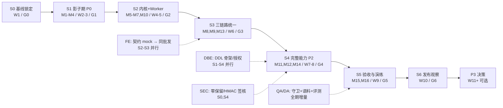

# 上下文压缩开发计划 v1.0

| 字段 | 内容 |
| --- | --- |
| 文档性质 | **执行计划（任务级）**。只登记目标、任务、责任、时序、依赖、门禁与判定；**不复述**《方案》的配置项含义表、算法伪代码、DDL、方法评估与风险论证 |
| 基线 | `docs/上下文压缩完整方案_设计与实施_v1.0.md`（已确认，下称《方案》） |
| 引用规范 | `§x.y` = 《方案》章节；`[D#]` = 关键决策；`[R#]` = 风险登记；`P#` = 《方案》实施分期；`M#` = 本计划 WBS 模块；`S#` = 本计划阶段；`G#` = 门禁；`Q#` = 决策台账（已按推荐关闭）；`IN#` = 实施输入任务 |
| 适用范围 | `platform/`（12 → 13 模块）、`rag/`、`admin-console/`、`frontend/`、`deploy/sql/platform/`、`scripts/`、`monitoring/`、`docs/` |
| 时间口径 | **相对周 W1…W10**；`T0` = 决策台账登记 + 环境就绪日（Q1–Q15 已按推荐关闭，无需再等评审）。全文不含绝对日期；`P3` 单列，不占主线工期 |
| 版本 / 日期 | v1.0 / 2026-11-11 |
| 修订 | **r1（2026-11-11）**：§10 待确认台账按推荐关闭 → Q1–Q15 决策记录 + IN-1–IN-6 实施输入；同步 T0 / G0 / §5.3 / §6 / §8 / 附录引用 |

---

## 0. 计划约定与基线锁定

### 0.1 与《方案》的关系

1. 《方案》的架构决策与技术约束**全部继承**，本计划只把它们拆成可派发、可验收的任务；需要细节时按编号回查《方案》。
2. §10 的 Q1–Q15 **已按推荐全部关闭**：《方案》给出决策 / 默认 / 建议值的直接采纳，本计划给出可执行基线的按基线执行；保留的是 §10.2 的实施输入（带责任与时点的任务）与 §10.4 的偏离变更控制，不改变已确认的架构。
3. **不再有待确认阻塞**：T0 登记台账后即可开工；只有显式偏离推荐结论时才按 §10.4 做三方影响评估并重签门禁，**不允许带未登记的偏离上线**。
4. 本轮只产出计划文档，**未改动任何生产代码**。

### 0.2 角色代号

| 代号 | 角色 | 主要职责 |
| --- | --- | --- |
| `PM` | 产品 / 评审 | 口径拍板、范围与优先级、灰度与上线窗口 |
| `TL` | 技术负责人 / 架构 | 决策签核、依赖裁决、门禁 G0–G6 总签 |
| `BE-A` | 后端·内核与 Worker | 配置解析、`agent-context`、L1/L4、摘要与持久化接线 |
| `BE-B` | 后端·API 与 SSE | 后台配置接口、端口契约、L2/L3、验签与事件 |
| `DBE` | 数据 / DBA | DDL 全链路、RLS、授权、活库同步、结构快照计数 |
| `FE-A` / `FE-B` | 前端（admin-console / frontend） | 配置表单、carry-over、协议 v1.1、Vitest |
| `QA` | 测试 | 单测 / IT / 源码守卫 / 反向验证 / 回归基线 |
| `DA` | 数据评测 | 针尖集、离线回放、A/B、judge、评测报告 |
| `SRE` | 运维 / 监控 / 发布 | 指标面板、告警、CI、环境、灰度、回滚演练 |
| `SEC` | 安全合规 | 零保留口径、HMAC 密钥、`carryOver=SERVER` 审批 |

> 阶段卡中的 `R` = 主责（唯一），`C` = 协同；每项交付物必须有且仅有一个 `R`。

### 0.3 通用完成门槛（所有阶段共同 DoD，逐条留证）

| 编号 | 门槛 |
| --- | --- |
| G-a | 代码进仓并完成评审；单 owner 文件按 §4.4 合并顺序落地 |
| G-b | 单测 / IT / 源码守卫 / 前端用例全绿，用例数不低于当期仓库基线 |
| G-c | `mvn -o clean verify` 两个 reactor 各跑一次（platform + rag），IT 带各自 env 变量；守卫反向验证**分模块单跑** |
| G-d | 每个新增守卫都有「撤掉修复点 → 恰好变红 → 恢复」的记录；守卫从编排入口进、不引用被测实现常量 |
| G-e | 结构变更同步 `01` 终态快照 + `07` 幂等 ALTER + `02` 种子 + **重放 `03` 后紧跟 `04`** + `init-db.sh EXPECT_*` + `it-env.sh --probe`；`SchemaDriftIT` 真跑 |
| G-f | RLS / 权限验证用 `app_agent`（NOBYPASSRLS）非特权真库；业务 SQL 不用 `agent_retention` |
| G-g | 指标 / 事件 / checkpoint 必须有「真跑一次后自动产出」的闭环证据，不接受「代码里有一行」 |
| G-h | 回滚开关实测可用；`enabled=false` 逐位等价守卫绿（[D11]） |
| G-i | 三级验收（行为单测 → 链路 E2E → 真跑闭环）在阶段内闭合；fail-closed，不伪造摘要 / 命中 |
| G-j | 协议、配置、运维手册、ADR、评测报告随阶段同步，不攒到末期 |

### 0.4 不可协商约束（编号化检查项，执行时逐条对照）

| 编号 | 检查项 | 来源 |
| --- | --- | --- |
| C1 | 新增模块零 Spring / JDBC / Hikari / Flyway；DB 写入只在 `agent-persistence` | §6.1 / ADR-011 |
| C2 | 功能须 Rabbit + DB **双通道**都验证；SSE 直连不写 outbox、不发 MQ | 项目铁律 #5 / #12 |
| C3 | 守卫从编排入口进，不引用被测实现自己的常量；弱断言要造出挤出压力 | §7.3 |
| C4 | 新表 `FORCE RLS`；清理 / 查询必带 `tenant_id` 且先 bind；一律 `ON CONFLICT DO NOTHING` | §5.8 |
| C5 | 压缩评测绝不写 `agent_eval_sample`；机器结果走独立指标 / `AgentMetricPort` | [D12] |
| C6 | record 加字段后所有拷贝 / 投影 / 发布态转换用全参构造逐字段带过 | §5.8 / 铁律 #11 |
| C7 | 影响行数 ≠ 1 必抛；事务内 SQL 失败不得被 fail-soft 吞掉后 COMMIT | §4.4 / §6.4-⑥ |
| C8 | 稳定前缀逐字不变；不可信块一律带围栏 USER 消息，绝不进 systemPrompt | [D6] |
| C9 | 批量领取禁用 `IN (SELECT … LIMIT … FOR UPDATE SKIP LOCKED)` | §5.8 / 铁律 #13 |
| C10 | 在途 Run 不随配置发布漂移；`policyVersion` 不匹配即丢弃重建 | [D4] / [D8] |
| C11 | `targetRatio < triggerRatio`；压缩不从累积序列删除任何东西 | §2.3 / §4.2 |
| C12 | 两 reactor 两库互不塞代码；rag 侧不动 platform 代码 | §0.3 |

---

## 1. 项目目标与范围

### 1.1 目标（可度量，判定口径见 §8.3）

| 编号 | 目标 | 度量 / 通过线 | 《方案》锚点 |
| --- | --- | --- | --- |
| O1 | 建立**全窗口 Token 预算**这一事实口径 | system + tools + memory + RAG + history + 当前输入全部计入；启用校准后 `estimation_error_ratio` P95 < 0.15；零静默超窗 | §3.1 / §5.2 |
| O2 | 三条模型链路共用一个组装入口 | L1/L4、L2、L3 全部经 `ContextAssembler`；SSE 100 轮压测与 Console 超长请求均在预算内 | §4.1 |
| O3 | 降低输入 Token | 离线回放平均 `input_tokens` 降 ≥ 30%，P95 ≤ `maxInputTokens`，零次 `budget_exceeded` | §7.2 |
| O4 | 保住关键信息 | 针尖 span 召回 ≥ 95%；用户纠正 / 显式约束 / 负向知识 **100%**；`source_message_ids` 可回取原文 | §7.2 / R1 |
| O5 | 回答质量不退化 | 下游任务成功率下降 ≤ 3pp；judge 差异不显著；n ≥ 30 才展示百分比 | §7.2 |
| O6 | 延迟与成本可控 | TTFT 不劣化；`saved > 0`；摘要次数 ≤ `maxCompactionsPerRun`；所有回退 `fallback=true` 如实上报 | §7.2 / §4.5 |
| O7 | 可回滚、合规 | `enabled=false` 与无此功能逐位一致；默认 `carryOver=CLIENT` 不落正文 | [D11] / R7 |
| O8 | 结果可信 | 以真跑闭环断言数字下降 + checkpoint 落库 + 下一轮复用；不以 `fallback_total=0` 或指标恒 0 判成功 | R18 / §7.3 |

### 1.2 范围内（按域）

| 域 | 交付内容 | WBS | 《方案》锚点 |
| --- | --- | --- | --- |
| 配置域 | 模型级 5 列、Agent 级 `generation_params.context`、全局 `agent.context.*`、后台表单与配置门禁、Run 快照固化 | M1–M3 | §3 |
| 内核域 | `agent-context` 纯算法模块、端口契约、水位线 W0–W3、Token 计量与校准、稳定前缀布局 | M4–M6 | §2.3 / §5 / §6.1 |
| 链路域 | L1/L4 接线、L2 SSE 接线与 carry-over、L3 Console 接线、RAG 命中块配额 | M7–M10 | §4 |
| 数据域 | `context_compaction` 表全链路、幂等 / CAS / RLS / 授权 / 保留期 | M11 | §6.2-A / §5.8 |
| 状态域 | W3 增量摘要、失败回退、三层缓存、TTL 失效、冷却与次数上限 | M12 | §5.3 / §5.6 |
| 前端与协议域 | 两前端 carry-over 收发、协议 v1.1、模型配置表单 | M13 | §4.4 / §6.3 |
| 可观测域 | 指标、面板、告警、成本净额闸门与自动降级 | M14 | §7.1 / §7.5 |
| 验收与运维域 | 评测资产、三级验收、反向验证、灰度、回滚、ADR 与手册 | M15–M16 | §6.7 / §7 / §8 |

### 1.3 范围外

1. 《方案》§0.3 五项：供应商侧 KV-Cache / 训练式压缩、P0 引入 pgvector 或语义历史召回、改动 rag 检索算法本体、`systemPromptRef`、改变「已创建 Run 绑定固定 Agent 版本」语义。
2. `P3` 三项（rag 侧 LLMLingua-2 预压缩、pgvector 语义召回、`carryOver=SERVER`）：按 §6.7 推荐 **本期不纳入主线、默认全关**；W11+ 由 MS-7 逐项 go/no-go，纳入须走 §10.4 变更控制，各自独立开关 + 独立 A/B。
3. 不新增会话正文持久化能力；不改写 `student_memory` 的证据来源；不修改 `agent_eval_sample` 语义。
4. 不做前端会话列表 / 多会话管理（协议仅增加可选压缩态字段）。

### 1.4 成功判据（一句话）

**G5 验收通过 + G6 观察窗无 P2 升级**；任一 Sev-0 风险（R1 / R5 / R14）未闭环即 No-Go。

---

## 2. 功能模块拆解（WBS）

### 2.1 模块清单

| ID | 模块 | 《方案》锚点 | 任务级内容（动词开头） | 主要落点 | R | 前置 | 关键交付物 | 期 |
| --- | --- | --- | --- | --- | --- | --- | --- | --- |
| M1 | 模型级配置与后台表单 | §3.2-A / §6.3 / §6.6 | ① 给 `model_catalog` 增 5 列并回填默认值；② 扩 `ModelDefinition` / `ModelConfigRequest` / `Response`；③ 回归 `/api/admin/models` 写入即生效路径并补审计留痕；④ admin-console 模型页新增「上下文与压缩」分组 + 前后端双重校验 + Vitest | deploy/sql、agent-api、admin-console | BE-B | — | DDL 片段、API 契约、表单用例 | P0 |
| M2 | 全局配置与组合根 | §3.2-C / §6.5 | 新增 `agent.context.*`（裸标量一律加引号）、`platform.env.example` 的 `AGENT_CONTEXT_*`（含独立 HMAC 键占位、不落真实值）、`AgentContextConfiguration`、`WorkerExecutionConfig` 默认值、总熔断与 [D11] 关闭等价守卫 | platform-bootstrap、env.example | BE-A | — | yml / env、组合根、熔断守卫 | P0 |
| M3 | 策略解析、门禁与快照 | §3.1 / §3.4 / §6.2-B | 实现 `ContextPolicyResolver` 与 `policyVersion` 派生；把 `context_policy` 写入 `execution_snapshot`（含修复 `prompt_config` 恒 `'{}'` 的落点裁决，见 Q5）；确认 `CapObjectFingerprint` 纳入新 JSON；新增 `validateGenerationParams()` 在**申请期 + 执行期**各调一次；同批修补 `topP` / `timeoutMs` 遗留（Q13） | agent-application、agent-ports | BE-A | M1, M2 | 解析器、门禁用例、快照字段 | P0 |
| M4 | Token 计量与校准 | §5.2 / §5.7 / §6.4-⑦ | 落 `TokenCounter` / `HeuristicEstimator`；供应商能力探测（默认全 false）；接 `ModelCallObserver` 校准桥（EWMA、n ≥ 30 才启用、bias 夹取）；**影子记录**全窗口估算值；注册《方案》§7.1 指标；影子对照证明模型请求字节未变 | agent-context、agent-infrastructure | BE-A | M3 | 计数器、校准桥、指标字典、影子报告 | P0 |
| M5 | 压缩内核（新模块） | §2.3 / §5.2 / §5.3 / §6.1 | 新增第 13 个 Maven 模块与 reactor 声明；实现 `BudgetAllocator`（水位填充）、`CompactionPipeline`（W1 可逆外置 / W2 整轮裁剪，复用 `splitRounds`）、`RollingStateMerger`、`ContextLayout`（稳定前缀 + 围栏 USER 块）；核心 record 全参拷贝 | platform/pom.xml、agent-context | BE-A | M3, M4 | 纯 Java 模块 + 单测 | P1 |
| M6 | 端口与事件契约 | §6.2-C / §6.3 | 定义 `ports/context/*` 四端口；扩 `ExecutionObserver.onContextCompacted`；给 `AgentChatEvent` 增第 14 个 permitted record 与 `WIRE_NAMES`、`Done` 可选字段；输出协议 v1.1 变更说明并冻结契约 | agent-ports、agent-api | BE-B | M3 | 契约文件、协议说明 | P1 |
| M7 | L1 / L4 接线 | §4.1 / §6.4-④ | 替换 `RunExecutionLoop:721` 与 `WorkerChildAgentRunner:259` 的 trim 调用；把 memory / notice 从 systemPrompt 末尾移出；**成本预留改用全窗口估算**；轮末预留 checkpoint 落点；工具结果回灌后不立即压缩 | agent-worker | BE-A | M5, M6 | 两处接线、前缀稳定守卫 | P1 |
| M8 | L2 SSE 接线 | §4.1 / §4.4 / §6.4-⑤ | 在 Controller 入口做 `contextState` 五项丢弃校验（验签 / TTL / 版本 / 大小 / tenant digest）；`buildMessages()` 前统一组装；`answer` 后、`done` 前生成并发第 14 事件；保持 `audit.finish` 影响行数断言与「不写 outbox / MQ」 | agent-api、agent-worker | BE-B | M5, M6 | SSE 链路、验签用例 | P1 |
| M9 | L3 ConsoleChat 接线 | §4.1 | 组装 `ModelRequest` 前只跑 W1/W2；请求体自带 `systemPrompt` 按稳定前缀对待；不引入会话态 | agent-api | BE-B | M5, M6 | 直连链路 + 预算 IT | P1 |
| M10 | RAG 命中块配额 | §4.1 / §5.1 | 注入前去重 → 排序 → 按 token 配额动态 top-k → 单块截断 → 其余只留 `chunkId` 引用；把 `MAX_INJECT_HITS` / `MAX_HIT_TEXT` 常量改为配额驱动（**platform 侧**，rag 算法不动） | agent-worker | BE-A | M5 | RAG 配额用例 | P1 |
| M11 | 持久化与并发 | §6.2-A / §5.8 / §6.4-⑥ | 落 `01` 新表 + `07` 幂等 ALTER + `02` 种子（如需）+ `03`→`04` 重放 + `EXPECT_*` / probe 同步（71 → 72 表，RLS 表 / 策略计数按实更新）；实现 `JdbcContextCheckpointRepository`；`DO NOTHING` 幂等 + CAS / fencing + POISONED + FORCE RLS + 清理带 `tenant_id` + 30 天保留 | deploy/sql、agent-persistence、scripts | DBE | M6 | DDL 全链路、Repository、真库 IT | P2 |
| M12 | W3 摘要与压缩态 | §5.3 / §5.6 / §4.5 | 实现 `IncrementalSummarizer`（结构化 JSON、temperature 0、无工具、非流式、自校验）；`merge` 只吃 `seq > upToSeq`；失败回落 W2 且 `fallback=true`；三层缓存与 TTL 失效重建；`carryOver` 双路径；冷却 / `maxCompactionsPerRun` 闸门 | agent-worker、agent-context、agent-infrastructure | BE-A | M8, M11 | 摘要器、缓存、回退用例 | P2 |
| M13 | 前端协议与交互 | §4.4 / §6.3 | 两前端收发 `contextState`、忽略未知事件、按可选字段解析 `Done`、仅内存保存、刷新丢失优雅降级；admin-console 表单（与 M1 同批）；**两前端同批发**并同步协议 v1.1 | admin-console、frontend | FE-A / FE-B | M6（软：契约冻结即可） | 前端用例、协议兼容报告 | P1 |
| M14 | 可观测与成本闸门 | §7.1 / §7.5 / §5.7 | 补齐《方案》§7.1 指标、Grafana 面板（n<30 不显示百分比）、Prometheus `rule_files` / alert rules（Q14）、5 条告警；实现 `saved` 净额与自动降 `TRIM_ONLY`；前缀哈希变化告警 | monitoring、agent-infrastructure | SRE | M4, M12 | 面板 json、告警规则、成本闸门用例 | P2 |
| M15 | 评测与验收资产 | §7.2 / §7.3 / §7.4 | 每阶段增量产出：针尖集、离线回放脚本、A/B + judge 换位、下游任务成功率、五组反向验证、4 类源码守卫、三级验收闭环 IT；末期汇总评测报告 | 测试目录、scripts | QA + DA | 每阶段增量 | 用例集、评测报告、反向验证记录 | 全期 |
| M16 | 部署 / 文档 / 灰度 / 回滚 | §6.7 / §8 | 抽取 ADR-013、运维手册、协议变更说明、密钥交付流程（不落盘）、CI 作业（按 Q15 推荐扩展）、灰度方案与观察窗、三级回滚演练、P3 go/no-go 材料 | docs、scripts、CI | TL + SRE | G5 | 交付包、演练记录、评审材料 | S5–S6 |

### 2.2 模块 → 阶段映射

| 阶段 | WBS | 《方案》分期 |
| --- | --- | --- |
| S0 | 基线锁定、评测集立项、守卫框架 | 前置 |
| S1 | M1 M2 M3 M4 + M15(增量) + M16(ADR 草案) | **P0** |
| S2 | M5 M6 M7 M10 + M13(按契约起步) + M15 | **P1-a** |
| S3 | M8 M9 M13 收口 + M15 | **P1-b** |
| S4 | M11 M12 M14 + M15 | **P2** |
| S5 | M15 收口 + M16 灰度 / 回滚 | 验收 |
| S6 | M16 发布 + P3 决策 | 上线 |
| W11+ | P3 三项（独立 A/B、独立开关） | **P3（可选）** |

### 2.3 契约变更单（引用 §6.3，转成可派发的变更项）

| 单号 | 契约 | 变更类型 | 兼容要求 | R | 回归点 |
| --- | --- | --- | --- | --- | --- |
| CH-1 | `/api/admin/models` 请求 / 响应 | 增 5 字段 | 旧请求缺省走默认值，不 400 | BE-B | 写入即生效 + 审计留痕 |
| CH-2 | `generation_params.context` | 增 jsonb 子对象 | 未声明 = 全局默认；旧 Agent 版本不变 | BE-A | 直调 API 绕过前端仍被门禁拒绝 |
| CH-3 | 三步发布申请 / apply | 校验增强 | 非法策略在**申请期**即拒 | BE-A | 双人复核、自审批 409 口径不变 |
| CH-4 | `GET /api/cap/agents/{id}/definition` | 回显新键 | 前端按可选字段解析 | BE-B | 指纹纳入新 JSON |
| CH-5 | `GET /api/admin/context/policy`（可选新增） | 新端点 | 仅平台管理员可见有效策略 + 偏差 | BE-B | 不泄漏租户数据 |
| CH-6 | `AgentChatStreamRequest` / `AgentChatRequest` | 增可空 `contextState` | 缺失 = 无压缩态，行为同今天 | BE-B | 五项丢弃条件 |
| CH-7 | `AgentChatEvent` / `Done` | 第 14 事件 + 可选字段 | 旧客户端忽略未知事件；协议 v1.1 | BE-B | 两前端同批发 |
| CH-8 | `ExecutionObserver` | 事件扩展 | 旧 `onContextTrimmed` 调用点在 [D11] 下保持等价 | BE-A | 关闭等价守卫 |
| CH-9 | `execution_snapshot` | 新增 `context_policy` | 只影响新 Run；在途 Run 不漂移 | BE-A | 快照固化用例 |
| CH-10 | SSE 协议版本文档 | v1 → v1.1 | 变更说明随包发布 | TL | 兼容用例 |

---

## 3. 开发阶段与里程碑

### 3.1 阶段总览

| 阶段 | 相对周 | 目标 | 主责 | 退出门禁 |
| --- | --- | --- | --- | --- |
| S0 准备与基线锁定 | W1 | 关闭口径、锁定基线、分派 owner | TL | G0 |
| S1 影子期（P0） | W2–W3 | 配置 + 全窗口预算 + 门禁 + 计量，**不改压缩行为** | BE-A | G1 |
| S2 内核与 Worker（P1-a） | W4–W5 | 纯算法内核 + W1/W2 + 稳定前缀 + L1/L4 | BE-A | G2 |
| S3 三链路统一（P1-b） | W6 | SSE / Console 接线 + 协议 v1.1 + 两前端 | BE-B | G3 |
| S4 完整能力（P2） | W7–W8 | W3 摘要 + checkpoint + carry-over + 成本闸门 | BE-A + DBE | G4 |
| S5 验收与灰度准备 | W9 | 效果评测 + 反向验证 + 全量回归 + 回滚演练 | QA + DA | G5 |
| S6 发布与观察 | W10 | 灰度放量 + 观察窗 + P3 决策 | SRE | G6 |
| W11+（可选） | — | P3 三项独立评估 | PM + TL | 单项 go/no-go |

### 3.2 阶段卡

#### S0 — 准备与基线锁定（W1）

- **输入**：《方案》已确认版；§10 决策台账（Q1–Q15 已按推荐关闭）；现行构建 / 用例 / 结构快照基线；IT 库与凭据清单；双通道回归范围。
- **任务**：登记 §10 决策结论并把 IN-1～IN-6 分派到人；发布分支策略与 §4.4 单 owner 文件表；DDL 影响评估（表 / RLS 表 / 策略计数）；评测集规格立项（针尖集 + A/B 样本，IN-2）；搭建守卫框架与反向验证记录模板；冻结协议 v1.1 草案（CH-10）；按 Q15 结论扩展 CI 作业。
- **输出**：基线报告、决策台账（已关闭）+ IN 任务分派表、WBS 责任分派表、评测集规格、守卫清单、协议草案、文件 owner 表。
- **责任**：`R=TL`；`C=PM / QA / DBE / DA / SRE / SEC`。
- **完成标准**：决策台账与 IN 任务分派表已登记（Q1–Q15 结论生效）；基线数在干净环境可复现；两个 reactor 的 `mvn -o clean verify` 跑通；owner 表覆盖全部热点文件；评测集有 ≥30 组配对样本的可达性结论。
- **门禁 G0**：TL + QA 签核「基线可复现 + owner 分派 + 决策台账已登记」。**口径已定，不再等待评审**；若要偏离推荐，须先按 §10.4 重签 G0 再进入 S1。

#### S1 — 影子期 / P0（W2–W3）

- **输入**：S0 全部输出；现行模型请求样例（用于逐字对照）。
- **任务**：M1 M2 M3 M4；M15 增量（配置门禁、关闭等价、预算计入守卫）；M16（ADR-013 草案）；DBE 并行准备 M11 的 DDL 骨架（不启用）。
- **输出**：5 列 + 表单、全局 yml / env、`ContextPolicyResolver` / `policyVersion` / 快照、配置门禁、计数器 + 校准桥 + 指标字典、影子对照报告、ADR 草案。
- **责任**：`R=BE-A`；`C=BE-B / DBE / QA / SRE / FE-A`。
- **完成标准**：
  1. 预算覆盖 5 个块且**只计量、不改变任何模型请求字节**（新旧 `ModelRequest` 逐字对照零差异）；
  2. 6 组非法值 + 绕过前端直调 API 均被拒；`targetRatio < triggerRatio` 门禁生效；
  3. `enabled=false` 与现状逐位等价守卫绿、新指标不注册 / 不递增（[D11]）；
  4. 估算误差基线值记录并可回放；成本预留输入**本期不切换**；
  5. `model_catalog` 列变更同步结构快照与 `EXPECT_*`。
- **门禁 G1**：影子对照零差异 + TL / QA 签核。**禁止本阶段改变压缩行为或请求字节**。

#### S2 — 内核与 Worker / P1-a（W4–W5）

- **输入**：G1 签核包；协议契约草案（M6）。
- **任务**：M5 M6 M7 M10；M13 按冻结契约 mock 起步；M15（单测 9 项 + 前缀 / 入口守卫 + 反向验证前两组）。
- **输出**：`agent-context` 第 13 模块、四端口、W1/W2、稳定前缀布局、L1/L4 接线、RAG 配额、前缀哈希守卫、L1 真跑闭环证据。
- **责任**：`R=BE-A`；`C=BE-B / QA / FE-A / FE-B`。
- **完成标准**：§7.4 单测 9 项全绿；`NoDirectTrimCallOutsideAssemblerGuard` / `StablePrefixNoDynamicAppendGuard` / `NoUntrustedBlockInSystemPromptGuard` 反向验证变红并恢复；L1 真跑一次 Run 后 `usage_record` 输入 token 真的下降、`run_message` 完整未被删除、工具轮次配对不破；前缀字节跨轮一致；Rabbit + DB 双通道重投不重复压缩；子 Agent 不继承父 checkpoint。
- **门禁 G2**：三级验收在 L1 闭合 + QA 签核。

#### S3 — 三链路统一 / P1-b（W6）

- **输入**：S2 内核与契约；两前端代码基线。
- **任务**：M8 M9 M13 收口；M15（链路 IT、前端用例、协议兼容用例）。
- **输出**：SSE 验签与尾部事件、Console 预算保护、协议 v1.1、两前端同批发、协议兼容报告。
- **责任**：`R=BE-B`；`C=FE-A / FE-B / QA / SEC`。
- **完成标准**：`SseHistory100TurnsWithinBudgetIT`、`ConsoleChatMessagesWithinBudgetIT`、`CarryOverRoundTripIT`（验签 / 过期 / 版本不符 / 超长四组丢弃）、`WorkerToolRoundPruningKeepsPairedMessagesIT` 全绿；租户链 thinking 帧恒 0；SSE 不写 outbox / MQ、`audit.finish` 影响行数断言保持；`contextState` 仅内存保存、刷新丢失后退回全量历史且不中断；旧客户端忽略未知事件；两前端 Vitest 分批全绿。
- **门禁 G3**：SSE 100 轮压测 + 协议兼容报告 + QA / FE 签核。

#### S4 — 完整能力 / P2（W7–W8）

- **输入**：S3 产出；S0 评测集规格；DBE 的 DDL 变更包；摘要 / judge 凭据（Q7）。
- **任务**：M11 M12 M14；M15（真库 IT、回退用例、成本闸门用例、剩余反向验证）。
- **输出**：checkpoint 表全链路 + Repository、W3 增量摘要 + 回退、三层缓存、carry-over 双路径、校准闭环、面板 / 告警 / `saved` 闸门。
- **责任**：`R=BE-A + DBE`（双主责按交付物分工：DDL/RLS 归 DBE，其余归 BE-A）；`C=SRE / QA / SEC`。
- **完成标准**：`ContextCheckpointRLSIsolationIT`（`app_agent` 跨租户读 0 行 + 染色断言）、`ConcurrentCompactionFencingIT`（两线程仅 1 个 CAS 成功）、`CheckpointIdempotentReplayIT`、`SchemaDriftIT`、`SwallowedSqlFailureMustRejectCheckpointCommitIT` 全绿；`SummaryFailureFallsBackAndReportsIT` 断言 `fallback=true` 且无伪造摘要；摘要只吃 `seq > upToSeq`、无递归重摘要；`policyVersion` 不符即丢弃重建；`saved` 可定量计算且自动降 `TRIM_ONLY` 用例通过；DDL 在 IT 库与联调库均重放成功且 `03`→`04` 顺序留痕；`carryOver=SERVER` 若启用须 SEC 书面签核（Q4 已按推荐关闭，本期不启用；变更走 §10.4）。
- **门禁 G4**：DBE + SEC + QA 签核；任一真库 IT 用 `ai_agent` 跑过即判假绿重跑。

#### S5 — 验收与灰度准备（W9）

- **输入**：S1–S4 全部产出；评测语料与 A/B 环境；Go/No-Go 表（§8.3）。
- **任务**：M15 收口（四类效果评测 + 五组反向验证 + 全量回归）；M16（灰度方案、回滚剧本、上线检查单、文档收口）。
- **输出**：评测报告、反向验证记录、灰度方案、回滚演练记录、上线检查单、交付包清单。
- **责任**：`R=QA + DA`；`C=TL / SRE / PM / SEC`。
- **完成标准**：§8.3 Go/No-Go 全绿；双 reactor `mvn -o clean verify` + 两前端分批全绿且用例数不低于基线；五组撤点恰好对应变红并恢复；三级回滚（`enabled=false` → `strategy=OFF` → `TRIM_ONLY`）各实测一次；灰度租户、放量比例、观察窗阈值书面确认（Q10）；结构快照计数与探针一致。
- **门禁 G5**：TL / QA / SRE / PM 联合签核；任一 Sev-0 风险未闭环即 No-Go。

#### S6 — 发布与观察（W10）

- **输入**：G5 签核包；灰度环境；告警面板。
- **任务**：M16 发布、按计划放量、观察窗监控、P3 go/no-go 材料。
- **输出**：发布记录、观察窗报告（token / 质量 / 延迟 / 成本 / 告警）、P3 决策单。
- **责任**：`R=SRE`；`C=TL / QA / DA`。
- **完成标准**：观察期内 5 条告警无可升级 P2；`usage_record` 输入 token 下降与 A/B 结论一致；无 `fallback > 10%`、无 `saved ≤ 0` 连续 20 次、无前缀哈希变化、无 `budget_exceeded`；全量推进按灰度方案执行；P3 三项按 §6.7 推荐逐项记录 go/no-go（Q12 已关闭；纳入须走 §10.4）。
- **门禁 G6**：SRE + TL 签核转正式发布。

### 3.3 里程碑与签核

| 里程碑 | 时点 | 达成标志 | 签核 |
| --- | --- | --- | --- |
| MS-1 预算口径上线（影子） | T0 + W3 | G1 通过，请求字节零差异 | TL / QA |
| MS-2 内核与 L1 灰度 | T0 + W5 | G2 通过，L1 真跑闭环 | TL / QA |
| MS-3 三链路统一（零 LLM） | T0 + W6 | G3 通过，协议 v1.1 两前端同批发 | TL / QA / FE |
| MS-4 完整能力可用 | T0 + W8 | G4 通过，真库 IT 全绿 | TL / DBE / SEC / QA |
| MS-5 验收通过 | T0 + W9 | G5 通过，评测与回滚演练完成 | TL / QA / SRE / PM |
| MS-6 正式发布 | T0 + W10 | G6 通过，观察窗达标 | SRE / TL |
| MS-7 P3 决策 | T0 + W11+ | 三项逐项 go/no-go 书面化 | PM / TL |

---

## 4. 任务优先级与依赖关系

### 4.1 优先级判定

| 级别 | 判定准则 | 对应任务 |
| --- | --- | --- |
| **P0（必修）** | 口径 / 安全 / 可回滚；不做则后续全部失真或无法回退 | M1 M2 M3 M4、关闭等价守卫、DDL 影响评估 |
| **P1（核心）** | 直接交付 O1–O4 的能力；零 LLM 关键路径 | M5 M6 M7 M8 M9 M10 M13 |
| **P2（增强）** | 交付 O5–O8 的闭环能力，依赖 P1 稳定 | M11 M12 M14、评测收口 |
| **P3（可选）** | 收益需独立 A/B 证明，默认全关 | rag 预压缩 / pgvector / `SERVER` |

> 同级内按 **关键路径优先**；守卫（M15）与开发同步增量，禁止堆积到末期。

### 4.2 依赖表

| 任务 | 硬前置 | 软前置 / 可并行 | 后继 | 关键路径 |
| --- | --- | --- | --- | --- |
| S0 | — | 评测集立项可与基线报告并行 | 全部 | ★ |
| M1 | S0 | 与 M2 并行；DDL 骨架可前置 | M3 | ★ |
| M2 | S0 | 与 M1 并行 | M3 M4 | ★ |
| M3 | M1 M2 | — | M4 M5 M6 | ★ |
| M4 | M3 | 与 M5 接口设计并行 | M5 M14 | ★ |
| M5 | M3 M4 | 端口签名可先冻结 | M7 M8 M9 M10 | ★ |
| M6 | M3 | **契约冻结后** M13 即可 mock 开发 | M7 M8 M13 | ★ |
| M7 | M5 M6 | M11 的 DDL 骨架可并行 | M12 | ★ |
| M8 | M5 M6 | M13 可并行开发 | M12 | ★ |
| M9 | M5 M6 | 与 M8 并行 | G3 | — |
| M10 | M5 | 与 M7 并行 | G3 | — |
| M11 | M6 | DDL 骨架 S0/S1 起并行；Repository 依赖 M6 的 `CheckpointDelta` 契约（**不依赖 M12**，避免循环） | M12 | ★ |
| M12 | M8 M11 | M14 指标可先注册 | M14 G4 | ★ |
| M13 | M6（软） | 契约冻结即可开工；收口须与 M8 同批 | G3 | ★ |
| M14 | M4 M12 | 面板 json 可先起草 | G5 | — |
| M15 | 每阶段增量 | 与开发并行 | G5 | ★ |
| M16 | G5 | ADR / 手册可从 S1 起草 | S6 | ★ |

### 4.3 关键路径图

### 4.4 并行冲突点（单 owner + 合并顺序）

| 热点文件 / 配置 | 涉及模块 | 唯一 owner | 合并顺序 | 规避措施 |
| --- | --- | --- | --- | --- |
| `platform/pom.xml` | M5 + M2 | BE-A | 先模块声明，后组合根 | reactor 变更单独提交，单独跑一次全量 verify |
| `application.yml` | M2 + M14 | BE-A | 先 `agent.context.*`，后指标 / 告警 | 裸标量加引号；变更用配置项差异评审 |
| `01_platform_ddl.sql` | M1 + M11 | DBE | 先 5 列，后新表 | 同一次结构快照计数更新，禁止两人同改 |
| `03` / `04` SQL | M11 | DBE | 严格 `03` → `04` 紧邻重放 | 顺序写入执行记录，`SchemaDriftIT` 验证 |
| `ConfigValidationGate.java` | M1 + M3 | BE-A | 先遗留校验，后 context 门禁 | 申请期 / 执行期双调用点一次性改完 |
| `AgentChatEvent.java` | M6 + M8 | BE-B | 先契约，后载荷 | 契约冻结后再放行前端开工 |
| `RunExecutionLoop.java` | M7 + M4 + M15 | BE-A | 先影子计量，再接线，再成本预留切换 | 三段分别在 S1/S2 落地，禁止跨阶段混改 |
| `AgentChatOrchestrator.java` | M8 + M10 + M12 | BE-B（M8）/ BE-A（M10,M12） | S3 接线 → S4 尾部摘要 | 按方法段划分，提交前互相 review |
| `agentChatApi.ts` / `agentChatState.ts` | M13 | FE-B | 与事件契约同批 | 协议 v1.1 版本号在两前端同一 PR 中出现 |

---

## 5. 相对时间安排

### 5.1 口径与假设

- `T0` = 决策台账登记 + IT / 联调环境就绪日（口径已按推荐关闭，无需再等评审）；1 周 = 5 工作日。
- 主线 **W1–W10**，不含评审等待、外部凭据申请、供应商排期；W10 内预留约 20% 缓冲。
- 人力按 §6.1 推荐基线（IN-3 由 PM 在 T0 落实）；P3 不计入主线。任何 G 门禁未过 → **该阶段顺延，不跨门禁并行**（QA 守卫与评测集准备除外）。
- 下表为相对安排，不是承诺日期；偏离推荐的变更控制见 §10.4。

### 5.2 周次 × 泳道

| 周 | 阶段 | BE-A | BE-B | DBE / SRE | FE | QA / DA | 关键产出 | 门禁 |
| --- | --- | --- | --- | --- | --- | --- | --- | --- |
| W1 | S0 | 基线核对、依赖裁决 | 契约草案 | DDL 影响评估、环境 | 协议草案评审 | 守卫框架、评测集规格 | 基线报告 / 决策台账 / IN 分派 / owner 表 | G0 |
| W2 | S1 | M2 M3 M4 起步 | M1 接口 + 5 列 | DDL 骨架、CI 评估 | 表单骨架 | 门禁用例、关闭等价守卫 | 配置骨架、指标字典 | — |
| W3 | S1 | 校准桥、影子对照 | 表单校验 + Vitest | 结构快照计数 | 表单收口 | 影子零差异报告、ADR 草案评审 | MS-1 交付包 | **G1** |
| W4 | S2 | M5 预算 / W1 / W2 | M6 端口契约 | 指标埋点 | 按契约 mock | 单测 1–5 项 | `agent-context` 骨架 | — |
| W5 | S2 | M7 接线、M10 配额 | 契约冻结、CH 单 | 前缀哈希指标 | carry-over 起步 | 前缀 / 入口守卫、L1 闭环 | MS-2 交付包 | **G2** |
| W6 | S3 | 支撑 SSE 联调 | M8 M9 | 联调环境核对 | M13 收口同批发 | 链路 IT + 前端用例 + 兼容用例 | MS-3 交付包 | **G3** |
| W7 | S4 | M12 摘要 / 缓存 | 尾部事件联调 | M11 DDL 全链路 + `03`→`04` | 回归 | 真库 IT 设计、回退用例 | checkpoint 表可用 | — |
| W8 | S4 | 校准闭环、成本闸门 | carry-over 双路径 | M14 面板 / 告警 | 回归 | 真库 IT 执行、反向验证 3–5 组 | MS-4 交付包 | **G4** |
| W9 | S5 | 缺陷修复 | 缺陷修复 | 回滚演练、CI 全量 | 分批 Vitest | 四类效果评测、五组反向验证 | 评测报告 / 上线检查单 | **G5** |
| W10 | S6 | 观察窗值守 | 观察窗值守 | 发布与放量 | 值守 | 观察窗数据核对 | 发布记录 / P3 决策单 | **G6** |
| W11+ | P3 | 独立 A/B | — | 独立开关 | — | 收益判定 | 单项 go/no-go | 单项门禁 |

### 5.3 工期敏感性与杠杆

> Q1–Q15 已按推荐关闭，常规排期不再含「等口径」的等待时间；**偏离推荐时的范围 / 排期 / 验收影响统一见 §10.3**，此处只列执行杠杆与资源型触发条件。

| 触发条件 | 对排期的影响 | 处置 |
| --- | --- | --- |
| IN-3 资源承诺未兑现（少 1 名全投入后端） | **+2～3w**（S2 / S4 串行化） | PM 在 T0 落实；通过线不变，门禁时点顺延 |
| IN-5 活库维护窗口等待 | +1w 日历（不占开发工时） | DBE 提前预约；`SchemaDriftIT` 未真跑则 G4 不签 |
| IN-2 评测样本 < 30 组 | +2w 补语料，或验收降级 | n<30 不展示百分比，质量项转定性 |
| 两前端未同批发（偏离 Q3 推荐） | +1w 回归窗口 | CH-7 强制同批；必要时按 §10.4 重签 G3 |
| 压缩杠杆（不减质量） | 评测集准备前置 W1、DDL 骨架前置 S1、前端按冻结契约 mock | 约可吸收 0.5–1w 浮动 |

---

## 6. 人员与资源需求

### 6.1 角色与投入（**按推荐基线执行；IN-3 由 PM 在 T0 落实**）

| 代号 | 建议投入 | 参与阶段 | 必备技能 / 经验 | 本计划关键交付 |
| --- | --- | --- | --- | --- |
| PM | 0.2 FTE | S0 S5 S6 | 口径拍板、灰度策略 | Q 台账、上线窗口、P3 决策 |
| TL | 0.5 FTE | 全期 | 架构、ADR、门禁裁决、record 拷贝陷阱 | 依赖裁决、G0–G6 总签、ADR-013 |
| BE-A | 1.0 FTE | S1–S5 | Java 21 / Spring Boot 4、Worker 链路、纯算法模块 | M2 M3 M4 M5 M7 M10 M12 |
| BE-B | 1.0 FTE | S1–S4 | SSE 事件协议、后台配置 API、验签 | M1 M6 M8 M9 |
| DBE | 0.3 FTE | S0–S5 | PG 17、FORCE RLS、授权三段式、活库 ALTER | M1 列、M11 全链路、结构快照 |
| FE-A / FE-B | 各 0.5 FTE | S1–S3、S5 | Vitest、SSE 流式解析、协议兼容 | M1 表单、M13 |
| QA | 1.0 FTE | 全期 | 真库 IT、源码守卫、反向验证、分批 Vitest | M15、G1–G5 证据 |
| DA | 0.5 FTE | S0–S6 | 离线回放、A/B、judge 换位、样本量口径 | 针尖集、评测报告、观察窗分析 |
| SRE | 0.3 FTE | S0 S4 S5 S6 | Micrometer / Grafana / Prometheus、CI、发布 | M14、M16、灰度与回滚 |
| SEC | 0.2 FTE | S0 S4 | 零保留 / PIPL 未成年人、密钥管理 | Q4 签核、HMAC 密钥交付检查 |

> 峰值约 **5.5 FTE**（W4–W8）。若 IN-3 实际投入低于此，按 §5.3 串行化；**不得通过削减守卫与反向验证来压缩工期**。

### 6.2 环境与凭据

| 项 | 用途 | 约束 |
| --- | --- | --- |
| JDK 21（`JAVA_HOME=/opt/homebrew/opt/openjdk@21`）+ `mvn -o` | 构建 | 两个 reactor 分别 `clean verify` |
| 本地 PG 17（5433）+ RabbitMQ 4.3.6 | 开发 / 联调 | 联调前核对运行 jar inode 与磁盘 jar（PR4） |
| `agent_it`（platform IT）+ `study_rag_it`（rag IT） | IT | `*IT` 绝不指回应用库；两套 env 脚本互不通用 |
| 远程 RDS / `agent_dev` 活库 | 真实 SSE + RAG 联调 | 与本地结构不同步；`07` 幂等 ALTER + owner `ai_agent`；`app_agent` NOBYPASSRLS 验隔离 |
| 真实模型 + RAG 服务凭据 | 闭环联调 / A-B | 凭据不落盘；TIMEOUT 时 fail-closed，不伪造命中 |
| `AGENT_CONTEXT_STATE_HMAC_KEY` | `contextState` 签名 | **独立密钥**，绝不复用两套 JWT 私钥；仅 env 注入 |
| Grafana + Prometheus | 指标 / 告警 | `rule_files` / alert rules 本期补齐（按 Q14 推荐）；n<30 不显示百分比 |
| judge 模型族 + 评测 token 预算 | A/B 质量评测 | 需不同模型族 + A/B 换位（Q7） |

### 6.3 成本与容量

- 摘要模型调用（≤ `maxCompactionsPerRun` 次 / Run）、离线回放 token、judge 调用、联调 Run 数沿用 `<1k Run/日` 保守口径。
- `context_compaction` 存储：保留期与 Run 对齐 30 天；默认 `CLIENT` 不落正文，容量压力主要来自结构化状态与引用。
- 成本验收依赖 `ModelPricing` 是否有摘要 / judge 价目（Q7 已按推荐关闭，补价见 IN-1）；缺失时 §8.3 成本项降级为定性判定并显式标注。
- ⚠️ **已知阻塞**：`model.pricing.models` 未配 `MiniMax-M2.5`，业务 Run 成本按 0 记并打 WARN；M12 / M14 启用前必须补价，否则 `saved` 公式恒失真、`context.summarizer.cost` 不可信；已登记为 IN-1（S4 前，PM + SRE）。

---

## 7. 环境与交付物

### 7.1 环境矩阵

| 环境 | 用途 | 数据 | 准入 | R | 禁用动作 |
| --- | --- | --- | --- | --- | --- |
| 本地开发 | 编码 + 单测 | 造数 | 分支 + owner 表 | BE | 指回应用库跑 IT |
| platform IT（`agent_it`） | 真库 IT / RLS / 并发 | `ItTenantProvisioner` 造数，`@BeforeAll` 回收 | `source scripts/it-env.sh` | QA / DBE | 用 `ai_agent` 验隔离 |
| rag IT（`study_rag_it`） | rag reactor 回归 | 独立 | `source scripts/rag-it-env.sh` | QA | 与 platform IT 变量混用 |
| 联调（`agent_dev` + 真模型 + 真 RAG） | SSE / RAG 闭环、影子对照 | 活库已发布 Agent | Q11 窗口 + inode 核对 | BE-A / SRE | 用 clean 前旧 jar 判「功能缺失」 |
| 预发 / 灰度 | S5 演练 + S6 放量 | 单租户灰度 | G5 签核 | SRE | 未演练回滚即放量 |
| 生产 | 正式发布 | 全租户 | G6 签核 | SRE | 跳过观察窗 |

### 7.2 交付物清单

| 类别 | 交付物 | 路径 / 命名 | R | 验收点 |
| --- | --- | --- | --- | --- |
| 代码 | `agent-context` 模块 + 端口 + 三链路接线 + 摘要器 + Repository | `platform/agent-context/…` 等 §6.6 清单 | BE-A / BE-B | G-a / G-b / C1 |
| SQL | `01` 终态、`07_context_compaction.sql`、`02` 种子、`03`/`04` 重放记录 | `deploy/sql/platform/` | DBE | G-e / G-f |
| 脚本 | `init-db.sh EXPECT_*`、`it-env.sh --probe`、离线回放脚本、CI 作业 | `scripts/`、CI 配置 | SRE / DA | G-c / G-e |
| 配置 | `application.yml` 的 `agent.context.*`、`platform.env.example`、模型目录默认值 | `platform-bootstrap/`、env.example | BE-A | 裸标量加引号、密钥不落盘 |
| 契约 | CH-1…CH-10 变更单、协议 v1.1 说明、SSE 事件字典 | `docs/`、代码注释 | BE-B / TL | 兼容用例 |
| 前端 | 模型页「上下文与压缩」表单、两前端 carry-over、Vitest | `admin-console/`、`frontend/` | FE-A / FE-B | 同批发 + 分批全绿 |
| 监控 | 指标字典、Grafana 面板 json、Prometheus 规则、5 条告警 | `monitoring/` | SRE | 告警自动产出证据 |
| 测试 | 单测 9 / 链路 IT 5 / 真库 IT 5 / 源码守卫 4 / 前端 3 / 反向验证 5 组 | 各模块测试目录 | QA | G-b / G-d / G-g |
| 评测 | 针尖集、A/B 结果、judge rubric 与换位记录、四类效果报告 | 评测目录 | DA | §8.3 通过线 |
| 文档 | **ADR-013**、运维手册、回滚剧本、协议变更说明、Q 台账、验收报告 | `docs/`、`问题记录/` | TL / SRE | G-j / G5 |
| 发布 | 灰度方案、上线检查单、观察窗报告、P3 决策单 | `docs/` | SRE / PM | G5 / G6 |

### 7.3 构建与回归门禁（每阶段必跑）

1. platform：`IT_HOST / IT_PORT / IT_ADMIN_USER` 三变量 + `source scripts/it-env.sh` → `mvn -o clean verify`；rag：`source scripts/rag-it-env.sh` 后单独跑。不带变量全量会红，**不可误判为回归**。
2. 结构快照计数（71 → 72 表，RLS 表 / 策略计数）与 `EXPECT_*`、IT 探针三者一致。
3. 两前端 `vitest run` 整跑会 SIGTERM → **≤12 文件 / 批**分批执行。
4. 守卫反向验证**分模块单跑**（reactor fail-fast 会挡住后跑模块）；不带 `clean` 时陈旧 failsafe 报告会假红。
5. 用例数按 XML `<testcase>` 统计（`@Nested` 下 `<testsuite tests=>` 偏小）；当期基线以仓库实测为准，2026-11-11 收口口径可作参考：platform 2776 单测 / 631 IT、rag 756 + 65、admin-console 683、frontend 669。
6. 全量 verify 中 `RetentionConfig` / `RunRecoverySweeper` 的 test-profile ERROR 日志属既有环境噪音，QA 手册写明判定口径，不误判为回归（PR10）。

---

## 8. 测试与验收标准

### 8.1 测试分层与执行矩阵

| 层 | 用例组（《方案》§7.4 命名） | 执行阶段 | R | 通过线 | 证据 |
| --- | --- | --- | --- | --- | --- |
| 行为单测（9 项） | 预算计入 system+tools、`targetRatio < triggerRatio`、水位填充回流、逐字 span、无递归重摘要、前缀字节稳定、全参拷贝、非法配置 6 组 + 直调绕过、关闭等价 | S1（3 项）→ S2（其余） | QA + BE-A | 全绿；撤点变红 | 单测报告 + 反向验证记录 |
| 链路 IT（5 项） | SSE 100 轮、Console 超长、Worker 工具轮配对、摘要失败回退、carry-over 四组丢弃 | S3 / S4 | QA | 全绿；`fallback=true` 且无伪造摘要 | IT 报告 |
| 真库 IT（5 项） | RLS 隔离、并发 CAS、幂等重投、`SchemaDriftIT`、POISONED 事务 | S4 | QA + DBE | 全绿；**必须 `app_agent`** | 真库执行日志 |
| 源码守卫（4 项） | 三链路统一入口、不可信块不进 systemPrompt、稳定前缀不追加、守卫从编排入口进 | S2 起增量 | QA | 全绿；每条反向验证 | 守卫报告 |
| 前端（3 项） | 模型页字段、Agent 表单策略、carry-over 收发 | S1 / S3 | FE | 分批全绿 | Vitest 报告 |
| 影子对照 | 新旧 `ModelRequest` 逐字比对 | S1 | QA | **零差异** | 对照报告（G1 必备） |
| 协议兼容 | 旧客户端忽略未知事件、`Done` 可选字段解析 | S3 | FE + QA | 不报错、功能不中断 | 兼容报告 |
| 双通道 | Rabbit + DB 两通道重投 / 恢复，checkpoint 不重复写入 | S2 / S4 | QA | 幂等键命中、无重复计费 | 重投记录 |
| 反向验证（5 组） | 撤掉 ① tools 计入预算 ② 首轮任务锚 ③ 增量 seq 游标 ④ CAS 影响行数断言 ⑤ `targetRatio < triggerRatio` 门禁 | S2（①②）→ S5（③④⑤） | QA | **恰好对应变红并恢复** | 五组记录 |
| 效果评测 | 四类效果（Token / 完整性 / 质量 / 延迟 / 成本） | S5（语料 W1 起准备） | DA | §8.3 | 评测报告 |

### 8.2 阶段 → 测试门禁

| 门禁 | 必测集合 | 未过处置 |
| --- | --- | --- |
| G0 | 基线复现、决策台账与 IN 分派登记 | 不进入 S1 |
| G1 | 影子零差异、门禁 6 组非法值、关闭等价 | 禁止接线 |
| G2 | 单测 9 项、前缀 / 入口守卫、L1 真跑闭环、双通道重投 | 禁止 SSE 接线 |
| G3 | 链路 IT 3 项、carry-over 四组、协议兼容、前端分批 | 禁止启用 checkpoint 表 |
| G4 | 真库 IT 5 项、回退用例、成本闸门、`03`→`04` 顺序留痕 | 禁止进入评测 |
| G5 | 四类效果、五组反向验证、全量回归、三级回滚演练 | No-Go |
| G6 | 观察窗 5 条告警、token / 成本一致性 | 回滚并复盘 |

### 8.3 上线 Go / No-Go 验收表

| 维度 | 通过线 | 数据来源 | 判定人 | 不通过处理 |
| --- | --- | --- | --- | --- |
| Token 使用量 | 平均输入降 ≥ 30%；P95 ≤ `maxInputTokens`；`budget_exceeded = 0` | 离线回放 + `usage_record` + `context.tokens.after` | DA / QA | 调 `triggerRatio` / `recentTurns` 后重测 |
| 信息完整性 | 关键 span ≥ 95%；约束 / 纠正 / 负向知识 **100%**；引用可回取 | 针尖集 + `source_message_ids` | DA | **一票否决**（R1，Sev-0） |
| 回答质量 | 下游任务成功率下降 ≤ 3pp；judge 差异不显著；n ≥ 30 | A/B + 换位 judge | DA / PM | 降 `TRIM_ONLY` 或提高 `targetRatio` |
| 延迟 | TTFT 不劣化；P95 总耗时增量仅在 W3 命中时出现且 ≤ `summaryTimeoutMs` | TTFT / Timer | QA | 摘要移出关键路径或关闭 W3 |
| 成本 | `saved > 0`；摘要次数 ≤ 上限；重投不重复付费 | `usage_record` + `ModelPricing` + 幂等键 | SRE / PM | 自动降 `TRIM_ONLY`；IN-1 未补价则定性判定并标注 |
| 估算准确性 | 校准启用后 `estimation_error_ratio` P95 < 0.15 | 校准桥 + 指标 | BE-A / QA | 上调 `reserveRatio`，不静默放量 |
| 隔离与并发 | 跨租户读 0 行；并发仅 1 个 CAS 成功；POISONED 拒绝提交 | 真库 IT（`app_agent`） | DBE / QA | **一票否决**（R5 / R14） |
| 回滚 | 三级降级各实测成功；`enabled=false` 逐位等价 | 演练记录 | SRE / QA | **一票否决** |
| 构建 | 双 reactor + 两前端全绿；用例数不低于基线；结构快照一致 | CI | QA / SRE | 禁止发布 |
| 告警 | 5 条规则可触发；无 `fallback > 10%`、无前缀哈希变化 | Grafana / Prometheus | SRE | 补齐后重跑 G5 |

> ⛔ **绝不编造归因正确率**；n<30 一律不展示百分比；`fallback_total=0` 不能证明摘要成功，必须用 `context.compaction_total{tier=3}` + 答案事实双重确认（R18）。

### 8.4 三级验收与反向验证执行单

| 级 | 内容 | 时点 | R | 完成标志 |
| --- | --- | --- | --- | --- |
| ① 行为单测 | 预算 / 水位 / 合并 / 围栏 / 门禁 / 全参拷贝 | S1–S2 | QA | 用例全绿 + 撤点变红 |
| ② 链路 E2E | 三条链路各跑一次真实编排（生产 Bean，仅替换网络出口） | S2–S3 | QA + BE | 压缩确实发生且事件 / 指标自动产出 |
| ③ 闭环 | 真跑一次 Run / SSE → `usage_record` 数字下降 → checkpoint 落库 → 下一轮复用 → 答案关键事实与未压缩版一致 | S2（L1）、S4（L2）、S5（全量） | QA / DA | 四段断言全通过 |

| 反向验证组 | 撤掉什么 | 期望变红的守卫 / 用例 | 时点 |
| --- | --- | --- | --- |
| RV-1 | tools 不计入预算 | `ContextBudgetAllocatorIncludesSystemAndToolsTest` | S2 |
| RV-2 | 首轮任务锚固定 | 针尖集首轮目标断言 | S2 |
| RV-3 | 增量 seq 游标 | `NoRecursiveResummaryTest` / 重复压缩守卫 | S5 |
| RV-4 | CAS 影响行数断言 | `ConcurrentCompactionFencingIT` | S5 |
| RV-5 | `targetRatio < triggerRatio` 门禁 | `TargetRatioMustBeBelowTriggerTest` | S5 |

### 8.5 灰度 / 观察 / 回滚验收

- **灰度**：按推荐基线单租户起步、观察窗 1 周，上线窗口由 IN-4 排期；G5 前完成回滚演练。
- **观察窗**：`budget_exceeded > 0`、`fallback 占比 > 10%`、`estimation_error_ratio` P95 > 0.25 持续 10m、前缀哈希变化、`saved ≤ 0` 连续 20 次 —— 五条逐项核对（§7.5）。
- **三级回滚实测**：`enabled=false`（逐位等价）→ `strategy=OFF` → `TRIM_ONLY`；每级记录「不多扣一个 token、不多发一个事件」。
- **数据处置**：回滚后 checkpoint 表保留但停读；清理必带 `tenant_id`、事务内先 bind；30 天保留期不变。

### 8.6 验收签核表

| 签核 | 角色 | 必备证据 |
| --- | --- | --- |
| G0 | TL + QA | 基线报告、决策台账 + IN 分派表、owner 表 |
| G1 | TL + QA | 影子零差异报告、门禁用例、关闭等价守卫 |
| G2 | TL + QA | 单测 / 守卫 / L1 闭环 / 双通道记录 |
| G3 | TL + QA + FE | 链路 IT、协议兼容报告、前端分批报告 |
| G4 | TL + DBE + SEC + QA | 真库 IT（`app_agent`）、DDL 顺序留痕、Q4 签核 |
| G5 | TL + QA + SRE + PM | 评测报告、五组反向验证、全量回归、回滚演练 |
| G6 | SRE + TL | 发布记录、观察窗报告、P3 决策单 |

---

## 9. 风险及应对措施

### 9.1 《方案》技术风险 → 计划内动作映射（R1–R18 全覆盖）

| 风险 | 等级 | 落地阶段 | 计划内应对动作（任务 / 守卫 / 门禁） | 责任 | 升级触发 |
| --- | --- | --- | --- | --- | --- |
| R1 | **Sev-0** | S2 S4 S5 | 针尖集 100% 约束召回 + W3 提示词自校验用例 + 逐字 span 守卫（M15） | QA / DA | 丢一条约束即 **No-Go** |
| R2 | 高 | S1 S4 S6 | 影子对照 + 校准桥 + 硬顶二次校验 + 误差告警（M4 / M14） | BE-A / SRE | P95 > 0.25 停放量 |
| R3 | 中 | S2 S6 | 前缀稳定守卫 + 前缀哈希指标与告警（M7 / M14） | QA / SRE | 哈希变化即 P2 |
| R4 | 高 | S4 | 单调 seq / 幂等键 / 增量 merge / 冷却 / 次数上限用例（M12 / M15） | BE-A / QA | 出现递归重摘要即阻断 |
| R5 | **Sev-0** | S4 | CAS + fencing + FORCE RLS 非特权真库 IT（M11 / M15） | DBE / QA | 用 `ai_agent` 跑过即判假绿重跑 |
| R6 | 高 | S0 S3 | 五项丢弃条件 IT + 独立 HMAC 密钥交付检查（M8 / SEC） | BE-B / SEC | 密钥复用 JWT 私钥即阻断 |
| R7 | 高 | S0 S4 | 默认 `CLIENT` 不落库；`SERVER` 须 SEC 书面开启 + 30 天清理用例（Q4） | SEC / PM | 未签核不得启用 |
| R8 | 中 | S4 | DDL 全链路 + `03`→`04` 顺序留痕 + `SchemaDriftIT` + `EXPECT_*` | DBE | 顺序缺失即重放 |
| R9 | 中 | S1 | 快照固化 + `policyVersion` 用例 + 两条生效路径对照（M3） | BE-A | 在途 Run 漂移即阻断 |
| R10 | 中 | S1 | 能力探测默认 false + 精确计数缺失回落用例（M4） | BE-A | 假设能力存在即回退 |
| R11 | 中 | S4 S6 | `saved` 净额闸门 + 自动降 `TRIM_ONLY` + 缓存防重投（M12 / M14） | SRE | `saved ≤ 0` 连续 20 次告警 |
| R12 | 中 | S3 S4 | TTFT 对比 + 尾部摘要超时降级用例（M8 / M12） | QA | 首 token 路径出现 LLM 调用即阻断 |
| R13 | 高 | S1 S2 | 全参构造逐字段带过 + `ContextPolicyAllArgsCopyTest` + 跨表面闭环守卫（M3 / M5） | QA | 字段被清空即阻断 |
| R14 | **Sev-0** | S4 | POISONED IT + 影响行数≠1 必抛 + `audit.finish` 断言保持（M11 / M15） | DBE / QA | 任一静默 COMMIT 即 No-Go |
| R15 | 中 | S4 | 一律 `DO NOTHING` + 授权真跑（M11） | DBE | 出现 `DO UPDATE` 即审查 |
| R16 | 中 | S5 | 评测链路不写 `agent_eval_sample` 的源码守卫（M15） | QA / DA | 写入即阻断 |
| R17 | 低 | S3 | 可选事件 + 旧客户端兼容用例 + 两前端同批发（M13） | FE-A / FE-B | 版本不同步即暂停放量 |
| R18 | 高 | S5 S6 | 闭环真跑断言数字下降 + checkpoint 落库 + 下一轮复用；五组反向验证（M15） | QA / TL | 指标恒 0 / 结构性假绿即重验 |

### 9.2 计划级新增风险

| 编号 | 风险 | 应对 | R | 触发 / 判定 |
| --- | --- | --- | --- | --- |
| PR1 | 未登记就偏离推荐结论，导致 M5–M13 返工 | G0 登记决策台账；任何偏离先按 §10.4 重签 G0 | TL / PM | W1 末检查台账与变更记录 |
| PR2 | 热点文件多人并行改，产生静默覆盖 | §4.4 单 owner + 合并顺序；跨段改动互相 review | TL | PR 冲突即停 |
| PR3 | 远程 RDS 与本地结构不同步，DDL 上线漏配 | `07` 幂等 ALTER + Q11 维护窗口 + 两套活库 `SchemaDriftIT` | DBE / SRE | 列缺失即回滚 |
| PR4 | 运行 jar inode ≠ 磁盘 jar，误判「端点 / 功能缺失」 | 联调前核对 inode 与构建时间线，必要时重启对齐 | SRE | 401 / 404 不作功能结论 |
| PR5 | 两前端 `vitest run` 整跑 SIGTERM 被误判为失败 | ≤12 文件 / 批，Python 驱动分批 | QA | 分批报告为准 |
| PR6 | 评测样本 < 30 导致百分比失真 | n<30 不展示百分比；不足则验收降级为定性并标注（Q8） | DA | 样本清点 |
| PR7 | 摘要 / judge 凭据或预算不到位 | T0 前申请；Q7 缺失时成本项定性判定 | PM / SRE | 凭据联调失败 |
| PR8 | FORCE RLS 表判空误判「无数据」 | 先确认 `relforcerowsecurity` 且事务内 bind tenant_id 再下结论 | DBE / QA | 空表结论复核 |
| PR9 | 守卫假绿（结构性为 0、弱断言） | 从编排入口进 + 撤点变红 + 造挤出压力 | QA | 反向验证记录 |
| PR10 | test-profile 既有 ERROR 日志被误判为回归 | QA 手册写明噪音判定口径 | QA | 全量 verify 报告 |
| PR11 | 为赶工期削减守卫 / 反向验证 | §6.1 明确禁止；任何削减须 TL + QA 双签并重排期 | TL | 计划变更评审 |

### 9.3 应急决策表

| 触发 | 动作 | 批准 | 恢复条件 |
| --- | --- | --- | --- |
| 摘要链路不稳 / `fallback > 10%` | 全局降 `strategy=TRIM_ONLY` | TL + SRE | 连续观察窗无 fallback 告警 |
| `budget_exceeded > 0` 或估算误差 P95 > 0.25 | 停止放量，上调 `reserveRatio` 并复核模型窗口配置 | TL | 影子对照 + 误差回落 |
| 跨租户 / 并发 / 事务异常任一证据 | 立即 `enabled=false` 全量回滚，封存 checkpoint 表 | TL + SEC | 真库 IT 重跑全绿 |
| 前缀哈希变化 | 冻结发布，定位动态块回拼 | TL | 前缀稳定守卫恢复 |
| 评测不达标（O3–O6 任一） | 不发布；调策略后重跑 A/B | PM + TL | G5 重签 |

### 9.4 回滚剧本（三级，S5 必须演练）

| 级别 | 开关 | 效果 | 数据处置 |
| --- | --- | --- | --- |
| L1 | `agent.context.enabled=false` | 与无此功能逐位一致（不多扣 token、不多发事件） | checkpoint 停读，表保留 |
| L2 | `strategy=OFF`（Agent 级，新 Run） | 不压缩；超窗由供应商显式报错 | 同上 |
| L3 | `strategy=TRIM_ONLY` | 仅 W1/W2 零 LLM 路径 | 摘要产物停用，可逆引用保留 |

---

## 10. 决策台账（Q1–Q15 已按推荐处理）

> **处理原则**：凡《方案》已给出决策 / 默认 / 建议值，或本计划已给出可执行推荐基线的，一律**按推荐采纳，不再作为开工前置**。本节把 Q1–Q15 全部转为「结论 + 落地任务」；保留的是**实施输入**与**偏离推荐时的变更控制**，不是等待拍板。
> 状态口径：`✅ 按推荐关闭` = 结论已生效，直接进 WBS；`✅ 按基线执行` = 结论已生效，仅需责任人在时点前交付资源 / 事实。

### 10.1 决策结论表

| ID | 事项 | 推荐依据 | 采纳结论（已生效） | 转成的任务 / 门禁 | 状态 |
| --- | --- | --- | --- | --- | --- |
| Q1 | 12 条 `[D#]` 与 `[D1]` 新模块 | §0.4 决策速查表（已确认方案基线） | **全部采纳**：新增 `agent-context` 第 13 模块；`[D6]` 稳定前缀、`[D7]` 客户端 carry-over 照案 | M5 / M7 / M8；`[D11]` 关闭等价守卫入 G1 | ✅ 按推荐关闭 |
| Q2 | 压缩比例三件套与定值 | §3.3 `[D3]`、§3.2-B 默认列、§5.5 | `triggerRatio=0.70` / `targetRatio=0.40` / `compressionRatio` 只读；冷却 `window×0.10`；`targetRatio < triggerRatio` 硬门禁 | M2 / M3 配置与门禁；RV-5 | ✅ 按推荐关闭 |
| Q3 | 第 14 事件 `context.checkpoint` + 协议 v1.1 + 两前端同批发 | §4.4 `[D7]`、§6.3、R17 | **接受**：可选事件 + 旧客户端忽略未知事件 + `Done` 可选字段 + 协议升 v1.1 + 两前端同批 | CH-7 / M6 / M8 / M13；G3 兼容用例 | ✅ 按推荐关闭 |
| Q4 | 零保留口径与 `carryOver=SERVER` | §4.4 ⛔ 段、§3.2-B、R7 | 默认 `CLIENT` 不落正文；`SERVER` **不纳入本期**，仅租户 `zeroRetention=false` + 管理员显式开启时例外 | M8 / M12；SEC 合规检查入 G4 | ✅ 按推荐关闭 |
| Q5 | 快照权威字段 | §5.8 / §6.3（两处写入 `context_policy`） | 两处一致写入；`run_config` 为实现期权威读取点，由 TL 在 S1 定，**不升为评审项** | CH-9 / M3；G1 快照固化用例 | ✅ 按推荐关闭 |
| Q6 | 模型窗口与供应商能力 | §3.2-A 默认列、R10 | `32768` / `max_input_tokens = window − 4096` / tokenizer `null` / caching `false` / tokenize `false`；**特性探测默认关闭、不假设能力，缺失即回落并上调 reserve** | M1 / M4；事实探测见 IN-6 | ✅ 按推荐关闭 |
| Q7 | 摘要模型 / 定价 / judge | §3.2-B `summarizerModel=null`（同模型）、§5.7、§7.2 | 摘要默认同模型；judge 用不同模型族 + A/B 换位；**补价转为上线前置任务**，未补价则成本项按 §8.3 定性标注 | M12 / M14 / M15；补价见 IN-1 | ✅ 按推荐关闭 |
| Q8 | 评测语料与样本量 | §7.2 通过线（建议值）、§7.3 三级验收 | 照建议通过线执行；n ≥ 30 才展示百分比，不足即定性且**绝不编造归因正确率** | M15；语料准备见 IN-2 | ✅ 按推荐关闭 |
| Q9 | 团队投入 | 本计划 §6.1 推荐基线 | 按 2 名全投入后端 / 峰值约 5.5 FTE 编排；资源承诺由 PM 在 T0 落实 | 甘特 §5.2；不足按 §5.3 串行化 | ✅ 按基线执行 |
| Q10 | 灰度与观察窗 | 本计划 §3.2 / §8.5 推荐基线 | 单租户灰度、观察窗 1 周、按 5 条告警判定；上线窗口由 SRE 排期 | S5 / S6；G6 签核 | ✅ 按基线执行 |
| Q11 | 活库结构同步与维护窗口 | §6.5、§6.2-A、项目既有约束 | DBE 按 `01` 终态 + `07` 幂等 ALTER 执行，联调库与 IT 库同步；窗口预约为实施任务 | M11；`SchemaDriftIT` 两套活库真跑 | ✅ 按推荐关闭 |
| Q12 | `P3` 是否纳入本期 | §6.7「P3（可选）… 特性开关，默认全关」 | **不纳入本期**，W11+ 单列；收益不达标不上线 | MS-7 仅记录 go/no-go | ✅ 按推荐关闭 |
| Q13 | 历史遗留三项 | §3.2-D「同一批改，避免再开一轮」 | 随 M3 一起改：`generation_params` 后端校验 / `topP` 消费 / `timeoutMs` 声明 | M1 / M3 门禁用例 | ✅ 按推荐关闭 |
| Q14 | 监控与告警规则补齐 | §6.6「一并补」、§7.5 | **本期补齐** M14，含 `rule_files` / alert rules / 5 条告警 | M14；G4 告警用例、G6 观察窗 | ✅ 按推荐关闭 |
| Q15 | CI 压缩专用作业 | §6.7 双 reactor `clean verify` 要求 | **复用现有脚本扩展**：双 reactor + 分批 Vitest + 守卫分模块单跑 | M16 / §7.3；G5 全量回归证据 | ✅ 按推荐关闭 |

### 10.2 采纳推荐后仍需交付的实施输入（任务，不是待确认）

| 编号 | 交付项 | 对应 Q | 责任 | 最晚时点 | 未兑现时按推荐的处理 |
| --- | --- | --- | --- | --- | --- |
| IN-1 | 补 `MiniMax-M2.5` 单价到 `model.pricing.models`（已知当前成本按 0 记并打 WARN） | Q7 | PM + SRE | S4 前 | 成本验收按 §8.3 定性判定并标注，`saved` 不作定量承诺；不阻塞功能上线 |
| IN-2 | 评测语料 ≥30 组配对样本 + 针尖集 + judge 凭据 | Q8 | DA + PM | S5 前（W1 立项） | n<30 不展示百分比，质量项转定性结论并写入评测报告；不编造数字 |
| IN-3 | 资源承诺（2 名全投入后端、峰值约 5.5 FTE） | Q9 | PM | T0 | 按 §5.3 串行化 S2 / S4，排期 +2～3w，通过线不变 |
| IN-4 | 灰度租户、上线窗口与观察窗排期 | Q10 | PM + SRE | S5 前 | 沿用单租户 / 1 周基线顺延，G6 不提前 |
| IN-5 | 远程 RDS 维护窗口预约 + `07` 幂等 ALTER 在两套活库落地 | Q11 | DBE + SRE | S4 前 | 日历等待不计开发工时；`SchemaDriftIT` 未真跑则 G4 不签 |
| IN-6 | 供应商 5 项能力事实探测结果（写入 `model_catalog`） | Q6 | BE-A | S1 前 | 按 R10 默认全 false + 回落并上调 reserve，不假设能力 |

> ⛔ IN-1～IN-6 是**带责任与时点的任务**，已纳入阶段门禁；不得再把它们当作「等人拍板」而拖延开工。

### 10.3 偏离推荐的敏感性（仅在显式变更时触发）

| 偏离场景 | 对范围 | 对排期 | 对验收 | 处置 |
| --- | --- | --- | --- | --- |
| 改 `[D7]` 为服务端会话态 | 需补《方案》未设计的会话存储 | **+2～3w** | carry-over 闭环用例重写 | §10.4 变更控制 + G0 / G3 重签 |
| 不接受协议 v1.1 / 两前端不同批发 | M6 / M8 / M13 收缩或返工 | +1～2w | 协议兼容用例调整 | 同上 |
| 纳入 `carryOver=SERVER` | 正文落库 + 合规评估 | **+2～3w** | G4 增 SEC 签核与 30 天清理用例 | 同上 |
| 供应商提供 `/tokenize` / 精确 tokenizer | M4 增适配 | +1w（可延 P3） | 估算误差阈值与 reserve 定值回归 | 同上 |
| 纳入 `P3` 任一项 | 本期范围扩大 | **+3～4w** | 需独立 A/B | S6 决策点按 §6.7 单独评估 |
| 评测样本 < 30 组 | 无范围变化 | +2w 补语料或验收降级 | 不展示百分比，质量项定性 | 已由 IN-2 覆盖，按推荐执行 |

> 按推荐采纳后，原 Q 项的「对范围 / 排期 / 验收影响」**归零**；上表只在显式偏离时生效。

### 10.4 关闭与变更控制

1. Q1–Q15 已于本版按推荐关闭，Q 台账转为**决策记录**；G0 不再等待口径签核。
2. 实施输入 IN-1～IN-6 由责任人在各自时点交付，纳入对应门禁复核；未兑现按 §10.2 的推荐降级处理，**不阻塞开工**。
3. 若后续要**偏离任一推荐结论**，须由 TL 在 2 个工作日内出具范围 / 排期 / 验收三方影响评估，更新 §2 WBS、§4 依赖、§5 甘特，并**重签受影响的 G0–G6 门禁**；影响门禁结论的须该门禁全部签核人重签。
4. 本计划与《方案》冲突时以《方案》为准；需变更《方案》决策，先更新 ADR-013 再改计划。
5. 任何「按推荐」不得被解释为跳过 §0.3 通用 DoD 与 §0.4 约束清单。

---

## 附录 A — 门禁速查

| 门禁 | 时点 | 一句话判据 | 签核 |
| --- | --- | --- | --- |
| G0 | W1 | 决策台账登记 + 基线可复现 + owner 分派 | TL / QA |
| G1 | W3 | 影子对照零差异、关闭等价 | TL / QA |
| G2 | W5 | L1 三级验收闭合、前缀稳定 | TL / QA |
| G3 | W6 | SSE 100 轮 + 协议兼容 | TL / QA / FE |
| G4 | W8 | 真库 IT（app_agent）全绿、DDL 顺序留痕 | TL / DBE / SEC / QA |
| G5 | W9 | Go/No-Go 全绿 + 五组反向验证 + 回滚演练 | TL / QA / SRE / PM |
| G6 | W10 | 观察窗无 P2 升级 | SRE / TL |

## 附录 B — 任务 ID 索引

`M1–M4` 配置与计量（P0）｜`M5–M10` 内核与链路（P1）｜`M11–M14` 状态、持久化、可观测（P2）｜`M15–M16` 验收与交付（全期）｜`Q1–Q15` 决策台账（已按推荐关闭）｜`IN-1–IN-6` 实施输入｜`R1–R18` 《方案》风险｜`PR1–PR11` 计划级风险｜`CH-1–CH-10` 契约变更单｜`RV-1–RV-5` 反向验证组。

---

**计划结束。** Q1–Q15 已按推荐关闭，T0 登记台账后即可按 S1→S6 逐门禁推进；偏离推荐须按 §10.4 重签门禁；任何阶段不得跳过 §0.3 通用 DoD 与 §0.4 约束清单。
