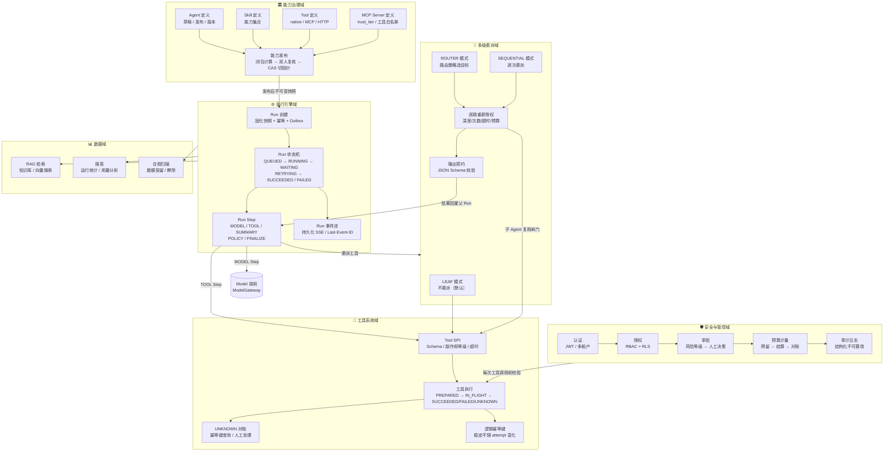
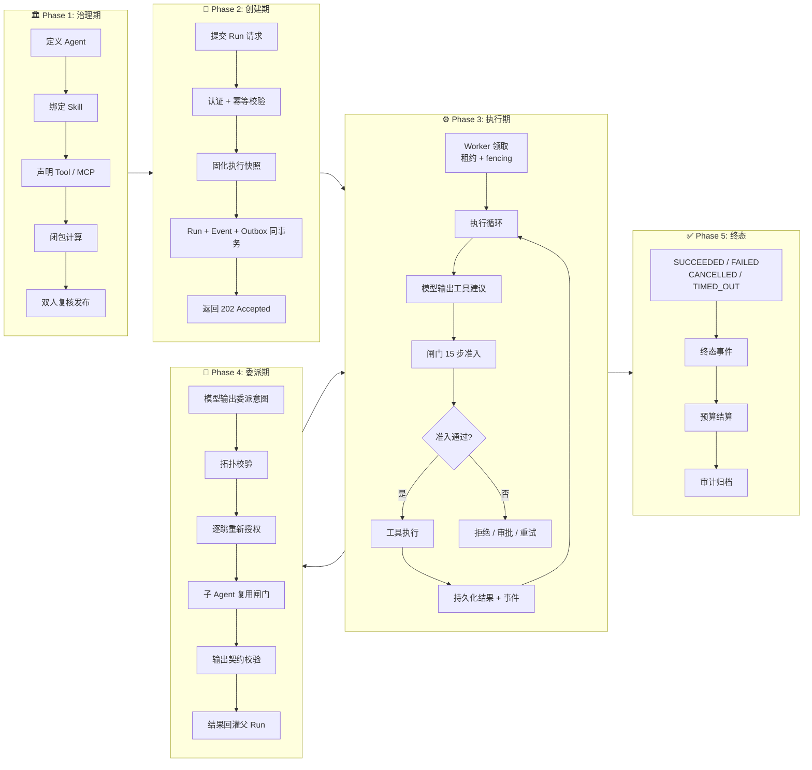
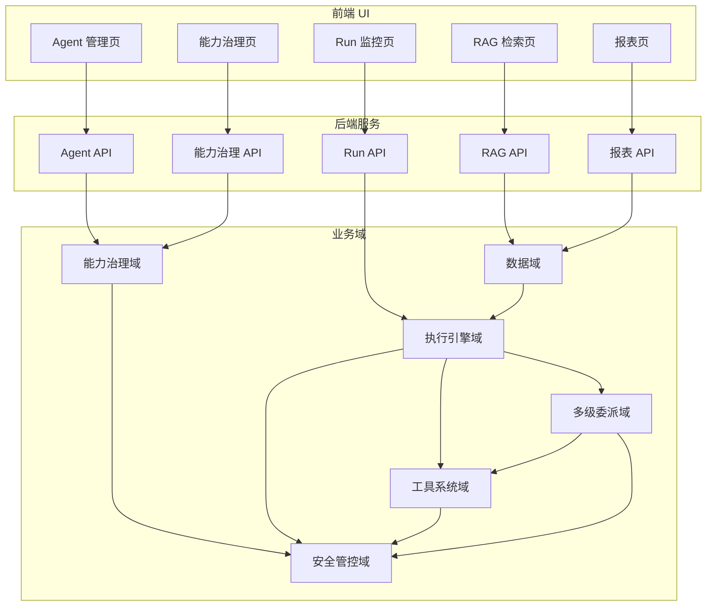
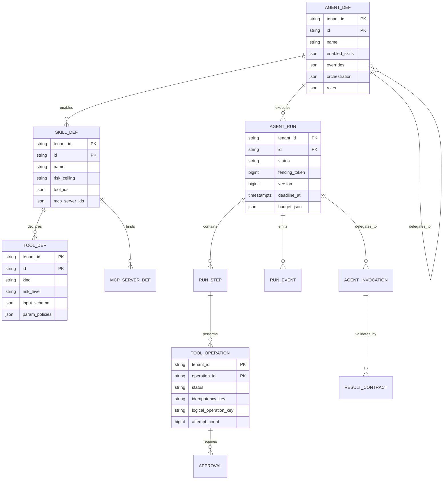

# 业务架构图

> **版本**：v1.0  
> **日期**：2026-10-30  
> **基线**：Java SaaS Agent 平台 v3.1 架构设计方案  
> **说明**：本文档以 Mermaid 图表代码呈现，可在支持 Mermaid 的工具中渲染（如 GitHub、Typora、VS Code 等）

---

## 1. 项目背景

**项目名称**：Java SaaS Agent 平台（`java-multi-agent`）

**业务定位**：面向初中生错题归因与个性化辅导场景的企业级、多租户、可审计、可恢复的 Java SaaS Agent 平台。

**核心业务理念**：

- **治理期**：定义 Agent → 绑定 Skill → Skill 声明 Tool/MCP → 闭包计算 → 双人复核发布
- **运行期**：每个 Run 创建时将配置钉死成快照，所有工具调用穿过唯一闸门（15 步准入）
- **委派**：Agent 可委派给子 Agent，但委派不授予权限，每跳必须重新授权

**业务领域划分**：能力治理、执行引擎、工具系统、多级委派、安全管控、数据域

---

## 2. 业务架构总览图



---

## 3. 各业务模块职责说明

### 3.1 能力治理域

**职责**：将「Agent 能用什么」算成**不可变的能力闭包**，经双人复核发布。

| 模块 | 核心组件 | 职责 |
|---|---|---|
| **Agent 定义** | `cap_agent_def` | Agent 的可编辑逻辑实体，包含 `enabled_skills`（唯一启用途径）、`overrides`（只允许 `removeSkills` / `removeTools` / `lowerRiskCeiling`）、`orchestration`（委派拓扑）、`roles`（仅声明适用主体范围） |
| **Skill 定义** | `cap_skill_def` | 能力集合，只存 Tool **id 列表**（有效版本由发布头解析），`risk_ceiling` 非法即发布拒绝 |
| **Tool 定义** | `cap_tool_def` | 工具定义，`kind` 支持 `native` / `mcp` / `http`，`risk_level` 用 NOT NULL + CHECK 强制显式声明，`param_policies` 支持 `in_allowlist` / `lte` |
| **MCP Server 定义** | `cap_mcp_server_def` | MCP Server 配置，`trust_tier`（internal/partner/public）影响默认审批，`exposed_tool_allowlist` 的 `null ≠ []` |
| **能力发布** | `cap_config_release` | 全局单调发布序号 `config_publish_seq`，双人复核（`approver_id <> requester_id`），CAS 切指针 |

**关键约束**：

- **闭包只收紧不扩张**：Agent 的 `overrides` 只能删，不能添加
- **fail-closed**：任何对象解析不到就抛 `ClosureResolutionException`，绝不退化成「跳过该对象」
- **release 不可变**：引用必须 `id@version`，禁止 latest 漂移
- **静态深度护栏**：`MAX_STATIC_CLOSURE_DEPTH = 8`

**核心实体关系**：

```
Agent (1) ──enables──▶ Skill (N)
Skill (1) ──declares──▶ Tool (N)
Skill (1) ──binds──▶ MCP Server (N)
Agent (1) ──delegates_to──▶ Agent (N)  [子 Agent 引用]
```

---

### 3.2 执行引擎域

**职责**：一次 Run 的完整生命周期管理：创建 → 领取 → 执行 → 终态。

| 模块 | 核心组件 | 职责 |
|---|---|---|
| **Run 创建** | `RunCreationService` | Run + 初始事件 + 幂等记录 + Outbox **四者同事务**，事务提交后返回 HTTP 202；幂等三态：首次创建 / 重复同请求返回首次 / 键相同请求不同拒绝 |
| **Run 状态机** | `RunStateMachine` | 状态迁移管理：`QUEUED` → `RUNNING` → `SUCCEEDED` / `FAILED` / `CANCELLED` / `TIMED_OUT`；所有未列出的迁移默认拒绝。
| ⚠️ **`WAITING_APPROVAL` / `RETRYING` 尚未实现**（P0-2 修复时对齐）：
| 后端 `RunState` 枚举与 DDL `run_state` 枚举都只有 6 个值，
| 当前语义是「**需审批 → 登记待办 → 本次调用 fail-closed 拒绝 → Run 收敛为 FAILED**」，
| **不支持挂起后自动恢复**。详见下方迁移表脚注 |
| **Run Step** | `agent_run_step` | Loop 中的持久化步骤，`step_type`：MODEL / TOOL / SUMMARY / POLICY / FINALIZE；`step_key` 是逻辑步骤标识，重试时保持稳定 |
| **Run 事件流** | `agent_run_event` | 可续传事件流，`(tenant_id, run_id, seq)` 唯一且单调递增，支持 Last-Event-ID 断点续传 |

**Run 状态迁移表**：

| 当前状态 | 目标状态 | 触发条件 | 必须的校验 |
|---|---|---|---|
| `QUEUED` | `RUNNING` | Worker 领取成功 | 条件更新、租约设置、fencing 递增 |
| `RETRYING` | `RUNNING` | 到达 `next_attempt_at` 并领取成功 | 次数、截止时间、取消标志、租约校验 |
| `RUNNING` | `RETRYING` | 明确可重试错误 | 记录错误、attempt、下次执行时间 |
| `RUNNING` | `FAILED` | 策略要求人工审批且未获批准 | **先登记待审批记录**（`approval` 表 PENDING 行，绑定 operation + 参数摘要 + 目标资源 + 有效期），再 fail-closed 拒绝 |
| `RUNNING` | `SUCCEEDED` | 全部步骤完成 | 租约世代校验；结果、终态、事件同事务提交 |
| `RUNNING` | `FAILED` | 不可恢复错误 | 租约世代校验；错误和终态事件同事务提交 |
| `RUNNING` | `CANCELLED` | 协作式取消完成 | 停止新操作；处理在途操作的未知结果 |
| `RUNNING` | `TIMED_OUT` | 总截止时间到达 | 停止新操作；在途副作用进入对账流程 |

**终态语义**：`SUCCEEDED` / `FAILED` / `CANCELLED` / `TIMED_OUT` 终态表示平台对当前 Run 的执行生命周期已结束，不代表外部系统中的每个动作都已回滚。

> ⚠️ **人工审批的当前语义（P0-2 修复时对齐，2026-10-31）**
>
> - **已实现**：需审批的工具在未获批准时，先在 `approval` 表登记一条 **PENDING 待办**
>   （绑定 operation + 参数摘要 + 目标资源 + 审批人范围 + 有效期），
>   审批台（`GET /api/approvals`）因此能查到待办；随后本次调用 **fail-closed 拒绝**，
>   Run 收敛为 `FAILED`。
> - **尚未实现**：`WAITING_APPROVAL` 挂起态与「审批通过后自动恢复执行」。
>   原因：审批按 `operation_id` 绑定，而工具幂等键含模型 call id，
>   Run 重投后未必产生同一个 operation —— 要真正闭环，
>   需新增 Run 状态与「审批决议 → 重新入队」的迁移（属后续设计，不是本次改动范围）。
> - 因此本表只列**代码里真实存在**的迁移；`RETRYING` 同理尚未实现。

---

### 3.3 工具系统域

**职责**：所有副作用工具的统一入口：Schema 校验 → 逻辑幂等键锁定 → 操作账本 → 结果对账。

| 模块 | 核心组件 | 职责 |
|---|---|---|
| **Tool SPI** | `AgentTool` 接口 | 工具定义：`definition()` + `execute(context, args)`；声明副作用等级（`READ_ONLY` / `IDEMPOTENT_WRITE` / `NON_IDEMPOTENT_WRITE` / `EXTERNAL_COMMUNICATION`）、超时、重试语义 |
| **工具执行** | `ToolOperation` | 操作账本状态机：`PREPARED` → `IN_FLIGHT` → `SUCCEEDED` / `FAILED` / `UNKNOWN` / `RECONCILIATION_REQUIRED` / `COMPENSATED` |
| **UNKNOWN 对账** | `ToolOperationReconciliationService` | 对账策略：按稳定幂等键查询 / 按业务唯一键查询 / 同一键安全重放 / 人工对账 / 受控补偿 |
| **逻辑幂等键** | `idempotency_key` | 逻辑操作的稳定标识，在 Run 重试、Worker 接管、模型重试时保持稳定；**禁止把 attempt 编号放进逻辑幂等键** |

**工具操作状态**：

| 状态 | 含义 | 允许动作 |
|---|---|---|
| `PREPARED` | 操作意图、参数摘要、幂等键已持久化 | 首次发起调用 |
| `IN_FLIGHT` | 请求可能已发出，结果尚未确认 | 查询下游状态；必要时使用相同幂等键 |
| `SUCCEEDED` | 下游成功已确认，结果已存储 | 读取结果，不重复执行 |
| `FAILED` | 已确认失败且无副作用，或失败语义明确 | 按错误分类决定是否重试 |
| `UNKNOWN` | 超时、断连、崩溃导致结果不确定 | 先对账；**禁止创建新逻辑操作** |
| `RECONCILIATION_REQUIRED` | 自动对账仍不能确认 | 转人工处理或受控补偿 |
| `COMPENSATED` | 已执行明确的补偿操作 | 保留原操作与补偿操作的审计关联 |

**关键约束**：

- **UNKNOWN 绝不释放预算预留**：成本可能已发生，只有确定失败才退额度
- **预留失败记 FAILED**：工具根本没发出，记 UNKNOWN 会凭空造出待对账的幽灵操作
- **同一键 + 不同参数摘要**：拒绝并返回 `IDEMPOTENCY_CONFLICT` 或 `TOOL_SIDE_EFFECT_CONFLICT`
- **补偿不是回滚**：补偿动作本身也必须有幂等键、权限校验、审批和审计

---

### 3.4 多级委派域

**职责**：Agent 委派拓扑管理，**委派不授予权限**，每跳必须重新授权。

| 模块 | 核心组件 | 职责 |
|---|---|---|
| **LEAF 模式** | `OrchestrationMode.LEAF` | 不发起任何委派，**缺省语义**；唯一允许 `childAgentRefs` 为空的模式 |
| **ROUTER 模式** | `OrchestrationMode.ROUTER` | 按固定版本路由策略选目标；模型输出只是候选，必须落在父声明内且服务端复核 |
| **SEQUENTIAL 模式** | `OrchestrationMode.SEQUENTIAL` | 父可在声明集合内逐次委派；框架只给三件事：子集合、逐跳重新授权、逐跳资源封顶 |
| **逐跳重新授权** | `DelegationGuard` | 绝不继承父的授权结论，落后即 `AUTHZ_STALE`，读不到即 `AUTHZ_UNAVAILABLE`；深度/次数/超时/预算整棵调用树共享根 Run |
| **输出契约** | `cap_result_contract` | 委派输出 JSON Schema 定义，校验子 Agent 输出是否符合父 Agent 的预期 |

**路由策略三维度**：

| 维度 | 取值 | 说明 |
|---|---|---|
| `mode` | `RULES_ONLY` / `RULE_FIRST` / `SEMANTIC` | 谁选目标：纯规则 / 规则优先 / 模型按父侧路由契约选 |
| `no_match_action` | `REJECT` / `DEFAULT_TARGET` | 没有规则命中时怎么办：拒绝 / 降级到显式声明的 `default_target` |
| `on_conflict` | `RULE_WINS` / `CANDIDATE_WINS` | 规则命中且与模型候选不同时的裁决 |

**关键约束**：

- **降级只作用于「选择」，不作用于「准入」**：降级选中的目标仍须通过父声明包含 → 版本固定 → 逐跳授权 → 深度/次数/超时/预算的全部判定
- **策略可以比拓扑更窄**：拓扑检查在引擎之前，进引擎后采纳任何模型候选前再判它 ∈ 策略点名的目标集
- **非 LEAF 必须显式声明**：depth=2 / 次数=8 / 60s 三个常量已删除，缺失即拒绝发布

**委派执行 8 步**：

```
幂等检查 → 解析父 → 以父声明为准定目标固定版本 → DelegationGuard → 解析子闭包 → 落 AgentInvocation → 调度子 → 输出契约校验 → 写终态
```

---

### 3.5 安全与管控域

**职责**：五道防线：认证 → 授权 → 审批 → 预算 → 审计。

| 模块 | 核心组件 | 职责 |
|---|---|---|
| **认证** | JWT / TenantContext | 多租户身份认证，`tenant_id` + `actor_id` + 权限范围由服务端构造，不接受客户端输入 |
| **授权** | RBAC + RLS | 角色 + 资源授权 + 行级安全（`current_setting('app.tenant_id', true)`），复合外键确保子资源不能引用其他租户的父资源 |
| **审批** | `RiskBasedApprovalPolicy` | 风险等级驱动的人工决策：绑定参数摘要、目标资源、策略和有效期；一次性消费协议（锁定 → 条件更新 CONSUMED → 发起外部调用） |
| **预算计量** | `BudgetService` | 预留 → 执行 → 结算流程：原子性预留、幂等结算、UNKNOWN 不释放；预算维度：Token、工具调用次数、费用上限、并发上限 |
| **审计日志** | `agent_audit_log` | 结构化、不可由普通用户修改的审计记录，包含 `actor_id` / `action` / `resource_type` / `decision` / `trace_id` / `metadata` |

**CAP 授权链路**：

```
1. 可信上下文（租户/主体/Run 不取客户端输入）
2. PrincipalAuthorized（角色 + authzVersion 强一致读）
3. EffectiveClosure
4. AgentSkillAllowed → SkillToolAllowed → RiskWithinCeiling
5. MCPBindingAllowed
6. ParamPolicyPassed
7. ConfigFingerprintValid
8. 幂等键校验
9. SchemaValid（结构，仅一次）
10. 账本登记（PRE）
11. Approval
12. BudgetOk
13. ExecutionAdmissionCheck（TOCTOU）
13a. 持久化执行意图（必须先于外部调用）
13b. 审批 → INTENT_SUBMITTED
14. ToolHandler.execute
14a. 确定结果先入可恢复存储
15. 账本 POST
```

**线性化边界**：步骤 13 通过的瞬间，在任何外部副作用发出之前重新向权威源确认 ①`authzVersion` 未变（撤权=版本递增）②闭包指纹未变。

---

### 3.6 数据域

**职责**：知识库检索增强、运行统计与用量分析、数据保留与擦除合规。

| 模块 | 核心组件 | 职责 |
|---|---|---|
| **RAG 检索** | `useRagSearch.ts` / 知识库 | 知识库管理、向量搜索、检索增强生成 |
| **报表** | `useReports.ts` / CSV 导出 | 运行统计、用量分析、费用报表 |
| **合规扫描** | `scan.ts` | 数据保留策略、敏感数据擦除、合规审计 |

---

## 4. 核心业务流转关系



---

## 5. 业务模块交互关系



---

## 6. 核心业务实体关系



---

## 7. 业务模块与技术模块映射

| 业务模块 | 技术模块 | 关键类 / 表 |
|---|---|---|
| 能力治理域 | `agent-application` + `agent-infrastructure` | `PermissionResolver`、`ConfigPublishService`、`cap_*_def` 表 |
| 执行引擎域 | `agent-application` + `agent-worker` | `RunCreationService`、`RunExecutionLoop`、`agent_run` 表 |
| 工具系统域 | `agent-application` + `agent-worker` + `agent-infrastructure` | `ToolInvocationGate`、`ToolHandler`、`agent_tool_operation` 表 |
| 多级委派域 | `agent-application` + `agent-worker` | `DelegationExecutor`、`DelegationGuard`、`agent_invocation` 表 |
| 安全管控域 | `agent-application` + `agent-ports` + `agent-infrastructure` | `CapExecutionFlow`、`ExecutionAdmissionChecker`、`AuthorizationService` |
| 数据域 | `frontend/src/features/` + 后端 API | `useRagSearch.ts`、`useReports.ts`、`scan.ts` |

---

## 8. 业务关键指标

| 指标 | 说明 |
|---|---|
| Run 成功率 | `SUCCEEDED` / 总 Run 数 |
| 工具调用成功率 | `SUCCEEDED` / 总 ToolOperation 数 |
| UNKNOWN 对账完成率 | 对账完成的 UNKNOWN 数 / 总 UNKNOWN 数 |
| 审批通过/拒绝比 | `APPROVED` / `REJECTED` |
| 预算预留失败率 | 预留失败数 / 总预留请求数 |
| 委派深度分布 | 调用树深度统计 |
| 平均 Run 时长 | Run 从创建到终态的平均耗时 |
| 模型调用 Token 用量 | 输入/输出 Token 统计 |
