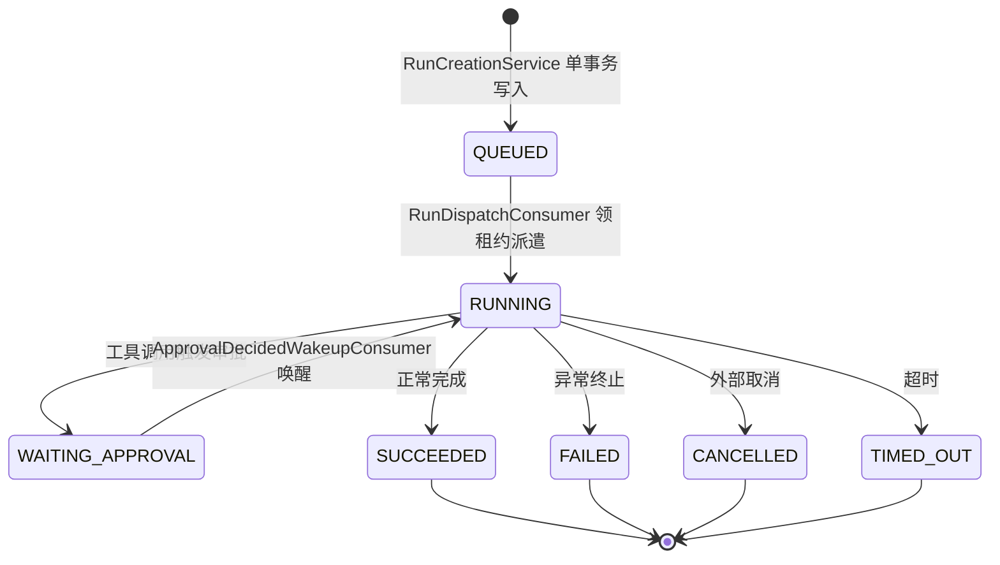
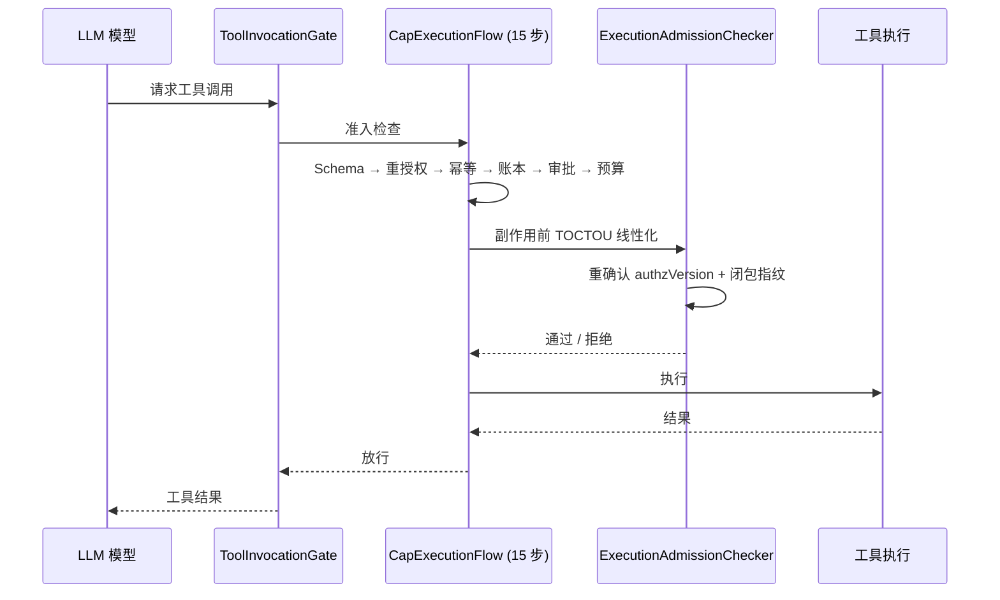

# 主流 Agent 基础设施框架设计对比与演进建议

> **文档版本**：v3.4（修订版）
> **创建日期**：2026-11-03
> **修订日期**：2026-11-03
> **状态**：修订版，待评审
> **依据**：以代码为准（参见附录 代码证据索引）；交叉核对 `docs/Agent设计总览.md`（2026-10-27 以代码为准）与项目 `working_memory` 残余缺口。
> **配套版本**：本分析对应的平台实现迭代建议线为 `1.1.0-SNAPSHOT`（当前 artifact 为 `1.0.1-SNAPSHOT`）。

---

## 0. 术语约定

本文使用以下术语，首次出现时以 **粗体** 标注，含义见本节：

| 术语 | 全称 / 含义 |
|------|------------|
| **harness-agent / harness 层** | Agent 运行所需的持久化、调度、护栏、可观测等基础设施层，即 Agent 的"鞍具/底座"，用以区分"应用层 Agent 行为"与"基础设施层 Agent 支撑能力"；harness-agent 框架指提供此类基础设施的框架（LangGraph、OpenAI Agents SDK 等） |
| **CAP** | **Capability（能力闭包）**——Agent → Skill → {Tool, MCP} 的三层能力定义与治理机制。注意：与分布式系统的 CAP 定理无关 |
| **TOCTOU** | **Time-of-Check to Time-of-Use**——检查时刻到使用时刻之间的竞态窗口；在闸门链中指副作用发出前重新校验授权与闭包指纹 |
| **Sev-0** | **严重级别 0（最高）**——直接威胁数据安全或业务连续性的缺陷 |
| **LLM07** | OWASP Top 10 for LLM Applications 第 7 项：**System Prompt Leakage**（系统提示词泄漏） |
| **D-5** | 设计决策编号 5，来源为项目内部设计文档 |
| **G1 / G2 / G4 / G5 / G6 / G7 / G11** | 项目 `working_memory` 中记录的残余缺口编号，含义见附录 |
| **HITL** | **Human-In-The-Loop**——人类审批介入回路 |
| **RLS** | **Row-Level Security**——行级安全，数据库层面的多租户数据隔离 |
| **PARK** | 自定义 RunState 枚举值，表示 Run 挂起等待外部事件（如审批完成）后唤醒恢复 |
| **fencing / fencing token** | 租约持有者标识（`lease_owner`），防止多 Worker 同时处理同一 Run |
| **at-least-once** | 至少一次投递——允许重复但不会丢失（RabbitMQ + Outbox 的本征语义） |
| **effectively-once** | 通过 at-least-once 投递 + 应用层幂等去重 + UNKNOWN 丢弃，实现的副作用精确一次执行——非消息中间件层面的 exactly-once |
| **持久化可靠性（durability）** | 指 Run 在崩溃/网络分区/消息重复等故障下不丢、不重、不卡死的执行保证 |
| **命令式（imperative）** | 手写 `while` 循环 + if/else 分支的编排方式，与声明式图（declarative graph）相对 |
| **checkpoint / 重放** | 图状态机执行到某节点后保存状态快照，崩溃恢复时从快照继续而非从头开始 |

---

## 1. 背景与范围

### 1.1 TL;DR（执行摘要）

本平台在 **持久化可靠性（effectively-once + fencing + 孤儿 Run 兜底）** 和 **闸门链执行架构（TOCTOU + 15 步准入）** 两个方向已达到甚至超过主流 harness 框架的生产水准——这是团队在分布式一致性领域的核心优势。

真正的代差集中在四个方向：① **CAP 治理设计完备但运行期未生效**（开关关、快照无写入方、Repo 未全接 Gate）；② **端到端从未在真实 LLM 下验证**；③ **护栏判定停留在正则黑名单 + 无 LLM07 检测**；④ **缺少一等公民的长期记忆与标准化 tracing**。

先补 P0 三项（CAP 授权链路 + 真实模型网关 + ML 级护栏）是当前 ROI 最高的动作。详细分析见 §2–§4，建议路线图见 §5，全局诊断见 §6。

---

> 本平台是一个企业级多租户 SaaS Agent（初中生错题归因辅导），技术基线为 Spring Boot 4.1.1 + PostgreSQL + RabbitMQ + Java 21，包名 `cn.studykid.multiagent`。
>
> 本文从三个维度对其现状做剖析——① 业务流程（任务流程与编排方式）、② 整体设计（架构与模块划分）、③ 护栏设计（安全约束与边界控制）——与主流 **harness 层** 框架（LangGraph、OpenAI Agents SDK、Anthropic Claude Agent SDK、AutoGen、LlamaIndex、CrewAI）对比差异，并给出按优先级排序的演进建议。
>
> 选型说明：以上 6 个框架代表了当前 Agent 基础设施领域的主流范式——LangGraph（图状态机）、OpenAI Agents SDK / Claude Agent SDK（平台 SDK）、AutoGen（多 Agent 对话编排）、LlamaIndex（数据+RAG 框架）、CrewAI（角色化多 Agent）；低代码平台（如 Dify、Coze）侧重应用层而非 harness 层，不在本次对比范围。
>
> ⚠️ **主流框架特征以各框架截至 2026-10 的公开文档与社区实践为参考**，部分细节可能随版本更新变化——关键判定以官方文档为准。
>
> **目标不是「推翻重做」**，而是识别当前设计与主流实践之间真正的**代差与超前点**，把有限的改造资源投向 P0 级真实风险。
>
> （文中以代码类名引用的具体文件路径，均可在附录「代码证据索引」中查到。）

---

## 2. 业务流程：任务流程与编排方式

### 2.1 架构速览

### 2.2 当前现状（基于实际代码）

- **生命周期状态机**：`RunState`（`platform/agent-core/.../core/run/RunState.java`）是显式枚举状态机：`QUEUED → RUNNING → (SUCCEEDED | FAILED | CANCELLED | TIMED_OUT | WAITING_APPROVAL)`。终态不可迁出；非法迁移显式抛 `IllegalStateTransitionException`（不做静默吞没）。`WAITING_APPROVAL` 是 **PARK** 非终态（挂起等待唤醒），审批决定到达后由 `ApprovalDecidedWakeupConsumer` 唤醒 `RESUME` 回 `RUNNING`。
- **触发与入队**：`RunController` → `RunCreationService` 在**单事务**内完成以下写入，保证「Run 与消息同事务落库」：
  - Run 记录
  - 初始事件
  - 幂等记录
  - Outbox（`outbox_event`）
- **调度与派发**：`OutboxRelay`（默认轮询 200ms，多租户 + 背压）把 Outbox 发到 RabbitMQ；`RunDispatchConsumer` 领租约（**fencing** token + lease），靠 `Outcome → ConsumeResult` 映射实现 **at-least-once（至少一次投递）+ 重复消息丢弃**（`UNKNOWN_RESULT` 一律 ack 丢弃，避免重复副作用按 **Sev-0** 定级）。
- **执行循环**：`RunExecutionLoop`（`platform/agent-worker/.../execute/RunExecutionLoop.java`）是手写 `while (steps < maxSteps)` 循环，包含四个阶段：
  1. `ModelGateway` 调用
  2. `ToolInvocationGate`（15 步准入）
  3. 工具执行
  4. 结果回灌
  租约按 `lease_owner` 续期；单步调用用 `Future.get(剩余时间)` 抢占式超时；重试**只在 Worker 侧**实现（刻意避开 `@Retryable`，因对 `record_weakness` 重复写按 **Sev-0** 定级）。
- **多级 Agent 编排**：`DelegationExecutor`（8 步）+ `WorkerChildAgentRunner`，三种 `OrchestrationMode`：`LEAF / ROUTER / SEQUENTIAL`；路由策略与委派拓扑分离，逐跳重新授权，整棵调用树共享根 Run 的预算/超时/深度（`docs/Agent设计总览.md §6`）。
- **流式输出**：SSE（`RunEventStreamer`）。

### 2.3 与主流 harness 层的差异

#### 2.3.1 编排抽象（截至 2026-10）

| 维度 | 本项目 | LangGraph | OpenAI Agents SDK | Claude Agent SDK | AutoGen / CrewAI |
|------|--------|-----------|-------------------|------------------|------------------|
| 编排模型 | 手写命令式单循环 + 硬编码 8/15 步 | 图状态机（checkpoint + interrupt/resume） | Handoff + guardrails 链 | Tool use 循环 + MCP | 对话式多 Agent 编排 |
| 条件分支 | 无声明式支持，靠 if/else | 条件边（conditional edges） | 通过 handoff 函数路由 | 工具返回值驱动 | 角色对话驱动 |
| 可观测 | 自建事件流 | LangSmith 深度集成 | OpenAI Tracing 原生 | 有限 | 有限 |
| 复杂度 | 维护面在自研代码里 | 学习曲线高（图范式） | 低，SDK 开箱即用 | 低 | 中 |

> **诊断**：主流框架将编排作为一等公民（图状态机、Handoff、ReAct/Plan-execute），本项目编排是硬编码流程，缺少声明式图、条件边、动态子图与原生 checkpoint 重放。**风险**：随着 Agent 拓扑复杂度增长，自研状态机的维护成本与出错概率将非线性上升。

#### 2.3.2 持久化与恢复（截至 2026-10）

| 维度 | 本项目 | LangGraph | OpenAI / Claude SDK |
|------|--------|-----------|---------------------|
| 副作用语义 | **effectively-once**（at-least-once + 幂等去重 + UNKNOWN 不重投） | at-most-once / 通过 checkpointer 恢复 | 多数场景 at-most-once（持久化能力有限） |
| 崩溃恢复 | Run 表 + lease + fencing 重领；孤儿 Run 兜底收敛 | checkpointer 自动重放 | 有限或无内置持久化 |
| 对账机制 | UNKNOWN_RESULT 一律 ack 丢弃 | 无内置对账 | 无内置对账 |
| 租约保护 | fencing token + `lease_owner` 抢占式续期 | 无 | 无 |

> **说明**：本项目在消息投递层面是 at-least-once（RabbitMQ + Outbox），在副作用执行层面通过幂等去重 + UNKNOWN 丢弃实现了 effectively-once。上述 LangGraph / OpenAI / Claude SDK 的持久化特征以 2026-10 公开文档为参考，部分框架在此后版本中可能已有增强——关键判定以官方最新文档为准。

#### 2.3.3 追踪（截至 2026-10）

| 维度 | 本项目 | 主流框架 |
|------|--------|----------|
| 追踪实现 | 自建 `run_event` / `run_step` / `RiskEventPort` + `ExecutionObserverChain` | LangSmith / OpenAI Tracing / AgentOps 标准化 trace |
| Span 模型 | 自定义，不兼容 OpenTelemetry | 标准化 span 模型，可对接 APM |
| 评测集成 | 无 | LangSmith evals、RAGAS、DeepEval |

### 2.4 核心矛盾

本项目的执行**持久化可靠性（effectively-once 语义、fencing、UNKNOWN 不重投、孤儿 Run 兜底收敛）**强于多数主流框架；代价是编排是硬编码流程，缺少图式声明、条件边、动态子图与原生 checkpoint 重放，维护面与出错面都在自研代码里——且端到端从未在真实 LLM 下验证过。

---

## 3. 整体设计：架构与模块划分

### 3.1 架构速览

```mermaid
graph TD
    subgraph "治理期（发布前）"
        CAP[能力闭包 CAP] --> Release[不可变 Release]
        Release --> Fingerprint[指纹 + 双人复核]
    end

    subgraph "运行期（Runtime）"
        Run[Run 创建] --> Snapshot[execution_snapshot + effective_closure]
        Snapshot --> Gate[闸门链 15 步]
        Gate --> Tool[工具执行]
    end

    subgraph "模块依赖（六边形架构）"
        Core[agent-core<br/>纯领域，零框架] --> Ports[agent-ports]
        Ports --> App[agent-application]
        App --> Infra[agent-infrastructure]
        Infra --> Worker[agent-worker]
        Worker --> API[agent-api]
        API --> Bootstrap[platform-bootstrap]
    end
```

### 3.2 当前现状

- **11 模块 Maven，端口适配器（六边形架构）**：`agent-core`（纯领域，零 Spring/DB）→ `agent-routing` → `agent-ports` → `agent-application` → `agent-infrastructure`/`agent-infra` → `agent-worker` → `agent-api` → `platform-bootstrap`。依赖方向由 `ModuleDependencyDirectionTest` 守住。
- **治理期 / 运行期分离**：能力闭包（**CAP**——Capability，注意与 CAP 定理无关）在发布期算好钉死成 release（不可变、双人复核 DB CHECK、指纹）；运行期每个 Run 固化 `execution_snapshot` + `effective_closure`。
- **多租户**：**RLS** 正在迁往应用层权限；`(tenant_id, 父id)` 复合外键双保险。平台级对象（Tool/Skill/MCP）走带外运维通道，应用层只 CRUD 租户级 Agent。新旧 Agent 表靠 `DualWriteAgentManagePort` 最终一致衔接。
- **CAP 三层治理**：Agent → Skill → {Tool, MCP} 交集，Agent 侧只允许收紧；`risk_level` 用 DB `NOT NULL + CHECK` 强制显式声明。

### 3.3 与主流 harness 层的差异

#### 3.3.1 配置治理层对比（截至 2026-10）

| 维度 | 本项目 | LangChain / LlamaIndex | OpenAI / Claude SDK |
|------|--------|------------------------|---------------------|
| 能力治理 | CAP 三层 + 闭包计算 + 指纹 + 不可变 release + 双人复核 | 无（库级别，无治理） | Project-level guardrails（平台托管） |
| 多租户 | RLS + 复合外键 + 带外运维 | 不适用（单租户） | 平台级隔离 |
| 治理期/运行期分离 | 发布期固化 → 运行期快照 | 无 | 无 |
| 上手成本 | 高（概念重、模块多） | 低（轻量可组合） | 低（SDK 开箱即用） |

> **🟢 超前**：本项目的闭包计算、指纹、不可变 release、双人复核，是远超 harness 的产品级治理——对应多租户 SaaS 场景，是合理且领先的设计。
> **代价**：概念重（CAP 四件套 / 闭包 / 委派拓扑与策略分离）、模块多、上手成本高；主流推崇「轻量可组合」。

#### 3.3.2 领域纯度对比

| 维度 | 本项目 | 典型 Java Agent 项目 |
|------|--------|---------------------|
| 领域层隔离 | `agent-core` 零框架依赖 | 多数领域和 Spring 混在一起 |
| 依赖方向 | `ModuleDependencyDirectionTest` 自动化守住 | 人工 code review 维持 |
| 端口适配器 | 完整六边形架构 | 多数三层架构或更扁平 |

> **🟢 超前**：端口适配器做得好——`agent-core` 零框架依赖，比多数把领域和 Spring 混在一起的 Java agent 项目强。

#### 3.3.3 关键缺口：一等公民长期记忆

| 维度 | 本项目 | LlamaIndex | OpenAI / Claude |
|------|--------|------------|-----------------|
| 跨 Run 记忆 | 无 `MemoryPort` / `VectorStore` 抽象 | `ChatMemoryBuffer` + VectorIndex | 内置 conversation memory |
| 语义检索 | 仅 `GetStudentProfileTool` / `RecordWeaknessTool` 点查/写入 | 向量检索 + RAG 原生 | 内置 |
| 学生画像 | 逐 Run 重建，无跨 Run 画像累积 | 不适用 | 不适用 |

> **关键缺口**：全仓 grep 不到 `MemoryPort` / `VectorStore` / 跨 Run 长期记忆抽象。错题归因场景可能需「记住学生历史错题画像」，但现状只有点查/写入，**没有跨 Run 的语义记忆**（主流 LlamaIndex Memory / OpenAI / Claude memory 把对话与语义记忆当一等公民）。（待产品确认：错题归因是否需要跨 Run 记忆，还是每次独立归因即可满足需求。）**若需要**：个性化辅导连贯性不足，同一学生的多次辅导无法累积知识。

---

## 4. 护栏（Guardrails）设计：安全约束与边界控制

### 4.1 架构速览

### 4.2 当前现状

- **四件套**（均 fail-closed，但判定层基本是正则/硬编码）：
  - `OutputModeration`（`agent-core/.../core/compliance`）：输出侧 PII 脱敏 / TOXICITY / JAILBREAK，动作 BLOCK/REDACT/ALLOW；注释自陈「这是黑名单，不可能完备」。
  - `PromptGuard`（`agent-application/.../application/prompt`）：用户输入 `<user_input>` 包裹、工具结果 `<tool_result trust="untrusted">` 包裹、长度/深度/元素数上限；**注入检测只观测不拦截**（设计决策 **D-5**，因教育场景误杀代价高）。
  - `HallucinationDetector`（`agent-application/.../application/evaluation`）：因首期无 RAG 且无 LLM-as-judge 基础设施，「提到出处即违规」的正则判定。该方案为过渡实现，误杀率在真实教育对话中待量化评估。
  - `ApprovalReadinessGuard`（`platform-bootstrap/.../config`）：启动自检 **HITL** 通道是否接线，可升级为硬失败。
- **闸门链（本项目最强处）**：`ToolInvocationGate` 外壳 + `CapExecutionFlow` 15 步（`Schema → 执行时重授权 → 幂等 → 账本 → 审批 → 预算 → 执行 → …`）+ `ExecutionAdmissionChecker` 的 **TOCTOU** 线性化边界（发出任何副作用前重新确认 `authzVersion` + 闭包指纹）+ `CapabilityClosureGuard` + `RiskBasedApprovalPolicy` + `BudgetProbe` + 幂等键。

### 4.3 与主流 harness 层的差异

#### 4.3.1 护栏判定层对比（截至 2026-10）

| 维度 | 本项目 | 主流框架 |
|------|--------|----------|
| Toxicity 检测 | 正则黑名单 | OpenAI Moderation API / NeMo Guardrails / Azure Content Safety |
| PII 检测 | 正则脱敏 | Presidio / 语义级分类器 |
| 注入检测 | 正则，仅观测不拦截 | Lakera / Rebuff ML 级分类器 |
| System Prompt Leak (**LLM07**) | **缺失** | OWASP LLM07 标准检测 |
| 策略管理 | Java 代码硬编码，改规则发版 | 策略即配置 / 热更新 |
| 判定精度 | 低（黑名单不完备） | 高（ML/语义级） |

> **🔴 代差 1**：判定层是关键词正则，无语义/ML 级分类器（toxicity / PII / injection 都应上分类器）。
> **🔴 代差 2**：无 **system-prompt-leak 检测**（**LLM07**，`working_memory` G6 缺口）——这是 OWASP LLM Top 10 标准护栏项。
> **🔴 代差 3**：护栏规则散在 Java 代码，改规则要发版，无策略中心。

#### 4.3.2 护栏执行架构对比（截至 2026-10）

| 维度 | 本项目 | 主流框架 |
|------|--------|----------|
| 架构哲学 | **主防线是闸门不信任模型决定** | 判定层拦截 + 框架级 guardrail（如 OpenAI SDK 的 input/output guardrail） |
| 注入检测策略 | 只观测不拦截（D-5） | 多数拦截（精度依赖 ML 分类器） |

> **主次分析**：`PromptGuard` 注入只观测不拦截——思路（主防线是「闸门不信任模型决定」）其实**主次正确**。注入检测作为辅助信号而非主防线有两个理由：① 教育场景误杀代价远高于漏报；② 闸门链的 TOCTOU 边界才是真正阻断恶意工具调用的防线。但注入检测本身停留在观测级（正则）是事实上的短板。

#### 4.3.3 本项目领先点

| 维度 | 说明 |
|------|------|
| **TOCTOU 线性化边界** | 副作用前重校验权威源（`authzVersion` + 闭包指纹），生产级精细度——主流框架少有 |
| **UNKNOWN 语义 + Sev-0 对账纪律** | 重复副作用按 Sev-0 定级，UNKNOWN_RESULT 一律 ack 丢弃——主流框架多数无此意识 |
| **审批就绪自检** | 框架不提供「我的 HITL 到底接没接上」的启动断言——本项目有 |
| **`kind=http` 的 SSRF 防线** | 出站 IP 白名单校验 + 每次重定向重新校验 + 云元数据地址绝对禁止——代码已实现且测试完备 |

---

## 5. 演进建议与优先级路线图

> 以下建议统一按 **优先级 = 风险 × 价值 × 成本** 排序，分为三级：
> - **P0** = 高紧迫度安全/功能风险，当前迭代先补
> - **P1** = 高价值架构能力，构筑长期竞争力
> - **P2** = 工程化完善，备选/backlog 性质（不阻塞 P0/P1 执行，资源有余时启动）
>
> 每项建议带来源分析点（→ §X.X）、前置依赖与可验证子步骤。

### 5.1 P0 — 当前真实风险，先补

#### P0-1：开启 CAP 授权链路（接入快照写入方 + 铺满 Gate + 灰度开启）

**来源**：→ §3.3.1 CAP 治理缺口；`Agent设计总览 §8.1/§8.7`

**现状**：
- 开关 `config.flag.cap-authorization-enforced` 默认 `false`
- `execution_capability_snapshot` 在生产路径**无写入方**——开启前不接写入方，每次工具调用都会被自己的准入链拒绝（表象「全工具不可用」）
- 约 55 个 `Jdbc*Repository` 未接 Gate，`AUTHZ_MISMATCH=0` 只覆盖已接的 5 个仓

**做法**（分 4 个可验证子步骤）：
1. **快照写入方 IT**：`execution_capability_snapshot` 写入路径联调通过
2. **高风险仓库接 Gate**：Agent / Tool / Skill 相关仓优先，Gate 覆盖率由 `AUTHZ_MISMATCH` 指标观测
3. **灰度开关矩阵**：单租户 → 多租户 → 全量，每阶段观察 `AUTHZ_MISMATCH` 与工具可用率
4. **全量开启** `cap-authorization-enforced=true`

**验收**：`AUTHZ_MISMATCH=0` 且工具可用率未下降

**前置依赖**：无（独立可做）

**工作量**：需单独评估（铺满 55 仓属大型改造，不可低估）

---

#### P0-2：接真实模型网关，在真实 LLM 下跑端到端

**来源**：→ §2.4 编排验证缺口

**现状**：
- `ModelGateway` 端口已在 `agent-ports` 中就位，实际工作是**实现真实适配器**而非从零建网关
- 当前仅 `FakeModelGateway` 占位；代码中已有 `MiniMaxModelGateway` 骨架引用

**做法**：
1. 低成本 MVP：先接 Ollama 本地模型验证流程正确性
2. 对接生产 LLM 服务（供应商选型需同时评估：零保留条款状态——需通过 `ZeroRetentionGate` 校验；未成年人数据合规——数据不出境/不用于训练；Token 成本与服务 SLA）

**前置依赖**：P0-1（CAP 未开启时接真实模型存在风险敞口）

**工作量**：适配器实现 + 联调，约 1 周（不含供应商选型与合规审批）

---

#### P0-3：用 ML/语义级护栏替换正则黑名单（与 D-5 协调）

**来源**：→ §4.3.1 护栏判定精度缺口

**现状**：toxicity / PII / injection 判定靠正则黑名单 + 无 LLM07 检测

**做法**（需与 D-5 的设计决策协调）：

> ⚠️ **与 D-5 的协调**：ML 判别器的引入不改变主防线（闸门不信任模型决定），也不改变 D-5 的"教育场景误杀代价高"判断。建议梯度方案：
> ① ML 分类器输出置信度分数（非硬拦截）；
> ② 高置信度 + 高风险类别（如 jailbreak / system prompt leak）→ 提升审批级别或追加人工复核；
> ③ 低置信度 / 教育场景常见模式 → 保持观测不拦截。
> 总体原则：**ML 增强观测精度，拦截决策仍由闸门链与 HITL 做出。**

- 接入分类器（Lakera / Rebuff / 自建小模型），优先评估自建或本地部署方案以规避 PII 出境风险
- 补 **system-prompt-leak 检测（LLM07）**
- 把 `OutputModeration` / `HallucinationDetector` / `PromptGuard` 的判定层升级为可配置策略

**前置依赖**：P0-2（需真实 LLM 验证护栏效果）

**工作量**：需独立评估（分类器选型 + 集成 + 调优）

---

### 5.2 P1 — 高价值架构能力

#### P1-1：声明式/图式编排（参考 LangGraph 范式）

**来源**：→ §2.3.1 编排抽象差距

**现状**：硬编码 8/15 步命令式循环，缺少声明式图、条件边、checkpoint 重放

**做法**：

> ⚠️ **Java 落地路径论证**：本项目纯 Java 栈，LangGraph 为 Python 生态。可选项：
> - LangGraph4j（社区非官方移植，成熟度待评估）
> - Spring AI 的图支持（原生 Java，需验证能力覆盖度）
> - 自研轻量 DSL + 现有循环适配（最可控但工作量最大）
> 推荐先评估 Spring AI 图能力与自研 DSL 的成本对比，再做选型。
>
> 分两步走：**第一步**（P1）引入图式 DSL + 现有循环适配，保持兼容；**第二步**（P2）逐步替换引擎核心。引擎替换的工作量需独立评估，当前不应给出固定窗口承诺。

**前置依赖**：P0-1 + P0-2（CAP 和真实 LLM 就位后才能验证图式编排）

---

#### P1-2：标准化 tracing + metrics + 结构化日志

**来源**：→ §2.3.3 追踪差距

**现状**：自建 `run_event` / `run_step` / `RiskEventPort`，不兼容 OpenTelemetry

**做法**：
- 对接 OpenTelemetry，统一 span 模型
- 同步规划 metrics（LLM 调用延迟/成功率/Token 消耗仪表盘）
- 结构化日志与 trace 关联

**前置依赖**：P0-2（真实 LLM 调用才有 trace 价值）

---

#### P1-3：Agent 长期记忆 / 语义检索

**来源**：→ §3.3.3 长期记忆缺口

**现状**：无 `MemoryPort` / `VectorStore` 抽象；仅点查/写入无跨 Run 累积

**做法**：
- 引入 `MemoryPort` + 向量/语义检索
- 记忆 schema 设计：学生 → 知识点 → 错误模式 → 时间衰减权重
- 注意与 P2-6（RAG）共享向量基础设施（Embedding 服务、向量数据库），避免重复建设

> ⚠️ **合规前置**：引入长期记忆前需明确：
> ① 记忆数据纳入现有 `ZeroRetentionGate` 的保留/擦除策略（含可删除性）；
> ② 未成年人学习画像的脱敏粒度（去标识化但保留知识点关联）；
> ③ 家长的删除权实现路径。
> 建议在 P1-3 启动前完成 DPIA（数据保护影响评估）。

**前置依赖**：P0-2（需真实 LLM 驱动语义检索）

---

### 5.3 P2 — 工程化完善（备选 / backlog）

以下 P2 项不阻塞 P0/P1 执行，资源有余时启动。

#### P2-1：护栏策略即配置 / 策略中心

**来源**：→ §4.3.1 策略管理缺口

把正则、阈值、动作外置为可热更新策略，避免改护栏要发版。

**前置依赖**：P0-3（先有语义级判定再做策略中心）

---

#### P2-2：标准化评测 harness

**来源**：→ §2.3.3 评测缺口

把现有 `BusinessAcceptanceEvalTest` / `HallucinationDetectorTest` / `PromptInjectionRedTeamTest` 提升为可量化回归集，覆盖注入/越权/编造/泄漏多维。补充测试金字塔规划：单元 → 集成 → E2E → Chaos。

**前置依赖**：P0-2 + P0-3

---

#### P2-3：原生 HITL 接线

**来源**：→ §4.2 HITL 自检 + §4.3.3

把 `ApprovalReadinessGuard` 的 `require-live-source` 开关与真实审批台对接，并用 OpenAI/Claude 的 interrupt/resume 原语统一 `WAITING_APPROVAL` 唤醒（`working_memory` G2：CAP 路径 HITL 运行期未接）。

**前置依赖**：P0-1（CAP 开启后 HITL 才真正被触发）

---

#### P2-4：平台级限流 / 配额（补 G7）

**来源**：→ §4.3.3 + `working_memory` G7

把 `BackpressureController` / `RateLimitPolicy` 扩展到平台入口与 LLM 调用层（token/请求级），参考主流 per-tenant/per-user rate limit。

**前置依赖**：独立可做

---

#### P2-5：推进 RLS 迁移（补 G4）

**来源**：→ §3.2 多租户 + `working_memory` G4

`ai_agent` 表仍 BYPASSRLS，需完成应用层权限迁移。

**前置依赖**：独立可做

---

#### P2-6：解除 RAG 阻断并补护栏（补 G11）

**来源**：→ `working_memory` G11

RAG 受 A-008 阻断；同时需覆盖 LLM04/08 等 RAG 特有风险。注意与 P1-3 共享向量基础设施。

**前置依赖**：P0-2（真实 LLM + RAG 联调）

---

#### P2-7：开发者体验（DX）改进

**来源**：→ §3.3.1 上手成本

编写开发者 onboarding 文档、提供 `agent-core` 的 quickstart demo、建立本地开发环境一键拉起脚本。

**前置依赖**：独立可做

---

#### P2-8：迁移兼容策略

**来源**：→ §5.1–5.2 建议执行

所有 P0/P1 新增或替换项，需明确新老并行期的开关切换机制、数据迁移方案、回滚路径。

**前置依赖**：P0-1 起即需考虑

---

#### P2-9：HTTP 工具出站 URL allowlist（纵深防御）

**现状**：`kind=http` 的 SSRF 防线已在代码中实现（`HttpToolExecutor` 按解析后实际 IP 判定 + 每次重定向重新校验 + 内网/回环/链路本地/云元数据地址绝对禁止），测试完备（`HttpToolExecutorSsrfTest`）。

**做法**：在现有 IP 级阻断之上，补充域名级 URL allowlist 作为纵深防御——当前配置发布时仅校验 URL 格式合法性，未做域名白名单约束。

**前置依赖**：P0-1（CAP 开启后 HTTP 工具路径才被真正保护）

---

#### P2-10：模型级路由与多供应商

**现状**：`ModelGateway` 接口定义了统一 `complete()` 方法，但无供应商路由/降级/成本优化抽象；`MiniMaxModelGateway` 已有降级处理需求但未抽象化。

**做法**：
1. 主备供应商路由与故障切换
2. 按 token 成本 / 延迟的路由策略
3. Supplier-specific 的降级语义保持（不能把"内容被安全策略拦截"降级为"模型不可用"）

**前置依赖**：P0-2

---

#### P2-11：Prompt 版本管理与回归

**现状**：`agent_version.prompt_config` 列已在 DB schema 中落地，但 prompt 缺少版本化与灰度机制。

**做法**：
1. prompt 随 Agent 版本发布时自动附带版本指纹
2. 支持按比例灰度新 prompt
3. 建立 prompt 回归套件（关键题型正确率不退化）

**前置依赖**：P0-2

---

## 6. 代差诊断表

以下从五个维度对项目现状做全局诊断，统一使用三态术语：🔴 代差（需追赶）、🟡 持平（与主流相当，有意识缺落地）、🟢 超前（强于主流）。

| 维度 | 子项 | 诊断 | 等级 | 对应建议 |
|------|------|------|------|----------|
| **编排** | 流程建模 | 硬编码循环 vs 图状态机 | 🔴 代差 | P1-1 |
| | 条件分支 | 无声明式条件边 | 🔴 代差 | P1-1 |
| | Checkpoint/重放 | 无原生支持 | 🔴 代差 | P1-1 |
| **持久化** | 副作用语义 | at-least-once + 幂等去重（副作用 effectively-once） | 🟢 超前 | — |
| | 崩溃恢复 | 孤儿 Run 兜底收敛 | 🟢 超前 | — |
| | 对账机制 | UNKNOWN_RESULT 不重投 | 🟢 超前 | — |
| **护栏** | 执行架构 | TOCTOU + 15 步闸门链 | 🟢 超前 | — |
| | SSRF 防线（kind=http） | IP 级出站阻断 + 重定向重新校验 | 🟢 超前 | P2-9（补 URL allowlist 纵深） |
| | 判定精度 | 正则黑名单 vs ML 分类器 | 🔴 代差 | P0-3 |
| | 策略管理 | 硬编码 vs 策略即配置 | 🟡 持平 | P2-1 |
| | LLM07 覆盖 | 缺失 | 🔴 代差 | P0-3 |
| **治理** | CAP 三层闭包 | 治理期/运行期分离 | 🟢 超前 | P0-1（补运行期生效） |
| | 多租户 | RLS + 复合外键 | 🟢 超前 | P2-5 |
| | 领域纯度 | agent-core 零框架依赖 | 🟢 超前 | — |
| **能力** | 长期记忆 | 缺失一等公民 MemoryPort | 🔴 代差 | P1-3 |
| | 可观测性 | 自建 trace vs OpenTelemetry | 🟡 持平 | P1-2 |
| | 真实模型验证 | 端到端从未跑过真实 LLM | 🔴 代差 | P0-2 |
| | 开发者体验 | 概念重、上手成本高 | 🟡 持平 | P2-7 |

> **诊断结论**：本项目的**持久化与护栏执行架构（fencing、TOCTOU、fail-closed、UNKNOWN 对账）在 harness 级别已领先主流框架**；真正的代差集中在三个方向——**编排缺少声明式图、护栏判定停留在正则、长期记忆与标准化 tracing 缺失**，且 CAP 治理虽设计完备但运行期未生效。补齐 3 个 P0 项即可消除最大风险敞口（各项工作量需单独评估后纳入迭代计划）。

---

## 7. 总评

本项目的**执行持久化可靠性与权限闸门的工程纪律（fencing、TOCTOU、fail-closed、UNKNOWN 对账、双写迁移）已经达到甚至超过主流 harness 的生产水准**——这是团队在分布式一致性领域的核心优势。

真正与主流拉开差距的是四个方向，按风险紧迫度排序：

1. **CAP 治理「设计已就位但运行期未生效」**（开关关、快照无写入方、Repo 未全接 Gate）——这是 P0 级风险，ROI 最高。
2. **端到端从未在真实 LLM 下验证**——护栏和编排的可靠性未经真实非确定性检验。
3. **护栏停留在正则黑名单 + 无 LLM07 检测**——判定精度不足，安全标准覆盖不完整。
4. **缺少一等公民的长期记忆与标准化 tracing**——限制产品能力天花板与排障效率。

补 P0 三项是当前投入产出比最高的动作，P1 三项是构筑长期竞争力的必选项，P2 十一项完善工程化底座。建议将 P0-1（CAP 授权链路）和 P0-2（真实模型网关）作为当前迭代的硬目标，优先启动——风险收敛最快。

---

## 附录：代码证据索引

| 编号 | 主题 | 类 / 文件（以代码为准） |
|------|------|-------------------------|
| E1 | Run 状态机 | `platform/agent-core/src/main/java/cn/studykid/multiagent/core/run/RunState.java`（`QUEUED` 枚举定义 @:34，迁移表 @:68-81） |
| E2 | 执行循环 | `platform/agent-worker/src/main/java/cn/studykid/multiagent/worker/execute/RunExecutionLoop.java` |
| E3 | Outbox 中继 | `platform/agent-worker/src/main/java/cn/studykid/multiagent/worker/dispatch/OutboxRelay.java`（降级间隔 @:177） |
| E4 | 消费派发 | `platform/agent-worker/src/main/java/cn/studykid/multiagent/worker/dispatch/RunDispatchConsumer.java`（UNKNOWN_RESULT @:71，孤儿 Run 兜底 @:127-136） |
| E5 | 工具闸门 | `platform/agent-worker/src/main/java/cn/studykid/multiagent/worker/execute/ToolInvocationGate.java`（fail-closed 声明 @:42） |
| E6 | 15 步准入 | `platform/agent-application/src/main/java/cn/studykid/multiagent/application/cap/CapExecutionFlow.java`（默认主体 `DEFAULT_PRINCIPAL_ID = "worker"` @:109） |
| E7 | TOCTOU 边界 | `platform/agent-application/src/main/java/cn/studykid/multiagent/application/cap/ExecutionAdmissionChecker.java`（读侧六处 fail-closed @:187） |
| E8 | 闭包守卫 | `platform/agent-worker/src/main/java/cn/studykid/multiagent/worker/execute/CapabilityClosureGuard.java`（降级策略必须显式 @:32） |
| E9 | 输出护栏 | `platform/agent-core/src/main/java/cn/studykid/multiagent/core/compliance/OutputModeration.java` |
| E10 | 输入护栏 | `platform/agent-application/src/main/java/cn/studykid/multiagent/application/prompt/PromptGuard.java`（D-5 只观测不拦截 @:28-31，可疑模式 @:52-60） |
| E11 | 编造检测 | `platform/agent-application/src/main/java/cn/studykid/multiagent/application/evaluation/HallucinationDetector.java` |
| E12 | HITL 自检 | `platform/platform-bootstrap/src/main/java/cn/studykid/multiagent/bootstrap/config/ApprovalReadinessGuard.java` |
| E13 | 多级委派 | `platform/agent-application/src/main/java/cn/studykid/multiagent/application/orchestration/DelegationExecutor.java`、`WorkerChildAgentRunner.java` |
| E14 | 现状边界 | `docs/Agent设计总览.md §8`（CAP 默认关 / 无真实网关 / 快照无写入方 @:260-294） |
| E15 | ModelGateway 端口 | `platform/agent-ports/src/main/java/cn/studykid/multiagent/ports/model/ModelGateway.java`（六种错误归一化 @:29-52） |
| E16 | ZeroRetentionGate | `platform/agent-core/src/main/java/cn/studykid/multiagent/core/compliance/ZeroRetentionGate.java`（设计立场 @:9-14，fail-closed @:21） |
| E17 | HTTP 工具 SSRF 防线 | `platform/agent-infrastructure/src/main/java/cn/studykid/multiagent/infrastructure/http/HttpToolExecutor.java`（自建客户端理由 @:47-65，SSRF 校验 @:197-208） |
| E18 | CAP 开关 | `platform/agent-application/src/main/java/cn/studykid/multiagent/application/cap/CapEnforcementSwitch.java`（配置键 @:43） |
| E19 | CapToolKind | `platform/agent-core/src/main/java/cn/studykid/multiagent/core/cap/CapToolKind.java`（HTTP 工具 SSRF 固有义务 @:27-33） |
| E20 | FakeModelGateway | `platform/agent-infrastructure/src/main/java/cn/studykid/multiagent/infrastructure/model/FakeModelGateway.java`（故障模式枚举） |
| — | 残余缺口 | 项目 `working_memory`：G1 开关 false / G2 HITL 未接 / G4 BYPASSRLS / G5 黑名单 / G6 无 LLM07 / G7 无限流 / G11 A-008 阻断 |

---

## 变更记录

| 版本 | 日期 | 说明 |
|------|------|------|
| v3.4（修订版） | 2026-11-03 | 第二轮评审修订（按逐条分析结论执行）：核心术语 `exactly-once` → `effectively-once（at-least-once + 幂等去重）`，影响 §0/§2.3.2/§2.4/§6/§7 五处；修正 §1"四个维度"复制错误为三个维度；新增 §1.1 TL;DR 执行摘要；删除 §2.4/§3.4/§4.4 的 ★ 星级小结表；新增主流框架版本时效声明；软化 OpenAI/Claude SDK 持久化描述；统一全文评价术语为"代差/持平/超前"三态；§4.3.2 中性化主流框架描述；§4.3.3 领先点新增 SSRF 防线一行；P0-1 拆分为 4 个可验证子步骤 + 验收判据；P0-2 补充 ModelGateway 端口已就位说明 + 供应商合规评估要点；P0-3 新增与 D-5 的梯度协调策略；P1-1 补充 Java 落地路径论证（LangGraph4j / Spring AI / 自研 DSL）；P1-3 新增合规前置（ZeroRetentionGate 协调 + DPIA）与向量基础设施复用说明；§5 统一 P0/P1/P2 分类标准为"风险×价值×成本"；P0/P1 从长表格改为展开式结构；新增 P2-9（HTTP 工具 URL allowlist 纵深）、P2-10（模型级路由）、P2-11（Prompt 版本管理）；§6 代差表新增 SSRF 子项，"约 2 个迭代"删除；§7"启动即见效"→"优先启动"、"= Sev-0"→"按 Sev-0 定级"；§0 术语表新增 harness 层/effectively-once/durability/imperative/checkpoint 五个条目；附录证据索引从 14 条扩展至 20 条并统一行号粒度 |
| v3.3（修订版） | 2026-11-03 | 第一轮评审修订：新增 §0 术语约定、§6 代差诊断表；章节编号统一为阿拉伯数字；框架对比拆分为逐框架对比表；补充架构 Mermaid 图；演进建议标注来源、前置依赖、建议完成窗口；拆分原 P2#10 为 3 项独立建议；补齐 DX、迁移策略等缺失方向；全文术语规范化 |
| v3.2（开发版） | 2026-11-03 | 初稿：业务流程/整体设计/护栏三维对比 + 优先级演进建议（P0–P2 共 10 项） |