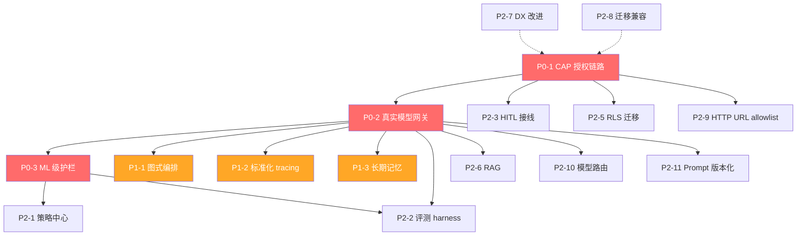
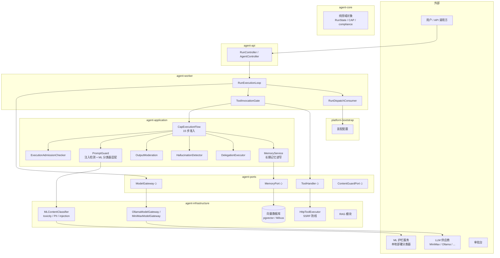
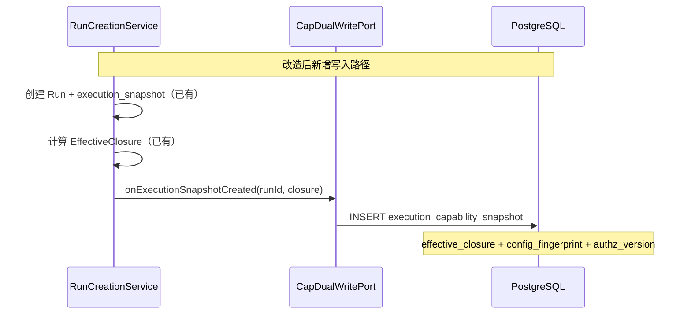
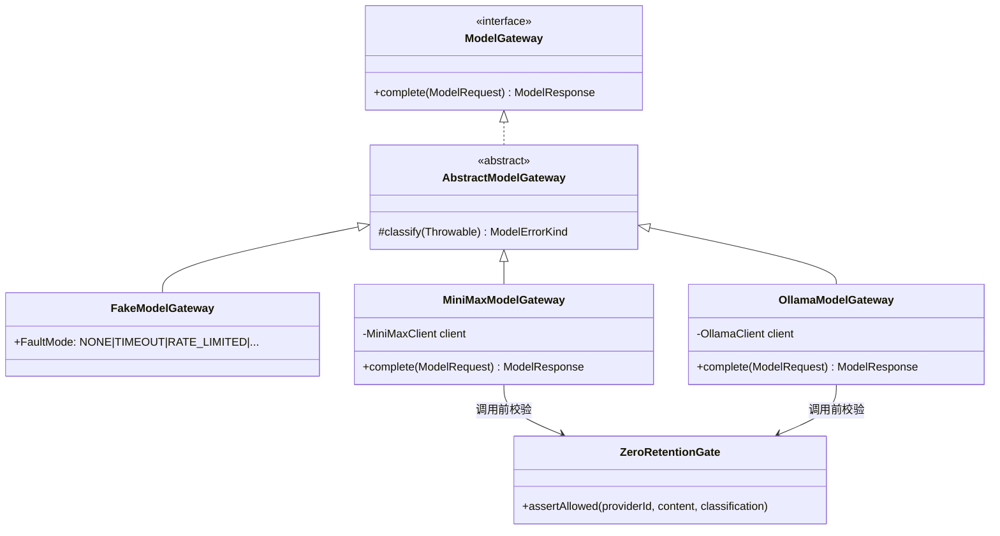
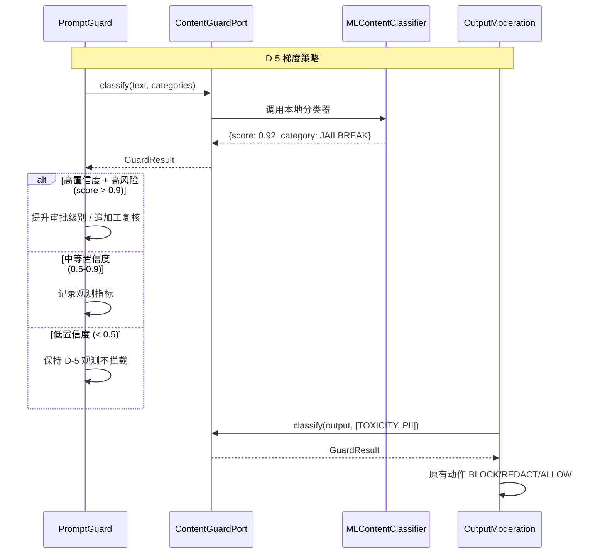
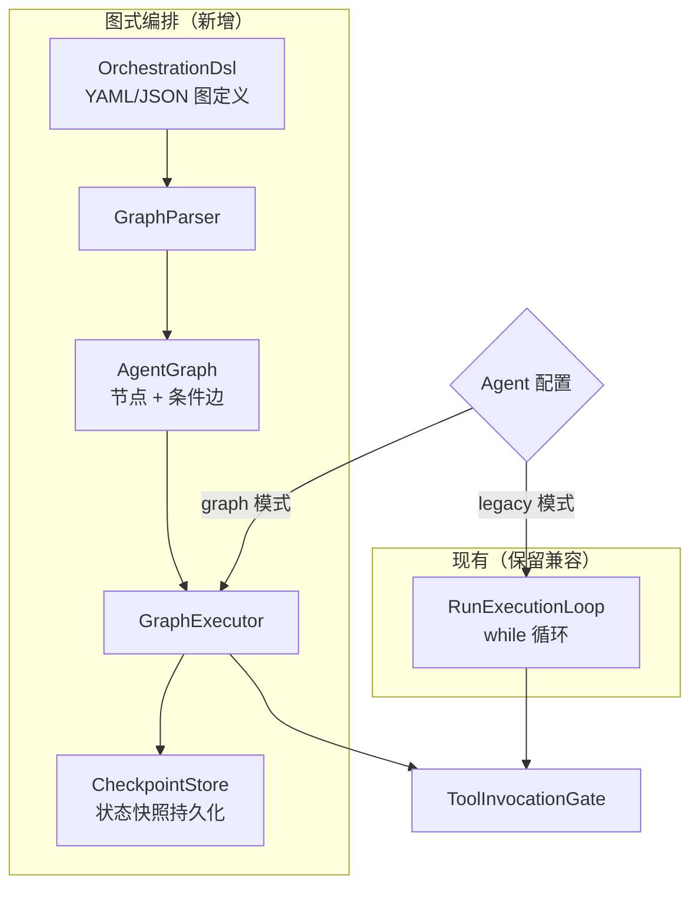
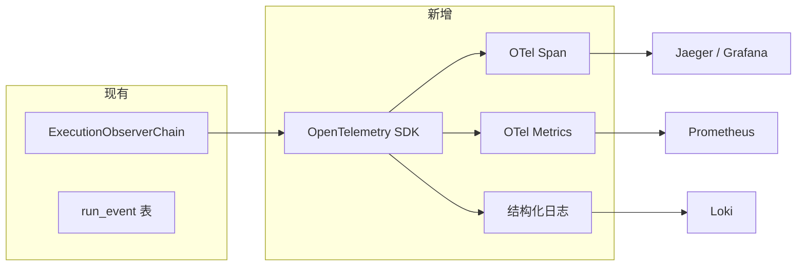
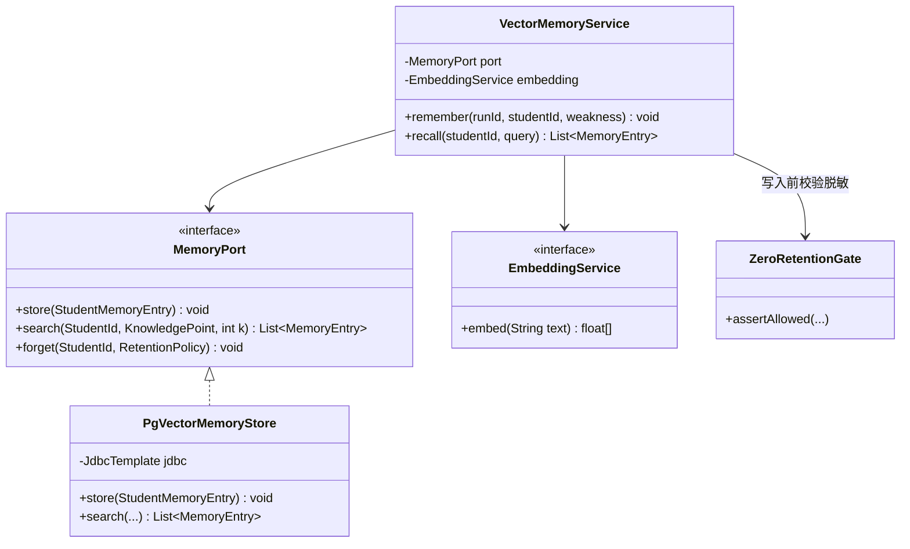

# 演进执行计划与系统设计

> **文档版本**：v1.0
> **创建日期**：2026-11-04
> **状态**：初稿，待评审
> **依据**：《主流 Agent 基础设施框架设计对比与演进建议 v3.4》（下称"演进建议"）、《Agent 设计总览》（2026-10-27）
> **配套版本**：目标迭代线 `1.1.0-SNAPSHOT`（当前 artifact `1.0.1-SNAPSHOT`）

---

## 1. 总体目标

基于演进建议中的 3 P0 + 3 P1 + 11 P2 共 17 项建议，规划为**三个执行阶段**，每阶段有明确的目标、交付物与验收判据。

**核心原则**：
- 不推翻重做——在现有六边形架构基础上增量演进
- P0 优先——先消除真实风险敞口，再架构升级
- 每阶段可独立交付、独立回滚
- 遵守七条承重不变式（`Agent设计总览 §7`）

---

## 2. 执行计划

### 2.0 依赖关系总览



---

### 阶段一：风险收敛（P0 三项）

**目标**：消除当前最大风险敞口——CAP 治理运行期生效、真实 LLM 验证、护栏判定精度升级。

**时间窗口建议**：3–4 周（不含供应商选型与合规审批等待）

| 迭代 | 任务 | 优先级 | 预估工作量 | 交付物 | 验收判据 |
|------|------|--------|-----------|--------|----------|
| **I1** | **P0-1a：快照写入方接入** | P0 | 3–5 天 | `CapDualWritePort.onExecutionSnapshotCreated` 在生产路径被 `RunCreationService` 调用；集成测试通过 | `execution_capability_snapshot` 表有新行写入，读侧六处不再 fail-closed（需 CAP 开关先关着验证读路径可用） |
| **I1** | **P0-1b：高风险仓库接 Gate** | P0 | 5–8 天 | Agent/Tool/Skill/MCP 相关 `Jdbc*Repository` 全部接入 Gate | `AUTHZ_MISMATCH` 指标覆盖这些仓且为 0 |
| **I1** | P2-7：开发者 onboarding 文档 | P2 | 2 天 | `agent-core` quickstart demo + 本地环境一键拉起脚本 | 新人可在一小时内跑通本地开发环境 |
| **I1** | **里程碑 M1**：快照写入方 + 高风险仓 Gate 就绪 | — | — | — | 读侧 pass + Gate 覆盖高风险仓 |
| **I2** | **P0-1c：灰度开关矩阵** | P0 | 3–5 天 | 单租户 → 多租户灰度配置 + `AUTHZ_MISMATCH` 监控面板 | 至少一个租户在 CAP 开启下工具可用率未下降 |
| **I2** | **P0-1d：全量开启 CAP** | P0 | 2 天 | `config.flag.cap-authorization-enforced=true` 全量生效 | `AUTHZ_MISMATCH=0` 且工具可用率未下降 |
| **I2** | P2-5：RLS 迁移 | P2 | 3 天 | `ai_agent` 表 `BYPASSRLS` 移除 | 应用层权限覆盖所有租户数据访问 |
| **I2** | **里程碑 M2**：CAP 全量开启 | — | — | — | M1 + 全租户 CAP 生效 |
| **I3** | **P0-2a：Ollama 本地 MVP** | P0 | 2–3 天 | `OllamaModelGateway` 适配器 + 端到端集成测试 | 假模型测试套件在 Ollama 上通过（关注工具调用路径是否被真实 LLM 的非确定性触发） |
| **I3** | **P0-2b：生产 LLM 适配器** | P0 | 3–5 天 | 供应商适配器（基于 `MiniMaxModelGateway` 骨架或新的供应商 SDK） | `ZeroRetentionGate` 对供应商返回 ALLOWED；端到端通过 |
| **I3** | P2-10：模型路由骨架 | P2 | 2 天 | `ModelRouter` 接口 + 主备切换策略（不做复杂路由） | 主模型故障时自动切换到备用模型 |
| **I3** | **里程碑 M3**：真实 LLM 端到端通过 | — | — | — | M2 + 生产 LLM 下全流程通过 |
| **I4** | **P0-3a：护栏判定层升级** | P0 | 5–8 天 | 语义级 toxicity / PII / injection 分类器集成（本地部署优先） + 补 LLM07 检测 | 与 P0-2 的 Ollama 真实 LLM 对比，分类器检测率显著优于正则（需量化基准） |
| **I4** | **P0-3b：D-5 梯度策略实现** | P0 | 2–3 天 | ML 置信度分数输出 + 高置信度/高风险 → 审批升级 | 低置信度教育场景保持观测，高置信度 jailbreak 触发 HITL |
| **I4** | P2-1：护栏策略外置 | P2 | 2 天 | 阈值/动作 YAML 配置化 | 改阈值不需发版 |
| **I4** | P2-11：Prompt 版本指纹 | P2 | 1 天 | `prompt_config` 发布时自动计算版本指纹 | 同内容同指纹、改内容变指纹 |
| **I4** | P2-8：迁移兼容策略 | P2 | 1 天 | 新老并行开关矩阵文档 | 每个新增/替换组件有明确的回滚路径 |
| **I4** | **里程碑 M4**：阶段一完成 | — | — | — | M3 + ML 护栏生效 + 策略外置 |

---

### 阶段二：架构升级（P1 三项）

**目标**：补齐声明式编排、标准化可观测性、长期记忆三大架构能力。

**前置依赖**：阶段一完成（M4）

**时间窗口建议**：4–6 周（P1-1 工作量最大且需技术选型验证）

| 迭代 | 任务 | 优先级 | 预估工作量 | 交付物 | 验收判据 |
|------|------|--------|-----------|--------|----------|
| **I5** | **P1-1a：图式编排技术选型** | P1 | 3–5 天 | Spring AI 图能力 vs 自研 DSL 对比报告 + PoC | PoC 能跑通现有 LEAF Agent 的编排逻辑 |
| **I5** | P1-2：OpenTelemetry 接入 | P1 | 3–5 天 | `run_event` → OTel Span 映射 + metrics（延迟/成功率/Token） | Jaeger 可查看完整调用链 |
| **I5** | P2-2：评测 harness 基线 | P2 | 2 天 | 基于真实 LLM 的注入/越权/编造评测回归套件 | 回归套件可重复跑 |
| **I6** | **P1-1b：DSL + 循环适配** | P1 | 5–8 天 | 图式 DSL 定义 + `RunExecutionLoop` 适配（兼容现有硬编码路径） | DSL 描述的图与现有硬编码行为一致 |
| **I6** | P2-3：HITL 真实接线 | P2 | 3 天 | `ApprovalReadinessGuard` 对接真实审批台 | `WAITING_APPROVAL` 状态可被人工审批唤醒 |
| **I7** | **P1-3a：MemoryPort + 向量基础设施** | P1 | 5–8 天 | `MemoryPort` 接口定义 + Embedding 服务 + 向量数据库部署 | 学生知识点向量可写入与检索 |
| **I7** | P1-3b：记忆合规 DPIA | P1 | 2 天 | 数据保护影响评估文档 | 明确保留/擦除策略、脱敏粒度、删除权路径 |
| **I7** | P2-6：RAG 解除阻断 | P2 | 3 天 | A-008 阻断移除 + LLM04/08 覆盖 | RAG 检索结果可进入闸门链 |
| **I7** | P2-9：HTTP URL allowlist | P2 | 1 天 | 域名级白名单配置 | 配置发布时校验 URL 域名是否在白名单 |
| **I7** | **里程碑 M5**：阶段二完成 | — | — | — | 图式编排 DSL 可用 + OTel tracing + MemoryPort + RAG |

---

### 阶段三：持续完善（P2 其余项）

**目标**：工程化底座完善，可持续演进。

**前置依赖**：阶段二完成（M5）

| 任务 | 优先级 | 预估工作量 | 交付物 |
|------|--------|-----------|--------|
| P1-1c：图引擎逐步替换 | P2 | 6–10 天 | 新 Agent 走图引擎，旧 Agent 保持兼容 |
| P2-2 完整：评测金字塔 | P2 | 3–5 天 | 单元 → 集成 → E2E → Chaos 四层覆盖率报告 |
| P2-4：平台级限流/配额 | P2 | 3–5 天 | per-tenant / per-user rate limit 生效 |
| P2-10 完整：模型路由策略 | P2 | 2–3 天 | token 成本/延迟路由 + supplier-specific 降级 |
| P2-11 完整：Prompt 灰度与回归 | P2 | 2–3 天 | 按比例灰度 + 关键题型正确率回归 |
| P2-7 完整：DX 持续改进 | P2 | 持续 | 按新人反馈迭代 |

---

### 关键里程碑总览

| 里程碑 | 阶段 | 判据 |
|--------|------|------|
| **M1** | I1 完成 | 快照写入方 + 高风险仓 Gate 就绪 |
| **M2** | I2 完成 | CAP 全量开启，`AUTHZ_MISMATCH=0`，工具可用率未下降 |
| **M3** | I3 完成 | 真实 LLM 下全流程端到端通过 |
| **M4** | I4 完成 | ML 护栏生效 + 策略外置（阶段一完成） |
| **M5** | I7 完成 | 图式 DSL + OTel + MemoryPort + RAG（阶段二完成） |

---

## 3. 系统设计

### 3.1 整体架构



**图例**：`◇` = 端口接口（agent-ports），实心箭头 = 运行时调用，虚线 = 编译期依赖。

### 3.2 核心改造点与衔接

#### 3.2.1 P0-1：CAP 授权链路

**现状**：`CapEnforcementSwitch` 默认 `false`；`execution_capability_snapshot` 无写入方；~55 个 Jdbc*Repository 未接 Gate。



**改造清单**：

| 改造点 | 位置 | 说明 |
|--------|------|------|
| 调用 `onExecutionSnapshotCreated` | `RunCreationService` | 在 Run 创建事务的同一 TransactionRunner 边界内调用（但可独立提交，快照写入失败不应阻塞 Run 创建） |
| Gate 接入 | ~55 个 `Jdbc*Repository` | 每个仓的方法加 `Gate.check(tenantId, operation)`，优先覆盖 Agent/Tool/Skill/MCP 仓 |
| 灰度配置 | `ApplicationConfiguration` | 租户级开关矩阵：`config.flag.cap-authorization-enforced.tenants=[t1,t2]` |
| 监控指标 | `AgentMetricCollector` | 新增 `AUTHZ_MISMATCH` 计数器 + 工具可用率 Gauge |

#### 3.2.2 P0-2：真实模型网关

**现状**：`ModelGateway` 端口已就位（`agent-ports`），仅 `FakeModelGateway` 实现。



**改造清单**：

| 改造点 | 位置 | 说明 |
|--------|------|------|
| `OllamaModelGateway` | `agent-infrastructure/model/` 新增 | 本地 MVP，对接 Ollama API；继承 `AbstractModelGateway` 复用错误归一化 |
| 生产 LLM 适配器 | `agent-infrastructure/model/` 新增/完善 | 基于现有 `MiniMaxModelGateway` 骨架或新增其他供应商 |
| `ZeroRetentionGate` 集成 | 适配器 `complete()` 方法开头 | 调用 `ZeroRetentionGate.assertAllowed(providerId, content, classification)` |
| 装配切换 | `WorkerExecutionConfig` | 按 profile 切换 Fake / Ollama / 生产 |

#### 3.2.3 P0-3：ML 级护栏

**现状**：`OutputModeration` / `PromptGuard` / `HallucinationDetector` 全是正则判定。

**新增组件**：`ContentGuardPort`（端口）+ `MLContentClassifier`（适配器）



**改造清单**：

| 改造点 | 位置 | 说明 |
|--------|------|------|
| `ContentGuardPort` | `agent-ports/content/` 新增 | 接口：`GuardResult classify(String text, Set<Category> categories)` |
| `MLContentClassifier` | `agent-infrastructure/content/` 新增 | 本地部署的分类器适配器（避免 PII 出境）；LLM07 检测作为独立 category |
| `PromptGuard` 改造 | `agent-application/prompt/` | 注入检测从正则替换为 `ContentGuardPort` 调用；保留 D-5 不拦截逻辑 |
| `OutputModeration` 改造 | `agent-core/compliance/` | toxicity / PII 检测从正则替换为 `ContentGuardPort` 调用 |
| 策略配置 | `application.yml` 新增 | `guard.content.classifier.type=local` / 置信度阈值 |

#### 3.2.4 P1-1：声明式/图式编排

**新增组件**：`OrchestrationDsl`（DSL 定义）+ `GraphExecutor`（图执行器）



**图 DSL 概念定义**：

```yaml
# 示例：错题归因 Agent 图
name: mistake-attribution
version: "1.0"
nodes:
  - id: call_llm
    type: model
  - id: gate
    type: gate                    # ToolInvocationGate
  - id: get_profile
    type: tool
    tool: GetStudentProfileTool
  - id: record_weakness
    type: tool
    tool: RecordWeaknessTool
  - id: delegate
    type: delegate
    agent: knowledge-agent
edges:
  - from: call_llm
    to: gate
  - from: gate
    to: get_profile
    condition: "tool == 'get_student_profile'"
  - from: gate
    to: record_weakness
    condition: "tool == 'record_weakness'"
  - from: gate
    to: delegate
    condition: "tool == 'delegate_to_knowledge'"
  - from: get_profile
    to: call_llm
  - from: record_weakness
    to: call_llm
  - from: delegate
    to: call_llm
maxSteps: 15
```

**改造清单**：

| 改造点 | 位置 | 说明 |
|--------|------|------|
| `OrchestrationDsl` | `agent-core/orchestration/` 新增 | 图节点/边/条件的领域模型 |
| `GraphParser` | `agent-application/orchestration/` 新增 | YAML/JSON → `AgentGraph` 解析器 |
| `GraphExecutor` | `agent-worker/execute/` 新增 | 基于 `RunExecutionLoop` 改造，增加 checkpoint/条件边支持 |
| `CheckpointStore` | `agent-infrastructure/persistence/` 新增 | 图状态快照持久化（复用 `execution_capability_snapshot` 表或新表） |
| `RunExecutionLoop` 兼容 | `agent-worker/execute/` 改造 | 新增 `executionMode` 判断，legacy 走原循环，graph 走 `GraphExecutor` |

#### 3.2.5 P1-2：标准化 tracing

**现状**：自建 `run_event` / `run_step` / `RiskEventPort` + `ExecutionObserverChain`。

**目标**：对接 OpenTelemetry，统一 span 模型 + metrics + 结构化日志。



**改造清单**：

| 改造点 | 位置 | 说明 |
|--------|------|------|
| OTel 依赖 | `pom.xml` | 引入 `io.opentelemetry:opentelemetry-api` + `opentelemetry-sdk` + `opentelemetry-exporter-otlp` |
| Span 映射 | `ExecutionObserverChain` 改造 | `run_event` → OTel Span；`run_step` → Span Event |
| Metrics 新增 | `AgentMetricCollector` 改造 | LLM 调用延迟 (Histogram) / 成功率 (Counter) / Token 消耗 (Counter) |
| 结构化日志 | logback 配置 | JSON 格式 + traceId/spanId 注入 MDC |

#### 3.2.6 P1-3：长期记忆

**新增组件**：`MemoryPort`（端口）+ `VectorMemoryService`（应用层）+ `PgVectorMemoryStore`（基础设施层）



**记忆 Schema 设计**：

```json
{
  "student_id": "hash(student_id)",     // 去标识化
  "knowledge_point": "一元二次方程",
  "error_pattern": "判别式符号误判",
  "strength": 0.7,                      // 0-1，时间衰减
  "last_updated": "2026-11-04T10:00:00Z",
  "retention_policy": "DELETE_ON_REQUEST"
}
```

**改造清单**：

| 改造点 | 位置 | 说明 |
|--------|------|------|
| `MemoryPort` | `agent-ports/persistence/` 新增 | 接口：store / search / forget |
| `VectorMemoryService` | `agent-application/memory/` 新增 | 记忆写入/检索用例 |
| `PgVectorMemoryStore` | `agent-infrastructure/persistence/` 新增 | pgvector 实现；search 用 `<=>` 余弦距离 |
| `EmbeddingService` | `agent-ports/model/` 新增 | Embedding 端口；实现可用 Ollama / 供应商 API |
| DPIA | 文档 | 数据保护影响评估：保留策略、脱敏粒度、删除权 |
| `ZeroRetentionGate` 集成 | `VectorMemoryService.store()` | 写入前校验记忆内容不含可识别学生信息 |

---

## 4. 风险点与待确认事项

### 4.1 技术风险

| 风险 | 影响 | 缓解措施 |
|------|------|----------|
| **P0-1 铺满 55 仓工作量被低估** | 阶段一延期 | I1 只覆盖高风险仓（Agent/Tool/Skill/MCP ~15 个），其余按优先级分批 |
| **P1-1 Java 图式编排无成熟方案** | LangGraph4j 不成熟 / Spring AI 图能力不足 | I5 先做 PoC 验证，若不通过则回退到"自研轻量 DSL + 现有循环适配 + P2 引擎替换延后" |
| **P0-3 ML 分类器本地部署复杂度** | 模型选型/部署/调优周期长 | 先用 Ollama 跑小型分类模型（如 Llama Guard），验证可行性后再上生产级方案 |
| **真实 LLM 非确定性导致现有护栏漏报** | 假模型下"通过"的护栏在真实 LLM 下失效 | I3 Ollama MVP 阶段即跑完整的护栏回归套件，提前暴露问题 |
| **P1-3 长期记忆与 ZeroRetentionGate 冲突** | 合规风险 | I7 先完成 DPIA，记忆内容必须脱敏且家长可删除 |

### 4.2 外部依赖

| 依赖 | 影响任务 | 状态 |
|------|----------|------|
| LLM 供应商选型与签约 | P0-2b | 待确认 |
| 供应商零保留条款签署 | P0-2b | 待确认（影响 `ZeroRetentionGate` 校验通过） |
| 向量数据库部署（pgvector/Milvus） | P1-3a | pgvector 为 PG 扩展，DBA 评估 |
| RAG 知识库内容准备 | P2-6 | 待产品确认教材/题库数据源 |
| 审批台对接接口 | P2-3 | 待确认审批系统 API |
| 未成年数据合规审批 | P1-3b DPIA | 待法务/安全评估 |

### 4.3 待产品确认

| 事项 | 影响任务 | 说明 |
|------|----------|------|
| 错题归因是否需要跨 Run 长期记忆 | P1-3 | 若每次独立归因即可，P1-3 降为 P2；节约 1 周+ |
| Prompt 灰度比例与回归标准 | P2-11 | 关键题型定义 + 正确率退化阈值 |
| 评测 harness 覆盖维度优先级 | P2-2 | 先覆盖注入/越权还是先覆盖编造/泄漏 |
| DX onboarding 目标受众 | P2-7 | 内部开发者 or 外部租户开发者，文档深度不同 |

---

## 附录：与现有代码的衔接点索引

| 现有组件 | 位置 | 改造方式 |
|----------|------|----------|
| `RunCreationService` | `agent-application/run/` | 新增 `CapDualWritePort.onExecutionSnapshotCreated` 调用 |
| `CapDualWritePort` / `CapDualWriteService` | `agent-application/cap/` | 写入方已有实现，只需接入调用方 |
| `CapEnforcementSwitch` | `agent-application/cap/` | 从 `false` 灰度切到 `true` |
| `Jdbc*Repository` (~55) | `agent-infrastructure/persistence/` | 加 Gate 调用 |
| `ModelGateway` | `agent-ports/model/` | 端口不变，新增 Ollama / 生产适配器实现 |
| `FakeModelGateway` | `agent-infrastructure/model/` | 保留用于单元测试 |
| `AbstractModelGateway` | `agent-infrastructure/model/` | 新增适配器继承此类 |
| `PromptGuard` | `agent-application/prompt/` | 注入检测从正则切换为 `ContentGuardPort` |
| `OutputModeration` | `agent-core/compliance/` | toxicity/PII 检测从正则切换为 `ContentGuardPort` |
| `ExecutionObserverChain` | `agent-worker/execute/` | 增加 OTel Span 导出 |
| `RunExecutionLoop` | `agent-worker/execute/` | 增加 executionMode 分支（legacy/graph） |
| `ZeroRetentionGate` | `agent-core/compliance/` | 集成到 ModelGateway 适配器 + MemoryPort 实现 |
| `ToolInvocationGate` | `agent-worker/execute/` | 不变——闸门链是唯一入口 |

---

## 变更记录

| 版本 | 日期 | 说明 |
|------|------|------|
| v1.0 | 2026-11-04 | 初稿：三阶段执行计划 + 系统设计（P0-1/2/3, P1-1/2/3 核心组件） |