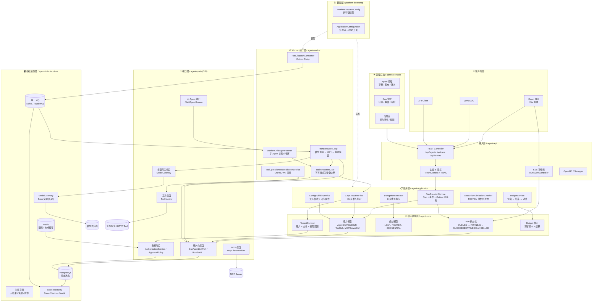
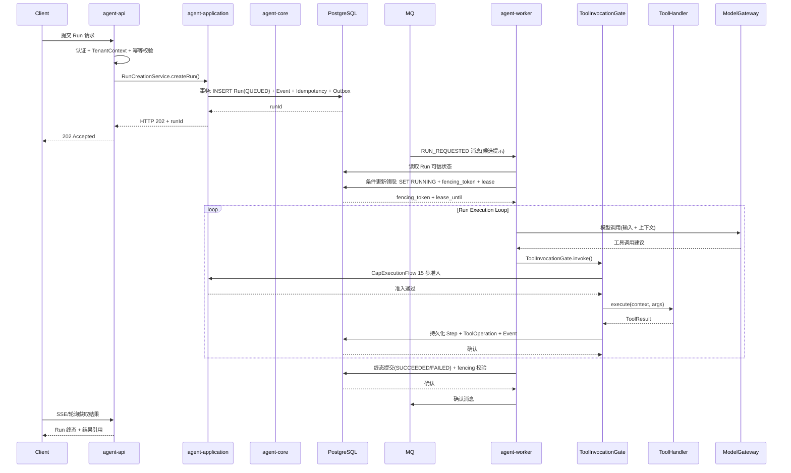
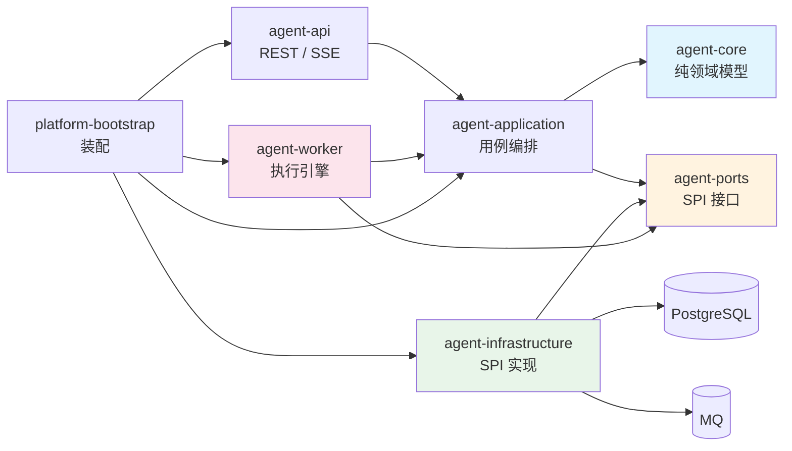
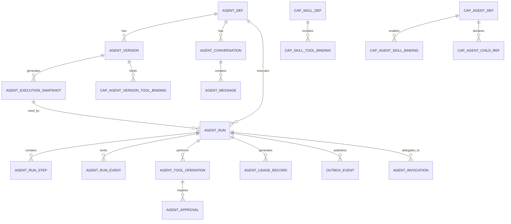

# 系统架构图

> **版本**：v1.0  
> **日期**：2026-10-30  
> **基线**：Java SaaS Agent 平台 v3.1 架构设计方案  
> **说明**：本文档以 Mermaid 图表代码呈现，可在支持 Mermaid 的工具中渲染（如 GitHub、Typora、VS Code 等）

---

## 1. 项目背景

**项目名称**：Java SaaS Agent 平台（`java-multi-agent`）

**业务定位**：面向初中生错题归因与个性化辅导场景的企业级、多租户、可审计、可恢复的 Java SaaS Agent 平台。

**核心设计理念**：

- **治理期**：将 Agent 可用的能力算成**不可变的闭包**，经双人复核发布
- **运行期**：每个 Run 创建时将配置**钉死成快照**，所有工具调用必须穿过唯一一道闸门（`ToolInvocationGate`，15 步准入）
- **可靠性**：PostgreSQL 为权威状态源，Outbox 事务性消息，租约 + fencing token 防止脑裂，UNKNOWN 状态对账而非盲目重放
- **安全**：RBAC + RLS 行级安全 + 执行时重新授权 + 逐跳重新授权

**技术栈**：

| 组件 | 技术选型 |
|---|---|
| 语言 | Java 21 LTS |
| 框架 | Spring Boot 3.x |
| 数据库 | PostgreSQL（权威状态、RLS） |
| 消息队列 | Kafka 或 RabbitMQ（单一 MQ） |
| 缓存 | Redis（限流、热点缓存） |
| 对象存储 | 企业对象存储（大结果、快照、附件） |
| AI 接入 | ModelGateway（首期 Fake 实现） |
| 可观测性 | OpenTelemetry + Prometheus/Grafana |
| 前端 | React 18 + Vite + React Router |
| 密钥管理 | KMS/Vault |

---

## 2. 系统架构总览图

---

## 3. 各层职责说明

### 3.1 客户端层

| 组件 | 技术选型 | 职责 |
|---|---|---|
| React SPA | React 18 + Vite + React Router | 前端用户界面，包含 Agent 管理、Run 监控、能力治理、RAG 检索、报表等页面 |
| Java SDK | JDK 21 | 供 Java 应用调用的平台 SDK |
| API Client | HTTP Client | 外部系统通过 REST API 接入 |

### 3.2 接入层（agent-api）

| 组件 | 职责 |
|---|---|
| REST Controller | 提供 `/api/agents`、`/api/runs`、`/api/results` 等 REST 端点，处理 HTTP 请求 |
| SSE 事件流 | 提供 Server-Sent Events 长连接，实时推送 Run 状态与事件，支持 Last-Event-ID 断点续传 |
| 认证 & 授权 | JWT 认证、TenantContext 构造、RBAC 角色校验、请求 Schema 校验 |
| OpenAPI | 自动生成 API 文档（Swagger） |

**关键约束**：
- `tenant_id`、`actor_id`、权限范围、`run_id`、`trace_id` 等可信上下文由服务端构造，不接受客户端覆盖
- 幂等键按操作域隔离：`(tenant_id, operation_scope, idempotency_key)`

### 3.3 应用层（agent-application）

| 组件 | 职责 |
|---|---|
| **CapExecutionFlow** | 15 步准入判定：可信上下文 → PrincipalAuthorized → EffectiveClosure → AgentSkillAllowed → RiskWithinCeiling → MCPBindingAllowed → ParamPolicyPassed → ConfigFingerprintValid → 幂等键校验 → SchemaValid → 账本登记 → 审批 → BudgetOk → ExecutionAdmissionCheck → 执行意图 → 执行 → 账本更新 |
| **RunCreationService** | Run 创建：Run + 初始事件 + 幂等记录 + Outbox **四者同事务**，事务提交后返回 HTTP 202 |
| **ConfigPublishService** | 能力发布：闭包计算 → 双人复核（`approver_id <> requester_id`）→ CAS 切指针，`authz_version` + `config_publish_seq` 单调递增 |
| **DelegationExecutor** | 8 步委派执行：幂等检查 → 解析父 → 以父声明为准定目标固定版本 → DelegationGuard → 解析子闭包 → 落 AgentInvocation → 调度子 → 输出契约校验 → 写终态 |
| **ExecutionAdmissionChecker** | TOCTOU 线性化边界：在任何外部副作用发出之前重新确认 ①`authzVersion` 未变 ②闭包指纹未变 |
| **BudgetService** | 预算计量：原子性预留 → 调用 → 按实际用量结算，重复结算幂等，UNKNOWN 绝不释放预留 |

### 3.4 核心领域层（agent-core）

| 组件 | 职责 |
|---|---|
| **Run 状态机** | Run 生命周期管理：`QUEUED` → `RUNNING` → `WAITING_APPROVAL` / `RETRYING` → `SUCCEEDED` / `FAILED` / `CANCELLED` / `TIMED_OUT`，所有未列出的迁移默认拒绝并返回 `RUN_STATE_CONFLICT` |
| **能力模型** | 能力四件套：`AgentDefinition` / `SkillDefinition` / `ToolDefinition` / `McpServerDef`，Agent → Skill → {Tool, MCP} 的交集，Agent 侧只允许收紧 |
| **编排模型** | 三种委派模式：`LEAF`（默认不委派）、`ROUTER`（路由策略选目标）、`SEQUENTIAL`（逐次委派） |
| **TenantContext** | 租户上下文：`tenant_id` + `actor_id` + 权限范围，事务级设置 `app.tenant_id`，RLS 行级安全 |
| **Budget 核心** | 预算维度：最大 Loop 迭代数、绝对截止时间、Token 上限、工具调用次数、费用上限、并发上限 |

**关键约束**：
- `agent-core` 不依赖 Spring AI、MQ SDK、Web 框架或数据库驱动
- 发布后版本与执行快照不可变

### 3.5 端口层（agent-ports）

| 端口 | 职责 |
|---|---|
| **持久化端口** | 仓储 SPI：`CapAgentDefPort` / `CapAgentChildRefPort` / `AgentInvocationPort` / `CapabilitySnapshotPort` / `ExecutionSnapshotPort` / `RunPort` / `ToolOperationPort` 等 |
| **授权端口** | `AuthorizationService` / `ApprovalPolicy`，执行时重新授权，撤权 = `authz_version` 递增 |
| **模型网关端口** | `ModelGateway`，领域层不依赖框架专属类型，首期提供 `FakeModelGateway` |
| **工具端口** | `ToolHandler`，工具 SPI：`definition()` + `execute(context, args)`，声明副作用等级、超时、重试语义 |
| **MCP 端口** | `McpClientProvider`，MCP Server 连接管理 |
| **子 Agent 端口** | `ChildAgentRunner`，委派执行子 Agent |

### 3.6 基础设施层（agent-infrastructure）

| 组件 | 职责 |
|---|---|
| **PostgreSQL** | 任务状态、版本、事件、Outbox、操作账本、审计日志的权威存储；RLS 行级安全 |
| **单一 MQ** | Kafka 或 RabbitMQ，只选一种主 MQ；Outbox 事务性消息投递，消费者必须幂等 |
| **Redis** | 限流、热点缓存；不能作为唯一任务状态 |
| **对象存储** | 大结果、附件、长轨迹存储；每次读取必须重新授权校验 |
| **ModelGateway** | AI 模型接入，可由 Spring AI 适配；首期只有 `AbstractModelGateway` + `FakeModelGateway` |
| **OpenTelemetry** | Trace、指标、日志关联，可观测性 |

### 3.7 Worker 执行层（agent-worker）

| 组件 | 职责 |
|---|---|
| **RunDispatchConsumer** | Outbox 消费分发，MQ 消息只携带候选 `tenant_id + run_id + message_id`，不携带可信权限 |
| **RunExecutionLoop** | 执行循环：只做编排（模型调用 → 闸门 → 状态提交），不关心工具做什么；重试只在 Worker 侧实现 |
| **ToolInvocationGate** | 不可绕过的安全边界，15 步准入；禁止使用 Spring AI `ToolCallingAdvisor` 的自动执行路径 |
| **WorkerChildAgentRunner** | 子 Agent 多轮小循环（默认 4 轮），每轮工具调用直接进 ToolInvocationGate + 子自己的闭包 |
| **ToolOperationReconciliationService** | UNKNOWN 对账：按稳定幂等键查询、按业务唯一键查询、人工对账、受控补偿 |

**关键约束**：
- Worker 不把 MQ payload 当作可信任务状态，必须从数据库重读
- 每次步骤更新、租约续期和 Run 终态提交都校验当前执行世代（`fencing_token`）
- UNKNOWN 停止执行并转对账，绝不当普通失败重试、也不释放预算预留

### 3.8 装配层（platform-bootstrap）

| 组件 | 职责 |
|---|---|
| **WorkerExecutionConfig** | Worker 执行链装配：RunDispatchConsumer → RunExecutionLoop → ToolInvocationGate |
| **ApplicationConfiguration** | 治理链装配 + CAP 开关（`config.flag.cap-authorization-enforced` 默认 `false`） |

### 3.9 管理后台（admin-console）

| 组件 | 职责 |
|---|---|
| **Agent 管理** | Agent 生命周期管理：草稿 → 校验 → 发布 → 不可变快照 |
| **Run 监控** | Run 状态监控、事件流查看、审批决策 |
| **治理台** | 能力闭包管理、权限配置、审计日志查询 |

---

## 4. 核心执行链路时序

---

## 5. 模块依赖关系

**依赖规则**：

1. `agent-core` 不直接依赖 Spring AI、MQ SDK、Web 框架或数据库驱动
2. `agent-tool` 的工具执行上下文必须由平台构造；工具仍应调用业务系统自身授权
3. `agent-worker` 不把 MQ payload 当作可信任务状态；必须重新读取数据库
4. 异步边界通过持久化 ID 和明确 DTO 传递上下文，不依赖跨线程 `ThreadLocal`
5. 控制面和 Worker 可独立部署，但首期不拆成过多微服务

---

## 6. 数据库核心表关系

---

## 7. 技术决策清单

| 决策项 | 状态 | 说明 |
|---|---|---|
| 主 MQ：Kafka 或 RabbitMQ | 待决策 | 首期只选一种，不双栈 |
| 数据访问技术：Spring JDBC / jOOQ / MyBatis | 待决策 | 涉及条件更新、租约和 RLS 的路径优先使用显式 SQL |
| ID 策略：UUIDv7 / UUID / 数据库生成 | 待决策 | 全系统统一 |
| 租户 RLS 角色模型 | 待决策 | 事务上下文设置和连接池验证方案 |
| 对象存储策略 | 待决策 | 结果引用、保留期限、删除和导出策略 |
| 并发与预算阈值 | 待决策 | 单租户并发、模型并发、单 Run 预算、最大运行时长 |
| 工具副作用对账清单 | 待决策 | 每个有副作用工具的下游幂等与对账能力 |
| 模型供应商策略 | 待决策 | 数据驻留、日志保留、敏感数据策略 |
| RPO/RTO 与容量目标 | 待决策 | 必须通过业务评审和压测确定 |

---

## 8. 不可妥协的原则

1. 模型只提出计划和工具调用建议；平台负责授权、调度、执行、持久化与最终交付
2. `tenant_id`、`actor_id`、权限范围、`run_id`、`trace_id` 等可信上下文由服务端构造，不接受模型覆盖
3. PostgreSQL 是任务状态的权威事实来源；MQ 只负责唤醒和分发
4. Run 与 Outbox 事件在同一数据库事务中提交
5. 每个 Worker 执行世代有单调递增的 `fencing_token`；旧世代不能更新新世代状态
6. 有副作用的工具必须具备下游幂等、可查询对账或受控人工处理策略；结果未知时禁止盲目重放
7. 发布后的 Agent 版本与执行快照不可变；安全授权在每次工具执行前动态检查
8. 预算由服务端强制执行；调用前预留、调用后结算，重复结算必须幂等
9. 外部网页、检索内容和工具结果均为不可信输入，不得升级为系统指令
10. 首期先交付安全、可靠的单 Agent 闭环，不以复杂编排替代可靠性基础
