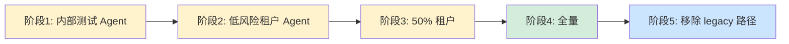
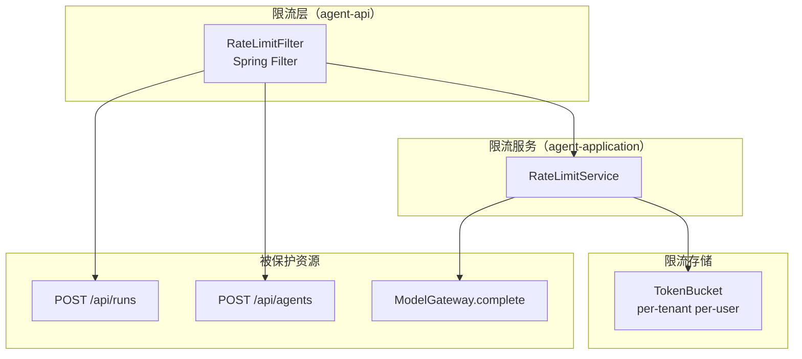
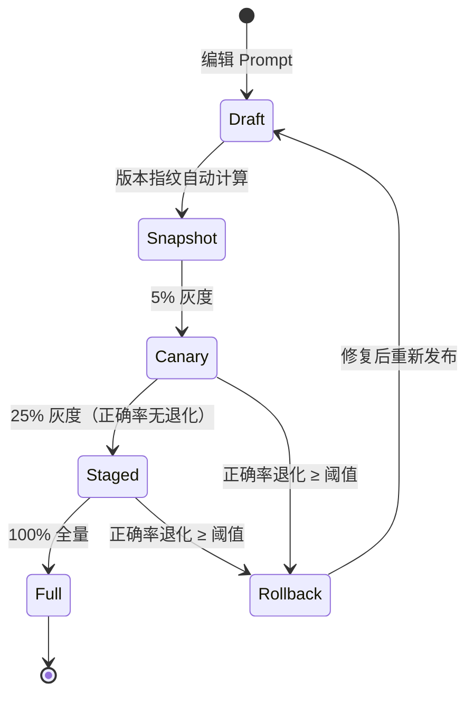

# 阶段三详细设计：持续完善

> **文档版本**：v1.0
> **创建日期**：2026-11-04
> **状态**：初稿，待评审
> **所属规划**：《演进执行计划与系统设计 v1.0》阶段三
> **依据**：《主流 Agent 基础设施框架设计对比与演进建议 v3.4》、《Agent 设计总览》（2026-10-27）
> **配套版本**：目标迭代线 `1.1.0-SNAPSHOT`

---

## 1. 阶段概述

### 1.1 目标

在阶段一的稳固地基和阶段二的架构升级之上，完善工程化底座——包括图引擎逐步替换、评测金字塔、平台级限流、模型路由策略、Prompt 灰度与回归、开发者体验持续改进。

阶段三的核心词是**收敛**：将前两阶段打开的架构升级逐步收敛到生产级完成度。

### 1.2 在整体路线中的定位

阶段三是整个演进路线的**收尾**——不再引入新的架构概念，专注于：
- 前两阶段遗留的"骨架→完整"补齐
- 工程化最佳实践的覆盖
- 持续可维护性的保障

与阶段一、二的线性依赖不同，阶段三的 6 项 P2 任务是**并行可推进**的，可按资源情况灵活排期。

### 1.3 范围

| 维度 | 包含 | 不包含 |
|------|------|--------|
| 编排 | P1-1c：图引擎逐步替换（legacy → graph 迁移） | 新编排范式引入 |
| 评测 | P2-2 完整版：评测金字塔（单元→集成→E2E→Chaos） | — |
| 限流 | P2-4：平台级限流/配额 | — |
| 模型路由 | P2-10 完整版：token 成本/延迟路由 | — |
| Prompt | P2-11 完整版：Prompt 灰度与回归 | — |
| DX | P2-7 完整版：DX 持续改进 | — |

---

## 2. 任务分解

### 2.1 任务 T1：P1-1c 图引擎逐步替换

| 属性 | 内容 |
|------|------|
| **优先级** | P2 |
| **预估工作量** | 6–10 天 |
| **前置依赖** | M5（阶段二完成——DSL + GraphExecutor 已验证可用） |
| **交付物** | 新 Agent 走图引擎、旧 Agent 保持兼容、迁移指南 |

**背景**：阶段二 I6 实现了 DSL + `GraphExecutor`，但 `RunExecutionLoop` 仍为默认路径。阶段三需要逐步将更多 Agent 迁移到图模式。

**迁移策略**：



**迁移步骤**：

| 阶段 | 范围 | 验证 | 持续时间 |
|------|------|------|----------|
| 1 | 内部 1–2 个测试 Agent | 行为一致性对比 + 性能对比 | 1 周 |
| 2 | 5 个低风险租户的 Agent | 业务验收回归 | 1–2 周 |
| 3 | 50% 租户 | A/B 对比（legacy vs graph 并行运行） | 2 周 |
| 4 | 全量 | 监控稳定性 | 1 周 |
| 5 | 移除 `RunExecutionLoop` legacy 分支 | 代码清理 + 架构简化 | 1 周 |

**行为一致性验证方法**：

```java
// AgentGraphMigrationTest.java
@Test
void graphShouldProduceSameResultsAsLegacy() {
    Run legacyRun = executeLegacy(agentId, input);
    Run graphRun = executeGraph(agentId, input);

    // 1. 状态一致
    assertThat(graphRun.getState()).isEqualTo(legacyRun.getState());

    // 2. 工具调用序列一致
    assertThat(graphRun.getToolCalls())
        .containsExactlyElementsOf(legacyRun.getToolCalls());

    // 3. 输出内容一致（允许 LLM 非确定性）
    assertThat(graphRun.getOutputSemanticHash())
        .isEqualTo(legacyRun.getOutputSemanticHash());
}
```

**实施要点**：
1. 为每个待迁移 Agent 编写图定义 YAML（基于现有硬编码逻辑反推）
2. 在 `ExecutionModeRouter` 中增加租户+Agent 维度的 mode 配置
3. 每个阶段迁移后运行全量回归测试
4. Legacy 路径移除前需冻结 2 周（无回退需求）

**验收判据**：
- [ ] 全量 Agent 在图模式下行为与 legacy 一致（业务验收回归通过）
- [ ] 图模式性能不低于 legacy 的 95%
- [ ] Legacy 代码路径已移除（阶段 5 完成后）

---

### 2.2 任务 T2：P2-2 完整评测金字塔

| 属性 | 内容 |
|------|------|
| **优先级** | P2 |
| **预估工作量** | 3–5 天 |
| **前置依赖** | M5（真实 LLM + ML 护栏 + 图式编排就绪——评测需要覆盖这些新组件） |
| **交付物** | 单元 → 集成 → E2E → Chaos 四层覆盖率报告 |

**评测金字塔设计**：

```
          ┌─────────┐
          │  Chaos  │  ← 随机故障注入（Worker 崩溃、RabbitMQ 断连、LLM 超时）
          │  10 条  │
        ┌─┴─────────┴─┐
        │   E2E       │  ← 端到端业务场景（错题归因 × 5、知识辅导 × 3、异常 × 2）
        │   10 条     │
      ┌─┴─────────────┴─┐
      │  集成测试       │  ← Run → Gate → Tool → LLM 单链路
      │   30 条         │
    ┌─┴─────────────────┴─┐
    │  单元测试            │  ← 纯领域对象（RunState / CAP / compliance）
    │  已有 + 补 20 条     │
    └─────────────────────┘
```

**各层详细规划**：

| 层 | 覆盖重点 | 现有基线 | 新增 | 运行频率 |
|------|----------|----------|------|----------|
| **单元** | RunState 迁移、CAP 闭包计算、CapToolDecision、AuthorizationDecision、Compliance 判定、GraphValidator、IdempotencyGuard | ~50 条（分散在各模块） | 补 ~20 条（覆盖新增的 AgentGraph / GraphValidator / MemoryPort 实现类 / ContentGuardPort 实现类） | 每次 push |
| **集成** | Run 创建→派发→执行 单链路、闸门 15 步全链路、委派链路、HITL 审批链路、RAG 检索链路、Memory 读写链路 | ~15 条（`RunCreationServiceTest`、`DispatchFlowIT` 等） | 补 ~15 条（Ollama 链路、ML 护栏链路、GraphExecutor 链路） | 每次 merge |
| **E2E** | 错题归因完整场景（3 个核心 × 多个变体）、知识辅导场景、异常场景（超时/审批拒绝/模型不可用） | 部分（`BusinessAcceptanceEvalTest`） | 补 ~5 条（新增 RAG 场景、长期记忆场景） | 每日 / 每次发布前 |
| **Chaos** | Worker 崩溃恢复（孤儿 Run 兜底）、RabbitMQ 断连（Outbox 续传）、LLM 超时（fencing 重领）、PostgreSQL 主从切换、CAP 开关切换（运行期开启/关闭） | 无 | 10 条 | 每周 / 每次重大变更 |

**Chaos 测试用例设计**：

| 用例 | 注入方式 | 预期行为 |
|------|----------|----------|
| Worker 崩溃 | `kill -9` worker 进程 | 孤儿 Run 被其他 Worker 领走，fencing token 更新，从 checkpoint 恢复 |
| RabbitMQ 断连 | 关闭 RabbitMQ 30s | OutboxRelay 重试，恢复后消息不丢 |
| LLM 超时 | 设置 1ms 超时 | ModelGateway 返回 TIMEOUT，Run 进入 FAILED（非卡死） |
| PG 主从切换 | pg_ctl promote | 连接池重连，事务重试，Run 不丢 |
| CAP 开关运行期切换 | `CapEnforcementSwitch.disable()` | 立即回退到非 CAP 路径，之前写入的 snapshots 不删除 |
| Ollama OOM | 限制容器内存 | Embedding 调用失败，fallback 到关键词检索 |

**验收判据**：
- [ ] 四层测试全部可自动化运行（CI 集成）
- [ ] 单元 + 集成覆盖率 ≥ 70%（JaCoCo 报告）
- [ ] E2E 每日报告：核心场景通过率 100%
- [ ] Chaos 每周报告：无数据丢失、无 Run 卡死

---

### 2.3 任务 T3：P2-4 平台级限流 / 配额

| 属性 | 内容 |
|------|------|
| **优先级** | P2 |
| **预估工作量** | 3–5 天 |
| **前置依赖** | 无（独立可做） |
| **交付物** | per-tenant / per-user rate limit 生效 |

**现状**：
- `BackpressureController` 在 `OutboxRelay` 中有背压控制（多租户 + 背压）
- `RateLimitPolicy` 可能存在于 `agent-worker` 中
- 缺少平台入口的 per-tenant / per-user 限流

**限流矩阵设计**：



**限流维度**：

| 维度 | 限制对象 | 默认值 | 配置键 |
|------|----------|--------|--------|
| 租户 Run 创建速率 | per-tenant | 100 / min | `rate-limit.tenant.run-creation` |
| 租户并发 Run | per-tenant | 10 | `rate-limit.tenant.concurrent-runs` |
| 用户请求速率 | per-user | 20 / min | `rate-limit.user.request` |
| LLM Token 消耗 | per-tenant per-day | 1M tokens | `rate-limit.tenant.daily-tokens` |
| LLM 调用速率 | per-tenant | 60 / min | `rate-limit.tenant.llm-calls` |
| 工具调用速率 | per-tenant per-tool | 30 / min | `rate-limit.tool.{toolName}.calls` |

**实现方案**：使用 Bucket4j（Java Token Bucket 库）+ Redis（分布式令牌桶）。

```java
// RateLimitService
public boolean tryConsume(String tenantId, String userId,
                          RateLimitDimension dimension) {
    Bucket bucket = bucketRegistry.getOrCreate(
        dimension.key(tenantId, userId),
        dimension.getDefaultLimit()
    );
    return bucket.tryConsume(1);
}
```

**超限响应**：
- HTTP 429 Too Many Requests + `Retry-After` header
- 超限事件写入 `run_event` 表（业务审计）
- Metrics 暴露 `rate_limit.exceeded_total`

**验收判据**：
- [ ] per-tenant Run 创建超过 100/min 时返回 429
- [ ] per-tenant 并发 Run 超过 10 时第 11 个请求排队或 429
- [ ] 限流不影响其他租户

---

### 2.4 任务 T4：P2-10 完整模型路由策略

| 属性 | 内容 |
|------|------|
| **优先级** | P2 |
| **预估工作量** | 2–3 天 |
| **前置依赖** | M5（真实 LLM + 阶段一 P2-10 主备骨架可用） |
| **交付物** | token 成本/延迟路由 + supplier-specific 降级 |

**路由策略矩阵**：

```java
// ModelRouter 接口（完善版，替代阶段一的 SimpleFailoverRouter）
public interface ModelRouter {
    RoutingDecision route(ModelRoutingContext ctx);
}

public record ModelRoutingContext(
    String tenantId,
    String agentId,
    int stepIndex,
    int estimatedTokens,   // 预估 Token 消耗
    Priority priority       // 租户优先级
) {}

public record RoutingDecision(
    String providerName,      // 选中的供应商
    RoutingReason reason,     // 选中的原因
    Instant expiresAt         // 决策有效期
) {}

public enum RoutingReason {
    COST_OPTIMAL,       // 成本最优
    LATENCY_CRITICAL,   // 延迟关键
    PRIMARY_HEALTHY,    // 主模型健康
    FAILOVER,           // 故障切换（阶段一已实现）
    TENANT_PREFERRED    // 租户偏好
}
```

**路由策略实现**：

| 策略 | 触发条件 | 目标供应商 |
|------|----------|-----------|
| 成本最优 | `estimatedTokens < threshold`（低 Token 任务） | 便宜模型（如 Ollama 本地） |
| 延迟关键 | `priority == HIGH` 或 `stepIndex <= 3`（前几步对延迟敏感） | 低延迟模型 |
| 租户偏好 | 租户配置了 `preferred_provider` | 按配置 |
| 主模型健康 | 主模型健康检查通过 | 主模型 |
| 故障切换 | 主模型不可用 | 备用模型（阶段一已实现） |

**supplier-specific 降级语义**：

```java
// 不同供应商对同一错误有不同的降级策略
public interface FallbackStrategy {
    boolean shouldFallback(ModelErrorKind error, String providerName);
}

// MiniMax：内容被拦截 ≠ 模型不可用，不应降级
public class MiniMaxFallbackStrategy implements FallbackStrategy {
    @Override
    public boolean shouldFallback(ModelErrorKind error, String providerName) {
        return switch (error) {
            case TIMEOUT, RATE_LIMITED, UNAVAILABLE -> true;   // 可降级
            case CONTENT_BLOCKED, INVALID_REQUEST -> false;     // 不可降级——降级也解决不了
            default -> false;
        };
    }
}
```

**实施要点**：
- 在阶段一 `SimpleFailoverRouter` 基础上增加策略链
- 每种策略可独立开启/关闭
- 路由决策写入 OTel Span 属性（`model.provider`）

**验收判据**：
- [ ] 低 Token 任务自动分配到成本最优的供应商
- [ ] 高优先级任务分配到低延迟供应商
- [ ] CONTENT_BLOCKED 不触发降级（避免"换个模型继续被拦截"）
- [ ] TIMEOUT / UNAVAILABLE 触发降级

---

### 2.5 任务 T5：P2-11 完整 Prompt 灰度与回归

| 属性 | 内容 |
|------|------|
| **优先级** | P2 |
| **预估工作量** | 2–3 天 |
| **前置依赖** | M5（真实 LLM + 阶段一 P2-11 Prompt 版本指纹可用） |
| **交付物** | 按比例灰度新 Prompt + 关键题型正确率回归 |

**Prompt 发布流程**：



**灰度实现**：

```java
// PromptRouter：根据 run_id 的哈希决定使用哪个 Prompt 版本
public class PromptRouter {
    public PromptVersion select(String agentId, String runId) {
        PromptRelease release = releaseStore.getCurrent(agentId);

        // 全量 → 直接返回当前版本
        if (release.isFullRollout()) {
            return release.getProductionVersion();
        }

        // 灰度 → 按 run_id 哈希分流
        String canaryVersion = release.getCanaryVersion();
        int ratio = release.getCanaryRatio();  // 5 = 5%

        int hash = Math.abs(runId.hashCode()) % 100;
        if (hash < ratio) {
            return releaseStore.getVersion(agentId, canaryVersion);
        }
        return release.getProductionVersion();
    }
}
```

**回归套件**：

| 题型 | 判定标准 | 退化阈值 |
|------|----------|----------|
| 一元二次方程判别式 | 归因准确率 | < 2% |
| 几何证明推理 | 步骤合理性 | < 3% |
| 函数图像理解 | 描述准确性 | < 3% |
| 应用题建模 | 模型选择正确率 | < 2% |

**灰度观察指标**：
- 正确率（分题型）
- 工具调用成功率（新 Prompt 是否导致工具调用失败率上升）
- Token 消耗（新 Prompt 是否导致更长的对话）
- 用户满意度（如果有评分机制）

**验收判据**：
- [ ] Prompt 发布自动生成版本指纹（阶段一已完成）
- [ ] 可按 5% / 25% / 100% 比例灰度
- [ ] 任一题型正确率退化 ≥ 2% → 自动告警
- [ ] 回滚可在 5 分钟内完成

---

### 2.6 任务 T6：P2-7 完整 DX 持续改进

| 属性 | 内容 |
|------|------|
| **优先级** | P2 |
| **预估工作量** | 持续（每迭代投入 0.5–1 天） |
| **前置依赖** | M1（阶段一 P2-7 onboarding 文档就绪） |
| **交付物** | 按新人反馈迭代的开发者指南 |

**DX 改进路线**：

| 迭代 | 改进项 | 输入来源 | 交付物 |
|------|--------|----------|--------|
| 第 1 个迭代 | 本地环境一键拉起脚本完善 | 新人 onboarding 反馈 | `scripts/dev-env-up.sh` 支持 M1/M2 Mac + Linux |
| 第 2 个迭代 | 架构决策记录 (ADR) 索引 | 代码审查常见问题 | `docs/adr/` 目录 + 模板 |
| 第 3 个迭代 | API 变更影响分析脚本 | 模块依赖测试失败反馈 | `scripts/check-api-compat.sh` |
| 第 4 个迭代 | 常见调试场景手册 | 日常开发问题积累 | `docs/debugging-guide.md` |
| 持续 | 错误码一一对应文档 | 线上告警 | 每个 `ReasonCode` / `ModelErrorKind` 有文档 |

**ADR 模板**（`docs/adr/0000-template.md`）：

```markdown
# ADR-{NNNN}: {标题}

- **状态**：提议 / 已接受 / 已废弃 / 已替代
- **日期**：YYYY-MM-DD
- **决策者**：{姓名}
- **相关**：ADR-{引用}

## 背景
{为什么需要做这个决策}

## 决策
{选择了什么方案}

## 后果
### 正面
- {好处}

### 负面
- {代价 / 限制}

## 替代方案
### 方案 B：{名称}
- {为什么没选}
```

**验收判据**：
- [ ] 每个迭代至少交付一项 DX 改进
- [ ] 新人 onboarding 反馈在 3 个工作日内闭环

---

## 3. 风险与回滚

### 3.1 风险清单

| 风险 | 影响任务 | 概率 | 影响 | 缓解措施 |
|------|----------|------|------|------|
| 图模式与 legacy 行为不一致（边界 case） | T1 | 中 | Agent 行为退化 | 逐 Agent 迁移 + A/B 对比 + 充足观察期 |
| Chaos 测试导致生产数据污染 | T2 | 高 | **Sev-0** | Chaos 仅限 staging 环境，绝不触及生产 |
| 限流阈值设置不当导致误拦截 | T3 | 中 | 正常用户无法使用 | 初始阈值设置宽松（当前峰值 × 3），逐步收紧 |
| 模型路由策略导致成本失控 | T4 | 中 | LLM 费用超预算 | 成本最优策略默认开启，租户可设日 Token 上限 |
| Prompt 回归套件覆盖不完备 | T5 | 中 | 退化未检测到 | 题型列表由产品确认，随课程迭代更新 |
| Legacy 移除后发现问题无法回退 | T1 | 中 | 线上事故 | Legacy 代码保留为注释一个月后再物理删除 |

### 3.2 回滚策略

| 组件 | 回滚方式 | 回滚时间 |
|------|----------|----------|
| 图模式 Agent | per-Agent 配置切回 `legacy` | < 5 分钟 |
| 限流规则 | 配置 `rate-limit.enabled=false` | < 5 分钟 |
| 模型路由策略 | 每项策略独立关闭，退化为 `SimpleFailoverRouter` | < 5 分钟 |
| Prompt 灰度 | 灰度比例设为 0（回退到 production 版本） | < 5 分钟 |

---

## 4. 待确认事项

| 事项 | 影响任务 | 紧急程度 | 负责人 |
|------|----------|----------|--------|
| 图引擎全量迁移的时间窗口 | T1 | 中 | 技术负责人 |
| Redis 是否可用于限流令牌桶（替代方案：本地 + DB） | T3 | 中 | 基础设施 |
| 关键题型定义与正确率退化阈值 | T5 | **高** | 产品 + 教研 |
| Token 成本预算（per-tenant per-day 上限） | T3 + T4 | 中 | 产品 + 财务 |
| Chaos 测试环境（是否有 staging 集群） | T2 | 中 | 基础设施 |
| Legacy 代码移除的时间冻结期 | T1 | 低 | 技术负责人 |