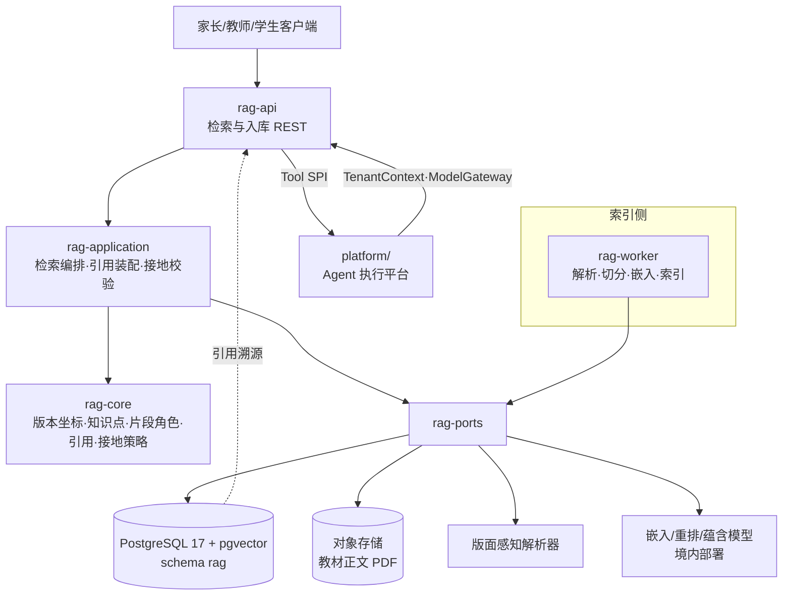
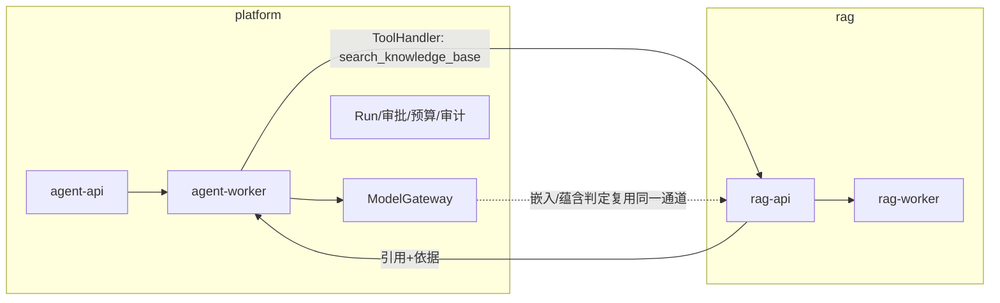
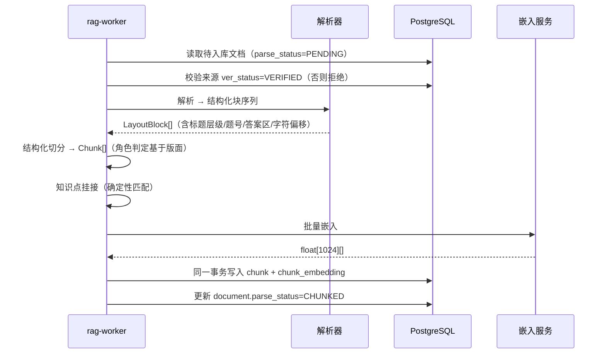
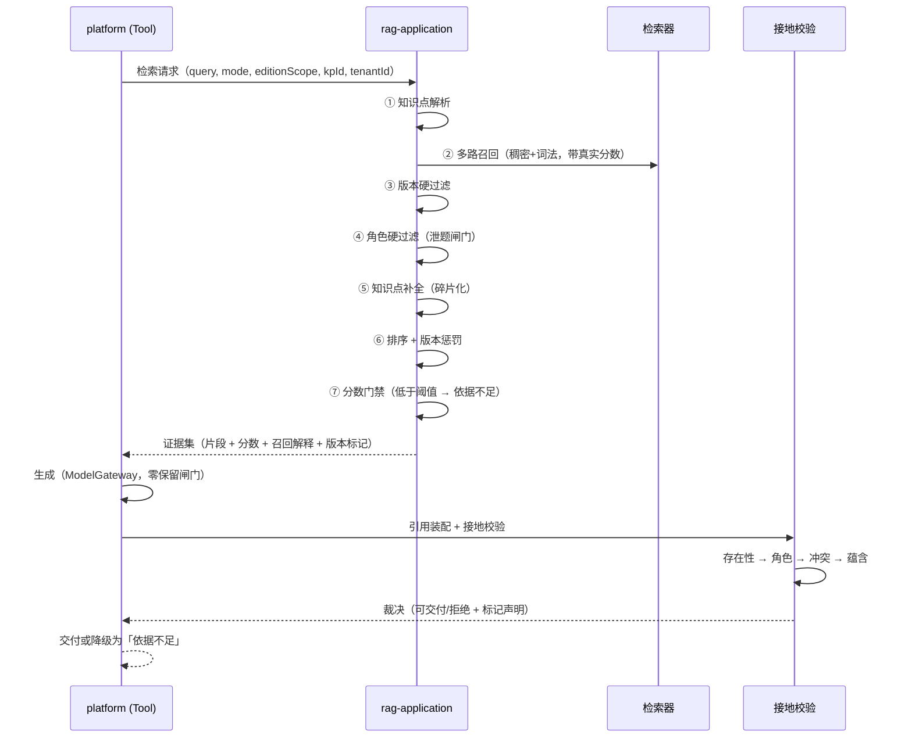

# RAG-D02 总体架构与技术选型

| 字段 | 内容 |
|---|---|
| 文档编号 | RAG-D02 |
| 版本/状态 | v1.0 / 架构基线（待评审） |
| 维护人 | AG-ARC |
| 依据 | RAG-D00 决策基线、主平台 v3.1 架构文档、ADR-011 技术基线 |

---

## 1. 架构总览



### 1.1 与主平台的关系



> ⚠️ **方向是单向的**：`platform/` 调 `rag/`，`rag/` **不回调** `platform/` 的业务接口。
> RAG 需要身份与租户上下文时，由 platform 在请求中传入（`TenantContext`），
> RAG 不自行解析令牌、不自建用户体系。

---

## 2. 模块边界

``` text
rag/
├── rag-core/          # 领域层：版本坐标、知识点本体、片段角色、引用、接地策略
├── rag-ports/         # 端口：检索、嵌入、蕴含判定、文档解析
├── rag-application/   # 用例：检索编排、入库流水线、引用装配与接地校验
├── rag-infrastructure/# 适配器：pgvector 检索、JDBC 持久化、解析器/模型客户端
├── rag-worker/        # 异步：解析、切分、嵌入、索引重建
├── rag-api/           # REST：检索、入库管理、引用查询
├── rag-bootstrap/     # 装配与启动
├── docs/              # 规划文档
└── eval/cases/        # 可执行评测集
```

### 2.1 依赖规则（与主平台同构）

| 规则 | 强制手段 |
|---|---|
| `rag-core` 零框架依赖（仅 JSpecify） | `RagCorePurityTest`（3 项，已跑通） |
| `rag-core` 不依赖 Spring AI / Jackson / JDBC | 同上测试断言 import 黑名单 |
| 领域层不依赖供应商 SDK | 端口接口不含供应商类型 |
| `rag-application` 只依赖 `core` + `ports` | POM 约束 |
| 基础设施不得反向污染领域 | 依赖方向单向 |

> ⚠️ 这条边界的**实际收益**已在主平台 ADR-011 §5 兑现：
> 回滚 Spring Boot 版本时领域层代码零改动。本项目沿用该结构。

---

## 3. 技术选型

### 3.1 存储

| 组件 | 选择 | 版本 | 理由 |
|---|---|---|---|
| 主数据库 | PostgreSQL | **17**（与主平台 DEC-13 一致） | 复用既有运维、备份、监控；RLS 隔离机制已验证 |
| 向量扩展 | pgvector | **≥ 0.8.7** | HNSW 索引；与元数据同事务 |
| 全文检索 | PostgreSQL `tsvector` + 中文分词 | — | 混合检索的词法通道 |
| 对象存储 | 既有企业对象存储 | — | 教材正文不入库 |
| 消息 | RabbitMQ 4.3.6（主平台 DEC-12） | — | **不引入第二套 MQ** |

> ⚠️ **部署要求（实测结论）**：官方 `postgres:17` 镜像**不含 pgvector**。
> 生产与 CI 必须使用 `pgvector/pgvector:pg17` 镜像，
> 或在基础镜像内安装 `postgresql-17-pgvector` 包（实测可用版本 **0.8.7**）。
> 详见 RAG-D00 §5.2。

#### 3.1.1 为什么 pgvector 能承载教辅规模

| 指标 | 估算 | 依据 |
|---|---|---|
| 单册教材页数 | 约 300 页 | 常见 16 开本 |
| 单页平均片段 | 约 8 个（段落/公式/表格/图注/题目） | 结构化切分经验值 |
| 单册片段数 | 约 2 400 | 300 × 8 |
| 一套教材（3 册） | 约 7 200 | |
| 3 学段 × 2 版本 × 6 学科 | 约 **150 万**片段 | 上限估算 |
| 单条 1024 维 float4 向量 | 约 4 KB | 1024 × 4 B |
| 150 万片段向量体积 | 约 **6 GB** | |
| HNSW 索引额外开销 | 约 2～3 倍 | |

> ⚠️ 6 GB 向量 + 索引在 150 万片段量级完全在 pgvector 舒适区内，
> 但**接近需要调优的量级**——故 NFR-RAG-004 要求在 100 万片段做一次实测，
> 而非等到生产才发现。

#### 3.1.2 中文全文检索的注意事项

PostgreSQL 默认分词器**不切分中文**。三条可选路径：

| 方案 | 说明 | 评价 |
|---|---|---|
| `zhparser` / `pg_jieba` 扩展 | 需编译安装 C 扩展 | 质量最好，但**增加部署耦合**（与 R-02「零新增中间件」的克制相悖） |
| **应用层预分词 + `tsvector('simple', ...)`** | 切分在 Java 侧完成，DB 只存已分词文本 | ✅ **本项目选择**：无部署耦合，分词器可独立迭代 |
| 纯向量 + 应用层 BM25 | 词法通道在应用层实现 | 需自行维护倒排，复杂度高 |

> 本项目选择第二种：**Java 侧用统一分词器切分并存入 `text_jieba` 列**，
> DB 侧建 `GIN(to_tsvector('simple', text_jieba))` 索引。
> 词法通道与稠密通道用 **RRF** 融合。

### 3.2 模型

| 能力 | 选择 | 理由 |
|---|---|---|
| 嵌入 | **BGE-M3**（1024 维） | 同时提供稠密/稀疏/多向量；100+ 语言；8192 token；**中英混合**（教材中文 + 论文英文） |
| 重排 | **bge-reranker-v2-m3**（cross-encoder） | 精度显著高于双塔，是召回质量的决定性环节 |
| 蕴含判定 | **判别式 NLI 模型**（与生成模型**不同**） | 见 RAG-D06 §4.2 |
| 生成 | 复用主平台 `ModelGateway` | 零保留闸门、预算、审计已在该通道上 |

> ⚠️ **部署约束**：嵌入与蕴含模型必须**境内部署**（NFR-RAG-008）。
> 理由与主平台 R-017 一致：教材内容虽非学生个人信息，
> 但**学生的提问与薄弱点会进入 Prompt**（RAG 上下文 + 生成请求），
> 故整条链路仍受零保留约束。

### 3.3 文档解析

| 方案 | 能力 | 结论 |
|---|---|---|
| **版面感知解析器**（Docling 类，产出带版面模型的标题/段落/表格/公式树） | 重建表格与阅读顺序 | ✅ **本项目选择** |
| 纯文本抽取（Apache Tika 类） | 输出纯文本/XHTML，**不重建表格与阅读顺序** | 仅作降级兜底 |

> ⚠️ 教辅 PDF 是**密集排版**（双栏、公式、表格、图注、题号），
> 纯文本抽取会破坏阅读顺序，导致「题干与选项被拆散」——
> 这是 RAG-D04 §2 认定的**头号切分风险**。
> 故解析器必须输出**结构化块序列**（`DocumentParserPort.LayoutBlock`），
> 包含标题层级、题号、答案区标识、页码与字符偏移。

---

## 4. 关键流程

### 4.1 入库流程



> ⚠️ **原子性要求**：`chunk` 与 `chunk_embedding` 必须**同一事务**写入。
> 否则会出现「片段已入库但向量未写入」→ 该片段永远召不回（静默漏召回），
> 或反之「向量已写入但片段不存在」→ 脏数据。
> 这是 RD-01 选择 pgvector 的核心原因之一。

### 4.2 检索与生成流程



> ⚠️ **生成与接地校验的边界**：生成由 `platform/` 完成（复用 `ModelGateway`），
> RAG 提供证据集与校验能力。
> 这样安排的收益是：零保留闸门、预算结算、审计留痕**自动覆盖** RAG 上下文，
> 无需在 RAG 侧重复实现一套。

---

## 5. 访问模型

| 主体 | 可检索范围 | 可写范围 | 审计 |
|---|---|---|---|
| 租户管理员 | 本租户全部已校验语料 | 登记/提交语料（不直接改校验状态） | 全部动作 |
| 内容审核员 | 本租户全部语料（含 `UNVERIFIED`） | 校验状态、权威等级、撤回 | `INGEST`/`REVOKE` |
| 教师 | 本租户已校验且达门槛的语料 | 无 | `RETRIEVE`/`CITE` |
| 学生 | 同上，且受 `min_trust_tier` 限制 | 无 | `RETRIEVE`/`CITE` |
| 跨租户 | **一律拒绝** | **一律拒绝** | 拒绝事件亦记录 |

> ⚠️ 门槛由 `rag_tenant.min_trust_tier` 控制，且**只能收紧不能放松**
> （继承主平台 DEC-11 的审批策略纪律）。

---

## 6. 与主平台的接入

### 6.1 接入方式

`rag/` 实现主平台的 `ToolHandler` SPI，主平台注册为 `search_knowledge_base` 工具：

| 项 | 值 |
|---|---|
| 工具名 | `search_knowledge_base` |
| 风险级别 | `READ` |
| 输入 | `query`（必填）、`mode`、`editionScope`、`knowledgePointId`、`topK` |
| 输出 | 证据集（片段 + 位置 + 版本 + 分数 + 召回解释） |
| 幂等 | 只读，无需幂等键 |
| 授权 | 走主平台 `AuthorizationService` + 执行时重新授权 |

> ⚠️ RAG 侧**不重复实现**授权。主平台的授权链（FR-008）在工具执行前已完成，
> RAG 只负责在数据层再按 `tenant_id` 隔离（纵深防御）。

### 6.2 接入前必须完成的主平台改造

见 RAG-D09 §3 接入改造清单（M-1～M-4，含责任方、依赖、顺序与验收判据）。**核心一项**是 `HallucinationDetector` 的判据反转
（详见 RAG-D06 §1）。

---

## 7. 演进路径

| 阶段 | 规模 | 动作 |
|---|---|---|
| 试点 | ≤ 50 万片段 | pgvector 单实例，HNSW 参数 `m=16/ef_construction=64` |
| 灰度 | ≤ 500 万片段 | 调 HNSW 参数；考虑 `ivfflat` 对比；读写分离 |
| 规模化 | > 1500 万片段 | **重开 ADR 评估**是否引入专用向量库；或按学科分库分索引 |
| 多模态 | — | 图形/几何图示的语义检索，另立范围 |

> ⚠️ 触发重评的**硬条件**：
> 1. 片段数超过 1500 万；**或**
> 2. 100 万片段下 P95 延迟 > 500ms 且调优无改善；**或**
> 3. 写入吞吐成为瓶颈（> 1000 chunk/s 持续 10 分钟）。
>
> 满足任一条件即重开 ADR，**不得**在没有评估的情况下继续堆参数。

---

## 8. 已知限制

| # | 限制 | 影响 | 归属 |
|---|---|---|---|
| L-1 | 基础设施层（pgvector 适配器、解析器客户端、模型客户端）**尚未实现** | 检索端口无生产实现 | RAG-D09 阶段 R2（见 RAG-D09 §4.2 R2-1）|
| L-2 | `rag-api` / `rag-worker` / `rag-bootstrap` **仅有骨架目录** | 无可部署制品 | RAG-D09 阶段 R2（见 RAG-D09 §4.2 R2-2）|
| L-3 | 中文分词方案**未实现** | 词法召回通道不可用 | RAG-D09 阶段 R2 |
| L-4 | 嵌入/蕴含模型**未选定具体权重与部署形态** | 阈值无法标定 | RAG-D00 RD-Q3 |
| L-5 | 评测集**未标注** | 阈值全部为初值，未经实测校准 | RAG-D08 |
| L-6 | 与主平台**尚未联通** | 无端到端业务闭环 | 待 A-008 结论 |
| L-7 | pgvector HNSW 在**本机小数据集**上验证，未做规模压测 | 性能目标未验证 | NFR-RAG-004 |
