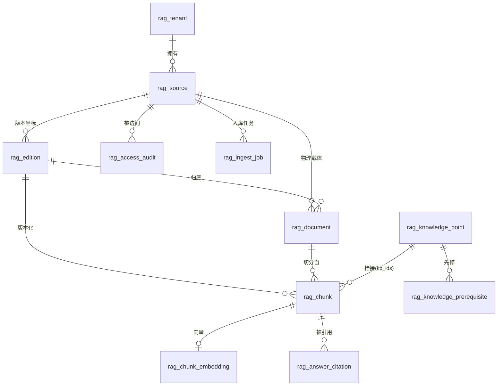
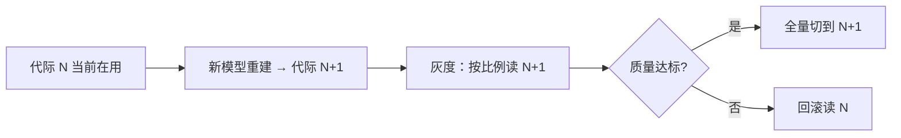

# RAG-D03 数据模型与索引设计

| 字段 | 内容 |
|---|---|
| 文档编号 | RAG-D03 |
| 版本/状态 | v1.0 / 设计基线（已实测） |
| 维护人 | AG-BE + AG-ARC |
| 依据 | RAG-D00 RD-01/RD-03/RD-12/RD-13 |
| 关联文件 | `rag/rag-infrastructure/src/main/resources/db/migration/V1__rag_corpus_baseline.sql` |

---

## 1. 实体关系



### 1.1 为什么是四层而不是三层

| 层 | 回答什么问题 | 为什么不能合并 |
|---|---|---|
| `rag_source` | 这是什么出版物？权威吗？授权吗？ | 校验与版权状态属于**出版物层面** |
| `rag_edition` | 哪一版？哪一册？ | 版本坐标是**教学语义**层面，与物理文件无关 |
| `rag_document` | 哪个物理文件？解析质量如何？ | 同一版本可有**多个载体**（官方电子版 + 扫描版），质量与授权不同 |
| `rag_chunk` | 哪一段？什么角色？ | 检索与引用的最小单位 |

> ⚠️ **合并 source 与 document 的后果**：
> 同一版本的两个载体中，若其中一个被撤回（版权/盗版），
> 合并后无法只下架它——要么影响整个版本，要么留下盗版内容。
> 分层后撤回是**行级操作**。

---

## 2. 表清单

| 表 | 用途 | 关键约束 |
|---|---|---|
| `rag_tenant` | 租户与检索门槛 | `min_trust_tier` 默认 `OFFICIAL_TUTORIAL` |
| `rag_source` | 语料来源登记 | 权威等级与出版标识自洽；`VERIFIED` 须有证据 |
| `rag_edition` | 版本坐标系 | 五轴唯一；跨租户外键 |
| `rag_document` | 物理载体 | 解析状态；对象存储引用 |
| `rag_knowledge_point` | 知识点本体 | 规范名唯一；别名数组 |
| `rag_knowledge_prerequisite` | 先修关系 | 禁止自我先修 |
| `rag_chunk` | 语料片段 | 定位信息完整；跨租户外键 |
| `rag_chunk_embedding` | 向量索引 | `vector(1024)`；与 chunk 复合外键 |
| `rag_ingest_job` | 入库任务 | 工具版本留痕（可复现） |
| `rag_access_audit` | 访问审计 | **追加不可改**（触发器） |
| `rag_answer_citation` | 引用溯源 | 逐字引文非空；版本快照 |

---

## 3. 核心表详解

### 3.1 `rag_source` —— 权威性与版权的载体

```sql
trust_tier     rag_trust_tier NOT NULL DEFAULT 'UNVERIFIED',
ver_status     rag_verification_status NOT NULL DEFAULT 'PENDING',
ver_method     rag_verification_method NOT NULL DEFAULT 'NONE',
ver_evidence   TEXT,
verified_at    TIMESTAMPTZ,
verified_by    UUID,
ver_valid_days INT NOT NULL DEFAULT 365,
license_status TEXT NOT NULL DEFAULT 'PENDING',
object_ref     TEXT,        -- 教材正文在对象存储
content_hash   CHAR(64),    -- 整册校验和
```

**约束（已实测）**：

```sql
CONSTRAINT rag_source_verified_requires_evidence_chk
    CHECK (ver_status <> 'VERIFIED' OR (ver_evidence IS NOT NULL AND verified_at IS NOT NULL)),
CONSTRAINT rag_source_identifier_chk
    CHECK (
        (trust_tier IN ('OFFICIAL_PUBLISHER', 'OFFICIAL_TUTORIAL') AND isbn IS NOT NULL)
     OR (trust_tier IN ('PEER_REVIEWED_PAPER', 'PREPRINT') AND doi IS NOT NULL)
     OR (trust_tier = 'UNVERIFIED')
    )
```

> ⚠️ 第二个约束的意图：**权威等级必须与出版标识自洽**。
> 没有 ISBN 的「官方教材」是不成立的——要么补 ISBN，要么降级为 `UNVERIFIED`。
> 这条约束把「权威性声明」变成了**可被数据库强制的事实**，
> 而不是靠流程自觉。

### 3.2 `rag_edition` —— 五轴版本坐标

```sql
subject       TEXT NOT NULL,
grade         TEXT NOT NULL,
term          TEXT NOT NULL CHECK (term IN ('上册','下册','全一册')),
publisher     TEXT NOT NULL,
revision_code TEXT NOT NULL,
curriculum_ref TEXT,       -- 关联课标
effective_from DATE, effective_to DATE,
CONSTRAINT rag_edition_unique
    UNIQUE (tenant_id, subject, grade, term, publisher, revision_code)
```

> ⚠️ **`effective_to` 不删除旧版**：
> 教材改版是渐进的，同一学校可能两个年级用不同版本，
> 且学生手上的书是确定的。删除旧版 = 部分学生完全查不到。

### 3.3 `rag_chunk` —— 定位与角色

```sql
role         rag_chunk_role NOT NULL,
page_number  INT NOT NULL CHECK (page_number >= 1),
section_path TEXT NOT NULL,
exercise_no  TEXT,
char_start   INT NOT NULL CHECK (char_start >= 0),
char_end     INT NOT NULL,
kp_ids       UUID[] NOT NULL DEFAULT '{}',
exercise_ref TEXT,
content_hash CHAR(64) NOT NULL,
embed_model  TEXT,
index_generation INT NOT NULL DEFAULT 1,
```

**索引**：

```sql
CREATE INDEX rag_chunk_tenant_edition_idx ON rag_chunk (tenant_id, edition_id);
CREATE INDEX rag_chunk_tenant_role_idx    ON rag_chunk (tenant_id, role);
CREATE INDEX rag_chunk_kp_idx             ON rag_chunk USING gin (kp_ids);
CREATE INDEX rag_chunk_document_idx      ON rag_chunk (tenant_id, document_id);
-- ⚠️ 只索引可检索角色：泄题闸门在存储层的第二道防线
CREATE INDEX rag_chunk_retrievable_idx   ON rag_chunk (tenant_id, page_number)
    WHERE role NOT IN ('EXERCISE_ANSWER','EXAMPLE_SOLUTION','BOILERPLATE');
```

> ⚠️ `kp_ids` 用 `UUID[]` + GIN 索引，而非独立关联表。
> 取舍：数组方案查询简单、索引紧凑；关联表方案更规范、可加外键。
> 本项目选择数组，因为知识点挂接是**多对多且无附加属性**的纯关联，
> 且需要「按知识点取全部片段」的高频查询。
> 代价：**无法用外键保证挂接的知识点存在**——
> 故挂接由应用层保证，并在评测中监控（孤儿挂接率）。

### 3.4 `rag_chunk_embedding` —— 向量与代际

```sql
chunk_id        UUID PRIMARY KEY,
tenant_id       UUID NOT NULL,
index_generation INT NOT NULL DEFAULT 1,
embed_model     TEXT NOT NULL,
embedding       vector(1024) NOT NULL,
CONSTRAINT rag_embedding_chunk_fk
    FOREIGN KEY (tenant_id, chunk_id)
    REFERENCES rag_chunk (tenant_id, chunk_id) ON DELETE CASCADE
);

CREATE INDEX rag_chunk_embedding_hnsw_idx
    ON rag_chunk_embedding USING hnsw (embedding vector_cosine_ops)
    WITH (m = 16, ef_construction = 64);
```

> ⚠️ **为什么代际是复合主键的一部分而不是列**：
> 换嵌入模型时，向量空间**完全不可比**（不同模型的余弦距离没有共同语义）。
> 因此新旧向量不能混在一个索引里。
> 代际机制支持：写入新代际 → 灰度切读 → 回滚切回旧代际。
> 见 §5。

### 3.5 `rag_answer_citation` —— 溯源链路终点

```sql
supported_claim  TEXT NOT NULL,
verbatim_quote   TEXT NOT NULL,
verdict          rag_grounding_verdict NOT NULL,
entailment_score REAL NOT NULL CHECK (entailment_score >= 0.0 AND entailment_score <= 1.0),
edition_snapshot JSONB NOT NULL,
```

> ⚠️ `edition_snapshot` 是**快照**不是外键。理由见 RAG-D06 §3.1：
> 语料改版后，历史引用必须仍可解释。

---

## 4. 租户隔离

### 4.1 RLS 策略

全部 11 张表启用 `ENABLE` + **`FORCE`** ROW LEVEL SECURITY：

```sql
CREATE OR REPLACE FUNCTION rag_current_tenant() RETURNS UUID AS $$
    SELECT NULLIF(current_setting('app.tenant_id', true), '')::UUID;
$$ LANGUAGE sql STABLE;

CREATE POLICY rag_chunk_tenant_isolation ON rag_chunk
    USING (tenant_id = rag_current_tenant())
    WITH CHECK (tenant_id = rag_current_tenant());
```

> ⚠️ `set_config(..., is_local=true)` 必须配合事务使用，
> 否则连接池复用会导致租户串扰（主平台 P1-D08 §6 约束 6）。

### 4.2 ⚠️ 实测：超级用户绕过 RLS

**实测结论**（RAG-D00 §5.1）：

| 连接角色 | 租户 1 能否看到租户 2 的数据 |
|---|---|
| `agent`（**超级用户**） | ✅ **能**（RLS 完全不生效） |
| `app_agent`（`NOSUPERUSER NOBYPASSRLS`） | ❌ 不能 |

> ⚠️ `FORCE ROW LEVEL SECURITY` **对超级用户与 `BYPASSRLS` 角色无效**。
> 这与主平台 `P1-D08` §3.6 的 E-3 风险完全一致。

**强制要求**：

| # | 要求 |
|---|---|
| 1 | 生产连接使用 `NOSUPERUSER NOBYPASSRLS` 角色 |
| 2 | 集成测试用非特权角色执行（**不得**用超级用户验证 RLS） |
| 3 | 应用启动时自检连接角色；是特权角色则**拒绝启动** |

> ⚠️ 第 3 条的理由：主平台 P4-D03 记录过「启动不校验 broker 可达致静默积压」
> 这一类**「表面正常、实际失效」**的缺陷。
> RAG 不得重蹈：连接特权化后，系统表面完全正常，
> 但**所有租户隔离形同虚设**——且没有任何报错。

---

## 5. 索引代际与换模型



| 步骤 | 动作 |
|---|---|
| 1 | 新嵌入模型重建**新代际**（不回填旧代际） |
| 2 | 双代际并存，`index_generation` 区分 |
| 3 | 灰度按租户/比例切读 |
| 4 | 达标则切换；不达标则回滚 |

> ⚠️ **禁止原地更新向量列**：新旧模型的向量在同一列中混合后，
> 余弦距离将无意义，且**无法回滚**。
> 这也是 `embed_model` 与 `index_generation` 都要记录的原因。

---

## 6. DDL 实测验证记录

> ⚠️ 只记录**实际执行过**的验证。

| 验证项 | 方法 | 结果 |
|---|---|---|
| 完整 DDL 可执行 | 真实 PG 17.11 + pgvector 0.8.7 | ✅ 11 表 + 全部约束 + 10 条策略 + HNSW 索引 |
| `vector(1024)` 列 | `pg_attribute` 查询 | ✅ 类型正确 |
| HNSW 索引创建 | `pg_indexes` 查询 | ✅ `rag_chunk_embedding_hnsw_idx` |
| 教材等级缺 ISBN 被拒 | `check_violation` | ✅ |
| `VERIFIED` 缺证据被拒 | `check_violation` | ✅ |
| 审计表 UPDATE/DELETE 被拒 | 触发器 | ✅ |
| 自我先修被拒 | `check_violation` | ✅ |
| 跨租户读隔离 | `app_agent` | ✅ |
| 跨租户写隔离 | `app_agent` | ✅ |
| 向量相似度检索 | 真实 `vector` 数据 + `EXPLAIN` | ✅ 余弦距离有区分度（正交向量 0.0 / 1.0） |
| 片段外键约束有效 | 插入不存在的 chunk_id | ✅ 被拒绝 |
| 超级用户绕过 RLS | `agent` vs `app_agent` 对比 | ⚠️ **已确认**——见 §4.2 |

> ⚠️ **规模压测未做**：HNSW 在本机小数据集（2 条）上验证，
> 100 万片段的延迟与召回**未实测**（NFR-RAG-004）。

---

## 7. 已知限制

| # | 限制 | 影响 | 归属 |
|---|---|---|---|
| L-1 | `kp_ids` 用数组，**无外键保护** | 可能存在孤儿挂接 | 需监控 + 应用层保证 |
| L-2 | 无**分词词表表** | 词法通道的倒排需另行设计 | RAG-D09 阶段 R2 |
| L-3 | 无**版本对照表**（跨版本知识点映射） | 跨版本对比功能受限 | 后续范围 |
| L-4 | 无**评测集表** | 评测样本在库外（JSON 文件） | RAG-D08 |
| L-5 | `rag_chunk` **未分区** | 超大规模需考虑按版本/学科分区 | 规模达阈值后评估 |
| L-6 | HNSW 参数 `m=16/ef_construction=64` **未调优** | 召回率与延迟未在真实规模验证 | NFR-RAG-004 |
| L-7 | 无**全文检索索引**（`tsvector` + GIN） | 词法通道未落地 | RAG-D09 阶段 R2 |
