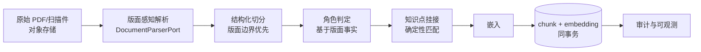
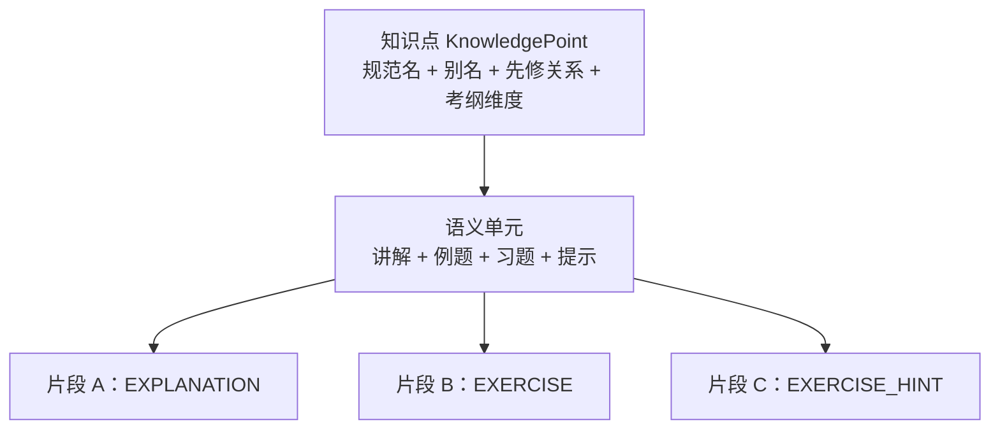

# RAG-D04 教辅数据处理流水线

| 字段 | 内容 |
|---|---|
| 文档编号 | RAG-D04 |
| 版本/状态 | v1.0 / 设计基线（待评审） |
| 维护人 | AG-BE（数据处理）+ AG-ARC |
| 依据 | RAG-D00 RD-03/RD-05/RD-06、RAG-D02 §3.3 |
| 关联代码 | `rag-core/.../ingest/`、`rag-core/.../chunk/`、`rag-core/.../version/`、`rag-core/.../knowledge/` |

---

## 0. 教辅语料与通用语料的五个本质差异

> ⚠️ **本节是全文的问题陈述**。后续所有设计都是对这五条差异的应答。
> 若某项设计无法回指到这五条中的一条，它很可能是不必要的复杂度。

| # | 差异 | 后果 | 对策章节 |
|---|---|---|---|
| **D1** | **版本差异**：同名知识点在不同版本中页码、章节号、结论表述可能不同 | 串版本 → 学生按错误页码翻书 | §2 |
| **D2** | **习题与答案分离**：答案册是独立出版物，答案与题目物理分离 | 召回答案却不知对应哪题；泄题 | §3 |
| **D3** | **知识点碎片化**：同一知识点散落在正文/例题/习题/答案/教辅/论文中 | 只召回一半；答案不完整 | §4 |
| **D4** | **版面语义密集**：双栏、公式、表格、图注、题号、答案区标识 | 切错边界 → 题干散架、答案混入正文 | §5 |
| **D5** | **答案的「可用性」是场景相关的**：同一答案在「讲解」与「核对」中合法性不同 | 泄题（教学事故） | §3.4、§6 |

---

## 1. 流水线总览



| 阶段 | 产出 | 失败模式 | 失败处置 |
|---|---|---|---|
| 解析 | `LayoutBlock[]` | OCR 错、阅读顺序错、公式乱码 | 整册标记 `FAILED`，**不部分入库** |
| 切分 | `Chunk[]` | 边界错位 | 抽检告警，段落级可重切 |
| 角色判定 | `Chunk.role` | 答案区误判 | 人工抽检（§7） |
| 知识点挂接 | `Chunk.kpIds` | 挂错/漏挂 | 确定性匹配 + 评测 |
| 嵌入 | `float[1024]` | 模型超时 | 重试；仍失败则该批不入库 |

> ⚠️ **「整册失败，不部分入库」是刻意选择**。
> 半本教材入库会产生「有些内容能查到、有些查不到」的不一致，
> 而学生与教师无法区分「这本没有」与「没解析出来」——
> 这会把**数据缺失伪装成知识边界**，是比「查不到」更危险的状态。

---

## 2. D1 版本差异的对策

### 2.1 五轴版本坐标系

```java
public record EditionCoordinate(
    Subject subject,      // 学科
    GradeBand grade,      // 年级
    Term term,            // 册次：上册/下册/全一册
    Publisher publisher,  // 出版社/版本体系
    String revisionCode   // 版次：2024修订 / 2012
)
```

> ⚠️ **为什么必须是五轴而不是一个字符串标签**：
> 「人教版七上」无法区分 2012 版与 2024 修订版。
> 而「人教版七上第 45 页」这种引用，若不知道指哪一版，
> 就**无法被机器校验**——只能靠学生自己判断。
> 拆轴后，「版本」成为可分别约束、可分别索引的维度。

**强制约束**（`rag-core` 的 `EditionCoordinate` 构造器 + DDL 共同保证）：

| 约束 | 实现位置 | 实测 |
|---|---|---|
| 缺版次不可构造 | `EditionCoordinate` 紧凑构造器 | ✅ 单测 |
| 版本唯一性 | `rag_edition` 复合唯一约束 | ✅ DB |
| 引用必须带完整坐标 | `Citation` record | ✅ 单测 |

### 2.2 版本范围的三档策略

```java
public enum Mode { STRICT, PREFERRED_WITH_FALLBACK, CROSS_EDITION }
```

| 模式 | 允许范围 | 典型场景 | 非首选版本处理 |
|---|---|---|---|
| `STRICT` | **仅**该版本 | 「按我的书讲」 | 不允许回退 |
| `PREFERRED_WITH_FALLBACK` | 同册其他版次 | 「这个知识点讲了什么」 | 保留但**标注差异** |
| `CROSS_EDITION` | 全部 | 「不同版本编排差异」 | 全部标注，按版本分组 |

> ⚠️ **STRICT 下不允许回退**是刻意的：
> 找不到就说找不到（由上层决定是否追问学生用的哪一版），
> 绝不「找个差不多的版本凑合」——那会让学生按错误的页码翻书，
> 而**按错误页码翻书比明确说「没找到」危害更大**
> （学生会以为是自己找错了，从而放弃核对）。

### 2.3 版本差异检测与提示

当命中内容与学生当前版本不一致时，回答必须显式携带：

```
⚠️ 以下内容来自《人教版·七年级上册·2012》，与你正在学习的《人教版·七年级上册·2024修订》可能不同。
```

> 该提示由 `EditionScope.requiresVersionDisclaimer()` 驱动，
> `RetrievalResult.versionMismatchDetected` 承载结果，
> `RetrievalOrchestrator` 在编排时计算。

### 2.4 教材改版的数据处理

| 场景 | 处理 |
|---|---|
| 出版新版教材 | 新增 `rag_edition` 行（`revision_code` 不同），**旧版保留** |
| 旧版停用 | 置 `effective_to`，**不删除**——学生可能仍在用 |
| 某版本内容有勘误 | 记录勘误表；引用到勘误段落时标注 |

> ⚠️ **旧版必须保留可查**。教辅场景中「换版」是渐进的：
> 同一所学校可能同时存在两个年级使用不同版本，
> 而学生手上的书是**确定**的。删掉旧版等于让部分学生完全查不到。

---

## 3. D2/D5 习题与答案分离的对策

### 3.1 十类片段角色

```java
public enum ChunkRole {
    EXPLANATION,       // 正文：定义、定理、概念讲解
    EXAMPLE,           // 例题正文
    EXAMPLE_SOLUTION,  // 例题解答  ← 答案类
    EXERCISE,          // 习题题干
    EXERCISE_ANSWER,   // 习题答案  ← 答案类
    EXERCISE_HINT,     // 习题提示（不含最终答案）← 教学可用
    PAPER_BODY, PAPER_METHOD,   // 论文
    APPENDIX,          // 术语表、公式表
    BOILERPLATE        // 噪声
}
```

**角色判定基于版面事实，不基于模型**（`IngestionPipeline.resolveRole`）：

| 版面事实 | 判定 |
|---|---|
| `inAnswerZone = true` 且有题号 | `EXERCISE_ANSWER` |
| `inAnswerZone = true` 且无题号 | `EXAMPLE_SOLUTION` |
| 块类型 `EXERCISE` | `EXERCISE` |
| 块类型 `ANSWER` | `EXERCISE_ANSWER` / `EXAMPLE_SOLUTION` |
| 公式/表格/图注且在答案区 | `EXERCISE_ANSWER` |
| 其余 | `EXPLANATION` |

> ⚠️ **为什么不用模型判角色**：模型会把「讲评」误判为「答案」。
> 而两类误判的代价**不对称**：
> 误判为答案 → 泄题（教学事故，Sev-0）；误判为讲解 → 不够具体（Sev-3）。
> 因此宁可过判为讲解，并要求人工抽检。
>
> ⚠️ **勘误（2026-10-20，RAG-D09 片修订）**：上段的**代价方向写反了**，
> 且**结论也随之写反**。以本项目实际的检索期闸门为准：
>
> | 误判形态 | 后果 | 严重度 |
> |---|---|---|
> | 把**答案内容**判成**讲解**（`EXPLANATION`）| `EXPLANATION` **不是**答案类角色 → **会被讲解模式召回** → 标准答案直接进入学生上下文 | **泄题（Sev-0）** |
> | 把**讲解内容**判成**答案类**（`EXERCISE_ANSWER` 等）| 该内容被讲解模式滤掉 → 学生拿不到这段讲解 | 不够具体（Sev-3） |
>
> → **正确结论是「宁可过判为答案类」**（把不确定的内容一律挡在答案侧），
> **不是**「宁可过判为讲解」。
> 依据：`ChunkRole.isAnswerBearing()` 只有 `EXERCISE_ANSWER` / `EXAMPLE_SOLUTION` 为真，
> 而 `RetrievalPolicy.allowsRole` 在 `EXPLAIN` 模式下放行**全部非答案类角色**。
>
> **该勘误有实测证据**：修复前 `IngestionPipeline` 把「答案区 + 无题号」的段落判为
> `EXPLANATION` → 讲解模式下被召回。
> 新增用例 `answerZoneContentNeverSurvivesExplainMode` 把「角色判定 → 检索期过滤」
> 串成一条端到端断言；反证（把判据回退）时该用例精确转红。
> 详见 RAG-D09 §6 与 `IngestionPipelineTest`。

### 3.2 题答配对

```sql
-- rag_chunk.exercise_ref 指向题号
-- 配合 rag_chunk.exercise_no，实现「答案 → 题」的回查
```

| 用途 | 说明 |
|---|---|
| 讲解模式 | 只召回题干与提示，**不召回答案** |
| 解题模式 | 召回题干与提示；标准答案须由模型**推导**后与标准答案比对 |
| 核对模式 | 召回标准答案（唯一允许） |

> ⚠️ **答案片段的「可用性」是模式相关的**（D5）。
> 这就是为什么 `RetrievalRequest` 必须携带 `mode`——
> 同一个问题在不同模式下应该召回不同的内容。

### 3.3 泄题闸门：检索期硬过滤

```java
public static boolean allowsRole(ChunkRole role, RetrievalMode mode) {
    return switch (mode) {
        case EXPLAIN, OVERVIEW -> !role.isAnswerBearing();
        case SOLVE -> role != ChunkRole.EXERCISE_ANSWER;
        case VERIFY -> true;
    };
}
```

> ⚠️ **这是唯一的角色规则来源**（`RetrievalPolicy.allowsRole`），
> 编排层与过滤器都调用它。两处各写一份是「闸门偶发失效」的最常见成因。

**为什么必须在检索期而非生成期**：

| 方案 | 失效形态 |
|---|---|
| ❌ 在 prompt 里说「不要给答案」 | 模型可能以**暗示**形式泄漏（「由上一步可得解为 x=4」）。长上下文中指令可靠性低 |
| ✅ 不把答案放进上下文 | **结构性不可能泄漏** |

> 这与主平台 P3-D09 的 `PromptGuard` 定位完全一致：
> 「检测/隔离是第二道防线，不可颠倒主次」。

### 3.4 存储层的第二道防线

DDL 中 `rag_chunk` 上建有部分索引：

```sql
CREATE INDEX rag_chunk_retrievable_idx ON rag_chunk (tenant_id, page_number)
    WHERE role NOT IN ('EXERCISE_ANSWER', 'EXAMPLE_SOLUTION', 'BOILERPLATE');
```

> ⚠️ 部分索引**不能**替代应用层过滤（它只影响索引扫描，不阻止查询返回），
> 但它让「按租户+页码扫可检索内容」这类查询在**存储层**就够不到答案类数据——
> 属于纵深防御的第二层。

### 3.5 提示（Hint）作为教学折中

`EXERCISE_HINT` 是本设计的关键中间态：**给方向，不给结果**。

| 内容 | 允许在 EXPLAIN 模式 | 说明 |
|---|---|---|
| 「提示：先配方化为顶点式」 | ✅ | 揭示方法，不揭示答案 |
| 「解：配方得 y=(x-2)^2-1，故顶点 (2,-1)」 | ❌ | 完整答案 |

> ⚠️ 提示语料的获取有难度：多数教辅的答案册只有答案没有提示。
> 缺提示时，正确行为是**只给题干 + 指向教材相关知识点**，
> 而非让模型自己编一个「提示」（编的提示可能误导）。

---

## 4. D3 知识点碎片化的对策

### 4.1 三层结构



| 层 | 作用 | 存储 |
|---|---|---|
| **知识点层** | 版本无关的语义骨架 | `rag_knowledge_point` |
| **片段层** | 版本相关的物理载体 | `rag_chunk`（`kp_ids` 多对多） |

> ⚠️ **知识点必须是版本无关的**：
> 「二次函数顶点」这个概念在 2012 版和 2024 版都存在，
> 但它在两版中的**位置**不同。把它建成版本无关的抽象层，
> 才能在版本切换时保持「同一个知识点，不同版本的位置」这一自然结构。

### 4.2 别名是召回质量的关键

```java
public record KnowledgePoint(
    String id, String subject, String grade,
    String canonicalName,        // 规范名：二次函数顶点坐标
    List<String> aliases,        // 别称：抛物线顶点 / 顶点式 / y=a(x-h)^2+k 的顶点
    List<String> prerequisites,  // 先修：配方
    List<Facet> facets           // 考纲维度
)
```

> ⚠️ **别名缺失造成的漏召回不会表现为「答错」，而表现为「少」**——
> 在评测中极易被漏检。因此别名表是**必须建设**的资产，不是可选优化。
> 建议从三处采集：教材目录与正文标题、教辅目录、历年真题题干。

### 4.3 知识点补全

```java
RetrievalPolicy.applyKnowledgePointCompletion(chunks, siblings, request)
```

| 条件 | 行为 |
|---|---|
| 请求已指定知识点 | 补入该知识点下尚未召回的片段（讲解 + 练习 + 提示） |
| 补全片段的角色 | **同样受泄题闸门约束** |
| 未指定知识点 | 不触发补全 |

> ⚠️ 补全引入的片段使用**独立基准分**（`COMPLETION_BASE_SCORE = 0.5`），
> 必须低于典型命中分，否则补全内容会挤掉直接命中的高价值片段。

### 4.4 先修关系：解释「为什么不会」

学生的错误常源于先修知识缺口。`prerequisites` 使系统能回答：
「你顶点公式记不住，是因为配方的『配方』环节不熟」。

> ⚠️ 先修关系不得成环（DB 拒绝自我先修，应用层拒绝环）。
> **先修关系的准确性需要人工评审**——错误的关系会给出误导性诊断，
> 比不给诊断更糟。

---

## 5. D4 版面语义密集的对策

### 5.1 结构优先，语义兜底

| 条件 | 切分策略 |
|---|---|
| 版面结构可得（标题层级、题号、答案区） | **按结构边界切** |
| 结构不可得 | 带**重叠**的固定窗口切分 |

> ⚠️ 固定窗口的致命碎片化（教学事故级）：
> - 题干与选项被切开 → 检索到半截题；
> - 答案与解析被切开 → 泄题或错配；
> - **定义与其适用条件被切开** → 检索到「三角形内角和等于 180°」
>   却漏掉「在<b>平面内</b>的三角形」这个前提 → 空间几何题答错。
>
> 最后一条尤其隐蔽：召回的片段**看起来完全正确**，
> 错误在于被省略的前提。重叠窗口是对此的兜底。

### 5.2 必须保留的定位信息

```java
public record Locator(
    int pageNumber,     // 物理页码
    String sectionPath, // 章节路径：第3章 > 3.2 二次函数的图像
    String exerciseNo,  // 题号
    int charStart, int charEnd  // 页内字符偏移
)
```

> 这四项共同构成**引用的可核对性**：
> 学生能翻到那一页、那一题；审计者能取回原文逐字比对。

### 5.3 章节路径的推进规则

`IngestionPipeline.updateSectionPath` 按标题层级**截断**而非追加：

```
第3章           →  [第3章]
  3.1           →  [第3章, 3.1]
    3.1.1       →  [第3章, 3.1, 3.1.1]
  3.2           →  [第3章, 3.2]      ← 截断，不是追加成 [第3章,3.1,3.1.1,3.2]
```

> ⚠️ 追加会产出「第3章 > 3.1 > 3.1.1 > 3.2」这种错误路径，
> 在引用展示时会让学生找不到对应位置。

---

## 6. 数据质量的人工抽检

> ⚠️ 自动化指标无法覆盖「角色判定对不对」「知识点挂得准不准」这类语义判断，
> 必须有人工抽检。参照主平台 ISO-5 纪律。

| 抽检项 | 抽样比例 | 合格线 | 不合格处置 |
|---|---|---|---|
| 答案区识别准确率 | 每册随机 20 段 | ≥ 95% | 该册重解析；连续两册不合格则暂停入库 |
| 题号保留率 | 每册随机 20 段 | 100% | 同上 |
| 公式保留完整率 | 每册随机 20 段 | ≥ 90% | 同上 |
| 知识点挂接准确率 | 每册随机 20 段 | ≥ 90% | 调整别名表或挂接规则 |
| 版本坐标正确率 | 每册随机 10 段 | 100%（ Sev-0 级） | **该册全部重挂** |

> ⚠️ 版本坐标正确率要求 100%，因为串版本是 Sev-0；
> 其余项允许一定误差，因为可通过抽检持续改进。

---

## 7. 已知限制

| # | 限制 | 影响 | 归属 |
|---|---|---|---|
| L-1 | 解析器**未实现**，仅有端口契约 | 无生产可用的结构化块 | RAG-D09 阶段 R1（见 RAG-D09 §4.1 R1-1；门禁 G1）|
| L-2 | `EXERCISE_HINT` 语料**无稳定来源** | 解题模式可能只能给题干+知识点 | 需与教辅出版方洽谈 |
| L-3 | 知识点挂接为**纯确定性匹配**，无语义抽取 | 跨句/隐含的知识点会漏挂 | 后续引入低置信模型辅助 |
| L-4 | 别名表**未建设** | 别名召回未经验证 | 需人工采集（§4.2） |
| L-5 | 人工抽检**未执行** | 质量基线未知 | RAG-D08 |
| L-6 | 答案区识别在**扫描件**上的表现未验证 | 扫描教材可能识别率显著下降 | 需实测 |
| L-7 | 跨文档的题答配对（答案册↔教材）**未实现** | 答案与题目的配对目前依赖题号文本 | 需题号规范化 |
