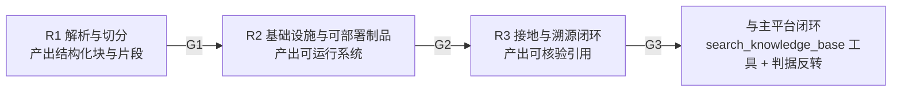

# RAG-D09 阶段门禁与主平台接入计划

| 字段 | 内容 |
|---|---|
| 文档编号 | RAG-D09 |
| 版本/状态 | v1.0 / **设计基线（待评审）** |
| 维护人 | AG-ARC 起草 / zhouwei 批准 |
| 依据 | RAG-D00 §0/§2/§6（RAG-D14）、RAG-D02 §6、RAG-D04 §3/§5、RAG-D06 §1、RAG-D07 §10、RAG-D08 §6/§8；主平台 `P0-D00` DEC-5、`P3-D11` |
| 关联 | 承接 **8 处**悬空引用（RAG-D00 ×4、RAG-D02 ×2、RAG-D04/RAG-D06/RAG-D07/RAG-D08 ×N）——见 §0.3 |

---

## 0. 文档定位

### 0.1 本片交付什么、不交付什么

| 本片交付 | 本片**不**交付 |
|---|---|
| **R1/R2/R3** 三个建设阶段的进入/退出条件 | 任何阶段的**实际完成结论** |
| **G1/G2/G3** 三道阶段门禁的通过条件、证据要求与签署人 | 门禁已通过的签署记录 |
| **M-1～M-4** 主平台接入改造清单（承接 RAG-D06 §1.4）| 改造代码本身（属主平台 `platform/`）|
| 阶段与 RAG-D08 评测门禁（SG-1～SG-6 / CI G-1～G-9）的**分工映射** | 评测基础设施本身（属 RAG-D08）|
| 首批语料接入的前置条件（N-1～N-3，承接 RAG-D07 §10.4）| 语料本身与授权文件 |
| **§6 工具链已知缺陷与规避**（含可执行复现步骤与实测结论）| 工具链本身的修复 |

> ⚠️ **诚实边界（与 RAG-D08 §0.1 / 主平台 P3-D11 §2.2 同构）**：
> 本片交付的是**阶段划分 + 门禁定义 + 接入改造清单**，
> **不是**「某阶段已完成」或「某门禁已通过」这个结论。
> 当前**三道门禁全部未通过**（见 §2.4），本片不产出任何通过结论。

### 0.2 为什么现在写这一片

RAG 子项目已完成 D00～D08 共 9 份文档，但 **RAG-D09 被 8 处引用却始终不存在**，
导致以下悬空：

| 悬空引用 | 指向的缺失内容 | 后果 |
|---|---|---|
| RAG-D00 §0（接入主平台需待 A-008）| §2 阶段门禁 **G3** | 无法判断「何时可接入主平台」 |
| RAG-D00 §0 / §2 RD-14 · RAG-D02 §6.2 · RAG-D06 §1.4 L-6 | §3 接入改造清单 **M-1～M-4** | 改造范围与责任方不明 |
| RAG-D04 §7 L-1（解析器未实现）| **阶段 R1** | 缺陷归属无处落地 |
| RAG-D02 §8 L-1/L-2/L-3（infra 未实现、无可部署制品、分词未实现）| **阶段 R2** | 同上 |
| RAG-D06 §7 L-1/L-3/L-7（蕴含/冲突判定无实现、端到端可回溯未实测）| **阶段 R3** | 同上 |
| RAG-D08 §6.3（L-12）、§8.2 | 阶段门禁 **G1～G3** 的内容 | 评测门禁与阶段门禁关系不明 |
| RAG-D07 §10.5 / §10.4 尾注 | N-1/N-2 排入阶段计划 | 首批语料接入的前置未排期 |
| `BlockType` / `LayoutBlock` 的 Javadoc | **§6 工具链已知缺陷与规避** | 规避规则的依据无处可查 |

### 0.3 ⚠️ 命名消歧：本项目已有**三套** G 编号

> 这是本片写作过程中实测发现的**文档级冲突风险**，必须先消歧，否则「G-1 通过」这类表述
> 在本项目内可以指**三件完全不同的事**。

| 编号体系 | 定义处 | 含义 | 门禁类型 |
|---|---|---|---|
| **G-1～G-5** | RAG-D07 §2.3.1 / §7 | 语料**准入闸门**（校验状态 / 过期 / 权威等级 / 撤回 / 审计）| 子项目**内部**门禁 |
| **G-1～G-9** | RAG-D08 §6.2 | **CI 门禁**（不变式 G 类 / 回归 R 类 / 观察 O 类 / 人工 M 类）| 持续集成门禁 |
| **SG-1～SG-6** | RAG-D08 §6.3 | 评测体系的**阶段验收标准** | 评测侧阶段验收 |
| **G1/G2/G3**（本片）| **本文 §2** | RAG 子项目的**建设阶段门禁** | 阶段验收 |

> ⚠️ RAG-D07 §7 已自带一句声明：「本文档的门禁 G-1～G-5 是**子项目内部**门禁，
> 不等于主平台阶段门禁」——本片沿用该立场，并**规定**：
> 本文的阶段门禁一律写作 **G1/G2/G3（无连字符）**，
> 其余三套一律保留原有连字符写法。**跨文档引用时必须带出处**，
> 裸写「G-1」视为**引用不完整**。

---

## 1. 阶段划分总览

### 1.1 三个阶段与三道门禁

| 阶段 | 主题 | 承接的已知限制 | 门禁 |
|---|---|---|---|
| **R1** | 解析与切分 | RAG-D04 L-1（解析器未实现）、L-3/L-4（挂接为纯确定性匹配、别名表未建设）| **G1** |
| **R2** | 基础设施与可部署制品 | RAG-D02 L-1（infra 未实现）、L-2（api/worker/bootstrap 仅骨架）、L-3（分词未实现）| **G2** |
| **R3** | 接地与溯源闭环 | RAG-D06 L-1（蕴含判定无实现）、L-3（冲突检测无实现）、L-7（端到端可回溯性未实测）| **G3** |

### 1.2 为什么是这三刀

> ⚠️ **切分原则**：按「**可独立验收的交付物**」切分，而不是按「代码模块」切分。
> R1 产出「结构化语料」，R2 产出「可运行的检索系统」，R3 产出「可核验的引用」——
> 三者各自都有**可运行的验收方式**与**可指认的失败模式**。

| 切点 | 为什么在这里切 | 切错的后果 |
|---|---|---|
| R1 \| R2 | 切分结果**不依赖**向量库与模型即可验收（版面块 + 片段 + 角色 + 定位）| 若把 infra 与切分放同阶段，切分的正确性会被 infra 的未完成**掩盖**（无法独立验收）|
| R2 \| R3 | 检索系统**不依赖**真实模型即可验收（召回 + 硬过滤 + 排序 + 门禁）| 把接地判定混入 R2，则「召回不准」与「接地过松」两类问题**互相掩盖** |
| R3 \| 主平台 | 引用可核验性**必须先在 RAG 内部闭环**，才能安全地接进主平台 | 反过来做 = 主平台先接受无法核验的引用，再回头补验证 |

> ⚠️ **与主平台 P4 的关系**：RAG 各阶段**不占用**主平台 P4 排期
> （RAG-D00 §0 已确立「可独立建设、可独立验收的 RAG 子系统」定位）。
> 只有 **G3 之后**的接入改造（M-1～M-4）才落在主平台 `platform/` 侧。

---

## 2. 阶段门禁 G1 / G2 / G3

### 2.1 G1 —— 解析与切分门禁（R1 → R2）

| 项 | 内容 |
|---|---|
| **目的** | 证明「教辅语料被正确地变成可检索、可定位、可判角色的片段」 |
| **通过条件** | ① `DocumentParserPort` 有**生产实现**（非 mock），且对**至少 1 册**真实教辅 PDF 产出结构化块； ② 切分不变式有**自动化证据**：噪声块丢弃、题号保留、章节路径层级截断、答案区角色判定**逐条有反证**； ③ 章节路径与字符区间**可回取原文**（随机抽 20 段，人工核对页码与位置全对）； ④ 答案区识别准确率 ≥ 95%（RAG-D04 §6 人工抽检口径），且**漏判率为 0**（漏判 = 泄题，单独一票否决）； ⑤ RAG-D07 N-1（N-2/V2 迁移）**已实施**——未校验语料不得入库（见 §4.3）|
| **证据形式** | 自动化测试报告 + 人工抽检记录（判定人 / 日期 / 片段 ID / 正确角色 / 错误类型）|
| **签署人** | 项目负责人 + 独立评审（**不得**为 R1 实施方）|
| **当前状态** | 🔴 **未通过**——RAG-D04 L-1 解析器未实现；L-4 别名表未建设；RAG-D07 N-1 未实施 |

> ⚠️ **G1 的「漏判率为 0」是单点否决项**：RAG-D04 §6 允许答案区识别准确率 ≥ 95%（含过判），
> 但**漏判**（答案被判成讲解）会直接导致泄题，**不能用 95% 的平均准确率抵偿**。
> 这是本片对 RAG-D04 §6 的一处**收紧**（判据只增不减，RAG-D00 §3 原则 7）。

### 2.2 G2 —— 基础设施与可部署制品门禁（R2 → R3）

| 项 | 内容 |
|---|---|
| **目的** | 证明「检索系统可运行、可部署、可扩展」 |
| **通过条件** | ① `rag-infrastructure` 有生产实现：pgvector 适配器、词法通道、中文分词、解析器客户端、模型客户端； ② `rag-api` / `rag-worker` / `rag-bootstrap` **有可部署制品**（不再是空目录），且 `rag-bootstrap` 能启动并自检通过； ③ 启动自检**已实现**（RAG-D07 N-5）：连接角色非特权、pgvector 存在、语料为空时明确 fail-closed 而非静默放行； ④ RAG-D00 §5.1 的 RLS 隔离用**非特权角色**实测通过（超级用户会绕过 RLS）； ⑤ 端到端检索（入库 → 召回 → 硬过滤 → 排序）跑通**合成夹具**，耗时与召回率有基线快照|
| **证据形式** | 可部署制品 + 启动自检日志 + 隔离反证（用超级用户跑必失败、用非特权角色跑必通过）|
| **签署人** | 项目负责人 + DBA/安全 |
| **当前状态** | 🔴 **未通过**——RAG-D02 L-1/L-2/L-3 全部未实施；RAG-D07 N-5 未实施 |

### 2.3 G3 —— 接地、溯源与主平台闭环门禁（R3 → 接入主平台）

| 项 | 内容 |
|---|---|
| **目的** | 证明「回答里的每条引用都可核验，且与主平台的判据不冲突」 |
| **通过条件** | ① **C1 存在性**在真实链路上实测：引文是片段子串、版本坐标一致、跨租户引用被拒（反证至少 1 条）； ② **C2 可支撑性**有实现：`EntailmentPort` 有生产实现，蕴含判定的**准确率**有评测集支撑（不得只断言「调用过」）； ③ **C3 无冲突**有实现且有反证； ④ 端到端可回溯性实测：**回答 → 声明 → 引用 → 片段 → 位置 → 来源** 全链路可回取（RAG-D06 L-7）； ⑤ **M-1～M-4 主平台改造全部完成**（§3），且 **M-4 硬约束**成立：主平台 P3-D11 的旧断言在无 RAG 模式下**仍全绿**； ⑥ RAG-D08 的 **SG-1～SG-3、SG-5** 通过（评测基础设施 + 不变式门禁 + 回归基线 + 规模实测）； ⑦ ⚠️ **主平台 A-008 评测结论已产出**（RAG-D00 §0 DEC-5 重新纳入条件）； ⑧ RAG-D08 **SG-4/SG-6**（人工评审量表 + 端到端质量结论）由**非实施方**签署 |
| **证据形式** | 端到端回溯演示 + 主平台 PR 记录（旧断言全绿）+ 独立评审签署记录 |
| **签署人** | 项目负责人 + 独立评审（**不得**为 RAG 或主平台实施方）+ 主平台安全负责人 |
| **当前状态** | 🔴 **未通过**——A-008 结论**未产出**（RAG-D00 §0）；M-1～M-4 **未实施**；RAG-D06 L-1/L-3/L-7 未关闭；RAG-D08 SG-1～SG-6 **全部未产出** |

> ⚠️ **G3 的 ⑦ 项是硬阻断**：DEC-5「首期不做 RAG」是主平台决策基线，
> 其**重新纳入条件**由 A-008 结论把关。
> **在 A-008 产出前，即使 RAG 本侧全部完成，也不得接入主平台**——
> 这不是保守，而是**决策基线的纪律**（主平台 P0-D00 DEC-1～13 全部闭环才构成基线）。

### 2.4 门禁状态总表

| 门禁 | 主题 | 关联的已知限制 | 通过条件条数 | 已满足 | 状态 |
|---|---|---|---|---|---|
| **G1** | 解析与切分 | RAG-D04 L-1/L-3/L-4、RAG-D07 N-1 | 5 | 0（**R2 缺失 1 项**，其余未开工）| 🔴 未通过 |
| **G2** | 基础设施与可部署制品 | RAG-D02 L-1/L-2/L-3、RAG-D00 §5.1、RAG-D07 N-5 | 5 | 0 | 🔴 未通过 |
| **G3** | 接地、溯源与主平台闭环 | RAG-D06 L-1/L-3/L-7、RAG-D00 A-008、RAG-D08 SG-1～SG-6 | 8 | 0 | 🔴 未通过 |

> ⚠️ **「已满足 0」不是评价工作量，而是评价证据**：
> 三道门禁的通过条件**全部**依赖尚未产出的证据。
> 本片的作用是把「什么算通过」写死，使得**未通过**这一状态**可核验、可追踪**，而不是模糊的「还没做完」。

---

## 3. 主平台接入改造清单 M-1～M-4

### 3.0 阶段门禁 ↔ 主平台接入的对应关系

> RAG-D07 §1.2 曾把「阶段门禁与主平台接入的对应关系」指向本节。
> 对应关系如下——**只有 G3 通过后**，本节的改造才有意义：

| 阶段门禁 | 是否允许触碰主平台 | 理由 |
|---|---|---|
| G1（解析与切分）| ❌ **不允许** | 切分正确性未证明时，接入主平台等于把未验证的语料喂给学生 |
| G2（基础设施与可部署制品）| ❌ **不允许** | 无可部署制品 = 无端到端链路 = 接入即「工具能调但什么都不返回」 |
| **G3（接地、溯源与主平台闭环）** | ✅ **本门禁通过后才允许** | 引用可核验性 + 判据反转完成，且 **A-008 结论已产出** |

> ⚠️ **G3 通过 ≠ 立即接入**：还需主平台侧排期与 RAG-D08 SG-4/SG-6 的人工签署。
> 本表回答的是「**哪一道门禁之后才允许开始动主平台**」。

### 3.1 改造内容

> 承接 RAG-D06 §1.4 的清单，本片补充**责任方、依赖、验收判据与顺序**。
> ⚠️ 改造代码落在主平台 `platform/`，**不在本子项目内**；
> 本片只定义改造**内容与判据**，不实施。

| # | 改造 | 位置 | 责任方 | 依赖 | 验收判据 |
|---|---|---|---|---|---|
| **M-1** | `HallucinationDetector` 增加**模式开关**（无语料 Run 走旧判据；有语料 Run 走新判据）| 主平台 `agent-application` | AG-BE + AG-AI | G3 ① ③ | 旧判据在**无 RAG 模式**下行为**逐字节不变**（P3-D11 的 14 项断言全绿）|
| **M-2** | 新增 `GroundedCitationVerifier`，校验 **C1/C2/C3**（存在性 / 可支撑性 / 无冲突）| 主平台 `agent-application` | AG-AI + AG-SEC | RAG 的 `GroundingService` | ① C1 三项子判定各有反证；② C2 蕴含判定**不是**「调用过」而是「准确率有评测集支撑」；③ C3 有反证 |
| **M-3** | `RunExecutionLoop` 提交前检查**分级**：有 RAG 引用 → 走 `GroundedCitationVerifier`；无 → 走旧检测器 | 主平台 `agent-worker` | AG-BE | M-1、M-2 | 两条分支各有**分支选择**的反证（注入 RAG 引用必须走新分支，注入普通内容必须走旧分支）|
| **M-4** | ⛔ **回归测试不得删除旧用例** | 主平台 `agent-application` | 全体 | — | P3-D11 的 E-3～E-7「注入内容不得豁免」用例**仍全绿** |

> ⚠️ **M-4 是硬约束，不是建议**：
> 若为了支持 RAG 而让**注入内容**能骗过检测器，那是**安全退化**
> （主平台 P1-D08 风险 I-5「模型编造出处」的直接回归）。
> **改造的正当性来自「判据变强」**（模式匹配 → 存在性+蕴含+冲突），
> 而不是「放宽规则」——见 RAG-D06 §1.2。

### 3.2 改造顺序与不可并行项

| 顺序约束 | 理由 |
|---|---|
| M-1 必须**先于** M-2 | 没有模式开关，新校验器无法与旧判据共存 |
| M-2 必须**先于** M-3 | 分级提交前检查需要两个可调用的校验器 |
| **M-4 全程并行** | 它不是一步，而是**对每一步的持续约束** |

> ⚠️ **M-1～M-4 全部完成后仍不得接入**：还需 G3 ⑦（A-008 结论）。
> 改造完成 ≠ 允许接入——**这是两件事**。

---

## 4. 阶段计划与前置条件

### 4.1 R1（解析与切分）→ G1

| # | 工作项 | 依赖 | 关闭的限制 |
|---|---|---|---|
| R1-1 | 实现 `DocumentParserPort` 生产实现（PDF 版面解析）| — | RAG-D04 L-1 |
| R1-2 | 别名表建设（教材目录 / 教辅目录 / 真题题干三处采集）| R1-1 | RAG-D04 L-4 |
| R1-3 | 切分不变式**反证**补齐（噪声丢弃 / 题号保留 / 路径截断 / 答案区判定）| — | RAG-D04 L-3 |
| R1-4 | **RAG-D07 N-1**：V2 迁移（来源级 + 载体级状态冗余列、`ON DELETE CASCADE`→`RESTRICT`、`license_status` 改枚举）| — | RAG-D07 L-2/L-3、RAG-R03/04/05/20 |

### 4.2 R2（基础设施与可部署制品）→ G2

| # | 工作项 | 依赖 | 关闭的限制 |
|---|---|---|---|
| R2-1 | `rag-infrastructure`：pgvector 适配器 / 词法通道 / 中文分词 / 解析器客户端 / 模型客户端 | R1-1 | RAG-D02 L-1、L-3 |
| R2-2 | `rag-api` / `rag-worker` / `rag-bootstrap` 落地为可部署制品 | R2-1 | RAG-D02 L-2 |
| R2-3 | 启动自检（非特权角色 / pgvector 存在 / 语料为空时 fail-closed）| R2-2 | RAG-D07 N-5、RAG-R08/09 |
| R2-4 | RLS 隔离用**非特权角色**实测 + 超级用户绕过的反证留档 | R2-1 | RAG-D00 §5.1 |

### 4.3 R3（接地与溯源）→ G3

| # | 工作项 | 依赖 | 关闭的限制 |
|---|---|---|---|
| R3-1 | `EntailmentPort` 生产实现 + 蕴含准确率评测 | R2-1、**A-008** | RAG-D06 L-1 |
| R3-2 | 冲突检测（C3）实现 + 反证 | R3-1 | RAG-D06 L-3 |
| R3-3 | 端到端可回溯性实测（回答→声明→引用→片段→位置→来源）| R3-1/R3-2 | RAG-D06 L-7 |
| R3-4 | **M-1～M-4** 主平台改造（§3）| R3-3 | RAG-D06 L-6 |
| R3-5 | **RAG-D08 SG-1～SG-6** 全部通过 | R3-3 | RAG-D08 L-12、§8.2 全部 |

### 4.4 首批语料接入的前置（RAG-D07 §10.5 的硬前置）

> RAG-D07 尾注明确：「N-1（V2 迁移）与 N-2（查询期/入库期闸门）
> 应作为**首批语料接入的前置**排入 RAG-D09 阶段计划」。本节即为该排期。

| 前置 | 内容 | 排期落点 | 阻断什么 |
|---|---|---|---|
| **N-1** | V2 迁移 | **R1-4**（G1 条件⑤）| 首批语料入库 |
| **N-2** | 查询期权威闸门 + 入库前置闸门 | R1-4 之后、G1 之前 | 首批语料**可检索** |
| **N-3** | 过期判定 + 到期扫描 + 提前提醒 | R2 阶段内 | 过期语料仍在库 |
| **N-10** | 补跑 `rag_document` 的 DDL 约束反证 + 跨租户隔离，**并同步 RAG-D00 §5 的表数基线**（10 表 → **11 表**）| R1 阶段内 | 基线可信度 |

> ⚠️ **N-10 是本片新识别的一项基线漂移**：
> RAG-D07 §2 已记载「当前 V1 为 11 表 / 10 条 RLS 策略」，
> 而 RAG-D00 §5 的实测记录仍写「10 表 + 10 条 RLS 策略」——
> **D00 的实测证据不覆盖新增的 `rag_document` 表**。
> 在基线更正前，**不得**引用 RAG-D00 §5 作为「表数已验证」的证据。

---

## 5. 与 RAG-D08 评测门禁的分工

> RAG-D08 §6.3 声明：「本片与 RAG-D09 的阶段门禁（G1～G3）的关系由 RAG-D09 定义，
> 本片**不预设**其内容。」本节即为该关系的定义。

| 维度 | RAG-D08 的门禁 | RAG-D09 的 G1/G2/G3 |
|---|---|---|
| 回答的问题 | 「**指标**是否达标」 | 「**阶段**是否可交付」 |
| 载体 | CI 门禁（G-1～G-9）+ 阶段验收（SG-1～SG-6）| 阶段门禁（G1/G2/G3）|
| 判定方式 | 自动化断言 + 人工评审量表 | 交付物清单 + 抽检记录 + 签署 |
| 阻断范围 | 阻断 PR / 阻断阶段验收 | 阻断**阶段推进**与**主平台接入** |
| 签署人 | 独立评审（非实施方）| 项目负责人 + 独立评审 |

### 5.1 门禁与阶段的对应

| 阶段门禁 | 依赖的 RAG-D08 门禁 | 依赖的 CI 门禁（G-1～G-9）|
|---|---|---|
| **G1** | SG-1（评测基础设施就绪）| **G-5 切分完整**（IDX-01/02/06）|
| **G2** | SG-3（回归门禁生效）| G-6 召回回归、G-9 权威门槛 |
| **G3** | SG-2、SG-4、SG-5、SG-6 **全部** | G-1 版本零串扰、G-2 泄题零污染、G-3 引用可核验、G-4 拒答合法、G-8 装饰性引用上限 |

> ⚠️ **G3 依赖 SG-4/SG-6 是有意的**：
> SG-4（人工评审就绪）与 SG-6（端到端质量结论）**只有人工能产出**，
> 且评审人**不得为实现方**（RAG-D08 §1.3）。
> 因此 **G3 是本项目唯一一道「机器无法自行通过」的门禁**——
> 这是设计，不是缺陷。

---

## 6. 工具链已知缺陷与规避

> `BlockType` 与 `LayoutBlock` 的 Javadoc 均指向本节。
> 本节给出**可执行复现步骤**与**本项目实测结论**。

### 6.1 缺陷描述（来源：`BlockType` 类注释）

JDK 21.0.12 的 javac 存在一个可复现的符号解析缺陷：

| 环节 | 机理 |
|---|---|
| 触发条件 | 某个 **classfile**（而非源码）持有 `getstatic <某枚举>.CONST` 形式的枚举常量引用 |
| 机理 | javac 为该常量在枚举的成员表里写入一个**不带 `ACC_ENUM` 标志的占位成员** |
| 症状 | 枚举常量查找要求该标志 → 后续源码按名引用同一常量时报 **`找不到符号 / 位置: 类 XxxEnum`**，**即使该 classfile 确实含全部常量** |
| 放大条件 | `LayoutBlock` 类注释补充：当编译单元**同时导入**外层类型 `X` 与其嵌套类型 `X.Nested` 时，javac 会提前「完成」`X`；若 `X.Nested` 持有某枚举类型的字段，该枚举被登记为「仅读取了类文件头部」的依赖符号，**成员表始终为空** |

### 6.2 已固化的规避规则

| # | 规则 | 落地方式 | 自动化守卫 |
|---|---|---|---|
| **T-1** | **枚举内部的自引用安全** → 判定语义写成枚举的**实例方法**（`isHeading()` / `isNoise()`）| `BlockType.isHeading()` / `isNoise()`；`IngestionPipeline` 只调实例方法，**不写** `type == BlockType.HEADING` | `ChunkRole`/`BlockType` 的调用点均走实例方法 |
| **T-2** | **任何其它 classfile 不得持有指向本枚举常量的 getstatic 引用** → 消费方**一律不直接引用**本枚举常量 | 消费方改用实例方法 | 源码级审查（本片新增，见 T-3）|
| **T-3** | **端口层不得出现嵌套类型** → 一律提升为顶层（`LayoutBlock` 即由 `DocumentParserPort` 的嵌套 record 提升而来）| `rag-ports` 全部为顶层类型 | ✅ **`NestedTypeImportGuardTest`**（rag-ports，2 项）——反射断言「无 `getDeclaringClass()`、无 `getDeclaredClasses()`」+ 源码级断言「无缩进嵌套声明」|

> ⚠️ **T-3 的守卫测试在本片之前只存在于 Javadoc 里**：
> `LayoutBlock` 类注释写着「该规则由 `NestedTypeImportGuardTest` 强制执行」，
> 而**该测试类此前并不存在**——即**规则声称有守卫、实际无守卫**。
> 本片已补齐（`rag-ports/src/test/java/cn/studykid/rag/ports/NestedTypeImportGuardTest.java`）。
> 这是本项目**第 N 次**出现「文档声称有守卫、实际没有」——
> 与 P4-D08 的 R-1（工具未注册为 Bean）同源：
> **「写了规则」≠「规则被强制执行」。**

### 6.3 ⚠️ 实测结论：**本次复现环境未能复现**（诚实边界）

| 项 | 内容 |
|---|---|
| 复现环境 | IntelliJ 内置 **JBR 25.0.4**（`javac 25.0.4`），项目以 `--release 21` 编译 |
| 已尝试的三个变体 | ① 类内嵌静态类持有枚举字段 + 同文件导入外层与嵌套类型；② **接口内嵌 record** 持有枚举字段（RAG 原始形态）；③ 跨包、经嵌套类型间接持有 + 直接按名引用常量 |
| 结果 | **三个变体全部编译通过，未复现** |
| 结论 | 该缺陷记载于 **JDK 21.0.12**；在 **JDK 25.0.4** 上**不再出现**（或触发条件比描述的更窄）。**本项目当前工具链下该缺陷不会触发** |
| 处置 | 规避规则 **T-1～T-3 全部保留**：本项目技术基线是 **JDK 21**（ADR-011），无法证明 JDK 21.0.x 家族上不再存在；且 T-2/T-3 本身就是好的工程实践（消费方不持有枚举 getstatic、端口层类型扁平化）|

### 6.4 ⚠️ 同症状双因：诊断纪律（本片实测踩中）

> **「找不到符号 / 位置: 类 XxxEnum」有两种成因**，而它们的**修法完全相反**：

| 成因 | 判别方法 | 修法 | 后果 |
|---|---|---|---|
| **(a) 拼写错误** | 读源码里写的常量名，与枚举**实际声明**逐字比对 | 改拼写 | 无 |
| **(b) javac 符号解析缺陷** | 常量名**确实存在**于枚举声明中，且 classpath 上的 classfile 也含该常量 | 改用实例方法 / 避免嵌套类型 | 需重构消费方 |

> ⚠️ **本项目本轮实际踩中的是 (a)，却一度被当作 (b)**：
> `rag-application` 测试引用 `BlockType.BOOTERPLATE`，枚举实际声明的是 `BOILERPLATE`——
> **一个字母之差**（`BOOTERPLATE` vs `BOILERPLATE`），
> 症状与 §6.1 描述的 javac 缺陷**完全一致**（`找不到符号 / 位置: 类 BlockType`）。
> 若按 (b) 处理，就会去重构 `BlockType` 的设计规则——**而真正的缺陷只是打错了一个字母**。
>
> **诊断纪律**：见到「找不到符号」时，
> **第一步永远是打开被引用类型看它到底声明了什么**，而不是立刻检索「已知工具链缺陷」。
> 已知缺陷清单（§6）应当用于**排除**嫌疑，而不是用于**解释**症状。

---

## 7. 已知限制与未产出结论

### 7.1 本片自身的限制

| # | 限制 | 影响 |
|---|---|---|
| D-1 | **门禁通过条件是「定义」不是「判定结果」** | 三道门禁的「已满足」列全为 0；本片不产出任何通过结论 |
| D-2 | **A-008 结论是外部依赖** | G3 ⑦ 在 A-008 产出前**无法评估**，R1/R2/R3 的排期因此带有**根本性不确定性** |
| D-3 | **§6.3 的缺陷未在当前工具链复现** | T-1～T-3 的保留是「面向 JDK 21.0.x 的防护」+「良好的工程实践」，**不是**「已验证规避有效」 |
| D-4 | **R1～R3 的人力与日历排期未定** | RD-Q6（与主平台接入时点）依赖 A-008，故本片**只给依赖顺序，不给日期** |
| D-5 | **RAG-D07 的 27 项验收测试与本片门禁的对应关系尚未逐条建立** | 存在「两套验收清单」的部分重叠风险 |

### 7.2 未产出结论清单

> ⚠️ 与 RAG-D08 §8.2 同构：下列结论**均未产出**，任何对外材料**不得**表述为已达成。

| 结论项 | 缺失的前置 | 归属 |
|---|---|---|
| 「RAG 切分质量达标」 | G1 ②③④ | R1 |
| 「RAG 检索质量达标」 | G2 ⑤ + RAG-D08 SG-3 | R2 |
| 「RAG 引用可核验」 | G3 ①～④ | R3 |
| 「RAG 可接入主平台」 | G3 全部 + **A-008** | G3 |
| 「RAG 质量已达标」（整体） | 上述全部 + SG-4/SG-6 人工签署 | 项目负责人 |
| 「§6 的 javac 缺陷已被规避」 | 在 **JDK 21.0.12** 上的实际复现验证 | 待办（见 §6.3）|

### 7.3 后续动作

| # | 动作 | Owner | 依赖 | 目标 |
|---|---|---|---|---|
| Q-1 | 评审本片（尤其 §2 的通过条件是否过严/过松）| zhouwei | — | 签署门禁定义 |
| Q-2 | 把 RAG-D07 的 27 项验收测试逐条映射到 G1/G2/G3 | AG-ARC | 本片 | 关闭 D-5 |
| Q-3 | 在 **JDK 21.0.12** 上实测 §6.1 的三个变体 | AG-BE | 有 JDK 21 环境 | 关闭 D-3 |
| Q-4 | 修正 RAG-D00 §5 的表数基线（10 表 → 11 表）| AG-ARC | RAG-D07 N-10 | 关闭 RAG-D07 RAG-R23 |
| Q-5 | 把 `BlockType` / `LayoutBlock` 的 Javadoc 中「完整复现…见 RAG-D09 §6」改为与 §6.3 一致的措辞 | AG-BE | 本片 | 消除文档过度承诺 |

---

## 8. 变更记录

| 日期 | 变更 | 状态 |
|---|---|---|
| 2026-10-20 | 初稿：建立 R1/R2/R3 阶段划分与 G1/G2/G3 阶段门禁（通过条件 / 证据 / 签署人 / 当前状态）、M-1～M-4 主平台接入改造清单（含顺序与硬约束 M-4）、首批语料接入前置 N-1～N-3/N-10 的排期落点、与 RAG-D08 评测门禁的分工映射、§6 工具链已知缺陷与规避（含 T-3 守卫测试补齐、**JDK 25.0.4 未能复现**的实测结论与「同症状双因」诊断纪律）；**三道门禁全部未通过，本片不产出任何通过结论** | 待评审 |
