# RAG-D14 RAG 语料管理模块 高保真视觉稿

| 字段 | 内容 |
|---|---|
| 文档编号 | RAG-D14 |
| 版本/状态 | v1.0 / 高保真视觉稿 |
| 日期 | 2026-11-04 |
| 依据 | **RAG-D13《语料管理 UI 设计文档》**（页面清单、信息架构、交互与状态）、RAG-D12《处理路径梳理与业务流程再设计》 |
| 产出形式 | **HTML 渲染成真实视觉稿 + 设计令牌**（每页 HTML 源码 + 浏览器截图 PNG） |
| 视觉基调 | 浅色 SaaS 后台设计令牌（由本文档自定义，见 §2） |
| 资源位置 | HTML 源码 `rag/docs/ui-mock/screens/*.html`；共享样式 `rag/docs/ui-mock/assets/ui.css`；共享外壳 `rag/docs/ui-mock/assets/shell.js`；截图 `rag/docs/ui-mock/screens/*.png` |

---

## 文档说明

> 本文档是 RAG-D13 的**视觉落地**：RAG-D13 定义了页面清单、信息架构与交互状态，
> RAG-D14 把它们渲染成**可直接查看的高保真视觉稿**（每页一张 1280px 宽 PNG），
> 并给出支撑这些页面的一致设计令牌。
>
> 全部页面共用一套外壳（侧边栏四治理域 + 顶栏）与一套组件库，
> 因此任意两页的间距、字号、徽标、表格节奏都完全一致——这是"单一真源可视化"（RAG-D13 PU-1）
> 在设计系统层面的体现。

**覆盖范围**：RAG-D13 §三 规划的全部 13 个页面，一一对应、无遗漏：

| # | 页面 | 所属治理域 | 截图 |
|---|---|---|---|
| 01 | Dashboard（总览） | 总览 | `01-dashboard.png` |
| 02 | 来源登记 | ② 录入与校对 | `02-source-new.png` |
| 03 | 来源列表 | ② 录入与校对 | `03-source-list.png` |
| 04 | 载体上传与解析预览 | ② 录入与校对 | `04-doc-upload.png` |
| 05 | 片段校对 | ② 录入与校对 | `05-chunk-fix.png` |
| 06 | 校验决定 | ③ 审核 | `06-verify.png` |
| 07 | 抽检队列 | ③ 审核 | `07-inspect.png` |
| 08 | 召回解释（质检） | ③ 审核 | `08-recall.png` |
| 09 | 审核员名录 | ④ 规则配置 | `09-roster.png` |
| 10 | 知识点别名 | ④ 规则配置 | `10-kpalias.png` |
| 11 | 字典 | ④ 规则配置 | `11-dict.png` |
| 12 | 摄取任务 | ⑤ 运维 | `12-jobs.png` |
| 13 | 重索引（索引代际 / 蓝绿） | ⑤ 运维 | `13-reindex.png` |

---

## 目录

- [一、设计目标与原则的视觉映射](#一设计目标与原则的视觉映射)
- [二、设计令牌（Design Tokens）](#二设计令牌design-tokens)
- [三、全站共享外壳](#三全站共享外壳)
- [四、逐页高保真视觉稿](#四逐页高保真视觉稿)
- [五、贯穿全流程的核心状态与交互（视觉规范）](#五贯穿全流程的核心状态与交互视觉规范)
- [六、与「过分复杂」靶点（A–G）的视觉承载](#六与过分复杂靶点g的视觉承载)
- [七、产出物清单与复现方式](#七产出物清单与复现方式)

---

## 一、设计目标与原则的视觉映射

RAG-D13 §1 的目标（G-1~G-5）与原则（PU-1~PU-6）在本视觉稿中的落点：

| RAG-D13 条目 | 视觉落点 |
|---|---|
| G-1 能力分层可见 | 侧边栏以四个治理域分区（录入与校对 / 审核 / 规则配置 / 运维），顶部独立"总览" |
| G-2 进度语言统一为三态 | 所有任务/来源/载体统一四枚徽标（`SUBMITTED/PROCESSING/READY/FAILED`）+ 单进度条 |
| G-3 召回可解释、分数可读 | 抽检与质检页统一"召回解释卡"，relevance 单值 + 阈值刻度条 |
| G-4 泄题风险显性化 | 答案类片段固定使用警示红 + 左侧 4px 竖条，全站一致 |
| G-5 不接调用点的能力不出现 | 只呈现存在性校验 / 角色校验结果，不出现占位 Port 或未启用的 NLI 开关 |
| PU-1 单一真源可视化 | 同一组件（徽标/角色标签/刻度条）在多页复用同一 CSS 类，视觉 100% 一致 |
| PU-2 先看内容、再看状态 | 主区恒为片段/依据/表格，状态只在角标与侧栏 |
| PU-3 fail-closed 可见 | 被过滤/被抑制/被门禁拦截均使用带原因的色块，不用空白 |
| PU-4 术语与领域一致 | 徽标文字直接使用 `ChunkRole` / `EditionScope.Mode` / 治理态枚举名 |
| PU-5 按角色分域 | 侧边栏分区 + Dashboard 域入口卡带待办数 |
| PU-6 状态少而稳 | 全站仅三套状态：任务四态、治理四态、返回三态 |

---

## 二、设计令牌（Design Tokens）

> 所有页面共用 `assets/ui.css` 中的 CSS 变量。以下为完整令牌表，可直接交接前端实现。

### 2.1 颜色令牌

| 令牌 | 值 | 用途 |
|---|---|---|
| `--brand-500` / `--brand-600` / `--brand-700` | `#2563eb` / `#1d4ed8` / `#1e40af` | 品牌主色（主按钮、激活导航、关键数值） |
| `--brand-50` / `--brand-100` | `#eff6ff` / `#dbeafe` | 主色浅底（激活项背景、聚焦环） |
| `--bg` | `#f6f8fb` | 页面画布背景 |
| `--surface` / `--surface-2` | `#ffffff` / `#f9fafb` | 卡片表面 / 次级表面（行 hover） |
| `--border` / `--border-strong` | `#e5e9f0` / `#d3d9e3` | 分隔线 / 输入控件描边 |
| `--text` / `--text-2` / `--text-3` | `#111827` / `#4b5563` / `#8a94a6` | 主文本 / 次文本 / 辅助说明 |
| `--ok` / `--ok-soft` | `#16a34a` / `#e9f9ef` | 成功（VERIFIED、READY、可引用正文） |
| `--warn` / `--warn-soft` | `#d97706` / `#fef3e2` | 警示黄（EXERCISE_HINT、PENDING、SUPPRESSED） |
| `--danger` / `--danger-soft` | `#dc2626` / `#fdeaea` | 危险红（答案类、REVOKED、泄题） |
| `--info` / `--info-soft` | `#2563eb` / `#eaf1fe` | 信息蓝（例题、PROCESSING、激活态） |
| `--noise` / `--noise-soft` | `#9ca3af` / `#f1f3f6` | 中性灰（BOILERPLATE、SUBMITTED） |
| `--failed` / `--failed-soft` | `#ea580c` / `#fdeee0` | 失败橙（治理态 FAILED、任务失败） |

### 2.2 字号刻度

| 令牌 | 值 | 场景 |
|---|---|---|
| `--fs-11` | 11px | 表头、角标、辅助说明 |
| `--fs-12` | 12px | 徽标、次要信息、表单标签 |
| `--fs-13` | 13px | 表格正文、输入控件、按钮 |
| `--fs-14` | 14px | 正文默认 |
| `--fs-16` | 16px | 卡片内重点片段文本 |
| `--fs-20` | 20px | 页面标题 `page-title` |
| `--fs-24` | 24px | KPI 数值 |

### 2.3 间距刻度（4px 基数）

`--sp-4` 4 / `--sp-8` 8 / `--sp-12` 12 / `--sp-16` 16 / `--sp-20` 20 / `--sp-24` 24 / `--sp-32` 32

### 2.4 圆角与阴影

| 令牌 | 值 | 用途 |
|---|---|---|
| `--r-6` | 6px | 角色标签 |
| `--r-8` | 8px | 按钮、输入框、片段卡 |
| `--r-12` | 12px | 卡片、KPI |
| `--sh-1` | `0 1px 2px rgba(16,24,40,.05), 0 1px 3px rgba(16,24,40,.06)` | 卡片默认 |
| `--sh-2` / `--sh-3` | 见 CSS | 浮层 / 弹层 |

### 2.5 关键组件尺寸

| 组件 | 规格 |
|---|---|
| 侧边栏 | 宽 **236px**，白底 + 右侧 1px 分隔线，`sticky` 固定 |
| 顶栏 | 高 **56px**，白底 + 下边框 |
| 内容区 | `padding: 24px`，`max-width: 1240px` |
| 按钮 | 高约 34px（`padding: 7px 14px`），圆角 8px；小号高 28px |
| 输入 / 下拉 | 高 34px，圆角 8px，边框 `--border-strong` |
| 表格行 | `padding: 12px`，行 hover 用 `--surface-2` |
| 进度条 | 轨道高 8px，圆角 4px；填充 `--brand-500`（失败为 `--danger`） |
| 阈值刻度条 | 高 12px，渐变红→黄→绿，门槛标记线位于 **38%**（即 relevance 0.38） |

---

## 三、全站共享外壳

所有 13 页共用同一外壳（`assets/shell.js` 渲染），保证导航与上下文一致：

- **侧边栏**：品牌区（`R` 标识 + "RAG 语料管理 / 语料 · 检索 · 治理"）+ 五个导航组：
  - 总览 → `Dashboard`（带待办计数 5）
  - 录入与校对 → 来源登记 / 来源列表 / 载体上传与解析预览 / 片段校对
  - 审核 → 校验决定 / 抽检队列 / 召回解释（质检）
  - 规则配置 → 审核员名录 / 知识点别名 / 字典
  - 运维 → 摄取任务 / 重索引
- **顶栏**：面包屑（`RAG 语料管理 · <域> / <页面>`）+ 三个上下文标签（**租户** / **作用域** / **角色**）+ "原型 · 交互示意"标识。
- **激活态**：当前页导航项以 `--info-soft` 底色 + 主色文字 + 加粗高亮（由 `body[data-page]` 驱动）。

---

## 四、逐页高保真视觉稿

> 每页按 RAG-D13 的三栏口径组织：**用途 / 视觉呈现 / 组件与状态**。

### 4.1 Dashboard（总览）

**用途**：一屏看到三面健康度，并按角色给出"下一步该做什么"。

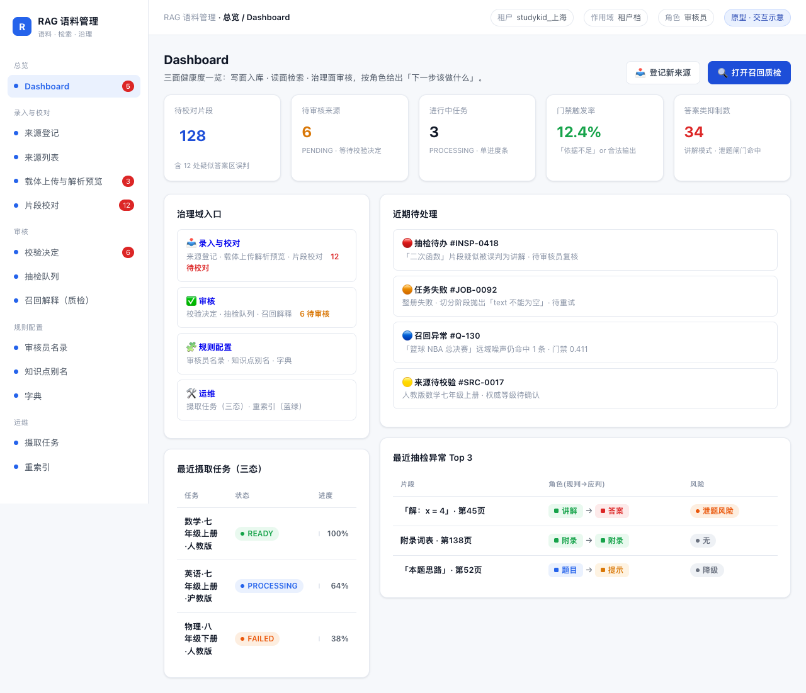

**布局**：顶部 5 张 KPI 卡 → 左栏（治理域入口卡 + 最近摄取任务三态）与右栏（近期待处理 + 最近抽检异常 Top 3）两栏。

**组件与状态**：
- KPI 卡 5 张：待校对片段 128（品牌蓝）、待审核来源 6（警示黄）、进行中任务 3、**门禁触发率 12.4%**（成功绿）、**答案类抑制数 34**（警示红）。
- 治理域入口卡 4 张，各带待办数并链接到对应域。
- 最近摄取任务用**三态徽标 + 单进度条**呈现（READY 100% / PROCESSING 64% / FAILED 38% 红色进度）。
- 抽检异常表用"现判 → 应判"角色对照，泄题风险标红。

### 4.2 来源登记

**用途**：登记来源（作品级），录入版本五轴、权威等级与版权状态。

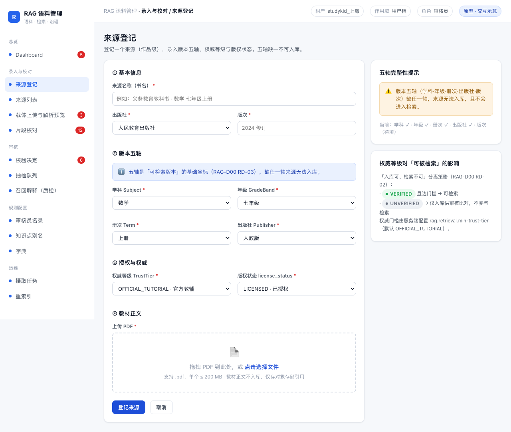

**布局**：左侧表单卡分四节（① 基本信息 ② 版本五轴 ③ 授权与权威 ④ 教材正文），右侧说明栏（五轴完整性提示 + 权威等级影响）。

**组件与状态**：
- 必填项以 `*` 标记；版本五轴四个下拉并列，缺项以 `--warn` 提示。
- 上传区为虚线拖拽框。
- 右侧「五轴完整性提示」实时显示 `学科 ✓ · 年级 ✓ · 册次 ✓ · 出版社 ✓ · 版次（待填）`。
- 权威等级影响说明引用 `rag.retrieval.min-trust-tier`（默认 OFFICIAL_TUTORIAL）。

### 4.3 来源列表

**用途**：浏览/筛选全部来源，定位治理状态。

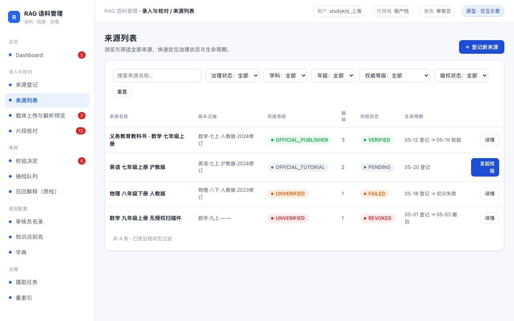

**布局**：筛选栏（6 项）→ 表格（来源名称 / 版本五轴 / 权威等级 / 载体 / 校验状态 / 生命周期 / 操作）。

**组件与状态**：
- 治理四态徽标：`VERIFIED` 绿、`PENDING` 灰、`REVOKED` 红、`FAILED` 橙。
- 权威等级徽标与治理态徽标并列，便于一眼区分"权威"与"校验"两个轴。
- 行内「发起校验」在主操作位（PENDING 行高亮为主按钮）。

### 4.4 载体上传与解析预览

**用途**：上传载体（PDF 级），**实时查看解析预览**（切片结果、角色着色、页码/题号），确认后提交入库。这是 RAG-D13 §3.2.3 的重点页。

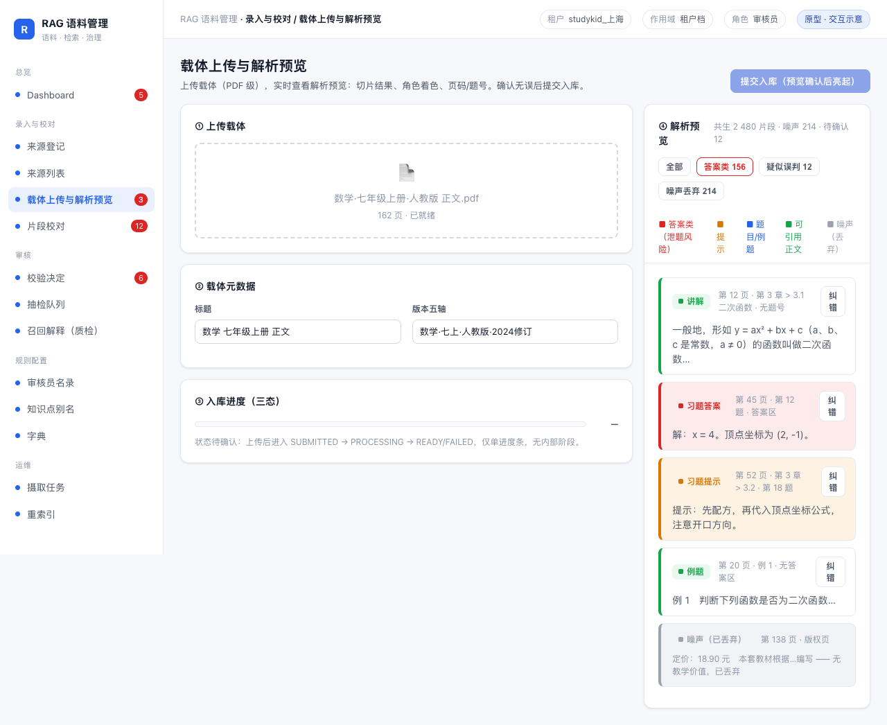

**布局**：左栏（① 上传载体 ② 载体元数据 ③ 入库进度三态）与右栏（④ 解析预览片段列表 + 角色图例 + 统计）两栏。

**组件与状态**：
- 顶部「提交入库」按钮**初始为 disabled**，预览确认后亮起（视觉稿中显示为禁用态）。
- 入库进度区标注 `SUBMITTED → PROCESSING → READY/FAILED` 与"仅单进度条，无内部阶段"。
- 片段卡按角色着色：**答案类**（红 + 4px 竖条，"泄题风险"语义）、**提示**（黄）、**题目/例题**（蓝）、**可引用正文**（绿）、**噪声**（灰、标注"已丢弃"）。
- 片段卡右侧统一「纠错」入口，指向片段校对。

### 4.5 片段校对

**用途**：对片段角色纠错，重点处理"疑似答案区误判"。

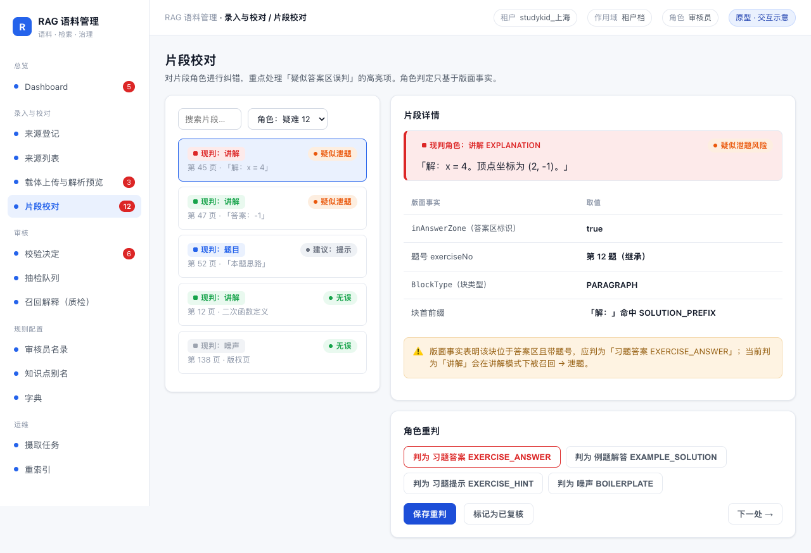

**布局**：左侧片段列表（按风险排序，答案类置顶）与右侧"片段详情 + 版面事实 + 角色重判"两栏。

**组件与状态**：
- 列表项用"现判角色标签 + 风险徽标"双标识（`疑似泄题` 红 / `建议：提示` 黄 / `无误` 绿）。
- 详情区同时展示**原文**与**版面事实**表：`inAnswerZone`、`exerciseNo`、`BlockType`、块首前缀命中情况——把判定规则翻译给校对员。
- 重判区提供四个角色按钮，危险操作（判为习题答案）用 `btn-danger` 强调。

### 4.6 校验决定

**用途**：对来源/载体做 `VERIFIED` / `REVOKED` 决定。

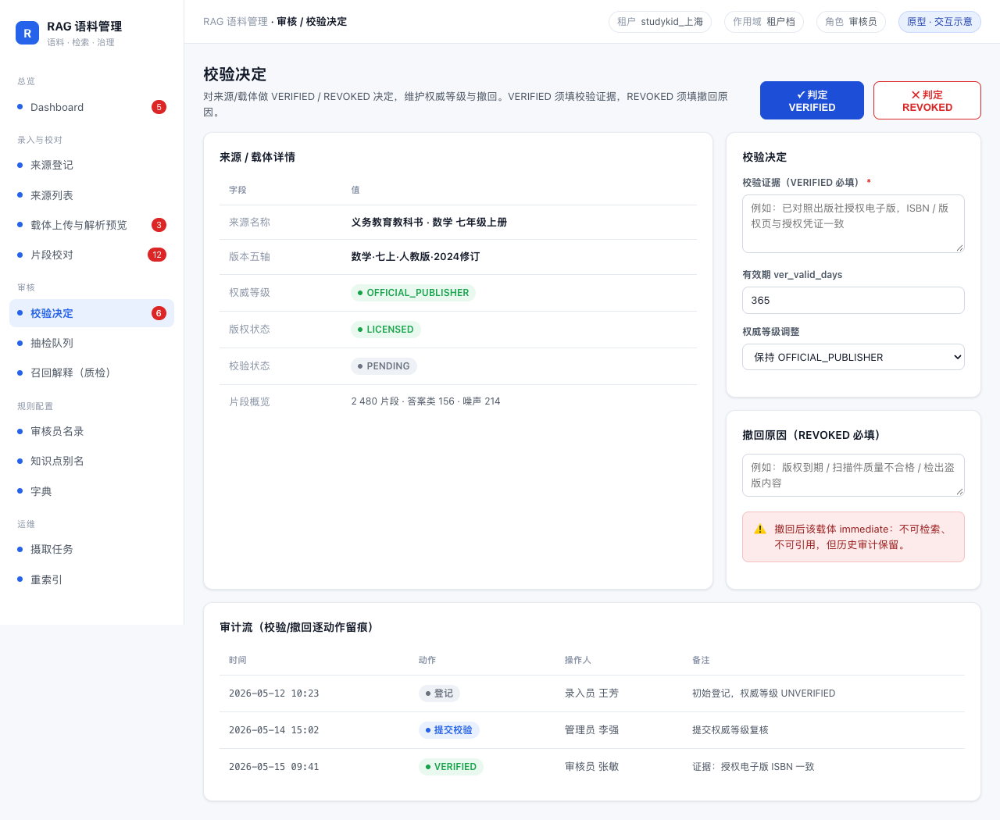

**布局**：上方"来源/载体详情"表 + 右侧"校验决定/撤回原因"两栏 → 下方"审计流"表。

**组件与状态**：
- 页头主操作：`✓ 判定 VERIFIED`（主按钮）与 `✕ 判定 REVOKED`（危险按钮）。
- **校验证据**为 VERIFIED 必填项；**撤回原因**为 REVOKED 必填项（fail-closed 留痕）。
- 有效期字段 `ver_valid_days` 与权威等级调整并排。
- 审计流逐动作留痕（登记 → 提交校验 → VERIFIED），操作人、备注齐全。

### 4.7 抽检队列

**用途**：对已入库片段人工抽检，看到**召回解释**（通道 + 分数 + 命中原因）。

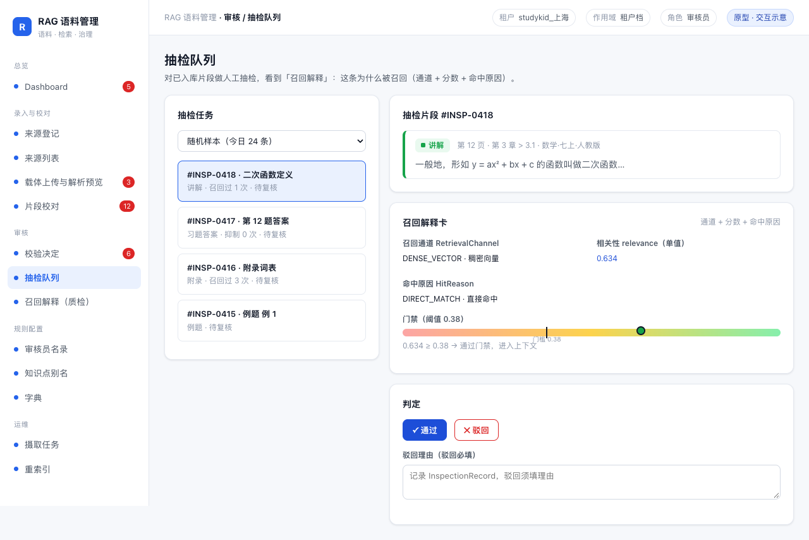

**布局**：左侧抽检任务列表与右侧"抽检片段 + 召回解释卡 + 判定"两栏。

**组件与状态**：
- 召回解释卡三段：**召回通道**（DENSE_VECTOR）、**相关性 relevance（单值 0.634）**、**命中原因**（DIRECT_MATCH）。
- 阈值刻度条：门槛线固定在 `0.38`，命中点标在 0.634 处为绿色，直观说明"通过门禁"。
- 判定区 `✓ 通过` / `✕ 驳回`，驳回必填理由（记录 InspectionRecord）。

### 4.8 召回解释（质检）

**用途**：模拟一次检索，验证"召回什么、为什么、是否触发门禁"——读面 `ask_textbook` 的管理端调试视图。

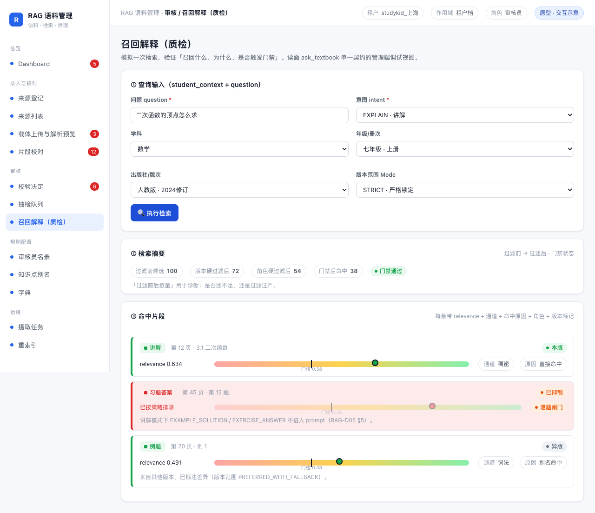

**布局**：① 查询输入（question + intent + 版本五轴 + 版本范围 Mode）→ ② 检索摘要 → ③ 命中片段列表。

**组件与状态**：
- 查询区带 `intent`（EXPLAIN/SOLVE/VERIFY/OVERVIEW）与 `Mode`（STRICT / PREFERRED_WITH_FALLBACK / CROSS_EDITION）下拉，术语与 `EditionScope` 枚举一致。
- 检索摘要以标签序列呈现 **过滤前 100 → 版本过滤 72 → 角色过滤 54 → 门禁后 38**，并把"过滤前后数量"作为一等指标（诊断召回不足 vs 过滤过严）。
- 命中列表每条带：**relevance 单值 + 阈值刻度条 + 通道标签 + 命中原因标签 + 角色标签 + 版本标记**。
- 答案类命中以红底 + "已抑制"徽标呈现，并说明"讲解模式下不进入 prompt"；异版命中以"异版"徽标提示差异。

### 4.9 审核员名录

**用途**：维护审核员及审核范围（ReviewerRosterEntry）。

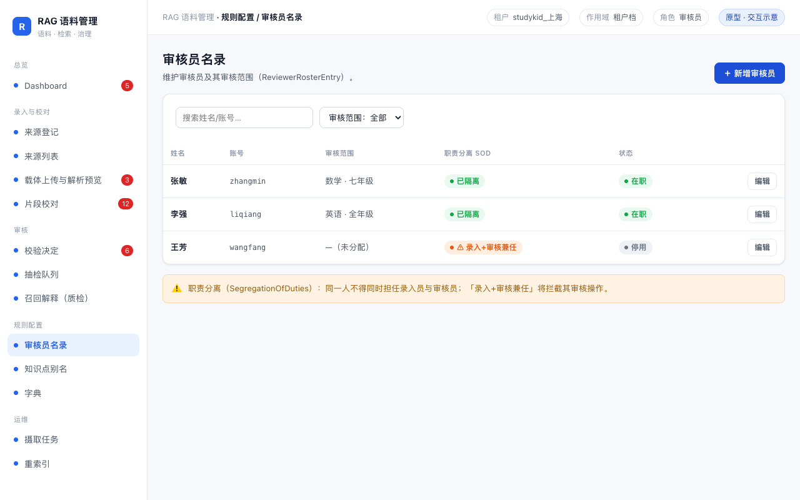

**布局**：筛选栏 + 表格（姓名 / 账号 / 审核范围 / 职责分离 / 状态）+ 底部职责分离提示。

**组件与状态**：
- 职责分离列用 `已隔离`（绿）/ `⚠ 录入+审核兼任`（红）直接暴露 SoD 冲突。
- 停用账号以 `停用` 灰徽标呈现。

### 4.10 知识点别名

**用途**：维护知识点别名（canonical_name + aliases），确定性匹配挂接。

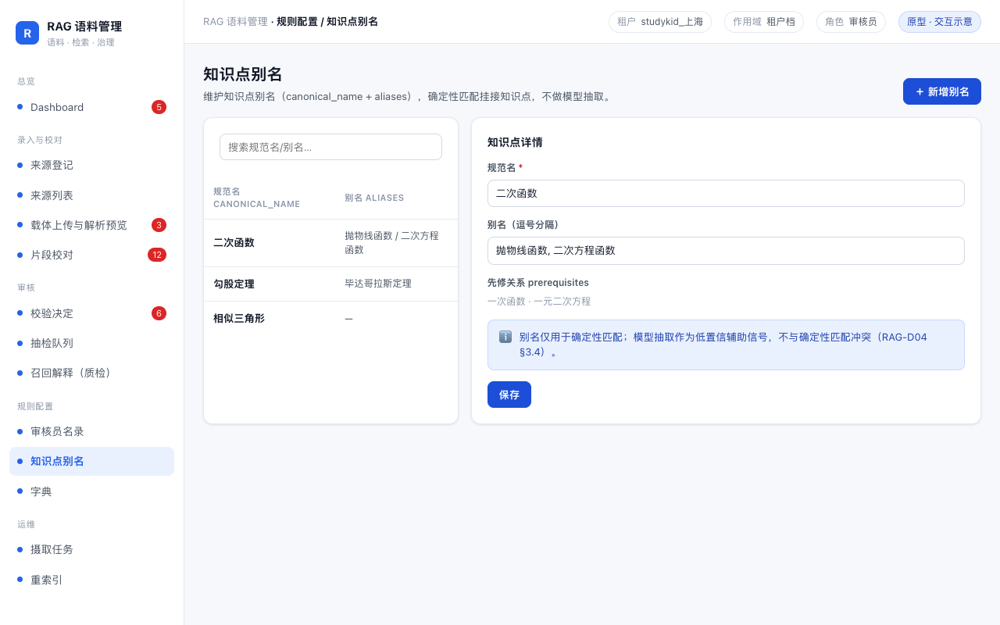

**布局**：左侧别名列表 + 右侧"知识点详情"编辑（规范名 / 别名 / 先修关系）。

**组件与状态**：
- 右侧信息条说明"别名仅用于确定性匹配；模型抽取作为低置信辅助信号"（RAG-D04 §3.4 口径）。

### 4.11 字典

**用途**：维护字典条目（dictionary type → entries）。

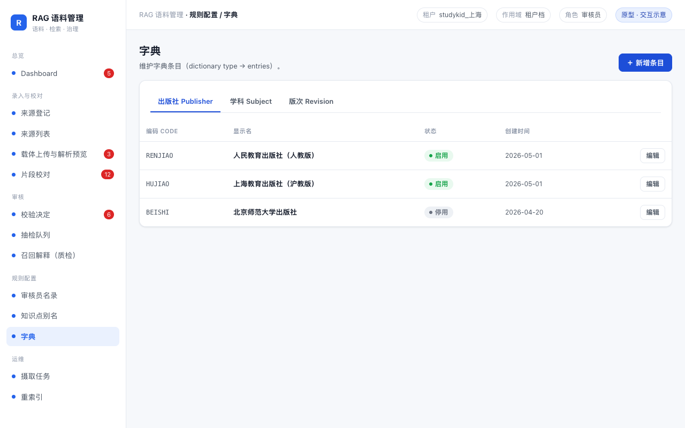

**布局**：类型标签页（出版社 / 学科 / 版次）+ 条目表格（编码 / 显示名 / 状态 / 创建时间）。

**组件与状态**：启用/停用以绿/灰徽标区分；编码用等宽字体。

### 4.12 摄取任务

**用途**：查看语料入库任务的**三态**，对失败任务重试（承载 RAG-D12 §3.2 写路径改造）。

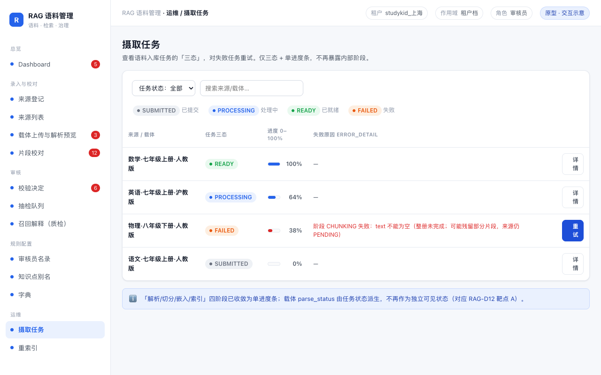

**布局**：筛选栏 + 三态图例 + 任务表格（来源/载体 / 任务三态 / 进度 0–100% / 失败原因 / 操作）。

**组件与状态**：
- 四枚状态徽标：`SUBMITTED` 灰、`PROCESSING` 蓝、`READY` 绿、`FAILED` 红。
- **只有一条进度条**，无"解析/切分/嵌入/索引"四节点（靶点 A 的直接消解）。
- FAILED 行展示完整 `error_detail`（阶段 + 原因 + "可能残留部分片段"提示），并提供「重试」主按钮。

### 4.13 重索引（索引代际 / 蓝绿）

**用途**：换嵌入模型的**索引代际**管理与蓝绿切换。

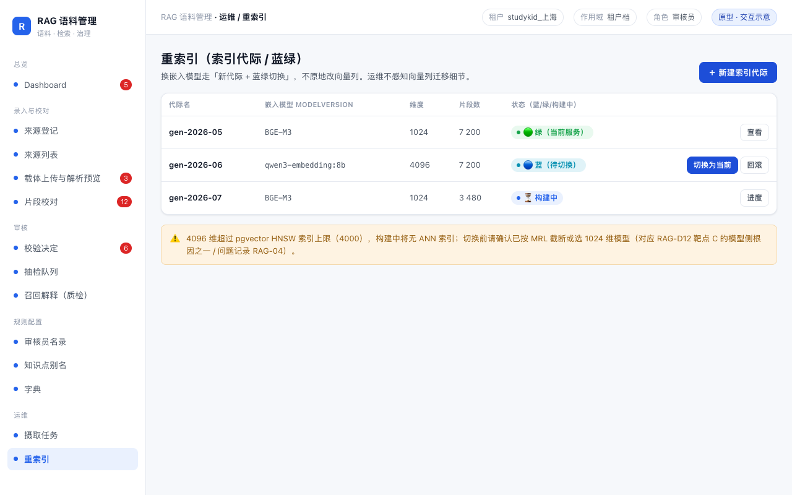

**布局**：代际列表（代际名 / 嵌入模型 modelVersion / 维度 / 片段数 / 状态）+ 操作列（查看 / 切换为当前 / 回滚）。

**组件与状态**：
- 状态用 `🟢 绿（当前服务）` / `🔵 蓝（待切换）` / `⏳ 构建中` 三态徽标表达。
- 底部警示条说明 4096 维超 pgvector HNSW 上限（对应问题记录 RAG-04）。

---

## 五、贯穿全流程的核心状态与交互（视觉规范）

> 本节把 RAG-D13 §4 的状态规范落成可复用的视觉规则，任何页面都遵守同一套口径。

### 5.1 任务三态（写面 / 运维）

| 状态 | 徽标类 | 视觉 | 出现位置 |
|---|---|---|---|
| `SUBMITTED` | `.b-submitted` | 灰点 + 灰字 | Dashboard、摄取任务 |
| `PROCESSING` | `.b-process` | 蓝点 + 蓝字 + 进度条 | Dashboard、摄取任务 |
| `READY` | `.b-ready` | 绿点 + 绿字 | Dashboard、摄取任务 |
| `FAILED` | `.b-failed` | 橙/红字 + `error_detail` | Dashboard、摄取任务 |

### 5.2 治理四态（审核 / 来源）

| 状态 | 徽标类 | 视觉 |
|---|---|---|
| `PENDING` | `.b-pending` | 灰 |
| `VERIFIED` | `.b-verified` | 绿 |
| `REVOKED` | `.b-revoked` | 红 |
| `FAILED` | `.b-failed` | 橙 |

### 5.3 角色着色（ChunkRole，全站统一）

| 分组 | 角色 | 视觉 | 语义 |
|---|---|---|---|
| 答案类 | `EXAMPLE_SOLUTION` / `EXERCISE_ANSWER` | 红 `.role-answer` / 片段左 4px 红竖条 | 泄题风险，讲解模式被硬过滤 |
| 提示 | `EXERCISE_HINT` | 黄 `.role-hint` | 讲解模式唯一可接受的答案类 |
| 题目/例题 | `EXERCISE` / `EXAMPLE` | 蓝 `.role-question` | 学生要看题 |
| 可引用正文 | `EXPLANATION` / `APPENDIX` / `PAPER_BODY` / `PAPER_METHOD` | 绿 `.role-cite` | `citableAsExplanation` |
| 噪声 | `BOILERPLATE` | 灰 `.role-noise` | 入库即丢弃 |

### 5.4 单分数量纲与门禁

- 全站**只出现一个** `relevance ∈ [0,1]`，不出现 `fusionScore`。
- 阈值刻度条 `.scale`：渐变红→黄→绿，门槛竖线固定 `left:38%`（relevance 0.38），命中点 `.mark` 用主色/绿色标出。
- 门禁结果作为合法状态呈现：`通过 / 依据不足 / 已抑制`。

### 5.5 版本范围标识

| Mode | 展示 |
|---|---|
| `STRICT` | 严格锁定；不显示"异版"标记 |
| `PREFERRED_WITH_FALLBACK` | 异版命中带 `异版` 徽标 + "已标注差异" |
| `CROSS_EDITION` | 结果按版本分组（视觉稿中预留分组头） |

---

## 六、与「过分复杂」靶点（A–G）的视觉承载

> 对应 RAG-D12 §1.2 的七个靶点；此表说明**每张视觉稿具体在哪里"显性化解"了复杂度**。

| 靶点 | 视觉承载位置 | 具体做法 |
|---|---|---|
| **A** 写路径状态机过细 | 摄取任务页、Dashboard 任务卡 | 五阶段收敛为三态 + **单进度条**；不展示解析/切分/嵌入/索引节点 |
| **B** 知识点补全执行两次 | 召回解释（质检）页 | 只展示最终融合后的命中列表；不暴露内部两次补全过程 |
| **C** 两套分数量纲 | 抽检队列、召回解释页 | 统一 `relevance` 单值 + 0.38 阈值刻度条，无 `fusionScore` |
| **D** 过滤规则四层重复 | 召回解释页"检索摘要" | 以"过滤前 100 → 版本 72 → 角色 54 → 门禁 38"序列把规则效果可视化，可验证 |
| **E** 两步式 API 外溢复杂度 | 召回解释页 | 一个查询输入框 → 一个结果区；返回三态 `GROUNDED/INSUFFICIENT/SUPPRESSED` 取代 400/200 双语义 |
| **F** 能力"写了但不生效" | 全站 | 只呈现存在性校验 + 角色校验；不出现占位 Port / 未启用 NLI；"已抑制"等空态带原因而非空白 |
| **G** 治理面过重（34 端点单控制器） | 全站侧边栏 + Dashboard | 四治理域分区导航 + 域入口分流，页面按职责归属，不再平铺 34 个端点 |

**"简化而非隐藏"的三条手法**：
1. **状态语言统一**（A/G）——用三态/四态/返回三态，而非折叠面板藏细节；
2. **单一真源可视化**（C/D）——一个 relevance、一条过滤序列、统一角色着色，把规则转成可核对内容；
3. **流程一段式 + 不生效能力不出现**（B/E/F）——直接削减入口，而非在 UI 堆开关。

---

## 七、产出物清单与复现方式

### 7.1 产出物

| 类型 | 路径 | 说明 |
|---|---|---|
| 共享样式 | `rag/docs/ui-mock/assets/ui.css` | 设计令牌 + 组件库 + 外壳布局 |
| 共享外壳 | `rag/docs/ui-mock/assets/shell.js` | 侧边栏四治理域 + 顶栏渲染 |
| 页面源码 | `rag/docs/ui-mock/screens/*.html` | 13 个页面（每页自包含，引用共享 CSS/JS） |
| 视觉稿 PNG | `rag/docs/ui-mock/screens/01..13-*.png` | 1280px 宽，浏览器渲染导出 |

### 7.2 复现方式

```bash
# 直接浏览器打开任意页面即可查看（纯静态，无构建）
open "rag/docs/ui-mock/screens/01-dashboard.html"

# 或批量重新截图（如已装 Playwright）
npx playwright screenshot --viewport-size=1280,900 --full-page \
  "rag/docs/ui-mock/screens/01-dashboard.html" out.png
```

### 7.3 边界说明

- 本视觉稿为**静态高保真稿**：按钮、下拉、标签页的 hover/active 样式已定义，但无业务逻辑联动（无后端）。
- 数据均为**示意数据**，用于呈现布局、组件与状态表现，非真实语料。
- 未包含学生端消费界面（`ask_textbook` 的消费 UI 属平台侧范围，见 RAG-D13 §六）。